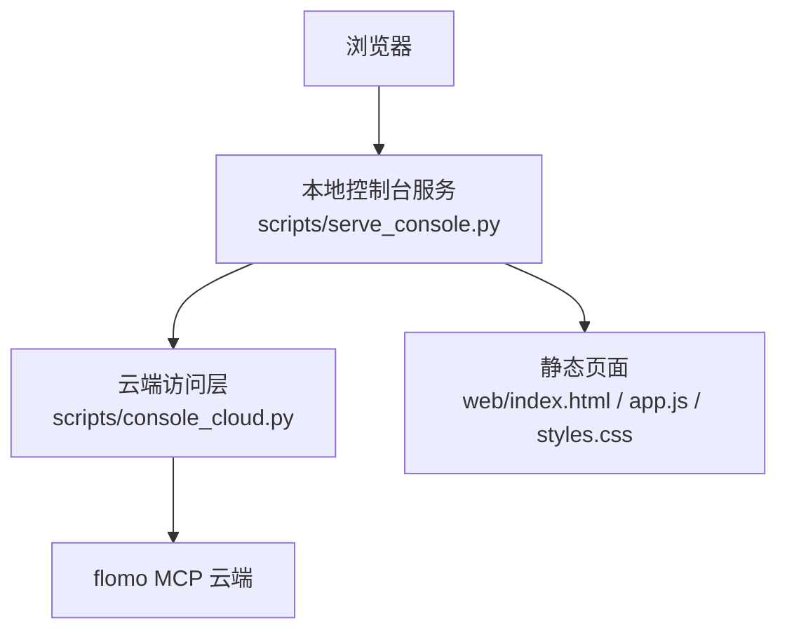
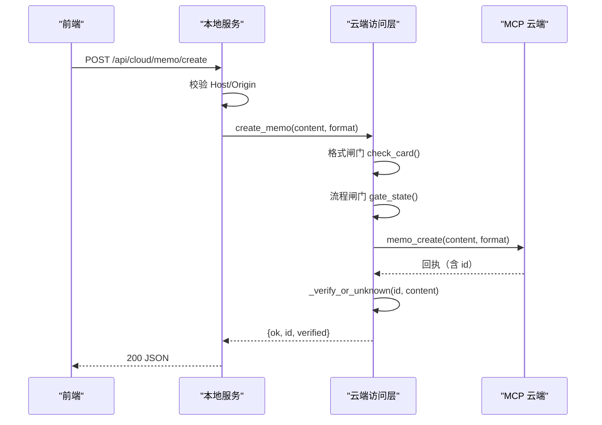
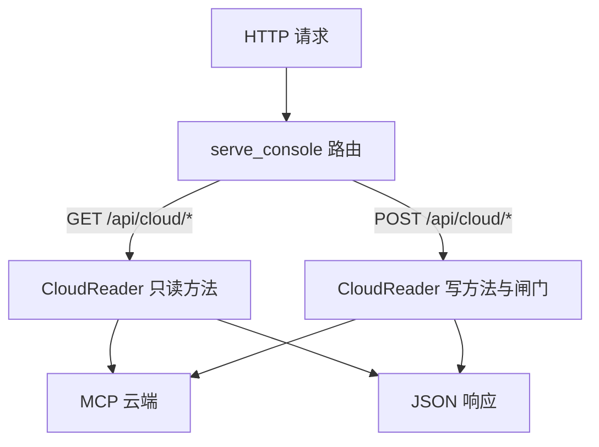

# API 参考

<cite>
**本文引用的文件**
- [README.md](file://README.md)
- [scripts/serve_console.py](file://scripts/serve_console.py)
- [scripts/console_cloud.py](file://scripts/console_cloud.py)
- [web/app.js](file://web/app.js)
- [tests/test_console_web.py](file://tests/test_console_web.py)
</cite>

## 目录
1. [引言](#引言)
2. [项目结构](#项目结构)
3. [核心组件](#核心组件)
4. [架构总览](#架构总览)
5. [接口参考](#接口参考)
6. [依赖关系分析](#依赖关系分析)
7. [性能与限制](#性能与限制)
8. [故障排查指南](#故障排查指南)
9. [结论](#结论)

## 引言
本文档整理 Web 控制台的公开 HTTP 接口，面向通过浏览器或脚本访问本地控制台服务的用户。控制台由本地 Python 服务提供静态页面和 JSON 接口；云端数据通过 MCP 工具调用，由 `console_cloud` 模块封装为前端可读的结构化响应。

所有接口均运行在本地服务进程内，默认监听 `127.0.0.1:8787`。认证方式统一为 **Bearer Token**：Token 由环境中的 flomo MCP 凭据提供，由 `console_cloud` 在连接云端时加载，不会出现在请求头或响应体中。

**章节来源**
- [README.md:121-176](file://README.md#L121-L176)

## 项目结构
控制台由三部分构成：
- 本地 HTTP 服务：路由、Host/Origin 校验、JSON 包装、错误降级。
- 云端访问层：白名单工具调用、参数归一化、写入闸门、回读验收。
- 前端静态资源：按视图发起 `/api/*` 请求，统一处理成功与失败。

**图表来源**
- [scripts/serve_console.py:1-80](file://scripts/serve_console.py#L1-L80)
- [scripts/console_cloud.py:1-60](file://scripts/console_cloud.py#L1-L60)
- [web/app.js:1-40](file://web/app.js#L1-L40)

**章节来源**
- [scripts/serve_console.py:1-80](file://scripts/serve_console.py#L1-L80)
- [scripts/console_cloud.py:1-60](file://scripts/console_cloud.py#L1-L60)
- [web/app.js:1-40](file://web/app.js#L1-L40)

## 核心组件
- `serve_console.ConsoleHandler`：实现 GET/POST/HEAD，负责路由分发、Host/Origin 校验、请求体解析、统一 JSON 响应。
- `console_cloud.CloudReader`：封装 MCP 工具调用，维护只读/写工具白名单，提供卡片、标签、参考、工具清单、写入与闸门等能力。
- 前端 `api/cloudApi/cloudPost`：统一发起 fetch，把网络异常与 HTTP 非 2xx 转换为 `{error}` 对象。

关键行为：
- Host 必须落在本机名白名单，否则返回 403。
- 带 Origin 时，Origin 的宿主名也必须同站。
- POST 请求体必须是 JSON 对象；未知 POST 路径返回 404。
- 云端失败统一降级为 JSON：网络/协议问题通常 502，业务校验失败使用 422。

**章节来源**
- [scripts/serve_console.py:160-240](file://scripts/serve_console.py#L160-L240)
- [scripts/serve_console.py:240-424](file://scripts/serve_console.py#L240-L424)
- [scripts/console_cloud.py:300-380](file://scripts/console_cloud.py#L300-L380)
- [web/app.js:80-140](file://web/app.js#L80-L140)

## 架构总览
下图展示一次“新建卡片”的完整调用链：前端提交正文 → 本地服务校验来源并解析 JSON → 云端访问层执行格式与流程闸门 → 调用云端写工具 → 回读全文验收 → 返回结构化结果。

**图表来源**
- [scripts/serve_console.py:320-424](file://scripts/serve_console.py#L320-L424)
- [scripts/console_cloud.py:720-824](file://scripts/console_cloud.py#L720-L824)

## 接口参考

### 鉴权与安全总则
- 认证方式：Bearer Token 由后端从 MCP 凭据加载，不在 HTTP 请求中传递。
- Host 白名单：默认接受本机回环名；若绑定到局域网地址，需显式启用允许选项。
- Origin 校验：当请求携带 Origin 时，其主机名必须与 Host 白名单同源。
- CORS：服务未暴露通用跨域策略；Origin 校验是安全边界，不是标准 CORS 预检放行。
- 端口与访问范围：默认仅回环；绑定非回环地址且未显式解锁时直接拒绝启动。

**章节来源**
- [scripts/serve_console.py:20-80](file://scripts/serve_console.py#L20-L80)
- [scripts/serve_console.py:180-240](file://scripts/serve_console.py#L180-L240)
- [scripts/serve_console.py:360-424](file://scripts/serve_console.py#L360-L424)

---

### 只读查询

#### GET /api/cloud/memos
- 用途：搜索或列出云端笔记。
- 认证：后端凭据自动加载；无需客户端传 token。
- 请求参数：
  - `keywords`：关键词。
  - `tag`：完整标签路径。
  - `start_date`：起始日期。
  - `end_date`：结束日期。
  - `source`：来源渠道。
  - `has_tag`：三态开关，真/假/不传。
  - `limit`：单次上限，默认 20，最大 50。
- 成功响应字段：
  - `count`：返回条目数。
  - `limit`：实际使用的 limit。
  - `capped`：是否达到云端上限。
  - `keywords`、`tag`、`start_date`、`end_date`、`source`、`has_tag`：回显查询条件。
  - `memos`：精简卡片列表，不含全文。
- 错误：
  - 403：Host 或 Origin 不合法。
  - 502：云端调用失败。
  - 500：服务内部异常。
- curl 示例：
  - `curl "http://127.0.0.1:8787/api/cloud/memos?keywords=AI&limit=10"`
- fetch 示例：
  - `fetch("/api/cloud/memos?keywords=AI&limit=10").then(r=>r.json())`

**章节来源**
- [scripts/serve_console.py:260-320](file://scripts/serve_console.py#L260-L320)
- [scripts/console_cloud.py:500-560](file://scripts/console_cloud.py#L500-L560)

#### GET /api/cloud/memo
- 用途：按 `id` 取单卡全文。
- 认证：后端凭据自动加载。
- 请求参数：
  - `id`：必填。
- 成功响应字段：
  - `memo`：包含精简字段与完整正文。
  - `omitted_ids`：被云端省略的其他 id。
- 错误：
  - 403：Host/Origin 不合法。
  - 502：云端调用失败。
  - 500：服务内部异常。
- curl 示例：
  - `curl "http://127.0.0.1:8787/api/cloud/memo?id=卡片ID"`

**章节来源**
- [scripts/serve_console.py:260-320](file://scripts/serve_console.py#L260-L320)
- [scripts/console_cloud.py:560-580](file://scripts/console_cloud.py#L560-L580)

#### GET /api/cloud/review
- 用途：获取今日回顾卡片。
- 认证：后端凭据自动加载。
- 请求参数：无。
- 成功响应字段：
  - `count`：回顾条目数。
  - `memos`：精简卡片列表。
- 错误：
  - 403：Host/Origin 不合法。
  - 502：云端调用失败。

**章节来源**
- [scripts/serve_console.py:260-320](file://scripts/serve_console.py#L260-L320)
- [scripts/console_cloud.py:620-640](file://scripts/console_cloud.py#L620-L640)

#### GET /api/cloud/related
- 用途：获取与指定卡片内容相近的相关笔记。
- 认证：后端凭据自动加载。
- 请求参数：
  - `id`：必填。
  - `limit`：默认 10，最大 50。
  - `no_same_tag`：三态开关。
- 成功响应字段：
  - `id`：输入卡片 id。
  - `count`：相关条目数。
  - `memos`：精简卡片列表。
- 错误：
  - 403：Host/Origin 不合法。
  - 502：云端调用失败。

**章节来源**
- [scripts/serve_console.py:260-320](file://scripts/serve_console.py#L260-L320)
- [scripts/console_cloud.py:640-660](file://scripts/console_cloud.py#L640-L660)

#### GET /api/cloud/tagtree
- 用途：获取云端实时标签树。
- 认证：后端凭据自动加载。
- 请求参数：
  - `prefix`：前缀过滤。
  - `depth`：深度，范围 1–10。
  - `limit`：默认 200，最大 1000。
- 成功响应字段：
  - `tags`：标签字符串数组。
  - `total`：云端 total。
  - `returned`：实际返回条数。
  - `limit`：实际 limit。
  - `truncated`：是否被截断。
  - `hint`：提示文本。
- 错误：
  - 403：Host/Origin 不合法。
  - 502：云端调用失败。

**章节来源**
- [scripts/serve_console.py:260-320](file://scripts/serve_console.py#L260-L320)
- [scripts/console_cloud.py:660-700](file://scripts/console_cloud.py#L660-L700)

#### GET /api/cloud/tags
- 用途：按关键词搜索标签名。
- 认证：后端凭据自动加载。
- 请求参数：
  - `keywords`：必填关键词。
  - `limit`：默认 20，最大 1000。
- 成功响应字段：
  - `keywords`：搜索词。
  - `count`：匹配标签数。
  - `tags`：标签名数组。
- 错误：
  - 403：Host/Origin 不合法。
  - 502：云端调用失败。

**章节来源**
- [scripts/serve_console.py:260-320](file://scripts/serve_console.py#L260-L320)
- [scripts/console_cloud.py:700-720](file://scripts/console_cloud.py#L700-L720)

#### GET /api/cloud/reference
- 用途：一次性获取记忆文档、用户画像、笔记格式规范、标签使用规范四份文本。
- 认证：后端凭据自动加载。
- 请求参数：无。
- 成功响应字段：
  - `memory`：记忆文档对象。
  - `user`：用户画像对象。
  - `format`：格式规范对象。
  - `tag`：标签规范对象。
- 错误：
  - 403：Host/Origin 不合法。
  - 502：云端调用失败。

**章节来源**
- [scripts/serve_console.py:260-320](file://scripts/serve_console.py#L260-L320)
- [scripts/console_cloud.py:720-760](file://scripts/console_cloud.py#L720-L760)

#### GET /api/overview
- 用途：返回仓库统计与云端可用性概览。
- 认证：后端凭据自动加载。
- 请求参数：无。
- 成功响应字段：
  - 合并仓库收集到的统计字段与云端状态。
  - 云端状态包含 `available`、`reason`、`source`、`max_limit`。
- 错误：
  - 403：Host/Origin 不合法。
  - 500：服务内部异常。

**章节来源**
- [scripts/serve_console.py:260-320](file://scripts/serve_console.py#L260-L320)
- [scripts/console_cloud.py:420-460](file://scripts/console_cloud.py#L420-L460)

---

### 写操作

#### POST /api/cloud/tool
- 用途：通用只读执行入口，按工具名与参数执行一个已放行的读工具。
- 认证：后端凭据自动加载。
- 请求体字段：
  - `name`：工具名，必须在只读白名单内。
  - `arguments`：工具参数对象。
- 成功响应：工具返回的结构化结果。
- 错误：
  - 400：请求体不是合法 JSON。
  - 404：未知 POST 路径。
  - 422：工具名不在只读白名单，或云端调用失败。
  - 500：服务内部异常。
- curl 示例：
  - `curl -X POST http://127.0.0.1:8787/api/cloud/tool -H "Content-Type: application/json" -d '{"name":"memo_search","arguments":{"limit":5}}'`
- fetch 示例：
  - `fetch("/api/cloud/tool",{method:"POST",headers:{"Content-Type":"application/json"},body:JSON.stringify({name:"memo_search",arguments:{limit:5}})})`

注意：写工具名不得通过此入口直接执行；写操作走专用接口。

**章节来源**
- [scripts/serve_console.py:320-424](file://scripts/serve_console.py#L320-L424)
- [scripts/console_cloud.py:300-380](file://scripts/console_cloud.py#L300-L380)
- [tests/test_console_web.py:120-170](file://tests/test_console_web.py#L120-L170)

#### POST /api/cloud/validate
- 用途：格式自检，委托 `validate_memo.check()`，只报不改。
- 认证：后端凭据自动加载。
- 请求体字段：
  - `content`：卡片正文。
- 成功响应字段：
  - `ok`：是否通过格式检查。
  - `errors`：阻断项。
  - `warnings`：提示项。
  - `tagline`：首行标签段。
  - `concept`：概念名。
- 错误：
  - 400：请求体不是合法 JSON。
  - 422：云端访问层抛出的业务错误。
- curl 示例：
  - `curl -X POST http://127.0.0.1:8787/api/cloud/validate -H "Content-Type: application/json" -d '{"content":"#顶层/二级\\n概念名\\n正文"}'`

**章节来源**
- [scripts/serve_console.py:320-424](file://scripts/serve_console.py#L320-L424)
- [scripts/console_cloud.py:760-790](file://scripts/console_cloud.py#L760-L790)

#### POST /api/cloud/gate
- 用途：现跑流程闸门，输出凭证与验证状态。
- 认证：后端凭据自动加载。
- 请求体字段：
  - `content`：必填卡片正文。
  - `skip_web`：可选布尔，跳过网络验证。
  - `anchor_id`：可选锚点 id。
  - `verify`：可选验证记录对象或文本。
- 成功响应字段：
  - `ok`：闸门脚本是否成功。
  - `skip_web`：是否跳过网络验证。
  - `draft`：当轮草稿文件名。
  - `lines`：闸门输出行。
  - `gate`：当前凭证状态。
- 错误：
  - 400：请求体不是合法 JSON。
  - 422：正文为空、闸门超时或业务错误。
- curl 示例：
  - `curl -X POST http://127.0.0.1:8787/api/cloud/gate -H "Content-Type: application/json" -d '{"content":"#顶层/二级\\n概念名\\n正文","skip_web":true}'`

**章节来源**
- [scripts/serve_console.py:320-424](file://scripts/serve_console.py#L320-L424)
- [scripts/console_cloud.py:790-860](file://scripts/console_cloud.py#L790-L860)

#### POST /api/cloud/memo/create
- 用途：新建卡片。流程：格式闸门 → 流程闸门 → 写云 → 回读验收。
- 认证：后端凭据自动加载。
- 请求体字段：
  - `content`：必填卡片正文。
  - `format`：可选格式标识。
- 成功响应字段：
  - `ok`：是否拿到有效 id。
  - `id`：新卡片 id。
  - `id_inferred`：是否通过签名回搜推断出 id。
  - `word_count`：云端返回字数。
  - `verified`：回读验收结果。
- 错误：
  - 400：请求体不是合法 JSON。
  - 422：格式闸门未过、流程闸门未过、云端调用失败。
- curl 示例：
  - `curl -X POST http://127.0.0.1:8787/api/cloud/memo/create -H "Content-Type: application/json" -d '{"content":"#顶层/二级\\n概念名\\n正文"}'`

**章节来源**
- [scripts/serve_console.py:320-424](file://scripts/serve_console.py#L320-L424)
- [scripts/console_cloud.py:860-920](file://scripts/console_cloud.py#L860-L920)

#### POST /api/cloud/memo/update
- 用途：更新卡片。流程：先回读原文 → 格式闸门 → 流程闸门 → 写云 → 回读验收。
- 认证：后端凭据自动加载。
- 请求体字段：
  - `id`：必填。
  - `content`：必填新正文。
  - `format`：可选格式标识。
- 成功响应字段：
  - `ok`：始终为 true。
  - `id`：更新的卡片 id。
  - `before`：更新前正文长度与概念名。
  - `word_count`：云端返回字数。
  - `verified`：回读验收结果。
- 错误：
  - 400：请求体不是合法 JSON。
  - 422：缺少 id、闸门未过、云端调用失败。
- curl 示例：
  - `curl -X POST http://127.0.0.1:8787/api/cloud/memo/update -H "Content-Type: application/json" -d '{"id":"卡片ID","content":"#顶层/二级\\n概念名\\n正文"}'`

**章节来源**
- [scripts/serve_console.py:320-424](file://scripts/serve_console.py#L320-L424)
- [scripts/console_cloud.py:920-946](file://scripts/console_cloud.py#L920-L946)

#### POST /api/cloud/tag/rename
- 用途：批量重命名标签。
- 认证：后端凭据自动加载。
- 请求体字段：
  - `old_tag`：旧标签名。
  - `new_tag`：新标签名。
  - `max_memos`：可选批量规模。
- 成功响应字段：
  - `old_tag`、`new_tag`：新旧标签。
  - `max_memos_requested`：请求规模。
  - `matched_memos`、`updated_memos`、`updated_tags`：匹配与实改数量。
  - `warnings`：警告信息。
  - `result`：原始云端回执。
  - `ok`：是否全部完成。
  - `status`：`done`、`partial`、`needs_scale`、`no_match`、`unknown`、`inconsistent`。
  - `hint`：人读建议。
- 错误：
  - 400：请求体不是合法 JSON。
  - 422：云端回执缺失关键字段、匹配数为零、规模不足、回执不一致。
- curl 示例：
  - `curl -X POST http://127.0.0.1:8787/api/cloud/tag/rename -H "Content-Type: application/json" -d '{"old_tag":"A/B","new_tag":"A/C","max_memos":200}'`

**章节来源**
- [scripts/serve_console.py:320-424](file://scripts/serve_console.py#L320-L424)
- [scripts/console_cloud.py:200-300](file://scripts/console_cloud.py#L200-L300)

---

### 说明：关于题目中列出的端点
- 题目中包含 `POST /validate` 与 `POST /gate`。实际服务实现中对应的端点是 `/api/cloud/validate` 与 `/api/cloud/gate`。
- 如果直接使用 `/validate` 或 `/gate`，会命中“未知写入接口”，返回 404。
- 正确用法请参考上述 `/api/cloud/validate` 与 `/api/cloud/gate` 定义。

**章节来源**
- [scripts/serve_console.py:320-424](file://scripts/serve_console.py#L320-L424)

## 依赖关系分析
- 路由层只负责来源校验、JSON 解析与统一错误包装。
- 云端访问层集中维护白名单、参数约束、业务逻辑与回读验收。
- 前端对 `/api/*` 的请求与服务路由表存在回归对齐检查，防止前后端失配。

**图表来源**
- [scripts/serve_console.py:240-424](file://scripts/serve_console.py#L240-L424)
- [scripts/console_cloud.py:300-946](file://scripts/console_cloud.py#L300-L946)

**章节来源**
- [scripts/serve_console.py:240-424](file://scripts/serve_console.py#L240-L424)
- [scripts/console_cloud.py:300-946](file://scripts/console_cloud.py#L300-L946)
- [tests/test_console_web.py:80-170](file://tests/test_console_web.py#L80-L170)

## 性能与限制
- 卡片搜索 `limit` 最大 50；列表可能显示 `capped` 表示还能继续筛选。
- 批量全文最多 10 条；超出部分由前端显式提示，不会静默丢弃。
- 标签树 `limit` 最大 1000；到顶时云端返回 `truncated`。
- 流程闸门有超时保护；超过时限返回业务错误，而非普通网络错误。
- 正文不落盘：仅在内存与 HTTP 响应之间传递；唯一落盘是闸门草稿，并由收尾清理回收。

**章节来源**
- [scripts/console_cloud.py:380-460](file://scripts/console_cloud.py#L380-L460)
- [scripts/console_cloud.py:580-640](file://scripts/console_cloud.py#L580-L640)
- [scripts/console_cloud.py:660-700](file://scripts/console_cloud.py#L660-L700)
- [scripts/console_cloud.py:790-860](file://scripts/console_cloud.py#L790-L860)

## 故障排查指南

### 如何在控制台日志中定位路由
- 服务默认将请求日志输出到标准错误，格式为 `[console] ...`。
- 可通过查看启动日志确认服务监听地址与允许的 Host 白名单。
- 若请求被来源校验拒绝，日志会记录对应 Host/Origin 拒绝原因。

**章节来源**
- [scripts/serve_console.py:120-160](file://scripts/serve_console.py#L120-L160)
- [scripts/serve_console.py:380-424](file://scripts/serve_console.py#L380-L424)

### 如何确认 token 有效
- 调用 `/api/overview` 可读取云端状态。
- 若 `available` 为 false，响应中的 `reason` 会说明 token 缺失或其他凭据问题。
- 注意：token 值本身不会出现在响应中，只会返回可用性与来源描述。

**章节来源**
- [scripts/console_cloud.py:420-460](file://scripts/console_cloud.py#L420-L460)
- [scripts/serve_console.py:260-320](file://scripts/serve_console.py#L260-L320)

### 如何区分网络错误与业务校验失败
- 422：业务校验失败，例如格式闸门未过、流程闸门未过、工具名不在白名单、正文为空等。
- 502：云端调用失败，包括 token 不可用、MCP 握手失败、工具执行异常、网络中断。
- 500：服务内部异常，如未捕获的 Python 异常。
- 400：请求体不是合法 JSON。
- 404：POST 路径不存在。
- 403：Host 或 Origin 不合法，属于请求来源安全问题。

前端会把 HTTP 非 2xx 转为 `{error}`，并在本地服务不可用时给出“本地服务无响应”。因此优先看状态码，再结合响应体中的 `kind`、`error`、`status`、`hint` 判断具体原因。

**章节来源**
- [scripts/serve_console.py:200-240](file://scripts/serve_console.py#L200-L240)
- [scripts/serve_console.py:320-424](file://scripts/serve_console.py#L320-L424)
- [web/app.js:80-140](file://web/app.js#L80-L140)

### 常见排错步骤
1. 确认服务是否启动，以及监听地址是否为 `127.0.0.1:8787` 或你期望的地址。
2. 确认浏览器打开的是本机地址，而不是外部域名；否则 Host 白名单会拒绝。
3. 若从其他网页发起请求，检查 Origin 是否与 Host 同源；浏览器跨站请求会被拒绝。
4. 若返回 422，查看响应体中的 `errors`、`status`、`hint`，按提示修复正文、凭证或参数。
5. 若返回 502，先查 `/api/overview` 的 `cloud.available`；若 token 无效，优先解决 MCP 凭据配置。
6. 若怀疑两个实例同时监听同一端口，更换端口或关闭旧进程，避免页面内容时新时旧。

**章节来源**
- [scripts/serve_console.py:80-120](file://scripts/serve_console.py#L80-L120)
- [scripts/serve_console.py:360-424](file://scripts/serve_console.py#L360-L424)

## 结论
Web 控制台的公开接口以 `/api/cloud/*` 为主，分为只读查询、写操作与概览三类。所有接口都依赖本地服务提供的 Host/Origin 安全边界；真正的认证由后端从 MCP 凭据加载 Bearer Token，不暴露给客户端。调试时应优先根据状态码区分来源拒绝、请求体错误、业务校验失败与云端网络失败，并结合 `/api/overview` 快速确认 token 与云端可用性。