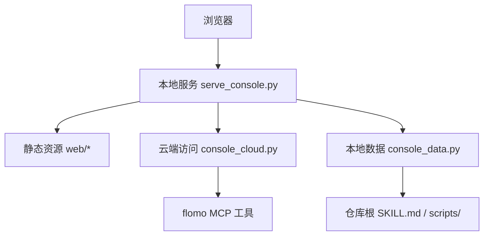
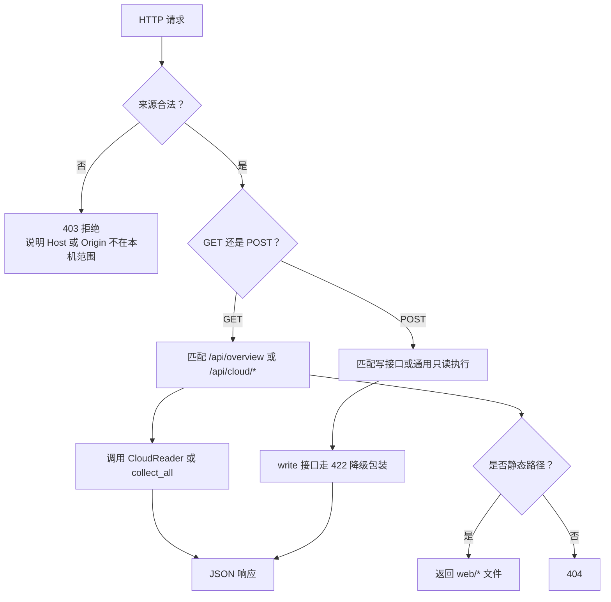
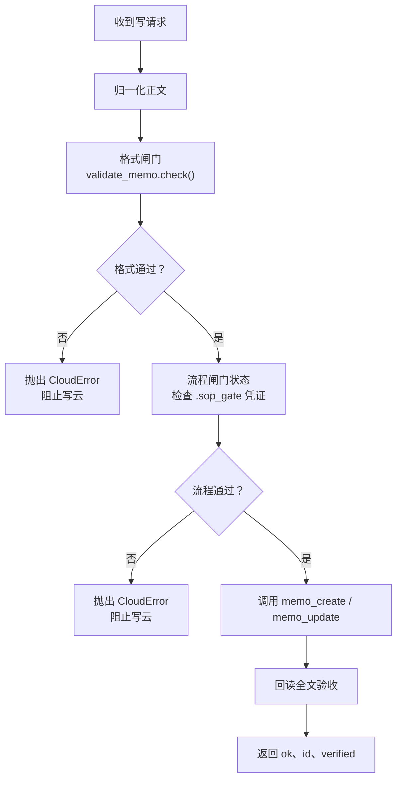
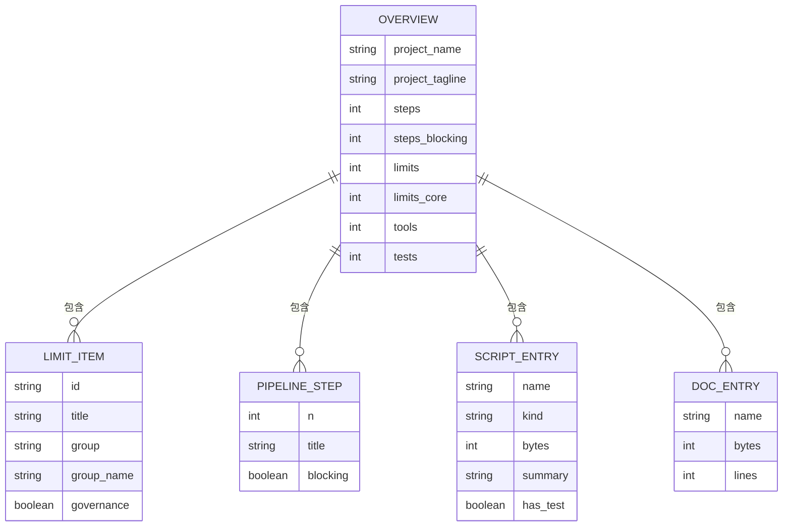
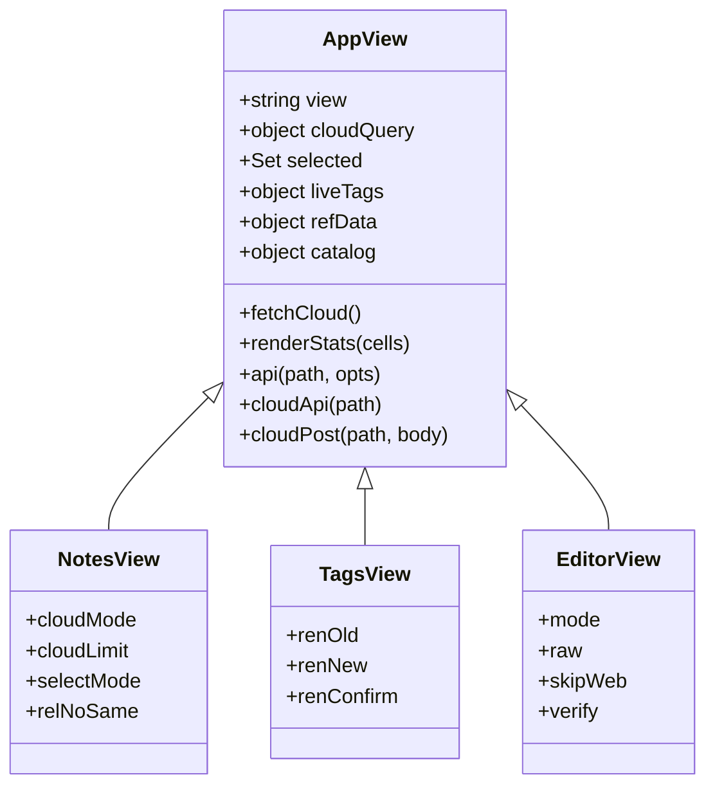
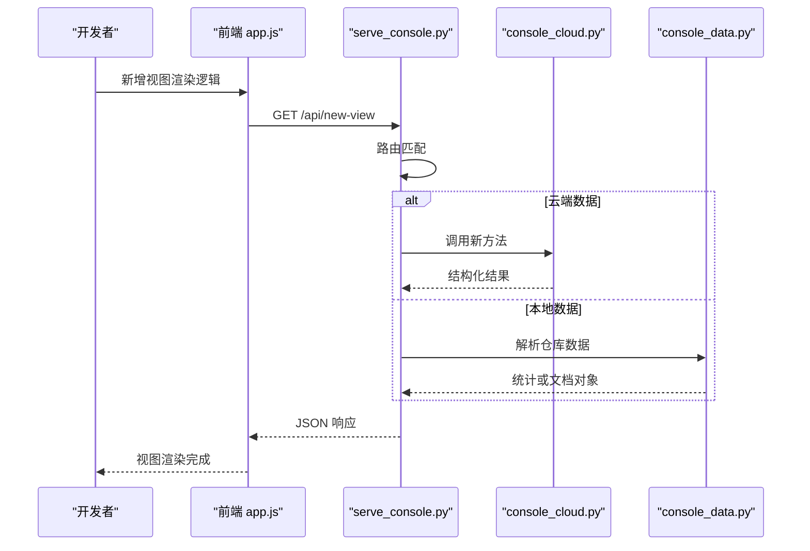

# Web 控制台

<cite>
**本文引用的文件**   
- [serve_console.py](file://scripts/serve_console.py)
- [console_cloud.py](file://scripts/console_cloud.py)
- [console_data.py](file://scripts/console_data.py)
- [index.html](file://web/index.html)
- [app.js](file://web/app.js)
- [styles.css](file://web/styles.css)
- [README.md](file://README.md)
</cite>

## 目录
1. [简介](#简介)
2. [启动方式与浏览器访问](#启动方式与浏览器访问)
3. [项目结构概览](#项目结构概览)
4. [四个视图总览](#四个视图总览)
5. [本地服务路由分发](#本地服务路由分发)
6. [云端访问层与白名单机制](#云端访问层与白名单机制)
7. [仓库解析与统计字段](#仓库解析与统计字段)
8. [前端结构与交互](#前端结构与交互)
9. [常见 UI 交互示例](#常见-ui-交互示例)
10. [API 调用路径参考](#api-调用路径参考)
11. [扩展新视图的步骤](#扩展新视图的步骤)
12. [Playwright 渲染验证注意事项](#playwright-渲染验证注意事项)
13. [性能与安全特性](#性能与安全特性)
14. [故障排查](#故障排查)
15. [结论](#结论)

## 简介
flomo-note 的 Web 控制台是一个零第三方依赖的本地 HTTP 服务，把云端 MCP 的只读与写能力暴露给浏览器。它不直接操作笔记正文落盘，也不让 token 离开进程；所有云端数据由 `console_cloud.py` 通过 MCP 工具拉取，本地文档与脚本统计由 `console_data.py` 解析，页面由 `web/index.html`、`web/app.js`、`web/styles.css` 提供。

控制台面向两类读者：
- 普通用户：搜索卡片、查看相关笔记、新建或编辑卡片、浏览标签树、阅读记忆与规范、按云端声明动态执行只读工具。
- 开发者：理解服务如何分发请求、如何通过白名单限制工具、如何处理写操作的格式与流程闸门、以及如何增加新的视图或接口。

**章节来源**
- [README.md:1-120](file://README.md#L1-L120)

## 启动方式与浏览器访问
### 基本命令
| 用途 | 命令 |
|---|---|
| 默认启动 | `python scripts/serve_console.py` |
| 自动打开浏览器 | `python scripts/serve_console.py --open` |
| 指定端口 | `python scripts/serve_console.py --port 9000` |
| 允许局域网访问 | `python scripts/serve_console.py --host 0.0.0.0 --allow-lan` |

默认监听 `http://127.0.0.1:8787`。使用 `--open` 会在服务就绪后通过系统浏览器打开首页；使用 `--port` 会改用指定端口；使用 `--host` 绑定非回环地址时必须同时加 `--allow-lan`，因为该控制台没有鉴权，开放到局域网意味着同网段机器可以直接读写云端卡片。

### 端口冲突处理
如果端口已被占用，服务不会静默覆盖旧实例，而是直接报错退出。原因是 Python 的 `ThreadingHTTPServer` 默认开启地址复用，第二个实例可能“绑成功”但两个进程同时接客，导致页面内容时新时旧。遇到该错误应停止旧进程或更换端口。

### 安全访问建议
- 日常开发：保持默认 `127.0.0.1`，仅本机浏览器访问。
- 需要局域网调试：显式加 `--allow-lan`，并确保网络环境可信。
- 不要将控制台暴露到公网；它没有账号密码，也没有登录态。

**章节来源**
- [serve_console.py:1-60](file://scripts/serve_console.py#L1-L60)
- [serve_console.py:350-424](file://scripts/serve_console.py#L350-L424)
- [README.md:120-170](file://README.md#L120-L170)

## 项目结构概览
控制台后端与前端解耦清晰：
- 后端入口：`scripts/serve_console.py`，负责静态资源、JSON 路由、来源校验和云端代理。
- 云端层：`scripts/console_cloud.py`，封装 MCP 工具的读/写能力、白名单、闸门与回读验收。
- 本地数据层：`scripts/console_data.py`，解析 `SKILL.md`、脚本清单与文档统计。
- 前端静态资源：`web/index.html`（结构）、`web/app.js`（视图与 API 调用）、`web/styles.css`（样式）。

**图表来源**
- [serve_console.py:60-120](file://scripts/serve_console.py#L60-L120)
- [console_cloud.py:1-80](file://scripts/console_cloud.py#L1-L80)
- [console_data.py:1-40](file://scripts/console_data.py#L1-L40)
- [index.html:1-20](file://web/index.html#L1-L20)

**章节来源**
- [README.md:120-170](file://README.md#L120-L170)

## 四个视图总览
控制台顶部导航包含四个视图：

| 视图 | 主要功能 | 数据来源 |
|---|---|---|
| 云端笔记 | 搜索、全文、相关笔记、多选取全文、新建与编辑 | `/api/cloud/memos`、`/api/cloud/memo`、`/api/cloud/related`、写入接口 |
| 标签 | 实时标签树、标签名搜索、批量重命名 | `/api/cloud/tagtree`、`/api/cloud/tags`、`/api/cloud/tag/rename` |
| 参考 | 记忆文档、用户画像、笔记格式规范、标签使用规范 | `/api/cloud/reference` |
| 能力 | 从云端 `tools/list` 获取工具清单，为只读工具生成表单并执行 | `/api/cloud/tools`、`POST /api/cloud/tool` |

每个视图在 `app.js` 中用 `VIEW_META` 描述标题与副标题，并通过侧边栏按钮切换 `state.view`。

**章节来源**
- [index.html:15-40](file://web/index.html#L15-L40)
- [app.js:20-40](file://web/app.js#L20-L40)

## 本地服务路由分发
`serve_console.py` 基于 `BaseHTTPRequestHandler` 实现 HTTP 路由，核心逻辑如下：

### GET 路由
- `/api/overview`：聚合 `console_data.collect_all(REPO_ROOT)` 与 `console_cloud.cloud_status()`。
- `/api/cloud/*`：全部委托 `CloudReader` 对应方法，统一走 `_cloud` 降级包装。
- `/` 或空路径：返回 `index.html`。
- 其他路径：作为静态资源路径交给 `_serve_static`。

### POST 路由
- `/api/cloud/validate`：格式自检。
- `/api/cloud/gate`：执行流程闸门。
- `/api/cloud/memo/create`：新建卡片。
- `/api/cloud/memo/update`：更新卡片。
- `/api/cloud/tag/rename`：批量重命名标签。
- `/api/cloud/tool`：通用只读执行。
- 未匹配路径：返回 404，提示未知写入接口。

### 请求来源校验
每个请求先经过 `_reject_foreign()`：
1. `Host` 的宿主名必须在允许的本地主机名集合内，用于防御 DNS 重绑定。
2. 若请求带 `Origin`，则其宿主名也必须在本机允许集合内，用于拦截浏览器跨站写。
3. 未携带 `Origin` 的请求视为命令行或非浏览器客户端，放行。

静态资源还做路径逃逸检查，确保目标仍在 `web/` 目录内，且后缀在白名单中。

**图表来源**
- [serve_console.py:201-349](file://scripts/serve_console.py#L201-L349)

**章节来源**
- [serve_console.py:120-349](file://scripts/serve_console.py#L120-L349)

## 云端访问层与白名单机制
`console_cloud.py` 是控制台与 flomo MCP 之间的唯一边界。它对外暴露 `CloudReader`，对内维护两套硬编码工具白名单：

### 只读白名单
`READONLY_TOOLS` 包含：
- `memo_search`
- `memo_batch_get`
- `memo_recommended`
- `get_daily_review`
- `tag_tree`
- `tag_search`
- `memory_context`
- `memory_user`
- `get_format_guide`
- `get_tag_guide`

### 写白名单
`WRITE_TOOLS` 包含：
- `memo_create`
- `memo_update`
- `tag_rename`

任何不在当前方向白名单中的工具都会抛出 `CloudError`，消息会明确区分“写工具”和“白名单外工具”。新增能力必须先在具体方法中调用工具，再同步加入对应白名单；回归用例会扫描源码锁定两者对等关系。

### 写路径不是直通
写操作在 `CloudReader` 内部经历以下阶段：
1. **格式闸门**：调用 `validate_memo.check()`，首行标签段、第二行概念名、结论先行、标签两级、字数上限等规则由既有实现判定。
2. **流程闸门**：调用 `sop_gate.py`，要求 `.sop_gate/<签名>.json` 凭证存在、签名与正文指纹匹配且未过期。
3. **写云**：调用 `memo_create` 或 `memo_update`。
4. **回读验收**：再次取单卡全文，逐字比对提交内容与落库内容，并报告字符数与截断状态。

**图表来源**
- [console_cloud.py:650-780](file://scripts/console_cloud.py#L650-L780)

**章节来源**
- [console_cloud.py:80-120](file://scripts/console_cloud.py#L80-L120)
- [console_cloud.py:201-260](file://scripts/console_cloud.py#L201-L260)
- [console_cloud.py:650-946](file://scripts/console_cloud.py#L650-L946)

## 仓库解析与统计字段
`console_data.py` 是离线、只读的本地数据层，不发起任何网络请求，也不读取 `.sop_gate/` 或笔记正文。它的主要职责是从仓库根读取 `SKILL.md`、`AGENTS.md`、`ENVIRONMENT.md`、`README.md` 以及 `scripts/` 目录，产出供 `/api/overview` 使用的统计信息。

### 关键解析函数
| 函数 | 输入 | 输出 | 作用 |
|---|---|---|---|
| `load_limits(root)` | 仓库根 | 硬限条目列表 | 解析 `SKILL.md` 中 H1–Hn 编号条目，按分组合并，标记治理类条目 |
| `load_pipeline(root)` | 仓库根 | 九步管线列表 | 解析“流程”下带编号的小节，标记阻塞步骤 |
| `load_scripts(root)` | 仓库根 | 工具与测试脚本清单 | 列出 `scripts/` 下的 `.py`/`.sh`，并用 `tests/` 中的 `COVERS` 声明判断是否有回归覆盖 |
| `load_docs(root)` | 仓库根 | 文档元信息 | 统计已存在文档的字节数与行数 |
| `collect_all(root)` | 仓库根 | 控制台概览对象 | 汇总 stats、docs、project 信息 |

### 统计字段
`collect_all` 返回的 `stats` 包含：
- `steps`：流程小节数量。
- `steps_blocking`：标记为“阻塞”的流程步骤数量。
- `limits`：硬限条目总数。
- `limits_core`：非治理类的核心硬限数量。
- `tools`：工具脚本数量。
- `tests`：测试脚本数量。

这些字段最终进入 `/api/overview`，并在前端以统计条形式展示。

**图表来源**
- [console_data.py:100-180](file://scripts/console_data.py#L100-L180)
- [console_data.py:201-281](file://scripts/console_data.py#L201-L281)

**章节来源**
- [console_data.py:1-40](file://scripts/console_data.py#L1-L40)
- [console_data.py:100-281](file://scripts/console_data.py#L100-L281)

## 前端结构与交互
### HTML 骨架
`web/index.html` 定义应用外壳：
- `<aside class="sidebar">`：品牌区、四个导航按钮、连接状态徽章。
- `<main class="main">`：页面标题、副标题、刷新按钮、统计区 `#stats`、主内容区 `#view`。
- `<aside class="drawer">`：单卡抽屉，用于全文和相关笔记。
- `<aside class="editor">`：新建/编辑编辑器，含标签段、概念名、正文、原始文本模式、校验、闸门、保存按钮。
- `
`：全局轻提示。

HTML 只引入 `styles.css` 和 `app.js`，无外部框架依赖。

### JavaScript 状态与视图
`app.js` 的核心状态包括：
- `view`：当前视图键值。
- `cloudMode`：笔记视图模式，如最近、搜索、今日回顾。
- `cloudQuery`、`cloudTag`、`cloudStart`、`cloudEnd`、`cloudSource`、`cloudHasTag`、`cloudLimit`：搜索参数。
- `selected`：多选笔记的 ID 集合。
- `liveTags`、`liveNames`、`renameResult`：标签视图状态。
- `refData`、`catalog`：参考与能力视图数据。

API 调用分为两类：
- `get(endpoint)`：缓存 GET 请求结果，用于 `/api/overview` 等稳定数据。
- `cloudApi(path)` 与 `cloudPost(path, body)`：统一处理云端代理的错误、非 JSON 响应、超时和本地服务不可达情况。

笔记正文渲染支持：
- 行内代码与粗体。
- Markdown 链接。
- flomo 的 `<mark>` 高亮与下划线。
- 标签行单独成行。
- `- ` 开头的无序列表。

### 样式结构
`styles.css` 采用 CSS 变量定义主题色、字体族、圆角和阴影，布局基于 CSS Grid 与 Flexbox：
- 左侧固定宽度侧栏。
- 右侧主内容区最大宽度约 1180px。
- 统计条自适应网格。
- 卡片、按钮、徽标、统计数字、空状态均有独立样式类。

**图表来源**
- [app.js:1-120](file://web/app.js#L1-L120)

**章节来源**
- [index.html:1-162](file://web/index.html#L1-L162)
- [app.js:1-200](file://web/app.js#L1-L200)
- [styles.css:1-120](file://web/styles.css#L1-L120)

## 常见 UI 交互示例
### 云端笔记视图
1. 打开控制台后，默认显示最近笔记。
2. 在搜索框输入关键词，点击刷新或回车，调用 `/api/cloud/memos`。
3. 展开某张卡片后，抽屉内显示完整正文和相关笔记。
4. 勾选“不含同标签”后，相关笔记请求会带上 `no_same_tag=1`。
5. 多选若干卡片后，点击“批量取全文”，调用 `/api/cloud/memos/batch`，单次最多 10 条。
6. 点击“新建笔记”，填写标签段、概念名和正文，点击“校验”调用 `/api/cloud/validate`，点击“跑闸门”调用 `/api/cloud/gate`，点击“写入”调用 `/api/cloud/memo/create`。
7. 编辑已有卡片时，“写入”改为 `/api/cloud/memo/update`，服务端会先回读原文再执行闸门。

### 标签视图
1. 切换到“标签”，默认加载云端标签树，可输入前缀、深度和条数过滤。
2. 在标签搜索框输入关键词，调用 `/api/cloud/tags`。
3. 输入原标签和新标签，确认后调用 `/api/cloud/tag/rename`。
4. 如果匹配数超过默认批量上限，界面应提示需扩大规模；服务端返回的状态可能是 `needs_scale`、`partial`、`done` 或 `no_match`。

### 参考视图
1. 切换到“参考”，一次性加载 `/api/cloud/reference`。
2. 分别展示记忆文档、用户画像、笔记格式规范和标签使用规范。
3. 文本由云端返回，前端不做复杂解析，主要用于人读。

### 能力视图
1. 切换到“能力”，加载 `/api/cloud/tools`。
2. 只读工具旁有“执行”按钮，点击后根据云端返回的参数规格生成表单。
3. 填写参数后点击“执行”，调用 `POST /api/cloud/tool`，返回结果按 `kind` 渲染为 memos、tags、text 或 json。
4. 写工具不会出现在通用执行入口；能力视图只会显示写工具的名称、摘要和说明，不会直连写云。

**章节来源**
- [app.js:120-300](file://web/app.js#L120-L300)
- [console_cloud.py:825-946](file://scripts/console_cloud.py#L825-L946)

## API 调用路径参考
### GET 接口
| 接口 | 查询参数 | 返回内容 |
|---|---|---|
| `/api/overview` | 无 | 项目信息、统计字段、文档列表、云端可用性 |
| `/api/cloud/memos` | `keywords`、`tag`、`start_date`、`end_date`、`source`、`has_tag`、`limit` | 卡片摘要列表、计数、是否被截断 |
| `/api/cloud/memo` | `id` | 单卡全文 |
| `/api/cloud/memos/batch` | `ids`（逗号分隔） | 批量全文，含被丢弃条数 |
| `/api/cloud/review` | 无 | 今日回顾卡片列表 |
| `/api/cloud/related` | `id`、`limit`、`no_same_tag` | 相关笔记 |
| `/api/cloud/tagtree` | `prefix`、`depth`、`limit` | 标签树、总量、是否截断 |
| `/api/cloud/tags` | `keywords`、`limit` | 标签名列表 |
| `/api/cloud/reference` | 无 | 四份参考文本 |
| `/api/cloud/tools` | 无 | 工具清单、接入状态、参数规格 |

### POST 接口
| 接口 | 请求体关键字段 | 行为 |
|---|---|---|
| `/api/cloud/tool` | `name`、`arguments` | 通用只读执行；写工具在此被拒绝 |
| `/api/cloud/validate` | `content`、可选 `format` | 格式自检，不写云 |
| `/api/cloud/gate` | `content`、`skip_web`、`anchor_id`、`verify` | 现跑流程闸门 |
| `/api/cloud/memo/create` | `content`、可选 `format` | 格式闸门 → 流程闸门 → 写云 → 回读验收 |
| `/api/cloud/memo/update` | `id`、`content`、可选 `format` | 回读原文 → 闸门 → 写云 → 回读验收 |
| `/api/cloud/tag/rename` | `old_tag`、`new_tag`、可选 `max_memos` | 批量重命名标签 |

### 重要语义
- 写接口成功不代表业务一定成功；例如标签重命名的 HTTP 200 只表示请求被处理，仍需检查响应中的 `ok` 与 `status`。
- 云端失败会被服务降级为 JSON，通常带 `error` 字段；前端据此显示错误而非崩溃。
- 工具白名单外的工具名一律拒绝，不会透传到 MCP。

**章节来源**
- [README.md:170-240](file://README.md#L170-L240)
- [serve_console.py:240-349](file://scripts/serve_console.py#L240-L349)
- [console_cloud.py:501-946](file://scripts/console_cloud.py#L501-L946)

## 扩展新视图的步骤
要新增一个控制台视图，建议遵循“前端视图 + 后端接口 + 云端或本地数据源”的三件套模式：

1. **确定数据来源**
   - 如果是云端数据：在 `console_cloud.py` 新增方法，并通过 `call(name, args)` 调用 MCP 工具，必要时加入 `READONLY_TOOLS`。
   - 如果是本地数据：在 `console_data.py` 新增解析函数，并纳入 `collect_all`。

2. **添加后端路由**
   - 在 `serve_console.py` 的 `do_GET` 或 `do_POST` 中添加新路径。
   - 如果是云端接口，优先放入 `cloud_routes`，享受统一的 `_cloud` 降级和错误包装。
   - 如果是本地数据，放入本地 `routes`，包裹异常并返回 500 JSON。

3. **添加前端视图**
   - 在 `web/index.html` 的导航按钮中加入新视图项。
   - 在 `web/app.js` 的 `VIEW_META` 中补充标题和副标题。
   - 在 `state` 中新增视图状态字段。
   - 新增渲染函数，例如 `renderNotes()`、`renderTags()`、`renderReference()`、`renderTools()` 的风格。
   - 在切换视图时调用对应数据接口，并把结果注入 `#view`。

4. **保持一致性**
   - 使用已有的 `esc()` 转义插入文本。
   - 使用 `.card`、`.section-head`、`.badge` 等现有样式类。
   - 如果涉及写操作，确认是否应走专用写接口，而不是通用只读执行。
   - 如果是云端能力，确保回归用例能覆盖新增接口；白名单变更必须与源码实际调用对齐。

**图表来源**
- [serve_console.py:240-349](file://scripts/serve_console.py#L240-L349)
- [console_cloud.py:825-946](file://scripts/console_cloud.py#L825-L946)
- [console_data.py:201-281](file://scripts/console_data.py#L201-L281)
- [app.js:1-120](file://web/app.js#L1-L120)

**章节来源**
- [serve_console.py:240-349](file://scripts/serve_console.py#L240-L349)
- [app.js:1-120](file://web/app.js#L1-L120)

## Playwright 渲染验证注意事项
Playwright 用于自动化验证控制台页面的渲染结果，需要注意以下几点：

1. **等待首次连接状态**
   页面初始连接徽章会显示“连接中…”，实际可用状态来自 `/api/overview`。验证时应等待状态变为“可用”或至少等待概览接口完成，否则截图可能捕获到过渡态。

2. **避免把网络错误当成渲染缺陷**
   当 MCP token 缺失或云端不可用时，`cloud_status()` 会返回 `available: false`。Playwright 断言不应假设云端一定可用，而应区分“本地服务正常”和“云端凭据可用”。

3. **等待异步视图渲染**
   视图切换、搜索、批量取全文、工具执行都是异步操作。断言前应先等待目标元素出现，例如笔记卡片、标签树节点、工具执行结果区域。

4. **注意移动端与桌面端差异**
   样式使用响应式网格，小窗口下侧栏和主内容区布局可能变化。若要做视觉回归，应固定视口大小。

5. **不要绕过来源校验**
   Playwright 是真实浏览器环境，通常会携带 `Origin`。服务端的同源校验会拒绝非同源请求，因此测试页面必须从同一服务的根路径加载，或通过本地服务器提供测试页。

6. **避免端口冲突**
   测试应使用随机端口或独占端口，避免与其他测试或手动启动的服务冲突。

7. **工具执行结果长度**
   能力视图对原始 JSON 有 4000 字符上限，超出时会截断并标注。Playwright 断言原始 JSON 时应考虑该上限，不要期望看到超长报文。

8. **写操作需谨慎**
   除非测试环境明确配置了测试 token 和沙箱，否则 Playwright 不应执行 `/api/cloud/memo/create`、`/api/cloud/memo/update`、`/api/cloud/tag/rename`。更安全的做法是断言接口返回错误、白名单拒绝或闸门未过。

**章节来源**
- [serve_console.py:201-260](file://scripts/serve_console.py#L201-L260)
- [console_cloud.py:480-500](file://scripts/console_cloud.py#L480-L500)
- [app.js:1-40](file://web/app.js#L1-L40)

## 性能与安全特性
### 性能
- 云端会话复用：`CloudReader` 在服务进程内复用 MCP 连接，避免每次请求都重新握手。
- 前端 GET 缓存：`get(endpoint)` 会缓存 `/api/overview` 等稳定数据，减少重复请求。
- 云端分页与上限：
  - 卡片搜索默认 20 条，上限 50 条。
  - 批量全文单次最多 10 条。
  - 标签树默认 200 条，上限 1000 条。
- 正文按需加载：列表只返回摘要，全文通过 `/api/cloud/memo` 或批量接口获取。

### 安全
- 工具白名单：读、写各自独立白名单，越权调用直接抛错。
- 写操作强制闸门：格式与流程闸门不可跳过，写后必须回读验收。
- 正文不落盘：除流程闸门需要的当轮草稿外，笔记正文只在内存与 HTTP 响应间传递。
- token 不出进程：仅在建立连接时使用，不进入返回值、响应体或日志。
- 请求来源校验：Host 与 Origin 双重校验，防止 DNS 重绑定和浏览器跨站写。
- 静态资源白名单：只允许已知静态后缀，并校验路径仍在 `web/` 内。
- 端口保护：默认回环绑定，非回环绑定需显式解锁；端口占用时主动拒绝启动。

**章节来源**
- [console_cloud.py:80-120](file://scripts/console_cloud.py#L80-L120)
- [console_cloud.py:480-500](file://scripts/console_cloud.py#L480-L500)
- [serve_console.py:60-200](file://scripts/serve_console.py#L60-L200)
- [serve_console.py:350-424](file://scripts/serve_console.py#L350-L424)

## 故障排查
| 现象 | 可能原因 | 处理建议 |
|---|---|---|
| 浏览器打不开控制台 | 端口被占用或服务未启动 | 查看命令行输出，停掉旧进程或换端口 |
| 页面一直显示“连接中…” | MCP token 缺失或云端不可用 | 检查 `.mcp.json` 或 `FLOMO_TOKEN`，确认 token 路径与权限 |
| 写卡片失败 | 格式闸门未过 | 查看 `/api/cloud/validate` 返回的 errors |
| 写卡片失败 | 流程闸门未过 | 查看 `/api/cloud/gate` 返回的 errors，补全凭证或验证记录 |
| 标签重命名返回 partial | 部分卡片改名成功，部分失败 | 按 hint 重试或逐卡更新收尾 |
| 标签重命名返回 needs_scale | 匹配数超过默认批量上限 | 增大 `max_memos`，但不超过 2000 |
| 能力视图执行只读工具报白名单拒绝 | 工具名不在 `READONLY_TOOLS` | 如需支持，先在 `console_cloud.py` 添加方法并加入白名单 |
| 自定义静态资源无法访问 | 后缀不在白名单或路径逃逸 | 检查文件名后缀和目标路径是否在 `web/` 内 |
| Playwright 截图不稳定 | 未等待异步渲染或云端状态 | 等待统计条、笔记卡片或工具结果出现后再断言 |

**章节来源**
- [console_cloud.py:201-260](file://scripts/console_cloud.py#L201-L260)
- [console_cloud.py:825-946](file://scripts/console_cloud.py#L825-L946)
- [serve_console.py:201-349](file://scripts/serve_console.py#L201-L349)

## 结论
flomo-note 的 Web 控制台是一个结构清晰、边界明确的本地管理界面。它的核心价值不是替代 MCP，而是把云端能力以人类可读的方式组织起来：云端笔记可搜索、可全文阅读、可新建编辑；标签体系可实时查看与批量调整；参考文本集中呈现；能力清单则动态暴露云端 MCP 的工具形态。

对使用者而言，最重要的是记住：
- 读随时现采，写必须过闸门。
- 工具白名单决定哪些 MCP 能力能在控制台运行。
- 写操作成功后仍要看回执，尤其是标签重命名。
- 端口默认仅本机可访问，不要随意暴露到局域网或公网。

对开发者而言，扩展控制台的最佳实践是：
- 新增云端能力时，先写方法，再加白名单，再补接口和前端。
- 新增本地数据时，集中在 `console_data.py`，不要散落进 HTTP 处理器。
- 所有插入文本都要转义，所有云端失败都要走统一降级。
- 回归用例要覆盖白名单、接口路由和前端渲染的关键分支。