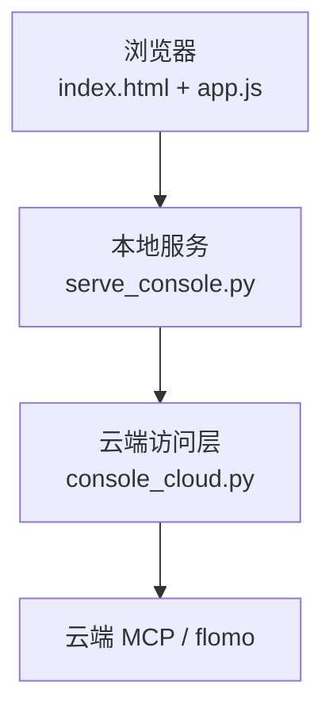
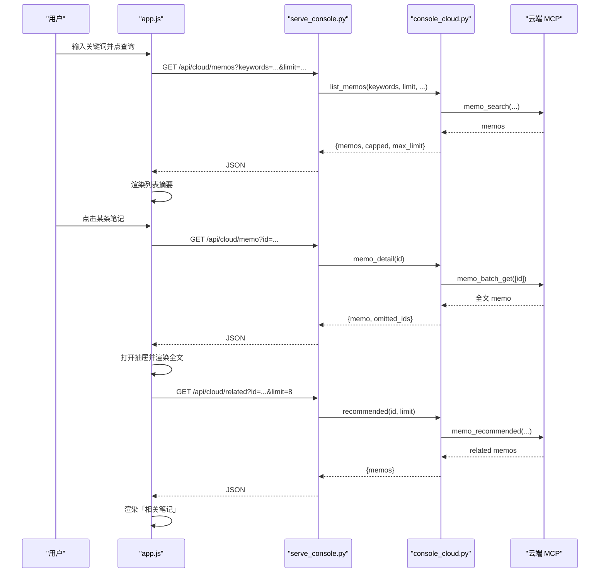
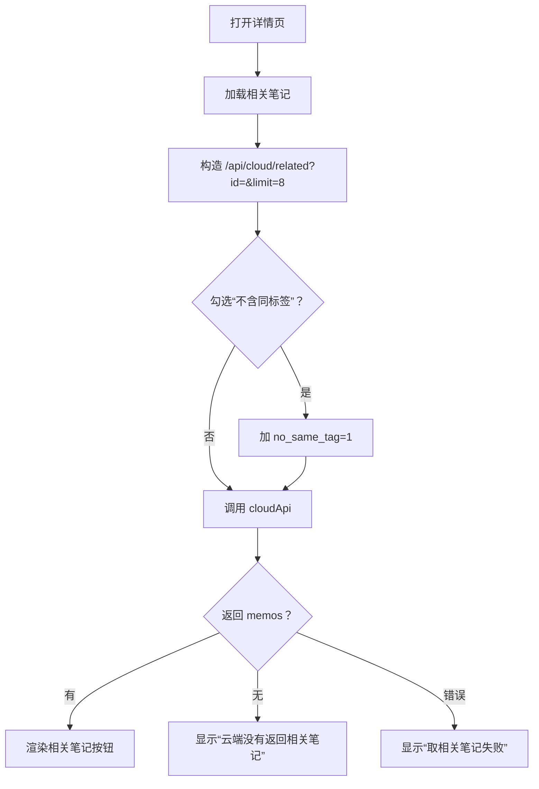
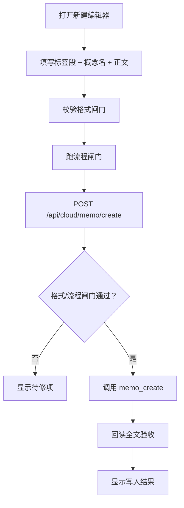
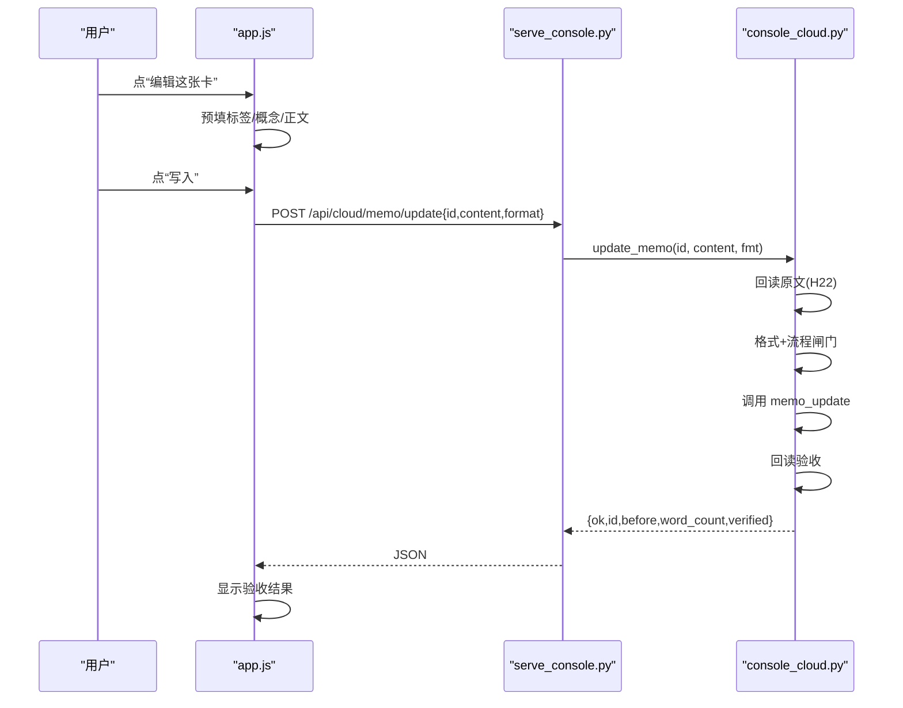
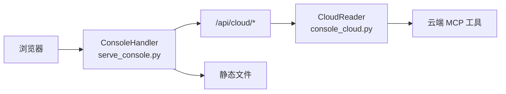
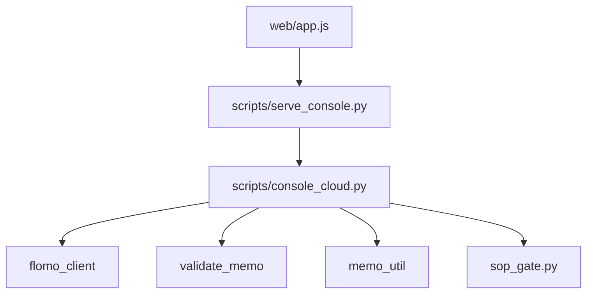

# 云端笔记视图

<cite>
**本文引用的文件**   
- [web/app.js](file://web/app.js)
- [web/index.html](file://web/index.html)
- [scripts/serve_console.py](file://scripts/serve_console.py)
- [scripts/console_cloud.py](file://scripts/console_cloud.py)
</cite>

## 目录
1. [简介](#简介)
2. [项目结构](#项目结构)
3. [核心组件](#核心组件)
4. [架构总览](#架构总览)
5. [详细组件分析](#详细组件分析)
6. [依赖关系分析](#依赖关系分析)
7. [性能与行为特征](#性能与行为特征)
8. [操作示例：从搜索到编辑一条卡片](#操作示例从搜索到编辑一条卡片)
9. [常见问题排查](#常见问题排查)
10. [结论](#结论)

## 简介
本文件面向“云端笔记”视图，说明用户如何在控制台界面中搜索、查看、新建和编辑云端卡片，并解释前端 `app.js`、本地服务 `serve_console.py` 与服务层 `console_cloud.py` 之间的调用链。重点覆盖以下契约：
- 搜索框输入触发 `/api/cloud/memos`，携带关键词、标签、起止日期、来源、是否含标签与分页上限。
- 点击列表条目后调用 `/api/cloud/memo?id=...` 拉取全文。
- 「相关笔记」区域调用 `/api/cloud/related`。
- 新建卡片通过 `/api/cloud/memo/create` 提交标签段 + 概念名 + 正文。
- 编辑已有卡片通过 `/api/cloud/memo/update` 携带 id 与修改字段。
- 所有写请求在服务端强制经过格式闸门与流程闸门，并在写入后回读全文验收。

## 项目结构
控制台由四部分构成：
- 静态页面入口 `web/index.html`：提供侧边栏导航、主内容区、详情抽屉、编辑器等 DOM。
- 前端逻辑 `web/app.js`：管理视图状态、发起 HTTP 请求、渲染笔记列表、处理表单校验与错误提示。
- 本地 HTTP 服务 `scripts/serve_console.py`：零依赖 Python 服务，负责静态文件分发、请求来源校验、路由转发。
- 云端访问层 `scripts/console_cloud.py`：封装 MCP 工具调用、参数校验、结果精简、写路径闸门与回读验收。

**图示来源**
- [web/index.html:1-162](file://web/index.html#L1-L162)
- [web/app.js:1-100](file://web/app.js#L1-L100)
- [scripts/serve_console.py:1-120](file://scripts/serve_console.py#L1-L120)
- [scripts/console_cloud.py:1-120](file://scripts/console_cloud.py#L1-L120)

**章节来源**
- [web/index.html:1-162](file://web/index.html#L1-L162)
- [web/app.js:1-100](file://web/app.js#L1-L100)
- [scripts/serve_console.py:1-120](file://scripts/serve_console.py#L1-L120)
- [scripts/console_cloud.py:1-120](file://scripts/console_cloud.py#L1-L120)

## 核心组件
- **视图状态与导航**：`state.view` 控制当前页；侧边栏按钮绑定 `notes/tags/reference/tools`。
- **云端笔记视图**：维护搜索关键词、标签、日期、来源、是否含标签、分页上限、多选集合。
- **详情抽屉**：展示单卡全文、编辑入口、相关笔记。
- **编辑器**：三段式（标签段、概念名、正文）与完整原始文本两种模式，支持预览、校验、跑闸门、写入。
- **HTTP 客户端封装**：`cloudApi` 用于只读接口，`cloudPost` 用于写接口与校验；失败统一转为用户可读文案。
- **服务端路由**：GET 分发 `/api/cloud/*`，POST 分发验证、闸门、创建、更新、重命名等写入口。
- **云端访问层**：白名单工具调用、参数归一化、结果精简、写前双闸门、写后回读。

**章节来源**
- [web/app.js:1-200](file://web/app.js#L1-L200)
- [scripts/serve_console.py:250-424](file://scripts/serve_console.py#L250-L424)
- [scripts/console_cloud.py:300-567](file://scripts/console_cloud.py#L300-L567)

## 架构总览
下面用时序图展示一次“搜索 → 查看详情 → 查看相关笔记”的完整链路。

**图示来源**
- [web/app.js:100-250](file://web/app.js#L100-L250)
- [scripts/serve_console.py:300-380](file://scripts/serve_console.py#L300-L380)
- [scripts/console_cloud.py:420-567](file://scripts/console_cloud.py#L420-L567)

## 详细组件分析

### 搜索框与 `/api/cloud/memos`
用户在笔记视图输入关键词、标签、起止日期、来源、是否含标签后，点击“查询”或切换最近/今日回顾，会执行以下步骤：
1. 前端校验日期格式与真实日期，不合法时弹出 toast 提示，不发送请求。
2. 将状态写入 `state.cloudQuery`、`state.cloudTag`、`state.cloudStart`、`state.cloudEnd`、`state.cloudSource`、`state.cloudHasTag`、`state.cloudLimit`，并将模式设为 `search`。
3. `fetchCloud()` 构造 URLSearchParams：
   - `keywords` ← 搜索词
   - `tag` ← 完整标签路径
   - `start_date`、`end_date` ← 起止日期
   - `source` ← 来源
   - `has_tag` ← “1”“0”或未传
   - `limit` ← 20 或 50
4. 调用 `cloudApi("/api/cloud/memos?...")`。
5. 服务层解析查询参数，调用 `CloudReader.list_memos`，最终调用云端 `memo_search`。
6. 返回数据包含 `memos`、`capped`、`limit`、`max_limit`；前端据此显示“本次加载”“单次上限”，并在达到上限时提示继续筛选。

关键点：
- 搜索是“关键词 · 标签 · 起止日期 · 来源 · 是否含标签”的组合条件。
- 列表只返回摘要，正文可能截断；后端通过 `slim_memo` 压缩正文，并保留 `content_truncated`。
- 前端不会静默丢弃超出 `MAX_LIMIT` 的结果，而是通过 `capped` 提示用户继续收窄条件。

**章节来源**
- [web/app.js:100-250](file://web/app.js#L100-L250)
- [web/app.js:450-520](file://web/app.js#L450-L520)
- [scripts/serve_console.py:310-340](file://scripts/serve_console.py#L310-L340)
- [scripts/console_cloud.py:460-567](file://scripts/console_cloud.py#L460-L567)

### 点击条目拉取全文 `/api/cloud/memo`
当用户点击列表中的某张卡片：
1. 打开右侧抽屉，先显示“正在读取全文”。
2. 调用 `cloudApi("/api/cloud/memo?id=" + encodeURIComponent(id))`。
3. 服务层路由到 `memo_detail`，传入 `id`。
4. `CloudReader.memo_detail` 调用 `memo_batch_get([id])`，再取第一条并包装为 `full_memo`。
5. 返回 `memo` 对象，包含标题、标签、字数、更新时间、URL、正文、是否仍被云端截断等信息。
6. 前端渲染正文、编辑按钮、相关笔记区域。

注意：
- 如果云端返回 `content_truncated=true`，前端会显式标注“云端仍截断”，提醒用户列表摘要不可作为全文依据。
- 若未找到 memo，服务层抛出 `CloudError`，经 `_cloud` 转为 `{error}`，前端在抽屉中显示失败文案。

**章节来源**
- [web/app.js:250-350](file://web/app.js#L250-L350)
- [scripts/serve_console.py:310-330](file://scripts/serve_console.py#L310-L330)
- [scripts/console_cloud.py:540-567](file://scripts/console_cloud.py#L540-L567)

### 「相关笔记」调用 `/api/cloud/related`
详情页底部有一个“相关笔记”区块：
1. 默认请求 `/api/cloud/related?id=...&limit=8`。
2. 如果勾选“不含同标签”，额外带上 `no_same_tag=1`。
3. 服务层调用 `recommended(memo_id, limit, no_same_tag)`，对应云端 `memo_recommended`。
4. 返回 `memos` 列表，每条仅带标题、少量标签等轻量信息。
5. 若无相关笔记，前端显示“云端没有返回相关笔记”；若接口出错，显示“取相关笔记失败”。

**图示来源**
- [web/app.js:300-380](file://web/app.js#L300-L380)
- [scripts/serve_console.py:330-350](file://scripts/serve_console.py#L330-L350)
- [scripts/console_cloud.py:567-590](file://scripts/console_cloud.py#L567-L590)

**章节来源**
- [web/app.js:300-380](file://web/app.js#L300-L380)
- [scripts/serve_console.py:330-350](file://scripts/serve_console.py#L330-L350)
- [scripts/console_cloud.py:567-590](file://scripts/console_cloud.py#L567-L590)

### 新建卡片：`/api/cloud/memo/create`
新建入口在笔记视图顶部按钮“＋ 新建笔记”：
1. 打开编辑器，标题为“新建笔记”，副标题提示“写入前须过格式与流程闸门”。
2. 表单字段包括：
   - 标签段：首行，多个标签空格分隔，每个以 `#` 开头，支持两级如 `#AI/RAG`。
   - 概念名：第二行，简明名词，不以 `#` 开头。
   - 正文：结论先行，不加多余前缀。
3. 支持切换到“完整卡片文本”直编模式，原始文本按“标签段 → 空行 → 概念名 → 空行 → 正文”拼装。
4. 点击“校验”调用 `/api/cloud/validate`，检查格式闸门；点击“跑闸门”调用 `/api/cloud/gate`，生成流程凭证。
5. 点击“写入”调用 `/api/cloud/memo/create`，请求体为：
   - `content`：完整卡片文本
   - `format`：可选格式标识
6. 服务端执行：
   - 格式闸门：委托 `validate_memo.check`。
   - 流程闸门：委托 `sop_gate.py`，可跳过网络验证或传入验证记录。
   - 调用 `memo_create`。
   - 回读全文验收，比较提交内容与落库内容。
7. 前端根据回执显示“已新建并验收”或“已下发，但没能回读验收”，并清空缓存，让下次刷新拉最新数据。

**图示来源**
- [web/app.js:520-620](file://web/app.js#L520-L620)
- [scripts/serve_console.py:380-424](file://scripts/serve_console.py#L380-L424)
- [scripts/console_cloud.py:740-820](file://scripts/console_cloud.py#L740-L820)

**章节来源**
- [web/index.html:60-162](file://web/index.html#L60-L162)
- [web/app.js:520-620](file://web/app.js#L520-L620)
- [scripts/serve_console.py:380-424](file://scripts/serve_console.py#L380-L424)
- [scripts/console_cloud.py:700-820](file://scripts/console_cloud.py#L700-L820)

### 编辑已有卡片：`/api/cloud/memo/update`
编辑入口在详情页的“编辑这张卡”：
1. 打开编辑器，标题改为“编辑笔记”，副标题提示“更新前先回读原文，更新后回读验收”。
2. 编辑器预填该卡片的标签段、概念名、正文。
3. 用户修改后，同样可先校验、跑闸门。
4. 点击“写入”调用 `/api/cloud/memo/update`，请求体包含：
   - `id`：要更新的卡片 id
   - `content`：新的完整卡片文本
   - `format`：可选格式标识
5. 服务端执行：
   - 先回读原文（H22），记录更新前的字符数与概念名。
   - 格式闸门 + 流程闸门。
   - 调用 `memo_update`。
   - 回读验收，比较提交内容与落库内容。
6. 前端显示“已更新并验收”或“已下发，但没能回读验收”，并标记列表待刷新。

**图示来源**
- [web/app.js:600-700](file://web/app.js#L600-L700)
- [scripts/serve_console.py:380-424](file://scripts/serve_console.py#L380-L424)
- [scripts/console_cloud.py:820-882](file://scripts/console_cloud.py#L820-L882)

**章节来源**
- [web/app.js:600-700](file://web/app.js#L600-L700)
- [scripts/serve_console.py:380-424](file://scripts/serve_console.py#L380-L424)
- [scripts/console_cloud.py:820-882](file://scripts/console_cloud.py#L820-L882)

### 视图切换、列表渲染、表单校验与错误提示
#### 视图切换
- 侧边栏按钮 `data-view` 对应 `notes/tags/reference/tools`。
- 点击后更新 `state.view`，关闭详情抽屉，重新渲染主内容。
- `render()` 先显示骨架占位，再异步执行对应 `VIEWS[state.view]`。
- 四个视图函数分别为 `viewNotes`、`viewTags`、`viewReference`、`viewTools`。

#### 列表渲染
- `viewNotes` 先拉取 `/api/overview`，判断云端是否可用。
- 若不可用，显示“云端不可用”及原因。
- 若可用，渲染筛选栏、统计条、标题、列表、多选提示、批量取全文按钮。
- 每条卡片使用 `memoCard` 渲染标签、时间、标题、摘要、字数、来源、截断提示。

#### 表单校验与错误提示
- 日期校验：拒绝非 `YYYY-MM-DD` 或不存在的日期，toast 提示。
- 编辑器校验：
  - “校验”调用 `/api/cloud/validate`，返回 errors/warnings/tagline/concept。
  - “跑闸门”调用 `/api/cloud/gate`，可跳过网络验证或传入验证记录。
  - 写入后根据回执显示三种状态：一致、不一致、未知（已下发但未验）。
- 通用错误：
  - `cloudApi` 与 `cloudPost` 捕获非 JSON 响应、HTTP 非 ok、本地服务无响应，统一返回 `{error}`。
  - 前端用 toast 显示短消息，用 editorResult 或详情区域显示长错误。

**章节来源**
- [web/app.js:1-200](file://web/app.js#L1-L200)
- [web/app.js:200-546](file://web/app.js#L200-L546)
- [web/app.js:600-918](file://web/app.js#L600-L918)

### 路由分发：`serve_console.py` → `console_cloud.py`
`serve_console.py` 是一个基于 `BaseHTTPRequestHandler` 的本地服务：
- GET 路由：
  - `/api/overview`：汇总本地数据与云端状态。
  - `/api/cloud/memos`：调用 `CloudReader.list_memos`。
  - `/api/cloud/memo`：调用 `CloudReader.memo_detail`。
  - `/api/cloud/memos/batch`：调用 `CloudReader.memo_batch`。
  - `/api/cloud/review`：调用 `CloudReader.daily_review`。
  - `/api/cloud/related`：调用 `CloudReader.recommended`。
  - `/api/cloud/tagtree`、`/api/cloud/tags`、`/api/cloud/reference`、`/api/cloud/tools`：标签、参考、能力清单。
  - 其余路径走静态文件服务。
- POST 路由：
  - `/api/cloud/validate`：格式自检。
  - `/api/cloud/gate`：流程闸门。
  - `/api/cloud/memo/create`：新建。
  - `/api/cloud/memo/update`：更新。
  - `/api/cloud/tag/rename`：批量改标签。
  - `/api/cloud/tool`：通用只读工具执行。
- 安全：
  - Host/Origin 同源校验，拒绝 DNS 重绑定与跨站写。
  - 静态资源后缀白名单。
  - 端口占用检测，避免多实例竞争。
  - 非回环绑定需显式 `--allow-lan`。

**图示来源**
- [scripts/serve_console.py:250-424](file://scripts/serve_console.py#L250-L424)
- [scripts/console_cloud.py:300-567](file://scripts/console_cloud.py#L300-L567)

**章节来源**
- [scripts/serve_console.py:1-200](file://scripts/serve_console.py#L1-L200)
- [scripts/serve_console.py:250-424](file://scripts/serve_console.py#L250-L424)

## 依赖关系分析
- `app.js` 依赖 `/api/cloud/*` 与 `/api/overview`，不直接访问云端。
- `serve_console.py` 依赖 `console_cloud.CloudReader`、`console_data.collect_all`，以及仓库根下的 `web/` 静态目录。
- `console_cloud.py` 依赖 `flomo_client`、`validate_memo`、`memo_util.memo_signature`、`sop_gate.py`。
- 写路径形成强约束链：前端表单 → 本地服务 → console_cloud 双闸门 → 云端写工具 → 回读验收。

**图示来源**
- [web/app.js:1-100](file://web/app.js#L1-L100)
- [scripts/serve_console.py:1-80](file://scripts/serve_console.py#L1-L80)
- [scripts/console_cloud.py:1-120](file://scripts/console_cloud.py#L1-L120)

**章节来源**
- [web/app.js:1-100](file://web/app.js#L1-L100)
- [scripts/serve_console.py:1-120](file://scripts/serve_console.py#L1-L120)
- [scripts/console_cloud.py:1-120](file://scripts/console_cloud.py#L1-L120)

## 性能与行为特征
- 列表摘要优先：`slim_memo` 不返回全文，减少带宽与渲染成本。
- 分页上限：
  - `memo_search` 单次最大 `MAX_LIMIT=50`。
  - `memo_batch_get` 单次最大 `BATCH_MAX=10`。
- 正文截断：
  - 列表摘要最多 `EXCERPT_CHARS=200` 字，超过时压成省略号。
  - 若云端返回 `content_truncated`，前端明确提示“已截断 · 点开看全文”。
- 缓存策略：
  - 前端对 `/api/overview` 做简单缓存。
  - 写操作成功后清空 `state.cloudData` 与全局缓存，强制刷新。
- 并发与连接：
  - `CloudReader` 内部懒建立连接，多线程安全，异常时重置连接以便下次重试。
- 用户体验：
  - 超长 JSON 结果在“能力”视图显式标注截断长度，避免静默丢失。
  - 多选全文超 10 条时，前端提示分次取回，不静默丢弃。

[本节为一般性性能讨论，不直接分析具体代码片段]

## 操作示例：从搜索到编辑一条卡片
以下示例描述一个典型用户流程，不涉及具体代码实现：

1. 启动本地服务：运行 `python scripts/serve_console.py`。
2. 打开浏览器访问控制台首页，进入“云端笔记”视图。
3. 在搜索框输入关键词，例如某个主题或标签片段。
4. 如需更精确，补充标签路径、起止日期、来源，或选择“仅含标签/仅无标签”。
5. 点击“查询”，列表展示匹配的卡片摘要。
6. 若列表为空，检查关键词、标签是否为完整路径、日期是否有效。
7. 点击某条卡片，打开详情抽屉，等待全文加载。
8. 查看“相关笔记”，必要时勾选“不含同标签”重新加载。
9. 点击“编辑这张卡”，进入编辑器。
10. 修改标签段、概念名或正文。
11. 点击“校验”，查看格式闸门结果；如有待修项，按提示修复。
12. 如需术语卡网络验证，取消“非术语卡”勾选，填入第②步验证记录；否则保持勾选跳过。
13. 点击“跑闸门”，等待流程凭证生成。
14. 点击“写入”，服务端执行 `memo_update` 并回读验收。
15. 成功时显示“已更新并验收”；若回读失败，显示“已下发，但没能回读验收”，不要重复提交。
16. 返回列表后点击“刷新”，获取最新云端状态。

**章节来源**
- [web/app.js:200-546](file://web/app.js#L200-L546)
- [web/app.js:600-700](file://web/app.js#L600-L700)
- [scripts/serve_console.py:380-424](file://scripts/serve_console.py#L380-L424)
- [scripts/console_cloud.py:740-882](file://scripts/console_cloud.py#L740-L882)

## 常见问题排查

### 无搜索结果
可能原因：
- 关键词过于宽泛或过于严格，建议先缩小范围。
- 标签不是完整路径，云端不接受裸顶层标签。
- 起止日期无效，前端会拦截并 toast 提示。
- 云端确实没有匹配卡片，应结合其他条件重试。
- 服务端返回 502 或非 JSON 响应，前端会显示“云端读取失败”。

排查步骤：
1. 先试“最近”视图，确认云端连通。
2. 逐步增加筛选条件，定位是哪个条件导致结果为空。
3. 检查日期格式是否为 `YYYY-MM-DD`。
4. 检查标签是否为完整路径。
5. 查看统计条中的“单次上限”，确认是否被 `capped` 影响。

**章节来源**
- [web/app.js:100-250](file://web/app.js#L100-L250)
- [web/app.js:450-520](file://web/app.js#L450-L520)
- [scripts/console_cloud.py:460-567](file://scripts/console_cloud.py#L460-L567)

### 正文过长截断
现象：
- 列表卡片显示“已截断 · 点开看全文”。
- 详情页仍可能出现“云端仍截断”。

原因：
- 列表摘要最多 200 字。
- 云端本身可能只返回部分正文，并用 `content_truncated` 标记。

处理建议：
- 列表页务必点开详情读全文。
- 若详情页仍截断，说明云端限制，不应把摘要当作完整卡片。
- 需要对比多条全文时使用“多选取全文”，但单次最多 10 条。

**章节来源**
- [web/app.js:200-380](file://web/app.js#L200-L380)
- [scripts/console_cloud.py:300-360](file://scripts/console_cloud.py#L300-L360)

### 写云返回非预期 JSON
现象：
- 编辑器校验或写入后出现“请求体不是合法 JSON”“未知写入接口”等错误。
- 前端收到非 JSON 响应，显示“本地服务无响应”或服务端降级错误。

原因：
- 请求体不是 JSON 对象。
- 使用了未暴露的 POST 路径。
- 服务层捕获到异常，返回 `{error}`。
- 云端工具不在白名单内，被 console_cloud 拒绝。

处理建议：
1. 确认请求头为 `application/json`。
2. 确认 POST 路径为 `/api/cloud/memo/create` 或 `/api/cloud/memo/update`。
3. 确认请求体包含 `content`，更新时还需 `id`。
4. 若校验未通过，先修复格式闸门报错，再跑闸门。
5. 若服务报 403，检查 Host/Origin 是否为本机地址。

**章节来源**
- [web/app.js:1-120](file://web/app.js#L1-L120)
- [scripts/serve_console.py:350-424](file://scripts/serve_console.py#L350-L424)
- [scripts/console_cloud.py:300-420](file://scripts/console_cloud.py#L300-L420)

### Token 过期
现象：
- 云端不可用，概览显示“云端不可用”。
- 服务层报告 token 缺失或连接失败。
- 任意云端调用返回 `CloudError`。

原因：
- 凭证配置缺失或过期。
- `load_token()` 抛出 `FlomoError`。
- 云端连接初始化失败，`CloudReader._connect` 抛出异常并被转为 `CloudError`。

处理建议：
1. 检查项目凭证配置位置与有效性。
2. 重启本地服务，使 `CloudReader` 重建连接。
3. 观察“连接”状态与“云端权限”提示。
4. 若只是偶发网络问题，重试即可；若持续不可用，检查凭证与网络。

**章节来源**
- [web/app.js:200-250](file://web/app.js#L200-L250)
- [scripts/console_cloud.py:360-420](file://scripts/console_cloud.py#L360-L420)
- [scripts/serve_console.py:300-340](file://scripts/serve_console.py#L300-L340)

## 结论
云端笔记视图通过前端 `app.js`、本地服务 `serve_console.py` 与服务层 `console_cloud.py` 三层协作，把“随时现采”的只读能力和“过闸门 + 回读验收”的写能力组织成可直接操作的界面。搜索、全文、相关笔记、新建、编辑各自对应明确的 API 契约；写路径不是直通云端，而是强制经过格式与流程闸门，并在写入后回读正文进行一致性验收。理解这些边界后，用户可以可靠地完成从搜索到编辑的一条完整卡片操作，并在无结果、正文截断、非预期响应、Token 过期等常见场景下快速定位问题。