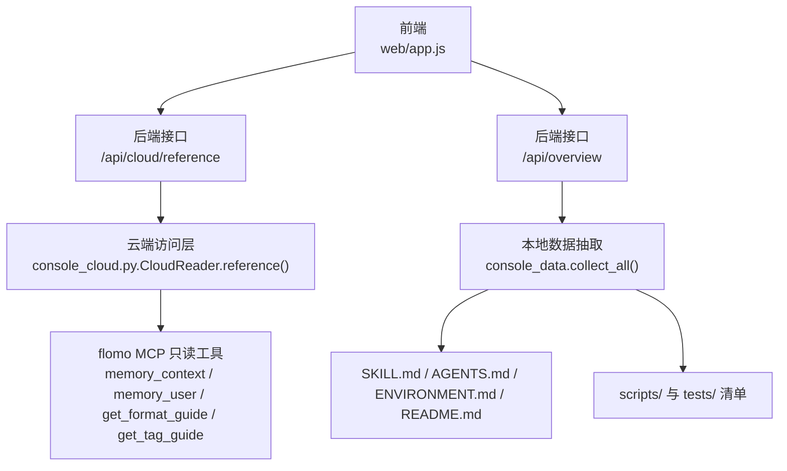
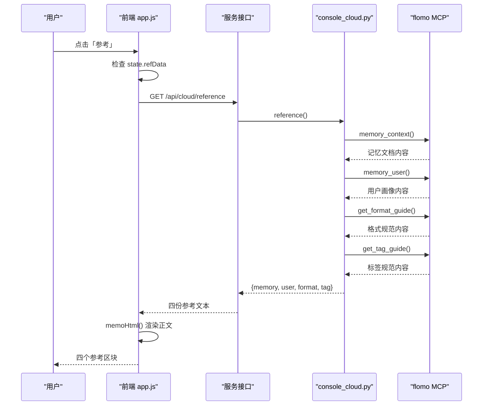
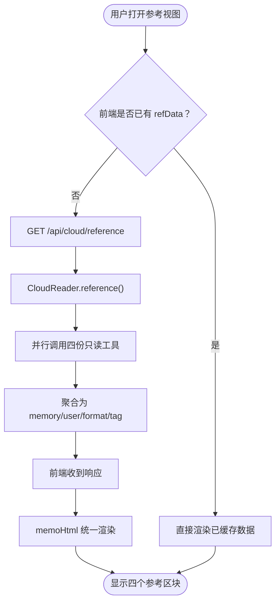
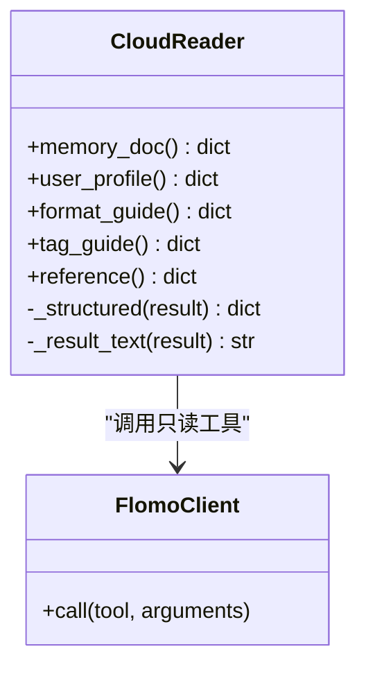
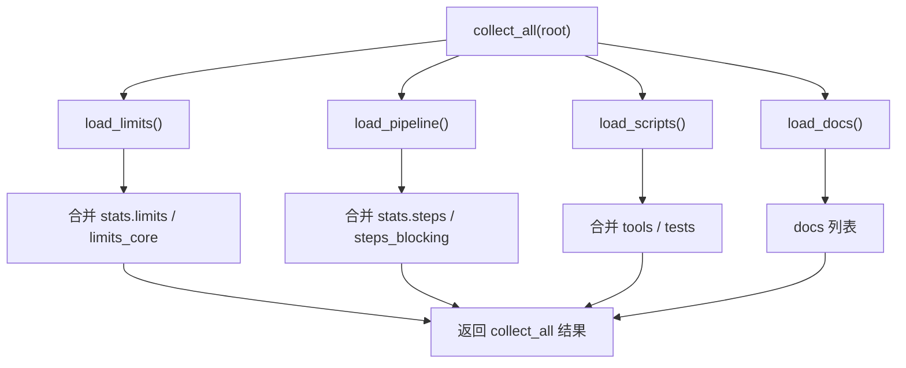
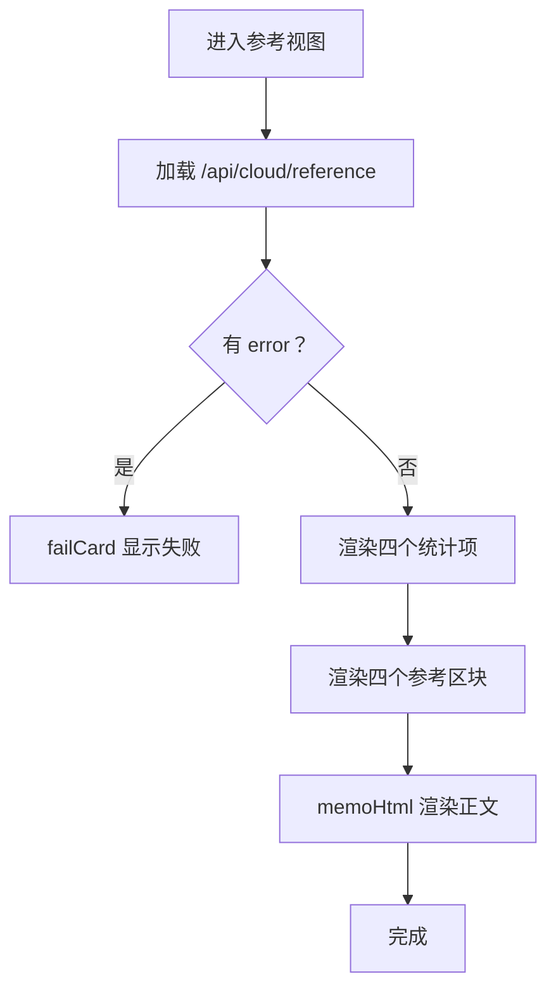
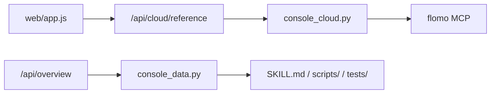

# 参考视图

<cite>
**本文引用的文件**   
- [scripts/console_cloud.py](file://scripts/console_cloud.py)
- [scripts/console_data.py](file://scripts/console_data.py)
- [web/app.js](file://web/app.js)
- [README.md](file://README.md)
</cite>

## 目录
1. [引言](#引言)
2. [项目结构](#项目结构)
3. [核心组件](#核心组件)
4. [架构总览](#架构总览)
5. [详细组件分析](#详细组件分析)
6. [依赖关系分析](#依赖关系分析)
7. [性能与可用性特征](#性能与可用性特征)
8. [维护指南](#维护指南)
9. [常见问题排查](#常见问题排查)
10. [结论](#结论)

## 引言
“参考视图”是控制台四个视图之一，负责把四类只读参考资料统一呈现给使用者：记忆文档、用户画像、笔记格式规范、标签使用规范。它不是独立的数据源，而是两个数据源的聚合展示层：

- **云端参考数据**：由 `console_cloud.py` 调用 flomo MCP 的只读工具拉取，并以统一的 `{memory, user, format, tag}` 结构返回。
- **本地仓库概览数据**：由 `console_data.py` 解析 SKILL 文档、脚本清单与配套用例，产出统计字段供“概览”使用；这部分并不直接出现在参考视图正文中，但为页面提供项目级上下文（步骤数、硬限数量、工具/用例数量等）。

前端 `web/app.js` 通过 `/api/cloud/reference` 拉取四份文本，并复用已有的卡片渲染逻辑，把它们统一成可导航、可对比的页面区块。

## 项目结构
与参考视图直接相关的代码分布在三层：

| 层次 | 文件 | 职责 |
|---|---|---|
| 后端只读能力 | `scripts/console_cloud.py` | 封装云端 MCP 只读工具，提供 `reference()` 聚合接口 |
| 后端本地数据 | `scripts/console_data.py` | 离线解析 SKILL、AGENTS、ENVIRONMENT、README 与脚本清单，产出 `collect_all()` |
| 前端视图 | `web/app.js` | “参考”视图路由、缓存、统计条与四块参考内容的渲染 |

**图表来源**
- [web/app.js:710-743](file://web/app.js#L710-L743)
- [scripts/console_cloud.py:613-636](file://scripts/console_cloud.py#L613-L636)
- [scripts/console_data.py:251-279](file://scripts/console_data.py#L251-L279)

**章节来源**
- [README.md:227-295](file://README.md#L227-L295)

## 核心组件
### 云端参考聚合器
`CloudReader` 提供四个方法分别读取一份参考文本，并把结果包装为 `{doc, content}`；`reference()` 再一次性收集四份，形成参考视图需要的扁平结构。

| 参考类型 | 云端工具 | 后端方法 | 前端键名 |
|---|---|---|---|
| 记忆文档 | `memory_context` | `memory_doc()` | `memory` |
| 用户画像 | `memory_user` | `user_profile()` | `user` |
| 笔记格式规范 | `get_format_guide` | `format_guide()` | `format` |
| 标签使用规范 | `get_tag_guide` | `tag_guide()` | `tag` |

这些工具都属于云端只读白名单，写入操作不经过该入口。

**章节来源**
- [scripts/console_cloud.py:95-98](file://scripts/console_cloud.py#L95-L98)
- [scripts/console_cloud.py:613-636](file://scripts/console_cloud.py#L613-L636)

### 本地仓库概览数据
`console_data.py` 不参与参考视图的正文渲染，但它负责：

1. 扫描根目录下的 `SKILL.md`、`AGENTS.md`、`ENVIRONMENT.md`、`README.md`。
2. 解析 SKILL 中的硬限条目、九步流程、脚本清单与用例覆盖情况。
3. 输出 `collect_all()`，其中 `stats` 包含步骤数、阻塞步骤数、硬限总数、核心硬限数、工具数、用例数；`docs` 列出每个文档的文件名、字节数与行数。

这些数据进入 `/api/overview`，供前端在概览区域显示，帮助使用者理解当前仓库的规则规模与工具生态。

**章节来源**
- [scripts/console_data.py:25-31](file://scripts/console_data.py#L25-L31)
- [scripts/console_data.py:251-279](file://scripts/console_data.py#L251-L279)

### 前端参考视图
前端在切换到 `reference` 视图时执行以下逻辑：

1. 若 `state.refData` 为空，则发起 `GET /api/cloud/reference`。
2. 失败时显示“云端参考文本读取失败”。
3. 成功时渲染四个统计项：记忆、画像、格式、标签。
4. 按 `memory`、`user`、`format`、`tag` 四个键分别渲染区块，标题固定为“记忆文档”“用户画像”“笔记格式规范”“标签使用规范”。
5. 正文通过 `memoHtml()` 渲染：标签行单独成行，以 `-` 开头的行转为列表，其余段落化。

**图表来源**
- [web/app.js:710-743](file://web/app.js#L710-L743)
- [scripts/console_cloud.py:613-636](file://scripts/console_cloud.py#L613-L636)

**章节来源**
- [web/app.js:21-21](file://web/app.js#L21-L21)
- [web/app.js:710-743](file://web/app.js#L710-L743)

## 架构总览
参考视图的完整数据流可以概括为：**前端请求 → 服务转发 → 云端 MCP → 结构化回包 → 前端统一渲染**。

**图表来源**
- [web/app.js:710-743](file://web/app.js#L710-L743)
- [scripts/console_cloud.py:613-636](file://scripts/console_cloud.py#L613-L636)

## 详细组件分析

### 云端参考能力：`console_cloud.py`
#### 设计要点
- 所有参考文本都走 `_result_text()`：优先从结构化返回中取 `content`，如果 `content` 是数组，则遍历元素取 `text`，并对内层 JSON 做一次容错解析。
- 四个参考方法各自调用一个 MCP 只读工具，然后返回 `{doc, content}`。
- `reference()` 只是聚合器，不新增业务规则；因此新增参考类型需要同时扩展方法、白名单和聚合结果。

#### 复杂度
- `reference()` 的时间复杂度为 O(1) 次聚合，实际成本取决于四次 MCP 调用。
- `_result_text()` 对单个工具的响应体进行线性扫描，最坏情况下遍历 `content` 数组一次。

#### 错误处理
- 工具调用失败会沿 `FlomoError` / 通用网络异常向上抛出，最终由服务层转为 HTTP 错误。
- 前端 `cloudApi()` 会把非 2xx 响应包装为 `{error}`，再由 `viewReference()` 用 `failCard()` 展示。

**图表来源**
- [scripts/console_cloud.py:613-636](file://scripts/console_cloud.py#L613-L636)
- [scripts/console_cloud.py:287-302](file://scripts/console_cloud.py#L287-L302)

**章节来源**
- [scripts/console_cloud.py:95-98](file://scripts/console_cloud.py#L95-L98)
- [scripts/console_cloud.py:287-302](file://scripts/console_cloud.py#L287-L302)
- [scripts/console_cloud.py:613-636](file://scripts/console_cloud.py#L613-L636)

### 本地仓库概览：`console_data.py`
#### 扫描范围
`DOC_FILES` 明确列出四份文档：`SKILL.md`、`AGENTS.md`、`ENVIRONMENT.md`、`README.md`。`load_docs()` 只关心是否存在、字节数和行数，不解析 Markdown 语义。

#### 统计字段
`collect_all()` 汇总以下内容：

| 字段 | 含义 |
|---|---|
| `steps` | 流程小节数量 |
| `steps_blocking` | 标为“阻塞”的流程步数 |
| `limits` | 硬限条目总数 |
| `limits_core` | 非治理类的核心硬限数量 |
| `tools` | `scripts/` 下工具脚本数量 |
| `tests` | `tests/` 下测试脚本数量 |
| `docs` | 存在的文档文件名、字节数、行数 |

#### 关键算法
- `load_limits()`：按 `##` 顶层节与 `###` 子节分组，匹配 `**Hn · 标题**` 条目，忽略分隔线与横向引用注记。
- `load_pipeline()`：定位 `## 三、流程`，提取带编号的小节，并在标题或正文中出现“阻塞”时标记阻塞。
- `load_scripts()`：扫描 `scripts/` 生成工具清单，再用 `covers.coverage_map()` 跨目录核对 `tests/` 中的 `COVERS` 声明。

**图表来源**
- [scripts/console_data.py:251-279](file://scripts/console_data.py#L251-L279)

**章节来源**
- [scripts/console_data.py:25-31](file://scripts/console_data.py#L25-L31)
- [scripts/console_data.py:64-118](file://scripts/console_data.py#L64-L118)
- [scripts/console_data.py:121-184](file://scripts/console_data.py#L121-L184)
- [scripts/console_data.py:187-249](file://scripts/console_data.py#L187-L249)
- [scripts/console_data.py:251-279](file://scripts/console_data.py#L251-L279)

### 前端统一渲染：`web/app.js`
#### 参考视图渲染逻辑
- 首次进入时懒加载 `/api/cloud/reference`，结果缓存在 `state.refData`。
- 四个统计项仅说明数据来源，不展示字数。
- 正文渲染复用 `memoHtml()`，把云端的纯文本按标签行、列表行、普通段落处理。
- 底部提示明确说明“四份文本均由云端现取，只读展示”。

#### 与其他视图的关系
- 参考视图不修改状态中的笔记查询参数，也不影响标签或工具台。
- 切换视图时会清空抽屉，避免参考页与笔记详情互相干扰。

**图表来源**
- [web/app.js:710-743](file://web/app.js#L710-L743)

**章节来源**
- [web/app.js:21-21](file://web/app.js#L21-L21)
- [web/app.js:710-743](file://web/app.js#L710-L743)

## 依赖关系分析
参考视图的依赖分为两类：

| 依赖 | 方向 | 说明 |
|---|---|---|
| 前端 → 后端 `/api/cloud/reference` | 运行时依赖 | 每次切换视图时按需拉取 |
| 后端 → flomo MCP | 运行时依赖 | 需要有效 token 和网络通道 |
| 后端 → 只读工具白名单 | 静态依赖 | 新增参考类型必须同步白名单 |
| 前端 → `memoHtml` | 内部依赖 | 参考正文复用笔记正文渲染 |
| 概览 → `console_data.collect_all` | 启动或概览请求依赖 | 不影响参考视图正文 |

**图表来源**
- [web/app.js:710-743](file://web/app.js#L710-L743)
- [scripts/console_cloud.py:613-636](file://scripts/console_cloud.py#L613-L636)
- [scripts/console_data.py:251-279](file://scripts/console_data.py#L251-L279)

**章节来源**
- [scripts/console_cloud.py:95-98](file://scripts/console_cloud.py#L95-L98)
- [web/app.js:710-743](file://web/app.js#L710-L743)
- [scripts/console_data.py:251-279](file://scripts/console_data.py#L251-L279)

## 性能与可用性特征
- **懒加载**：参考数据只在进入参考视图时拉取，不会在首页加载时占用带宽。
- **前端缓存**：`state.refData` 在同一会话中复用，刷新前不会重复请求。
- **单次聚合**：`reference()` 在一次后端方法调用中拉齐四份文本，减少多次接口往返。
- **轻量渲染**：前端没有引入 Markdown 解析库，而是用正则把常见行格式转为 HTML，降低前端体积。
- **上限提示**：云端返回的截断、单卡上限等信息在其他视图有显式提示；参考视图本身是全文型文本，通常不存在分页，但若云端未来返回空文本，前端会显示“云端返回空文本”。

[本节为一般性说明，不直接分析具体代码片段]

## 维护指南

### 新增一份参考文档
若希望增加第五类参考（例如“工作区规范”），需要在三个位置同步扩展：

1. **后端只读方法**：在 `CloudReader` 中新增类似 `workspace_guide()` 的方法，调用对应 MCP 工具，返回 `{doc, content}`。
2. **聚合方法**：在 `reference()` 中加入新字段，例如 `workspace`。
3. **前端视图**：在 `viewReference()` 的四块区块中添加对应的渲染项，并把统计项更新为五项。

注意：参考类工具属于只读能力，如果它本质上是 MCP 工具，还需确认其名称是否在 `READONLY_TOOLS` 白名单中；否则会被拒绝调用。

**章节来源**
- [scripts/console_cloud.py:95-98](file://scripts/console_cloud.py#L95-L98)
- [scripts/console_cloud.py:613-636](file://scripts/console_cloud.py#L613-L636)
- [web/app.js:710-743](file://web/app.js#L710-L743)

### 调整分类或标题
当前参考视图的分类标题是硬编码的：

- “记忆文档”
- “用户画像”
- “笔记格式规范”
- “标签使用规范”

若要调整显示标题，只需修改 `viewReference()` 中的区块标题字符串；后端返回的 `doc` 字段目前仅用于标识来源，前端并未用它决定标题。

**章节来源**
- [web/app.js:710-743](file://web/app.js#L710-L743)

### 新增或调整本地文档统计
如果要让概览统计多计某类本地文档，应修改 `console_data.py` 中的 `DOC_FILES`，并确认 `load_docs()` 仍按文件名枚举。这里不涉及参考视图正文，只影响 `/api/overview` 的 `docs` 列表。

**章节来源**
- [scripts/console_data.py:25-31](file://scripts/console_data.py#L25-L31)
- [scripts/console_data.py:251-279](file://scripts/console_data.py#L251-L279)

## 常见问题排查

### SKILL 文件缺失
- **现象**：`load_limits()` 和 `load_pipeline()` 对 `SKILL.md` 做防御性处理：找不到文件时分别返回空列表或空管线。
- **影响**：概览统计中的步骤数、阻塞步骤数、硬限数量可能为零；但这不会影响参考视图的云端参考文本。
- **处理**：恢复 `SKILL.md`，或确认仓库根确实不需要该文件。

**章节来源**
- [scripts/console_data.py:38-42](file://scripts/console_data.py#L38-L42)
- [scripts/console_data.py:121-184](file://scripts/console_data.py#L121-L184)

### 路径变更
- **现象**：如果脚本或文档移动到 `scripts/` 之外，`load_scripts()` 将不再扫描到它；如果文档不在仓库根，`load_docs()` 也找不到。
- **影响**：工具/用例数量、文档列表与统计数字与实际仓库不一致。
- **处理**：移动文件后同步更新扫描逻辑；或在 `DOC_FILES` 中显式列出相对仓库根的期望路径。

**章节来源**
- [scripts/console_data.py:187-249](file://scripts/console_data.py#L187-L249)
- [scripts/console_data.py:251-279](file://scripts/console_data.py#L251-L279)

### Markdown 解析异常
- **现象**：参考正文来自云端，前端不做完整 Markdown 解析，只做简单行级转换。
- **影响**：复杂 Markdown（表格、嵌套列表、脚注）可能渲染不完整；但不会导致前端崩溃。
- **处理**：保持参考文本为清晰段落、短列表和标签行；如需强 Markdown 支持，应在后端或服务端先转换为 HTML，而不是在前端引入重型解析器。

**章节来源**
- [web/app.js:146-171](file://web/app.js#L146-L171)
- [web/app.js:710-743](file://web/app.js#L710-L743)

### 云端 reference 不可用时的回退策略
- **后端**：如果 MCP 调用失败，`CloudReader.reference()` 会抛出异常，服务层将其转为 HTTP 错误。
- **前端**：`cloudApi()` 捕获网络异常和非 2xx 响应，返回 `{error}`；`viewReference()` 用 `failCard()` 显示“云端参考文本读取失败”，并保留页面结构。
- **用户体验**：参考视图仍可切换，其他视图不受影响；概览中的云端可用性状态也不会被参考视图的错误覆盖。
- **建议**：如果云端暂时不可用，应先在服务侧记录原因（token 缺失、代理失败、工具未启用），再在前端展示更明确的引导信息。

**章节来源**
- [web/app.js:96-124](file://web/app.js#L96-L124)
- [web/app.js:710-717](file://web/app.js#L710-L717)
- [scripts/console_cloud.py:287-302](file://scripts/console_cloud.py#L287-L302)

### 参考文本为空
- **现象**：前端渲染出“云端返回空文本”。
- **可能原因**：云端 MCP 返回空内容、结构化返回中没有 `content`、或 `_result_text()` 无法从 `content` 数组中提取文本。
- **处理**：检查 MCP 工具是否正常返回内容；检查 `_structured()` 和 `_result_text()` 是否能识别新的返回结构。

**章节来源**
- [web/app.js:164-171](file://web/app.js#L164-L171)
- [scripts/console_cloud.py:287-302](file://scripts/console_cloud.py#L287-L302)

## 结论
参考视图是一个面向使用者的只读聚合界面：它把记忆文档、用户画像、格式规范和标签规范四份来源不同的参考文本统一呈现，并通过 `memoHtml()` 保持一致的可读格式。它的正确运行依赖两条线：

- 云端线：`console_cloud.py` 通过 MCP 只读工具拉取文本，并由白名单约束权限。
- 本地线：`console_data.py` 扫描 SKILL 文档与脚本清单，产出概览统计，帮助用户理解规则规模和工具生态。

维护参考视图的关键在于“一处实现、多处对齐”：新增参考类型要同步后端方法、白名单、聚合结果和前端区块；调整分类标题只改前端；调整本地文档统计只改 `console_data.py`。这样既能保证参考内容稳定可读，又能避免前端、后端和本地数据三者之间出现口径漂移。