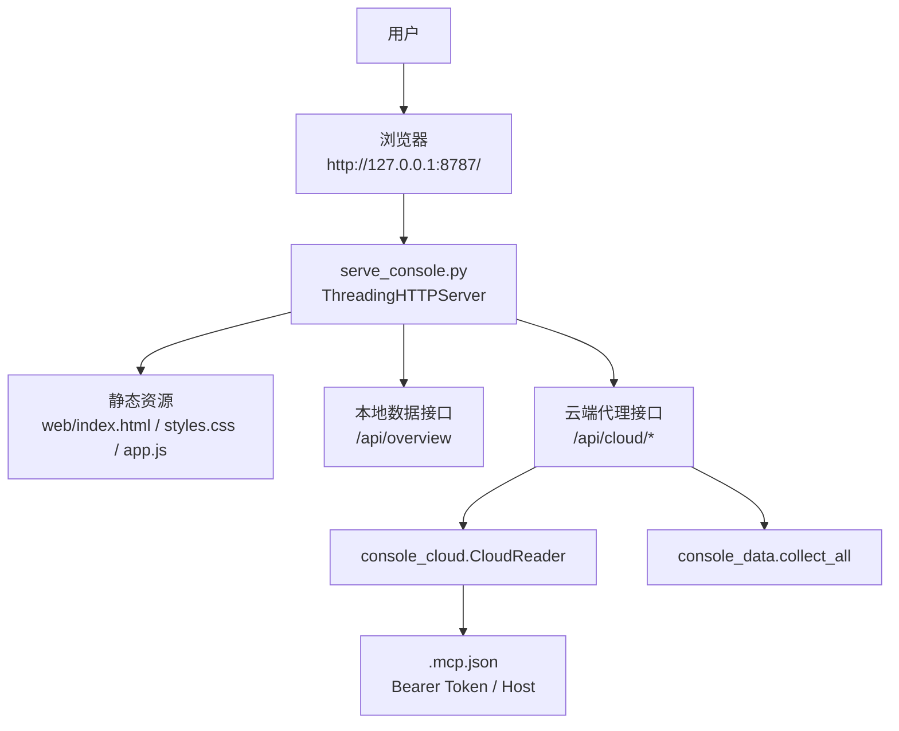
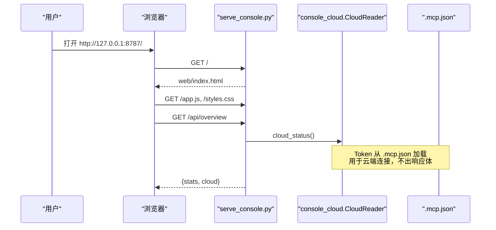
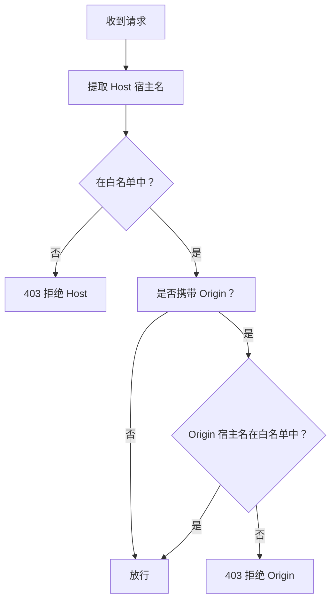
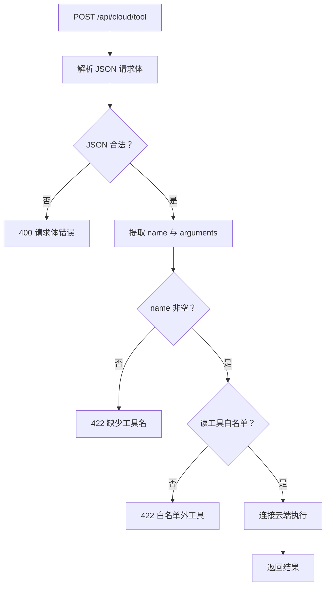
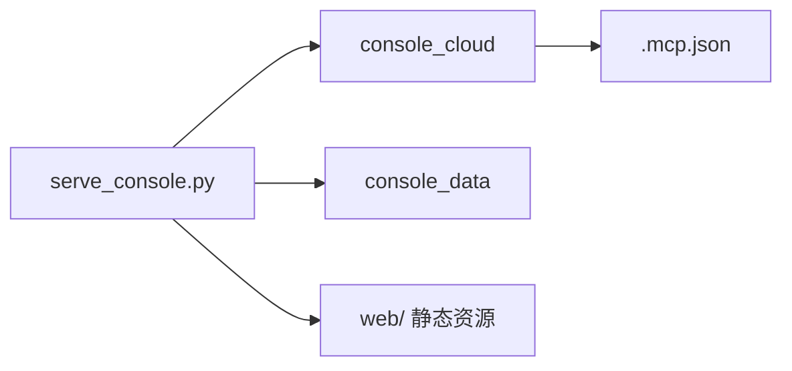

# 启动与配置

<cite>
**本文引用的文件**   
- [serve_console.py](file://scripts/serve_console.py)
- [.mcp.json](file://.mcp.json)
- [test_console_serve.py](file://tests/test_console_serve.py)
- [test_console_web.py](file://tests/test_console_web.py)
</cite>

## 目录
1. [简介](#简介)
2. [项目结构](#项目结构)
3. [核心组件](#核心组件)
4. [架构总览](#架构总览)
5. [详细组件分析](#详细组件分析)
6. [依赖关系分析](#依赖关系分析)
7. [性能与安全特性](#性能与安全特性)
8. [常见问题排查](#常见问题排查)
9. [结论](#结论)
10. [附录：最小可复现步骤与命令](#附录最小可复现步骤与命令)

## 简介
本文说明 Web 控制台的本地启动方式、端口与环境变量行为，解释控制台如何读取 `.mcp.json` 中的 Bearer Token，以及 Host 白名单、Origin 校验和本地安全边界。文档还给出首次启动成功后的浏览器访问示例、常见故障及最小可复现的启动与排查清单。

控制台由 Python 脚本 `scripts/serve_console.py` 提供，采用标准库实现，不引入第三方 Web 框架；前端为仓库根下的静态三件套 `web/index.html`、`web/styles.css`、`web/app.js`。后端通过 `console_cloud` 与 `console_data` 两个模块分别对接云端 MCP 能力和本地数据收集，本脚本只负责 HTTP 路由、静态文件服务、来源校验和 JSON 接口转发。

## 项目结构
控制台相关代码主要分布在三个位置：

| 路径 | 作用 |
|---|---|
| `scripts/serve_console.py` | Web 控制台入口脚本、命令行参数解析、HTTP 服务器、路由与安全校验 |
| `web/` | 前端静态资源（HTML/CSS/JS），零外部依赖，离线可用 |
| `.mcp.json` | MCP 客户端配置，包含云端服务的连接信息与鉴权头 |

**图示来源**
- [serve_console.py:1-424](file://scripts/serve_console.py#L1-L424)

**章节来源**
- [serve_console.py:1-424](file://scripts/serve_console.py#L1-L424)

## 核心组件
- **命令行入口**：`python scripts/serve_console.py`，默认监听回环地址 `127.0.0.1:8787`。
- **HTTP 服务器**：基于标准库 `http.server.ThreadingHTTPServer`，使用线程处理请求。
- **请求处理器**：`ConsoleHandler`，继承 `BaseHTTPRequestHandler`，实现 GET、POST、HEAD 路由与来源校验。
- **来源白名单**：按绑定地址计算本机宿主名集合，用于 Host 与 Origin 校验。
- **静态文件服务**：仅允许 `web/` 下指定后缀的文件，并做路径逃逸防护。
- **云端代理**：GET 走只读工具列表与笔记查询，POST 走写接口与通用读工具执行入口。
- **配置读取**：`.mcp.json` 中的 MCP 配置由 `console_cloud` 层加载，Token 仅在进程内用于建立云端会话，不出现在响应体中。

**章节来源**
- [serve_console.py:1-120](file://scripts/serve_console.py#L1-L120)
- [serve_console.py:201-424](file://scripts/serve_console.py#L201-L424)

## 架构总览
控制台是“本地 HTTP 服务 + 前端静态页面 + 云端 MCP 代理”的组合。

**图示来源**
- [serve_console.py:201-330](file://scripts/serve_console.py#L201-L330)
- [test_console_serve.py:1-120](file://tests/test_console_serve.py#L1-L120)

**章节来源**
- [serve_console.py:201-330](file://scripts/serve_console.py#L201-L330)

## 详细组件分析

### 启动参数与环境变量
`main()` 使用 `argparse` 定义参数，关键行为如下：

| 参数 | 类型 | 默认值 | 含义 |
|---|---|---:|---|
| `--port` | 整数 | `8787` | 监听端口 |
| `--host` | 字符串 | `127.0.0.1` | 绑定地址；默认仅回环 |
| `--allow-lan` | 布尔开关 | 关闭 | 显式允许绑定非回环地址（局域网） |
| `--open` | 布尔开关 | 关闭 | 启动后自动调用系统浏览器打开首页 |

当 `--host` 不是回环地址且未加 `--allow-lan` 时，脚本直接输出拒绝信息并以退出码 `2` 结束。该限制是因为控制台没有内置鉴权，绑定到 `0.0.0.0` 或局域网地址意味着同网段任意机器都可读写云端卡片。

端口占用检测不是简单尝试绑定，而是先探测目标地址与端口是否已有 TCP 监听者；若已占用，也返回退出码 `2`，避免两个实例同时接客导致页面内容不稳定。

测试用例验证了“端口被占时第二个实例以退出码 `2` 拒绝启动”，这是冒烟测试的重要判据之一。

**章节来源**
- [serve_console.py:330-424](file://scripts/serve_console.py#L330-L424)
- [test_console_serve.py:1-120](file://tests/test_console_serve.py#L1-L120)

### Bearer Token 与 Host 配置来源
`.mcp.json` 是 MCP 客户端的配置载体。根据测试断言，其结构包含 `mcpServers.flomo.headers.Authorization`，其中 Authorization 字段携带 Bearer Token。服务端在启动后：

1. 通过 `console_cloud.CloudReader` 复用云端会话，避免每次请求重握手。
2. 从 `.mcp.json` 中读取连接与鉴权信息。
3. 在 `/api/overview` 响应中只暴露云端可用性状态，不包含 token 原文。
4. 测试会显式检查响应体不含 `Bearer`、`Authorization` 以及 token 明文。

这意味着：

- Token 的生命周期限于服务进程内。
- Token 不会进入普通 GET 响应。
- 如果 `.mcp.json` 缺失、格式错误、MCP 服务器键不存在或 Authorization 无效，云端连接会失败，但本地静态资源仍可正常加载。

**章节来源**
- [test_console_serve.py:120-200](file://tests/test_console_serve.py#L120-L200)
- [serve_console.py:1-120](file://scripts/serve_console.py#L1-L120)

### Host 白名单与 Origin 校验
Host 白名单由 `allowed_hostnames()` 根据绑定地址动态计算：

- 始终包含回环名：`127.0.0.1`、`localhost`、`::1`。
- 绑定具体地址时，额外加入该地址。
- 绑定通配地址时，会把本机各接口地址也加入白名单，否则用户按局域网地址访问会被自己的服务拒绝。
- 白名单不等于“允许任意域名”：DNS 重绑定仍会被 Host 宿主名校验拦截。

Origin 校验规则：

- 如果请求携带 `Origin`，则其宿主名必须落在白名单内。
- `Origin: null` 同样被拒绝。
- 没有 `Origin` 的请求被视为非浏览器客户端（如 curl、回归测试），放行。
- 这一设计是为了兼容命令行工具，而不是放宽安全性。

**图示来源**
- [serve_console.py:60-120](file://scripts/serve_console.py#L60-L120)
- [serve_console.py:201-230](file://scripts/serve_console.py#L201-L230)

**章节来源**
- [serve_console.py:60-120](file://scripts/serve_console.py#L60-L120)
- [serve_console.py:201-230](file://scripts/serve_console.py#L201-L230)

### 本地安全边界
控制台的安全模型建立在三层之上：

| 层级 | 保护目标 | 说明 |
|---|---|---|
| 绑定地址 | 网络可达性 | 默认绑定 `127.0.0.1`，阻止其他主机直接访问 |
| Host 白名单 | DNS 重绑定 | 要求请求 Host 的宿主名属于本机 |
| Origin 校验 | 浏览器跨站写 | 带 Origin 的请求必须同源 |
| 静态路径校验 | 文件系统泄露 | 仅允许 `web/` 下白名单后缀文件 |
| 写入口白名单 | 工具调用安全 | POST 写操作与通用工具执行入口均有严格校验 |

需要特别注意：**监听回环不等于只有本机能读**。同源策略控制浏览器能否读取响应，但不阻止其他程序向本机端口发送请求。因此 Host 白名单与 Origin 校验缺一不可。

**章节来源**
- [serve_console.py:1-120](file://scripts/serve_console.py#L1-L120)
- [serve_console.py:201-230](file://scripts/serve_console.py#L201-L230)

### 路由与接口
GET 路由包括：

| 路径 | 方法 | 说明 |
|---|---|---|
| `/` 或空路径 | GET | 返回 `web/index.html` |
| `/api/overview` | GET | 本地统计 + 云端可用性 |
| `/api/cloud/memos` | GET | 搜索笔记 |
| `/api/cloud/memo` | GET | 单条笔记详情 |
| `/api/cloud/memos/batch` | GET | 批量取全文 |
| `/api/cloud/review` | GET | 今日回顾 |
| `/api/cloud/related` | GET | 相关笔记 |
| `/api/cloud/tagtree` | GET | 标签树 |
| `/api/cloud/tags` | GET | 标签名 |
| `/api/cloud/reference` | GET | 参考文本 |
| `/api/cloud/tools` | GET | 工具清单 |
| 其他路径 | GET | 作为静态资源路径解析 |

POST 路由包括：

| 路径 | 说明 |
|---|---|
| `/api/cloud/validate` | 校验卡片格式 |
| `/api/cloud/gate` | 运行流程闸门 |
| `/api/cloud/memo/create` | 新建笔记 |
| `/api/cloud/memo/update` | 更新笔记 |
| `/api/cloud/tag/rename` | 重命名标签 |
| `/api/cloud/tool` | 通用只读工具执行入口 |

未知 POST 路由返回 404，且响应体为 JSON 错误对象，而不是静默断开连接。这在前端调试中非常重要。

**章节来源**
- [serve_console.py:230-330](file://scripts/serve_console.py#L230-L330)

### 静态资源与路径逃逸防护
静态资源服务对目标路径做了三重检查：

1. 解析后必须仍在 `WEB_ROOT` 下。
2. 必须是真实文件。
3. 文件后缀必须在白名单中，包括 HTML、CSS、JS、SVG、ICO、PNG、WebP、WOFF2。

这种设计防止通过 `..`、URL 编码等方式读取仓库其他文件。测试覆盖了四种 `..` 写法，期望全部返回 403 或 404，不能拿到仓库文档。

**章节来源**
- [serve_console.py:230-270](file://scripts/serve_console.py#L230-L270)
- [test_console_serve.py:160-200](file://tests/test_console_serve.py#L160-L200)

### 通用工具执行入口的安全边界
`/api/cloud/tool` 是“能力”页的工具执行入口，但它只允许读工具。测试断言表明：

- 写工具如 `memo_create`、`memo_update` 应返回 422。
- 空工具名返回 422。
- 白名单外工具返回 422。
- 畸形 JSON 请求体返回 400。
- 本地离线环境下不应出现 502，因为写工具会在连接云端前被拒绝。

这保证了“界面可执行按钮”不会绕过写通道闸门。

**图示来源**
- [serve_console.py:300-330](file://scripts/serve_console.py#L300-L330)
- [test_console_serve.py:180-220](file://tests/test_console_serve.py#L180-L220)

**章节来源**
- [serve_console.py:300-330](file://scripts/serve_console.py#L300-L330)
- [test_console_serve.py:180-220](file://tests/test_console_serve.py#L180-L220)

## 依赖关系分析
控制台脚本直接依赖以下标准库模块：

| 模块 | 用途 |
|---|---|
| `argparse` | 解析命令行参数 |
| `http.server` | 提供 BaseHTTPRequestHandler 与 ThreadingHTTPServer |
| `json` | 解析与序列化 JSON |
| `mimetypes` | 推断静态资源 Content-Type |
| `socket` | 端口占用探测与本机地址解析 |
| `webbrowser` | `--open` 自动打开浏览器 |
| `pathlib` | 仓库根与静态资源路径处理 |
| `urllib.parse` | URL 与查询参数解析 |

项目级依赖由 `console_cloud` 与 `console_data` 提供，`serve_console.py` 只导入：

- `CloudError`、`CloudReader`、`cloud_status`
- `collect_all`

**图示来源**
- [serve_console.py:1-40](file://scripts/serve_console.py#L1-L40)

**章节来源**
- [serve_console.py:1-40](file://scripts/serve_console.py#L1-L40)

## 性能与安全特性
- **线程化服务**：每个请求由独立线程处理，适合本地开发调试。
- **会话复用**：`CloudReader` 是进程级单例，避免每请求重建云端连接。
- **响应缓存禁用**：所有响应设置 `Cache-Control: no-store`，避免旧版本静态资源或 API 响应被缓存。
- **请求体限流**：拒绝请求前先消费请求体，避免 Windows 上 RST 导致的客户端混淆。
- **端口预检**：在绑定前探测端口占用，降低双实例竞争。
- **写路径降级**：云端错误统一封装，写通道使用 422 区分“业务拒绝”，502 表示云端不可用。

这些特性共同保证控制台在本地开发环境中的可观测性与稳定性。

**章节来源**
- [serve_console.py:1-120](file://scripts/serve_console.py#L1-L120)
- [serve_console.py:230-330](file://scripts/serve_console.py#L230-L330)

## 常见问题排查

### 端口占用
**现象**：启动后立即退出，提示端口已被监听，或页面内容时新时旧。  
**原因**：同一端口存在另一个服务实例；由于 `ThreadingHTTPServer` 可能支持地址复用，仅靠绑定不一定报错。  
**处理**：
- 停止旧进程。
- 使用 `--port` 指定新端口。
- 检查是否有残留 Python 进程占用 `8787`。

**章节来源**
- [serve_console.py:120-160](file://scripts/serve_console.py#L120-L160)
- [serve_console.py:360-400](file://scripts/serve_console.py#L360-L400)

### Token 无效
**现象**：`/api/overview` 显示云端不可用，但静态页面能打开。  
**原因**：`.mcp.json` 中 `Authorization` 无效、过期或缺失；或 MCP Host 不可达。  
**处理**：
- 确认 `.mcp.json` 存在且可被 `console_cloud` 读取。
- 确认 `mcpServers.flomo.headers.Authorization` 包含有效 Bearer Token。
- 确认 Token 未被泄露到响应体（测试会断言响应体不含 token）。
- 检查网络是否能访问 MCP 服务端。

**章节来源**
- [test_console_serve.py:120-180](file://tests/test_console_serve.py#L120-L180)
- [serve_console.py:1-120](file://scripts/serve_console.py#L1-L120)

### CORS 或 Origin 被拒绝
**现象**：浏览器控制台报跨站请求被拒，或直接返回 403。  
**原因**：
- 从非本机域名访问。
- 通过代理、反向代理或 SSH 隧道访问，导致 Host/Origin 不是本机宿主名。
- 手动构造带 Origin 的请求，但 Origin 不在白名单中。

**处理**：
- 使用 `http://127.0.0.1:<端口>/` 直接访问。
- 如果使用代理，清除代理环境变量后再试。
- 不要为本地开发随意开启 `--allow-lan`。
- 如果是命令行工具，通常不需要 Origin；脚本明确放行无 Origin 的请求。

**章节来源**
- [serve_console.py:60-120](file://scripts/serve_console.py#L60-L120)
- [serve_console.py:201-230](file://scripts/serve_console.py#L201-L230)
- [test_console_serve.py:40-80](file://tests/test_console_serve.py#L40-L80)

### Playwright Chromium 未安装时的渲染验证失败
**现象**：控制台本身可以启动，但在某些自动化流程中出现渲染或截图失败。  
**原因**：控制台后端是纯 Python HTTP 服务，不依赖 Playwright；Playwright 通常是上层自动化或 UI 测试依赖。如果 Playwright 未安装 Chromium，渲染验证会失败，但这不影响本地浏览器的正常访问。  
**处理**：
- 安装 Playwright 及其 Chromium。
- 如果只是查看控制台，无需安装 Playwright。
- 如果自动化测试失败，优先确认是 Playwright 环境问题，而非控制台启动问题。

**章节来源**
- [serve_console.py:1-40](file://scripts/serve_console.py#L1-L40)
- [test_console_web.py:1-60](file://tests/test_console_web.py#L1-L60)

### 无法局域网访问
**现象**：绑定非回环地址时被拒绝。  
**原因**：控制台没有内置鉴权，绑定局域网地址等于把云端卡片读写能力开放给同网段。  
**处理**：
- 仅在本机使用：保持默认 `127.0.0.1`。
- 确需局域网访问：添加 `--allow-lan`，并确保网络环境可信。
- 生产或共享环境不建议直接暴露该服务。

**章节来源**
- [serve_console.py:330-360](file://scripts/serve_console.py#L330-L360)

## 结论
`serve_console.py` 是一个轻量、安全的本地控制台服务：默认只监听本机、默认只接受本机宿主名、默认拒绝非回环绑定。它通过 `.mcp.json` 加载 Bearer Token，但 Token 不会出现在响应中；所有写操作经过严格路由与白名单校验；静态资源受路径与后缀限制。对于本地开发，最稳妥的方式是使用默认端口 `8787`，并通过 `http://127.0.0.1:8787/` 访问。

## 附录：最小可复现步骤与命令

### 首次启动步骤
1. 确保仓库根目录下存在 `scripts/serve_console.py` 与 `web/` 目录。
2. 确保 `.mcp.json` 中存在有效的 MCP 配置与 Bearer Token。
3. 确认端口 `8787` 未被占用。
4. 运行启动命令。
5. 等待控制台输出已启动日志。
6. 在浏览器打开 `http://127.0.0.1:8787/`。
7. 确认首页加载、样式与脚本正常，`/api/overview` 返回 JSON。

### Windows PowerShell 常用命令
- 默认启动：
  - `python scripts/serve_console.py`
- 指定端口：
  - `python scripts/serve_console.py --port 9000`
- 启动后自动打开浏览器：
  - `python scripts/serve_console.py --open`
- 局域网访问（需显式解锁）：
  - `python scripts/serve_console.py --host 0.0.0.0 --allow-lan`

### Git Bash 常用命令
- 默认启动：
  - `python scripts/serve_console.py`
- 指定端口：
  - `python scripts/serve_console.py --port 9000`
- 启动后自动打开浏览器：
  - `python scripts/serve_console.py --open`
- 局域网访问（需显式解锁）：
  - `python scripts/serve_console.py --host 0.0.0.0 --allow-lan`

### 快速故障排查清单
| 症状 | 检查项 | 预期结果 |
|---|---|---|
| 启动即退出 | 是否绑定非回环且未加 `--allow-lan` | 默认应拒绝非回环绑定 |
| 启动即退出 | 端口是否被占用 | 应先停旧实例或换端口 |
| 页面空白 | `web/` 是否存在 | 应包含 index.html、styles.css、app.js |
| 云端不可用 | `.mcp.json` 是否存在 | 应包含 flomo 服务器与 Authorization |
| 浏览器报 Origin 拒绝 | 访问地址是否为本机 | 应使用 `http://127.0.0.1:<端口>/` |
| 工具执行失败 | 工具是否在写工具白名单 | 写工具不走 `/api/cloud/tool` |
| 静态文件 403 | 是否尝试访问 `web/` 以外的文件 | 应限制在 `web/` 白名单后缀内 |

**章节来源**
- [serve_console.py:1-424](file://scripts/serve_console.py#L1-L424)
- [test_console_serve.py:1-220](file://tests/test_console_serve.py#L1-L220)