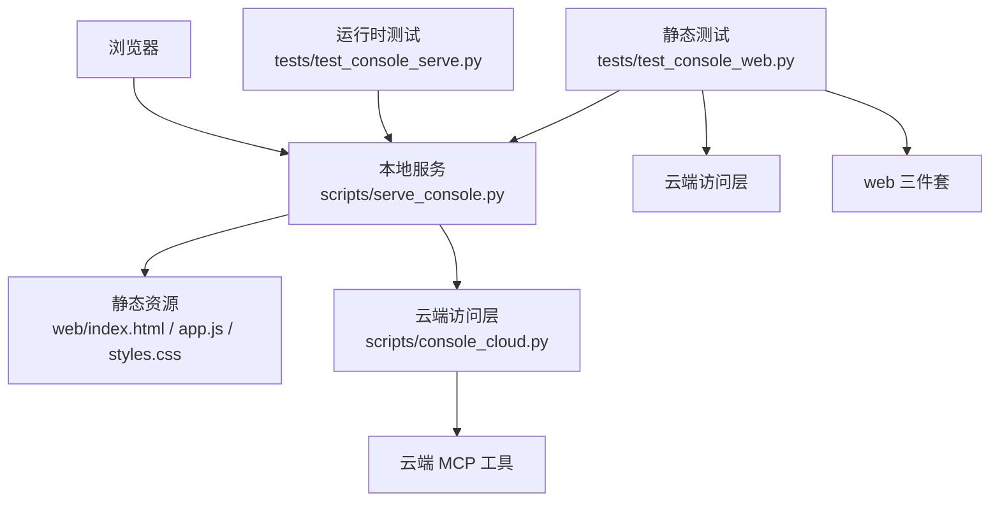
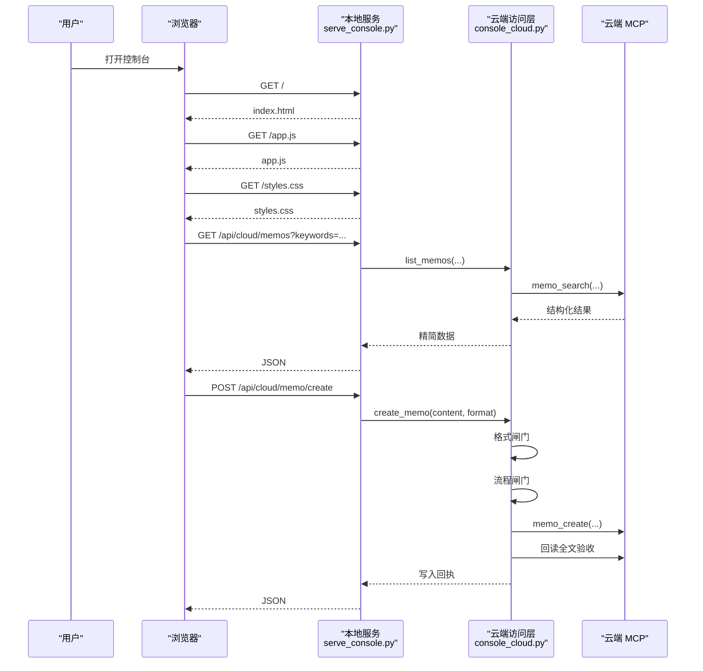
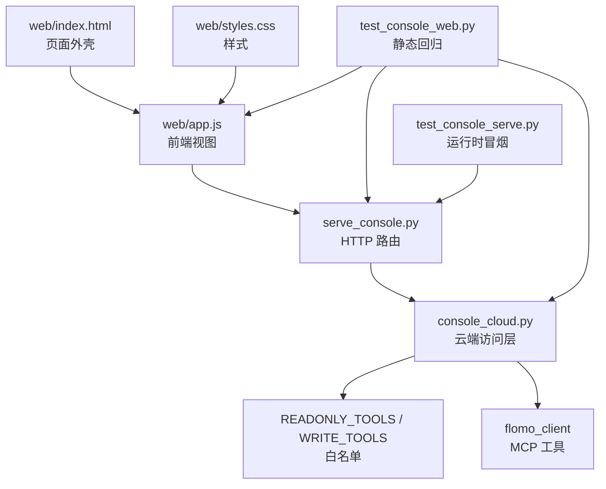

# 扩展开发指南

<cite>
**本文引用的文件**
- [serve_console.py](file://scripts/serve_console.py)
- [console_cloud.py](file://scripts/console_cloud.py)
- [index.html](file://web/index.html)
- [app.js](file://web/app.js)
- [styles.css](file://web/styles.css)
- [test_console_web.py](file://tests/test_console_web.py)
- [test_console_serve.py](file://tests/test_console_serve.py)
</cite>

## 目录

1. [引言](#引言)
2. [项目结构](#项目结构)
3. [核心组件](#核心组件)
4. [架构总览](#架构总览)
5. [新增后端路由](#新增后端路由)
6. [新增前端视图](#新增前端视图)
7. [Playwright 渲染验证与测试配合](#playwright-渲染验证与测试配合)
8. [最小增量示例：新增只读视图](#最小增量示例新增只读视图)
9. [依赖关系分析](#依赖关系分析)
10. [性能与安全注意事项](#性能与安全注意事项)
11. [故障排查](#故障排查)
12. [结论](#结论)

## 引言

本仓库的控制台由「本地静态页面 + 本地 HTTP 服务 + 云端 MCP 能力」组成。控制台本身不直接操作云端的业务逻辑，而是通过 `scripts/console_cloud.py` 暴露一组受白名单约束的读写方法；`scripts/serve_console.py` 负责把 URL 路由映射到这些方法，并把 `web/` 下的 HTML、JS、CSS 作为静态资源返回。

面向扩展开发者的核心规则是：

- **入口层要薄**：`serve_console.py` 只做请求来源校验、静态文件服务、URL 路由和 JSON 响应。
- **业务逻辑下沉**：所有云端调用集中在 `console_cloud.py`，包括参数归一化、白名单校验、闸门与回读验收。
- **外部调用走白名单**：读工具走 `READONLY_TOOLS`，写工具走 `WRITE_TOOLS`，不在集合中的工具名一律拒绝。
- **错误信息可机器解析**：返回体中应包含 `error` 等稳定字段，以便单元测试断言状态码与文案片段，而不是只断连接成功。
- **前后端对齐靠测试**：`tests/test_console_web.py` 检查源码层面是否“对得上”，`tests/test_console_serve.py` 检查运行时是否能“真起服务、真返回”。

## 项目结构

控制台的代码组织按职责分层，而不是按功能文件夹切分：

| 路径 | 职责 |
|---|---|
| `scripts/serve_console.py` | 本地 HTTP 服务、静态文件代理、GET/POST 路由、请求来源校验 |
| `scripts/console_cloud.py` | 云端访问层、读/写白名单、参数校验、闸门与回读验收 |
| `web/index.html` | 控制台外壳：侧栏导航、主内容区、抽屉、编辑器、提示条 |
| `web/app.js` | 前端视图注册、API 调用、数据渲染、交互事件 |
| `web/styles.css` | 控制台样式，无外部字体与第三方依赖 |
| `tests/test_console_web.py` | 静态回归：导航 ↔ 视图注册 ↔ 元信息 ↔ 路由表 ↔ 按钮事件 |
| `tests/test_console_serve.py` | 运行时冒烟：真实启动服务、真实发请求、检查 404/403/JSON 错误 |



**图示来源**
- [serve_console.py:1-60](file://scripts/serve_console.py#L1-L60)
- [console_cloud.py:1-40](file://scripts/console_cloud.py#L1-L40)
- [test_console_web.py:1-40](file://tests/test_console_web.py#L1-L40)
- [test_console_serve.py:1-40](file://tests/test_console_serve.py#L1-L40)

**章节来源**
- [serve_console.py:1-60](file://scripts/serve_console.py#L1-L60)
- [console_cloud.py:1-40](file://scripts/console_cloud.py#L1-L40)
- [test_console_web.py:1-40](file://tests/test_console_web.py#L1-L40)
- [test_console_serve.py:1-40](file://tests/test_console_serve.py#L1-L40)

## 核心组件

### 本地服务：serve_console.py

`serve_console.py` 是一个基于 Python 标准库 `http.server` 的线程型 HTTP 服务器，主要承担四件事：

1. **请求来源校验**：检查 Host 宿主名是否在允许列表中；若带 Origin，则 Origin 宿主名也必须同源。这是为了防 DNS 重绑定与跨站写。
2. **静态文件服务**：将 `/`、`/styles.css`、`/app.js` 以及其它合法后缀文件从 `web/` 目录返回，并做路径逃逸防护。
3. **GET 路由**：把 `/api/overview` 与一组 `/api/cloud/*` 只读接口映射到 `ConsoleReader` 方法。
4. **POST 路由**：把校验、闸门、创建、更新、标签重命名与通用只读执行入口映射到 `ConsoleReader` 方法。

它不实现任何云端业务判断，也不直接执行命令；所有外部调用都委托给 `console_cloud.CloudReader`。

**章节来源**
- [serve_console.py:1-60](file://scripts/serve_console.py#L1-L60)
- [serve_console.py:201-270](file://scripts/serve_console.py#L201-L270)
- [serve_console.py:271-360](file://scripts/serve_console.py#L271-L360)
- [serve_console.py:361-424](file://scripts/serve_console.py#L361-L424)

### 云端访问层：console_cloud.py

`console_cloud.py` 是控制台与云端之间的唯一契约面。它定义了：

- 读工具白名单 `READONLY_TOOLS`。
- 写工具白名单 `WRITE_TOOLS`。
- 写入门槛说明 `WRITE_TOOLS_REASON`。
- 各类限制常量：最大列表数、批量上限、标签树上限、草稿前缀、仓库根等。
- `CloudError` 异常类型。
- 实际业务方法：列/搜卡片、单卡全文、批量全文、相关笔记、今日回顾、标签树、标签名搜索、记忆文档、用户画像、格式规范、标签规范、工具清单、通用读工具执行入口、校验、流程闸门、创建、更新、标签重命名等。

关键设计点：

- 白名单不是“预留权限空间”，而是“恰好等于本模块实际调用的工具”；加能力必须先加方法，再加白名单。
- 写通道不是直通：创建/更新前先过格式闸门与流程闸门，写入后回读全文验收。
- 正文不落盘，仅当轮草稿落盘，并由收尾清理回收。
- token 不出进程，对外只暴露可用与否。

**章节来源**
- [console_cloud.py:1-120](file://scripts/console_cloud.py#L1-L120)
- [console_cloud.py:121-200](file://scripts/console_cloud.py#L121-L200)

### 前端三件套

#### web/index.html

HTML 提供控制台的骨架：

- 侧栏品牌区、导航按钮、连接状态、脚注。
- 主区域顶部标题与刷新按钮。
- 统计区 `#stats`。
- 当前视图容器 `#view`。
- 抽屉用于展示单卡详情与相关笔记。
- 编辑器用于新建/编辑卡片、跑闸门、提交写入。
- 全局提示条 `#toast`。

新增视图时，通常不需要改导航结构（除非新增独立一级视图），而是复用现有 `#view` 容器并在 JS 中切换渲染内容。

**章节来源**
- [index.html:1-162](file://web/index.html#L1-L162)

#### web/app.js

JS 是控制台的前端控制器，负责：

- 视图元信息 `VIEW_META`。
- 全局状态 `state`。
- API 调用封装 `api`、`get`、`cloudApi`、`cloudPost`。
- 各视图的数据获取与渲染函数。
- 导航点击、抽屉打开关闭、编辑器校验/闸门/保存、标签重命名等交互。

新增只读视图的最小改动通常是：在已有视图中追加一个分支，或在 `VIEWS` 注册新视图函数。

**章节来源**
- [app.js:1-60](file://web/app.js#L1-L60)
- [app.js:61-120](file://web/app.js#L61-L120)

#### web/styles.css

CSS 定义颜色变量、布局、侧栏、按钮、统计条、卡片、徽标等样式。新增视图应尽量复用现有类名，避免引入新的视觉体系。

**章节来源**
- [styles.css:1-120](file://web/styles.css#L1-L120)

### 测试层

#### tests/test_console_web.py

该测试是静态回归：不启动服务，也不联网，只读取以下文件源码并用正则断言：

- 导航项、视图注册表、视图元信息三者一致。
- 默认视图与高亮项一致。
- 前端请求的 `/api/...` 都在服务路由表中。
- 服务路由与前端调用一一对应。
- 页面零外部依赖。
- 写调用走 `cloudPost`，不直连云端。
- 按钮都有对应的事件处理。
- POST 路由中只有写接口和通用只读执行入口。
- 截断必须显式声明，不能静默丢弃。
- 前端批量上限与服务端 `BATCH_MAX` 一致。
- 重命名结果区分成功、部分完成与规模不足。

**章节来源**
- [test_console_web.py:1-60](file://tests/test_console_web.py#L1-L60)
- [test_console_web.py:61-213](file://tests/test_console_web.py#L61-L213)

#### tests/test_console_serve.py

该测试是运行时冒烟：真实启动 `serve_console.py`，随机端口监听，再用 `http.client` 直接发送请求，断言：

- 首页返回 HTML。
- 样式与脚本可取且非空。
- `/api/overview` 返回含项目统计与云端状态的 JSON。
- 响应体不含 token 或鉴权头。
- 未知路径返回 404。
- 四种 `..` 路径写法都逃不出 `web/`。
- 未知写路由返回 404 且带 JSON 错误体。
- 通用执行入口 `/api/cloud/tool` 拒绝写工具、空工具名、白名单外工具，返回 422。
- 畸形 JSON 请求体返回 400 与错误体。
- 端口被占用时第二个实例以退出码 2 退出。

**章节来源**
- [test_console_serve.py:1-60](file://tests/test_console_serve.py#L1-L60)
- [test_console_serve.py:61-200](file://tests/test_console_serve.py#L61-L200)

## 架构总览

控制台请求的典型路径如下：



**图示来源**
- [serve_console.py:271-360](file://scripts/serve_console.py#L271-L360)
- [console_cloud.py:1-120](file://scripts/console_cloud.py#L1-L120)

## 新增后端路由

新增后端路由遵循“先服务，再访问层，最后前端”的顺序。

### 第一步：在 serve_console.py 中添加 URL 规则

对于只读 GET 路由，应在 `do_GET` 方法的 `cloud_routes` 字典中添加条目；对于写 POST 路由，应在 `do_POST` 方法的 `routes` 字典中添加条目。

推荐步骤：

1. 确定 URL 路径，例如 `/api/cloud/my_feature`。
2. 在 `do_GET` 或 `do_POST` 的路由字典中注册该路径。
3. 路由值应是一个 lambda，接收 `r`（即 `CloudReader` 实例）并调用对应方法。
4. 查询参数通过 `self._q(q, key, default)` 提取；POST 参数通过 `_read_json()` 读取。
5. 如果路由可能抛错，交给统一出口 `_cloud`，它会返回带 `error` 字段的 JSON。

注意：

- 只读路由放在 `cloud_routes`，并通过 `_cloud` 包装。
- 写路由放在 `do_POST` 的 `routes`，同样通过 `_cloud(err_code=422)` 包装。
- 不要在本文件中实现业务判断；只负责映射。

**章节来源**
- [serve_console.py:271-360](file://scripts/serve_console.py#L271-L360)
- [serve_console.py:361-424](file://scripts/serve_console.py#L361-L424)

### 第二步：在 console_cloud.py 中实现方法并放入白名单

新增只读能力时：

1. 在 `console_cloud.py` 中实现一个新方法，例如 `my_feature(...)`。
2. 该方法内部使用 `CloudReader` 或其他既有能力，最终返回前端可直接渲染的结构。
3. 如果该方法调用了某个云端 MCP 工具，确保该工具名已在 `READONLY_TOOLS` 中。
4. 如果新增的是写方法，则在 `WRITE_TOOLS` 中加入对应工具，并保证经过格式与流程闸门。

白名单是安全边界，不是可选配置。新增方法却忘记加白名单，会在运行时报错；新增工具名却不在方法中使用，会破坏“白名单恰好等于实际调用”的一致性，导致回归测试失败。

**章节来源**
- [console_cloud.py:1-120](file://scripts/console_cloud.py#L1-L120)
- [console_cloud.py:121-200](file://scripts/console_cloud.py#L121-L200)

### 第三步：前端调用

前端不应绕过服务直接请求云端。新增视图应从 `cloudApi` 或 `cloudPost` 发起请求，路径形如 `/api/cloud/my_feature`。

- 只读数据用 `cloudApi("/api/cloud/my_feature")`。
- 写数据用 `cloudPost("/api/cloud/my_feature", body)`。
- 错误对象应包含 `error`，并可附带 `status`，以便界面显示状态码与原因。

**章节来源**
- [app.js:61-120](file://web/app.js#L61-L120)

## 新增前端视图

新增前端视图的最小变更通常涉及三个文件：HTML、JS、CSS。

### 在 web/index.html 添加容器与模板

如果新增的是一个独立一级视图，需要：

1. 在侧栏导航中添加一个 `<button class="nav-item" data-view="xxx">`。
2. 为默认视图保持 `is-active` 与正确的 `data-view`。
3. 如果新增的是子视图或局部面板，可以复用 `#view` 容器，通过 JS 动态替换其内容。

建议：

- 容器 ID 语义清晰，例如 `#view-my-feature`。
- 模板结构尽量简单，优先使用 `innerHTML` 渲染已转义文本。
- 可访问性属性保留，例如 `aria-hidden`、`role`、`aria-live`。

**章节来源**
- [index.html:1-162](file://web/index.html#L1-L162)

### 在 web/app.js 中注册视图切换与渲染逻辑

新增视图至少需要：

1. 一个渲染函数，例如 `renderMyFeature(data)`。
2. 一个数据获取函数，例如 `fetchMyFeature()`。
3. 在 `VIEWS` 中将视图键映射到渲染函数。
4. 在 `VIEW_META` 中补充标题与副标题。
5. 在导航点击事件中触发对应渲染。
6. 如果新增按钮，必须在 JS 中绑定事件处理器，否则 `test_console_web.py` 会报“按钮没有事件处理”。

推荐模式：

- 渲染函数接收服务端返回的数据。
- 渲染前对字符串进行转义。
- 加载态、空数据态、错误态分别处理。
- 错误信息来自 `cloudApi` 返回的 `{ error }`。

**章节来源**
- [app.js:1-60](file://web/app.js#L1-L60)
- [app.js:61-120](file://web/app.js#L61-L120)

### 在 web/styles.css 中补充样式

新增样式时应：

- 优先复用现有变量，如 `--bg`、`--surface`、`--ink`、`--accent`。
- 复用 `.card`、`.section-head`、`.badge`、`.btn` 等基础类。
- 为新容器添加语义化类名，例如 `.my-feature-card`。
- 不引入远程 CSS、不引入外部字体。
- 保持移动端可读性，避免固定宽度导致溢出。

**章节来源**
- [styles.css:1-120](file://web/styles.css#L1-L120)

## Playwright 渲染验证与测试配合

当前仓库中，控制台的前端回归主要由 `tests/test_console_web.py` 完成；运行时冒烟由 `tests/test_console_serve.py` 完成。两者都不是传统意义上的 Playwright 端到端用例，但它们共同覆盖了“静态对得上 + 运行时能工作”的核心需求。

### 静态测试：test_console_web.py

它相当于“编译期”的约束，检查：

- 导航、视图注册、元信息三者一致。
- 前端调用的 API 与后端路由表一致。
- 按钮都有事件处理。
- 页面零外部依赖。
- 写调用不走只读入口。
- 截断与批量上限具名且显式。
- 前端批量上限与服务端 `BATCH_MAX` 一致。

这意味着：如果你新增了一个只读视图，但没有在服务端注册路由，`test_console_web.py` 就能发现“服务缺失该接口”；如果你注册了路由但前端没调用，也能发现“服务独有路由”。

### 运行时测试：test_console_serve.py

它更像“冒烟测试”，检查：

- 服务能否启动。
- 静态资源能否返回。
- 已知接口能否返回预期 JSON。
- 未知路径是否 404。
- 路径逃逸是否被拦截。
- 通用执行入口是否拒绝写工具与白名单外工具。
- 畸形请求是否返回 400。
- 端口冲突是否以退出码 2 拒绝。

### 如果需要加入 Playwright 验证

虽然当前仓库未直接使用 Playwright，但可以在现有测试基础上扩展端到端场景，例如：

1. 启动本地服务。
2. 使用 Playwright 打开 `http://127.0.0.1:<端口>/`。
3. 等待 `#view` 渲染出目标内容。
4. 断言页面中存在稳定的选择器，例如新增容器的 ID。
5. 断言无 JavaScript 控制台错误。
6. 断言网络请求命中新增的 `/api/cloud/xxx`。
7. 断言错误分支能显示机器可读的错误文案。

Playwright 适合验证“用户可见行为”，而 `test_console_web.py` 适合防止“改了前端忘了后端”这类结构性失配。两者互补。

**章节来源**
- [test_console_web.py:1-60](file://tests/test_console_web.py#L1-L60)
- [test_console_serve.py:1-60](file://tests/test_console_serve.py#L1-L60)

## 最小增量示例：新增只读视图

下面给出“新增只读视图”的最小增量步骤。为避免粘贴具体代码，这里只列出应修改的文件位置与断言目标。

### 后端变更

1. 在 `scripts/console_cloud.py` 中新增一个只读方法，例如：

   - 方法名：`my_feature`
   - 输入：少量查询参数
   - 输出：前端可直接渲染的字典或列表
   - 不调用白名单外的工具

2. 如果该方法调用了 MCP 工具，确保该工具名在 `READONLY_TOOLS` 中。

3. 在 `scripts/serve_console.py` 的 `do_GET` 中注册路由，例如：

   - URL：`/api/cloud/my_feature`
   - 调用：`r.my_feature(...)`
   - 查询参数通过 `self._q` 提取

4. 保持路由返回值结构简单，错误通过 `CloudError` 抛出，由 `_cloud` 转为 JSON。

**章节来源**
- [console_cloud.py:1-120](file://scripts/console_cloud.py#L1-L120)
- [serve_console.py:271-360](file://scripts/serve_console.py#L271-L360)

### 前端 HTML 变更

在 `web/index.html` 中：

- 如需一级导航，增加一个 `data-view="my_feature"` 的导航按钮。
- 如需二级面板，在 `#view` 容器中预留渲染目标。
- 保持结构简洁，不引入外部脚本或样式。

**章节来源**
- [index.html:1-162](file://web/index.html#L1-L162)

### 前端 JS 变更

在 `web/app.js` 中：

1. 新增渲染函数，例如 `renderMyFeature(data)`。
2. 新增数据获取函数，例如 `fetchMyFeature()`，调用 `cloudApi("/api/cloud/my_feature")`。
3. 在 `VIEWS` 中注册 `my_feature: renderMyFeature`。
4. 在 `VIEW_META` 中补充标题与副标题。
5. 在默认视图或初始化逻辑中调用 `fetchMyFeature()`。
6. 如需按钮，绑定点击事件，并在出错时显示 `data.error`。

**章节来源**
- [app.js:1-60](file://web/app.js#L1-L60)
- [app.js:61-120](file://web/app.js#L61-L120)

### 前端 CSS 变更

在 `web/styles.css` 中：

- 为新容器添加类名，例如 `.my-feature-list`。
- 复用现有颜色变量与间距。
- 不引入远程资源。

**章节来源**
- [styles.css:1-120](file://web/styles.css#L1-L120)

### 测试覆盖

1. 运行 `python tests/test_console_web.py`：
   - 确认新增路由出现在服务路由表。
   - 确认前端确实调用该路由。
   - 确认新增按钮有事件处理。
   - 确认没有新增外部依赖。

2. 运行 `python tests/test_console_serve.py`：
   - 确认服务能启动。
   - 确认新增只读接口返回 200 与 JSON。
   - 确认未知路径仍返回 404。

**章节来源**
- [test_console_web.py:61-213](file://tests/test_console_web.py#L61-L213)
- [test_console_serve.py:61-200](file://tests/test_console_serve.py#L61-L200)

### 本地验证步骤

1. 启动服务：

   ```bash
   python scripts/serve_console.py --port 8787
   ```

2. 在浏览器打开：

   ```
   http://127.0.0.1:8787/
   ```

3. 切换到新增视图，检查：

   - 页面能加载。
   - 数据能渲染。
   - 空数据时有友好提示。
   - 错误时显示 `error` 文案。
   - 刷新后数据重新拉取。

4. 在开发者工具中检查：

   - 网络请求命中 `/api/cloud/my_feature`。
   - 响应体为 JSON。
   - 无跨域错误。
   - 无外部资源请求。

5. 运行测试：

   ```bash
   python tests/test_console_web.py
   python tests/test_console_serve.py
   ```

## 依赖关系分析

控制台的关键依赖关系如下：



**图示来源**
- [serve_console.py:1-60](file://scripts/serve_console.py#L1-L60)
- [console_cloud.py:1-120](file://scripts/console_cloud.py#L1-L120)
- [test_console_web.py:1-40](file://tests/test_console_web.py#L1-L40)
- [test_console_serve.py:1-40](file://tests/test_console_serve.py#L1-L40)

**章节来源**
- [serve_console.py:1-60](file://scripts/serve_console.py#L1-L60)
- [console_cloud.py:1-120](file://scripts/console_cloud.py#L1-L120)
- [test_console_web.py:1-40](file://tests/test_console_web.py#L1-L40)
- [test_console_serve.py:1-40](file://tests/test_console_serve.py#L1-L40)

## 性能与安全注意事项

### 性能

- 只读数据采用前端缓存：`app.js` 中对 `/api/...` 的请求会缓存一次，刷新或切换状态后重新拉取。
- 批量取全文有限制：前端 `BATCH_LIMIT` 必须与 `console_cloud.BATCH_MAX` 一致，否则会静默丢数据。
- 列表摘要长度有限制：`EXCERPT_CHARS` 控制摘要字符数，全文需单独请求。
- 标签树、工具清单等大数据集有服务端 `limit` 上限。

### 安全

- 请求来源必须通过 Host 与 Origin 校验。
- 静态文件只能从 `web/` 内读取，`..` 逃逸返回 403。
- 文件后缀在白名单内才返回。
- 写请求必须走 POST，且全部经 `console_cloud` 的白名单与闸门。
- token 不进入响应体、日志或缓存。
- 非回环绑定必须显式开启 `--allow-lan`。

**章节来源**
- [serve_console.py:1-60](file://scripts/serve_console.py#L1-L60)
- [serve_console.py:201-270](file://scripts/serve_console.py#L201-L270)
- [console_cloud.py:1-120](file://scripts/console_cloud.py#L1-L120)
- [app.js:61-120](file://web/app.js#L61-L120)

## 故障排查

| 现象 | 可能原因 | 排查方式 |
|---|---|---|
| 新增路由 404 | 未在 `serve_console.py` 中注册 | 检查 `do_GET` 或 `do_POST` 的路由字典 |
| 前端报错“服务缺失接口” | 前端调用了后端未注册的路径 | 运行 `test_console_web.py` |
| 后端报错白名单外工具 | MCP 工具名未加入 `READONLY_TOOLS` 或 `WRITE_TOOLS` | 检查 `console_cloud.py` 白名单 |
| 写接口返回 422 | 格式闸门或流程闸门未通过 | 查看返回体中的 `error` |
| 写接口返回 502 | 云端不可用或连接失败 | 检查 token 与 MCP 配置 |
| 页面空白或无响应 | 新增视图函数不存在或渲染函数名写错 | 检查 `VIEWS` 与 JS 中函数定义 |
| 按钮点了没反应 | HTML 中有按钮但 JS 中没有事件处理 | 检查 `test_console_web.py` 的按钮断言 |
| 服务无法启动 | 端口被占用或非回环绑定未加 `--allow-lan` | 检查命令行参数与端口占用 |
| 双实例内容闪烁 | 同一端口有两个服务实例 | 换端口或先停旧实例 |
| 静态文件 403 | 路径逃逸或非法后缀 | 检查 URL 是否包含 `..` |
| 未知写路由 404 | POST 路径未注册 | 检查 `do_POST` 的 `routes` |

**章节来源**
- [serve_console.py:201-424](file://scripts/serve_console.py#L201-L424)
- [test_console_web.py:61-213](file://tests/test_console_web.py#L61-L213)
- [test_console_serve.py:61-200](file://tests/test_console_serve.py#L61-L200)

## 结论

扩展控制台的最佳实践可以总结为一句：**“服务层只认 URL，访问层只认白名单，前端只认 JSON。”**

新增只读视图的最小路径是：

1. 在 `console_cloud.py` 中实现只读方法。
2. 确保 MCP 工具名在 `READONLY_TOOLS` 中。
3. 在 `serve_console.py` 的 `cloud_routes` 中注册 GET 路由。
4. 在 `web/app.js` 中注册视图函数与元信息。
5. 在 `web/index.html` 中补充导航或容器。
6. 在 `web/styles.css` 中补充样式。
7. 用 `test_console_web.py` 检查静态一致性。
8. 用 `test_console_serve.py` 检查服务能起、路由能返回。
9. 手动在浏览器中验证渲染、空数据、错误与刷新行为。

这样既能保持入口层薄、业务逻辑集中，又能让新增功能同时通过静态回归与运行时冒烟，降低“前端改了后端没改”的风险。