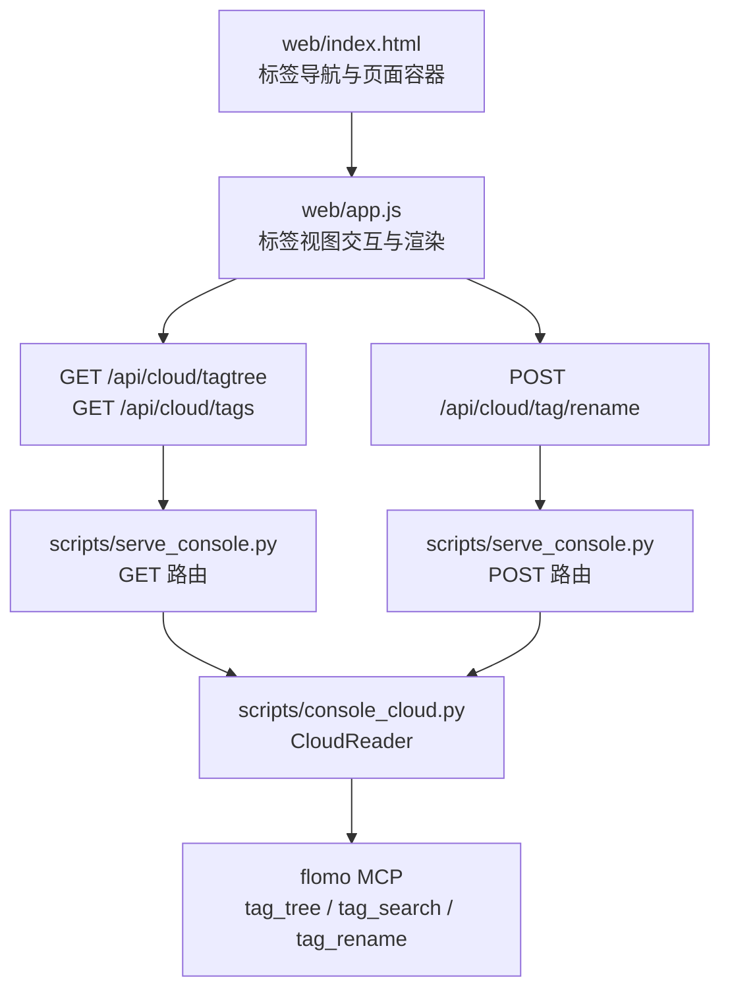
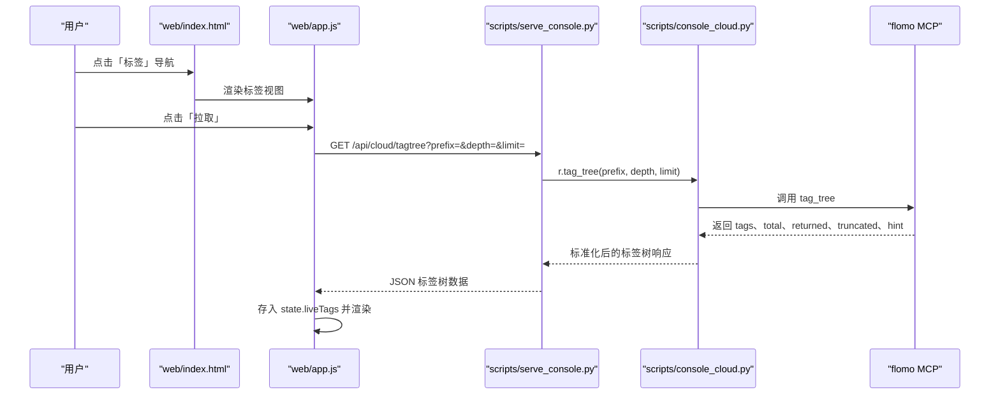
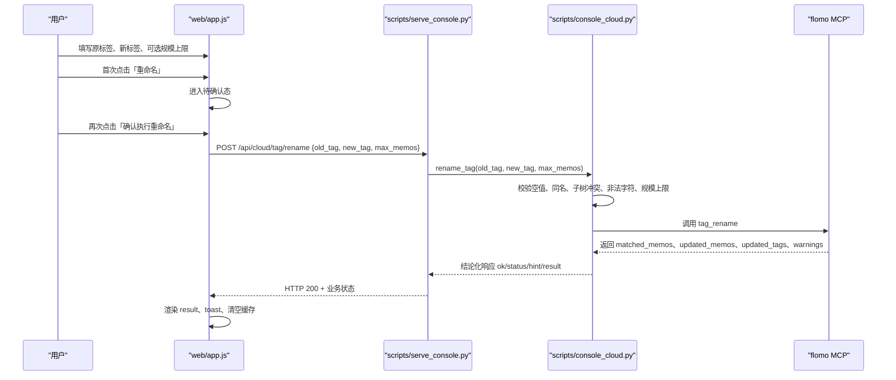
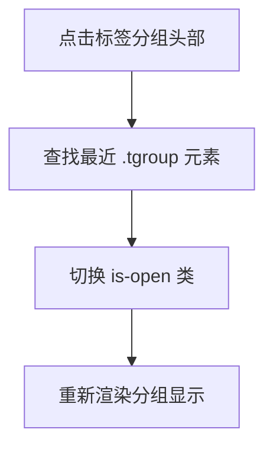
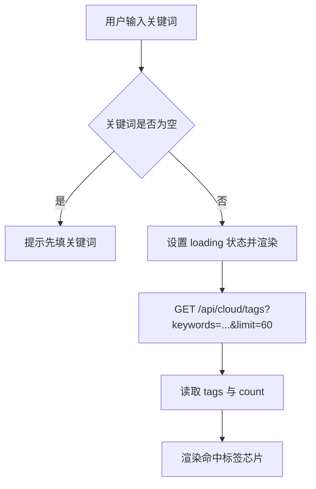
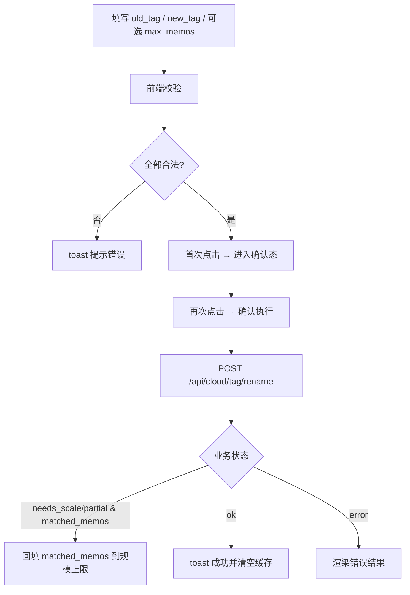
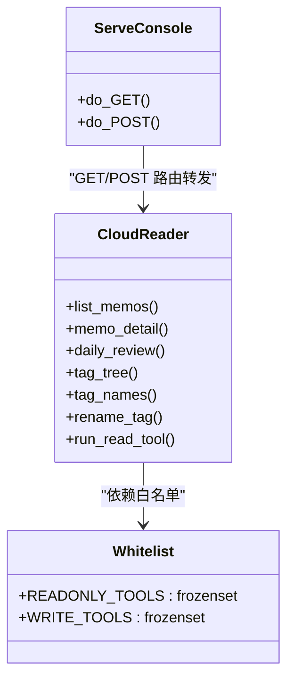
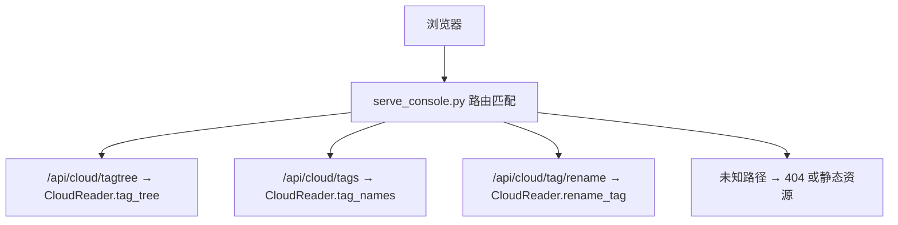
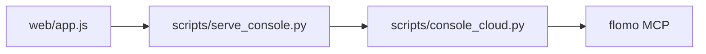

# 标签视图

<cite>
**本文引用的文件**   
- [scripts/console_cloud.py](file://scripts/console_cloud.py)
- [scripts/serve_console.py](file://scripts/serve_console.py)
- [web/app.js](file://web/app.js)
- [web/index.html](file://web/index.html)
- [README.md](file://README.md)
</cite>

## 目录
1. [简介](#简介)
2. [项目结构中的标签相关位置](#项目结构中的标签相关位置)
3. [核心组件总览](#核心组件总览)
4. [架构总览：从前端到云端标签树与重命名](#架构总览从前端到云端标签树与重命名)
5. [详细组件分析](#详细组件分析)
6. [依赖关系分析](#依赖关系分析)
7. [性能与限制](#性能与限制)
8. [操作示例：查找重复二级标签并批量重命名](#操作示例查找重复二级标签并批量重命名)
9. [注意事项与故障排查](#注意事项与故障排查)
10. [结论](#结论)

## 简介
标签视图是控制台四个主要视图之一，负责展示云端实时标签树、按名称搜索标签，以及批量重命名旧标签为新标签。它同时承担两类职责：
- **用户侧**：浏览层级标签、展开折叠分组、搜索过滤、高亮命中词、执行二次确认的批量重命名。
- **开发者侧**：理解 `/api/cloud/tagtree` 如何返回扁平标签字符串列表、`/api/cloud/tags` 如何返回标签名搜索结果、`POST /api/cloud/tag/rename` 如何提交旧标签与新标签映射，以及后端白名单与路由如何放行这些操作。

## 项目结构中的标签相关位置
| 层次 | 文件 | 职责 |
|---|---|---|
| 前端页面骨架 | `web/index.html` | 提供「标签」导航项、主容器和全局提示区，不直接实现标签逻辑。 |
| 前端交互与渲染 | `web/app.js` | 状态管理、标签树加载、标签名搜索、重命名流程、事件处理、结果渲染。 |
| 服务层路由 | `scripts/serve_console.py` | 把 GET `/api/cloud/tagtree`、GET `/api/cloud/tags`、POST `/api/cloud/tag/rename` 转发给云端访问层。 |
| 云端访问层 | `scripts/console_cloud.py` | 维护读工具白名单与写工具白名单；调用 flomo MCP 的 `tag_tree`、`tag_search`、`tag_rename`；做参数校验与重命名结论判定。 |
| 文档入口 | `README.md` | 说明控制台四个视图、标签视图能力、接口契约及重命名语义。 |

**图表来源**
- [web/index.html:22-43](file://web/index.html#L22-L43)
- [web/app.js:650-707](file://web/app.js#L650-L707)
- [scripts/serve_console.py:262-304](file://scripts/serve_console.py#L262-L304)
- [scripts/serve_console.py:337-363](file://scripts/serve_console.py#L337-L363)
- [scripts/console_cloud.py:581-619](file://scripts/console_cloud.py#L581-L619)
- [scripts/console_cloud.py:812-860](file://scripts/console_cloud.py#L812-L860)

**章节来源**
- [web/index.html:22-43](file://web/index.html#L22-L43)
- [README.md:170-200](file://README.md#L170-L200)

## 核心组件总览
| 组件 | 关键方法或行为 | 输入 | 输出 |
|---|---|---|---|
| 前端标签状态 | `state.liveTags`、`state.liveNames`、`state.renameResult`、`state.renConfirm` | 用户填写的前缀、深度、条数、关键词、旧标签、新标签、规模上限 | 渲染标签树、搜索结果、重命名结果 |
| 前端标签树加载 | `loadLiveTags()` | `prefix`、`depth`、`limit` | 调用 `/api/cloud/tagtree`，更新 `state.liveTags` |
| 前端标签名搜索 | `loadTagNames(kw)` | `keywords`、固定 `limit=60` | 调用 `/api/cloud/tags`，更新 `state.liveNames` |
| 前端重命名 | `runTagRename()` | `old_tag`、`new_tag`、可选 `max_memos` | POST `/api/cloud/tag/rename`，更新 `state.renameResult` |
| 后端 GET 路由 | `do_GET()` | URL 路径与查询参数 | 匹配 `/api/cloud/tagtree`、`/api/cloud/tags` 后交给 `CloudReader` |
| 后端 POST 路由 | `do_POST()` | JSON body | 匹配 `/api/cloud/tag/rename` 后交给 `CloudReader.rename_tag()` |
| 云端标签树 | `CloudReader.tag_tree()` | `prefix`、`depth`、`limit` | 扁平标签字符串数组 + 分页元信息 |
| 云端标签名搜索 | `CloudReader.tag_names()` | `keywords`、`limit` | 标签名字符串数组 |
| 云端批量重命名 | `CloudReader.rename_tag()` | `old_tag`、`new_tag`、可选 `max_memos` | `ok`、`status`、`matched_memos`、`updated_memos`、`hint`、原始回执等 |

**章节来源**
- [web/app.js:30-52](file://web/app.js#L30-L52)
- [web/app.js:1040-1090](file://web/app.js#L1040-L1090)
- [scripts/serve_console.py:262-304](file://scripts/serve_console.py#L262-L304)
- [scripts/serve_console.py:337-363](file://scripts/serve_console.py#L337-L363)
- [scripts/console_cloud.py:581-619](file://scripts/console_cloud.py#L581-L619)
- [scripts/console_cloud.py:812-860](file://scripts/console_cloud.py#L812-L860)

## 架构总览：从前端到云端标签树与重命名

### 标签树请求流程

**图表来源**
- [web/index.html:22-43](file://web/index.html#L22-L43)
- [web/app.js:650-707](file://web/app.js#L650-L707)
- [web/app.js:1040-1052](file://web/app.js#L1040-L1052)
- [scripts/serve_console.py:262-304](file://scripts/serve_console.py#L262-L304)
- [scripts/console_cloud.py:581-603](file://scripts/console_cloud.py#L581-L603)

### 重命名请求流程

**图表来源**
- [web/app.js:650-707](file://web/app.js#L650-L707)
- [web/app.js:1040-1090](file://web/app.js#L1040-L1090)
- [scripts/serve_console.py:337-363](file://scripts/serve_console.py#L337-L363)
- [scripts/console_cloud.py:812-860](file://scripts/console_cloud.py#L812-L860)

## 详细组件分析

### 前端标签视图状态与渲染
前端使用单一状态对象保存标签视图相关数据：
- `liveTags`：当前标签树数据，可能是 `null`、`{loading: true}`、错误对象或成功对象。
- `liveNames`：标签名搜索结果，包含 `q`、`count`、`tags` 或 `error`。
- `renOld`、`renNew`、`renMax`：重命名输入框的值。
- `renConfirm`：是否已进入二次确认态。
- `renameResult`：重命名返回结果或 `{error}`。

渲染函数构造三块内容：
1. **实时标签树区块**：包含前缀、深度、条数输入框和「拉取」按钮。
2. **标签名搜索区块**：包含关键词输入框、搜索按钮和命中标签串。
3. **批量重命名区块**：包含旧标签、新标签、规模上限输入框，以及带确认状态的按钮。

当点击「拉取」时，前端将当前输入拼成查询参数，调用 `/api/cloud/tagtree`，并把结果写入 `state.liveTags`。  
当点击「搜索」时，前端对关键词做非空校验，然后调用 `/api/cloud/tags?keywords=...&limit=60`，把结果写入 `state.liveNames`。

**章节来源**
- [web/app.js:30-52](file://web/app.js#L30-L52)
- [web/app.js:650-707](file://web/app.js#L650-L707)
- [web/app.js:1040-1090](file://web/app.js#L1040-L1090)

### 标签树递归渲染、展开折叠与高亮
#### 递归渲染
`/api/cloud/tagtree` 返回的是扁平标签字符串数组。前端根据每个标签中 `/` 的数量确定层级，并按父级组织为分组。虽然本次检索未直接看到完整递归渲染函数源码，但从事件处理和结果结构可确认：
- 标签被组织为 `.tgroup` 分组。
- 分组头部 `.tgroup-head` 控制展开折叠。
- 分组通过 CSS 类 `is-open` 表示展开状态。
- 标签串以芯片形式呈现，并通过 `hl(text, q)` 高亮搜索命中。

#### 展开折叠
点击分组头部时，前端找到最近的 `.tgroup` 元素，切换其 `is-open` 类：

**图表来源**
- [web/app.js:1018-1021](file://web/app.js#L1018-L1021)

#### 高亮当前标签
高亮由 `hl(text, q)` 实现：
- 先转义 HTML 特殊字符，避免注入。
- 如果搜索词为空，直接返回安全文本。
- 否则在原始文本中查找搜索词出现位置。
- 命中部分用 `<mark>` 包裹，其余部分保持普通文本。

注意：该高亮用于标签名搜索结果中的芯片列表，而不是标签树节点本身。

**章节来源**
- [web/app.js:620-627](file://web/app.js#L620-L627)
- [web/app.js:701-707](file://web/app.js#L701-L707)
- [web/app.js:1018-1021](file://web/app.js#L1018-L1021)

### 搜索框如何过滤标签名称
搜索框对应 `tag_names` 接口，而非本地过滤整棵标签树：
1. 用户输入关键词。
2. 前端校验关键词非空。
3. 前端设置 `state.liveNames = { loading: true, q: kw }` 并触发渲染。
4. 前端调用 `/api/cloud/tags?keywords=encodeURIComponent(kw)&limit=60`。
5. 后端调用 `CloudReader.tag_names(keywords, limit)`。
6. 云端返回标签名数组，前端统计命中数量并渲染芯片列表。

这种设计适合标签很多的情况，因为它是“按需搜索”，而不是每次都拉全量标签树再本地过滤。

**图表来源**
- [web/app.js:1000-1015](file://web/app.js#L1000-L1015)
- [web/app.js:1052-1058](file://web/app.js#L1052-L1058)
- [scripts/console_cloud.py:605-619](file://scripts/console_cloud.py#L605-L619)

**章节来源**
- [web/app.js:650-707](file://web/app.js#L650-L707)
- [web/app.js:1000-1015](file://web/app.js#L1000-L1015)
- [web/app.js:1052-1058](file://web/app.js#L1052-L1058)
- [scripts/console_cloud.py:605-619](file://scripts/console_cloud.py#L605-L619)

### 批量重命名如何调用 `/tag/rename`
重命名是覆盖范围最大的写操作，因此采用两步确认：
1. 用户填写原标签和新标签，可选填写规模上限。
2. 前端去掉 `#` 前缀并去空白。
3. 若任一标签为空，提示必填。
4. 若规模上限已填，必须为正整数；否则提示错误。
5. 第一次点击按钮只进入确认态，不发送请求。
6. 第二次点击才发起 `POST /api/cloud/tag/rename`。
7. 如果服务端返回 `needs_scale` 或 `partial`，且带有 `matched_memos`，前端会把该数字回填到规模上限输入框，让用户确认后重试。
8. 成功后清空缓存、清空已加载标签树，并 toast 提示。

**图表来源**
- [web/app.js:1040-1090](file://web/app.js#L1040-L1090)

**章节来源**
- [web/app.js:650-707](file://web/app.js#L650-L707)
- [web/app.js:1040-1090](file://web/app.js#L1040-L1090)

### `console_cloud.py` 中对 `tagtree` 与 `tag/rename` 的白名单放行逻辑
`console_cloud.py` 定义了两组互斥的工具白名单：
- `READONLY_TOOLS`：只允许调用的读工具集合。
- `WRITE_TOOLS`：只允许调用的写工具集合。

标签树和标签名搜索属于读工具，因此依赖 `tag_tree` 和 `tag_search` 这两个读工具；批量重命名属于写工具，因此依赖 `tag_rename`。

| 功能 | 云端工具 | 白名单归属 | 后端方法 |
|---|---|---|---|
| 标签树 | `tag_tree` | `READONLY_TOOLS` | `tag_tree()` |
| 标签名搜索 | `tag_search` | `READONLY_TOOLS` | `tag_names()` |
| 批量重命名 | `tag_rename` | `WRITE_TOOLS` | `rename_tag()` |

此外，通用只读执行入口 `run_read_tool()` 会显式拒绝写工具，防止写操作绕过格式闸门、流程闸门和回读验收。

**图表来源**
- [scripts/console_cloud.py:89-103](file://scripts/console_cloud.py#L89-L103)
- [scripts/console_cloud.py:581-619](file://scripts/console_cloud.py#L581-L619)
- [scripts/console_cloud.py:812-860](file://scripts/console_cloud.py#L812-L860)
- [scripts/serve_console.py:262-304](file://scripts/serve_console.py#L262-L304)
- [scripts/serve_console.py:337-363](file://scripts/serve_console.py#L337-L363)

**章节来源**
- [scripts/console_cloud.py:89-103](file://scripts/console_cloud.py#L89-L103)
- [scripts/console_cloud.py:581-619](file://scripts/console_cloud.py#L581-L619)
- [scripts/console_cloud.py:812-860](file://scripts/console_cloud.py#L812-L860)
- [scripts/serve_console.py:262-304](file://scripts/serve_console.py#L262-L304)
- [scripts/serve_console.py:337-363](file://scripts/serve_console.py#L337-L363)

### `serve_console.py` 的路由处理
`serve_console.py` 是一个本地 HTTP 服务，把浏览器请求转发到 `CloudReader`：

- **GET 路由**：
  - `/api/cloud/tagtree`：接收 `prefix`、`depth`、`limit`，调用 `r.tag_tree()`。
  - `/api/cloud/tags`：接收 `keywords`、`limit`，调用 `r.tag_names()`。
- **POST 路由**：
  - `/api/cloud/tag/rename`：接收 JSON body 中的 `old_tag`、`new_tag`、`max_memos`，调用 `r.rename_tag()`。
  - 其他写接口统一走 422 错误码包装，未知路径返回 404。

所有请求都会经过同源检查，防止跨站伪造请求。

**图表来源**
- [scripts/serve_console.py:262-304](file://scripts/serve_console.py#L262-L304)
- [scripts/serve_console.py:337-363](file://scripts/serve_console.py#L337-L363)

**章节来源**
- [scripts/serve_console.py:262-304](file://scripts/serve_console.py#L262-L304)
- [scripts/serve_console.py:337-363](file://scripts/serve_console.py#L337-L363)

## 依赖关系分析
- 前端 `web/app.js` 依赖后端 REST 接口，不直接访问 flomo。
- 后端 `scripts/serve_console.py` 是薄路由层，只负责路径分发、JSON 解析和错误码包装。
- 云端访问层 `scripts/console_cloud.py` 是唯一真正调用 flomo MCP 的地方，同时集中实现白名单、参数校验和业务结论。
- 标签树、标签名搜索、批量重命名三者共享同一套网络通道，但标签树和标签名搜索属于读能力，批量重命名属于写能力。

**图表来源**
- [web/app.js:1040-1090](file://web/app.js#L1040-L1090)
- [scripts/serve_console.py:262-363](file://scripts/serve_console.py#L262-L363)
- [scripts/console_cloud.py:581-860](file://scripts/console_cloud.py#L581-L860)

**章节来源**
- [web/app.js:1040-1090](file://web/app.js#L1040-L1090)
- [scripts/serve_console.py:262-363](file://scripts/serve_console.py#L262-L363)
- [scripts/console_cloud.py:581-860](file://scripts/console_cloud.py#L581-L860)

## 性能与限制
| 项目 | 限制或默认值 | 说明 |
|---|---:|---|
| 标签树默认条数 | 200 | 可通过 `limit` 调整，最大 1000。 |
| 标签树深度 | 1~10 | 超出范围会被截断到有效区间。 |
| 标签名搜索默认条数 | 20 | 前端搜索时使用 60。 |
| 批量重命名默认规模 | 200 | 超过时需显式声明 `max_memos`。 |
| 批量重命名绝对上限 | 2000 | 超过会抛出错误，不会静默截断。 |
| 网络失败处理 | 前端统一降级 | 本地服务无响应或非 JSON 响应会转为错误对象，不中断整个页面。 |

**章节来源**
- [scripts/console_cloud.py:103-130](file://scripts/console_cloud.py#L103-L130)
- [scripts/console_cloud.py:581-619](file://scripts/console_cloud.py#L581-L619)
- [scripts/console_cloud.py:812-860](file://scripts/console_cloud.py#L812-L860)
- [web/app.js:30-52](file://web/app.js#L30-L52)
- [web/app.js:1040-1090](file://web/app.js#L1040-L1090)

## 操作示例：查找重复二级标签并批量重命名
以下示例假设仓库中存在多个不同顶层但相同二级名称的标签，例如：
- `测试/连通性`
- `工程/连通性`
- `质量/连通性`

目标是将所有挂有旧二级标签的笔记迁移到新二级标签，例如统一改为 `测试/网络连通性`。

### 操作步骤
1. 打开控制台并切换到「标签」视图。
2. 在「标签名搜索」中输入重复二级名称，例如 `连通性`。
3. 查看命中标签列表，确认哪些标签存在重复或需要合并。
4. 在「标签重命名」区域：
   - 「原标签」填写旧标签，例如 `测试/连通性`。
   - 「新标签」填写新标签，例如 `测试/网络连通性`。
   - 「规模上限」留空表示按默认 200；如果预计匹配较多，可手动填写正整数。
5. 点击「重命名」。
6. 页面进入待确认态，再次点击「确认执行重命名」。
7. 查看底部结果：
   - 如果返回 `done`，表示匹配到的卡片都已完成重命名。
   - 如果返回 `needs_scale`，说明匹配数超过默认上限，应把提示中的 `matched_memos` 填入「规模上限」后重试。
   - 如果返回 `partial`，表示部分卡片已改名，可能出现标签分裂，需要检查结论并决定是否继续。
8. 完成后刷新标签树或重新拉取，确认旧标签不再被大量使用，新标签已生效。

### 补充建议
- 如果重复出现在多个顶层下，应先分别处理，每次只改一个旧标签到一个新标签，避免一次变更影响过多标签族。
- 重命名后务必拉取标签树复查，不能只看 toast 提示。
- 若搜索结果很多，优先使用「标签名搜索」定位候选，再用「标签树」确认层级结构。

[本节为操作流程说明，不直接分析具体代码行]

## 注意事项与故障排查

### 空标签
- 前端要求原标签和新标签都必须填写。
- 后端 `rename_tag()` 也会拒绝空值。
- 如果只填了一个，前端会在请求前拦截；如果仍到达后端，后端会抛出明确错误。

**章节来源**
- [web/app.js:1040-1090](file://web/app.js#L1040-L1090)
- [scripts/console_cloud.py:812-840](file://scripts/console_cloud.py#L812-L840)

### 非法字符
- 新标签不能包含空白字符、小于号 `<` 或井号 `#`。
- 前端会去掉 `#` 前缀，但后端还会再次检查新标签中是否残留非法字符。
- 如果检测到非法字符，后端会列出具体非法字符并报错。

**章节来源**
- [scripts/console_cloud.py:812-840](file://scripts/console_cloud.py#L812-L840)

### 同名冲突与子树冲突
- 新旧标签相同会被拒绝，因为不需要重命名。
- 新标签不能位于旧标签的子树下，例如旧标签为 `A/B`，新标签不能是 `A/B/C`。
- 这类规则在服务端强制，避免重命名后产生父子标签指向同一实体的混乱。

**章节来源**
- [scripts/console_cloud.py:812-840](file://scripts/console_cloud.py#L812-L840)

### 规模超限导致状态不一致
- 默认最多处理 200 条。
- 超过默认上限时，云端可能返回实际匹配数但不写入任何卡片，状态为 `needs_scale`。
- 前端会把 `matched_memos` 回填到规模上限输入框，但不会自动重试。
- 如果只写了部分卡片，状态为 `partial`，表示标签可能已经分裂。
- 绝对上限为 2000，超过会直接报错。

**章节来源**
- [scripts/console_cloud.py:103-130](file://scripts/console_cloud.py#L103-L130)
- [scripts/console_cloud.py:812-860](file://scripts/console_cloud.py#L812-L860)
- [web/app.js:1040-1090](file://web/app.js#L1040-L1090)

### 网络中断导致状态不一致
- 前端对云端接口的失败做了统一降级：本地服务无响应或非 JSON 响应会返回 `{error}`。
- 重命名失败时，前端渲染 `renameResult.error`，toast 提示「重命名未完成」。
- 由于重命名是写操作，即使 HTTP 响应成功，也要看 `ok` 和 `status`。
- 建议在网络不稳定时不要连续重试，先确认上一次请求是否真的到达云端，再决定是否重新提交。

**章节来源**
- [web/app.js:30-52](file://web/app.js#L30-L52)
- [web/app.js:1040-1090](file://web/app.js#L1040-L1090)
- [scripts/console_cloud.py:812-860](file://scripts/console_cloud.py#L812-L860)

## 结论
标签视图围绕三个核心能力构建：
- 通过 `/api/cloud/tagtree` 获取云端实时标签树，前端按分组递归渲染、支持展开折叠，并在标签名搜索结果中高亮命中词。
- 通过 `/api/cloud/tags` 搜索标签名，适合标签量大时快速定位，而不是每次都拉全量树。
- 通过 `POST /api/cloud/tag/rename` 批量重命名标签，后端通过白名单、参数校验和业务结论判定保证安全性，前端通过两步确认和规模上限回填降低误操作风险。

开发侧的关键纪律是：
- 新增读能力必须加入 `READONLY_TOOLS`。
- 新增写能力必须加入 `WRITE_TOOLS`，并通过专用接口而非通用只读执行入口暴露。
- 写操作必须由 `create_memo`、`update_memo`、`rename_tag` 三个专用方法承载，确保格式闸门、流程闸门和回读验收不被绕过。
- 前端不应自行决定批量规模，应由用户显式确认，并由服务端返回真实匹配数作为依据。