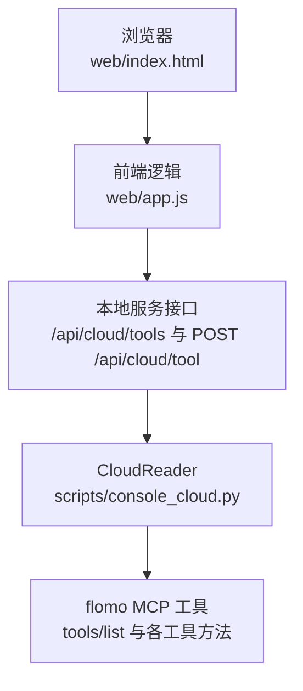
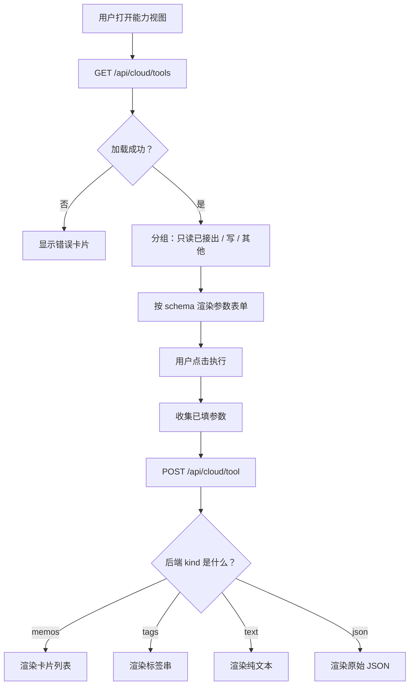
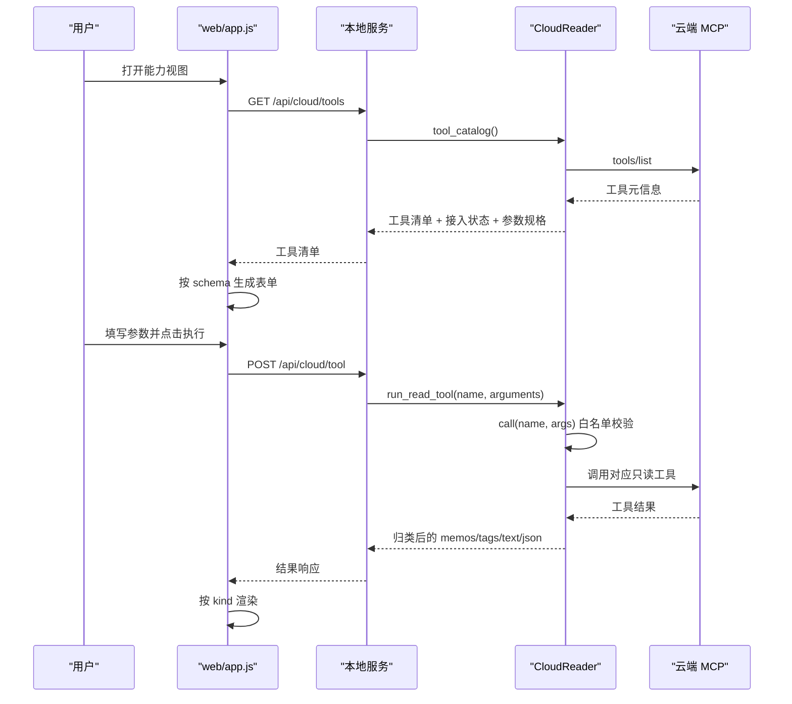
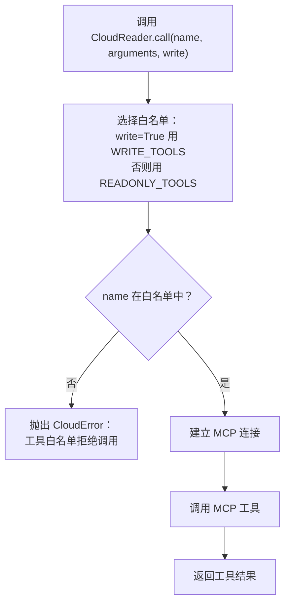
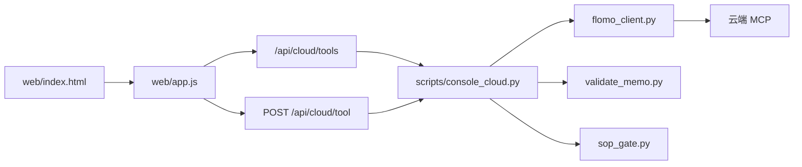

# 能力视图（工具台）

<cite>
**本文引用的文件**   
- [scripts/console_cloud.py](file://scripts/console_cloud.py)
- [web/app.js](file://web/app.js)
- [web/index.html](file://web/index.html)
- [README.md](file://README.md)
</cite>

## 目录
1. [简介](#简介)
2. [项目结构与入口](#项目结构与入口)
3. [核心组件](#核心组件)
4. [架构总览](#架构总览)
5. [详细组件分析](#详细组件分析)
6. [依赖关系分析](#依赖关系分析)
7. [性能与边界](#性能与边界)
8. [故障排查](#故障排查)
9. [结论](#结论)
10. [附录：调用示例](#附录调用示例)

## 简介
能力视图是控制台四个视图之一，负责把云端 MCP 暴露的工具全部呈现出来并“在页面上直接可用”。其核心流程如下：

- 前端通过 `/api/cloud/tools` 获取 `tools/list` 返回的全部工具清单、接入状态与参数规格。
- 前端按参数 schema 动态生成表单；只读工具填写参数后点击「执行」，走通用只读执行接口 `POST /api/cloud/tool`。
- 后端在 `console_cloud.CloudReader.call` 中用白名单做唯一准入判定：只读路径只允许 `READONLY_TOOLS`，写工具必须显式标记 `write=True`。
- 写工具不在此直通执行；能力视图对写工具仅展示“去专属入口”的引导按钮。
- 结果由后端统一归类为卡片列表、标签串、纯文本或原始 JSON，前端据此渲染。

安全上，白名单是唯一准入边界；token 不出进程；正文不落盘（除受控草稿）；调试时以 `tools/list` 作为新增工具是否暴露的唯一验证手段。

**章节来源**
- [README.md:130-190](file://README.md#L130-L190)
- [scripts/console_cloud.py:1-180](file://scripts/console_cloud.py#L1-L180)

## 项目结构与入口
能力视图涉及三层：

| 层级 | 文件 | 职责 |
|---|---|---|
| 前端界面 | `web/index.html` | 提供“能力”导航项与编辑器/抽屉等容器 |
| 前端逻辑 | `web/app.js` | 拉取工具清单、按 schema 生成表单、处理执行事件与结果渲染 |
| 后端访问层 | `scripts/console_cloud.py` | 连接 MCP、读取工具清单、校验白名单、格式化结果 |

**图表来源**
- [web/index.html:10-45](file://web/index.html#L10-L45)
- [web/app.js:800-980](file://web/app.js#L800-L980)
- [scripts/console_cloud.py:830-946](file://scripts/console_cloud.py#L830-L946)

**章节来源**
- [web/index.html:10-45](file://web/index.html#L10-L45)
- [README.md:130-190](file://README.md#L130-L190)

## 核心组件
### CloudReader：云端访问层
`CloudReader` 是控制台与 MCP 之间的唯一边界，承担以下责任：

- 懒建立 MCP 连接，失败后重置以便下次重连。
- 所有工具调用统一经过 `call(name, arguments, write=False)`。
- 白名单校验：默认只放行 `READONLY_TOOLS`；写工具必须显式传入 `write=True`。
- 网络异常、协议异常、`SystemExit` 一律转为 `CloudError`，避免 HTTP 服务收到未捕获异常。
- 读结果归一化：结构化数据优先从 `structuredContent` 解析，否则退回内层 JSON。
- 写路径额外封装格式闸门、流程闸门、回读验收与 id 兜底逻辑。

关键常量与方法：

| 名称 | 含义 |
|---|---|
| `READONLY_TOOLS` | 已接出的只读工具集合，恰好等于各读方法实际调用的工具 |
| `WRITE_TOOLS` | 已接出的写工具集合，当前为 `memo_create`、`memo_update`、`tag_rename` |
| `WRITE_TOOLS_REASON` | 写入门槛说明，出现在能力清单里 |
| `call(...)` | 白名单 + MCP 调用的统一入口 |
| `tool_catalog()` | 读取 `tools/list` 并输出带接入状态与参数规格的能力清单 |
| `run_read_tool(...)` | 通用只读执行入口，写工具显式拒绝 |

**章节来源**
- [scripts/console_cloud.py:100-180](file://scripts/console_cloud.py#L100-L180)
- [scripts/console_cloud.py:430-520](file://scripts/console_cloud.py#L430-L520)
- [scripts/console_cloud.py:830-946](file://scripts/console_cloud.py#L830-L946)

### 前端工具台：web/app.js
前端能力视图的核心逻辑集中在 `viewTools`、`toolField`、`toolPanel`、`writePanel`、`runTool` 等函数中：

- 首次进入能力视图时缓存 `/api/cloud/tools` 的结果。
- 将工具分为三类：
  - 只读且已接出：显示参数表单和「执行」按钮。
  - 写工具：显示参数名、门槛说明和跳转按钮。
  - 其他工具：列出但不支持直接执行。
- 参数控件由 schema 决定：
  - `boolean` → 下拉框（不传 / 真 / 假）。
  - `array` → 文本输入，逗号或空格分隔。
  - `integer` / `number` → number 类型输入框。
  - 其他 → 普通文本输入框。
- 执行结果根据后端返回的 `kind` 渲染：memos / tags / text / json。

**图表来源**
- [web/app.js:800-980](file://web/app.js#L800-L980)
- [web/app.js:1020-1160](file://web/app.js#L1020-L1160)
- [scripts/console_cloud.py:830-946](file://scripts/console_cloud.py#L830-L946)

**章节来源**
- [web/app.js:800-980](file://web/app.js#L800-L980)
- [web/app.js:1020-1160](file://web/app.js#L1020-L1160)

## 架构总览
能力视图的请求时序如下：

**图表来源**
- [web/app.js:800-980](file://web/app.js#L800-L980)
- [scripts/console_cloud.py:830-946](file://scripts/console_cloud.py#L830-L946)

## 详细组件分析

### 读/写工具白名单机制
白名单是能力视图与安全边界的中心概念。

#### 白名单定义
- `READONLY_TOOLS` 包含 `memo_search`、`memo_batch_get`、`memo_recommended`、`get_daily_review`、`tag_tree`、`tag_search`、`memory_context`、`memory_user`、`get_format_guide`、`get_tag_guide`。
- `WRITE_TOOLS` 包含 `memo_create`、`memo_update`、`tag_rename`。
- 文档明确强调：两个集合“分别恰等于本模块各方法实际调用的工具”，回归用例按源码扫描锁定该对等关系。

#### 校验位置
`CloudReader.call` 是统一入口：

**图表来源**
- [scripts/console_cloud.py:430-520](file://scripts/console_cloud.py#L430-L520)

#### 读写分离策略
- 通用只读执行入口 `run_read_tool` 会显式拒绝 `WRITE_TOOLS` 中的工具。
- 写操作只能通过专用方法：`create_memo`、`update_memo`、`rename_tag`。
- 写工具在能力视图里不提供「执行」按钮，只提供跳转到笔记新建、编辑或标签重命名的引导。

**章节来源**
- [scripts/console_cloud.py:100-180](file://scripts/console_cloud.py#L100-L180)
- [scripts/console_cloud.py:430-520](file://scripts/console_cloud.py#L430-L520)
- [scripts/console_cloud.py:830-946](file://scripts/console_cloud.py#L830-L946)
- [web/app.js:800-980](file://web/app.js#L800-L980)

### 参数 schema 到表单的映射
后端 `tool_catalog` 对每个工具的 `inputSchema.properties` 进行转换：

- `type` 被 `_schema_type` 归一化为单个 token：`boolean`、`integer`、`number`、`array`，其余归为 `string`。
- 联合类型（如 `[\"null\", \"boolean\"]`）取第一个非 `null` 项。
- `required` 来自 schema 的 `required` 数组。
- 描述摘要取自工具描述首句。

前端 `toolField` 再按类型渲染控件：

| 后端 type | 前端控件 | 行为 |
|---|---|---|
| `boolean` | 下拉框 | 可选“不传”“真”“假” |
| `array` | 文本框 | 逗号或空格分隔，执行时切数组 |
| `integer` / `number` | number 输入框 | 数值型字段 |
| 其他 | 文本输入框 | 字符串型字段 |

这种设计让“云端加了参数，界面自动跟着长出来”，不需要为每个工具手写表单。

**章节来源**
- [scripts/console_cloud.py:360-420](file://scripts/console_cloud.py#L360-L420)
- [scripts/console_cloud.py:830-946](file://scripts/console_cloud.py#L830-L946)
- [web/app.js:800-980](file://web/app.js#L800-L980)

### 结果分类与格式化
`run_read_tool` 对工具返回结果做统一分类：

1. 尝试从结果中提取 memos。
2. 尝试从结构化数据中提取标签串。
3. 尝试提取纯文本。
4. 若以上都没有，则回退为原始 JSON。

返回结构包含：

| 字段 | 含义 |
|---|---|
| `tool` | 工具名 |
| `arguments` | 实际使用的参数 |
| `kind` | `memos` / `tags` / `text` / `json` |
| `memos` | 精简卡片列表 |
| `tags` | 标签字符串列表 |
| `total` | 总数（如有） |
| `truncated` | 是否被截断 |
| `text` | 纯文本内容 |
| `raw` | 原始工具结果 |

前端根据 `kind` 渲染不同形态：

- `memos`：可点击卡片查看全文。
- `tags`：标签芯片列表。
- `text`：段落化正文。
- `json`：超过限制时显式截断并标注。

**章节来源**
- [scripts/console_cloud.py:900-946](file://scripts/console_cloud.py#L900-L946)
- [web/app.js:800-980](file://web/app.js#L800-L980)

### 写工具的门禁与验收
写工具不走能力视图的直接执行入口，而是走专用接口。`ConsoleReader` 中写路径的关键约束：

- 新建：两道闸门 → `memo_create` → 回读全文验收。
- 更新：先回读原文 → 两道闸门 → `memo_update` → 回读验收。
- 标签重命名：本地前置校验 → `tag_rename` → 回执解读为 `done` / `partial` / `needs_scale` / `no_match` / `unknown` / `inconsistent`。

写前闸门：

- 格式闸门：委托 `validate_memo.check()`。
- 流程闸门：委托 `validate_memo.check_gate()`，要求 `.sop_gate/<签名>.json` 凭证存在且签名匹配。

写后验收：

- 回读全文并按规范逐字比对。
- 如果回读失败，标记为“未知”，提示不要重发。

**章节来源**
- [scripts/console_cloud.py:600-830](file://scripts/console_cloud.py#L600-L830)

## 依赖关系分析
能力视图依赖链如下：

- 前端只依赖本地服务接口，不直接构造 MCP 调用。
- 后端通过 `FlomoClient` 连接 MCP。
- 写路径依赖 `validate_memo` 与 `sop_gate`。
- 能力视图本身不实现 MCP 协议，也不持有 token。

**图表来源**
- [web/index.html:10-45](file://web/index.html#L10-L45)
- [web/app.js:800-980](file://web/app.js#L800-L980)
- [scripts/console_cloud.py:100-180](file://scripts/console_cloud.py#L100-L180)

**章节来源**
- [README.md:130-190](file://README.md#L130-L190)
- [scripts/console_cloud.py:100-180](file://scripts/console_cloud.py#L100-L180)

## 性能与边界
- 工具清单按需拉取并缓存，刷新时会清空缓存。
- 只读工具执行结果可能很大，JSON 展示有字符上限，超出时显式截断。
- 批量全文取回有硬限：`BATCH_MAX = 10`，前端显式提示超出条数。
- 标签树默认最多 1000 条，达到上限时云端会给出提示。
- 卡片检索单次最大返回 `MAX_LIMIT = 50`，界面需提示继续筛选。
- 流程闸门最长等待 `GATE_TIMEOUT = 300` 秒。
- token 仅在建立连接时使用，不进入返回值、响应体或日志。

**章节来源**
- [scripts/console_cloud.py:120-180](file://scripts/console_cloud.py#L120-L180)
- [scripts/console_cloud.py:300-420](file://scripts/console_cloud.py#L300-L420)
- [web/app.js:1-50](file://web/app.js#L1-L50)

## 故障排查
常见错误与定位方式：

| 现象 | 可能原因 | 排查步骤 |
|---|---|---|
| 能力视图无法加载工具清单 | 本地服务无响应或 MCP 握手失败 | 检查 `/api/cloud/tools` 返回；确认 token 配置 |
| 执行只读工具报白名单拒绝 | 工具不在 `READONLY_TOOLS` | 查看 `tools/list` 中该工具是否已接出 |
| 执行写工具被拒绝 | 写工具不走通用入口 | 使用专用写接口，不要调 `POST /api/cloud/tool` |
| 写工具 422 | 格式或流程闸门未过 | 先点“校验”或“跑闸门”，查看待修项 |
| 写请求已下发但回读失败 | 验收回包不可用或网络波动 | 按 id 现查，不要重发 |
| 标签重命名未生效 | 匹配数超默认规模或未声明 `max_memos` | 根据 `matched_memos` 设置规模上限重试 |
| 工具参数不生效 | 参数为空值或被过滤 | 检查前端表单是否传了空字符串；后端会剔除 `None` 和空字符串 |

**章节来源**
- [scripts/console_cloud.py:430-520](file://scripts/console_cloud.py#L430-L520)
- [scripts/console_cloud.py:600-830](file://scripts/console_cloud.py#L600-L830)
- [scripts/console_cloud.py:900-946](file://scripts/console_cloud.py#L900-L946)
- [web/app.js:1020-1160](file://web/app.js#L1020-L1160)

## 结论
能力视图的本质不是“任意 MCP 调用器”，而是“白名单内的读能力可视化执行器”。它通过 `tools/list` 动态发现工具，按 schema 生成表单，并通过 `CloudReader.call` 的白名单机制确保只有已明确接出的工具才能被执行。写能力被严格隔离到专用入口，强制走过格式闸门、流程闸门与回读验收。调试新增工具时，应先在 `tools/list` 中确认工具是否暴露，再把对应方法加入 `READONLY_TOOLS` 或 `WRITE_TOOLS`，而不是绕过控制台直接构造 MCP 调用。

## 附录：调用示例

### 示例一：调用一个只读工具
以 `tag_names` 为例，这是后端读白名单中的一个工具。

| 项目 | 内容 |
|---|---|
| 方法 | `POST /api/cloud/tool` |
| 请求头 | `Content-Type: application/json` |
| 请求体 | `{ "name": "tag_search", "arguments": { "keywords": "RAG", "limit": 20 } }` |
| 预期成功响应结构 | `{ "tool": "tag_search", "arguments": {...}, "kind": "tags", "tags": [...], "raw": {...} }` |
| 典型字段 | `kind` 为 `tags`；`tags` 为标签名列表；`raw` 为原始工具结果 |
| 常见错误码 | 4xx 表示请求无效；后端抛 `CloudError` 时由服务层转为错误响应 |

前端收到 `kind=tags` 后渲染标签芯片列表；若结果为 memos 则渲染卡片，若为 text 则渲染正文，若为 json 则以受限原始 JSON 展示。

**章节来源**
- [scripts/console_cloud.py:900-946](file://scripts/console_cloud.py#L900-L946)
- [web/app.js:800-980](file://web/app.js#L800-L980)

### 示例二：调用一个写工具
写工具不能通过 `POST /api/cloud/tool` 直接执行。以新建卡片为例：

| 项目 | 内容 |
|---|---|
| 方法 | `POST /api/cloud/memo/create` |
| 请求头 | `Content-Type: application/json` |
| 请求体 | `{ "content": "#AI/RAG\n马尔科夫链\n\n...正文..." }` |
| 预期成功响应结构 | `{ "ok": true, "id": "...", "word_count": N, "verified": {...} }` |
| 422 含义 | 格式或流程闸门未过，云端未收到写请求 |
| verified.matched=true | 回读正文与提交内容一致 |
| verified.matched=false | 回读不一致，需核对后再决定是否重写 |
| verified.matched=null | 写请求已下发但未能回读验收，应按 id 现查，不要重发 |

如果直接尝试 `POST /api/cloud/tool` 并传入写工具名，后端会在 `run_read_tool` 中拒绝，因为写工具不走通用入口。

**章节来源**
- [scripts/console_cloud.py:600-830](file://scripts/console_cloud.py#L600-L830)
- [scripts/console_cloud.py:900-946](file://scripts/console_cloud.py#L900-L946)
- [README.md:150-190](file://README.md#L150-L190)

### 安全性说明
1. **白名单是唯一准入边界**  
   任何不在 `READONLY_TOOLS` 或 `WRITE_TOOLS` 中的工具都会被 `CloudReader.call` 拒绝。新增能力必须先加方法、再加白名单，并由回归用例锁定对等关系。

2. **不应绕过控制台直接构造 MCP 调用**  
   能力视图的前端不直接连接 MCP，也不持有 token；token 仅在 `CloudReader._connect` 中用于建立连接，不进入返回值或日志。绕过控制台意味着跳过白名单、闸门与验收。

3. **写操作必须走专用入口**  
   `POST /api/cloud/tool` 只执行只读工具；写工具必须使用 `POST /api/cloud/memo/create`、`POST /api/cloud/memo/update` 或 `POST /api/cloud/tag/rename`。

4. **调试新增工具的正确顺序**  
   - 确认云端 MCP 已通过 `tools/list` 暴露该工具。
   - 在 `console_cloud.py` 中确认对应方法存在。
   - 将该工具加入 `READONLY_TOOLS` 或 `WRITE_TOOLS`。
   - 重启本地服务后，刷新能力视图，确认工具出现在清单中且 `wired` 为真。
   - 对只读工具测试参数与结果分类；对写工具测试闸门与回读验收。

**章节来源**
- [scripts/console_cloud.py:100-180](file://scripts/console_cloud.py#L100-L180)
- [scripts/console_cloud.py:430-520](file://scripts/console_cloud.py#L430-L520)
- [scripts/console_cloud.py:830-946](file://scripts/console_cloud.py#L830-L946)
- [web/app.js:800-980](file://web/app.js#L800-L980)