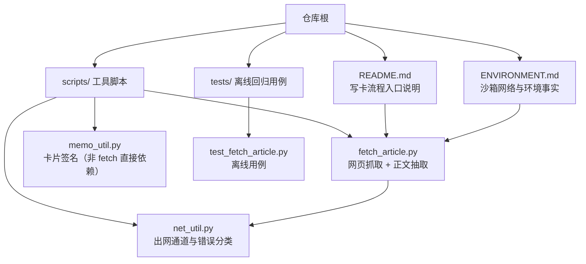
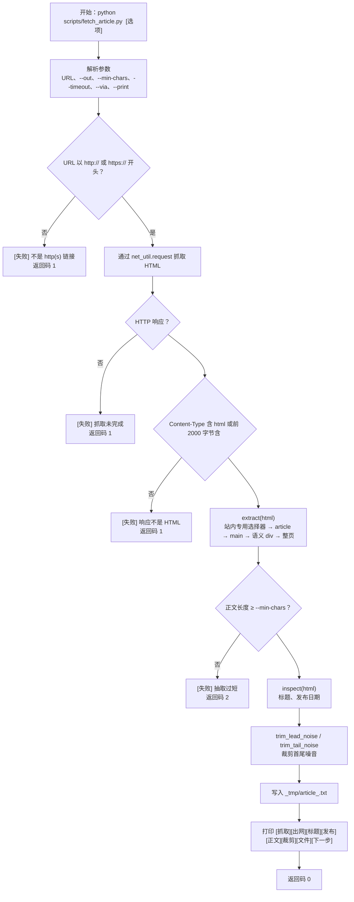
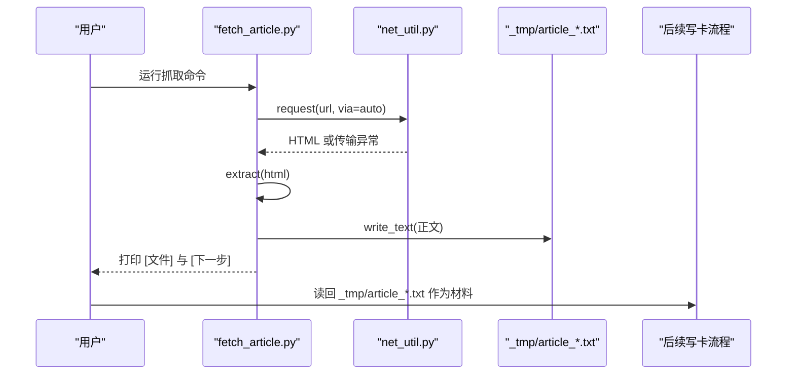
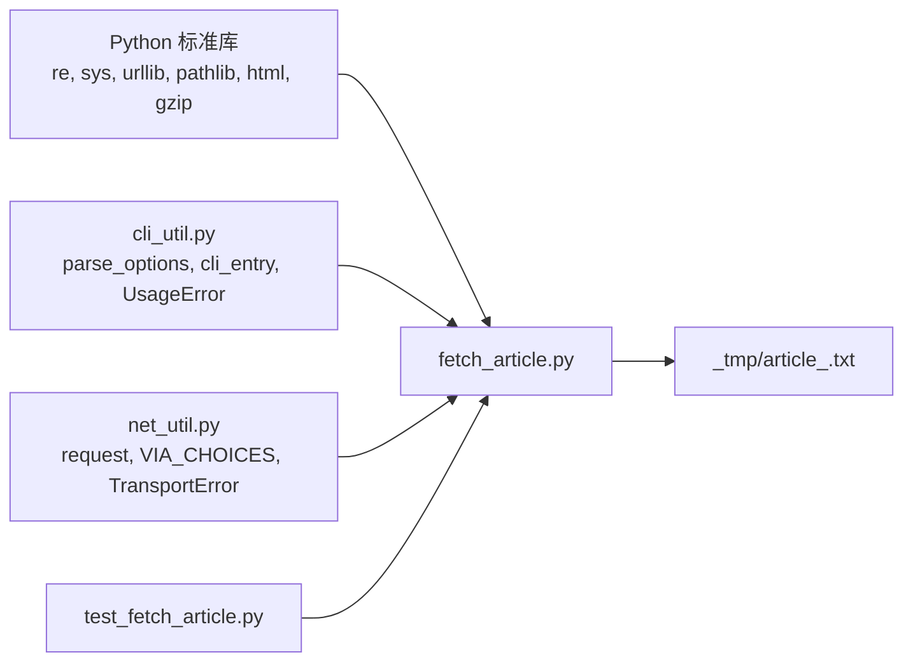

# 3.1 内容抓取 fetch_article

<cite>
**本文引用的文件**   
- [scripts/fetch_article.py](file://scripts/fetch_article.py)
- [tests/test_fetch_article.py](file://tests/test_fetch_article.py)
- [scripts/net_util.py](file://scripts/net_util.py)
- [ENVIRONMENT.md](file://ENVIRONMENT.md)
- [README.md](file://README.md)
</cite>

## 目录
1. [引言](#引言)
2. [项目结构中的位置](#项目结构中的位置)
3. [核心能力与端到端流程](#核心能力与端到端流程)
4. [命令行参数、返回码与输出格式](#命令行参数返回码与输出格式)
5. [临时正文文件命名规则](#临时正文文件命名规则)
6. [与 flomo memo 正文的关系](#与-flomo-memo-正文的关系)
7. [关键处理逻辑](#关键处理逻辑)
8. [常见失败分支与修复建议](#常见失败分支与修复建议)
9. [arXiv 等特殊站点的处理差异](#arxiv-等特殊站点的处理差异)
10. [Playwright 渲染验证失败的排查方式](#playwright-渲染验证失败的排查方式)
11. [从零到生成 _tmp 正文文件的命令示例](#从零到生成-_tmp-正文文件的命令示例)
12. [依赖关系图](#依赖关系图)

## 引言
`fetch_article.py` 是写卡流程第 1 步的「抓取通道」：它根据 URL 拉取网页，把 HTML 解码、抽取正文、裁剪首尾噪音、检查章节是否被截断，最后把纯文本正文落盘到项目根目录下的 `_tmp/` 文件夹。脚本本身不直接写 flomo 云端，也不替调用方阅读正文；它的职责是把「可被后续步骤读入的正文文件」交给上层流程。

该脚本的核心设计是：
- 统一出网通道：通过 `net_util` 在环境代理和直连之间自动回退。
- 多通道正文抽取：优先走站内专用选择器，再尝试 `<article>`、`<main>`、语义化 div，最后回退整页。
- 显式裁剪：开头元信息行和结尾推荐位等噪音会被裁剪，并在日志中说明裁掉多少、从哪句起。
- 章节完整性告警：如果页面有 h2/h3 标题但正文缺失后半段，会打印 `[告警]` 提醒不要按残缺正文写卡。
- 明确返回码：成功、网络/HTML 错误、正文过短分别用不同退出码区分。

## 项目结构中的位置
在项目结构中，`fetch_article.py` 位于 `scripts/`，属于工具脚本集合中的一环；其离线回归用例位于 `tests/test_fetch_article.py`，不联网，只测试解码、抽取、元信息、标题缺口、参数校验等纯函数行为。



**图表来源**
- [scripts/fetch_article.py:1-200](file://scripts/fetch_article.py#L1-L200)
- [scripts/net_util.py:1-196](file://scripts/net_util.py#L1-L196)
- [tests/test_fetch_article.py:1-50](file://tests/test_fetch_article.py#L1-L50)
- [README.md:60-120](file://README.md#L60-L120)
- [ENVIRONMENT.md:1-80](file://ENVIRONMENT.md#L1-L80)

**章节来源**
- [scripts/fetch_article.py:1-200](file://scripts/fetch_article.py#L1-L200)
- [README.md:60-120](file://README.md#L60-L120)

## 核心能力与端到端流程
`fetch_article.py` 的端到端流程可以概括为：解析参数 → 校验 URL → 抓取 HTML → 判断是否为 HTML → 抽取正文 → 检查字数阈值 → 提取元信息 → 裁剪首尾噪音 → 检测章节缺口 → 写入 `_tmp/article_<slug>.txt` → 打印下一步读回命令。



**图表来源**
- [scripts/fetch_article.py:201-580](file://scripts/fetch_article.py#L201-L580)
- [scripts/net_util.py:100-196](file://scripts/net_util.py#L100-L196)

**章节来源**
- [scripts/fetch_article.py:201-580](file://scripts/fetch_article.py#L201-L580)

## 命令行参数、返回码与输出格式

### 基本用法
```bash
python scripts/fetch_article.py <url> [--out PATH] [--min-chars N] [--timeout N] [--via auto|proxy|direct] [--print]
```

其中：
- `<url>` 是位置参数，支持写在选项之前或之后。
- `--out PATH` 指定输出路径；不传时默认写到项目根的 `_tmp/article_<slug>.txt`。
- `--min-chars N` 设置正文最小字符数阈值，默认 300。
- `--timeout N` 设置请求超时秒数，默认 30.0。
- `--via` 控制出网通道：`auto`、`proxy`、`direct`。
- `--print` 额外把正文打印到标准输出，适合短文快速查看。

### 参数校验行为
- 缺少 URL 时报“缺 URL”。
- 传入多个 URL 时报“只接受一个 URL”。
- `--timeout` 或 `--min-chars` 传入非法值时，由 `cli_entry` 包装成一行失败提示，而不是裸 traceback。
- `--via` 不在允许集合内时，会抛出参数错误。

### 返回码
| 返回码 | 含义 | 典型场景 |
|--------|------|----------|
| 0 | 抽取成功并写入正文文件 | URL 合法、HTML 可抓、正文长度达标、文件已落盘 |
| 1 | 网络/HTTP 失败，或响应不是 HTML | 连接被拒、DNS 失败、HTTPError、Content-Type 不含 html |
| 2 | 抽取结果过短 | JS 渲染页、反爬页、SPA 未执行 JavaScript |

### 标准输出与标准错误
- 正常成功时，主要日志打印到标准输出。
- 失败信息通常打印到标准错误，例如“不是 http(s) 链接”“抓取未完成”“响应不是 HTML”“抽取仅 N 字符”。
- 成功时会打印 `[文件]` 和 `[下一步]`，明确告诉调用方应该读取哪个正文文件。

**章节来源**
- [scripts/fetch_article.py:1-120](file://scripts/fetch_article.py#L1-L120)
- [scripts/fetch_article.py:400-580](file://scripts/fetch_article.py#L400-L580)
- [tests/test_fetch_article.py:230-348](file://tests/test_fetch_article.py#L230-L348)

## 临时正文文件命名规则
当没有使用 `--out` 指定输出路径时，脚本会把正文写入：

```
_tmp/article_<slug>.txt
```

其中 `<slug>` 来自 URL 的路径部分：
1. 去掉查询字符串和片段标识符。
2. 去掉末尾斜杠。
3. 取最后一个路径段；若为空则用 `page`。
4. 把非字母数字、下划线、连字符以外的字符替换为连字符。
5. 去掉首尾连字符。
6. 最多保留 48 个字符。

这个命名规则的目的是让同一 URL 产生稳定文件名，避免中文路径、特殊字符、长路径造成文件系统问题，同时保证 slug 足够短。

需要注意：
- `_tmp/` 目录由脚本自动创建，父目录不存在时会递归创建。
- 实际落地路径是 `PROJECT_ROOT/_tmp/...`，即仓库根目录下的 `_tmp/`。
- Windows 环境下，`ENVIRONMENT.md` 明确说明中间文件和最终交付物落在项目根 `_tmp/`，且该目录可能被上一轮清理移除，因此首次使用前确保目录存在。

**章节来源**
- [scripts/fetch_article.py:330-370](file://scripts/fetch_article.py#L330-L370)
- [scripts/fetch_article.py:520-580](file://scripts/fetch_article.py#L520-L580)
- [ENVIRONMENT.md:140-180](file://ENVIRONMENT.md#L140-L180)

## 与 flomo memo 正文的关系
`fetch_article.py` 的输出是「网页正文的纯文本快照」，不是完整的 flomo memo 卡片。完整卡片还需要经过后续步骤：验证、提炼、定标签、查重、写作、自检并写云。

具体关系如下：
- **抓取产物**：`_tmp/article_<slug>.txt` 是原始网页正文，可能包含站点元信息、正文段落、章节标题、发布时间等。
- **memo 正文**：是写卡阶段按照 SKILL.md 格式生成的卡片正文，通常以标签段和概念名开头，内容是对原文的提炼和结构化表达。
- **本脚本的职责边界**：只负责「抓回网页、抽正文、写临时文件」。文档明确说「抓回仍须读回全文」，脚本末尾会打印下一步读哪个文件，但不会替调用方完成卡片写作。
- **与 memo_util 的关系**：`memo_util.py` 提供卡片签名、正文指纹、概念关键词等能力，供质检、闸门、写云等流程使用；`fetch_article.py` 并不直接依赖它，两者分工清晰。



**图表来源**
- [scripts/fetch_article.py:201-580](file://scripts/fetch_article.py#L201-L580)
- [scripts/net_util.py:100-196](file://scripts/net_util.py#L100-L196)

**章节来源**
- [scripts/fetch_article.py:1-120](file://scripts/fetch_article.py#L1-L120)
- [scripts/fetch_article.py:500-580](file://scripts/fetch_article.py#L500-L580)
- [README.md:30-80](file://README.md#L30-L80)

## 关键处理逻辑

### 编码解码
`decode_html` 按以下顺序处理响应体：
1. 如果响应头前两个字节是 gzip 魔数，尝试解压。
2. 从 `Content-Type` 中提取 charset。
3. 从 HTML 头部 `<meta charset=...>` 中提取编码。
4. 尝试 UTF-8 解码。
5. 回退到 GB18030。

这个顺序很重要：不能先信 meta charset，因为有些老站点在 UTF-8 页面里写了错误的 `charset=gb2312`，直接按旧编码解码会导致中文乱码，而乱码文本仍可被正则抽出正文，从而掩盖问题。

### HTML 转纯文本
`to_text` 负责把 HTML 片段变成可读文本：
- 删除 script、style、noscript、svg、nav、footer、aside、header、form、iframe、template、button 等块级元素。
- 把 `<li>` 转换为带 `- ` 的行项。
- 把 `<br>` 转为换行。
- 把表格单元格结束标签转为空格。
- 把块级结束标签转为换行。
- 去除所有剩余标签。
- 还原 HTML 实体，例如 `&amp;`。
- 规范化空白行和缩进。

### 正文抽取通道
`extract` 按以下优先级尝试：
1. 站内专用选择器：例如匹配 `id="article-body"` 的 div。
2. 站内专用右界兜底：防止正文内的嵌套 div 提前截断。
3. `<article>` 标签。
4. `<main>` 标签。
5. 候选 div：匹配含 `article`、`content`、`post`、`entry`、`detail`、`main-text`、`body-text`、`left_zw`、`paragraph` 等语义类的 div，选文本量最大者。
6. 整页兜底。

每个候选都要求文本长度达到默认阈值，避免把侧栏或导语误判为正文。

### 首尾噪音裁剪
- 开头裁剪：连续的前若干行如果是面包屑、标题行、日期、来源、作者、责编、评论等元信息，会被裁剪。最多看前 15 行，遇到第一行正文就停。
- 结尾裁剪：只在命中行已经过了全文 40% 时才裁，并且裁剪后长度不得低于 `--min-chars`。
- 裁剪必须可见：脚本会打印原长度、新长度、从哪类噪音开始裁剪。

### 章节完整性检查
`heading_gap` 比较页面中的 h2/h3 标题与正文中出现过的标题：
- 如果正文中有、页面中没有的标题，可能是正文被截断。
- 如果页面有、正文中没有的标题，会在 `[告警]` 中指出断点章节。
- 导航、侧栏、页脚中的标题会被过滤，避免误报。
- 该检查只产生告警，不改抽取结果。

### 元信息提取
`inspect` 提取：
- 标题：优先 `<title>`，其次 `<h1>`。
- 发布日期：优先 `article:published_time`、`pubdate`、`publish-date`、`publish_date`、`date` 等 meta；其次 `<time datetime=...>`；最后从正文前几行兜底找日期行。

**章节来源**
- [scripts/fetch_article.py:201-370](file://scripts/fetch_article.py#L201-L370)
- [scripts/fetch_article.py:370-520](file://scripts/fetch_article.py#L370-L520)
- [tests/test_fetch_article.py:1-230](file://tests/test_fetch_article.py#L1-L230)

## 常见失败分支与修复建议

### 1. 参数错误
**现象**
- 提示“缺 URL”。
- 提示“只接受一个 URL”。
- 提示某个选项缺少值。
- `--timeout` 或 `--min-chars` 传入非法值。

**原因**
- 没有传入 URL。
- 传入了多个 URL。
- 选项值类型不符合预期。
- `--via` 值不在允许集合中。

**修复建议**
- 始终传入一个 HTTP(S) URL。
- 不要把 `--out`、`--print` 等选项当成 URL。
- `--timeout` 传入正浮点数，`--min-chars` 传入正整数。
- `--via` 使用 `auto`、`proxy` 或 `direct`。

**章节来源**
- [scripts/fetch_article.py:420-480](file://scripts/fetch_article.py#L420-L480)
- [tests/test_fetch_article.py:230-320](file://tests/test_fetch_article.py#L230-L320)

### 2. URL 不是 HTTP(S)
**现象**
```
[失败] 不是 http(s) 链接：ftp://example.com/a
```
**返回码**：1

**原因**
- URL 以 `ftp://`、`file://` 或其他协议开头。
- URL 拼写错误，漏掉 `https://`。

**修复建议**
- 补全协议前缀。
- 检查粘贴的链接是否正确。
- 如果链接需要登录或跳转，先用浏览器确认能打开，再复制 HTTPS 链接。

**章节来源**
- [scripts/fetch_article.py:440-460](file://scripts/fetch_article.py#L440-L460)

### 3. 网络不可达或代理配置错误
**现象**
```
[失败] 抓取未完成：...
```
**返回码**：1

**可能原因**
- 环境变量中的代理端口过期或不可用。
- DNS 解析失败。
- TLS 握手失败。
- 连接被拒绝。
- 超时。
- 两条通道都失败。

**机制说明**
- `--via auto` 时，先走环境代理，失败再直连。
- 只有两条通道都失败才抛 `FetchError`。
- 如果服务器已返回 HTTP 状态码（例如 403、404），不算通道失败，而是 `HTTPError`。
- `net_util` 明确区分“确定未发出”和“可能已发出”，用于写操作重发决策；抓取侧对 GET 请求更宽松。

**修复建议**
1. 先用连通体检工具判断真实通道：
   ```bash
   python scripts/netdoctor.py --url <要抓的链接>
   ```
2. 如果环境代理失败，强制直连：
   ```bash
   python scripts/fetch_article.py <url> --via direct
   ```
3. 如果只想强制走环境代理，加：
   ```bash
   python scripts/fetch_article.py <url> --via proxy
   ```
4. 检查 `HTTP_PROXY`、`HTTPS_PROXY`、`NO_PROXY` 等代理环境变量。
5. 在沙箱环境中注意代理端口每次会话重新分配，不要抄固定端口。
6. 如果 DNS 被劫持，参考 `ENVIRONMENT.md` 中 GitHub 域名与 DNS 的处理方式。

**章节来源**
- [scripts/fetch_article.py:370-430](file://scripts/fetch_article.py#L370-L430)
- [scripts/net_util.py:1-196](file://scripts/net_util.py#L1-L196)
- [ENVIRONMENT.md:40-120](file://ENVIRONMENT.md#L40-L120)

### 4. 响应不是 HTML
**现象**
```
[失败] 响应不是 HTML（Content-Type: ...）
```
**返回码**：1

**原因**
- 目标 URL 返回 JSON、图片、PDF、重定向后的非 HTML 页面。
- 反爬接口返回错误 JSON。
- CDN 或鉴权网关返回认证页而非文章页。

**修复建议**
- 确认 URL 指向文章正文，而不是 API 接口。
- 在浏览器中打开 URL，确认返回的是文章内容。
- 如果是 SPA 或 JS 渲染页面，改用 webfetch、镜像站或预印本通道。
- 如果返回 403/404，说明服务器已响应，不是通道问题，应检查链接有效性或权限。

**章节来源**
- [scripts/fetch_article.py:450-470](file://scripts/fetch_article.py#L450-L470)

### 5. 正文过短
**现象**
```
[失败] 抽取仅 N 字符（阈值 300，通道：...）——多半是 JS 渲染页或反爬页，改走 webfetch / 镜像 / 预印本通道
```
**返回码**：2

**原因**
- 页面依赖 JavaScript 渲染，静态 HTML 只包含骨架或空容器。
- 站点有反爬策略，返回验证码、登录页或限流页。
- 文章确实很短，但通常这种情况也会伴随其他信号。

**修复建议**
1. 改用 webfetch 或镜像站。
2. 如果是预印本平台，改用 arXiv 预印本通道。
3. 如果是 Playwright 渲染任务，先确认浏览器启动和渲染成功，再拿渲染后的 HTML 给后续流程。
4. 检查返回的 HTML 是否真的包含正文容器。
5. 适当调整 `--min-chars`，但不要把阈值设得过低，否则会把侧栏或导语当正文。

**章节来源**
- [scripts/fetch_article.py:460-500](file://scripts/fetch_article.py#L460-L500)
- [tests/test_fetch_article.py:110-140](file://tests/test_fetch_article.py#L110-L140)

### 6. HTML 解析为空或抽到侧栏
**现象**
- 正文长度为 0。
- 正文只有几条短文本，触发阈值失败。
- 正文看起来像侧栏、导航、相关文章列表。

**原因**
- 站点使用非常规 HTML 结构。
- 通用选择器命中了短容器。
- 站内专用选择器没命中。
- 正文被截断，右侧容器提前闭合。

**修复建议**
- 检查页面是否包含 `<article>`、`<main>`、`id="article-body"` 或语义类 div。
- 查看 `[正文]` 输出的通道说明，确认走的是哪个抽取通道。
- 对于已知站点，考虑扩展站内专用选择器。
- 检查 `[告警]` 是否指出章节缺失，说明正文可能被容器提前闭合截断。

**章节来源**
- [scripts/fetch_article.py:240-370](file://scripts/fetch_article.py#L240-L370)
- [tests/test_fetch_article.py:60-120](file://tests/test_fetch_article.py#L60-L120)

### 7. 章节被截断
**现象**
```
[告警] 正文止于章节《...》，其后 N 个章节标题未出现在正文里：...
```

**原因**
- 抽取容器过早闭合。
- 正文右侧还有更多内容，但被 `</div>` 或其他边界截断。
- 评论区、作者卡、推荐位被误当作正文边界。

**修复建议**
- 核对原文，确认是否真被截断。
- 检查抽取通道是否为站内专用选择器或语义 div。
- 如果是评论节点混入正文，脚本已有降级到兜底通道的逻辑；若仍失败，需人工检查站点结构。
- 不要忽略 `[告警]`，因为它意味着正文可能不完整。

**章节来源**
- [scripts/fetch_article.py:370-500](file://scripts/fetch_article.py#L370-L500)
- [tests/test_fetch_article.py:140-230](file://tests/test_fetch_article.py#L140-L230)

## arXiv 等特殊站点的处理差异
arXiv 的特殊性主要体现在两层：

### 网络层：SNI 关键字阻断
根据 `ENVIRONMENT.md`，本机网络对 SNI 中出现 `arxiv.org` 的 TLS ClientHello 直接重置连接，表现为 TCP 能建连但约 0.08 秒后出现连接重置。解决方式是使用 `sni_fetch.py`，把 SNI 换成无关域名，同时保留 HTTP `Host` 头，由 Fastly 按 Host 路由返回内容。

### 内容层：arXiv HTML 正文抽取
`scripts/extract_arxiv_html.py` 专门负责 arXiv HTML 正文抽取，并把公式按 MathML 还原。这说明 arXiv 的正文结构不适合直接用普通文章选择器处理，尤其是公式、摘要、引用等结构化字段。

### 对 fetch_article 的影响
- `fetch_article.py` 的通用抽取逻辑优先匹配常规文章容器，不一定能正确处理 arXiv 的特定结构。
- 对于 arXiv 这类预印本，文档推荐使用“预印本通道”，也就是结合 `extract_arxiv_html.py` 等专用处理。
- 如果直接对 arXiv 使用 `fetch_article.py`，可能出现正文过短、正文结构异常或公式丢失的情况。

**章节来源**
- [ENVIRONMENT.md:120-180](file://ENVIRONMENT.md#L120-L180)
- [README.md:120-160](file://README.md#L120-L160)

## Playwright 渲染验证失败的排查方式
Playwright 在本项目中主要用于“页面渲染验证”，尤其适用于 SPA、JS 渲染页面。常见问题和排查思路如下：

### 1. 浏览器无法启动
**可能原因**
- Playwright 或 Chromium 未安装。
- 当前 Python 环境与安装 Playwright 的环境不一致。
- 沙箱权限不足。

**排查建议**
- 确认 Playwright 版本与项目记录一致。
- 确认 Chromium 已安装。
- 检查 Python 解释器路径是否与安装 Playwright 时一致。

### 2. 无头浏览器启动失败
**可能原因**
- 沙箱代理拦截了对回环地址的请求。
- 浏览器启动参数缺少 `--no-proxy-server`。

**修复建议**
- 启动浏览器时加上 `--no-proxy-server`。
- 在代理可用前提下，确认代理不会接管本地回环服务。

**章节来源**
- [ENVIRONMENT.md:180-220](file://ENVIRONMENT.md#L180-L220)

### 3. 渲染结果为空或白屏
**可能原因**
- 页面依赖登录态、Cookie、Token。
- 页面依赖前端路由或动态数据接口。
- 站点有反爬或人机校验。
- 目标 URL 不是文章正文，而是登录页、404 页、验证码页。

**排查建议**
- 先在浏览器中手动打开 URL，确认能加载正文。
- 如果需要登录，补充 Cookie 或 Token。
- 如果是 API 数据驱动，确认接口可达且返回正确数据。
- 把渲染后的 HTML 交给 `fetch_article.py` 的 `extract` 和 `inspect` 做二次检查，看是否能定位正文容器。

### 4. 渲染成功但 fetch_article 仍报正文过短
**可能原因**
- 渲染后的 HTML 仍然没有正文容器。
- 正文被包裹在脚本变量或懒加载容器中。
- 站点对自动化访问返回简化版页面。

**修复建议**
- 输出渲染后的 HTML，人工检查是否存在 `<article>`、`<main>`、`id="article-body"` 等容器。
- 对 JS 渲染页面改用 webfetch 或镜像站。
- 对预印本页面改用 arXiv 专用抽取。

**章节来源**
- [ENVIRONMENT.md:180-220](file://ENVIRONMENT.md#L180-L220)
- [scripts/fetch_article.py:240-500](file://scripts/fetch_article.py#L240-L500)

## 从零到生成 _tmp 正文文件的命令示例
下面是一条从零到生成 `_tmp` 正文文件的端到端命令示例。假设工作目录已经是仓库根：

```bash
cd D:/OpenClaw/flomo-note
mkdir -p _tmp
python scripts/fetch_article.py "https://example.com/article-title"
```

如果网络受代理影响，可先体检：

```bash
python scripts/netdoctor.py --url "https://example.com/article-title"
```

如果环境代理不可用，强制直连：

```bash
python scripts/fetch_article.py "https://example.com/article-title" --via direct
```

如果想把正文打印出来快速查看：

```bash
python scripts/fetch_article.py "https://example.com/article-title" --print
```

如果想指定输出路径：

```bash
python scripts/fetch_article.py "https://example.com/article-title" --out _tmp/my-article.txt
```

成功后，脚本会输出类似如下信息（字段顺序以实现为准）：
- `[抓取]`：原始 URL
- `[出网]`：实际使用的出网通道
- `[标题]`：从 `<title>` 或 `<h1>` 提取的标题
- `[发布]`：从 meta、time 或正文兜底提取的发布日期
- `[正文]`：正文字符数和抽取通道
- `[裁剪]`：是否裁剪首尾噪音
- `[文件]`：正文文件路径
- `[下一步]`：提示读回正文文件

**章节来源**
- [scripts/fetch_article.py:420-580](file://scripts/fetch_article.py#L420-L580)
- [ENVIRONMENT.md:140-180](file://ENVIRONMENT.md#L140-L180)
- [README.md:30-80](file://README.md#L30-L80)

## 依赖关系图
`fetch_article.py` 的直接依赖主要是 Python 标准库和 `net_util`，间接依赖包括 `cli_util` 提供的命令行入口包装。



**图表来源**
- [scripts/fetch_article.py:1-120](file://scripts/fetch_article.py#L1-L120)
- [scripts/fetch_article.py:370-580](file://scripts/fetch_article.py#L370-L580)
- [scripts/net_util.py:1-196](file://scripts/net_util.py#L1-L196)
- [tests/test_fetch_article.py:1-50](file://tests/test_fetch_article.py#L1-L50)

**章节来源**
- [scripts/fetch_article.py:1-120](file://scripts/fetch_article.py#L1-L120)
- [scripts/net_util.py:1-196](file://scripts/net_util.py#L1-L196)
- [tests/test_fetch_article.py:1-50](file://tests/test_fetch_article.py#L1-L50)