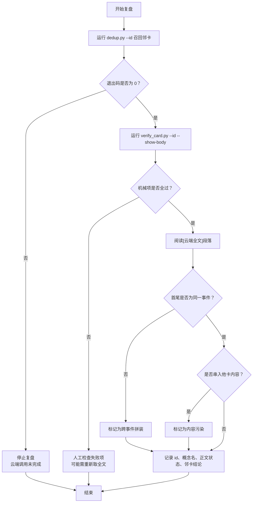
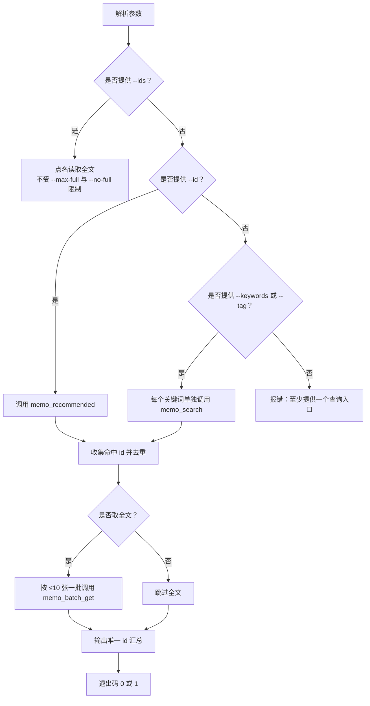
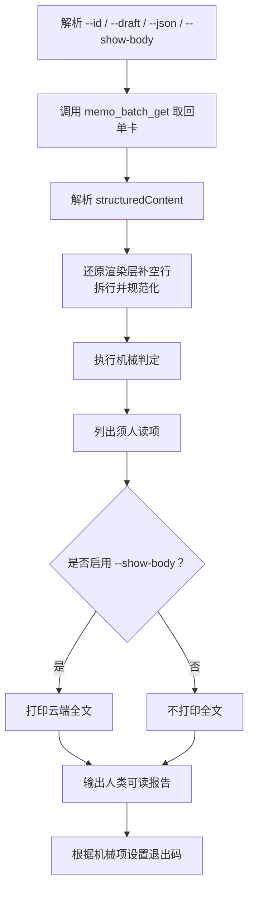
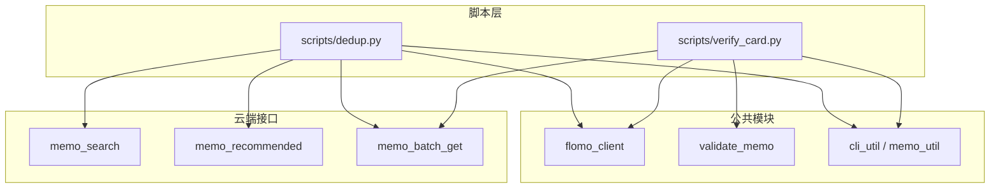

# 3.10 复盘 dedup --id + verify_card --show-body

<cite>
**本文引用的文件**   
- [dedup.py](file://scripts/dedup.py)
- [verify_card.py](file://scripts/verify_card.py)
- [test_dedup.py](file://tests/test_dedup.py)
- [test_verify_card.py](file://tests/test_verify_card.py)
</cite>

## 目录
1. [引言](#引言)
2. [复盘目标与边界](#复盘目标与边界)
3. [工具概览](#工具概览)
4. [参数、输出与关键字段](#参数输出与关键字段)
5. [典型人读命令](#典型人读命令)
6. [按批次扫描的复盘流程](#按批次扫描的复盘流程)
7. [关键流程图](#关键流程图)
8. [常见问题与人工干预](#常见问题与人工干预)
9. [依赖关系分析](#依赖关系分析)
10. [结论](#结论)

## 引言
本指南面向“已写云端卡片”的二次审查，即复盘阶段。复盘不是自动化验收的替代，而是面向人的最后一道质量门：程序负责把信息拉齐、列出可机械判定的结果并明确标注盲区，人负责做语义判断、确认概念名稳定、正文未被截断、查重结果合理，以及与其他卡片之间没有意外覆盖。

核心做法是两件套：
- 先用 `scripts/dedup.py --id` 从云端召回与本卡相关的邻卡清单；
- 再用 `scripts/verify_card.py --id --show-body` 回读每张卡的全文，逐项核对结构、字数、占位符和正文完整性，并把“须人读”的两项显式标出来。

## 复盘目标与边界
复盘要确认四件事：
1. **概念名稳定**：本地草稿中的概念名应与云端回读一致，且不在后续写入中漂移。
2. **正文未被截断**：不能依赖检索快照或截断回包；必须通过 `memo_batch_get` 拿到完整正文，并通过 `content_truncated`、截断占位符等信号排查风险。
3. **查重结果合理**：`--id` 召回的邻卡是否真的属于同一事件、是否只是同名近邻、是否被去重逻辑正确合并。
4. **无意外覆盖**：确认没有因为第三方修改、批量重写、命名冲突等原因导致其他卡片被替换或丢失。

需要明确的是，脚本无法自动判断“首尾是否为同一事件”，也无法可靠判断“是否串入他卡内容”。这两项必须由人通读正文后确认，脚本会以“须人读”的形式显式列出。

**章节来源**
- [verify_card.py:1-35](file://scripts/verify_card.py#L1-L35)
- [verify_card.py:144-152](file://scripts/verify_card.py#L144-L152)
- [test_verify_card.py:113-123](file://tests/test_verify_card.py#L113-L123)

## 工具概览
| 工具 | 角色 | 输入 | 主要输出 | 退出码含义 |
|---|---|---|---|---|
| `scripts/dedup.py` | 查重与邻卡召回 | `--id`、`--keywords`、`--tag`、`--ids`、`--limit`、`--max-full`、`--no-full` | 每次调用的命中清单、全文、唯一 id 汇总 | 0=成功；1=云端调用失败或全文未取到 |
| `scripts/verify_card.py` | 写云后回读自查 | `--id`、`--draft`、`--json`、`--show-body` | 机械判定项、元信息、可选全文、可选 JSON | 0=机械项全过；1=机械项失败或回读失败 |

`dedup.py` 的职责是把相关卡找出来、去重、分批取全文，最后给出供人读的 id 清单；`verify_card.py` 的职责是对单张卡做结构化、格式化和内容完整性检查，并把机器能判的和必须人读的分开。

**章节来源**
- [dedup.py:1-20](file://scripts/dedup.py#L1-L20)
- [dedup.py:215-220](file://scripts/dedup.py#L215-L220)
- [verify_card.py:1-35](file://scripts/verify_card.py#L1-L35)
- [verify_card.py:252-297](file://scripts/verify_card.py#L252-L297)

## 参数、输出与关键字段

### dedup.py 关键参数
| 参数 | 说明 | 复盘常用值 |
|---|---|---|
| `--id` | 以本卡 id 定向召回推荐邻卡 | 必填；使用写云回包中的 id |
| `--keywords` | 关键词搜索，支持半角逗号、全角逗号、顿号、分号、换行分隔 | 可选；与 `--id` 可同时运行 |
| `--tag` | 标签搜索 | 可选 |
| `--ids` | 点名读取指定 id 的全文 | 用于补充某张可疑卡 |
| `--limit` | 单次召回上限 | 默认 10 |
| `--max-full` | 全文获取上限 | 默认 8；超出会显式列出未读 id |
| `--no-full` | 只列命中清单，不取全文 | 复盘通常不要加 |

`dedup.py` 的关键行为：
- 每个关键词单独调用一次 `memo_search`，结果逐次打印，不合并成一张表；
- 对命中的 id 去重，再按最多 10 张一批调用 `memo_batch_get`；
- 若 `--max-full` 不够，会告警并列出未取全文的 id；
- `--ids` 点名的卡不受 `--max-full` 与 `--no-full` 限制；
- 最终输出 `[汇总] 唯一卡 N 张：id 列表`；
- 任一云端调用失败时返回退出码 1，且不等于“无命中”。

**章节来源**
- [dedup.py:21-47](file://scripts/dedup.py#L21-L47)
- [dedup.py:67-97](file://scripts/dedup.py#L67-L97)
- [dedup.py:121-197](file://scripts/dedup.py#L121-L197)
- [dedup.py:201-220](file://scripts/dedup.py#L201-L220)
- [test_dedup.py:75-107](file://tests/test_dedup.py#L75-L107)
- [test_dedup.py:109-141](file://tests/test_dedup.py#L109-L141)

### verify_card.py 关键参数
| 参数 | 说明 | 复盘常用值 |
|---|---|---|
| `--id` | 要回读的云端卡片 id | 必填 |
| `--draft` | 本地草稿路径 | 可选；追加与草稿的逐字比对 |
| `--json` | 输出 JSON，供自动化消费 | 可选；复盘人读时优先用默认文本 |
| `--show-body` | 打印云端全文，供两条“须人读”项核对 | 复盘必填 |

`verify_card.py` 的关键输出字段：
| 字段 | 含义 |
|---|---|
| `id` | 云端卡片 id |
| `word_count` | 云端记录的字数 |
| `chars` | 原始正文字符数 |
| `net` | 净字符数（丢空行、还原转义、去行内空白） |
| `chars_raw` | 原始正文长度 |
| `escapes` | Markdown 转义数量 |
| `blanks` | 空行导致的字符差额 |
| `spaces` | 行内空白导致的字符差额 |
| `render_pad` | 渲染层补空行的差额 |
| `lines` | 非空行数 |
| `tags` | 标签列表 |
| `first` | 首行片段 |
| `second` | 第二行片段（概念名落点） |
| `tail` | 末行片段 |
| `render_padded` | 是否识别到渲染层补空行 |
| `draft_compared` | 是否执行了与草稿的逐字比对 |

机械判定项包括：
- 回读完整；
- 首行是完整标签段；
- 第二行是概念名；
- 形态检查复用 `validate_memo`；
- 无内容占位符残留；
- 无截断占位符；
- 可选：与本地草稿逐字比对。

此外，脚本始终输出两项“须人读”：
- 首尾是否同一事件；
- 是否串入他卡内容。

**章节来源**
- [verify_card.py:144-223](file://scripts/verify_card.py#L144-L223)
- [verify_card.py:252-297](file://scripts/verify_card.py#L252-L297)
- [test_verify_card.py:37-123](file://tests/test_verify_card.py#L37-L123)
- [test_verify_card.py:276-310](file://tests/test_verify_card.py#L276-L310)

## 典型人读命令

### 单卡复盘
```bash
python scripts/dedup.py --id "<本卡 memo id>"
python scripts/verify_card.py --id "<本卡 memo id>" --show-body
```

第一条命令用于召回邻卡、去重、取全文并输出唯一 id 清单；第二条命令对同一张卡进行结构化核查，并在末尾打印云端全文，让人在正文里完成“是否同一事件”和“是否串入他卡内容”的判断。

### 同时跑关键词召回
```bash
python scripts/dedup.py --id "<本卡 memo id>" --keywords "智能体,agent" --tag "AI/Agent"
```
当同时提供 `--id` 与关键词或标签时，脚本会分别执行推荐召回和关键词/标签搜索，而不是静默吞掉关键词路。

### 点名补充某张可疑卡
```bash
python scripts/dedup.py --id "<本卡 memo id>" --ids "<可疑卡 id>"
```
`--ids` 点名的卡会直接取全文，不受 `--max-full` 与 `--no-full` 限制。

### 仅看命中清单，不取全文
```bash
python scripts/dedup.py --id "<本卡 memo id>" --no-full
```
该模式适合先快速评估召回规模，但复盘阶段不建议长期使用，因为正文缺失时不能做同事件判断。

**章节来源**
- [dedup.py:21-47](file://scripts/dedup.py#L21-L47)
- [dedup.py:121-197](file://scripts/dedup.py#L121-L197)
- [test_dedup.py:143-171](file://tests/test_dedup.py#L143-L171)
- [test_dedup.py:173-188](file://tests/test_dedup.py#L173-L188)

## 按批次扫描的复盘流程
复盘通常不是只查一张卡，而是按批次扫描。建议流程如下：

1. **收集本批次的卡片 id 清单**。
   - 清单应来自写云回包或任务记录，不应手抄。
2. **对每张卡运行 `dedup.py --id`**。
   - 观察“每次调用的命中条数”；
   - 检查是否有“无命中”；
   - 查看“唯一卡”汇总；
   - 如果 `--max-full` 不足，先处理告警中列出的未读 id。
3. **对每张卡运行 `verify_card.py --id --show-body`**。
   - 先看机械判定项是否全部 PASS；
   - 再看首行、次行、末行是否与预期一致；
   - 最后在“云端全文”段落中确认概念名、正文结尾、是否混入他卡。
4. **对可疑邻卡重复第 2 步和第 3 步**。
   - 可用 `--ids` 把问题卡加入 `dedup.py`；
   - 对疑似被覆盖的卡单独跑 `verify_card.py --show-body`。
5. **记录复盘结论**。
   - 记录每张卡的 id；
   - 记录概念名是否变化；
   - 记录正文是否被截断；
   - 记录邻卡是否属于同一事件；
   - 记录是否存在意外覆盖或第三方修改迹象；
   - 记录是否需要重建卡片或恢复旧版本。

批量场景下，可按批次把 id 写成清单文件，再循环执行上述命令。每次命令结束后都应检查退出码：
- `dedup.py` 返回 1：云端调用未完成，不得据此认为“无命中”；
- `verify_card.py` 返回 1：机械项不过或回读失败，不得标记为自查通过。

**章节来源**
- [dedup.py:121-220](file://scripts/dedup.py#L121-L220)
- [verify_card.py:252-297](file://scripts/verify_card.py#L252-L297)
- [test_dedup.py:75-107](file://tests/test_dedup.py#L75-L107)

## 关键流程图

### 复盘主流程


**图示来源**
- [dedup.py:121-220](file://scripts/dedup.py#L121-L220)
- [verify_card.py:252-297](file://scripts/verify_card.py#L252-L297)

### dedup.py 内部处理流程


**图示来源**
- [dedup.py:67-97](file://scripts/dedup.py#L67-L97)
- [dedup.py:121-220](file://scripts/dedup.py#L121-L220)

### verify_card.py 回读与判定流程


**图示来源**
- [verify_card.py:144-223](file://scripts/verify_card.py#L144-L223)
- [verify_card.py:252-297](file://scripts/verify_card.py#L252-L297)

## 常见问题与人工干预

### 1. id 无效或云端找不到卡片
现象：
- `verify_card.py` 报回读失败；
- 或者回包中没有 memos。

原因：
- id 写错；
- 卡片已被删除；
- 第三方修改或删除；
- 云端协议回包形态异常。

处理：
- 首先核对 id 是否来自写云回包；
- 不要用肉眼手抄 id；
- 若确认为第三方删除或篡改，应记录事件时间、操作者、影响范围，并考虑恢复或重建；
- 不要据此继续标记卡片“自查通过”。

**章节来源**
- [verify_card.py:164-173](file://scripts/verify_card.py#L164-L173)
- [test_verify_card.py:155-174](file://tests/test_verify_card.py#L155-L174)

### 2. 云端卡片被第三方修改
现象：
- 概念名发生变化；
- 标签被调整；
- 正文出现不属于本次写卡的内容；
- `verify_card.py` 的“与本地草稿逐字比对”失败。

处理：
- 使用 `--show-body` 打开全文；
- 比较首行、次行、末行；
- 判断是否串入他卡内容；
- 记录差异位置；
- 如属意外覆盖，应回滚或重建，并记录变更原因。

**章节来源**
- [verify_card.py:144-223](file://scripts/verify_card.py#L144-L223)
- [verify_card.py:252-297](file://scripts/verify_card.py#L252-L297)
- [test_verify_card.py:176-244](file://tests/test_verify_card.py#L176-L244)

### 3. 正文过长导致显示截断
现象：
- `dedup.py` 默认 `--max-full=8`，超过时会告警并列出未读 id；
- 正文来自检索回包时可能出现截断占位符；
- `verify_card.py` 检测到 `content_truncated` 或截断占位符时会失败。

处理：
- 复盘阶段不要使用 `--no-full`；
- 若命中较多，提高 `--max-full` 或用 `--ids` 点名读取；
- 对仍被截断的卡，改用 `memo_batch_get` 直接取完整正文；
- 不要因为“字数看起来够”就忽略截断信号。

**章节来源**
- [dedup.py:67-97](file://scripts/dedup.py#L67-L97)
- [dedup.py:201-220](file://scripts/dedup.py#L201-L220)
- [test_dedup.py:109-141](file://tests/test_dedup.py#L109-L141)
- [test_verify_card.py:87-113](file://tests/test_verify_card.py#L87-L113)

### 4. 概念名不稳定
现象：
- 第二行不是概念名；
- 第二行直接落到“要点”“结构”“标签”等结构标签；
- 本地草稿概念名与云端不一致。

处理：
- 使用 `verify_card.py` 的结构检查定位第二行；
- 使用 `--draft` 进行逐字比对；
- 修复后重新写云并再次复盘；
- 不要把平台渲染层补的空行误判为概念名缺失。

**章节来源**
- [verify_card.py:104-143](file://scripts/verify_card.py#L104-L143)
- [verify_card.py:181-223](file://scripts/verify_card.py#L181-L223)
- [test_verify_card.py:125-153](file://tests/test_verify_card.py#L125-L153)

### 5. 复盘不是自动化验收的替代
关键点：
- 脚本可以检查结构、字数、占位符、截断、形态等问题；
- 脚本无法自动判断“是否同一事件”和“是否串入他卡内容”；
- 自动化绿灯不等于人已经读完；
- 复盘报告必须如实标注盲区，不能把“脚本绿了”解释为“四项都查过了”。

**章节来源**
- [verify_card.py:1-35](file://scripts/verify_card.py#L1-L35)
- [verify_card.py:144-152](file://scripts/verify_card.py#L144-L152)
- [verify_card.py:252-297](file://scripts/verify_card.py#L252-L297)
- [test_verify_card.py:113-123](file://tests/test_verify_card.py#L113-L123)

## 依赖关系分析



**图示来源**
- [dedup.py:12-20](file://scripts/dedup.py#L12-L20)
- [dedup.py:121-197](file://scripts/dedup.py#L121-L197)
- [verify_card.py:22-31](file://scripts/verify_card.py#L22-L31)
- [verify_card.py:164-173](file://scripts/verify_card.py#L164-L173)

耦合关系说明：
- 两个脚本都依赖 `flomo_client` 访问云端；
- `dedup.py` 侧重召回、去重、批量取全文；
- `verify_card.py` 侧重单卡回读、结构校验、内容完整性检查；
- 两者共同依赖命令行工具与错误处理封装；
- `verify_card.py` 复用写前形态校验器，保证写前与写后口径一致。

**章节来源**
- [dedup.py:12-20](file://scripts/dedup.py#L12-L20)
- [verify_card.py:22-31](file://scripts/verify_card.py#L22-L31)

## 结论
复盘的核心价值在于把“程序能判的”和“必须人读的”分开：程序负责拉取完整正文、检测截断、检查结构和占位符、列出邻卡 id，人负责确认概念名稳定、正文完整、邻卡归属合理、没有意外覆盖。

实操上应坚持以下原则：
- 复盘必须用 `--id` 召回邻卡，并用 `--show-body` 打开全文；
- 不要因自动化绿灯就跳过人读；
- 遇到 id 无效、第三方修改、正文截断、概念名漂移时，必须记录并干预；
- 批量复盘时，按批次扫描、逐项记录，保留 id 清单、邻卡结论和人工判断依据；
- 最终质量门由人关闭，脚本只提供证据和边界。