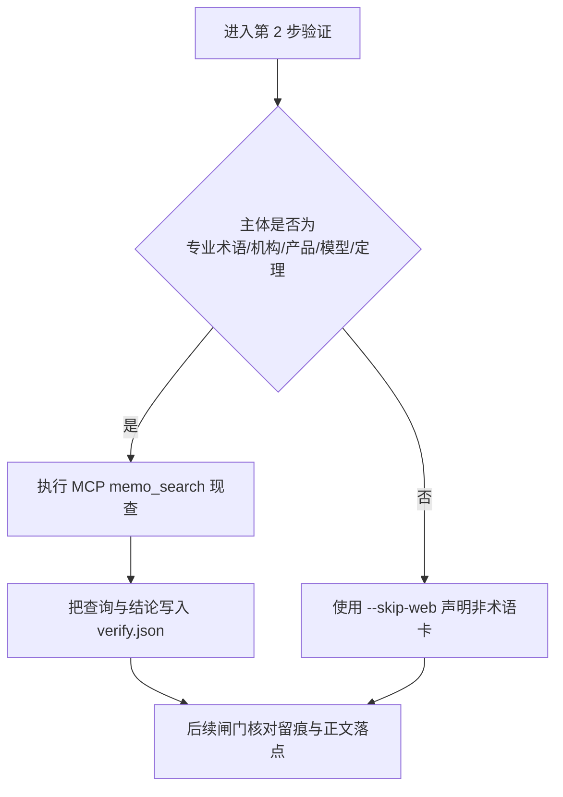
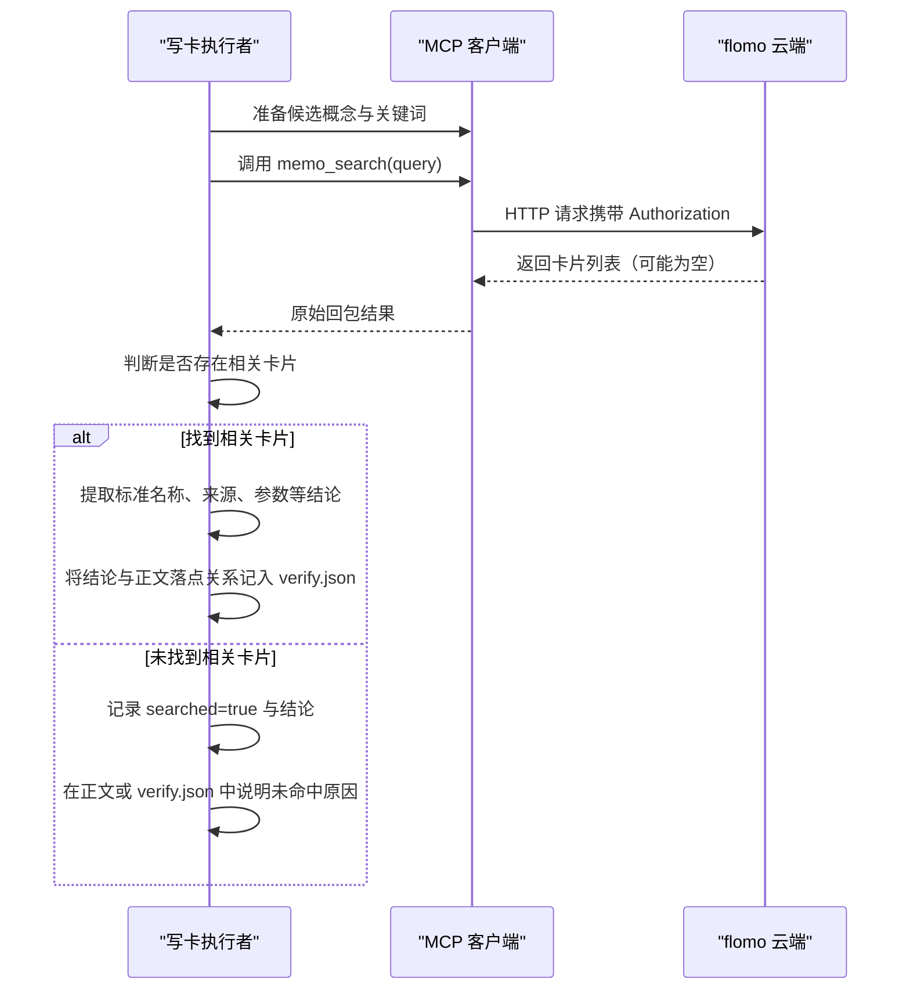
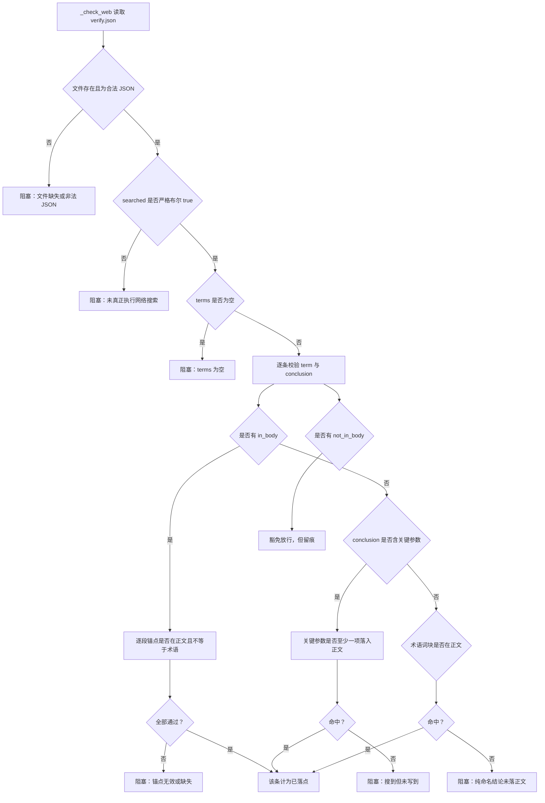
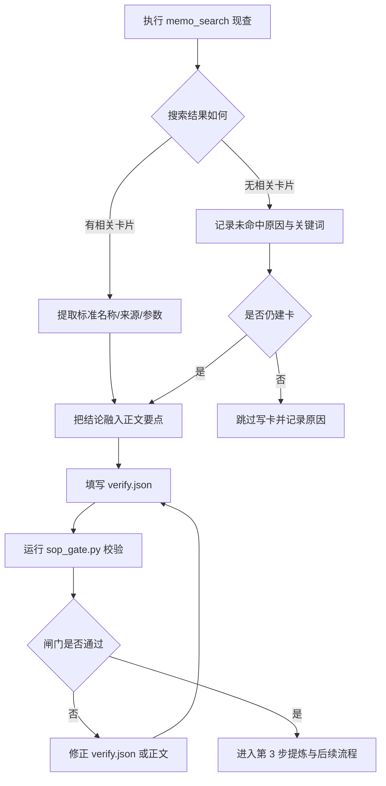

# 3.2 术语验证 search 现查 + verify.json 留痕

<cite>
**本文引用的文件**   
- [SKILL.md](file://SKILL.md)
- [sop_gate.py](file://scripts/sop_gate.py)
- [flomo_client.py](file://scripts/flomo_client.py)
- [test_sop_gate.py](file://tests/test_sop_gate.py)
</cite>

## 目录
1. [目标与边界](#目标与边界)
2. [何时需要执行术语验证](#何时需要执行术语验证)
3. [verify.json 位置、字段与版本约定](#verifyjson-位置字段与版本约定)
4. [一次 search 现查的标准流程](#一次-search-现查的标准流程)
5. [把搜索结果写进 verify.json](#把搜索结果写进-verifyjson)
6. [闸门校验规则：搜索是否真做、结论是否真写](#闸门校验规则搜索是否真做结论是否真写)
7. [失败分支与处置](#失败分支与处置)
8. [人工复核与修正流程](#人工复核与修正流程)
9. [完整样例](#完整样例)
10. [常见误区](#常见误区)

## 目标与边界
术语验证是写卡 SOP 第 2 步，核心目标是：**对正文中的候选概念进行「现查」，把搜索查询和核查结论落到 `verify.json`，供后续流程闸门审计。**  
它不是写卡动作，也不直接修改正文；它只是为第 3 步提炼、第 4 步定标签和第 7 步写云前自检提供依据。真正落进卡片正文的，必须是经过 MCP `memo_search` 确认后的标准术语、命名来源、首提时间或关键参数。

本步骤的关键约束有三条：
- 必须使用 MCP 工具真实调取云端状态，不能凭记忆、图片、原文简称或上一轮 AI 输出直接下结论。
- 必须生成 `verify.json`，否则第 7 步写云前会被闸门以 ERR 阻断。
- 必须在正文中体现验证结论，仅留痕不写卡同样过不了闸门。

**章节来源**
- [SKILL.md:340-370](file://SKILL.md#L340-L370)
- [sop_gate.py:1-80](file://scripts/sop_gate.py#L1-L80)

## 何时需要执行术语验证
根据项目细则，以下主体类型必须走术语验证：
- 专业术语
- 数学概念
- 科学名词
- 机构名称
- 产品名称
- 模型简称
- 定理简称

如果本轮素材没有上述类型主体，则不应强制搜索，而是通过 `--skip-web` 显式声明非术语卡。该标记会在凭证中留下 `web_skipped=true`，便于事后审计。

判断时先问：**这个候选能不能独立成立为一个对象？**  
能成立的，先列成概念清单；只给了名字的，要按第 2 步检索补齐信息后再判断能否成卡。



[无图表来源：该图为概念流程示意，不对应单一代码文件]

**章节来源**
- [SKILL.md:355-370](file://SKILL.md#L355-L370)
- [sop_gate.py:1-40](file://scripts/sop_gate.py#L1-L40)

## verify.json 位置、字段与版本约定

### 文件位置
`verify.json` 由调用方在完成第 2 步网络搜索后手工落盘，路径作为 `--verify` 传给 `scripts/sop_gate.py`。  
仓库中没有自动产出该文件的脚本——它是「人读可审计」的记录，不是机器内部缓存。

推荐组织方式：
- 单张卡：放在当轮工作目录，例如 `_tmp/verify_概念名.json`。
- 批次卡：每张卡一个记录文件，文件名与草稿一一对应，避免多张卡共用一份记录导致审计无法定位。

### 顶层字段
| 字段 | 类型 | 必填 | 含义 |
|---|---|---:|---|
| `searched` | JSON 布尔值 | 是 | 表示是否真的执行了 MCP 搜索。必须是字面量 `true`，不能是字符串 `"true"`、数字 `1` 或 `"no"`。 |
| `terms` | 数组 | 是 | 每个候选概念对应一条记录。空数组会触发阻塞。 |

### terms 项字段
| 字段 | 类型 | 必填 | 含义 |
|---|---|---:|---|
| `term` | 字符串 | 是 | 候选概念的名称，用于匹配正文落点。 |
| `query` | 字符串 | 建议填 | 实际传给 `memo_search` 的关键词，便于审计回溯本次现查用了哪些词。 |
| `conclusion` | 字符串 | 是 | 搜索后得出的核查结论，例如标准术语、命名来源、首提时间、关键参数。 |
| `in_body` | 字符串数组 | 可选 | 显式声明的正文片段。片段必须真实存在于正文，且不得等于或包含于术语本身。 |
| `not_in_body` | 字符串 | 可选 | 显式豁免理由。用于说明某个搜索结论确实不该写进正文，例如与卡片主题无关。 |

### 编码与读取约定
`sop_gate.py` 读取验证记录时使用 UTF-8 带 BOM 的容错模式（`utf-8-sig`）。这意味着：
- 推荐保存为 **UTF-8**。
- 若编辑器默认写入 UTF-8 BOM，也能被正确解析。
- 内容必须是合法 JSON，否则闸门报「非法 JSON」并阻塞。

### 版本兼容要求
- `searched` 必须是严格布尔 `true`。测试用例明确覆盖字符串、数字等假阳性情况。
- 每条 term 必须有 `term` 和 `conclusion`；缺少任一字段即阻塞。
- 如果新增字段，只要旧版闸门不依赖它，不会破坏向后兼容；但新增必填字段会改变契约，需要同步更新文档与用例。
- 如果删除已有字段，必须先检查闸门、凭证组装与审计文案是否仍消费该字段。

**章节来源**
- [SKILL.md:355-370](file://SKILL.md#L355-L370)
- [sop_gate.py:120-175](file://scripts/sop_gate.py#L120-L175)
- [sop_gate.py:430-460](file://scripts/sop_gate.py#L430-L460)
- [test_sop_gate.py:200-260](file://tests/test_sop_gate.py#L200-L260)

## 一次 search 现查的标准流程
术语验证的核心调用是 MCP 工具的 `memo_search`。标准流程如下：



**图表来源**
- [flomo_client.py](file://scripts/flomo_client.py)
- [sop_gate.py:430-460](file://scripts/sop_gate.py#L430-L460)

### 关键词选择建议
- 优先用候选概念的**标准名称**，而不是原文中的缩写或图片描述。
- 同时保留 `query` 字段，记录实际搜索词。这样即使最终结论来自其他语义维度，审计仍可回溯本次搜索入口。
- 对于多语言术语，可同时尝试中英文关键词，但最终 `conclusion` 要收敛到一致的标准称谓。

### 成功分支的基本判断
- 如果搜索结果中存在与候选概念对应的卡片，应据此确认标准术语、命名来源、发明者或首提时间、关键参数。
- 如果搜索结果不存在，不能简单写“搜索失败”；应区分：
  - MCP 握手或 token 问题（通道失败）
  - 搜索正常但无相关卡片
  - 关键词太窄或太宽
  - 概念尚未被任何人录入云端

**章节来源**
- [SKILL.md:355-370](file://SKILL.md#L355-L370)
- [sop_gate.py:430-460](file://scripts/sop_gate.py#L430-L460)

## 把搜索结果写进 verify.json
完成 MCP 搜索后，应逐条候选概念填写 `terms`。填写顺序应与概念清单一致，方便审计对照。

### 已找到相关卡片
示例语义：
- 搜索到既有卡片，确认候选概念是某产品的正式名称。
- 从搜索结果或卡片正文中提取关键参数，例如续航、功率、评级。
- 在 `conclusion` 中写出结论，并在正文中融入对应要点。

### 未找到相关卡片
如果 MCP 搜索返回空结果，但仍属于术语类主体，应继续写 `verify.json`，并在结论中如实说明：
- 当前云端无直接命中
- 使用的关键词
- 是否改用其他关键词重试
- 是否决定跳过写卡，或暂按摘要/间接来源处理

注意：「未找到」不等于「不需要验证」。验证留痕正是为了证明「已经现查过，而不是凭印象跳过」。

### 多结果歧义
当搜索结果出现多个候选对象时，不要只写“有多个结果”。应在 `conclusion` 中写明：
- 如何区分这些对象（域名、作者、用途、型号、年份等）
- 最终采用哪一个
- 另一个为何排除

如果歧义仍未解决，应先暂停写卡，补充抓取或上下文，再回填结论。

**章节来源**
- [SKILL.md:355-370](file://SKILL.md#L355-L370)
- [sop_gate.py:180-260](file://scripts/sop_gate.py#L180-L260)

## 闸门校验规则：搜索是否真做、结论是否真写
`sop_gate.py` 的 `_check_web` 负责校验 `verify.json`。它不只检查「有没有搜」，还要检查「搜到的东西有没有写进正文」。

### 前置校验
| 检查项 | 失败表现 |
|---|---|
| 未传 `--verify` | 阻塞：未提供第 2 步验证记录 |
| `verify.json` 不存在 | 阻塞：验证记录文件不存在 |
| JSON 解析失败 | 阻塞：非法 JSON |
| `searched` 不是严格布尔 `true` | 阻塞：必须为布尔 true |
| `terms` 为空 | 阻塞：terms 为空 |
| 任意 term 缺 `term` 或 `conclusion` | 阻塞：缺 term/conclusion |

### 正文落点校验顺序
对每个 term，闸门按以下优先级判定是否已落正文：

1. **显式锚点 `in_body`**  
   每段锚点必须是正文的真实子串，且不得等于或包含于术语本身。

2. **关键参数落点**  
   若 `conclusion` 中包含数字加单位（如 `430 公里`、`160 kW`、`31,200 欧元`）或星级评级，至少一项须出现在正文。

3. **纯命名落点**  
   若无关键参数，则按术语的词块比对正文。找不到落点即阻塞。

4. **显式豁免 `not_in_body`**  
   确实不该写进正文的条目，可用 `not_in_body` 给出理由；该条目视为已处理，但豁免理由随凭证留痕。

### 归一化规则
比较前会对两侧文本做归一化：去空白、去千分位逗号、统一小写。因此：
- `160 kW` 与 `160kW` 视为相同
- `1,055 公里` 与 `1055公里` 视为相同

但这不意味着可以随便改正文格式；正文仍须遵循 H14 卡片格式。



**图表来源**
- [sop_gate.py:180-260](file://scripts/sop_gate.py#L180-L260)
- [sop_gate.py:430-460](file://scripts/sop_gate.py#L430-L460)
- [test_sop_gate.py:250-430](file://tests/test_sop_gate.py#L250-L430)

**章节来源**
- [sop_gate.py:180-260](file://scripts/sop_gate.py#L180-L260)
- [sop_gate.py:430-460](file://scripts/sop_gate.py#L430-L460)
- [test_sop_gate.py:250-430](file://tests/test_sop_gate.py#L250-L430)

## 失败分支与处置

### 未找到相关卡片
- 现象：`memo_search` 返回空列表。
- 处置：
  - 仍写 `verify.json`，`searched=true`。
  - 在 `conclusion` 中说明当前云端无直接命中，以及已尝试的关键词。
  - 若素材仅为名称且无替代来源，可按项目规则决定是否跳过写卡，并说明原因。
  - 不要把「未找到」写成「没搜索」；前者是有效验证结果，后者是漏做。

### 多结果歧义
- 现象：搜索结果出现多个同名或近名对象。
- 处置：
  - 在 `conclusion` 中写出区分依据与最终选择。
  - 若仍无法确定，暂停写卡，补充抓取或上下文。
  - 不要在 `verify.json` 里只写“结果不确定”而不给结论；审计需要知道最终决策是什么。

### MCP 握手失败
- 现象：MCP 连接失败、token 未配置、握手异常。
- 处置：
  - 先排查 `.mcp.json` 或 `FLOMO_TOKEN` 是否配置。
  - 使用 `netdoctor.py` 排查出网通道，不要手写 curl 猜测端口。
  - 握手失败时不应假装搜索成功；此时应修复环境后重新现查。
  - 若 token 过期，应刷新凭据后重试，不能复用旧凭据绕过 MCP。

### Token 过期
- 现象：Authorization 失效，MCP 工具调用失败。
- 处置：
  - 刷新本地 token，使 `.mcp.json` 中的 Authorization 仍有效。
  - 刷新后重新执行 `memo_search`，并更新 `verify.json`。
  - 不能通过伪造 `searched=true` 绕过闸门；闸门还会校验后续凭证签名与正文指纹。

### 搜索成功但结论未写进正文
- 现象：`verify.json` 齐全，但闸门发现关键参数或术语名未在正文中出现。
- 处置：
  - 修改正文，让结论真正融入对应要点。
  - 如果结论确实不该写入正文，改为添加 `not_in_body` 并给出合理理由。
  - 不要用 `in_body` 填写术语本身或正文中不存在的片段。

### verify.json 结构错误
- 现象：JSON 非法、`searched` 不是布尔 `true`、`terms` 为空、缺 `term` 或 `conclusion`。
- 处置：
  - 用 JSON 校验器检查语法。
  - 确保 `searched` 是字面量 `true`。
  - 补全必填字段。
  - 不要写 `searched="true"` 或 `searched=1`。

**章节来源**
- [README.md:20-40](file://README.md#L20-L40)
- [sop_gate.py:430-460](file://scripts/sop_gate.py#L430-L460)
- [test_sop_gate.py:200-260](file://tests/test_sop_gate.py#L200-L260)

## 人工复核与修正流程
术语验证不直接改正文，但它决定后续提炼与标签方向。典型修正流程如下：



[无图表来源：该图为通用修正流程示意]

### 修正 checklist
- 是否所有候选概念都有一条 `terms` 记录？
- `searched` 是否为严格布尔 `true`？
- `query` 是否能还原本次 MCP 搜索？
- `conclusion` 是否给出可审计的最终结论？
- 有参数的结论是否至少一项落入正文？
- 纯命名结论是否至少在正文中出现术语名？
- 不写进正文的结论是否用 `not_in_body` 显式豁免？
- 使用 `in_body` 时，片段是否真实存在于正文？
- 是否已用 `sop_gate.py --verify <路径>` 跑通闸门？

**章节来源**
- [SKILL.md:340-370](file://SKILL.md#L340-L370)
- [sop_gate.py:180-260](file://scripts/sop_gate.py#L180-L260)

## 完整样例

### 一次 search 调用
假设候选概念是某车型的官方名称，当前正文只写了简称。标准调用语义如下：

- 工具：`memo_search`
- 参数：`keywords` 为该车型的标准名称或广泛使用的全称
- 期望返回：云端已有的相关卡片列表

调用成功后，应从结果中提取：
- 标准术语
- 命名来源或产品背景
- 关键参数（如续航、功率、价格、评级）
- 若结果为空，记录关键词与未命中原因

### verify.json 产出样例
以下为一份可通过闸门的记录示例（仅展示结构，不包含具体业务敏感内容）：

```json
{
  "searched": true,
  "terms": [
    {
      "term": "候选概念 A",
      "query": "候选概念 A 标准名称",
      "conclusion": "确认为某机构发布的产品名称，首提时间为某年，关键参数包括续航 430 公里"
    },
    {
      "term": "候选概念 B",
      "query": "候选概念 B 英文缩写",
      "conclusion": "经搜索与现有卡片比对，确认其标准称谓为 X，与 Y 不同，因用途不同而区分",
      "in_body": ["X 标准称谓已在正文要点中使用"],
      "not_in_body": ""
    },
    {
      "term": "候选概念 C",
      "query": "候选概念 C 关键词",
      "conclusion": "当前云端无直接命中；已尝试关键词 C1、C2，暂无替代来源，本轮暂不写入正文",
      "not_in_body": "该参数与卡片主题无关，按 H13 不并入"
    }
  ]
}
```

说明：
- `searched` 是布尔 `true`。
- 每个概念都有 `term`、`query`、`conclusion`。
- 概念 B 用 `in_body` 声明正文落点，但该片段必须真实存在于正文。
- 概念 C 既说明未命中，也给出是否写卡的判断。
- 如果某个结论确实不该写进正文，应使用 `not_in_body` 而非省略。

**章节来源**
- [SKILL.md:355-370](file://SKILL.md#L355-L370)
- [sop_gate.py:120-175](file://scripts/sop_gate.py#L120-L175)
- [test_sop_gate.py:250-430](file://tests/test_sop_gate.py#L250-L430)

## 常见误区
| 误区 | 正确做法 |
|---|---|
| 只跑 MCP 搜索，不写 `verify.json` | 术语卡无留痕 = 第 7 步直接 ERR 阻断 |
| 把 `searched` 写成字符串 `"true"` | 必须是 JSON 布尔 `true` |
| 用 `in_body` 填术语本身 | 锚点必须承载结论的具体表述，不能等于术语 |
| 搜索成功但结论照抄原文不写进正文 | 闸门会检测关键参数或术语名是否落入正文 |
| 搜索失败就跳过验证 | 仍需记录已现查的事实，或显式 `--skip-web` |
| 多结果歧义时只写“有多个结果” | 必须写出区分依据与最终结论 |
| 用旧凭证或伪造留痕绕过闸门 | 凭证还绑定正文指纹、签名与有效期 |
| 以为 `verify.json` 就是正文 | 它只是审计留痕，正文仍需按 H14 单独写作 |

**章节来源**
- [SKILL.md:340-370](file://SKILL.md#L340-L370)
- [sop_gate.py:180-260](file://scripts/sop_gate.py#L180-L260)
- [test_sop_gate.py:200-430](file://tests/test_sop_gate.py#L200-L430)