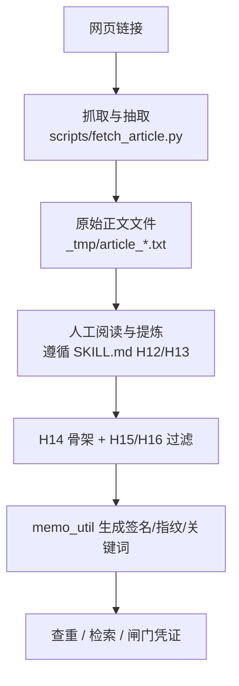
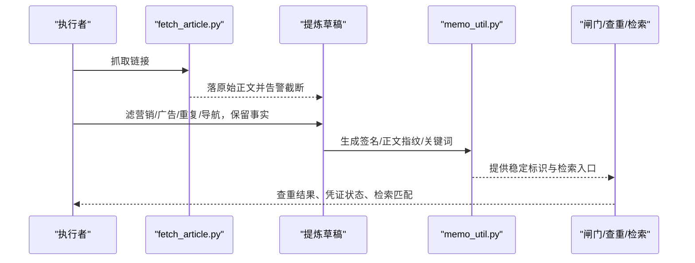
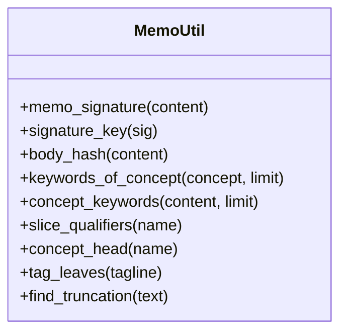
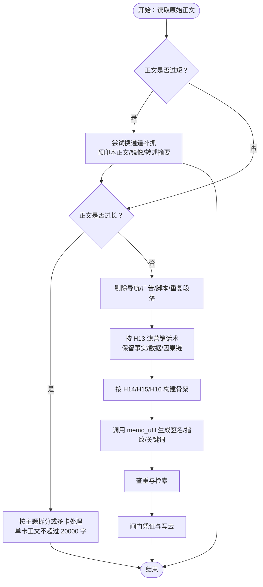
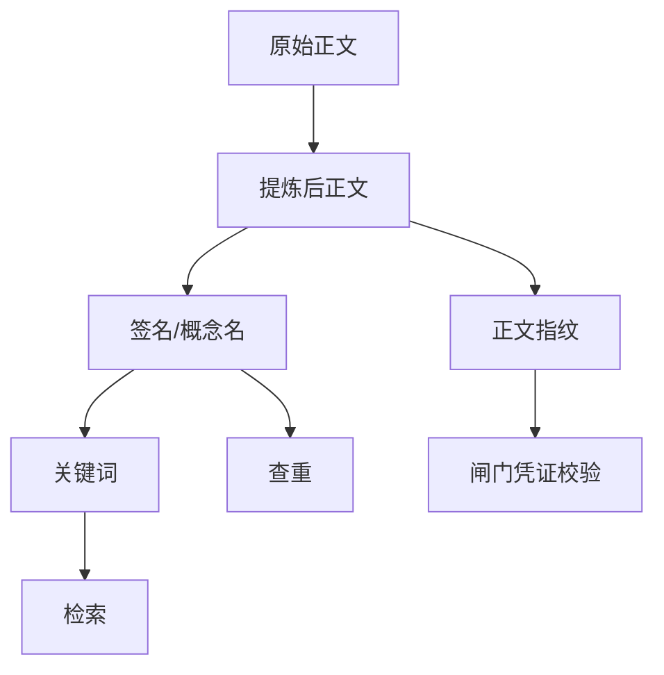

# 3.3 内容提炼

<cite>
**本文引用的文件**   
- [SKILL.md](file://SKILL.md)
- [memo_util.py](file://scripts/memo_util.py)
- [test_memo_util.py](file://tests/test_memo_util.py)
- [fetch_article.py](file://scripts/fetch_article.py)
</cite>

## 目录
1. [引言](#引言)
2. [项目结构](#项目结构)
3. [核心组件](#核心组件)
4. [架构总览](#架构总览)
5. [详细组件分析](#详细组件分析)
6. [依赖关系分析](#依赖关系分析)
7. [性能与质量特征](#性能与质量特征)
8. [排错指南](#排错指南)
9. [结论](#结论)
10. [附录：提炼对照清单](#附录提炼对照清单)

## 引言
本节面向“从抓取到的原始正文中提炼一事一卡”的实操人员，目标是明确：哪些信息该删、哪些事实该留、过短或过长原文如何处理，以及提炼结果如何影响后续查重与检索。

在整体流程中，“抓取 → 验证 → 提炼 → 定标签 → 查重 → 写作 → 自检 → 复盘 → 更新”是一个有顺序的流水线；其中第 3 步提炼必须遵循 H12/H13 的语义边界，再进入 H14–H16 的结构约束。提炼不是改写全文，而是把网页噪声剔除后，按“概念是什么 / 怎么工作 / 参数 / 沿革 / 边界”重新组织成一张独立卡片。

## 项目结构
本节的操作依据主要分布在两类文件中：

| 文件 | 角色 | 与提炼的关系 |
|---|---|---|
| `SKILL.md` | 执行细则唯一源 | 定义 H12/H13（写什么不写什么）、H14–H16（格式）、H17/H18（标签）、提炼纪律与闸门衔接 |
| `scripts/memo_util.py` | 签名、指纹、关键词、标签解析的唯一实现 | 决定卡片签名、正文指纹和检索关键词口径；提炼质量直接改变这些值 |
| `scripts/fetch_article.py` | 通用网页抓取与正文抽取脚本 | 负责去导航、去脚本、抽正文、检测截断；它产出的是“待提炼的原始正文”，不是最终卡片 |
| `tests/test_memo_util.py` | 公共逻辑回归用例 | 锁定签名、关键词、标签、切片等口径，防止改动一处导致另一处静默失配 |

**图表来源**  
- [fetch_article.py:240-430](file://scripts/fetch_article.py#L240-L430)
- [SKILL.md:231-266](file://SKILL.md#L231-L266)
- [memo_util.py:1-86](file://scripts/memo_util.py#L1-L86)

**章节来源**  
- [SKILL.md:19-19](file://SKILL.md#L19-L19)
- [SKILL.md:359-359](file://SKILL.md#L359-L359)

## 核心组件
本节只说明与“内容提炼质量”直接相关的组件，不展开整个仓库。

| 组件 | 输入 | 输出 | 对提炼的影响 |
|---|---|---|---|
| 网页抽取器 | HTML 片段 | 纯文本正文 | 如果导航、广告、侧栏残留进正文，会污染提炼判断，使营销话术更难识别 |
| 提炼规则 | 原始正文 | 一事一卡的主体内容 | 决定哪些是事实、数据、因果链，哪些是营销话术、事件叙述、载体信息 |
| 签名提取 | 完整卡片文本 | 首行标签 + 第二行概念名 | 概念名写错会导致同一对象被拆成多张卡 |
| 正文指纹 | 完整卡片正文 | SHA-256 前缀键 | 闸门凭证绑定正文指纹，防“先跑闸门、后改正文” |
| 关键词提取 | 概念名 | 最多两个短关键词 | 影响 flomo 全文检索命中与近邻比对 |
| 截断占位符检测 | 正文 | 是否含 `[此处省略…字]` | 避免用残缺正文写卡 |

**章节来源**  
- [memo_util.py:1-86](file://scripts/memo_util.py#L1-L86)
- [memo_util.py:201-347](file://scripts/memo_util.py#L201-L347)
- [SKILL.md:214-217](file://SKILL.md#L214-L217)

## 架构总览
提炼不是孤立步骤，它位于抓取之后、查重之前，并被签名、指纹和关键词三个“机器可判定的契约”所约束：

**图表来源**  
- [fetch_article.py:300-430](file://scripts/fetch_article.py#L300-L430)
- [memo_util.py:1-86](file://scripts/memo_util.py#L1-L86)
- [SKILL.md:387-392](file://SKILL.md#L387-L392)

## 详细组件分析

### 1. 原始正文清洗边界：抓取层 vs 提炼层
`fetch_article.py` 已经做了第一道噪声过滤：移除脚本、样式、导航、页眉页脚等块级元素，并把 HTML 转为可读纯文本。但它的职责是“尽可能拿到正文”，而不是“替人完成知识提炼”。

关键行为如下：

| 行为 | 说明 | 提炼阶段仍需处理 |
|---|---|---|
| 去除 `<nav>`/`<aside>`/`<footer>`/`<header>` | 减少导航型噪声 | 若页面语义容器选错，仍可能混入无关段落 |
| 优先 `<article>`/`<main>` | 尽量取到主体区域 | 不能保证没有广告、推荐、相关推荐 |
| 候选 div 按文本量打分 | 避免侧栏误当正文 | 长文章可能被右界提前收束 |
| 检测二三级标题缺失 | 发现可能的截断 | 即使字符数够，也可能缺后半篇 |

因此，提炼时仍要人工确认：原始正文是否真的来自目标页面主体，是否存在“结尾像自然收尾但后面还有章节”的情况。

**章节来源**  
- [fetch_article.py:254-330](file://scripts/fetch_article.py#L254-L330)
- [fetch_article.py:330-430](file://scripts/fetch_article.py#L330-L430)

### 2. 提炼规则：H12/H13 的删除与保留
根据 `SKILL.md`，提炼的核心原则是：

- **删除**：
  - 营销话术（尤其是倍数、横向对比、“行业首个”等不可核比较）
  - 事件动机、时间线、报道过程
  - 方法论启示类主观总结（除非原文就是方法论文章）
  - 其他卡片关联（H12）
  - 来源、作者、机构、报道方、状态、载体信息（H15/H16）
  - 模板指令回显（如“结论先行”“要点：”等非真实内容）
- **保留**：
  - 定义、参数、机制、法规条款、生效状态
  - 可核对的沿革与时间线
  - 实验结果、关键数值、条件与边界
  - 因果链本身（而非“某媒体认为”的外壳）

提炼后的正文应满足 H14 的结构要求：首行标签段单独成段，第二行概念名，空一行后是正文；正文首句是结论句，不使用强调标记，不使用行内 `#`，总字数不超过 20000 字。

**章节来源**  
- [SKILL.md:228-266](file://SKILL.md#L228-L266)
- [SKILL.md:268-280](file://SKILL.md#L268-L280)
- [SKILL.md:359-359](file://SKILL.md#L359-L359)

### 3. 正文指纹与关键词：为什么提炼质量决定查重与检索效果
`memo_util.py` 是签名、指纹、关键词、标签解析的单一实现，多个模块共用。提炼质量直接影响以下三个出口：

#### 3.1 签名与概念名
签名取正文前两个非空行：首行应为标签段，第二行应为概念名。H14 允许标签段与概念名之间夹一个空行，这是为了兼容 flomo 存储层自动插入的空行。

如果提炼时把来源、载体、事件叙述写进概念名，签名就会变；同一对象可能因为写法不同被拆成多个簇，导致查重漏报。

#### 3.2 正文指纹
正文指纹是对完整正文做哈希，用于凭证校验，防止“先跑闸门、后改正文”。如果提炼阶段删掉了关键事实，指纹会变，旧凭证失效；如果只改措辞没改事实，指纹也会变，需要重新跑闸门。

#### 3.3 关键词
关键词从概念名派生：先取最长连续中文段（至少四字），再取去除标点后的前八个字符，去重保序，默认最多两个。全角标点会被剔除，避免 flomo 全文检索返回零结果。

如果概念名包含营销词、事件动作、时间切片或载体信息，关键词就可能变成无检索价值的片段，降低后续查重的召回率。

**图表来源**  
- [memo_util.py:1-86](file://scripts/memo_util.py#L1-L86)
- [memo_util.py:201-347](file://scripts/memo_util.py#L201-L347)

**章节来源**  
- [memo_util.py:1-86](file://scripts/memo_util.py#L1-L86)
- [test_memo_util.py:21-60](file://tests/test_memo_util.py#L21-L60)
- [test_memo_util.py:61-115](file://tests/test_memo_util.py#L61-L115)

### 4. 提炼流程图
下面的流程图描述一次标准提炼操作，覆盖删除项、保留项与异常分支：

**图表来源**  
- [SKILL.md:266-266](file://SKILL.md#L266-L266)
- [SKILL.md:343-352](file://SKILL.md#L343-L352)
- [memo_util.py:1-86](file://scripts/memo_util.py#L1-L86)

### 5. 与 H14–H16 的衔接关系
| 规则 | 提炼阶段要求 | 机器检查方式 |
|---|---|---|
| H14 卡片格式 | 首行标签段、第二行概念名、空一行、正文；首句结论先行；禁止强调标记；禁止行内 `#`；不超过 20000 字 | `validate_memo.py` 与 `memo_util.memo_signature` 共同判定 |
| H15 无来源无状态 | 删除来源、作者、机构、报道、参考、状态、自指备注 | 形态清单 ERR 阻断 |
| H16 禁止载体信息 | 截图、PPT、公众号长图只是取材通道，不写载体名 | 与 H15 同等对待 |
| H12 禁止关联卡片 | 正文不得引用其他 flomo 卡片 | 写前质检拦截 |

特别要注意：H14 的概念名必须是名词短语，不能写成整句；如果写成“标题：摘要”形态，切片限定检测只扫描冒号前的标题部分，不把摘要里的“当前”“近日”误判为切片。

**章节来源**  
- [SKILL.md:243-266](file://SKILL.md#L243-L266)
- [SKILL.md:268-280](file://SKILL.md#L268-L280)
- [memo_util.py:201-270](file://scripts/memo_util.py#L201-L270)

## 依赖关系分析
提炼质量通过以下依赖链影响下游：

- 如果原始正文未彻底清理，提炼容易把广告或导航当成事实。
- 如果概念名写错，签名变化，同一对象可能重复建卡。
- 如果正文被篡改但未重新跑闸门，正文指纹不符，闸门拒绝写云。
- 如果关键词是无意义的营销片段，检索命中率下降，查重召回率也下降。

**图表来源**  
- [memo_util.py:1-86](file://scripts/memo_util.py#L1-L86)
- [SKILL.md:387-392](file://SKILL.md#L387-L392)

## 性能与质量特征
从实现角度看，`memo_util.py` 中的关键字段都是线性或正则匹配，复杂度不高；真正影响质量的是“口径一致性”：

| 维度 | 低质量表现 | 高质量表现 |
|---|---|---|
| 签名稳定性 | 同对象因来源/载体/事件叙述产生不同概念名 | 概念名只标识对象本身 |
| 正文指纹稳定性 | 每次微调措辞都破坏凭证 | 仅修改事实时才重新跑闸门 |
| 关键词有效性 | 出现全角标点、动词、时间切片 | 最短四字中文核心段 + 去标点后前八字符 |
| 截断检测 | 用“结尾像自然收尾”误判 | 直接检测 `[此处省略…字]` |

测试用例锁定了常见边界：签名对空串/None/非字符串安全、关键词去重保序、标签两级解析、切片限定区分产品型号与时间版本、截断占位符只认带括号的标记形态。

**章节来源**  
- [test_memo_util.py:21-115](file://tests/test_memo_util.py#L21-L115)
- [test_memo_util.py:116-221](file://tests/test_memo_util.py#L116-L221)
- [memo_util.py:201-347](file://scripts/memo_util.py#L201-L347)

## 排错指南
遇到提炼相关问题时，可按以下顺序排查：

1. **确认原始正文未被截断**  
   使用 `scan_truncated.py` 或查看 `memo_batch_get` 的真实正文，不要只看检索回包。若正文含 `[此处省略…字]`，应先补抓或换通道，不能用残缺正文写卡。

2. **检查签名是否可解析**  
   如果 `memo_signature` 返回 None，通常是首行不是标签、第二行不存在、第二行也是标签、或正文不足两行非空内容。

3. **检查关键词是否退化**  
   如果概念名含全角括号、动词、时间切片或载体信息，关键词可能失去检索价值。应回到 H14 概念名规范修正。

4. **检查闸门凭证正文指纹**  
   如果闸门报错正文指纹不符，说明闸门运行后正文又被修改，需要重新跑 `sop_gate.py`。

5. **检查 H15/H16 残留**  
   来源、作者、机构、报道方、载体名、状态行、自指备注都必须删除；事件自身的通报方与材料载体同等对待。

**章节来源**  
- [memo_util.py:1-86](file://scripts/memo_util.py#L1-L86)
- [memo_util.py:201-347](file://scripts/memo_util.py#L201-L347)
- [SKILL.md:214-217](file://SKILL.md#L214-L217)
- [SKILL.md:268-280](file://SKILL.md#L268-L280)
- [SKILL.md:387-392](file://SKILL.md#L387-L392)

## 结论
内容提炼的关键不是“改写得更流畅”，而是“剔除噪声后保留一事一卡的事实内核”。它既要符合 H12/H13 的语义边界，又要满足 H14–H16 的结构约束；同时，它必须让 `memo_util.py` 能生成稳定的签名、正文指纹和有效关键词，从而支撑查重、检索与闸门凭证。

提炼质量的衡量标准可以简化为三条：
1. 概念名是否只标识对象本身；
2. 正文是否不含来源、载体、营销话术与自指备注；
3. 签名、指纹、关键词是否与最终卡片一致且可用于下游流程。

## 附录：提炼对照清单

### 典型删除句式
- “据 X 报道 / 援引 / 转自”
- “X 网站发布 / 通报称 / 消息来源”
- “来源：/ 报道：/ 参考来源：/ 原文链接”
- “状态：/ 当前状态：”
- “本文 / 文中 / 该文 / 原文 / 本篇 / 这篇”
- “作者 + 言说动词：指出 / 认为 / 表示 / 提出 / 写道 / 坦言 / 强调 / 声称 / 自陈 / 介绍 / 总结”
- “快 5-10 倍 / 行业首个 / 远超同行”等营销式倍数与横向对比
- 与已建卡片关联的语句
- 模板指令回显，例如“结论先行”“一句话核心结论”

### 典型保留事实
- 对象定义、机制说明、工作原理
- 参数、单位、数值、评级
- 法规条款、生效状态、适用范围
- 已知沿革、首提时间、命名来源
- 实验条件、边界限制、失败情形
- 由谁作出（处分或判决的程序要素）

### 过短原文处理策略
- 优先走预印本正文通道；
- 穷尽正文通道后仍不可得，才可用摘要写卡，但要点严格限于摘要明示事实；
- 不得凭个人判断以“内容单薄”为由跳过写卡；
- 抓取完全失败且无替代来源时方可跳过并说明原因。

### 过长原文处理策略
- 单卡正文不超过 20000 字；
- 超过时应按主题拆分，或按概念粒度拆成多卡；
- 不得跨卡串联归纳；
- 若抽取出现“正文止于某章节，其后若干章节标题未出现”，必须先核对原文，不能按残缺正文写卡。

**章节来源**  
- [SKILL.md:231-235](file://SKILL.md#L231-L235)
- [SKILL.md:266-266](file://SKILL.md#L266-L266)
- [SKILL.md:343-352](file://SKILL.md#L343-L352)
- [SKILL.md:359-359](file://SKILL.md#L359-L359)