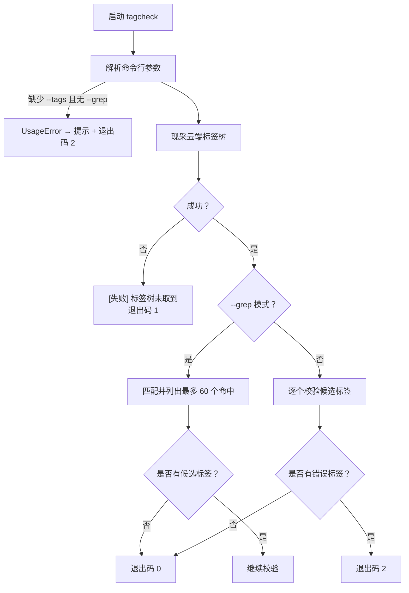
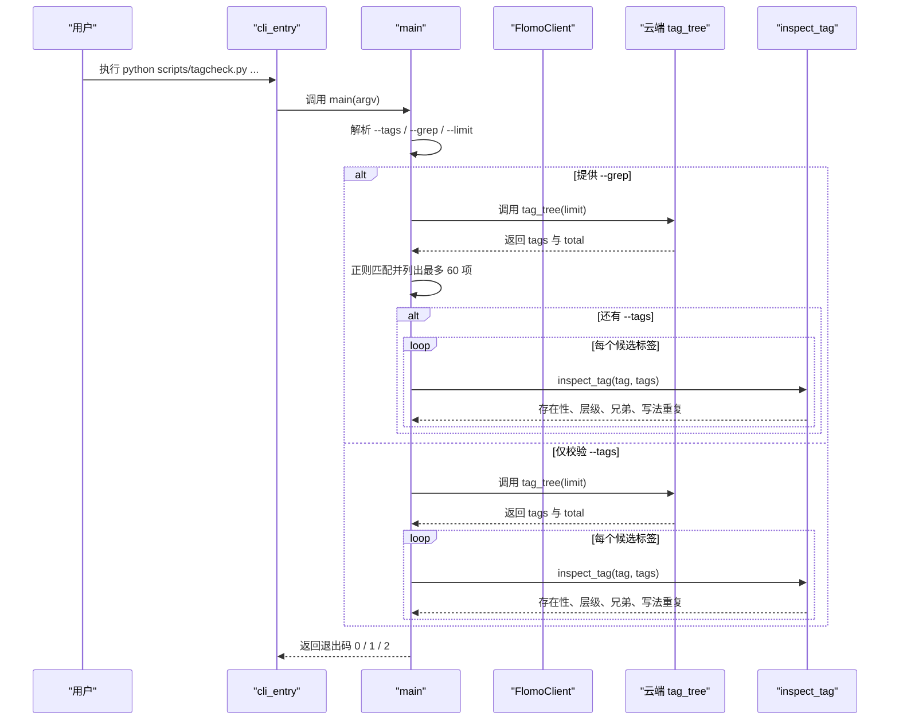
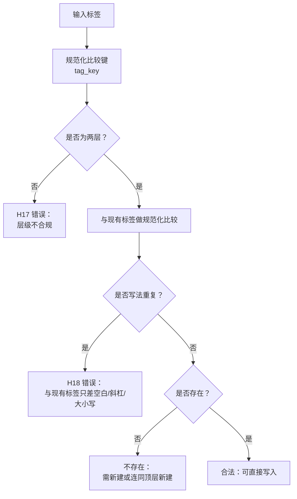
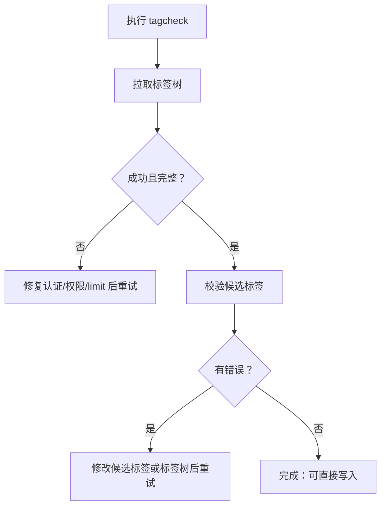
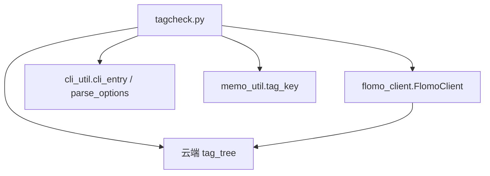

# 3.4 标签确定 tagcheck

<cite>
**本文引用的文件**
- [scripts/tagcheck.py](file://scripts/tagcheck.py)
- [tests/test_tagcheck.py](file://tests/test_tagcheck.py)
</cite>

## 目录
1. [简介](#简介)
2. [项目结构与入口](#项目结构与入口)
3. [核心流程](#核心流程)
4. [命令行参数](#命令行参数)
5. [标签体系规则 H17/H18](#标签体系规则-h17h18)
6. [返回值与日志输出格式](#返回值与日志输出格式)
7. [详细使用场景与修复命令](#详细使用场景与修复命令)
8. [重试策略：标签树变化与截断](#重试策略标签树变化与截断)
9. [架构与依赖关系](#架构与依赖关系)
10. [故障排查清单](#故障排查清单)
11. [结论](#结论)

## 简介
tagcheck 是定标签前的“第 4 步”现采云端标签树校验脚本。它不写入任何标签，只读云端 `tag_tree`，对候选标签执行以下检查：
- 是否存在于当前标签树；
- 是否严格两级；
- 同一顶层下已有哪些二级兄弟标签；
- 是否与现有标签只差空白、全半角斜杠或大小写（即写法重复）。

该脚本用于避免在已有近义簇旁新建重复簇，也用于防止三级标签、单层标签或跨级混用进入正式标签段。

**章节来源**
- [scripts/tagcheck.py:1-27](file://scripts/tagcheck.py#L1-L27)

## 项目结构与入口
tagcheck 位于仓库的 `scripts/` 目录下，是一个独立可执行的 Python 脚本。其运行入口逻辑由外部 `cli_util.cli_entry` 统一包装：当传入 `-h`、`--help` 或 `help` 时，直接打印脚本文档字符串并返回退出码 0；否则按定义的选项解析后调用 `main`。



**图表来源**
- [scripts/tagcheck.py:28-53](file://scripts/tagcheck.py#L28-L53)
- [scripts/tagcheck.py:89-199](file://scripts/tagcheck.py#L89-L199)

**章节来源**
- [scripts/tagcheck.py:28-53](file://scripts/tagcheck.py#L28-L53)
- [scripts/tagcheck.py:89-199](file://scripts/tagcheck.py#L89-L199)
- [tests/test_tagcheck.py:1-24](file://tests/test_tagcheck.py#L1-L24)

## 核心流程
tagcheck 的核心处理顺序如下：

1. **初始化标准输出编码**：尝试设置 UTF-8 输出环境。
2. **解析参数**：读取 `--tags`、`--grep`、`--limit`。
3. **拆分候选标签**：将 `--tags` 中的值按逗号、全角逗号、顿号拆分，去重、去除 `#` 前缀与空白。
4. **加载标签树**：通过 `FlomoClient` 调用云端 `tag_tree`，并用 `tool_data` 解析回包。
5. **校验标签树完整性**：若返回条数不等于 `total`，视为截断并抛出运行时错误。
6. **可选正则匹配**：如果提供了 `--grep`，先列出匹配的现有标签。
7. **逐项检查候选标签**：
   - 先判写法重复；
   - 再判层级是否严格两级；
   - 然后判断是否存在；
   - 最后列出同顶层二级兄弟标签。
8. **汇总结论**：有错误则退出码 2，全部合法则退出码 0。



**图表来源**
- [scripts/tagcheck.py:89-199](file://scripts/tagcheck.py#L89-L199)

**章节来源**
- [scripts/tagcheck.py:55-87](file://scripts/tagcheck.py#L55-L87)
- [scripts/tagcheck.py:89-199](file://scripts/tagcheck.py#L89-L199)

## 命令行参数

| 参数 | 类型 | 默认值 | 说明 |
| --- | --- | --- | --- |
| `--tags` | 字符串 | 空字符串 | 指定待校验的候选标签。多个标签应放在同一个 `--tags` 中，用英文逗号、中文逗号或顿号分隔。支持以 `#` 开头。 |
| `--grep` | 字符串 | 无 | 提供正则表达式，列出匹配的现有标签。空字符串会被拒绝，因为空正则命中全部标签不构成有效证据。 |
| `--limit` | 整数 | 2000 | 请求云端返回的标签数量上限。必须为正整数。 |

### 参数校验规则
- 未提供 `--tags` 且未提供 `--grep`：触发用法错误。
- `--grep` 为空字符串：触发用法错误。
- `--grep` 的正则无法编译：退出码 2。
- `--limit` 不是正整数：触发用法错误。

**章节来源**
- [scripts/tagcheck.py:33-45](file://scripts/tagcheck.py#L33-L45)
- [scripts/tagcheck.py:102-123](file://scripts/tagcheck.py#L102-L123)

## 标签体系规则 H17/H18

### H17：严格两级
标签必须是“顶层/二级”两级结构，不允许：
- 单层标签，例如只有顶层；
- 三级或更深标签，例如“顶层/二级/子级”。

H17 的错误会明确提示“须严格两级”，并禁止三级或单层。

### H18：多标签空格分隔、禁止跨级混用
H18 主要约束标签簇的书写一致性：
- 首行标签段中多个标签之间用空格分隔；
- 同一顶层下的相近概念不应写成不同簇；
- 与现有标签只差空白、全角或半角斜杠、大小写的候选标签，会被判定为“写法重复”，不能照原样写入，否则会形成两个语义相同但名称不同的标签簇。

tagcheck 使用 `memo_util.tag_key` 作为“写法重复”判据，与后续“第 ⑧ 步闸门”保持一致。



**图表来源**
- [scripts/tagcheck.py:55-87](file://scripts/tagcheck.py#L55-L87)
- [scripts/tagcheck.py:139-199](file://scripts/tagcheck.py#L139-L199)

**章节来源**
- [scripts/tagcheck.py:55-87](file://scripts/tagcheck.py#L55-L87)
- [scripts/tagcheck.py:139-199](file://scripts/tagcheck.py#L139-L199)

## 返回值与日志输出格式

### 返回值语义

| 退出码 | 含义 | 典型原因 |
| --- | --- | --- |
| 0 | 全部校验通过 | 所有候选标签都存在、严格两级、无写法重复。 |
| 1 | 标签树不可信或调用失败 | 云端连接失败、权限不足、字段缺失、返回条数小于 `total`。 |
| 2 | 存在可用性问题 | 标签缺失、层级不合规、写法重复、参数错误、正则无效。 |

### 日志输出格式

#### 标签树信息
```text
[标签树] N 个（limit=2000，条数与 total 相符）
```

#### 匹配结果（`--grep`）
```text
[匹配] 正则「pattern」命中 M 个
   标签1
   标签2
   …另 K 个未列出（缩小 --grep 范围再看）
```

#### 单个标签检查结果
- 通过：
  ```text
  ✓ 顶层/二级  已存在（同顶层 X 个二级）
  ```
- 写法重复：
  ```text
  ✗ 顶层／二级  与现有「顶层/二级」只差空白/全半角/大小写——云端会把它们当两个簇，照原样写入即分裂（H18）；改回现有写法
  ```
- 层级不合规：
  ```text
  ✗ 顶层/二级/子级  层级不合规：须严格两级（#顶层/二级），禁三级或单层（H17）
  ```
- 不存在：
  ```text
  ✗ 顶层/新二级  不存在；该顶层存在，可直接新建此二级
  ```
  或
  ```text
  ✗ 顶层/新二级  不存在；该顶层也不存在，须连同顶层一起新建
  ```

#### 兄弟二级标签列表
```text
   同顶层二级：顶层/二级A, 顶层/二级B …另 Y 个
```

#### 最终结论
- 全部通过：
  ```text
  
  [结论] 全部存在且严格两级，可直接写入首行标签段
  ```
- 有错误：
  ```text
  
  [结论] B/N 个标签不可直接用，按上面提示调整后重跑
  ```

**章节来源**
- [scripts/tagcheck.py:124-199](file://scripts/tagcheck.py#L124-L199)

## 详细使用场景与修复命令

### 场景一：正常校验两个已存在的二级标签

**命令：**
```bash
python scripts/tagcheck.py --tags "AI/Agent,科技/测试"
```

**预期行为：**
- 现采云端标签树；
- 两个标签均存在；
- 输出每个标签的同顶层二级兄弟数量；
- 退出码为 0。

**参考用例路径：**
- [tests/test_tagcheck.py:53-60](file://tests/test_tagcheck.py#L53-L60)

**章节来源**
- [tests/test_tagcheck.py:53-60](file://tests/test_tagcheck.py#L53-L60)

### 场景二：标签不存在，但顶层存在

**命令：**
```bash
python scripts/tagcheck.py --tags "AI/不存在"
```

**预期行为：**
- 退出码 2；
- 提示该顶层存在，可直接新建此二级；
- 不误报顶层缺失。

**修复建议：**
- 若确属新二级，可在标签树中新建该二级标签后重跑；
- 不要直接创建与已有近义簇并列的新簇。

**参考用例路径：**
- [tests/test_tagcheck.py:62-70](file://tests/test_tagcheck.py#L62-L70)
- [tests/test_tagcheck.py:72-85](file://tests/test_tagcheck.py#L72-L85)

**章节来源**
- [tests/test_tagcheck.py:62-70](file://tests/test_tagcheck.py#L62-L70)
- [tests/test_tagcheck.py:72-85](file://tests/test_tagcheck.py#L72-L85)

### 场景三：三级标签

**命令：**
```bash
python scripts/tagcheck.py --tags "AI/Agent/子级"
```

**预期行为：**
- 退出码 2；
- 提示“严格两级”，指出 H17；
- 不会把问题解释成“可以新建三级标签”。

**修复建议：**
- 将“子级”合并进合适的二级标签；
- 或在标签树中新增一个更准确的二级标签，而不是继续加第三层。

**参考用例路径：**
- [tests/test_tagcheck.py:87-92](file://tests/test_tagcheck.py#L87-L92)

**章节来源**
- [tests/test_tagcheck.py:87-92](file://tests/test_tagcheck.py#L87-L92)

### 场景四：带 `#` 前缀和全角逗号

**命令：**
```bash
python scripts/tagcheck.py --tags "#AI/Agent，科技/测试"
```

**预期行为：**
- 自动去除 `#`；
- 支持中文逗号分隔；
- 退出码 0；
- 两个标签均被判定为合法。

**参考用例路径：**
- [tests/test_tagcheck.py:114-117](file://tests/test_tagcheck.py#L114-L117)

**章节来源**
- [tests/test_tagcheck.py:114-117](file://tests/test_tagcheck.py#L114-L117)

### 场景五：仅使用 `--grep` 查找现有标签

**命令：**
```bash
python scripts/tagcheck.py --grep "Agent|测试"
```

**预期行为：**
- 列出匹配的现有标签；
- 若无匹配，提示按 H18 判断，不要因为“搜不到”就新建近义簇；
- 退出码为 0。

**修复建议：**
- 根据列出的现有标签决定复用哪个二级；
- 若确实没有合适标签，应按 H18 新建，而不是随意开一个近义簇。

**参考用例路径：**
- [tests/test_tagcheck.py:119-127](file://tests/test_tagcheck.py#L119-L127)
- [tests/test_tagcheck.py:133-136](file://tests/test_tagcheck.py#L133-L136)

**章节来源**
- [tests/test_tagcheck.py:119-127](file://tests/test_tagcheck.py#L119-L127)
- [tests/test_tagcheck.py:133-136](file://tests/test_tagcheck.py#L133-L136)

### 场景六：同时使用 `--grep` 与 `--tags`

**命令：**
```bash
python scripts/tagcheck.py --grep "AI" --tags "AI/不存在"
```

**预期行为：**
- 先输出 `[匹配]` 段落；
- 再输出 `--tags` 的校验结果；
- 退出码仍按标签校验结果决定；
- 本例中因 `AI/不存在` 不合法，退出码为 2。

**修复建议：**
- 先用 `--grep` 确认现有标签；
- 再用 `--tags` 固定最终要写入的候选标签。

**参考用例路径：**
- [tests/test_tagcheck.py:129-136](file://tests/test_tagcheck.py#L129-L136)

**章节来源**
- [tests/test_tagcheck.py:129-136](file://tests/test_tagcheck.py#L129-L136)

### 场景七：写法重复

**命令示例：**
```bash
python scripts/tagcheck.py --tags "AI / Agent"
python scripts/tagcheck.py --tags "AI／Agent"
python scripts/tagcheck.py --tags "ai/agent"
```

**预期行为：**
- 退出码 2；
- 明确指出与树中哪个写法只差空白、全半角斜杠或大小写；
- 不再提示“可直接新建”；
- 全角斜杠优先报“写法重复”，而不报“层级不合规”。

**修复建议：**
- 直接使用标签树中已有的写法；
- 不要新增一个名称相近但写法不同的标签簇。

**参考用例路径：**
- [tests/test_tagcheck.py:138-164](file://tests/test_tagcheck.py#L138-L164)
- [tests/test_tagcheck.py:166-170](file://tests/test_tagcheck.py#L166-L170)

**章节来源**
- [tests/test_tagcheck.py:138-164](file://tests/test_tagcheck.py#L138-L164)
- [tests/test_tagcheck.py:166-170](file://tests/test_tagcheck.py#L166-L170)

### 场景八：顶层存在但大小写不同

**命令：**
```bash
python scripts/tagcheck.py --tags "ai/新二级"
```

**预期行为：**
- 仍判定顶层存在；
- 不提示“连同顶层一起新建”；
- 因为顶层名大小写不同，二级仍是新的，需要新建二级而非顶层。

**修复建议：**
- 保持顶层名称不变；
- 在该顶层下新建正确的二级标签。

**参考用例路径：**
- [tests/test_tagcheck.py:172-180](file://tests/test_tagcheck.py#L172-L180)

**章节来源**
- [tests/test_tagcheck.py:172-180](file://tests/test_tagcheck.py#L172-L180)

## 重试策略：标签树变化与截断

### 标签树截断
当云端返回的标签条数小于 `total` 时，tagcheck 认为标签树不完整，抛出运行时错误并返回退出码 1。此时结论不可信，应调大 `--limit` 重新采集。

**典型输出：**
```text
[失败] 标签树未取到：标签树被截断（返回 N / total M），结论不可信；调大 --limit 重采
```

**修复命令：**
```bash
python scripts/tagcheck.py --tags "AI/Agent" --limit 5000
```

**参考用例路径：**
- [tests/test_tagcheck.py:107-112](file://tests/test_tagcheck.py#L107-L112)

**章节来源**
- [scripts/tagcheck.py:58-78](file://scripts/tagcheck.py#L58-L78)
- [tests/test_tagcheck.py:107-112](file://tests/test_tagcheck.py#L107-L112)

### 工具调用失败
包括网络异常、认证失败、权限不足等底层 `FlomoError`，以及回包缺少 `total` 字段等结构化错误。这类情况统一视为“标签树未取到”，返回退出码 1。

**典型输出：**
```text
[失败] 标签树未取到：token expired
```

**修复建议：**
- 检查本地 token 是否过期；
- 检查云账号是否具有读取标签树的权限；
- 检查网络连接；
- 再次执行相同命令。

**参考用例路径：**
- [tests/test_tagcheck.py:97-105](file://tests/test_tagcheck.py#L97-L105)

**章节来源**
- [scripts/tagcheck.py:124-137](file://scripts/tagcheck.py#L124-L137)
- [tests/test_tagcheck.py:97-105](file://tests/test_tagcheck.py#L97-L105)

### 标签树变化时的重试策略
1. 第一次执行：使用默认 `--limit 2000` 获取标签树。
2. 若返回“截断”：增大 `--limit` 并重试。
3. 若返回“工具级错误”：修复认证或权限后重试。
4. 若标签树本身发生变化：重新执行命令，确保使用的是最新标签树。
5. 若只是候选标签写错：按错误提示修改候选标签后重试，无需反复拉取标签树。



**图表来源**
- [scripts/tagcheck.py:58-78](file://scripts/tagcheck.py#L58-L78)
- [scripts/tagcheck.py:124-199](file://scripts/tagcheck.py#L124-L199)

## 架构与依赖关系

tagcheck 依赖三个外部模块：
- `flomo_client`：负责令牌加载、客户端初始化、云端工具调用；
- `cli_util`：负责参数解析、用法错误渲染；
- `memo_util`：提供 `tag_key`，用于规范化标签比较。



**图表来源**
- [scripts/tagcheck.py:28-32](file://scripts/tagcheck.py#L28-L32)
- [scripts/tagcheck.py:55-78](file://scripts/tagcheck.py#L55-L78)

**章节来源**
- [scripts/tagcheck.py:28-32](file://scripts/tagcheck.py#L28-L32)
- [scripts/tagcheck.py:55-78](file://scripts/tagcheck.py#L55-L78)

## 故障排查清单

| 现象 | 可能原因 | 处理方式 |
| --- | --- | --- |
| 退出码 1，提示标签树未取到 | 网络、权限、token 过期 | 检查网络、token、云账号权限后重试 |
| 退出码 1，提示标签树被截断 | `--limit` 太小 | 增大 `--limit` 后重试 |
| 退出码 2，提示层级不合规 | 一级或三级及以上标签 | 改为“顶层/二级”两级结构 |
| 退出码 2，提示写法重复 | 与现有标签只差空白、斜杠或大小写 | 改用标签树中的现有写法 |
| 退出码 2，提示不存在 | 二级标签不在标签树中 | 先新建二级，或改用已有二级 |
| 退出码 2，提示未给 `--tags` 或 `--grep` | 未传参 | 至少提供 `--tags` 或 `--grep` |
| 退出码 2，提示 `--grep` 为空 | 传了空字符串 | 提供非空正则或改用 `--tags` |
| 退出码 2，提示正则有误 | 正则语法错误 | 修正正则表达式 |
| 退出码 2，提示该顶层也不存在 | 顶层本身也不在标签树中 | 需要先创建顶层及二级，再校验 |

**章节来源**
- [scripts/tagcheck.py:58-78](file://scripts/tagcheck.py#L58-L78)
- [scripts/tagcheck.py:102-199](file://scripts/tagcheck.py#L102-L199)
- [tests/test_tagcheck.py:53-180](file://tests/test_tagcheck.py#L53-L180)

## 结论
tagcheck 通过现采云端标签树，将“人工肉眼比对标签”转化为自动化、可复现的校验流程。它在写入标签之前拦截三类高风险问题：
- 标签不存在；
- 层级不符合 H17；
- 与现有标签写法重复，导致 H18 标签簇分裂。

推荐的使用顺序是：
1. 先用 `--grep` 查看现有标签；
2. 再用 `--tags` 固定最终候选标签；
3. 出现错误时按提示调整标签或标签树；
4. 遇到截断或工具错误时，先解决数据可靠性问题，再重新执行。

**章节来源**
- [scripts/tagcheck.py:1-27](file://scripts/tagcheck.py#L1-L27)
- [scripts/tagcheck.py:102-199](file://scripts/tagcheck.py#L102-L199)
- [tests/test_tagcheck.py:53-180](file://tests/test_tagcheck.py#L53-L180)