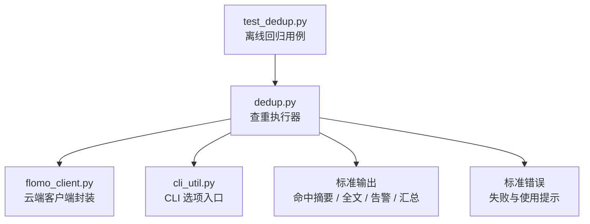
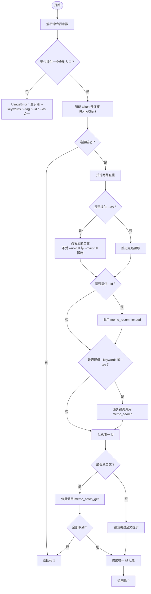
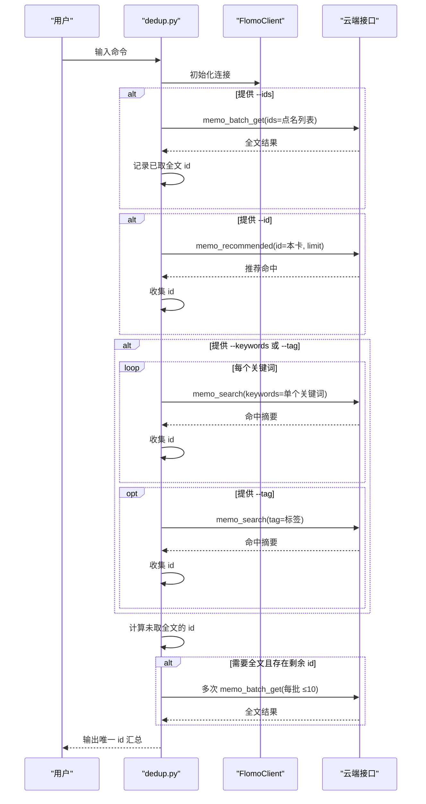
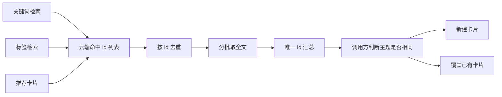
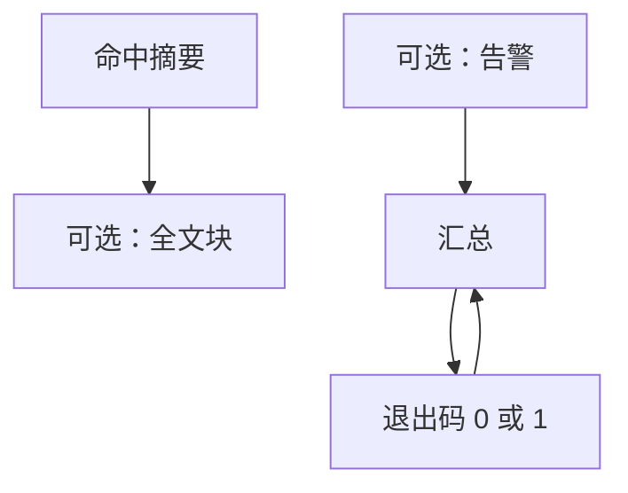
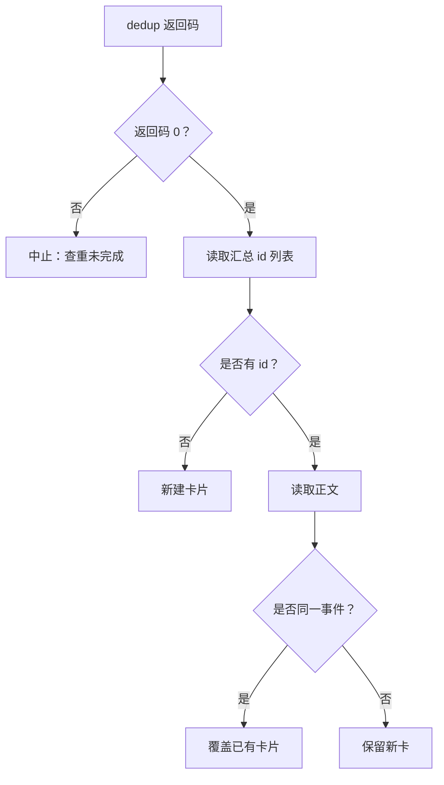

# 3.5 查重 dedup

<cite>
**本文引用的文件**
- [scripts/dedup.py](file://scripts/dedup.py)
- [tests/test_dedup.py](file://tests/test_dedup.py)
</cite>

## 目录
1. [引言](#引言)
2. [项目结构定位](#项目结构定位)
3. [核心机制总览](#核心机制总览)
4. [两路查重流程](#两路查重流程)
5. [正文指纹、关键词、id 去重与主标签的关系](#正文指纹关键词id-去重与主标签的关系)
6. [命令行参数说明](#命令行参数说明)
7. [返回码与典型输出](#返回码与典型输出)
8. [边界情况与处理建议](#边界情况与处理建议)
9. [新建卡与覆盖卡的判断方法](#新建卡与覆盖卡的判断方法)
10. [故障排查](#故障排查)
11. [结论](#结论)

## 引言
`dedup.py` 是 flomo-workbench 工作流中的“查重与近邻复查”执行器，对应流程的第 5 步和第 8 步。它的职责不是替人做最终判断，而是把云端查到的候选卡片标准化地列出来：先按每个关键词单独检索，再对唯一 id 分批取全文，最后输出一份可被后续步骤直接引用的 id 清单。

关键原则有三条：
- 每次云端调用必须可观测：每个关键词的命中结果单独打印，不能合并成一张大表掩盖单次失败。
- 去重基于 id：跨关键词重复出现的同一张卡只取一次全文。
- 失败不等于无命中：只要任一云端调用出错，就不许进入“新建或覆盖”的最终判定。

## 项目结构定位
`dedup.py` 位于 `scripts/` 下，通过相对路径把自身所在目录加入 Python 搜索路径后，导入同目录的 `flomo_client`（封装 token、网络请求、FlomoError）和 `cli_util`（封装选项解析、UsageError、cli_entry）。

**图表来源**
- [scripts/dedup.py:1-220](file://scripts/dedup.py#L1-L220)
- [tests/test_dedup.py:1-260](file://tests/test_dedup.py#L1-L260)

**章节来源**
- [scripts/dedup.py:1-35](file://scripts/dedup.py#L1-L35)

## 核心机制总览
`dedup.py` 的核心由以下部分组成：

| 组件 | 作用 | 关键行为 |
|---|---|---|
| `split_keywords` | 拆分关键词 | 支持半角逗号、全角逗号、顿号、分号、换行；去空、去重、保序 |
| `brief_line` | 命中摘要行 | 输出 id、字数、标签、正文第二行（概念行）的前 48 字符 |
| `collect` | 收集唯一 id | 按出现顺序追加，跳过已存在的 id |
| `search_one` | 单次检索 | 调 `memo_search`，打印本次 label 与命中数，无命中时明确标注 |
| `fetch_full` | 分批取全文 | 单批不超过 10 张；超出 `--max-full` 时显式列出未读 id |
| `main` | 控制流程 | 解析参数、建连、跑两路查重、聚合 id、决定是否取全文、输出汇总 |

**图表来源**
- [scripts/dedup.py:36-220](file://scripts/dedup.py#L36-L220)

**章节来源**
- [scripts/dedup.py:36-220](file://scripts/dedup.py#L36-L220)

## 两路查重流程
脚本支持同时运行两条查重路径，互不吞掉：

1. **点名读取路径（`--ids`）**  
   - 直接把传入的 id 列表交给 `memo_batch_get` 取全文。
   - 不受 `--no-full` 和 `--max-full` 限制。
   - 这些 id 会进入最终汇总。

2. **推荐卡片路径（`--id`）**  
   - 调用 `memo_recommended`，参数名就是 `id`，值是当前本卡 id。
   - 用于复盘场景，比如从 `memo_recommended` 拉出与本卡相关的邻卡。
   - 命中结果会打印摘要，并把 id 加入去重集合。

3. **关键词与标签路径（`--keywords`、`--tag`）**  
   - 每个关键词单独调用一次 `memo_search`。
   - 如果同时传了 `--tag`，标签查询排在所有关键词之后。
   - 每次调用都独立打印 label，例如“关键词 1/3：智能体”。

4. **id 去重与全文获取**  
   - 所有路径的命中 id 先经 `collect` 去重。
   - 如果开启全文模式，则把尚未点名的剩余 id 传给 `fetch_full`。
   - `fetch_full` 以 10 张为一批循环调用 `memo_batch_get`。
   - 若某批服务端没返回某个 id，会打印 `[告警]`，但不自动重试。

**图表来源**
- [scripts/dedup.py:115-220](file://scripts/dedup.py#L115-L220)
- [tests/test_dedup.py:68-122](file://tests/test_dedup.py#L68-L122)

**章节来源**
- [scripts/dedup.py:115-220](file://scripts/dedup.py#L115-L220)

## 正文指纹、关键词、id 去重与主标签的关系
这里需要区分“程序做的去重”和“人工判断的主题一致性”。

| 维度 | 程序做了什么 | 程序没有做什么 |
|---|---|---|
| 正文指纹 | 程序不计算哈希指纹；它依赖云端的 `content` 字段在 `memo_batch_get` 中返回完整正文 | 不会自行比较两段正文相似度 |
| 检索关键词 | 每个关键词独立调用 `memo_search`，返回的是云端匹配结果 | 不会根据关键词语义重新打分或改写 |
| id 去重 | 所有路径的 id 统一进 `seen` 列表，重复 id 只保留一次 | 不会因内容相似而合并不同 id |
| 主标签比对 | 摘要行会显示每张卡的标签，但脚本不会拿当前主标签过滤结果 | 不会用主标签作为查重判定条件 |
| 主题判断 | 程序只负责把 id 和全文列出来 | 是否属于“同一事件”“同一主题”，必须由调用方阅读正文后决定 |

因此，“查重”在这里有两层含义：
- 第一层是**工具层面的去重**：同一个云端 id 不重复取全文。
- 第二层是**业务层面的查重**：调用方根据正文、标签、时间、上下文判断两张卡是否应合并、覆盖或保留多张。

**图表来源**
- [scripts/dedup.py:36-220](file://scripts/dedup.py#L36-L220)

**章节来源**
- [scripts/dedup.py:36-220]

## 命令行参数说明
所有参数都由 `cli_util.parse_options` 解析，非法参数或缺值会返回一行错误提示而不是 Python 调用栈。

| 参数 | 类型 | 默认值 | 含义与约束 |
|---|---|---:|---|
| `--keywords` | 字符串 | 空 | 要检索的关键词，支持半角逗号、全角逗号、顿号、分号、换行分隔；会去空、去重、保序 |
| `--tag` | 字符串 | 空 | 按标签检索；通常与 `--keywords` 一起用，也可单独使用 |
| `--id` | 字符串 | 空 | 复盘路径：按当前本卡 id 调 `memo_recommended` |
| `--ids` | 字符串 | 空 | 点名读取指定 id 的全文，多个 id 用逗号分隔 |
| `--limit` | 整数 | 10 | 每次检索或推荐的返回上限；必须 ≥1 |
| `--max-full` | 整数 | 8 | 自动批量取全文的上限；必须 ≥0 |
| `--no-full` | 开关 | 关闭 | 关闭自动取全文，只输出命中摘要和 id 清单 |

### 组合规则
- 至少提供 `--keywords`、`--tag`、`--id`、`--ids` 中的一个。
- `--id` 与 `--keywords`/`--tag` 可同时给出，两路都会执行。
- `--ids` 优先级体现在它会先取全文，再与其他路径汇总。
- `--no-full` 影响自动取全文逻辑，但不会影响显式 `--ids`。
- `--max-full` 只限制自动批量取全文数量；`--ids` 不受此上限限制。

**章节来源**
- [scripts/dedup.py:36-55](file://scripts/dedup.py#L36-L55)
- [scripts/dedup.py:115-153](file://scripts/dedup.py#L115-L153)
- [tests/test_dedup.py:201-247](file://tests/test_dedup.py#L201-L247)

## 返回码与典型输出
### 返回码
| 返回码 | 含义 | 典型原因 |
|---:|---|---|
| 0 | 成功 | 包括“无命中”；只要查询流程完整结束就返回 0 |
| 1 | 失败 | 网络连接失败、token 缺失、任意云端调用抛出 `FlomoError`、参数解析失败 |

特别注意：**返回码 1 表示查重过程不完整，不能作为“无命中”信号**。调用方不得据此直接写云或跳过查重。

### 典型输出
脚本输出分为四类：

1. **命中摘要**  
   格式类似：`── 关键词 1/3：智能体 → 2 条`，随后每条一行，包含 id、字数、标签、概念摘要。

2. **无命中提示**  
   当某次检索结果为空时，会打印“（无命中）”。

3. **全文输出**  
   每张全文前有一行分隔标题，包含 id、字数、标签；之后是完整 `content`。

4. **汇总与告警**  
   - `[告警] 超出 --max-full=...`：超过自动全文上限时列出未读 id。
   - `[跳过全文] --no-full：... 张卡只列清单，未取正文`。
   - `[汇总] 唯一卡 N 张：id1, id2, ...` 或 `[汇总] 唯一卡 无`。

**图表来源**
- [scripts/dedup.py:62-114](file://scripts/dedup.py#L62-L114)
- [scripts/dedup.py:186-217](file://scripts/dedup.py#L186-L217)

**章节来源**
- [scripts/dedup.py:62-114](file://scripts/dedup.py#L62-L114)
- [scripts/dedup.py:186-217](file://scripts/dedup.py#L186-L217)

## 边界情况与处理建议

### 云端查询超时或网络异常
- 行为：抛出 `FlomoError`，打印 `[失败] 查重调用未完成` 或 `[失败] 全文未取到`，返回码 1。
- 建议：
  - 不要把它当成“无命中”。
  - 检查网络、token、代理配置。
  - 重试前确认是否只是瞬时超时；如果是，可在上层加有限重试，但不要静默吞掉错误。

**章节来源**
- [scripts/dedup.py:153-177](file://scripts/dedup.py#L153-L177)
- [scripts/dedup.py:186-217](file://scripts/dedup.py#L186-L217)

### 批量 id 分页
- 行为：`BATCH_LIMIT = 10`，超过 10 张时分批调用 `memo_batch_get`。
- 行为：测试验证 12 张卡会分成 10 张和 2 张两批。
- 风险：如果某批返回里缺少某个 id，只会打印 `[告警] 本批未取到 id=...`，不会自动重试。
- 建议：
  - 优先缩小 `--max-full`，避免一次性拉太多。
  - 对失败的 id 列表手动复测，或用 `--ids` 点名补读。
  - 不要把“未取到”当成“不存在”。

**章节来源**
- [scripts/dedup.py:24-26](file://scripts/dedup.py#L24-L26)
- [scripts/dedup.py:96-114](file://scripts/dedup.py#L96-L114)
- [tests/test_dedup.py:124-142](file://tests/test_dedup.py#L124-L142)

### 空结果
- 行为：单次 `memo_search` 返回空列表时，打印“（无命中）”，但仍继续其他关键词或路径。
- 行为：如果所有路径都没有命中，汇总会输出“唯一卡 无”，返回码仍为 0。
- 建议：
  - 返回码 0 不代表“有命中”，只代表“查重流程完整结束”。
  - 如果上游期望“必须有命中才继续”，应由调用方检查汇总中是否真的存在 id。

**章节来源**
- [scripts/dedup.py:62-79](file://scripts/dedup.py#L62-L79)
- [scripts/dedup.py:186-217](file://scripts/dedup.py#L186-L217)

### 相似但不同主题
- 行为：脚本只按 id 去重，不按正文相似度合并。
- 风险：两个不同主题的卡片可能都被检索出来，也可能同一个主题在不同时间生成多张 id 不同的卡片。
- 建议：
  - 以 `memo_batch_get` 返回的正文为准，不要只看 `brief_line` 的概念摘要。
  - 结合标签、时间、事件描述、作者意图综合判断。
  - 如果确认是同一事件的不同版本，由调用方决定覆盖还是保留历史。

**章节来源**
- [scripts/dedup.py:62-114](file://scripts/dedup.py#L62-L114)

### 参数错误
- 行为：非法数字、越界值、缺值、重复选项、未知参数、多余位置参数等，返回码 1，打印一行带 `[失败]` 的提示，不冒 traceback。
- 建议：
  - 先用 `python scripts/dedup.py --help` 或不带参数运行查看用法。
  - 注意 `--limit` 必须 ≥1，`--max-full` 必须 ≥0。
  - 注意 `--ids` 只能传一次，多个 id 写在同一个值里。

**章节来源**
- [tests/test_dedup.py:201-247](file://tests/test_dedup.py#L201-L247)

## 新建卡与覆盖卡的判断方法
`dedup.py` 本身不写云，也不直接决定新建或覆盖。它只做一件事：**把候选卡片整理成人类可读的正文和机器可读的 id 清单**。

调用方应按如下流程决策：

1. 检查返回码是否为 0。
2. 检查 `[汇总]` 行是否存在真实 id。
3. 如果汇总为“无”，视为无命中，通常走新建流程。
4. 如果存在 id，读取对应正文：
   - 如果内容与现有卡片高度重合，且语义指向同一事件，则考虑覆盖。
   - 如果主题相关但不同事件，保留多张。
   - 如果完全无关，忽略该候选。
5. 根据判断结果调用上层写入逻辑。

**图表来源**
- [scripts/dedup.py:186-217](file://scripts/dedup.py#L186-L217)

**章节来源**
- [scripts/dedup.py:186-217](file://scripts/dedup.py#L186-L217)

## 故障排查

| 现象 | 可能原因 | 排查步骤 |
|---|---|---|
| 返回码 1，提示“查重未能进行” | token 缺失或连接失败 | 检查 token 配置、环境变量、凭据来源 |
| 返回码 1，提示“查重调用未完成” | 某次 `memo_search` 或 `memo_recommended` 失败 | 检查网络、云端状态、参数是否合法 |
| 返回码 1，提示“全文未取到” | `memo_batch_get` 失败 | 检查网络；用 `--ids` 点名复测失败 id |
| 只看到摘要，没有正文 | 使用了 `--no-full`，或命中数为 0 | 去掉 `--no-full`；检查是否真有无命中 |
| 只读到部分正文 | `--max-full` 太小 | 增大 `--max-full`，或用 `--ids` 点名补读 |
| 某批 id 缺失 | 服务端分批返回不完整 | 手工核对缺失 id，必要时单独 `--ids` 重试 |
| 参数报错但没有 traceback | 参数解析失败 | 对照参数表修正；确认 `--limit`≥1、`--max-full`≥0 |
| 认为“无命中”但汇总仍有 id | 误把失败返回码当无命中 | 先看返回码，再看汇总行，不要只看某次检索结果 |

**章节来源**
- [scripts/dedup.py:115-217](file://scripts/dedup.py#L115-L217)
- [tests/test_dedup.py:144-247](file://tests/test_dedup.py#L144-L247)

## 结论
`dedup.py` 的价值在于把原本容易手抄 id、合并结果、混淆“失败”和“无命中”的查重流程，变成可重复、可观测、可回滚的工具化步骤。它不负责替你决定“这两张卡是不是同一件事”，但它确保你拿到的是完整的 id 列表和正文快照，从而让后续的“新建卡”或“覆盖卡”判断更可靠。

使用时的底线原则是：
- 返回码 1：查重未完成，禁止进入判定。
- 返回码 0：流程完成，仍需检查汇总中是否真的有 id。
- 正文是唯一依据：id 去重不等于主题一致。
- 超限和失败都要看告警，不要只看最后一行。

**章节来源**
- [scripts/dedup.py:1-220](file://scripts/dedup.py#L1-L220)