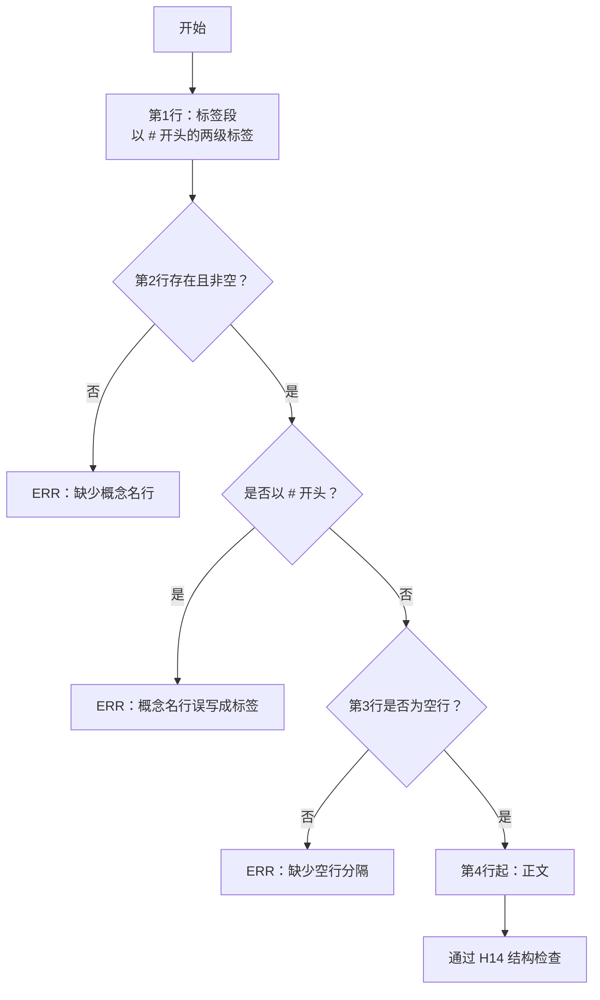
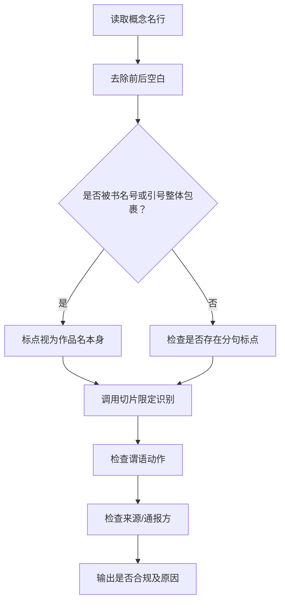
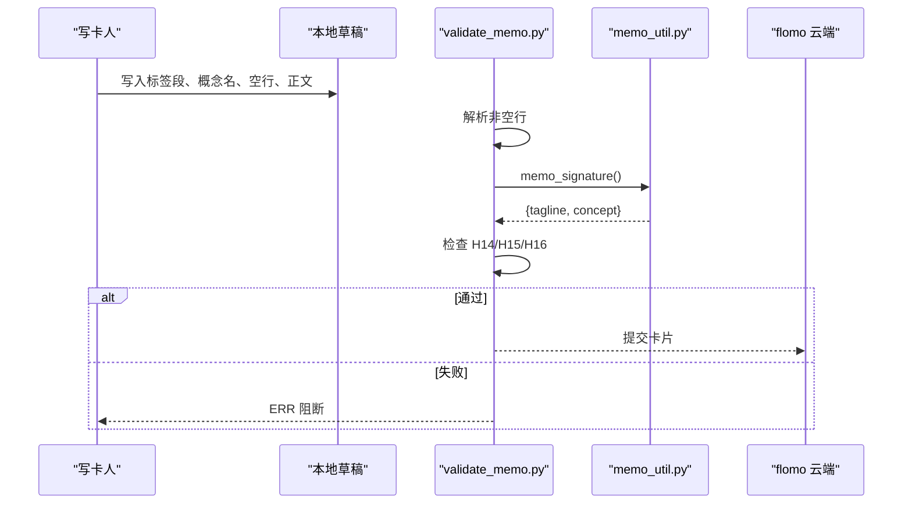
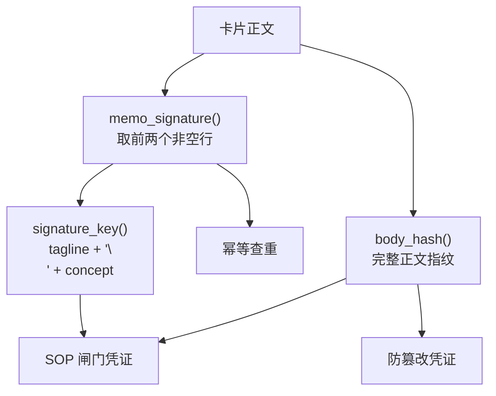
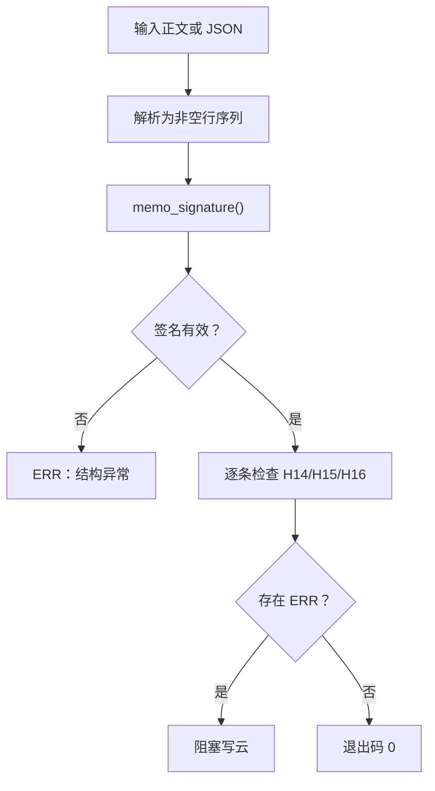

# 3.6 卡片写作（H14-H16）

<cite>
**本文引用的文件**
- [AGENTS.md](file://AGENTS.md)
- [SKILL.md](file://SKILL.md)
- [scripts/memo_util.py](file://scripts/memo_util.py)
- [scripts/validate_memo.py](file://scripts/validate_memo.py)
- [tests/test_validate_memo.py](file://tests/test_validate_memo.py)
- [tests/test_memo_util.py](file://tests/test_memo_util.py)
</cite>

## 目录
1. [引言](#引言)
2. [适用范围与目标](#适用范围与目标)
3. [卡片三段结构总览](#卡片三段结构总览)
4. [一行标签段书写规则](#一行标签段书写规则)
5. [概念名行书写规则](#概念名行书写规则)
6. [正文书写规则](#正文书写规则)
7. [换行约定与禁止事项](#换行约定与禁止事项)
8. [正确与错误样本对照](#正确与错误样本对照)
9. [与签名、指纹的一致性](#与签名指纹的一致性)
10. [validate_memo.py 的消费方式](#validate_memopy-的消费方式)
11. [常见问题排查](#常见问题排查)
12. [结论](#结论)

## 引言
本节面向 H14–H16 阶段产出的 flomo 卡片纯文本，说明“一行标签段 + 概念名行 + 正文”的书写规范。卡片形态由项目总则定义为“一事一卡、标签聚合”，并强调笔记只存在于云端，本地仓库仅保留技能文档、脚本与测试；因此本节的每条规则都对应可被 `scripts/validate_memo.py` 检测的结构或内容约束，而不是作者主观偏好。

**章节来源**
- [AGENTS.md:1-20](file://AGENTS.md#L1-L20)

## 适用范围与目标
- H14：定义卡片骨架——首行标签段、第二行概念名称、空一行后接正文。
- H15：规定卡片不得出现来源、作者、报道方等引用信息，也不得出现状态、进展等执行态备注。
- H16：规定卡片不得交代“这张卡来自什么载体”，包括截图、讲义、PPT、直播、公众号推文等取材通道。
- 这些硬限由 `SKILL.md` 给出，并由 `scripts/validate_memo.py` 以 ERR 阻断写云；`memo_util.py` 提供签名与关键词计算，是幂等查重、闸门凭证和质检共享的唯一实现。

**章节来源**
- [SKILL.md:240-310](file://SKILL.md#L240-L310)
- [AGENTS.md:1-20](file://AGENTS.md#L1-L20)

## 卡片三段结构总览
一张合规卡片应满足以下顺序：
1. 第一行：标签段，必须以 `#` 开头，且为两级标签。
2. 第二行：概念名行，不能以 `#` 开头，应是名词短语。
3. 第三行：必须为空行。
4. 第四行起：正文，直接写结论句，不使用模板引导词。

该流程由 `validate_memo.py` 的概念名定位逻辑与签名函数共同支撑：标签段必须位于第一个非空行，概念名必须是第二个非空行。

**图表来源**
- [scripts/validate_memo.py:170-220](file://scripts/validate_memo.py#L170-L220)
- [scripts/memo_util.py:1-30](file://scripts/memo_util.py#L1-L30)

**章节来源**
- [SKILL.md:243-260](file://SKILL.md#L243-L260)
- [scripts/memo_util.py:1-30](file://scripts/memo_util.py#L1-L30)
- [scripts/validate_memo.py:170-220](file://scripts/validate_memo.py#L170-L220)

## 一行标签段书写规则
标签段不是正文，也不是概念名，它是卡片在 flomo 中的分类入口。

### 允许的形态
- 多个标签在同一行，用空格分隔。
- 每个标签以 `#` 开头。
- 合法形态只有“顶层 / 二级”，例如 `#科技/安全`。
- 子标签必须带主前缀，不能裸写二级词。

### 禁止事项
- 三级及以上标签，如 `#A/B/C`。
- 裸顶层词不带二级。
- 泛化词头如 `#概念/`、`#方法/`。
- emoji 与特殊字符。
- 英文词使用普通空格或连字符时应按项目约定改用下划线形式。
- 标签越级：主题需要细分时，应并入既有二级或在合适顶层新建二级，而不是继续下钻层级。

### 常见错误
- 把正文里的编号写成 `#PR 34`：正文中 `#` 紧跟非空白会被 flomo 当作标签，从而产生脏标签。应改为 `PR 34`。
- 把语言名写成 `#C++`：应改为 C Sharp、F Sharp 等不触发标签语法的写法。
- 在概念名行再次写标签：这会让签名失效，因为签名取的是“首行标签段 + 第二行概念名”。

**章节来源**
- [SKILL.md:243-260](file://SKILL.md#L243-L260)
- [SKILL.md:298-310](file://SKILL.md#L298-L310)
- [scripts/validate_memo.py:300-340](file://scripts/validate_memo.py#L300-L340)

## 概念名行书写规则
概念名行是卡片的主题标识，也是签名的一部分。它不应是来源、状态、载体信息或模板指令。

### 判定原则
概念名必须是一个“独立成立的主题名词短语”，即它能指向一个稳定的对象，而不是某个对象的切片、动作或出处。具体判据包括：

1. **必须是名词短语**  
   概念名里不应出现逗号、句号、分号、问号、叹号等分句标点。若整行被书名号或引号包裹，标点属于作品名本身，不参与整句判断。

2. **不得是“标题 + 副标题”**  
   第二行不能写成“小标题 + 冒号”形式，也不能以冒号结尾。这类行看起来像条目，但实际没有概念名。

3. **不得包含可剥离的切片限定**  
   时间切片、版本/阶段号、代次/轮次/批次、地域/语种版本、事件动作等都属于“对象切片”，不是对象本身。例如年份区间、季度、版本号、Beta/Preview 加数字、第几代、中文版等。

4. **不得是谓语结构**  
   “谁做了什么”不是概念名。动词在概念名里可能是构词成分，也可能是谓语；实现通过语法位置区分，而不是简单枚举动词表。

5. **不得标注来源或通报方**  
   概念名括号或其他位置都不允许出现报道方、通报方、发布渠道等来源信息。

### 为什么要求“独立成立的主题名词”
- 概念名要能稳定指称对象，否则幂等查重、签名校验、闸门凭证都会失去可靠依据。
- 如果概念名是整句或切片，同一对象可能因措辞变化产生不同签名。
- 如果概念名模糊，后续检索、去重、统计都会失准。

**图表来源**
- [scripts/validate_memo.py:780-870](file://scripts/validate_memo.py#L780-L870)
- [scripts/memo_util.py:120-200](file://scripts/memo_util.py#L120-L200)

**章节来源**
- [SKILL.md:243-260](file://SKILL.md#L243-L260)
- [scripts/validate_memo.py:780-870](file://scripts/validate_memo.py#L780-L870)
- [scripts/memo_util.py:120-200](file://scripts/memo_util.py#L120-L200)

## 正文书写规则
正文承载知识内容，不承担格式指令、来源交代或载体说明。

### 长度与可读性
- 单卡正文含标签段不超过 20000 字。
- 正文应以结论先行：首段第一句直接写出结论句。
- 要点可用有序或无序列表组织。
- 公式应使用 Unicode，不要写 LaTeX 美元符。
- 正文应聚焦概念或事件本身，避免堆砌无关背景。

### 禁止事项
- 模板指令回显：如 SKILL 中的“结论先行”“占位符必须替换”等格式指令不得原样进入卡片。
- 任何来源、作者、机构、报道、参考信息。
- 任何状态、进展、待办、内部备注。
- 任何卡片载体信息，包括截图、讲义、PPT、直播、公众号、视频号等出处。
- 任何强调标记：加粗、斜体、删除线、行内代码、高亮、下划线等。
- 正文中出现 `#` 紧跟非空白字符。

### 为什么严格限制正文
- flomo 渲染能力有限，本库采用白名单式受支持语法，其余标记会原样显示。
- 正文一旦混入来源或载体信息，就会污染知识库，使卡片脱离原始材料后无法独立理解。
- 正文过长会影响回顾效率，违背“记录足够轻、足够快”的目标。

**章节来源**
- [SKILL.md:243-260](file://SKILL.md#L243-L260)
- [SKILL.md:268-298](file://SKILL.md#L268-L298)
- [scripts/validate_memo.py:300-460](file://scripts/validate_memo.py#L300-L460)
- [scripts/validate_memo.py:796-830](file://scripts/validate_memo.py#L796-L830)

## 换行约定与禁止事项
### 允许与推荐
- 标签段独占一行。
- 概念名独占一行。
- 概念名之后必须有一个空行。
- 正文首段第一句就是结论句。
- 要点使用列表。
- 多张卡片之间保持清晰分段。

### 不允许
- 标签段后直接跟正文而跳过概念名行。
- 概念名行与正文之间没有空行。
- 概念名行以 `#` 开头。
- 概念名行是空行。
- 正文首段出现“结论先行”等模板前缀。
- 正文中插入多余空行来伪装结构。

### 与云端存储层的关系
flomo 存储层可能在标签段后自动插入一个空行，因此云端回读时“标签段 + 空行 + 概念名”也能被识别。但这只是回读宽容；本地草稿仍应按“标签段 → 概念名 → 空行 → 正文”书写，否则多处检测会失效。

**图表来源**
- [scripts/validate_memo.py:170-220](file://scripts/validate_memo.py#L170-L220)
- [scripts/memo_util.py:1-30](file://scripts/memo_util.py#L1-L30)

**章节来源**
- [SKILL.md:243-260](file://SKILL.md#L243-L260)
- [scripts/validate_memo.py:170-220](file://scripts/validate_memo.py#L170-L220)

## 正确与错误样本对照
以下示例用“示意文本”代替真实内容，重点展示结构与排版。

### 正确样本
- 标签段：`#领域/子领域`
- 概念名行：`马尔科夫链`
- 空行：空
- 正文：
  - 首段第一句直接给出结论。
  - 要点使用列表。
  - 不包含来源、状态、载体信息。
  - 不包含加粗、斜体、HTML 标签、行内 `#`。

### 错误样本与原因
| 错误类型 | 错误表现 | 违反规则 | 修复建议 |
|---|---|---|---|
| 标签越级 | `#科技/安全/邮件认证` | H17 标签严格两级 | 合并到 `#科技/安全` 或新建准确二级 |
| 概念名误写标签 | 第二行以 `#` 开头 | H14 概念名行不得以 `#` 开头 | 去掉 `#`，改为主题名词 |
| 概念名模糊 | 第二行为“要点：”或空行 | H14 概念名须是名词短语 | 写出独立主题名词 |
| 概念名含切片 | “GPT-6 Preview 3 评测” | H6b/H14 概念名不得带切片限定 | 概念名写“GPT-6”，评测要点放入正文 |
| 概念名含谓语 | “某模型发布新命令” | H6b/H14 概念名不是句子 | 概念名写“某模型新命令”，事件过程放正文 |
| 正文含模板指令 | 正文出现“结论先行” | H14 禁止模板指令回显 | 直接写结论句，不写引导词 |
| 正文含来源 | “据 XX 日报报道” | H15 禁止来源 | 删除来源，只保留事实 |
| 正文含载体 | “如图所示”“见 PPT 第 3 页” | H16 禁止载体信息 | 省略出处，只写内容 |
| 正文含强调标记 | `**加粗**`、`*斜体*` | H14 正文纯文本 | 改用句式与列表表达重点 |
| 正文含行内标签 | `#PR 34` | H14 正文禁止 `#` 紧跟非空白 | 改为 `PR 34` |
| 缺少空行 | 概念名后直接接正文 | H14 结构缺失 | 补一个空行 |
| 标签段后插空行 | 标签行、空行、概念名 | 本地草稿格式偏斜 | 概念名放在标签段下一行 |

**章节来源**
- [SKILL.md:243-310](file://SKILL.md#L243-L310)
- [scripts/validate_memo.py:780-910](file://scripts/validate_memo.py#L780-L910)

## 与签名、指纹的一致性
### 签名的构成
`memo_util.memo_signature` 从正文中提取两个非空行：
- 第一个非空行作为标签段。
- 第二个非空行作为概念名。
- 若第一个非空行不以 `#` 开头，或第二个非空行不存在、为空、或以 `#` 开头，则返回无效签名。

这意味着：
- 标签段必须出现在第一行。
- 概念名必须出现在第二个非空行。
- 标签段与概念名之间可以夹一个空行，这是为了兼容 flomo 存储层自动插入的空行。
- 如果第二行是空行，那么第三个非空行才会成为概念名；本地草稿应避免这种偏移。

### 指纹的计算
- `signature_key` 对“标签段 + 换行 + 概念名”进行 UTF-8 编码后计算 SHA-256，并取前 16 位十六进制，用于凭证文件名等短键。
- `body_hash` 对完整正文内容进行哈希，用于防止“先跑闸门、后改正文”。
- 两者都依赖 `memo_util.py` 的单一实现，避免幂等查重、SOP 闸门、validate_memo 三处口径漂移。

**图表来源**
- [scripts/memo_util.py:1-60](file://scripts/memo_util.py#L1-L60)

### 修改后必须重新计算签名的原因
- 签名依赖标签段和概念名。只要这两个字段变化，`signature_key` 就变化。
- 闸门凭证同时绑定签名和正文指纹。若正文也改动，`body_hash` 同样变化。
- 如果只改正文而不更新凭证，闸门会认为“正文被闸门通过后替换过”，从而拒绝写云。
- 如果只改概念名而不更新签名相关凭证，幂等查重和闸门校验可能找不到匹配凭证。

**章节来源**
- [scripts/memo_util.py:1-60](file://scripts/memo_util.py#L1-L60)
- [scripts/validate_memo.py:870-910](file://scripts/validate_memo.py#L870-L910)

## validate_memo.py 的消费方式
`validate_memo.py` 是写云前的静态自检入口。它消费纯文本卡片，并按 H14–H16 等硬限输出错误或警告：

1. **输入处理**  
   支持从文件或命令行传入 JSON 或直接字符串；统一使用 UTF-8-SIG 读取，容忍 BOM；将 CRLF/CR 归一化为 LF。

2. **结构消费**  
   - 通过 `concept_name_index` 找到标签段之后的首个非空行作为概念名所在行。
   - 通过 `memo_signature` 提取签名，确认首行标签段与第二行概念名有效。
   - 检查标签段是否以 `#` 开头、是否两级标签。
   - 检查概念名是否以 `#` 开头、是否空行、是否冒号结尾。

3. **内容消费**  
   - 检查正文是否包含模板指令回显。
   - 检查正文是否包含来源、状态、载体信息。
   - 检查正文是否包含不受支持的 Markdown/HTML 强调语法。
   - 检查正文是否出现行内 `#` 标签。
   - 检查概念名是否写成整句、是否包含切片限定。

4. **结果消费**  
   - ERR 阻断写云。
   - WARN 只提示，不阻塞。
   - 退出码 0 表示通过，1 表示存在必须修复的错误，2 表示参数用法错误。

**图表来源**
- [scripts/validate_memo.py:1-60](file://scripts/validate_memo.py#L1-L60)
- [scripts/validate_memo.py:170-220](file://scripts/validate_memo.py#L170-L220)
- [scripts/validate_memo.py:780-910](file://scripts/validate_memo.py#L780-L910)

**章节来源**
- [scripts/validate_memo.py:1-60](file://scripts/validate_memo.py#L1-L60)
- [scripts/validate_memo.py:170-220](file://scripts/validate_memo.py#L170-L220)
- [scripts/validate_memo.py:780-910](file://scripts/validate_memo.py#L780-L910)

## 常见问题排查
| 现象 | 可能原因 | 处理步骤 |
|---|---|---|
| 概念名行报“格式违规” | 第二行是空行、冒号结尾、以 `#` 开头，或不在预期行号 | 确认标签段后第二行就是概念名，不加空行 |
| 云端回读概念名落到第三行 | flomo 存储层在标签段后自动插入空行 | 本地草稿仍按两行写；回读分支由 `concept_name_index` 兼容 |
| 概念名被判为整句 | 概念名含逗号、句号、分号、问叹号 | 改成名词短语，原句移入正文首段 |
| 概念名被判为切片 | 包含年份、季度、版本号、Beta/Preview 数字、第几代等 | 把切片信息移到正文，概念名只留稳定对象 |
| 正文报“模板指令回显” | 写了“结论先行”或类似条目名 | 删除引导词，直接写结论句 |
| 正文报“来源/载体信息” | 出现来源、作者、截图、PPT、报道方等 | 删除出处，只保留知识内容 |
| 正文报“强调标记” | 使用了加粗、斜体、删除线、反引号、HTML 标签 | 改用句式、列表和自然语言表达重点 |
| 凭证校验失败 | 改了标签、概念名或正文但未更新签名/指纹 | 重新生成凭证，确保 `signature_key` 与 `body_hash` 一致 |
| 查重不一致 | 同一概念用了不同概念名 | 统一概念名，使其能稳定生成相同签名 |

**章节来源**
- [scripts/validate_memo.py:170-220](file://scripts/validate_memo.py#L170-L220)
- [scripts/validate_memo.py:780-910](file://scripts/validate_memo.py#L780-L910)
- [scripts/memo_util.py:1-60](file://scripts/memo_util.py#L1-L60)

## 结论
H14–H16 的核心目标是让每张卡片具备稳定结构、明确主题和干净正文：
- 一行标签段负责分类。
- 概念名行负责唯一标识主题名词。
- 正文负责结论与要点。
- 三者之间靠空行分隔，且不得混入来源、状态、载体、模板指令或强调标记。

这套规则不只是文字约定，而是由 `validate_memo.py` 执行、由 `memo_util.py` 提供签名与指纹的统一实现。写卡时遵守 H14–H16，不仅能通过写云质检，也能保证幂等查重、闸门凭证和存量取证始终基于同一份纯文本口径。