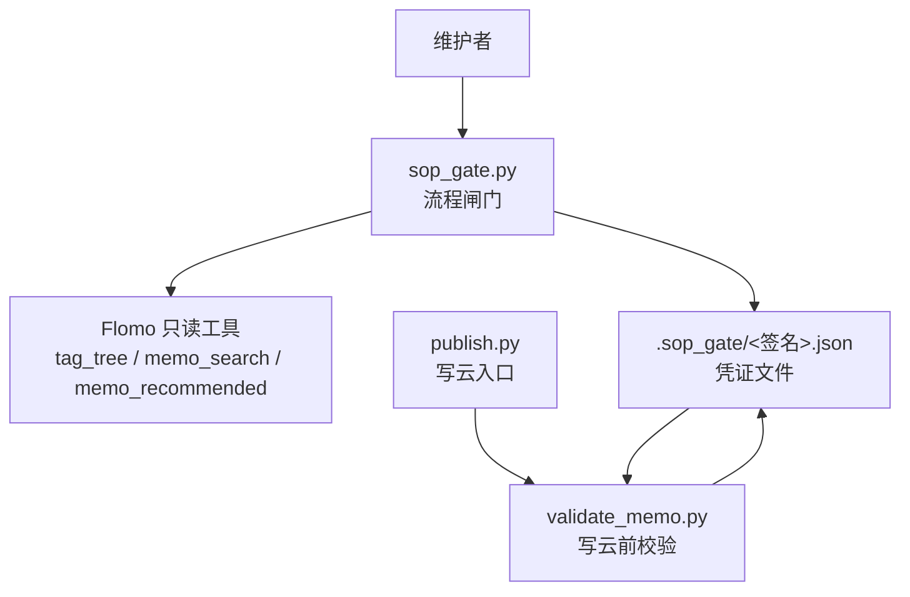
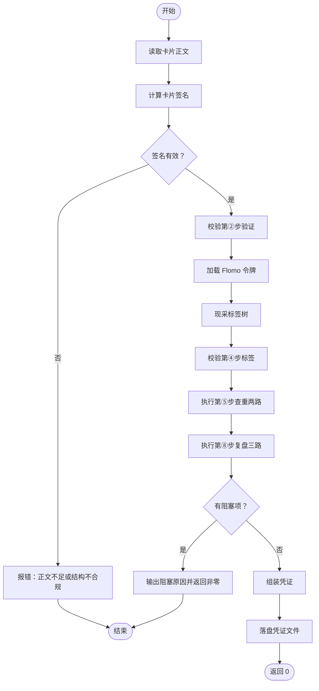
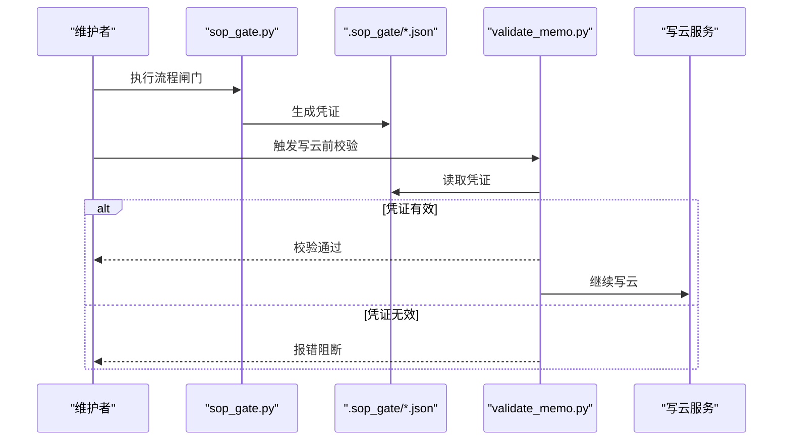

# 3.7 流程闸门 sop_gate

<cite>
**本文引用的文件**   
- [scripts/sop_gate.py](file://scripts/sop_gate.py)
- [scripts/validate_memo.py](file://scripts/validate_memo.py)
- [tests/test_sop_gate.py](file://tests/test_sop_gate.py)
</cite>

## 目录
1. [引言](#引言)
2. [项目结构与角色定位](#项目结构与角色定位)
3. [核心职责与物理隔离点](#核心职责与物理隔离点)
4. [凭证对象结构](#凭证对象结构)
5. [存储位置、版本号与幂等行为](#存储位置版本号与幂等行为)
6. [命令行参数与调用方式](#命令行参数与调用方式)
7. [闸门校验流程](#闸门校验流程)
8. [与前序步骤的耦合关系](#与前序步骤的耦合关系)
9. [成功与失败分支](#成功与失败分支)
10. [异常场景与处理策略](#异常场景与处理策略)
11. [与 validate_memo.py 和 publish.py 的关系](#与-validatememopy-和-publishpy-的关系)
12. [补跑指定步骤的命令示例](#补跑指定步骤的命令示例)
13. [故障排查清单](#故障排查清单)
14. [结论](#结论)

## 引言
`sop_gate.py` 是 SOP 流水线中的“流程闸门”：把此前靠执行者自觉完成的检查型步骤，变成必须留痕、写云前必查的机械控制点。它负责收集第②步验证（网络搜索）、第④步标签核对、第⑤步查重两路并查、第⑧步复盘三路现查的结果；全部通过后，在 `.sop_gate/<签名>.json` 中落盘一份凭证。`validate_memo.py` 在写云前读取该凭证；缺少凭证、凭证过期、正文指纹不一致、签名不匹配或关键步骤缺失时，直接报错阻止写云。

它的核心设计思想是：**凭证不是“已完成”的口头声明，而是由脚本真实调取云端数据后生成的可审计事实**。即使有人手动创建一张空凭证，也会因为字段缺失、正文指纹不符或过期而被拒绝。

## 项目结构与角色定位
`sop_gate.py` 位于 `scripts/` 下，属于维护与发布辅助脚本之一。它与以下组件协作：
- `memo_util`：提供卡片签名、正文指纹、概念关键词派生、标签解析等基础能力。
- `flomo_client`：通过 FlomoClient 调用 `tag_tree`、`memo_search`、`memo_recommended` 等只读工具。
- `cli_util.cli_entry`：统一捕获外部库异常并转换为非零退出码。
- `validate_memo.py`：写云前的格式与流程闸门校验入口。
- `publish.py`：实际触发写云流程的上层脚本；闸门通过 `validate_memo.py` 间接保护写云动作。

**图表来源**
- [scripts/sop_gate.py:536-594](file://scripts/sop_gate.py#L536-L594)
- [scripts/validate_memo.py:900-1090](file://scripts/validate_memo.py#L900-L1090)

**章节来源**
- [scripts/sop_gate.py:1-60](file://scripts/sop_gate.py#L1-L60)
- [scripts/validate_memo.py:1-50](file://scripts/validate_memo.py#L1-L50)

## 核心职责与物理隔离点
闸门承担四类职责：
1. **收集凭证**：从调用方提供的验证记录 JSON 读取第②步结果，从云端现采标签树、查重候选、复盘推荐。
2. **校验齐全性**：确认网络搜索已执行、术语结论已落入正文或显式豁免、标签路径合法、查重与复盘均已落盘。
3. **生成凭证**：将本次运行结果封装为带签名、正文指纹、时间戳和有效期的 JSON。
4. **拒绝未完成流水线**：没有凭证或凭证不完整时，`validate_memo.py` 不得放行写云。

这是**物理隔离点**：即使有人跳过 `sop_gate.py`，只要没有对应签名的凭证文件，写云就会失败。即使有人绕过 `validate_memo.py` 直接调用写云接口，也不应被视为合规流程——闸门文档明确强调不能通过绕过 `publish.py` 来跳过闸门。

**章节来源**
- [scripts/sop_gate.py:1-40](file://scripts/sop_gate.py#L1-L40)
- [scripts/validate_memo.py:927-990](file://scripts/validate_memo.py#L927-L990)

## 凭证对象结构
凭证是一个 JSON 对象，关键字段如下：

| 字段 | 类型 | 含义 | 校验规则 |
|---|---|---|---|
| `signature` | 对象 | 卡片标识，包含 `tagline` 与 `concept` | 必须与当前卡片首行标签和第二行概念名一致 |
| `sig_key` | 字符串 | 用于构造凭证文件名的短签名 | 文件名与凭证内值需同源 |
| `body_hash` | 字符串 | 当前正文内容的 SHA-256 指纹 | 写云时必须等于当前正文指纹 |
| `generated_at` | 整数 | 凭证生成时间戳 | 用于计算有效期 |
| `expires_at` | 整数 | 凭证过期时间戳 | 当前时间超过即失效 |
| `web` | 对象 | 第②步验证结果 | 必须为 `searched=true` 或 `web_skipped=true` |
| `tag_check` | 对象 | 第④步标签核对结果 | 不能为 `None`，否则视为旧格式或被篡改 |
| `dedup` | 对象 | 第⑤步查重两路结果 | 存在即可，语义判定交由人工 |
| `review` | 对象 | 第⑧步复盘三路结果 | 存在即可，锚点与候选 ID 供审计 |
| `human_judgment` | 数组 | 机器判不了的边界项 | 不参与放行判定，但必须随凭证留痕 |
| `no_gate_authorized` | 布尔值 | 是否允许 `--no-gate` 降级 | 仅当由 `sop_gate.py --allow-no-gate` 生成时才为真 |
| `no_gate_reason` | 字符串 | 降级理由 | 审计用途 |

凭证中的 `web.terms[].landed` 会逐条记录每个术语的落点审计结果，包括是否命中、是否豁免、命中的证据或术语词块。这些字段用于事后审计，而不是单纯决定“是否阻塞”。

**章节来源**
- [scripts/sop_gate.py:505-518](file://scripts/sop_gate.py#L505-L518)
- [scripts/sop_gate.py:352-504](file://scripts/sop_gate.py#L352-L504)
- [scripts/validate_memo.py:927-990](file://scripts/validate_memo.py#L927-L990)

## 存储位置、版本号与幂等行为
### 存储位置
默认凭证文件位于仓库根目录下的 `.sop_gate/` 子目录，文件名为 `<sig_key>.json`。`sig_key` 由卡片签名经 `signature_key` 计算得出，确保同一张卡始终使用同一文件名。调用方可通过 `--out` 指定自定义路径，但默认行为仍遵循此命名约定。

### 版本号
代码中没有显式的 `version` 字段。凭证的版本演进通过字段存在性判断：
- 缺少 `body_hash`：视为旧格式凭证，写云时报错并要求重跑。
- 缺少 `expires_at`：视为旧格式凭证，写云时报错并要求重跑。
- 缺少 `tag_check`：视为旧格式凭证，写云时报错并要求重跑。
- 新增 `human_judgment`：新凭证自动携带，旧凭证不会因此被误判为异常，但审计视角会看到新旧凭证差异。

这种“按必需字段推断版本”的方式比固定版本号更健壮：旧凭证无法通过缺字段检查，新凭证也不会因未知字段被拒绝。

### 幂等行为
`sop_gate.py` 对同一张卡重复运行时，会覆盖同一路径下的凭证文件。由于文件名由签名决定，多次运行同一张卡的闸门会产生相同路径的新凭证，形成**幂等覆盖**。这不是分布式锁意义上的强幂等：如果两个进程同时写入同一凭证文件，可能产生竞争。但在本项目的本地维护流程中，通常由单人在一次流水线中执行闸门。

若希望避免覆盖已有凭证，可在生成前检查目标文件是否存在；不过当前实现以“最新运行结果为准”，这更符合“凭证反映本轮现查事实”的设计意图。

**章节来源**
- [scripts/sop_gate.py:536-594](file://scripts/sop_gate.py#L536-L594)
- [scripts/validate_memo.py:927-990](file://scripts/validate_memo.py#L927-L990)

## 命令行参数与调用方式
`sop_gate.py` 使用 argparse，参数与帮助文本保持一致，便于自动化脚本和人类命令共用。

| 参数 | 是否必填 | 说明 |
|---|---:|---|
| `--memo` | 是 | 卡片正文文件路径 |
| `--verify` | 否 | 第②步网络搜索验证记录 JSON 路径；未提供且未用 `--skip-web` 时会阻塞 |
| `--skip-web` | 否 | 显式声明非术语卡，无需第②步网络验证；会在凭证中记录 `web_skipped=true` |
| `--out` | 否 | 凭证输出路径；默认 `.sop_gate/<sig_key>.json` |
| `--anchor-id` | 否 | 指定复盘锚点 ID；更新已有卡时可传入本卡 ID |
| `--allow-no-gate` | 否 | 仅在批量处理历史卡时使用，值为降级理由；会写入凭证作为授权标记 |

常用调用方式：
- 完整流程：`python scripts/sop_gate.py --memo <正文路径> --verify <验证记录JSON>`
- 非术语卡跳过验证：`python scripts/sop_gate.py --memo <正文路径> --skip-web`
- 更新已有卡并指定复盘锚点：`python scripts/sop_gate.py --memo <正文路径> --verify <验证记录JSON> --anchor-id <本卡id>`
- 自定义凭证输出路径：`python scripts/sop_gate.py --memo <正文路径> --verify <验证记录JSON> --out <凭证路径>`
- 批量历史卡降级授权：`python scripts/sop_gate.py --memo <正文路径> --verify <验证记录JSON> --allow-no-gate "<理由>"`

注意：查重关键词由脚本从概念名派生，**不提供** `--search-kw` 参数。调用方不能绕过这一逻辑。

**章节来源**
- [scripts/sop_gate.py:536-570](file://scripts/sop_gate.py#L536-L570)

## 闸门校验流程
闸门的核心处理顺序如下：

**图表来源**
- [scripts/sop_gate.py:536-594](file://scripts/sop_gate.py#L536-L594)
- [scripts/sop_gate.py:201-504](file://scripts/sop_gate.py#L201-L504)

### 各阶段校验要点
1. **正文签名**：必须能从卡片前两行非空内容提取标签行和概念名；否则直接阻塞。
2. **第②步验证**：
   - 未提供 `--verify` 且未 `--skip-web`：阻塞。
   - 验证记录不存在或非法 JSON：阻塞。
   - `searched` 不是布尔 `true`：阻塞。
   - `terms` 为空或缺少 `term`/`conclusion`：阻塞。
   - 每条术语必须满足“结论已落入正文”或显式豁免。
3. **第④步标签核对**：
   - 标签树未获取时提示无法核对。
   - 与现有标签只差空白、全半角斜杠或大小写：阻塞，防止云端分裂簇。
   - 不在树中：提示将新建二级或连顶层新建，并列出相近二级。
4. **第⑤步查重**：
   - 使用概念名派生的关键词调用 `memo_search`。
   - 使用主标签细分调用 `tag_tree` 统计近邻簇数量。
   - “0 个簇”会区分“簇在但无卡”和“标签不在树中”。
5. **第⑧步复盘**：
   - 优先使用 `--anchor-id`。
   - 其次用概念关键词检索首条命中。
   - 再退到本卡标签簇首条。
   - 都无法取锚则阻塞，并在提示中给出出路。

**章节来源**
- [scripts/sop_gate.py:201-504](file://scripts/sop_gate.py#L201-L504)

## 与前序步骤的耦合关系
### 第②步验证
闸门不替用户做网络搜索，而是读取用户在完成第②步后手工落盘的验证记录 JSON。该 JSON 至少包含：
- `searched`：布尔 `true`。
- `terms`：术语核实条目列表。
- 每个条目建议包含 `term`、`query`、`conclusion`。
- 可选 `in_body`：声明正文落点片段。
- 可选 `not_in_body`：声明某结论确实不该写入正文的理由。

闸门不仅检查“搜索做了”，还检查“搜到的信息写进了卡正文”。仅留痕而正文照抄原文会被拒绝。

### 第④步标签核对
闸门从云端现采标签树，并与卡片首行标签逐项比对。它不要求调用方预先提供标签树，而是自己调用 `tag_tree`，因此每次运行都反映当前云端状态。

### 第⑤步查重
闸门自动从概念名派生关键词，调用 `memo_search` 获取最多 20 条命中，并统计同主标签下的近邻簇。调用方不能传入自定义查重关键词，这是为了防止跳过真正查重。

### 第⑧步复盘
闸门调用 `memo_recommended` 需要锚点 ID。更新场景下可由 `--anchor-id` 指定本卡 ID；否则脚本自动尝试关键词命中或标签簇首条。

**章节来源**
- [scripts/sop_gate.py:1-60](file://scripts/sop_gate.py#L1-L60)
- [scripts/sop_gate.py:352-504](file://scripts/sop_gate.py#L352-L504)

## 成功与失败分支
### 成功分支
当所有阻塞项为空时：
1. 生成 `sig_key`。
2. 调用 `assemble_gate` 组装凭证。
3. 若使用了 `--allow-no-gate`，将授权标记和理由写入凭证。
4. 创建 `.sop_gate/` 目录（如不存在）。
5. 写入凭证 JSON。
6. 打印 `[通过] 闸门全过，凭证已写入 ...`。
7. 返回退出码 `0`。

### 失败分支
当任一阻塞项存在时：
1. 将所有阻塞项写入标准错误。
2. 打印 `闸门未过：<数量> 项阻塞，未生成凭证`。
3. 返回退出码 `1`。

此外，云端调用异常会通过 `cli_entry` 转为非零退出码，并带上 `[失败] 云端调用出错：` 前缀，使自动化流程能识别外部依赖问题。

**章节来源**
- [scripts/sop_gate.py:536-594](file://scripts/sop_gate.py#L536-L594)

## 异常场景与处理策略

### 凭证过期
凭证默认有效期为 6 小时（`GATE_TTL = 6 * 3600`）。`validate_memo.py` 在写云前比较当前时间与 `expires_at`；过期则报错，要求重新执行 `sop_gate.py`。测试中也覆盖了过期凭证被拒绝的场景。

### 正文指纹不一致
凭证中包含 `body_hash`，即正文内容的 SHA-256。如果闸门运行后正文又被修改，写云时会发现指纹不一致，从而拒绝写云。这是防止“先跑闸门、后改正文”的关键防线。

### 人为跳过步骤
- 未提供 `--verify` 且未 `--skip-web`：闸门直接阻塞，提示术语卡必须现查。
- 使用 `--skip-web`：必须在非术语卡场景使用，凭证中保留 `web_skipped=true`，便于审计。
- 使用 `--allow-no-gate`：仅适用于批量处理历史卡，授权标记必须随凭证落盘；`validate_memo.py` 只有在凭证中存在该标记且正文指纹匹配时才允许降级。

### 标签写错或新建簇
- 与现有标签只差空白、全半角斜杠或大小写：阻塞，因为云端会把它们当作两个簇。
- 标签不在树中：不阻塞，但提示将新建二级或连顶层新建，并列出相近二级供人工判断。
- 首行标签不是合法两级标签：提示 H17 相关错误。

### 查重或复盘取不到结果
- 查重关键词无法从概念名派生：阻塞。
- 复盘无法取得锚点 ID：阻塞，并在提示中说明可通过 `--anchor-id` 指定最接近的卡，或检查首行标签是否正确。

### 验证记录不合法
- 文件不存在：阻塞。
- JSON 解析失败：阻塞。
- `searched` 不是布尔 `true`：阻塞。
- `terms` 为空或缺字段：阻塞。
- 术语结论未落入正文且未豁免：阻塞。

**章节来源**
- [scripts/sop_gate.py:201-504](file://scripts/sop_gate.py#L201-L504)
- [scripts/validate_memo.py:927-990](file://scripts/validate_memo.py#L927-L990)
- [tests/test_sop_gate.py:1-200](file://tests/test_sop_gate.py#L1-L200)

## 与 validate_memo.py 和 publish.py 的关系
### 与 validate_memo.py 的耦合
`sop_gate.py` 负责生成凭证，`validate_memo.py` 负责消费凭证。两者共享以下约定：
- 卡片签名来源于 `memo_util.memo_signature`。
- 凭证文件名基于 `signature_key(sig)`。
- 正文指纹基于 `memo_util.body_hash`。
- 凭证目录均为 `PROJECT_ROOT/.sop_gate`。

`validate_memo.check_gate` 会依次检查：
1. 凭证文件是否存在。
2. 凭证是否为合法 JSON。
3. 凭证签名是否与当前卡片一致。
4. 正文指纹是否匹配。
5. 凭证是否过期。
6. 第②步验证是否执行或显式跳过。
7. 第④步标签核对是否存在。

如果使用了 `--no-gate`，只有凭证中带 `no_gate_authorized=true` 且正文指纹匹配，才会降级为警告；否则仍按正常闸门校验。

### 与 publish.py 的关系
虽然本仓库快照中未直接分析 `publish.py` 源码，但从文档上下文可知，`publish.py` 是写云流程的上层入口。闸门并不直接保护 `publish.py`，而是通过 `validate_memo.py` 拦截写云前的卡片校验。因此，**绕过 `publish.py` 并不能绕过闸门**：只要写云流程最终经过 `validate_memo.check_gate`，缺少或无效凭证就会被拒绝。

**图表来源**
- [scripts/sop_gate.py:536-594](file://scripts/sop_gate.py#L536-L594)
- [scripts/validate_memo.py:927-1090](file://scripts/validate_memo.py#L927-L1090)

**章节来源**
- [scripts/validate_memo.py:900-1090](file://scripts/validate_memo.py#L900-L1090)

## 补跑指定步骤的命令示例
闸门本身是一次性入口，不是“分步骤补跑器”。但它通过不同参数组合，支持常见补跑场景：

| 场景 | 命令示例 | 说明 |
|---|---|---|
| 补跑完整闸门 | `python scripts/sop_gate.py --memo <正文路径> --verify <验证记录JSON>` | 重新执行验证、标签、查重、复盘 |
| 非术语卡补跑 | `python scripts/sop_gate.py --memo <正文路径> --skip-web` | 跳过第②步，但仍跑标签、查重、复盘 |
| 更新已有卡 | `python scripts/sop_gate.py --memo <正文路径> --verify <验证记录JSON> --anchor-id <本卡id>` | 用本卡 ID 作为复盘锚点 |
| 批量历史卡 | `python scripts/sop_gate.py --memo <正文路径> --verify <验证记录JSON> --allow-no-gate "批量历史卡"` | 生成带降级授权的凭证 |
| 仅修正正文后重试 | 重新执行上述任一命令 | 正文指纹变化后必须重跑闸门 |

注意：
- 没有“只补跑查重”或“只补跑复盘”的参数。
- 查重关键词不可手动传入。
- 复盘锚点可通过 `--anchor-id` 指定，但并非独立步骤开关。
- 如果只想重新生成凭证而不改变正文，仍可重复执行同一命令，凭证会被覆盖。

**章节来源**
- [scripts/sop_gate.py:536-594](file://scripts/sop_gate.py#L536-L594)

## 故障排查清单
| 现象 | 可能原因 | 处理方式 |
|---|---|---|
| 写云时报“缺少 SOP 流程闸门凭证” | 未执行 `sop_gate.py`，或凭证文件名不匹配 | 重新执行闸门，确认 `.sop_gate/<sig_key>.json` 存在 |
| 报“正文指纹与当前卡片不符” | 闸门运行后正文被修改 | 重新执行 `sop_gate.py` |
| 报“凭证已过期” | 超过 6 小时未写云 | 重新执行 `sop_gate.py` |
| 报“签名与当前卡片不符” | 凭证针对另一张卡，或卡片概念名/标签发生变化 | 重新执行闸门 |
| 报“验证未执行” | 未提供 `--verify`，也未 `--skip-web` | 补充验证记录或确认是否应跳过验证 |
| 报“标签核对缺失” | 凭证为旧格式或被篡改 | 重新执行闸门 |
| 报“使用了 `--no-gate` 但该项降级未经授权” | 凭证中没有 `no_gate_authorized=true` | 使用 `--allow-no-gate` 重新生成凭证 |
| 闸门提示“复盘无法取锚” | 关键词无命中且标签簇也无卡 | 使用 `--anchor-id` 指定最接近的卡，或检查标签是否正确 |
| 闸门提示“验证术语结论未落正文” | 搜索了但没有把结论写进卡 | 修改正文落点，或使用 `not_in_body` 显式豁免并说明理由 |

**章节来源**
- [scripts/sop_gate.py:201-504](file://scripts/sop_gate.py#L201-L504)
- [scripts/validate_memo.py:927-1090](file://scripts/validate_memo.py#L927-L1090)
- [tests/test_sop_gate.py:201-484](file://tests/test_sop_gate.py#L201-L484)

## 结论
`sop_gate.py` 不是普通辅助脚本，而是 SOP 流水线的物理隔离点。它把“我自觉做了”变成“我留下了可验证的事实”，并通过凭证签名、正文指纹、过期时间和字段完整性构建多层防御。

关键原则：
- 凭证必须由 `sop_gate.py` 生成，不能手工伪造。
- 凭证过期后必须重跑，不能复用昨天的结果。
- 正文变更后必须重跑，不能绕过指纹校验。
- 跳过验证必须显式声明，不能静默忽略。
- 降级闸门必须有授权标记，不能靠 `--no-gate` 任意绕过。
- 不能通过绕过 `publish.py` 来跳过闸门；只要写云流程经过 `validate_memo.check_gate`，闸门就会生效。

对于维护者而言，最稳妥的操作顺序是：**先写卡 → 再跑 `sop_gate.py` → 最后触发写云**。任何一步缺失或凭证异常，都应停止写云并修复，而不是寻找绕过方式。