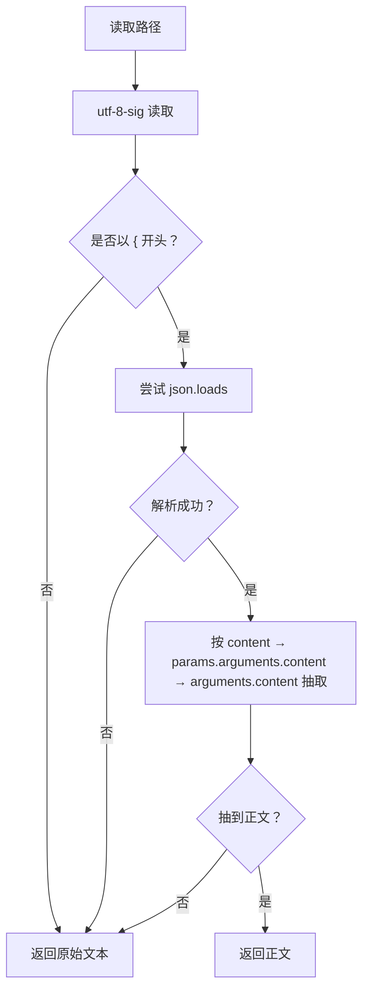
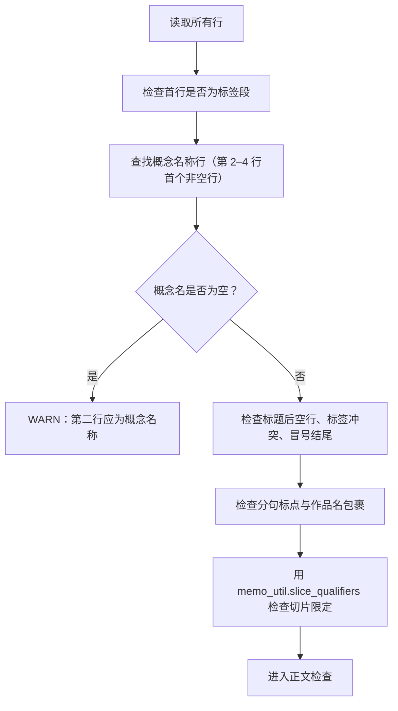
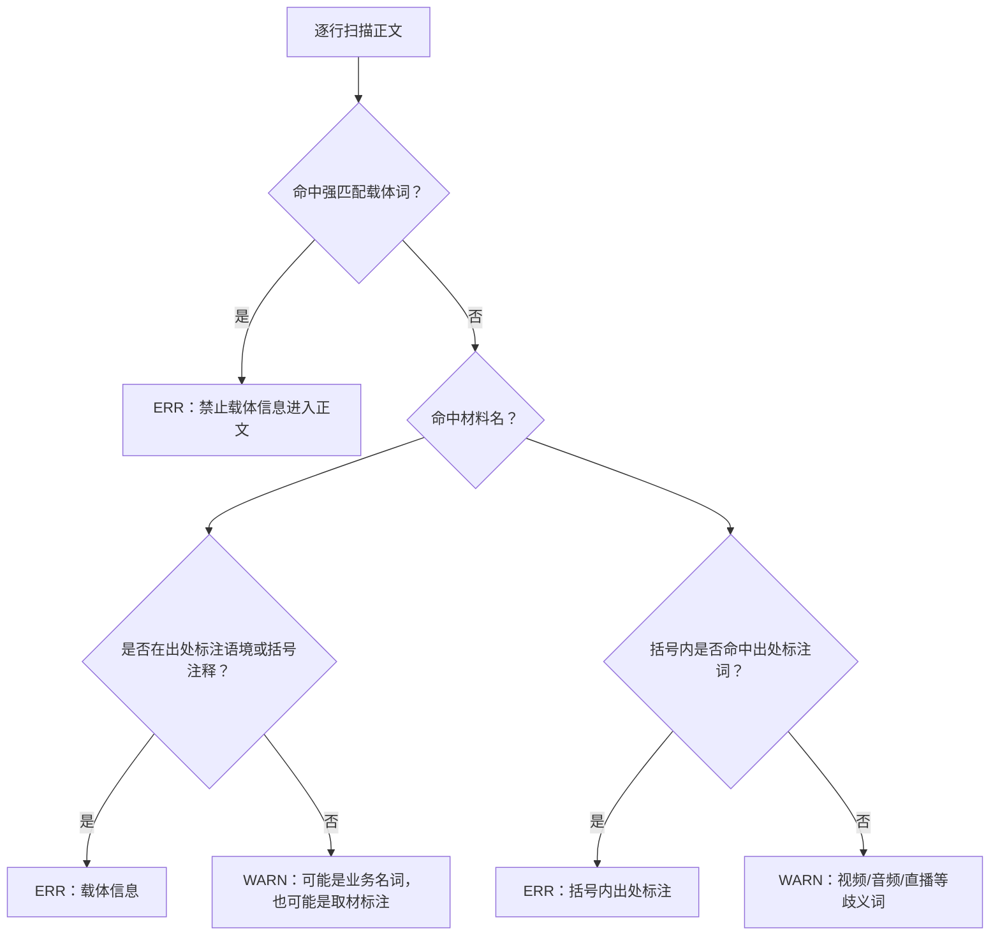
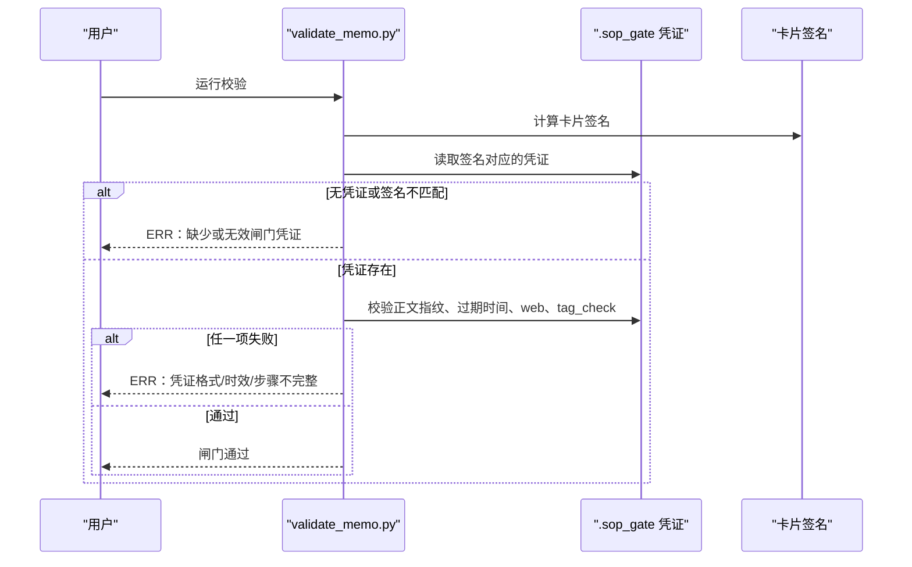
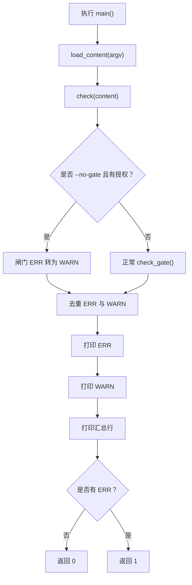

# 3.8 文本质检 validate_memo

<cite>
**本文引用的文件**   
- [scripts/validate_memo.py](file://scripts/validate_memo.py)
- [tests/test_validate_memo.py](file://tests/test_validate_memo.py)
</cite>

## 目录
1. [用途与定位](#用途与定位)
2. [命令行用法](#命令行用法)
3. [输入格式与健壮性](#输入格式与健壮性)
4. [质检规则总览](#质检规则总览)
5. [卡片结构与标签检查](#卡片结构与标签检查)
6. [正文内容与 Markdown/HTML 残留检查](#正文内容与-markdownhtml-残留检查)
7. [占位符、模板前缀与材料指示词](#占位符模板前缀与材料指示词)
8. [来源字段与载体字段检查](#来源字段与载体字段检查)
9. [闸门凭证与 --no-gate 降级](#闸门凭证与--no-gate-降级)
10. [退出码与报告输出](#退出码与报告输出)
11. [批处理方式](#批处理方式)
12. [人类审核定位指南](#人类审核定位指南)
13. [常见问题与修复命令](#常见问题与修复命令)
14. [与 publish.py 的协作关系](#与-publishpy-的协作关系)
15. [附录：核心正则与边界案例速查](#附录核心正则与边界案例速查)

## 用途与定位
`validate_memo.py` 是写入 flomo 之前的静态自检脚本，用于在 `publish.py` 写云之前拦截结构不合规、标签非法、来源/载体混入正文、占位符未清理以及 SOP 闸门凭证缺失等问题。它只读本地文件和 `.sop_gate` 目录中的凭证，不直接调用网络接口。

该脚本把问题分为两类：
- **错误（ERR）**：必须修复，否则脚本返回非零退出码，不应继续写云。
- **警告（WARN）**：提示风险，不阻塞写云，但人类审核时应优先处理。

**章节来源**
- [scripts/validate_memo.py:1-25](file://scripts/validate_memo.py#L1-L25)
- [scripts/validate_memo.py:1040-1097](file://scripts/validate_memo.py#L1040-L1097)

## 命令行用法
| 用法 | 含义 |
|---|---|
| `python scripts/validate_memo.py memo.txt` | 校验纯文本卡片文件 |
| `python scripts/validate_memo.py --file memo.txt` | 同上一条，别名 |
| `python scripts/validate_memo.py --content "正文内容"` | 从命令行传入正文 |
| `python scripts/validate_memo.py create.json` | JSON 时自动抽取 `content` |
| `python scripts/validate_memo.py --create create.json` | 同上，显式声明 JSON |
| `python scripts/validate_memo.py --no-gate ...` | 尝试以降级模式绕过闸门 ERR，但仍需授权凭证 |
| `python scripts/validate_memo.py -h` / `--help` | 打印帮助文档并返回退出码 2 |

参数解析会忽略 Python 解释器名和脚本名；当第一个参数不以 `-` 开头且以 `.py` 结尾时，会被当作脚本名丢弃。

**章节来源**
- [scripts/validate_memo.py:1040-1097](file://scripts/validate_memo.py#L1040-L1097)

## 输入格式与健壮性
### 支持的输入形态
- 纯文本 `.txt`。
- JSON：顶层对象可直接含 `content`，也兼容 JSON-RPC 信封 `params.arguments.content` 或 `arguments.content`。
- 读取统一使用 `utf-8-sig`，可正确剥离 BOM。
- CRLF / CR 归一化为 LF，避免 Windows 换行污染首行/末行判定。

### JSON 抽取优先级
1. 顶层 `obj["content"]`。
2. `obj["params"]["arguments"]["content"]`。
3. `obj["arguments"]["content"]`。
4. 都不是字符串则返回空串。

若 JSON 解析失败，则退回到原始文本作为正文。



**图表来源**
- [scripts/validate_memo.py:986-1014](file://scripts/validate_memo.py#L986-L1014)

**章节来源**
- [scripts/validate_memo.py:1-25](file://scripts/validate_memo.py#L1-L25)
- [scripts/validate_memo.py:986-1014](file://scripts/validate_memo.py#L986-L1014)

## 质检规则总览
| 编号 | 检查项 | 级别 | 业务约束 | 典型错误消息关键词 |
|---|---|---|---|---|
| 0 | 截断占位符 | ERR | 正文不能出现检索回包留下的省略标记 | “正文含截断占位符”“内容已缺失” |
| 1 | 首行标签段 | ERR | 必须以 `#` 开头，仅允许两级 `#顶层/二级` | “首行必须是标签段”“标签须为两级” |
| 2 | 概念名称行 | ERR/WARN | 第二行应为名词短语，不得为空、冒号结尾或带切片限定 | “不是概念名”“概念名称含切片限定” |
| 3 | 标题后空行 | ERR | 概念名后必须空一行再写正文 | “标题行后必须空一行再接正文” |
| 4 | 字数上限 | ERR | 含标签段共不超过 20000 字 | “超过上限 20000 字” |
| 5 | Markdown/HTML 残留 | ERR/WARN | 禁止加粗、删除线、斜体、反引号、图片语法、代码块及不受支持 HTML 标签 | “含加粗语法”“含删除线语法”“含单星号斜体语法” |
| 6 | 正文脏标签 | ERR | 正文内 `#xxx` 会被 flomo 识别为标签，造成脏标签 | “正文含 '#'……造成脏标签” |
| 7 | 占位/生造内容 | ERR | 禁止 `example.com/org`、`待补`、`placeholder`、`TODO`、`lorem` | “正文含 example/placeholder/TODO/lorem 占位” |
| 8 | 旧格式状态行 | WARN | 历史遗留的“状态：”等末尾元信息行应删除 | “疑似旧格式状态行” |
| 9 | 载体字段 | ERR/WARN | 截图、讲义、课件、UP主、页码等载体信息不得进入概念卡正文 | “含卡片载体/来源信息” |
| 10 | 匿名出处引导语 | ERR | “史载”“据载”等无主体出处引导语属于来源信息 | “含事件来源信息” |
| 11 | 事件来源字段 | ERR | 报道方、通报方、发布方一律不得出现在正文或概念名中 | “含事件来源信息”“概念名称含来源/通报方” |
| 12 | 模板前缀回显 | ERR | “结论先行”“一句话核心结论：”等 SKILL 指令不得回显 | “正文含「结论先行」”“模板前缀” |
| 13 | 闸门凭证 | ERR | 必须有对应签名、正文指纹、过期时间、验证与标签核对留痕 | “缺少 SOP 流程闸门凭证”“正文指纹与当前卡片不符” |
| 14 | 预印本摘要依赖 | WARN | 正文若以摘要为唯一依据，应回查正文 | “以摘要为唯一依据的表述” |
| 15 | 材料指示词 | WARN | “本文”“文中”“作者指出”等脱离材料后不可指代 | “出现材料指示词” |

**章节来源**
- [scripts/validate_memo.py:201-430](file://scripts/validate_memo.py#L201-L430)
- [scripts/validate_memo.py:430-828](file://scripts/validate_memo.py#L430-L828)
- [scripts/validate_memo.py:828-1097](file://scripts/validate_memo.py#L828-L1097)

## 卡片结构与标签检查
### 首行标签段
脚本首先取首行去空白后判断是否以 `#` 开头。若否，报“首行必须是标签段”。

对每个标签 token：
- 必须以 `#` 开头。
- 去掉 `#` 后不能为空。
- 只能包含中文、英文、数字、下划线、层级 `/`。
- 必须恰好一个 `/`，即两级：`#顶层/二级`。
- 若存在带 `/` 的主标签，裸二级（不含 `/`）会被判为“疑似裸子标签”，因为很可能误建了独立顶层标签。

| 标签形态 | 结果 | 原因 |
|---|---|---|
| `#数学/泛函方程` | 通过 | 两级合法标签 |
| `#科技*安全` | ERR | 含非法字符 |
| `#数学` | ERR | 裸顶层，缺二级 |
| `#科技/安全/邮件认证` | ERR | 三级及以上 |
| `#安全`（已有主标签时） | ERR | 疑似裸子标签 |

### 概念名称行
概念名称行由 `concept_name_index` 统一计算：先跳过首行标签段，然后在第 2 至第 4 行之间找首个非空行。这是为了避免 flomo 存储层插入空行导致概念名落到第 3 行。

校验包括：
- 第二行为空行时发 WARN：“标签段后第二行应为概念名称”。
- 第三行非空时报 ERR：“标题行后必须空一行再接正文”。
- 第 2 或第 3 行若是以 `#` 开头的标签，报错说明多写标签会导致签名失效。
- 概念名不能为空。
- 概念名不能以冒号结尾，也不能是“要点：”这类条目名。
- 概念名不能含分句标点（书名号或引号整体包裹的作品名除外）。
- 概念名不能含“切片限定”，例如时间、版本、代次、批次、轮次、地域语种、事件动作等。



**图表来源**
- [scripts/validate_memo.py:201-290](file://scripts/validate_memo.py#L201-L290)
- [scripts/validate_memo.py:828-900](file://scripts/validate_memo.py#L828-L900)

**章节来源**
- [scripts/validate_memo.py:201-290](file://scripts/validate_memo.py#L201-L290)
- [scripts/validate_memo.py:828-900](file://scripts/validate_memo.py#L828-L900)

## 正文内容与 Markdown/HTML 残留检查
### 截断占位符
正文一旦来自检索回包，可能已被替换为 `[此处省略N字]` 之类标记。脚本调用 `find_truncation` 检测这些占位符，并立即报 ERR。

原因是这不是普通格式问题，而是“内容已缺失”。后续重写稿应通过 `memo_batch_get` 重新获取全文。

### 字数阈值
脚本使用常量 `MAX_MEMO_CHARS = 20000`，对完整 `content` 做字符数判断。超限通常意味着：
- 一张卡塞了多个事件；
- 未按 H7 拆卡；
- 正文膨胀。

### Markdown 与 HTML 残留
本库对强调类语法采取比 flomo 官方清单更严格的策略：**全部禁止**。

| 残留类型 | 级别 | 说明 |
|---|---|---|
| 代码块 ``` | ERR | flomo 不支持 |
| 图片语法 `` | ERR | flomo 不支持 |
| 加粗 `**文字**` | ERR | 本库禁止任何 markdown 强调 |
| 删除线 `~~` | ERR | 本库禁止任何 markdown 强调 |
| 单星号斜体 `*文字*` | ERR | 数学记号如 `f*g` 有专门豁免逻辑 |
| 粗斜体 `***文字***` | ERR | 三重星号仍属强调语法 |
| 行内代码反引号 | ERR | 反引号会原样显示 |
| 不受支持 HTML 标签 | ERR | 含 `<mark>`、`<u>` 及其他 inline HTML |
| 表格行 | WARN | flomo 不渲染，建议改用列表 |
| Markdown 链接 `[text](url)` | WARN | 建议改为纯文本 URL |
| 裸邮箱地址 | WARN | 云端会存成 `mailto:` 链接，破坏逐字一致 |
| 标题语法 `#...` | WARN | flomo 不渲染 |
| 引用语法 `>` | WARN | flomo 不渲染 |

#### 数学表达式豁免
脚本对数学表达式做了专门保护：
- 斜体检测要求整段不含空白，避免 `f*g 与复共轭 z*` 被误判。
- 前置断言排除转义星号 `\*`。
- 单字母尖括号如 `<R`、`<T` 若无闭合标签且不在自闭合白名单，被视为数学记号放行。
- 含汉字的尖括号片段不被视为 HTML 标签。
- 绝对值、集合势、条件概率中的竖线不被视为表格。

#### 正文脏标签
除首行标签段外，正文中出现 `#xxx` 也会被 flomo 识别为标签。脚本扫描每行（URL 行整行跳过），发现 `#` 后紧跟非空白字符即报 ERR。

注意：
- 行首 `#` 已在标题语法分支处理。
- 含 `http` 的行整行跳过，避免 URL fragment `#frag` 误报。
- 正文中的 `/` 正常书写不算脏标签。

**章节来源**
- [scripts/validate_memo.py:201-430](file://scripts/validate_memo.py#L201-L430)

## 占位符、模板前缀与材料指示词
### 占位符与生造内容
正文中出现以下关键字串会被判 ERR：
- `example.com`
- `example.org`
- `待补`
- `placeholder`
- `TODO`
- `lorem`

这用于拦截未完成草稿或 AI 生造内容。

### 模板前缀回显
SKILL 的格式指令词若被原样写入正文，会成为“模板前缀回显”。脚本检查：
- 正文任意位置出现“结论先行”即 ERR。
- 行首出现“一句话核心结论：”“一句话结论：”即 ERR。

正确写法是把结论直接作为正文首段第一句，不加引导词。

### 材料指示词
“本文”“文中”“该文”“原文”“本篇”“这篇”“该篇”，以及“作者 + 言说动词”组合，属于材料指示词。它们只在基于特定材料的语境中有意义，卡片离开原文后就无法指代，因此发出 WARN。

这与“匿名出处引导语”不同：后者是明确交代来源，必须 ERR；前者只是措辞上把“哪一篇/谁说的”当成信息，降级为 WARN。

**章节来源**
- [scripts/validate_memo.py:430-500](file://scripts/validate_memo.py#L430-L500)
- [scripts/validate_memo.py:780-828](file://scripts/validate_memo.py#L780-L828)
- [scripts/validate_memo.py:900-986](file://scripts/validate_memo.py#L900-L986)

## 来源字段与载体字段检查
### 载体字段
载体字段是指“这张卡取自什么材料”的信息，例如截图、录屏、讲义、课件、板书、字幕、页码、UP主、B站、公众号、视频号等。

脚本将载体检测分为四层：

| 层级 | 示例 | 级别 | 语义 |
|---|---|---|---|
| 强匹配 | UP主、B站、第 N 页、如图、见截图、课程字幕、直播录像 | ERR | 明确指向材料排版位置或账号 |
| 材料名 | 截图、讲义、课件、字幕、板书、配图 | ERR/WARN | 仅在“出处标注语境”或括号注释中判 ERR，否则 WARN |
| 出处标注词 | 公众号、视频号、哔哩哔哩、抖音、录播、讲座 | ERR | 括号注释中出现即 ERR |
| 歧义词 | 视频、音频、直播、演讲、发布会、访谈 | WARN | 可能是业务名词，不单独阻断 |

“出处标注语境”包括：
- 行内出现“据”“摘自”“引自”“来自”“如图”“所示”“中可见”“中显示”“详见”。
- 材料名落在括号注释中。
- 括号注释本身被视为交代取材的位置，除非是多项并列清单。



**图表来源**
- [scripts/validate_memo.py:430-620](file://scripts/validate_memo.py#L430-L620)

### 匿名出处引导语
没有机构名的出处引导语同样属于来源信息。脚本明确拦截：
- “史载”
- “史书载”
- “史籍载”
- “据载”

这些词在正文里只有“交代出处”一种用法，因此直接 ERR。守卫排除了“历史载入”“典籍载体”“史载荷载”等构词连读。

### 事件来源字段
事件自身的报道方、通报方、发布方一律不得写入正文或概念名。脚本使用多层正则覆盖多种违规形态：

| 模式 | 示例 | 说明 |
|---|---|---|
| 来源引导式 | “据新华社报道”“根据澎湃新闻消息” | 引导词 + 来源主体 + 消息/报道/通报等 |
| 媒体描述词 | “据游戏媒体 Eurogamer 报道”“据澳大利亚广播公司报道” | 媒体 + 名称 + 报道动词 |
| 短修饰引导 | “据公开军事报道” | 修饰语 + 报道/消息/通报 |
| 裸引导 | “据报道”“据消息” | 无具体主体，仍判 ERR |
| 发布动作式 | “中央纪委国家监委网站 9 月 18 日发布消息” | 机构 + 日期 + 发布/刊发/通报 |
| 行首标签式 | “来源：…”“报道：…” | 类似旧格式状态行的加强版 |
| 概念名来源 | “XXX（中央纪委国家监委通报）” | 概念名括号内不得标注通报方 |

法规依据豁免：
- “依据《中国共产党纪律处分条例》…” 这类法条名称属于事件自身程序要素，不是交代来源。
- 行整体为“据《…》”“根据《…》”“依据《…》”“按照《…》”时跳过来源检测。

URL 行整行跳过来源检测，但 URL 被替换为空后仍需检查剩余文本，避免“来源：https://…”这类来源行漏检。

**章节来源**
- [scripts/validate_memo.py:500-828](file://scripts/validate_memo.py#L500-L828)

## 闸门凭证与 --no-gate 降级
### 闸门检查流程
闸门凭证位于 `.sop_gate/<signature_key>.json`，由 `scripts/sop_gate.py` 生成。每次检查会验证：

1. **签名是否存在**：凭证文件名由卡片签名决定。
2. **签名是否匹配**：凭证中的 `tagline` 和 `concept` 必须与当前卡一致。
3. **正文指纹是否匹配**：`body_hash` 必须等于当前正文哈希，防止闸门跑完后正文又被改过。
4. **过期时间是否存在**：`expires_at` 必须是整数时间戳。
5. **过期时间是否有效**：必须大于当前时间。
6. **网络搜索是否执行**：`web.searched` 必须为真，或 `web.web_skipped` 为真。
7. **标签核对是否留痕**：`tag_check` 字段必须存在。

如果任一检查失败，都会报 ERR。

### --no-gate 降级
`--no-gate` 不再是无条件开关。要让它生效，必须同时满足：
- 凭证中存在 `no_gate_authorized: true`。
- 凭证中的 `body_hash` 与当前正文一致。

否则：
- 若用户传了 `--no-gate` 但无授权，直接报 ERR。
- 若授权有效，闸门 ERR 会转为 WARN，并在输出前加上“（闸门·未阻断）”标记。

这种设计防止任何人通过加参数绕过整套 SOP。



**图表来源**
- [scripts/validate_memo.py:900-986](file://scripts/validate_memo.py#L900-L986)
- [scripts/validate_memo.py:1040-1097](file://scripts/validate_memo.py#L1040-L1097)

**章节来源**
- [scripts/validate_memo.py:900-986](file://scripts/validate_memo.py#L900-L986)
- [scripts/validate_memo.py:1040-1097](file://scripts/validate_memo.py#L1040-L1097)

## 退出码与报告输出
### 退出码
| 退出码 | 含义 |
|---|---|
| 0 | 通过（无 ERR，可写云） |
| 1 | 存在必须修复的错误 |
| 2 | 参数/用法错误，或读取输入失败 |

### 标准输出
脚本依次打印：
1. 所有 ERR。
2. 所有 WARN。
3. 汇总行，格式为：`结果：X 错 / Y 警，合计 Z 条提示`。

重复消息会去重，但保留首次出现顺序。

### 标准错误
参数错误、文件不存在、JSON 解析失败等输入层错误会写入 `stderr`，并返回退出码 2。



**图表来源**
- [scripts/validate_memo.py:1040-1097](file://scripts/validate_memo.py#L1040-L1097)

**章节来源**
- [scripts/validate_memo.py:1040-1097](file://scripts/validate_memo.py#L1040-L1097)

## 批处理方式
脚本本身不提供内置批量循环，但适合 shell 管道或 CI 任务逐个调用。常见方式：

- Linux/macOS：
  ```bash
  for f in cards/*.txt; do python scripts/validate_memo.py "$f"; done
  ```
- 结合 `find`：
  ```bash
  find . -name '*.txt' -exec python scripts/validate_memo.py {} \;
  ```
- Windows PowerShell：
  ```powershell
  Get-ChildItem cards\*.txt | ForEach-Object { python scripts/validate_memo.py $_.FullName }
  ```

注意事项：
- 批处理时建议先收集所有 ERR，再统一决定是否停止写云。
- 单个文件退出码 1 表示该卡必须修复。
- 对历史卡批量走闸门的场景，才考虑使用 `--no-gate`，且必须由 `sop_gate.py --allow-no-gate <理由>` 生成授权凭证。

**章节来源**
- [scripts/validate_memo.py:1040-1097](file://scripts/validate_memo.py#L1040-L1097)

## 人类审核定位指南
| 错误类别 | 人类应看哪里 | 常见修复方向 |
|---|---|---|
| 标签非法 | 首行标签段 | 写成两级 `#顶层/二级`，补主标签或删掉多余层级 |
| 概念名冒号结尾 | 第二行 | 改成名词短语，把“要点：”移到正文 |
| 标题后缺空行 | 第 2、3 行 | 在概念名后插入空行 |
| 正文超 20000 字 | 全文长度 | 拆卡或精简 |
| Markdown/HTML 残留 | 报错行号 | 删除 `**`、`*`、`~~`、反引号、HTML 标签，改用纯文本 |
| 正文脏标签 | 报错行中的 `#xxx` | 改成 `♯` 或改写为自然语言 |
| 载体字段 | 报错行中的截图/讲义/UP主/页码等 | 删除载体信息，只保留概念内容 |
| 匿名出处引导语 | 含“史载”“据载”的行 | 删除引导语，直接陈述事实 |
| 事件来源字段 | 含媒体报道/通报/发布的行 | 删除来源表述，保留事件内容 |
| 模板前缀回显 | 含“结论先行”或“一句话结论：”的行 | 直接写结论，不写引导词 |
| 闸门凭证缺失 | 输出中的 `.sop_gate/xxx.json` | 重新运行 `scripts/sop_gate.py` |
| 预印本摘要依赖 | 含“据摘要”“摘要显示”的行 | 抓 arXiv 正文或 PDF，不要只凭摘要 |
| 材料指示词 | 含“本文”“文中”“作者指出”的行 | 改成客观陈述，删除“哪一篇/谁说的” |

**章节来源**
- [scripts/validate_memo.py:201-986](file://scripts/validate_memo.py#L201-L986)
- [tests/test_validate_memo.py:1-188](file://tests/test_validate_memo.py#L1-L188)

## 常见问题与修复命令
### 1. 首行不是标签段
**现象**：ERR“首行必须是标签段”。  
**修复**：在卡片最前面加 `#顶层/二级`。

### 2. 标签层级错误
**现象**：ERR“标签层级超过两级”或“标签须为两级”。  
**修复**：写成 `#科技/安全`，不要写成 `#科技/安全/邮件认证`，也不要只写 `#科技`。

### 3. 正文含 Markdown 强调
**现象**：ERR“含加粗语法”“含单星号斜体语法”“含删除线语法”。  
**修复**：删除 `**`、`*`、`~~`，改用自然语言强调，例如把重点放在句式结构上。

### 4. 正文含 HTML 标签
**现象**：ERR“含 HTML 标签 <mark> 与 <u>”。  
**修复**：删除 `<mark>`、`<u>` 等标签，不要依赖 flomo 能渲染就写入。

### 5. 正文含裸邮箱
**现象**：WARN“云端会存成 mailto 链接，与草稿不再逐字相同”。  
**修复**：非必要写邮箱时改用 `a(at)b.c`；确需写联系邮箱时接受 WARN，但要注意回读比对需要额外宽容。

### 6. 正文含截断占位符
**现象**：ERR“正文含截断占位符：内容已缺失”。  
**修复**：使用 `memo_batch_get` 重新获取全文并重写，不要直接写云。

### 7. 正文含来源或载体信息
**现象**：ERR“含事件来源信息”或“含卡片载体/来源信息”。  
**修复**：删除“据新华社报道”“截图未展开”“UP主 xxx”“第 9 页”等，只保留概念本身。

### 8. 闸门凭证缺失
**现象**：ERR“缺少 SOP 流程闸门凭证”。  
**修复**：
```bash
python scripts/sop_gate.py
```
然后重新运行校验。

### 9. 使用了 --no-gate 但未经授权
**现象**：ERR“使用了 --no-gate 但该项降级未经授权”。  
**修复**：
```bash
python scripts/sop_gate.py --allow-no-gate "批量处理历史卡的理由"
```
之后再运行校验。

### 10. 闸门正文指纹不匹配
**现象**：ERR“SOP 闸门凭证的正文指纹与当前卡片不符”。  
**修复**：正文改动后必须重新运行 `scripts/sop_gate.py`。

**章节来源**
- [scripts/validate_memo.py:201-1097](file://scripts/validate_memo.py#L201-L1097)

## 与 publish.py 的协作关系
`validate_memo.py` 必须在 `publish.py` 之前运行。原因如下：

1. **写前门禁**：`validate_memo.py` 负责在写云前拦截结构错误、标签错误、来源/载体混入正文、占位符未清理以及闸门凭证缺失。
2. **幂等签名依赖**：卡片签名由首行标签段和第二行概念名构成；若签名失效，`publish.py` 后续的查重、写云幂等性和 SOP 闸门校验都可能静默失败。
3. **闸门凭证完整性**：闸门凭证中的 `web.searched`、`tag_check`、`body_hash`、`expires_at` 等字段是写云前的机械兜底，防止“卡写对了但流程没跑”的事故。
4. **失败即停写云**：只要 `validate_memo.py` 返回非 0，CI 或批处理应停止调用 `publish.py`，避免脏数据写入 flomo。

推荐流水线顺序：
```text
1. 生成或更新卡片：memo.txt 或 create.json
2. 运行 validate_memo.py
3. 若有 ERR，停止并修复
4. 确认无 ERR 后，再运行 publish.py 写云
```

**章节来源**
- [scripts/validate_memo.py:1-25](file://scripts/validate_memo.py#L1-L25)
- [scripts/validate_memo.py:900-1097](file://scripts/validate_memo.py#L900-L1097)

## 附录：核心正则与边界案例速查
| 场景 | 规则要点 | 边界处理 |
|---|---|---|
| 表格行 | 只认分隔行、竖线包裹行、空格包围竖线成组 | 绝对值、集合势、条件概率不判表格 |
| 斜体 | 整段无空白 + 非运算符起头 + 非转义星号 | 数学 `f*g` 豁免 |
| 英文斜体 | 纯 ASCII 词 + 含空格 | 与中文斜体区分 |
| HTML 标签 | 只拦闭合 inline 标签 | 单字母 `<R`、`<T` 无闭标签视为数学记号 |
| 脏标签 | 正文中 `#\S{1,40}` | URL 行整行跳过 |
| 载体字段 | 四层匹配：强匹配、材料名、出处标注词、歧义词 | 多项并列清单不视为出处标注 |
| 来源字段 | 引导式、媒体描述词、短修饰、裸引导、发布动作、行首标签 | 法规依据豁免 |
| 匿名出处 | “史载”“据载”等 | 排除“历史载入”“史载荷载” |
| 概念名切片 | 时间、版本、代次、地域语种、事件动作 | 书名号整体包裹年份/版本号放行 |
| 闸门凭证 | 签名、正文指纹、过期时间、web、tag_check | 缺字段一律按“须重跑 sop_gate.py”处理 |

**章节来源**
- [scripts/validate_memo.py:201-1097](file://scripts/validate_memo.py#L201-L1097)
- [tests/test_validate_memo.py:1-188](file://tests/test_validate_memo.py#L1-L188)