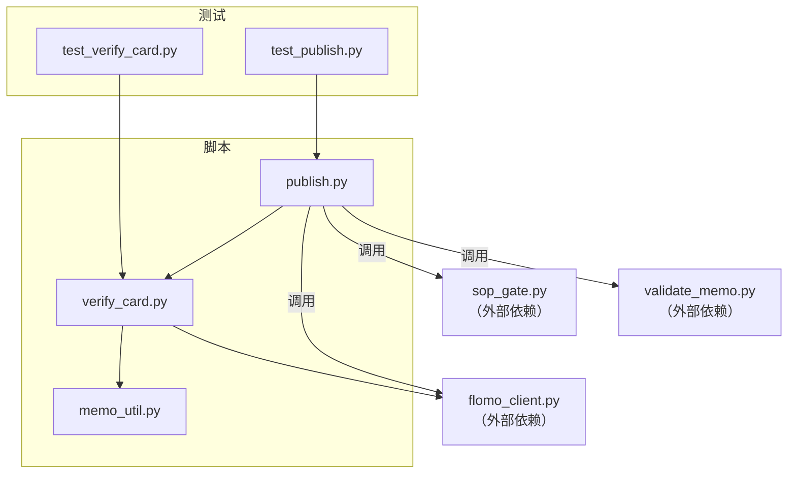
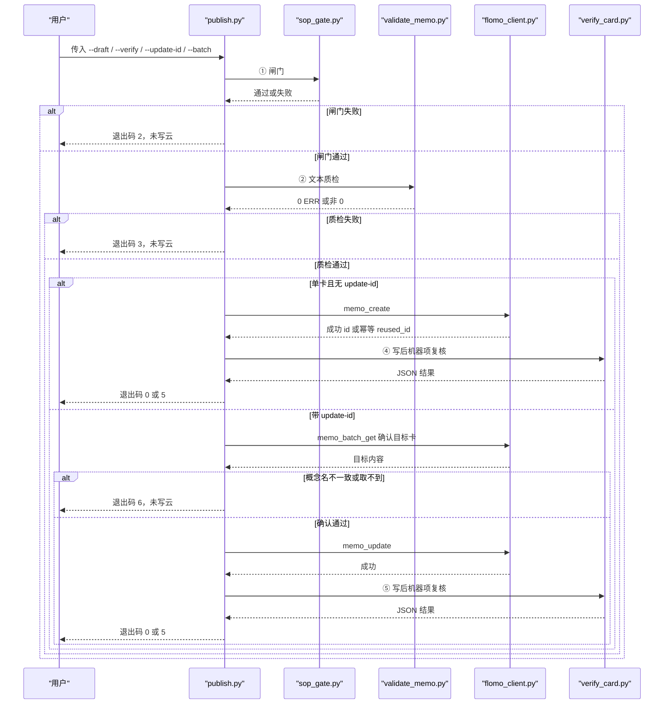
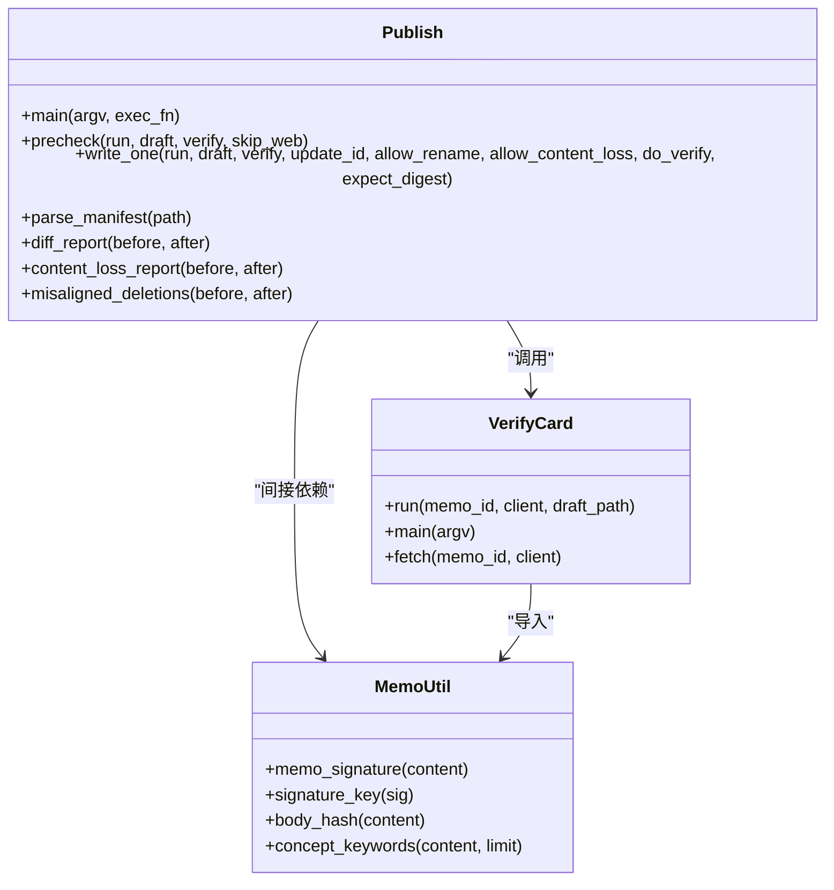
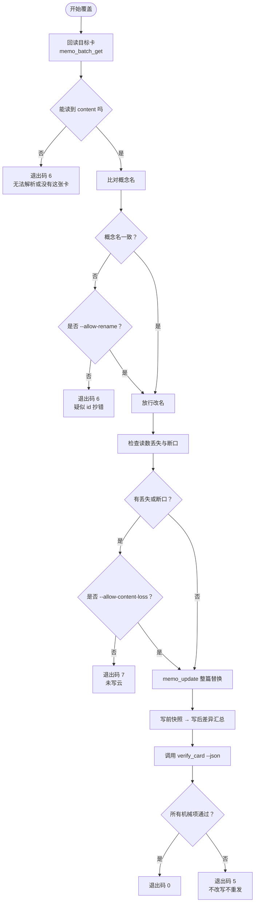
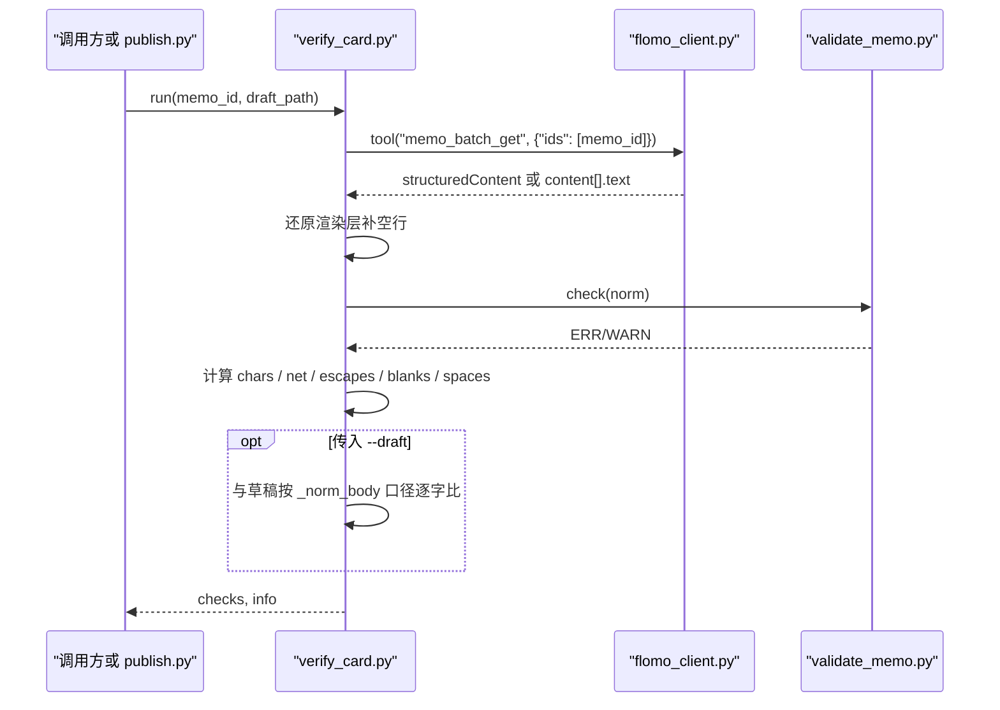
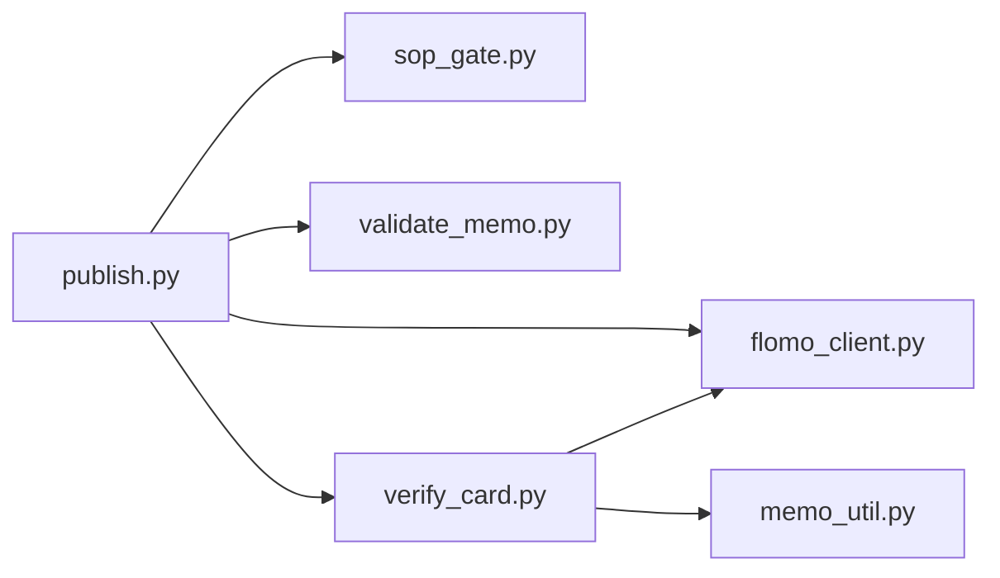

# 3.9 写云与复核 publish + verify_card

<cite>
**本文引用的文件**   
- [publish.py](file://scripts/publish.py)
- [verify_card.py](file://scripts/verify_card.py)
- [memo_util.py](file://scripts/memo_util.py)
- [test_publish.py](file://tests/test_publish.py)
- [test_verify_card.py](file://tests/test_verify_card.py)
</cite>

## 目录
1. [引言](#引言)
2. [项目结构](#项目结构)
3. [核心组件](#核心组件)
4. [架构总览](#架构总览)
5. [详细组件分析](#详细组件分析)
6. [依赖关系分析](#依赖关系分析)
7. [性能考虑](#性能考虑)
8. [故障排查指南](#故障排查指南)
9. [结论](#结论)
10. [附录：命令清单与参数边界](#附录命令清单与参数边界)

## 引言
本节文档说明从闸门通过后到云端落盘、再到回读复核的完整链路，以及 `publish.py` 与 `verify_card.py` 如何共同承担“建卡或覆盖既有卡 → 立即回读全文 → 逐字比对净字符数 → 生成复核报告”的职责。重点解释：

- `update-id` 的行为：先回读目标卡、比对概念名（身份），再整篇替换更新，并生成改前快照与差异汇总。
- 覆盖差异汇总：删除行与新增行以归一化口径列出，超过上限只列前若干行。
- 批次清单处理：每行最多四段，含可选 `rename`；预检全部通过才写；失败时保留已写入 id 并列出未执行行。
- 单卡与批量命令写法、`--batch` 清单格式、`--update-id` 的使用场景。
- token 失效、MCP 握手失败、云端返回 id 缺失、正文被服务端改写等错误路径，以及重试与人工核对步骤。

该流程的核心纪律是：**闸门不过不发、质检有 ERR 不发、create/update 只发一次、失败不重发、id 由程序解析、写后复核失败不改写不重发**。

## 项目结构
与写云和复核直接相关的代码位于 `scripts/`，测试用例位于 `tests/`：



**图表来源**
- [publish.py:1-100](file://scripts/publish.py#L1-L100)
- [verify_card.py:1-40](file://scripts/verify_card.py#L1-L40)
- [memo_util.py:1-30](file://scripts/memo_util.py#L1-L30)
- [test_publish.py:1-40](file://tests/test_publish.py#L1-L40)
- [test_verify_card.py:1-30](file://tests/test_verify_card.py#L1-L30)

**章节来源**
- [publish.py:1-100](file://scripts/publish.py#L1-L100)
- [verify_card.py:1-40](file://scripts/verify_card.py#L1-L40)

## 核心组件
| 组件 | 职责 | 关键行为 |
|---|---|---|
| `publish.py` | 将闸门、质检、写云、复核串成一条命令 | 支持单卡、覆盖、幂等复用、批次；失败不自动重试；输出 `[RESULT]` 与下一步提示 |
| `verify_card.py` | 独立回读卡片并做机械自查 | 检查截断、标签段、概念名、形态、占位符、字数、草稿比对；输出 JSON 或人类可读报告 |
| `memo_util.py` | 提供卡片签名、概念关键词、正文指纹等共享工具 | 闸门、质检、查重都依赖同一份签名实现 |
| `test_publish.py` | 离线验证 `publish.py` 的闸门阻断、建卡、覆盖、批次、差异等行为 | 用假执行器钉住 create 只发一次、复核失败不改写等纪律 |
| `test_verify_card.py` | 离线验证 `verify_card.py` 的判据 | 覆盖正常卡、截断、渲染层补空行、协议形态变化、JSON 输出等 |

**章节来源**
- [publish.py:1-120](file://scripts/publish.py#L1-L120)
- [verify_card.py:1-60](file://scripts/verify_card.py#L1-L60)
- [memo_util.py:1-40](file://scripts/memo_util.py#L1-L40)
- [test_publish.py:1-60](file://tests/test_publish.py#L1-L60)
- [test_verify_card.py:1-40](file://tests/test_verify_card.py#L1-L40)

## 架构总览
从闸门通过到云端落盘的完整链路如下：



**图表来源**
- [publish.py:601-780](file://scripts/publish.py#L601-L780)
- [publish.py:895-1038](file://scripts/publish.py#L895-L1038)
- [verify_card.py:160-297](file://scripts/verify_card.py#L160-L297)

**章节来源**
- [publish.py:601-894](file://scripts/publish.py#L601-L894)
- [verify_card.py:160-297](file://scripts/verify_card.py#L160-L297)

## 详细组件分析

### publish.py：写云主链
`publish.py` 把以下阶段固定为一次调用：

1. **闸门**：调用 `sop_gate.py`，可透传 `--verify` 与 `--skip-web`。
2. **质检**：调用 `validate_memo.py`，要求 0 ERR。
3. **写云**：
   - 单卡：调用 `flomo_client.py memo_create`，从 CLI 输出中解析成功 id 或幂等复用 id。
   - 覆盖：先调 `flomo_client.py memo_batch_get` 确认目标卡概念名；一致后才调 `memo_update`。
4. **复核**：调用 `verify_card.py --json`，把 `--id` 与 `--draft` 传给复核脚本。
5. **批次**：解析清单，预检全过才写；中途失败停止后续，但已写出的 id 仍记录在汇总中。

#### 写卡路径类图


**图表来源**
- [publish.py:201-462](file://scripts/publish.py#L201-L462)
- [publish.py:601-894](file://scripts/publish.py#L601-L894)
- [publish.py:895-1038](file://scripts/publish.py#L895-L1038)
- [verify_card.py:1-160](file://scripts/verify_card.py#L1-L160)
- [memo_util.py:1-120](file://scripts/memo_util.py#L1-L120)

#### 覆盖差异流程图


**图表来源**
- [publish.py:601-780](file://scripts/publish.py#L601-L780)
- [publish.py:895-1038](file://scripts/publish.py#L895-L1038)

#### 关键实现要点
- **幂等复用**：`memo_create` 返回 `{idempotent: true, reused_id}` 时，不新建卡，而是复用已有 id；测试断言会检查输出中的复用 id 与 `reused=1` 标记。
- **id 缺失即失败**：成功正则找不到 id、也没有幂等复用 id 时，按失败处理并明确禁止重发。
- **覆盖只走 `memo_update`**：测试断言覆盖路径不调用 `memo_create`，且复核指向同一个 id。
- **概念名必须可比对**：目标卡读不到概念名时阻塞；加 `--allow-rename` 才会放行，并明确标注是跳过比对而非比对通过。
- **写前内容丢失检查**：对覆盖场景比较云端原文与本地草稿，检测读数减少与词中间断口；失败时默认退出码 7，加 `--allow-content-loss` 才放行。
- **差异汇总**：使用 `difflib.SequenceMatcher` 对比归一化后的行序列，删除行与新增行分别列出；超过 `DIFF_SHOW` 只列前若干行并提示剩余行数。
- **批次预检不变量**：N 张卡全部预检通过才写；任何一张闸门或质检失败都不写云，且不再继续跑后续卡片。
- **批次清单校验**：每行至多四段；第 4 段只接受 `rename`；不能给 rename 但没有覆盖 id；草稿不存在、留痕不存在、重复草稿、同内容不同路径、同一 id 覆盖两次都会报错。
- **批次续跑安全**：失败后汇总表列出“计划 N 张 / 本次写入 M 张”，并列出未执行行；不要整批重来，应注释掉已成功的行再跑余下的。

**章节来源**
- [publish.py:601-894](file://scripts/publish.py#L601-L894)
- [publish.py:895-1038](file://scripts/publish.py#L895-L1038)
- [test_publish.py:201-486](file://tests/test_publish.py#L201-L486)
- [test_publish.py:703-983](file://tests/test_publish.py#L703-L983)

### verify_card.py：写后回读与机械自查
`verify_card.py` 是 H11 中“可机械判定部分”的固定实现，主要检查：

1. **回读完整性**：`content_truncated` 为真时直接失败。
2. **首行标签段**：必须以 `#` 开头且包含 `/`。
3. **第二行概念名**：非空、不以 `#` 开头、不是结构标签。
4. **形态检查**：复用 `validate_memo.check()`，保证写前与写后同源。
5. **内容占位符残留**：如公式抽取丢正文留下的占位符。
6. **截断占位符**：正文取自检索回包时可能出现省略标记，属于永久缺失。
7. **实测字数与净字符**：区分原始长度、转义、空行、行内空白、去空行去空白后的净长度。
8. **与本地草稿逐字比对**：只有传入 `--draft` 时才追加该项；否则只报数字，不假装对过账。

#### 回读与自检时序


**图表来源**
- [verify_card.py:80-200](file://scripts/verify_card.py#L80-L200)
- [verify_card.py:201-297](file://scripts/verify_card.py#L201-L297)

#### 关键实现要点
- **回包解析**：通过 `FC.tool_data` 取结构化数据，避免旧实现把整个回包信封当卡片。
- **渲染层补空行**：标签段后可能多一个空行，脚本会还原后再判断概念名位置，并把这一事实写入 `render_padded`。
- **JSON 输出**：`--json` 输出 `ok`、`info`、`checks`、`human_judgment`，供自动化消费；全文不会进入 JSON。
- **人读项显式列出**：首尾是否同一事件、是否串入他卡内容必须由人看，脚本不能虚报覆盖。
- **默认客户端构造**：从 `load_token()` 解出 `(token, 来源)` 元组后再传给 `FlomoClient`，避免离线用例或真实 token 来源导致构造失败。
- **回读失败统一转退出码 1**：`main` 捕获异常后打印诊断并返回非 0。

**章节来源**
- [verify_card.py:1-297](file://scripts/verify_card.py#L1-L297)
- [test_verify_card.py:1-320](file://tests/test_verify_card.py#L1-L320)

### memo_util.py：签名与关键字共享实现
该模块提供卡片签名、概念关键词、正文哈希等共享能力，闸门、质检、查重都依赖同一实现，避免“查重通过但凭证对不上”的幽灵问题。

- `memo_signature`：取前两个非空行，首行须为标签段，第二行须为非空且不以 `#` 开头。
- `signature_key`：用于凭证文件名等稳定短键。
- `body_hash`：防“先跑闸门、后改正文”。
- `keywords_of_concept` / `concept_keywords`：从概念名派生检索短关键词，兼容全角标点导致检索失败的场景。

**章节来源**
- [memo_util.py:1-120](file://scripts/memo_util.py#L1-L120)

## 依赖关系分析
`publish.py` 与 `verify_card.py` 都通过子进程调用外部脚本，并通过 Python 模块导入共享工具：



**图表来源**
- [publish.py:1-120](file://scripts/publish.py#L1-L120)
- [verify_card.py:1-60](file://scripts/verify_card.py#L1-L60)

**章节来源**
- [publish.py:1-120](file://scripts/publish.py#L1-L120)
- [verify_card.py:1-60](file://scripts/verify_card.py#L1-L60)

## 性能考虑
- **批量节省闸门调用**：单卡模式如果先 `--dry-run` 再写，会重复触发闸门；批量模式只在预检阶段跑一次闸门，避免每张卡重复查重的云端检索成本。
- **差异显示上限**：覆盖差异超过 `DIFF_SHOW` 行时只列前若干行，避免大段落 diff 淹没重点。
- **超时设置**：子进程默认 600 秒，`memo_update` 为 180 秒，复核为 120 秒；网络慢或云端响应长时需要留意这些边界。
- **子命令输出尾部转发**：长输出只显示末尾若干行，并声明被切掉的行数，避免误以为只有这些错误。

[本节为通用指导，不直接分析具体源码行]

## 故障排查指南

### 常见退出码含义
| 退出码 | 含义 | 是否已写云 | 建议操作 |
|---|---|---:|---|
| 0 | 写入成功且机器项复核全过 | 是 | 完成 |
| 1 | 前置检查不通过（参数或文件问题） | 否 | 检查参数、草稿、留痕、批次清单 |
| 2 | 闸门未过 | 否 | 修复闸门失败项后重跑闸门 |
| 3 | 文本质检有 ERR | 否 | 修改正文后重跑闸门 |
| 4 | 写入失败（create 或 update） | 通常否 | 不自动重试；先确认云端现状，再决定是否手动重试 |
| 5 | 已写入但机器项复核失败 | 是 | 不改写不重发；根据复核报告人工处置 |
| 6 | 目标卡确认不通过 | 否 | 核对 `--update-id`、概念名、回包结构 |
| 7 | 草稿比原卡少了读数或出现断口 | 否 | 加 `--allow-content-loss` 仅在有意识重写时使用 |

**章节来源**
- [publish.py:1-120](file://scripts/publish.py#L1-L120)
- [test_publish.py:201-486](file://tests/test_publish.py#L201-L486)

### token 失效或 MCP 握手失败
- `verify_card.py` 的入口使用 `CLI.cli_entry` 捕获 `FlomoError`，统一转为退出码 1 并输出一行诊断。
- `publish.py` 也通过 `cli_entry` 包裹主逻辑，使凭据缺失、握手失败等底层错误不混入业务日志。
- 排查步骤：
  1. 确认当前环境 token 是否有效。
  2. 单独运行 `verify_card.py --id <id> --show-body` 验证回读是否正常。
  3. 若 token 过期，刷新凭据后重试；不要盲目重试 `memo_create`，因为脚本本身禁止自动重发。

**章节来源**
- [verify_card.py:260-297](file://scripts/verify_card.py#L260-L297)
- [test_verify_card.py:240-320](file://tests/test_verify_card.py#L240-L320)

### 云端返回 id 缺失
- 建卡成功后，脚本从 CLI 输出中匹配成功 id；若既没有成功 id，也没有幂等复用 id，则按失败处理。
- 此时不应认为“卡已创建”，更不应自行拼接另一个 create 请求。
- 排查步骤：
  1. 查看 `publish.py` 输出的失败提示。
  2. 检查 `flomo_client.py` 的实际返回结构是否与预期一致。
  3. 若怀疑是云端协议变化，先恢复卡片状态，再评估是否升级客户端或适配新回包。

**章节来源**
- [publish.py:601-640](file://scripts/publish.py#L601-L640)
- [test_publish.py:120-200](file://tests/test_publish.py#L120-L200)

### 正文被服务端改写
- `verify_card.py` 会在传入 `--draft` 时，按 `FC._norm_body` 口径与本地草稿逐字比对。
- 如果云端存储层对 Markdown 元字符转义、插入行内空格或补空行，这些差异不参与比对；但行界与非转义字符仍然严格。
- 若比对失败，首先确认失败位置与净字符数差异，而不是只看 `word_count`。
- 排查步骤：
  1. 使用 `python scripts/verify_card.py --id <id> --draft <草稿路径>`。
  2. 查看“首个差异在第几个字符”与“净字符数”。
  3. 若怀疑平台层改写，再用 `--show-body` 打印云端全文进行两条人读项核对。

**章节来源**
- [verify_card.py:160-297](file://scripts/verify_card.py#L160-L297)
- [test_verify_card.py:120-240](file://tests/test_verify_card.py#L120-L240)

### 重试与人工核对步骤
- **写失败（退出码 4）**：脚本明确不重发。应先确认云端当前内容，再决定是否需要手动 `memo_update` 或重建。
- **复核失败（退出码 5）**：卡已写入，不改写不重发。按 `verify_card.py` 的报告逐项处理，必要时 `--show-body` 通读全文。
- **批次中途失败**：汇总表给出“已写 id”和“未执行行”。正确做法是注释掉已成功的行，只重跑余下条目，不要整批重来。
- **目标卡确认失败（退出码 6）**：先核对 `--update-id` 是否抄错；若确属改名，再加 `--allow-rename`。
- **内容丢失（退出码 7）**：除非是有意识重写，否则不加 `--allow-content-loss`；放行后必须在回读里逐条认领丢失项。

**章节来源**
- [publish.py:601-894](file://scripts/publish.py#L601-L894)
- [test_publish.py:201-486](file://tests/test_publish.py#L201-L486)
- [test_publish.py:703-983](file://tests/test_publish.py#L703-L983)

## 结论
`publish.py` 与 `verify_card.py` 共同构成了“闸门 → 质检 → 写云 → 回读 → 逐字比对 → 复核报告”的可审计链路。其设计重点不是把所有错误都自动修复，而是：

- 把危险动作限制为一次调用。
- 把 id、概念名、净字符数、差异行等关键信息交给程序解析。
- 把必须靠语义判断的部分显式标为“须人读”。
- 在批量模式下保持“预检全过才写”的不变量。
- 在失败时给出可操作的下一步，而不是静默吞掉错误。

这套机制尤其适合需要反复迭代卡片质量、同时又要防止重复卡、误覆盖、漏读数、截断正文等问题的工作流。

[本节为总结性内容，不直接分析具体源码行]

## 附录：命令清单与参数边界

### 单卡命令示例
- 基本写卡：
  ```
  python scripts/publish.py --draft _tmp/memo_body_68.txt --verify _tmp/verify_68.json
  ```
- 覆盖既有卡：
  ```
  python scripts/publish.py --draft _tmp/memo_body_68.txt --verify _tmp/verify_68.json --update-id MjYxODU0MzI5
  ```
- 允许连概念名一起改：
  ```
  python scripts/publish.py --draft _tmp/memo_body_68.txt --verify _tmp/verify_68.json --update-id MjYxODU0MzI5 --allow-rename
  ```
- 仅预检不写云：
  ```
  python scripts/publish.py --draft _tmp/memo_body_68.txt --verify _tmp/verify_68.json --dry-run
  ```
- 透传闸门的 web 跳过：
  ```
  python scripts/publish.py --draft _tmp/memo_body_68.txt --verify _tmp/verify_68.json --skip-web
  ```
- 关闭自动复核：
  ```
  python scripts/publish.py --draft _tmp/memo_body_68.txt --verify _tmp/verify_68.json --no-verify-card
  ```
- 有意重写时放行内容丢失：
  ```
  python scripts/publish.py --draft _tmp/memo_body_68.txt --verify _tmp/verify_68.json --update-id MjYxODU0MzI5 --allow-content-loss
  ```

### 批次命令示例
- 预检全部草稿：
  ```
  python scripts/publish.py --batch _tmp/batch.txt
  ```
- 仅预检不写云：
  ```
  python scripts/publish.py --batch _tmp/batch.txt --dry-run
  ```

### 批次清单格式
每行最多四段，字段之间用 `|` 分隔：

| 字段顺序 | 含义 | 是否必填 | 说明 |
|---|---|---:|---|
| 第 1 段 | 草稿路径 | 是 | 不存在时报错 |
| 第 2 段 | 留痕路径 | 否 | `-` 或空表示不需要 |
| 第 3 段 | 覆盖 id | 否 | `-` 或空表示建卡；有值则走覆盖路 |
| 第 4 段 | 标志 | 否 | 只接受 `rename`；其余值报错 |

示例清单：

```
# 本轮三张
_tmp/draft_zt_1.txt | _tmp/verify_zt_1.json | -
_tmp/draft_zt_2.txt | _tmp/verify_zt_2.json | -
_tmp/draft_af_fix.txt | - | MjUzMzgyODYz | rename
```

注意：
- `rename` 只能出现在有覆盖 id 的行上。
- 同一份草稿不能出现两次。
- 正文完全相同但路径不同的草稿会被视为重复卡。
- 同一张卡的 id 不能被覆盖两次。
- 字段超过四段、第四段不是 `rename`、全是注释、没有任何条目都会直接报错。

**章节来源**
- [publish.py:1-120](file://scripts/publish.py#L1-L120)
- [publish.py:895-1038](file://scripts/publish.py#L895-L1038)
- [test_publish.py:703-983](file://tests/test_publish.py#L703-L983)

### verify_card.py 常用命令
- 基本回读：
  ```
  python scripts/verify_card.py --id MjYxMzk1MDg0
  ```
- 输出 JSON：
  ```
  python scripts/verify_card.py --id MjYxMzk1MDg0 --json
  ```
- 追加草稿逐字比对：
  ```
  python scripts/verify_card.py --id MjYxMzk1MDg0 --draft _tmp/memo_body_37.txt
  ```
- 打印云端全文以便人读：
  ```
  python scripts/verify_card.py --id MjYxMzk1MDg0 --show-body
  ```

**章节来源**
- [verify_card.py:1-80](file://scripts/verify_card.py#L1-L80)
- [verify_card.py:201-297](file://scripts/verify_card.py#L201-L297)
- [test_verify_card.py:1-120](file://tests/test_verify_card.py#L1-L120)