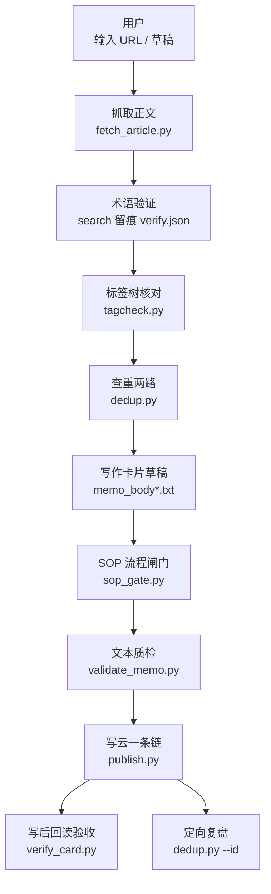
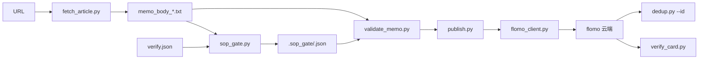
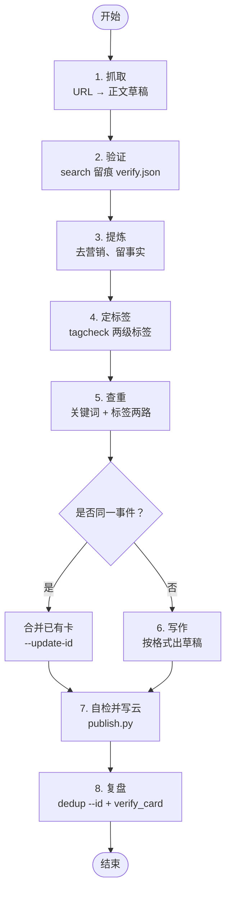
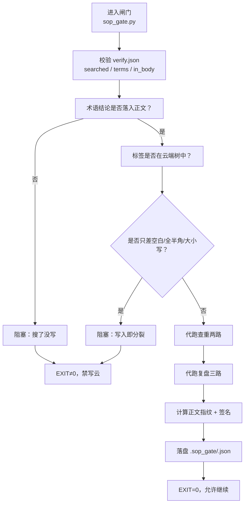
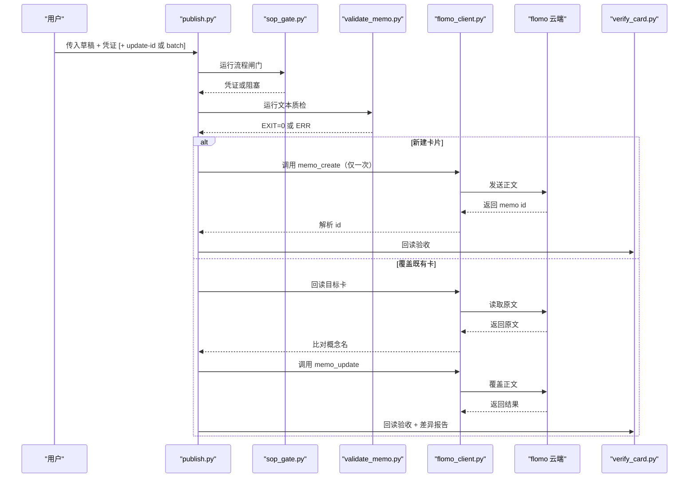
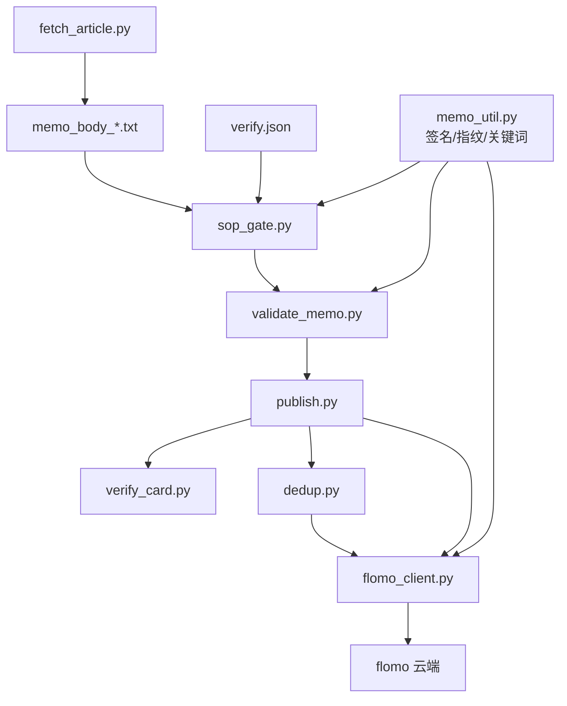

# SOP 流水线总览

<cite>
**本文引用的文件**   
- [README.md](file://README.md)
- [SKILL.md](file://SKILL.md)
- [ENVIRONMENT.md](file://ENVIRONMENT.md)
- [scripts/publish.py](file://scripts/publish.py)
- [scripts/sop_gate.py](file://scripts/sop_gate.py)
- [scripts/validate_memo.py](file://scripts/validate_memo.py)
- [scripts/dedup.py](file://scripts/dedup.py)
- [scripts/memo_util.py](file://scripts/memo_util.py)
- [scripts/flomo_client.py](file://scripts/flomo_client.py)
- [scripts/tagcheck.py](file://scripts/tagcheck.py)
- [scripts/fetch_article.py](file://scripts/fetch_article.py)
- [scripts/verify_card.py](file://scripts/verify_card.py)
</cite>

## 目录
1. [引言](#引言)
2. [项目结构](#项目结构)
3. [核心组件](#核心组件)
4. [架构总览](#架构总览)
5. [九步流水线详解](#九步流水线详解)
6. [闸门与写云前置条件](#闸门与写云前置条件)
7. [publish.py 的职责边界](#publishpy-的职责边界)
8. [典型命令示例](#典型命令示例)
9. [依赖关系分析](#依赖关系分析)
10. [性能与失败回退](#性能与失败回退)
11. [故障排查指南](#故障排查指南)
12. [结论](#结论)

## 引言
本项目的目标是把网页、文章和想法沉淀为 flomo 云端卡片，做到“一事一卡、标签聚合、本地不落盘”。整个写卡过程被规范为九步流水线：抓取 → 验证 → 提炼 → 定标签 → 查重 → 写作 → 自检并写云 → 复盘 → 更新云端。其中验证、查重、复盘等检查型步骤由流程闸门强制留痕；`publish.py` 是最终写云入口，负责把闸门、质检、建卡或覆盖、复核串成一次调用，避免手拼命令导致重复发送或 id 抄错。

**章节来源**
- [README.md:1-30](file://README.md#L1-L30)
- [README.md:31-120](file://README.md#L31-L120)

## 项目结构
仓库按职责分层组织：规则文档独立于执行脚本，工具集中在 `scripts/`，回归用例集中在 `tests/`，控制台前端在 `web/`。写卡主路径只经过少数几个脚本，其余工具用于审计、诊断、存量取证和文档治理。



**图表来源**
- [README.md:31-120](file://README.md#L31-L120)
- [scripts/fetch_article.py:1-40](file://scripts/fetch_article.py#L1-L40)
- [scripts/tagcheck.py:1-40](file://scripts/tagcheck.py#L1-L40)
- [scripts/dedup.py:1-40](file://scripts/dedup.py#L1-L40)
- [scripts/sop_gate.py:1-40](file://scripts/sop_gate.py#L1-L40)
- [scripts/validate_memo.py:1-40](file://scripts/validate_memo.py#L1-L40)
- [scripts/publish.py:1-40](file://scripts/publish.py#L1-L40)
- [scripts/verify_card.py:1-40](file://scripts/verify_card.py#L1-L40)

**章节来源**
- [README.md:60-120](file://README.md#L60-L120)

## 核心组件
| 组件 | 角色 | 关键输入 | 关键输出 | 失败行为 |
|---|---|---|---|---|
| `fetch_article.py` | 内容抓取与正文抽取 | URL、站点选择器 | `_tmp/` 中的正文草稿、标题、字数 | 自动走代理/直连回退；抓不到时建议换来源或补 curl |
| `verify.json` | 第 2 步验证留痕 | 人工 search 结果 | `searched=true`、术语清单、结论、正文落点 | 未提供或结论未落入正文会被闸门阻塞 |
| `tagcheck.py` | 现采标签树并校验两级标签 | 草稿首行标签 | 标签存在性、相近二级提示 | 非两级或疑似分裂写法直接非 0 退出 |
| `dedup.py` | 查重与复盘检索 | 关键词、标签、锚点 id | 命中摘要、全文片段、id 清单 | 任一云端调用失败返回 1，不视为无命中 |
| `sop_gate.py` | 把检查型步骤强制化 | 草稿、`verify.json`、可选锚点 id | `.sop_gate/<签名>.json` 凭证 | 有阻塞项不出凭证，退出码非 0 |
| `validate_memo.py` | 卡片格式、标签、来源、字数、闸门凭证质检 | 草稿、凭证 | EXIT=0 表示可写云 | ERR 阻断写云，WARN 仅提示 |
| `publish.py` | 最终写云入口 | 草稿、凭证、可选 update-id/batch | 云端 memo id、批次汇总 | create 只发一次；失败不重发；批量预检全过才写 |
| `flomo_client.py` | MCP 通道封装 | token、工具参数 | 工具响应、握手、写后回读 | 凭据缺失或非 0 退出，不暴露内部 JSON |
| `verify_card.py` | 写后回读机械检查 | 云端 id、可选草稿 | H11 可机械项结果、人读全文 | 回读取不到全文标“已下发、未验收”，不重发 |

**章节来源**
- [README.md:60-120](file://README.md#L60-L120)
- [scripts/publish.py:1-120](file://scripts/publish.py#L1-L120)
- [scripts/sop_gate.py:1-60](file://scripts/sop_gate.py#L1-L60)
- [scripts/dedup.py:1-60](file://scripts/dedup.py#L1-L60)

## 架构总览
写卡不是单条命令，而是多脚本协作的流水线。数据从 URL 开始，先落到本地临时草稿与凭证，再由 `publish.py` 统一触发写云动作。云端访问收敛在 `flomo_client.py`，控制台通过 `console_cloud.py` 白名单转发，但标准写卡路径仍以命令行脚本为主。



**图表来源**
- [scripts/fetch_article.py:1-40](file://scripts/fetch_article.py#L1-L40)
- [scripts/sop_gate.py:1-60](file://scripts/sop_gate.py#L1-L60)
- [scripts/validate_memo.py:1-40](file://scripts/validate_memo.py#L1-L40)
- [scripts/publish.py:1-60](file://scripts/publish.py#L1-L60)
- [scripts/flomo_client.py:1-40](file://scripts/flomo_client.py#L1-L40)
- [scripts/verify_card.py:1-40](file://scripts/verify_card.py#L1-L40)
- [scripts/dedup.py:1-40](file://scripts/dedup.py#L1-L40)

**章节来源**
- [README.md:31-120](file://README.md#L31-L120)

## 九步流水线详解
九步并非每步都对应一个独立脚本，而是业务阶段；部分阶段由多个脚本共同实现。

| 步骤 | 目标 | 主要输入 | 主要输出 | 依赖 |
|---|---|---|---|---|
| 1. 抓取 | 拿到完整正文 | URL、站内选择器 | `_tmp/memo_body_*.txt`、标题、字数 | 网络通道、代理 |
| 2. 验证 | 专业术语/机构/产品/模型简称必须现查 | 草稿中的术语 | `verify.json` | 云端搜索能力 |
| 3. 提炼 | 去营销话术，保留事实、数据、因果链 | 抓取正文 | 精炼草稿 | 步骤 1 |
| 4. 定标签 | 使用严格两级 `#顶层/二级` | 草稿首行标签 | 标签树核对结果 | 云端标签树 |
| 5. 查重 | 关键词 + 同主标签两路并查 | 概念名、标签 | 命中摘要、是否撞卡判断 | 云端搜索、标签树 |
| 6. 写作 | 按卡片格式产出草稿 | 提炼正文、标签、概念名 | `memo_body_*.txt` | 步骤 2–5 |
| 7. 自检并写云 | 闸门 → 质检 → 建卡或覆盖 → 机器复核 | 草稿、凭证、可选 id | 云端 memo id、复核结果 | 步骤 1–6 |
| 8. 复盘 | 近邻复查与全文自查 | 本卡 id | 推荐笔记、全文对照 | 云端推荐、批注 |
| 9. 更新云端 | 改既有卡或改名 | 既有卡 id、新草稿 | 覆盖差异、更新结果 | 步骤 7 |



**图表来源**
- [README.md:31-120](file://README.md#L31-L120)
- [scripts/dedup.py:1-60](file://scripts/dedup.py#L1-L60)
- [scripts/publish.py:1-60](file://scripts/publish.py#L1-L60)

**章节来源**
- [README.md:31-120](file://README.md#L31-L120)

## 闸门与写云前置条件
流程闸门的作用是把“靠自觉”的检查变成“必须留痕”的物理约束。它代跑标签核对、查重两路、复盘三路，并校验 `verify.json` 中术语结论是否真正落入正文。通过后落盘带正文指纹的凭证，文件名基于卡片签名的稳定短键。



**图表来源**
- [scripts/sop_gate.py:1-120](file://scripts/sop_gate.py#L1-L120)
- [scripts/sop_gate.py:200-400](file://scripts/sop_gate.py#L200-L400)
- [scripts/memo_util.py:1-80](file://scripts/memo_util.py#L1-L80)

关键点：
- 凭证有效期默认数小时，超期需重跑。
- 凭证包含机器无法判断的盲区说明，供审计但不影响放行判定。
- 标签若与现有簇只差写法，即使语义接近也阻塞，防止云端出现两个同名簇。
- 术语结论没有关键参数时，至少术语词块须出现在正文；有数字+单位或评级时，关键参数须落地。

**章节来源**
- [scripts/sop_gate.py:1-120](file://scripts/sop_gate.py#L1-L120)
- [scripts/sop_gate.py:200-400](file://scripts/sop_gate.py#L200-L400)
- [scripts/memo_util.py:1-80](file://scripts/memo_util.py#L1-L80)

## publish.py 的职责边界
`publish.py` 是写云唯一合法入口，职责包括：
- 接收草稿、凭证、可选 update-id 或 batch 清单。
- 先跑闸门和质检，任一 ERR 都不发云端。
- 新建卡片只发一次；失败立即停止，绝不重试。
- 覆盖既有卡前回读原文，比对概念名作为身份确认；不符则阻塞，除非显式允许改名。
- 覆盖写前落快照，写后逐行比对云端原文与草稿，列出删除和新增行。
- 对“读数丢失”和“删在词中间”做写前拦截，因为整篇替换下这类错误在写后对账中可能隐形。
- 批量模式先全量预检，任何一张不过则一张都不写；成功后逐张写入并复核。



**图表来源**
- [scripts/publish.py:1-120](file://scripts/publish.py#L1-L120)
- [scripts/publish.py:201-462](file://scripts/publish.py#L201-L462)
- [scripts/flomo_client.py:1-40](file://scripts/flomo_client.py#L1-L40)

**章节来源**
- [scripts/publish.py:1-120](file://scripts/publish.py#L1-L120)
- [scripts/publish.py:201-462](file://scripts/publish.py#L201-L462)

## 典型命令示例
### 单卡写入
适用于第一次为某个 URL 或草稿创建卡片：

```bash
python scripts/publish.py --draft _tmp/memo_body_68.txt --verify _tmp/verify_68.json
```

如果是要覆盖已有卡片：

```bash
python scripts/publish.py --draft _tmp/memo_body_68.txt --verify _tmp/verify_68.json --update-id MjYxODU0MzI5
```

如需连概念名一起改：

```bash
python scripts/publish.py --draft _tmp/memo_body_68.txt --verify _tmp/verify_68.json --update-id MjYxODU0MzI5 --allow-rename
```

只想预检而不实际写云：

```bash
python scripts/publish.py --draft _tmp/memo_body_68.txt --verify _tmp/verify_68.json --dry-run
```

**章节来源**
- [scripts/publish.py:1-120](file://scripts/publish.py#L1-L120)
- [README.md:250-320](file://README.md#L250-L320)

### 批量写入
批量清单每行形如：

```
草稿路径 | 留痕路径 | 覆盖 id 或 - | rename 或 -
```

示例：

```bash
python scripts/publish.py --batch _tmp/batch.txt
```

批次清单示例：

```
_tmp/draft_zt_1.txt | _tmp/verify_zt_1.json | -
_tmp/draft_zt_2.txt | _tmp/verify_zt_2.json | -
_tmp/draft_af_fix.txt | - | MjUzMzgyODYz | rename
```

批量不变量：先把 N 张全部预检；任何一张不过则一张都不写；预检全过后才逐张写入并复核。

**章节来源**
- [scripts/publish.py:1-120](file://scripts/publish.py#L1-L120)

## 依赖关系分析
写卡路径的关键依赖如下：



**图表来源**
- [scripts/memo_util.py:1-80](file://scripts/memo_util.py#L1-L80)
- [scripts/sop_gate.py:1-60](file://scripts/sop_gate.py#L1-L60)
- [scripts/validate_memo.py:1-60](file://scripts/validate_memo.py#L1-L60)
- [scripts/publish.py:1-60](file://scripts/publish.py#L1-L60)
- [scripts/dedup.py:1-60](file://scripts/dedup.py#L1-L60)
- [scripts/verify_card.py:1-40](file://scripts/verify_card.py#L1-L40)

关键耦合点：
- `memo_util.py` 是签名、正文指纹、概念关键词的唯一实现，改动会影响闸门、质检和云端查重口径。
- `flomo_client.py` 是 MCP 通道唯一入口，命令行解析和卡片语义分别落在 `cli_util.py` 和 `memo_util.py`。
- `publish.py` 依赖 `sop_gate.py` 和 `validate_memo.py` 的输出，而不是直接绕过它们。
- `dedup.py` 既服务于第 5 步查重，也服务于第 8 步复盘，但本身不做“是否同一事件”的语义决策。

**章节来源**
- [scripts/memo_util.py:1-80](file://scripts/memo_util.py#L1-L80)
- [scripts/publish.py:1-60](file://scripts/publish.py#L1-L60)
- [scripts/dedup.py:1-60](file://scripts/dedup.py#L1-L60)

## 性能与失败回退
### 性能特征
- 闸门和查重会多次调用云端只读接口，因此批量场景应优先用 `publish.py --batch` 的预检机制，避免每张卡重复跑两次闸门。
- 查重每个关键词单独调用一次，命中卡再分批取全文；服务端单次全文上限为 10 条。
- 标签树现采时使用较大 limit，避免截断导致误判。
- 控制台不缓存标签树，每次现采云端，牺牲少量网络延迟换取界面与云端一致。

### 失败回退策略
| 阶段 | 失败表现 | 回退策略 |
|---|---|---|
| 抓取 | 代理失败、页面为空、SPA 无法渲染 | 自动转直连；必要时补 curl 或换来源 |
| 验证 | `verify.json` 缺失或结论未落入正文 | 闸门阻塞，补充真实搜索结论并写入正文 |
| 标签 | 非两级、与现有簇只差写法 | 修正为现有标签或接受新建二级提示 |
| 查重 | 云端调用失败 | 返回 1，不视为无命中；修复网络后再跑 |
| 闸门 | 凭证缺失、签名不符、正文指纹不符、过期 | 重新跑 `sop_gate.py` |
| 质检 | ERR | 按报错修复格式、标签、来源、字数 |
| 写云 | create 失败 | 不重发，先人工核实再决定 |
| 写云 | 成功但复核失败 | 标记“已写入、复核失败”，不改写、不重发 |
| 覆盖 | 概念名不一致 | 阻塞，除非显式 `--allow-rename` |
| 覆盖 | 读数丢失或删在词中间 | 阻塞，除非 `--allow-content-loss` 且人读认领 |
| 回读 | 云端回读取不到全文 | 标“已下发、未验收”，禁止重发以免重复卡 |

**章节来源**
- [scripts/dedup.py:1-60](file://scripts/dedup.py#L1-L60)
- [scripts/sop_gate.py:1-60](file://scripts/sop_gate.py#L1-L60)
- [scripts/publish.py:1-120](file://scripts/publish.py#L1-L120)
- [scripts/publish.py:201-462](file://scripts/publish.py#L201-L462)
- [README.md:201-250](file://README.md#L201-L250)

## 故障排查指南
常见排障顺序：

1. **先确认 token**：`.mcp.json` 或环境变量是否存在；缺少 token 时所有脚本都会以非 0 退出。
2. **先看闸门凭证**：`.sop_gate/<signature>.json` 是否存在、是否对应当前草稿签名、是否过期。
3. **再看质检结果**：格式、标签、来源、字数、模板前缀、状态行等 ERR。
4. **区分查重失败和无命中**：`dedup.py` 返回 1 是调用未完成，不能当无命中处理。
5. **覆盖卡先读目标卡**：概念名不一致代表对象不对，不要盲目加 `--allow-rename`。
6. **写后复核失败不等于写失败**：已下发的卡不应重发，应先定位回读取不到还是内容不一致。
7. **批量失败看批次汇总**：已成功的行注释掉，只重跑余下行，不要整批重来。

**章节来源**
- [README.md:201-250](file://README.md#L201-L250)
- [scripts/publish.py:1-120](file://scripts/publish.py#L1-L120)
- [scripts/dedup.py:1-60](file://scripts/dedup.py#L1-L60)

## 结论
写卡 SOP 的核心不是“能写出卡”，而是“每一步都能被追溯、漏做能被阻止、写云只发一次、覆盖不会丢卡”。流程图展示的是从 URL 到复盘的完整路径；闸门把可选步骤转化为写云前置条件；`publish.py` 则是把闸门、质检、写云、复核收束为单一可信入口。初学者应先用单卡命令建立全局心智模型，再进入各子节理解闸门凭证、查重两路、覆盖差异和批量预检的具体实现。