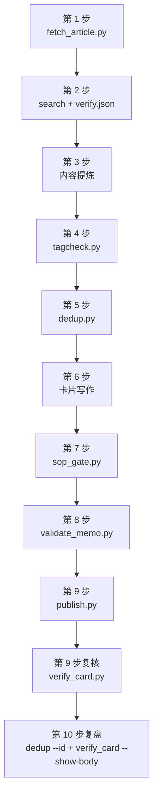
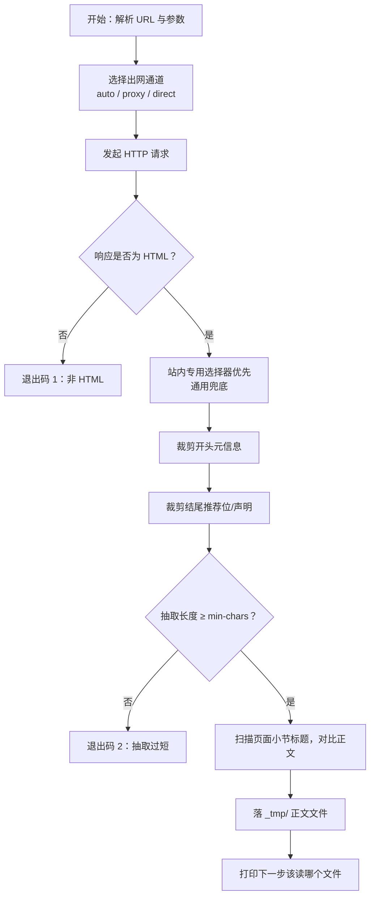
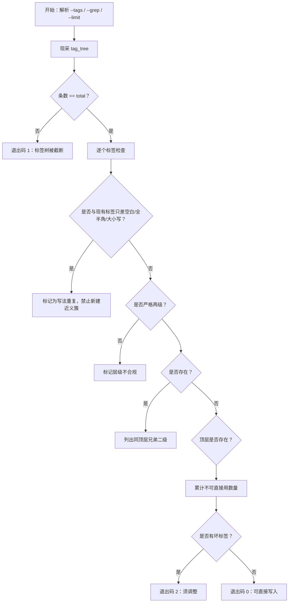
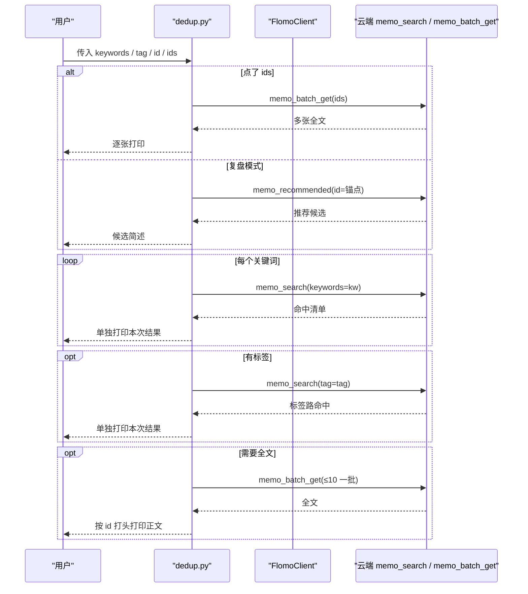
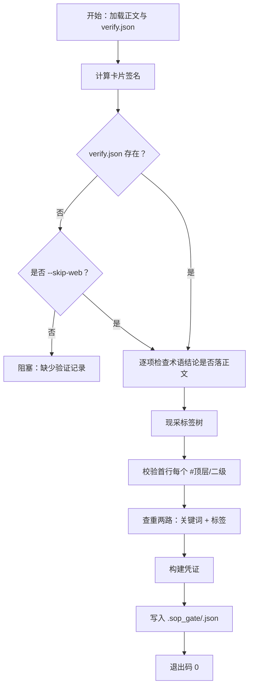
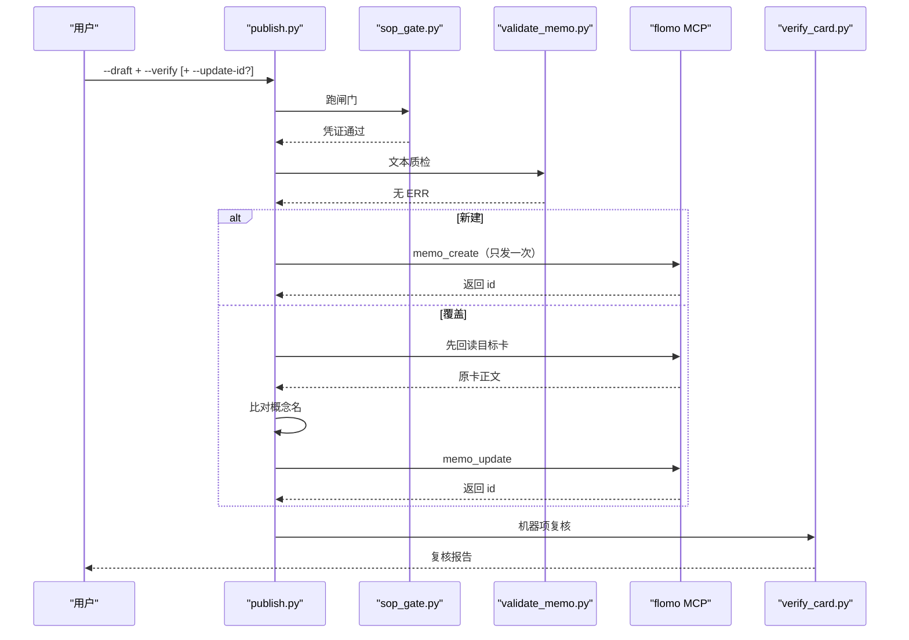
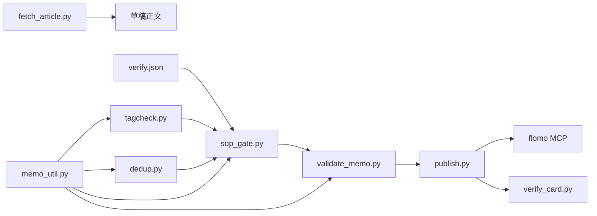
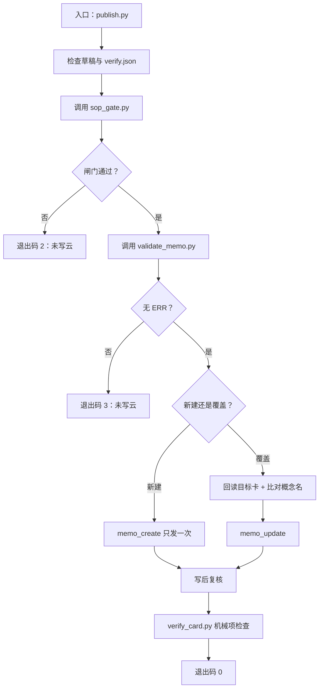

# 写卡 SOP 详解

<cite>
**本文引用的文件**   
- [README.md](file://README.md)
- [ENVIRONMENT.md](file://ENVIRONMENT.md)
- [scripts/fetch_article.py](file://scripts/fetch_article.py)
- [scripts/tagcheck.py](file://scripts/tagcheck.py)
- [scripts/dedup.py](file://scripts/dedup.py)
- [scripts/sop_gate.py](file://scripts/sop_gate.py)
- [scripts/validate_memo.py](file://scripts/validate_memo.py)
- [scripts/publish.py](file://scripts/publish.py)
- [scripts/verify_card.py](file://scripts/verify_card.py)
- [scripts/memo_util.py](file://scripts/memo_util.py)
</cite>

## 目录
1. [引言](#引言)
2. [项目结构与角色划分](#项目结构与角色划分)
3. [九步流水线总览](#九步流水线总览)
4. [第一步：内容抓取 fetch_article](#第一步内容抓取-fetch_article)
5. [第二步：术语验证 search + verify.json](#第二步术语验证-search--verifyjson)
6. [第三步：内容提炼（滤营销话术）](#第三步内容提炼滤营销话术)
7. [第四步：标签确定 tagcheck](#第四步标签确定-tagcheck)
8. [第五步：查重 dedup](#第五步查重-dedup)
9. [第六步：卡片写作 H14–H16](#第六步卡片写作-h14h16)
10. [第七步：流程闸门 sop_gate](#第七步流程闸门-sop_gate)
11. [第八步：文本质检 validate_memo](#第八步文本质检-validate_memo)
12. [第九步：写云与复核 publish + verify_card](#第九步写云与复核-publish--verify_card)
13. [第十步：复盘 dedup --id + verify_card --show-body](#第十步复盘-dedup---id--verify_card----show-body)
14. [批量写卡 publish.py --batch](#批量写卡-publishpy---batch)
15. [典型错误与修复方式](#典型错误与修复方式)
16. [依赖关系与流程图](#依赖关系与流程图)
17. [故障排查指南](#故障排查指南)
18. [结论](#结论)

## 引言
flomo-note 是一个 AI 辅助的云端笔记技能，目标是把网页、文章或想法沉淀为 flomo 云端卡片。卡片形态固定为“一行标签段 + 概念名称行 + 正文”，强调一事一卡、标签聚合。本地不持久化笔记，只保存脚本、文档与中间产物；真正落盘的是 `.sop_gate` 凭证、抓取件、草稿、批次清单等过程文件。

写卡不是“人工拼命令”，而是由工具链把容易漏做的步骤强制留痕：搜索、标签树核对、查重、复盘都必须通过 `sop_gate` 出凭证，否则 `validate_memo` 会直接判错，`publish.py` 不会写云。

**章节来源**
- [README.md:1-80](file://README.md#L1-L80)

## 项目结构与角色划分
写卡相关脚本集中在 `scripts/`，每个脚本职责单一：

| 脚本 | 在 SOP 中的位置 | 核心职责 |
|---|---:|---|
| `fetch_article.py` | 第 1 步 | 取网页、去噪音、抽正文，落 `_tmp/` |
| `tagcheck.py` | 第 4 步 | 现采标签树，校验两级、存在性、写法重复 |
| `dedup.py` | 第 5 步、第 8 步 | 关键词逐次现查 + 同主标签比对 + 全文取回 |
| `sop_gate.py` | 第 7 步 | 代跑核查项，输出带签名和正文指纹的凭证 |
| `validate_memo.py` | 第 8 步 | 格式、标签、来源、载体、字数等静态自检 |
| `publish.py` | 第 9 步 | 闸门 → 质检 → 建卡/覆盖 → 复核，支持批量 |
| `verify_card.py` | 第 9 步、第 10 步 | 写云后回读全文做机械自查，可打印全文 |
| `memo_util.py` | 全链路共用 | 卡片签名、正文指纹、关键词派生、标签键、切片限定检测 |



**图表来源**
- [README.md:40-120](file://README.md#L40-L120)
- [scripts/fetch_article.py:1-40](file://scripts/fetch_article.py#L1-L40)
- [scripts/tagcheck.py:1-40](file://scripts/tagcheck.py#L1-L40)
- [scripts/dedup.py:1-40](file://scripts/dedup.py#L1-L40)
- [scripts/sop_gate.py:1-40](file://scripts/sop_gate.py#L1-L40)
- [scripts/validate_memo.py:1-40](file://scripts/validate_memo.py#L1-L40)
- [scripts/publish.py:1-40](file://scripts/publish.py#L1-L40)
- [scripts/verify_card.py:1-40](file://scripts/verify_card.py#L1-L40)

**章节来源**
- [README.md:80-160](file://README.md#L80-L160)

## 九步流水线总览
SOP 的标准顺序是：

1. **抓取**：`fetch_article.py <url>`
2. **验证**：对专业术语、机构、产品、模型简称做现查，结果落 `verify.json`
3. **提炼**：过滤营销话术，保留事实、数据、因果链
4. **定标签**：`tagcheck.py --tags "顶层/二级"`
5. **查重**：`dedup.py --keywords ... [--tag ...]`
6. **写作**：按 H14–H16 写出草稿到 `_tmp/`
7. **闸门**：`sop_gate.py --memo <正文路径> --verify <verify.json>`
8. **质检**：`validate_memo.py --file <正文路径>`
9. **写云与复核**：`publish.py --draft <正文路径> --verify <verify.json>`，然后 `verify_card.py --id <返回 id>`
10. **复盘**：`dedup.py --id <本卡 id>` + `verify_card.py --id <本卡 id> --show-body`

其中第 2、5、8 步必须“真调云端只读接口”并留下证据，否则闸门不通过。

**章节来源**
- [README.md:24-48](file://README.md#L24-L48)

## 第一步：内容抓取 fetch_article
### 输入
- URL（必填位置参数）
- 可选：输出路径、最小字符数、超时时间、网络通道、是否打印 stdout

### 关键命令行参数
- `<url>`：要抓取的网页地址
- `--out PATH`：指定输出正文路径
- `--min-chars N`：抽取阶段的最小字符数阈值
- `--timeout N`：请求超时秒数
- `--via auto|proxy|direct`：默认 `auto`，先走环境代理，不通则直连重试
- `--print`：额外把正文打到标准输出，适合短文快速查看

### 处理逻辑


**图表来源**
- [scripts/fetch_article.py:1-40](file://scripts/fetch_article.py#L1-L40)
- [scripts/fetch_article.py:41-120](file://scripts/fetch_article.py#L41-L120)
- [scripts/fetch_article.py:121-220](file://scripts/fetch_article.py#L121-L220)

### 输出
- 正文文件（默认写入 `_tmp/`）
- 标准输出包含标题、发布日期、字符数、输出路径
- `[裁剪]` 行说明首尾裁掉的内容
- `[告警]` 提示正文可能在某个小节末尾被截断

### 失败分支
| 条件 | 行为 | 退出码 |
|---|---|---:|
| 两条出网通道都失败 | 同时报环境代理失败原因与直连失败原因 | 1 |
| 响应不是 HTML | 直接失败 | 1 |
| 抽取结果过短 | 多半是 JS 渲染页或反爬页 | 2 |

### 与其他步骤的关系
- 它是整个流水线的起点；后续所有步骤都依赖它产出的正文文件
- 第 2 步搜索时建议以抓回的原文为依据，避免仅凭标题写结论
- 第 3 步提炼应基于该文件的正文，而不是浏览器快照

### 典型错误与修复
| 现象 | 可能原因 | 修复方式 |
|---|---|---|
| 抓取失败但 curl 能通 | 沙箱注入代理端口每次会话变化，旧端口失效 | 用 `--via auto` 让脚本自动判断；或用 `netdoctor.py` 诊断 |
| 正文很短 | SPA 页面、JS 渲染、反爬 | 换 webfetch、镜像站、预印本通道 |
| 正文突然在某节结束 | 抽取右界提前收束 | 检查 `[告警]` 指出的小节标题，回到原文确认 |

**章节来源**
- [scripts/fetch_article.py:1-60](file://scripts/fetch_article.py#L1-L60)
- [scripts/fetch_article.py:121-220](file://scripts/fetch_article.py#L121-L220)
- [ENVIRONMENT.md:25-80](file://ENVIRONMENT.md#L25-L80)

## 第二步：术语验证 search + verify.json
### 输入
- 从第 1 步正文中识别的专业术语、机构名、产品名、模型简称
- 每个术语对应的搜索结果与结论

### 处理方式
这一步通常由调用者执行外部搜索，然后把结果整理成 JSON 落盘：

```json
{
  "searched": true,
  "terms": [
    {
      "term": "示例术语",
      "query": "实际搜索词",
      "conclusion": "确认为 XX 的标准称谓",
      "in_body": ["正文中已写入的片段"],
      "not_in_body": "确实不应写入的理由"
    }
  ]
}
```

关键字段说明：
- `searched`：是否完成搜索
- `terms[].term`：被核实的术语
- `terms[].query`：实际查询语句
- `terms[].conclusion`：搜索结论
- `terms[].in_body`：结论中应落进正文的片段
- `terms[].not_in_body`：豁免理由

### 输出
- `verify.json`（由调用方创建）
- 供 `sop_gate.py` 读取并校验结论是否真的进入正文

### 失败分支
- 未提供 `verify.json`，且未加 `--skip-web`：闸门阻塞
- 术语属于专业术语/机构/产品/模型/定理简称却跳过搜索：违反强制留痕
- 结论中的关键参数或术语词块没有出现在正文：闸门阻塞

### 与其他步骤的关系
- 第 4 步之前完成，因为结论可能影响概念名和正文措辞
- 第 7 步 `sop_gate.py` 会逐项核对 `in_body` 与结论关键参数
- 第 9 步 `publish.py` 要求 `--verify` 指向该文件

### 典型错误与修复
| 现象 | 原因 | 修复方式 |
|---|---|---|
| 闸门报“验证记录缺失” | 忘记传 `--verify` | 补上 `verify.json` 路径 |
| 闸门报“结论未落正文” | `in_body` 与实际正文不一致 | 调整正文或补充 `not_in_body` 豁免 |
| 术语结论只有名词，没有参数 | 闸门退到“术语词块至少一个须出现” | 确保术语本身或其核心词块出现在正文 |

**章节来源**
- [scripts/sop_gate.py:1-60](file://scripts/sop_gate.py#L1-L60)
- [scripts/sop_gate.py:61-140](file://scripts/sop_gate.py#L61-L140)

## 第三步：内容提炼（滤营销话术）
### 输入
- 第 1 步输出的正文文件
- 第 2 步 `verify.json` 中的核实结论

### 处理规则
- 删除营销话术、口号、空洞评价
- 保留事实、数据、因果关系、主体对象、适用范围
- 概念名应是名词短语，不能是“谁做了什么”
- 不要引入时间切片、版本后缀、代次、地域版本等限定结构
- 如果材料本身不是概念，应按 SKILL 规则提取概念

### 输出
- 新的草稿正文（尚未加 H14–H16 卡片格式）

### 失败分支
- 提炼后仍含大量广告语、引导语、模板前缀：会被第 8 步质检拦截
- 概念名含谓语动作或切片限定：会被第 8 步质检拦截

### 与其他步骤的关系
- 第 3 步是“人读 + 人判”的核心环节，脚本无法完全替代
- 第 6 步在此基础上套用卡片格式
- 第 7、8 步会对提炼质量做机械复查

### 典型错误与修复
| 现象 | 原因 | 修复方式 |
|---|---|---|
| 概念名像新闻标题 | 写成“某公司发布某产品” | 改为对象名称，去掉谓语 |
| 概念名带年份/季度/版本号 | 切片限定 | 剥离时间、版本、地域限定 |
| 正文混入平台占位符 | 抽取器丢公式 | 改用摘要降级，并在复盘中标注 |

[本节为操作原则说明，不直接分析具体源码行]

## 第四步：标签确定 tagcheck
### 输入
- 拟使用的标签列表

### 关键命令行参数
- `--tags "顶层/二级,顶层/二级"`：一次传入多个标签，支持半角/全角逗号、顿号
- `--grep "正则"`：只列出匹配的现有标签，不做放行判定
- `--limit N`：现采标签树上限（默认 2000）

### 处理逻辑


**图表来源**
- [scripts/tagcheck.py:1-40](file://scripts/tagcheck.py#L1-L40)
- [scripts/tagcheck.py:41-120](file://scripts/tagcheck.py#L41-L120)
- [scripts/tagcheck.py:121-200](file://scripts/tagcheck.py#L121-L200)

### 输出
- 每个标签的状态：存在、层级、同顶层兄弟二级、是否与现有标签写法重复
- 若使用 `--grep`，只列出匹配标签，不产出放行结论

### 失败分支
| 条件 | 退出码 | 含义 |
|---|---:|---|
| 标签树被截断 | 1 | 调大 `--limit` 重采 |
| 标签不在树中、层级不合规、写法重复 | 2 | 须按提示调整标签 |
| 参数错误 | 2 | 例如空 `--grep`、未给 `--tags` 或 `--grep` |

### 与其他步骤的关系
- 必须在第 5 步查重前确定，因为查重会按标签路再扫一遍
- 第 7 步闸门也会重新核对首行标签是否在现采标签树中
- 与 `memo_util.tag_key` 共用“忽略空白、全半角斜杠、大小写”的等价语义

### 典型错误与修复
| 现象 | 原因 | 修复方式 |
|---|---|---|
| 报“与现有标签只差空白/全半角/大小写” | 写了近义写法，如空格斜杠、大小写不同 | 改回树里已有写法 |
| 报层级不合规 | 用了三级标签或裸顶层 | 改为严格两级 `#顶层/二级` |
| 报顶层不存在 | 该顶层下没有任何叶子标签 | 连同顶层一起新建，或换已有顶层 |

**章节来源**
- [scripts/tagcheck.py:1-40](file://scripts/tagcheck.py#L1-L40)
- [scripts/tagcheck.py:41-120](file://scripts/tagcheck.py#L41-L120)
- [scripts/tagcheck.py:121-200](file://scripts/tagcheck.py#L121-L200)
- [scripts/memo_util.py:1-40](file://scripts/memo_util.py#L1-L40)

## 第五步：查重 dedup
### 输入
- 关键词列表
- 可选：主标签
- 可选：本卡 id（复盘模式）
- 可选：点名 id 列表

### 关键命令行参数
- `--keywords "关键词1,关键词2"`：支持半角/全角逗号、顿号、分号、换行分隔
- `--tag "顶层/二级"`：按主标签再扫一次
- `--id <本卡 memo id>`：复盘模式，调 `memo_recommended`
- `--ids ID1,ID2,...`：点名读这些卡的全文
- `--limit N`：每路检索上限（默认 10）
- `--max-full N`：自动取全文的上限（默认 8）
- `--no-full`：只看命中清单，不取全文

### 处理逻辑


**图表来源**
- [scripts/dedup.py:1-40](file://scripts/dedup.py#L1-L40)
- [scripts/dedup.py:41-120](file://scripts/dedup.py#L41-L120)
- [scripts/dedup.py:121-220](file://scripts/dedup.py#L121-L220)

### 输出
- 每条关键词检索结果的独立区块
- 标签检索结果区块
- 全文区块（受 `--max-full` 限制）
- 程序提取的 id 清单，供后续操作引用

### 失败分支
| 条件 | 退出码 | 含义 |
|---|---:|---|
| 无关键词、无标签、无 id、无 ids | 1 | 至少给一项 |
| 云端调用失败 | 1 | 查重未完成，不得据此判定“无命中” |
| 全文超过 `--max-full` | 不报错，但列出未取全文的 id | 用 `--ids` 点名补读 |

### 与其他步骤的关系
- 第 5 步用于写卡前查重
- 第 8 步复盘也复用同一脚本
- 第 9 步 `publish.py` 内部会通过 `sop_gate.py` 间接触发两路查重
- 第 10 步复盘明确用 `--id`

### 典型错误与修复
| 现象 | 原因 | 修复方式 |
|---|---|---|
| “查重调用未完成” | 云端接口失败 | 不要当“无命中”处理，先解决网络或 token |
| 某些 id 没取到全文 | 服务端单次 `memo_batch_get` 上限为 10 | 分批或 `--ids` 点名 |
| 超出 `--max-full` | 自动全文数量过多 | 缩小 `--max-full` 或用 `--ids` 精确补读 |

**章节来源**
- [scripts/dedup.py:1-40](file://scripts/dedup.py#L1-L40)
- [scripts/dedup.py:41-120](file://scripts/dedup.py#L41-L120)
- [scripts/dedup.py:121-220](file://scripts/dedup.py#L121-L220)

## 第六步：卡片写作 H14–H16
### 输入
- 第 3 步提炼后的正文骨架
- 第 4 步确定的标签
- 第 2 步 `verify.json` 中已确认的事实

### 格式要求
根据项目规则，卡片格式遵循 H14–H16：
- 首行：标签段，形如 `#顶层/二级`
- 第二行：概念名称
- 空一行
- 第三行起：正文

注意：
- 云端存储层会在标签行后插入一个空行，因此本地草稿与云端回读的“第二行概念名”可能落在第 2 行或第 3 行
- 概念名必须是名词短语，不能是事件描述
- 正文不应含 Markdown 粗体、非法 HTML、表格残留、状态行等
- 单卡正文（含标签段）字符数上限为 20000

### 输出
- `_tmp/` 下的草稿正文文件

### 失败分支
- 概念名不是合法概念名：第 8 步质检会报“概念名问题”
- 标签不是严格两级：第 8 步质检会报 ERR
- 正文含不支持语法：第 8 步质检会报 ERR
- 正文过长：第 8 步质检会报 ERR

### 与其他步骤的关系
- 第 6 步完成后才能进入第 7 步闸门
- 第 7、8、9、10 步都会依赖这里产出的正文和概念名

### 典型错误与修复
| 现象 | 原因 | 修复方式 |
|---|---|---|
| 概念名带动词 | 写成事件标题 | 改为对象名称 |
| 正文含 `**加粗**` | 不符合纯文本卡片规范 | 改用句式表达强调 |
| 正文含 `<div>`、`<span>` | 不受支持的 HTML | 转成纯文本 |
| 正文超长 | 一张卡塞了太多内容 | 拆成多张卡 |

**章节来源**
- [scripts/validate_memo.py:1-60](file://scripts/validate_memo.py#L1-L60)
- [scripts/validate_memo.py:61-120](file://scripts/validate_memo.py#L61-L120)
- [scripts/verify_card.py:1-40](file://scripts/verify_card.py#L1-L40)

## 第七步：流程闸门 sop_gate
### 输入
- 正文路径：`--memo <正文路径>`
- 验证记录：`--verify <verify.json>`
- 可选：`--skip-web`（非术语卡显式声明无需第 2 步验证）
- 可选：`--anchor-id <本卡 id>`（更新场景）
- 可选：`--out <凭证路径>`
- 可选：`--allow-no-gate "<理由>"`（仅限批量处理历史卡）

### 处理逻辑


**图表来源**
- [scripts/sop_gate.py:1-60](file://scripts/sop_gate.py#L1-L60)
- [scripts/sop_gate.py:61-140](file://scripts/sop_gate.py#L61-L140)
- [scripts/sop_gate.py:141-220](file://scripts/sop_gate.py#L141-L220)

### 输出
- `.sop_gate/<signature_key>.json` 凭证
- 凭证包含：
  - 卡片签名
  - 正文指纹
  - 标签检查结果
  - 查重结果
  - 验证记录审计
  - 机器无法判断的人读项清单
  - 凭证有效期（默认 6 小时）

### 失败分支
| 条件 | 退出码 | 含义 |
|---|---:|---|
| 有阻塞项未过 | 1 | 不出凭证，不得写云 |
| 验证记录缺失且未 skip-web | 1 | 术语验证未留痕 |
| 术语结论未落正文 | 1 | 需修正正文或补充豁免 |
| 标签不在树中或写法重复 | 1 | 需修正标签 |

### 与其他步骤的关系
- 第 7 步是第 8 步的前置条件
- `validate_memo.py` 会检查凭证是否存在、是否覆盖当前卡片签名、是否过期
- `publish.py` 内部会先跑闸门，再通过质检后才写云

### 典型错误与修复
| 现象 | 原因 | 修复方式 |
|---|---|---|
| 凭证过期 | 超过 6 小时 | 重跑闸门 |
| 正文指纹不匹配 | 闸门后改了正文 | 重写草稿并重跑闸门 |
| 术语结论没写进正文 | 只留痕没落笔 | 把结论关键参数或术语词块加入正文 |
| 标签写法与树中不一致 | 空格、全半角斜杠、大小写差异 | 改回树中写法 |

**章节来源**
- [scripts/sop_gate.py:1-60](file://scripts/sop_gate.py#L1-L60)
- [scripts/sop_gate.py:61-140](file://scripts/sop_gate.py#L61-L140)
- [scripts/sop_gate.py:141-220](file://scripts/sop_gate.py#L141-L220)
- [scripts/memo_util.py:1-40](file://scripts/memo_util.py#L1-L40)

## 第八步：文本质检 validate_memo
### 输入
- 正文路径：`--file <正文路径>`
- 或直接传正文：`--content "..."`
- 或传 create JSON：`--create create.json`
- 可选：`--no-gate`（须配合闸门授权标记）

### 关键检查项
- 格式：首行标签段、第二行概念名、空行、正文
- 标签：严格两级 `#顶层/二级`
- 正文：不含 Markdown 粗体、非法 HTML、表格残留、状态行
- 来源与载体：检查来源行、链接、邮箱等
- 字数：单卡正文不超过 20000 字符
- 概念名：不含切片限定、不含谓语动作
- 闸门凭证：存在、覆盖签名、未过期

### 输出
- 警告（WARN）：不阻塞
- 错误（ERR）：必须修复
- 退出码：
  - 0：通过
  - 1：存在必须修复的错误
  - 2：参数或用法错误

### 失败分支
- 闸门凭证缺失或未授权降级：ERR
- 标签不是两级：ERR
- 正文含不支持语法：ERR
- 概念名违规：ERR
- 正文超长：ERR

### 与其他步骤的关系
- 第 8 步由 `sop_gate.py` 或 `publish.py` 内部调用
- 第 9 步 `publish.py` 在写云前会再次运行质检
- 第 10 步复盘后可再次用此脚本复查

### 典型错误与修复
| 现象 | 原因 | 修复方式 |
|---|---|---|
| 报“模板前缀回显” | 正文首句带了“结论先行”等指令词 | 直接写结论，不保留引导语 |
| 报“概念名含切片限定” | 名字里有年份、季度、版本、地域版本 | 剥离限定结构 |
| 报“概念名含谓语动作” | 写成事件描述 | 改为对象名称 |
| 报“标签层级不合规” | 用了三级或单层标签 | 改为严格两级 |

**章节来源**
- [scripts/validate_memo.py:1-60](file://scripts/validate_memo.py#L1-L60)
- [scripts/validate_memo.py:61-120](file://scripts/validate_memo.py#L61-L120)
- [scripts/validate_memo.py:121-200](file://scripts/validate_memo.py#L121-L200)
- [scripts/memo_util.py:41-120](file://scripts/memo_util.py#L41-L120)

## 第九步：写云与复核 publish + verify_card
### 输入
- 草稿正文：`--draft <正文路径>`
- 验证记录：`--verify <verify.json>`
- 可选：`--update-id <memo id>`（覆盖既有卡）
- 可选：`--allow-rename`（允许改名）
- 可选：`--dry-run`（只跑到质检）
- 可选：`--skip-web`（透传闸门）
- 可选：`--no-verify-card`（跳过写后复核）
- 可选：`--allow-content-loss`（有意重写时放行）

### 关键处理链


**图表来源**
- [scripts/publish.py:1-40](file://scripts/publish.py#L1-L40)
- [scripts/publish.py:41-120](file://scripts/publish.py#L41-L120)
- [scripts/verify_card.py:1-40](file://scripts/verify_card.py#L1-L40)

### 输出
- 成功：已写入 id、复核结果
- 失败：对应退出码及原因
- 覆盖场景：改前快照、删增行 diff、净删行数提示

### 失败分支与退出码
| 退出码 | 含义 | 是否已写云 |
|---:|---|---:|
| 0 | 写入成功且机器项复核全过 | 是 |
| 1 | 前置检查不通过（草稿/留痕文件不存在） | 否 |
| 2 | 闸门未过 | 否 |
| 3 | 文本质检有 ERR | 否 |
| 4 | 写入失败 | 否，绝不重发 |
| 5 | 已写入但机器项复核失败 | 是，不改写、不重发 |
| 6 | 目标卡确认不通过 | 否 |
| 7 | 草稿比原卡少了读数或删出词中间断口 | 否 |

### 覆盖既有卡的特殊保护
- 写前先回读目标卡
- 比对概念名，不符即阻塞
- 若确属改名，需显式 `--allow-rename`
- 读不到概念名同样阻塞
- 落改前快照，写后逐行比对

### 典型错误与修复
| 现象 | 原因 | 修复方式 |
|---|---|---|
| 退出码 4 | 写云失败 | 先人工核实，不要整批重来 |
| 退出码 5 | 写入了但复核失败 | 不改写，只报告；检查正文或 id |
| 退出码 6 | 目标卡 id 抄错或概念名不符 | 核对 id，必要时加 `--allow-rename` |
| 退出码 7 | 删了数字或词语中间断口 | 若无意重写，补回内容 |

**章节来源**
- [scripts/publish.py:1-40](file://scripts/publish.py#L1-L40)
- [scripts/publish.py:41-120](file://scripts/publish.py#L41-L120)
- [scripts/verify_card.py:1-40](file://scripts/verify_card.py#L1-L40)

## 第十步：复盘 dedup --id + verify_card --show-body
### 输入
- 本卡 id
- 可选：`--limit`
- 可选：`--show-body`

### 处理方式
复盘分两部分：

1. **定向复查近邻**：`dedup.py --id <本卡 id>`
   - 调 `memo_recommended`，给出与本卡相关的候选
   - 仍可叠加 `--keywords` 与 `--tag`，两路都跑
   - 可用 `--ids` 点名读特定候选全文

2. **全文人读自查**：`verify_card.py --id <本卡 id> --show-body`
   - 打印云端全文
   - 做机械项检查：形态、截断、占位符、字数、草稿一致性
   - 显式列出两项机器判不了的内容：首尾是否同一事件、是否串入他卡内容

### 输出
- 推荐候选清单
- 全文（按需）
- 机械自查报告
- 如需人读，`--show-body` 直接输出完整正文

### 典型错误与修复
| 现象 | 原因 | 修复方式 |
|---|---|---|
| 回读失败 | id 错误或云端未返回卡片 | 核对 id，不要用手工拼接的请求 |
| 全文被截断 | 来自检索回包 | 改用 `memo_batch_get` 重取 |
| 正文缺中段 | 取自检索回包截断版 | 用完整正文重写或补回缺失段落 |

**章节来源**
- [scripts/dedup.py:1-40](file://scripts/dedup.py#L1-L40)
- [scripts/dedup.py:121-220](file://scripts/dedup.py#L121-L220)
- [scripts/verify_card.py:1-40](file://scripts/verify_card.py#L1-L40)
- [scripts/verify_card.py:41-120](file://scripts/verify_card.py#L41-L120)

## 批量写卡 publish.py --batch
### 用途
一次性处理多张卡，替代“每张各跑一遍闸门、再各写一遍”的低效流程。

### 批次清单格式
每行字段：
```
草稿路径 | 留痕路径 | 覆盖 id | rename
```
- 后三段可省或用 `-` 占位
- `#` 开头为注释
- 第 4 段只认 `rename`；表示该条覆盖卡允许连概念名一起改，等价于单卡的 `--allow-rename`

### 示例
```bash
python scripts/publish.py --batch _tmp/batch.txt
python scripts/publish.py --batch _tmp/batch.txt --dry-run
```

示例清单：
```
_tmp/draft_zt_1.txt | _tmp/verify_zt_1.json | -
_tmp/draft_zt_2.txt | _tmp/verify_zt_2.json | -
_tmp/draft_af_fix.txt | - | MjUzMzgyODYz | rename
```

### 行为规则
- 先对全部 N 张卡做预检：闸门、质检、覆盖对象身份
- 任何一张不过，一张都不写
- 预检全部通过后，才逐张写入并立刻复核
- 覆盖对象的 id 也在预检阶段核验，防止前面几张已经写入后才暴露抄错 id

### rename 与 update-id 的行为
- `update-id`：覆盖既有卡，写前比对概念名，不符则阻塞
- `rename`：仅在批次第 4 段出现，表示允许覆盖卡连概念名一起改
- 单卡模式用 `--allow-rename`，批次模式用第 4 段 `rename`

### 批量退出码
- 2/3/6 若在预检阶段失败：一张都没写
- 4/5/6/7 若发生在第 k 张写入时：前 k−1 张已写入
- 汇总输出包含未执行行与已写 id，便于重跑余下条目

### 典型错误与修复
| 现象 | 原因 | 修复方式 |
|---|---|---|
| 批次整体失败，零张写入 | 预检阶段某张不过 | 修复该张后重跑，不要把已成功的行再提交 |
| 部分写入 | 第 k 张失败 | 注释掉前 k 张，只重跑剩余行 |
| 覆盖 id 抄错 | 预检发现 | 修正批次清单，不要盲目整批重来 |
| 概念名不符 | 未加 `rename` | 若确属改名，在第 4 段加 `rename` |

**章节来源**
- [scripts/publish.py:1-40](file://scripts/publish.py#L1-L40)
- [scripts/publish.py:41-120](file://scripts/publish.py#L41-L120)

## 典型错误与修复
| 阶段 | 常见错误 | 修复方式 |
|---|---|---|
| 第 1 步 | 抓取失败、正文过短 | 换通道、镜像站、预印本；检查代理 |
| 第 2 步 | 未留痕、结论未落正文 | 补 `verify.json`，把关键参数或术语词块写入正文 |
| 第 4 步 | 标签写法重复、层级不合规 | 改回树中写法，改为严格两级 |
| 第 5 步 | 云端调用失败 | 不要当无命中；检查 token、网络、limit |
| 第 7 步 | 凭证过期、正文指纹不匹配 | 重跑闸门 |
| 第 8 步 | 概念名含切片或谓语 | 改为名词短语 |
| 第 9 步 | 写云失败 | 不重发；先人工核实 |
| 第 10 步 | 回读失败、正文截断 | 用 `memo_batch_get` 重取完整正文 |

[本节汇总常见现象，不直接分析源码行]

## 依赖关系与流程图
### 组件依赖图


**图表来源**
- [scripts/fetch_article.py:1-40](file://scripts/fetch_article.py#L1-L40)
- [scripts/tagcheck.py:1-40](file://scripts/tagcheck.py#L1-L40)
- [scripts/dedup.py:1-40](file://scripts/dedup.py#L1-L40)
- [scripts/sop_gate.py:1-40](file://scripts/sop_gate.py#L1-L40)
- [scripts/validate_memo.py:1-40](file://scripts/validate_memo.py#L1-L40)
- [scripts/publish.py:1-40](file://scripts/publish.py#L1-L40)
- [scripts/verify_card.py:1-40](file://scripts/verify_card.py#L1-L40)
- [scripts/memo_util.py:1-40](file://scripts/memo_util.py#L1-L40)

### 写云一条链的控制流


**图表来源**
- [scripts/publish.py:1-40](file://scripts/publish.py#L1-L40)
- [scripts/publish.py:41-120](file://scripts/publish.py#L41-L120)
- [scripts/sop_gate.py:1-40](file://scripts/sop_gate.py#L1-L40)
- [scripts/validate_memo.py:1-40](file://scripts/validate_memo.py#L1-L40)
- [scripts/verify_card.py:1-40](file://scripts/verify_card.py#L1-L40)

## 故障排查指南
### 找不到 flomo token
- 表现：所有脚本以非 0 退出，提示未找到 token
- 原因：`.mcp.json` 缺失，且环境变量 `FLOMO_TOKEN` 也未配置
- 修复：在项目根创建 `.mcp.json`，填入 `mcpServers.flomo.headers.Authorization`

### 网络异常
- 表现：抓取失败、写云失败、DNS 失败、TLS 握手失败
- 排查顺序：
  1. 先用 `netdoctor.py` 判断真实出网通道
  2. 区分“连接被拒/DNS 失败”和“超时/中断”
  3. 抓取侧自动回退；写云侧只在确定未发出请求时才换出口
  4. 本机服务也要绕代理测试
- 参考：[ENVIRONMENT.md:25-80](file://ENVIRONMENT.md#L25-L80)

### 凭证无效
- 表现：闸门报凭证缺失、签名不匹配、过期
- 原因：
  - 忘了跑 `sop_gate.py`
  - 闸门后改了正文
  - 凭证超过 6 小时
- 修复：重跑闸门，并确保正文不再改动

### 写云后复核失败
- 表现：退出码 5
- 行为：不改写、不重发，只报告
- 排查：
  - 用 `verify_card.py --id <id> --show-body` 看全文
  - 检查是否截断、是否含占位符、是否格式异常
  - 用 `dedup.py --id <id>` 复盘近邻

### 控制台端口冲突
- 表现：启动时报端口已被占用
- 原因：上一轮遗留进程仍在监听
- 修复：查 PID 后终止旧进程，再重启

**章节来源**
- [ENVIRONMENT.md:1-80](file://ENVIRONMENT.md#L1-L80)
- [scripts/publish.py:1-40](file://scripts/publish.py#L1-L40)
- [scripts/verify_card.py:1-40](file://scripts/verify_card.py#L1-L40)

## 结论
flomo-note 的写卡 SOP 不是一个“AI 自由发挥”的流程，而是一条由脚本强制约束的流水线：

- 第 1 步负责抓取与清洗
- 第 2 步强制术语留痕
- 第 3 步由人过滤营销话术
- 第 4 步强制标签树核对
- 第 5 步强制两路查重
- 第 6 步按 H14–H16 写卡
- 第 7 步把“自觉检查”变成“凭证化强制”
- 第 8 步做文本质检
- 第 9 步保证写云幂等、写后复核
- 第 10 步复盘近邻并打印全文

最关键的纪律有三条：
1. 不手抄 id；
2. create 只发一次；
3. 漏做验证、查重、复盘就不能通过闸门。

批量写卡应使用 `publish.py --batch`，并遵守“预检全过才写、任何一张不过则一张都不写”的规则。对于覆盖既有卡，必须先确认 id 与概念名；若确属改名，才加 `rename` 或 `--allow-rename`。