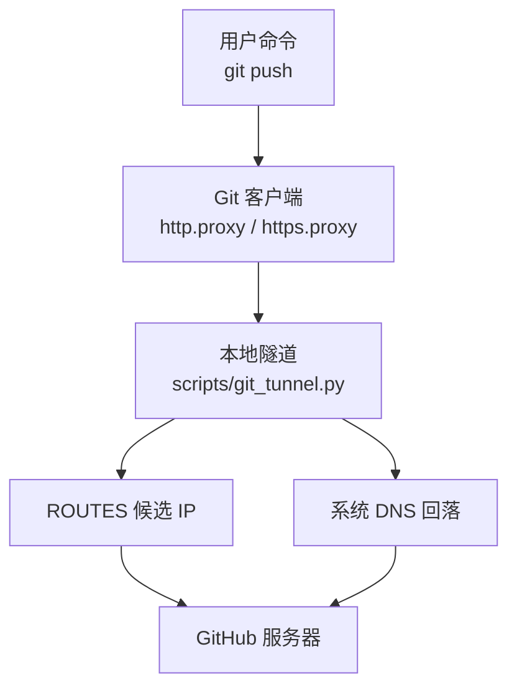
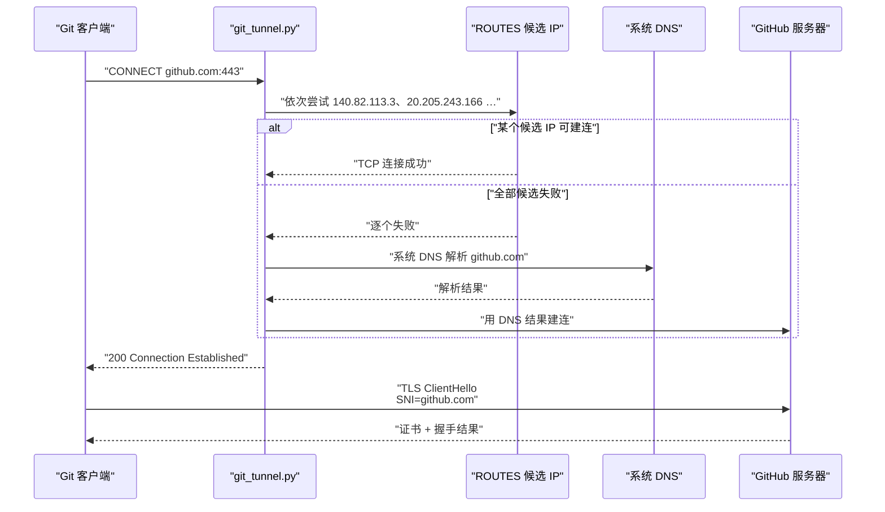
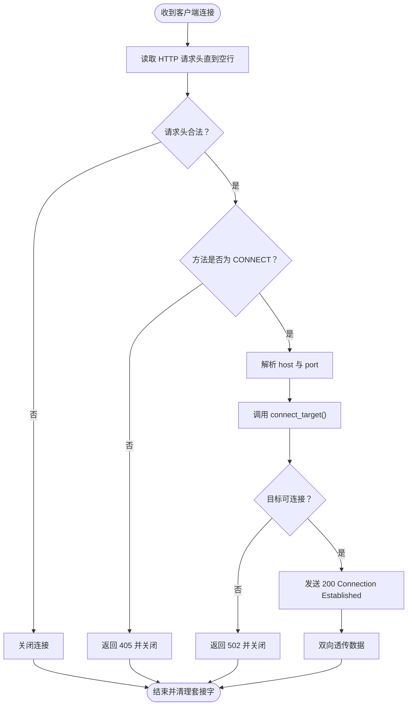
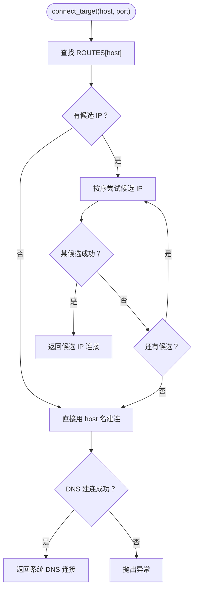
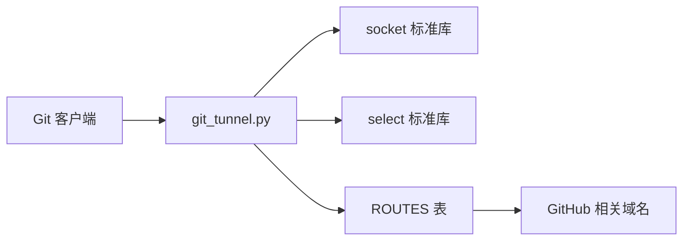

# GitHub 隧道与推送通道

<cite>
**本文引用的文件**   
- [git_tunnel.py](file://scripts/git_tunnel.py)
- [test_git_tunnel.py](file://tests/test_git_tunnel.py)
- [README.md](file://README.md)
- [ENVIRONMENT.md](file://ENVIRONMENT.md)
</cite>

## 目录
1. [引言](#引言)
2. [项目结构定位](#项目结构定位)
3. [核心组件](#核心组件)
4. [架构总览](#架构总览)
5. [详细组件分析](#详细组件分析)
6. [依赖关系分析](#依赖关系分析)
7. [性能与可靠性特性](#性能与可靠性特性)
8. [启动与使用方式](#启动与使用方式)
9. [故障排查清单](#故障排查清单)
10. [结论](#结论)

## 引言
`scripts/git_tunnel.py` 是一个本地 TCP CONNECT 代理，用于解决本机对 `github.com` 等域名的直连不稳定、沙箱注入代理返回 502、以及 DNS 被劫持到保留段假 IP 的问题。它把 `github.com:443` 的 HTTP CONNECT 请求重定向到 `ROUTES` 表中按序尝试的候选 IP；当所有候选都失败时，再回落系统 DNS 解析结果。TLS SNI 与证书校验仍由 Git 端和 GitHub 端到端完成，不关闭任何安全校验，因此安全性保持不变。

该工具是仓库中“GitHub 可达 IP”的**唯一事实源**，而不是 README 或环境备忘中的临时说明。IP 漂移时应修改 `ROUTES`，并用 `--print-hosts` 生成可追加到 `/etc/hosts` 的片段。

## 项目结构定位
在仓库中，`git_tunnel.py` 位于 `scripts/`，对应测试用例位于 `tests/test_git_tunnel.py`。README 将其归类为“取件与通道”，ENVIRONMENT.md 则记录其运行背景、端口约定、与 hosts 的关系。



**图示来源**
- [git_tunnel.py:1-211](file://scripts/git_tunnel.py#L1-L211)
- [ENVIRONMENT.md:1-256](file://ENVIRONMENT.md#L1-L256)

**章节来源**
- [README.md:1-200](file://README.md#L1-L200)
- [ENVIRONMENT.md:1-200](file://ENVIRONMENT.md#L1-L200)

## 核心组件
`git_tunnel.py` 的核心由以下部分组成：

| 组件 | 职责 |
|---|---|
| `ROUTES` | 域名到候选 IP 列表的映射，是可达 IP 的唯一事实源 |
| `HOSTS_PRIMARY` | 从 `ROUTES` 派生的主机名到首选 IP 的映射，供 `--print-hosts` 输出 |
| `_parse_args` | 解析监听端口、`--quiet`/`--verbose`、`--print-hosts` |
| `connect_target` | 先试候选 IP，全失败后回落到系统 DNS |
| `handle` | 解析 HTTP CONNECT，建立目标连接并双向透传 |
| `relay` | 基于 `select` 的双向数据转发，任一端关闭即收尾 |
| `main` | 启动 socket 服务端并监听默认端口 |

关键常量：

| 名称 | 含义 | 默认值或行为 |
|---|---|---|
| `HOST` | 绑定地址 | `127.0.0.1` |
| `PORT` | 默认监听端口 | `18123` |
| `CONNECT_TIMEOUT` | 单个候选 IP 的连接超时 | `6` 秒 |
| `DNS_TIMEOUT` | 系统 DNS 回落的连接超时 | `15` 秒 |
| `ROUTES` | 域名 → 候选 IP | 按顺序尝试，命中即用 |
| `HOSTS_PRIMARY` | 域名 → 首选 IP | 由 `ROUTES` 首条候选派生 |

**章节来源**
- [git_tunnel.py:1-211](file://scripts/git_tunnel.py#L1-L211)

## 架构总览
下图展示一次完整 `git push` 过程中，HTTP CONNECT、候选 IP 尝试、DNS 回落与 TLS 握手之间的关系。



**图示来源**
- [git_tunnel.py:1-211](file://scripts/git_tunnel.py#L1-L211)

这个流程的关键点是：**隧道只负责把 TCP 连接送到更可能通的 IP；SNI 和目标域名校验仍然由 Git 和 GitHub 直接完成**。

## 详细组件分析

### CONNECT 代理处理流程
`handle` 函数读取客户端发来的 HTTP 请求，仅接受 `CONNECT` 方法。对于非 CONNECT 请求，它会返回 `405 Method Not Allowed`。CONNECT 的目标格式形如 `host:port`；如果未显式提供端口，则默认为 `443`。



**图示来源**
- [git_tunnel.py:1-211](file://scripts/git_tunnel.py#L1-L211)

### 选路与 DNS 回落逻辑
`connect_target` 是隧道最关键的决策点：

1. 从 `ROUTES` 查找目标域名的候选 IP。
2. 按顺序调用 `socket.create_connection` 尝试每个候选。
3. 任一候选成功就立即返回，不再尝试后续 IP。
4. 所有候选失败后，日志提示“候选均失败，回落系统 DNS”。
5. 最后以域名本身作为目标调用 `socket.create_connection`，走系统 DNS。
6. 如果候选和 DNS 都失败，异常向上抛出，由 `handle` 转为 `502 Bad Gateway`。



**图示来源**
- [git_tunnel.py:1-211](file://scripts/git_tunnel.py#L1-L211)

测试用例覆盖了六个关键分支：首位候选命中、中间候选推进、候选全失败后回落、未配置域名直接走 DNS、候选与 DNS 均失败抛异常、多候选全失败后仍回落。这使 `connect_target` 的行为具备离线回归保障。

**章节来源**
- [git_tunnel.py:1-211](file://scripts/git_tunnel.py#L1-L211)
- [test_git_tunnel.py:1-120](file://tests/test_git_tunnel.py#L1-L120)

### 双向数据转发
`relay` 使用 `select.select` 同时监听客户端连接和目标连接，每次最多读取 65536 字节。任意一端返回空数据表示对端关闭，循环终止；发生异常时进入 `finally` 块关闭两端套接字。这种实现简单可靠，适合短生命周期 Git HTTPS 连接。

**章节来源**
- [git_tunnel.py:1-211](file://scripts/git_tunnel.py#L1-L211)

### 命令行参数
`_parse_args` 支持：

| 参数 | 作用 |
|---|---|
| 位置整数 | 设置监听端口，默认 `18123` |
| `--quiet` 或 `-q` | 关闭逐连接日志 |
| `--verbose` 或 `-v` | 开启详细日志（默认已开启） |
| `--print-hosts` | 打印 `/etc/hosts` 建议行后退出，不启动服务 |
| 其他未知参数 | 写入标准错误并退出码 `2` |

**章节来源**
- [git_tunnel.py:1-211](file://scripts/git_tunnel.py#L1-L211)

## 依赖关系分析
`git_tunnel.py` 只依赖 Python 标准库，没有第三方运行时依赖：

| 模块 | 用途 |
|---|---|
| `select` | 非阻塞式双向数据转发 |
| `socket` | TCP 服务端、目标连接、超时控制 |
| `sys` | 标准错误输出、进程退出码 |
| `threading` | 导入但未在当前截断内容中直接使用（当前版本主要使用单线程事件循环） |

它与外部系统的集成点只有两类：

1. **Git 客户端**：通过 HTTP CONNECT 协议连接 `127.0.0.1:18123`。
2. **GitHub 相关域名**：通过候选 IP 或系统 DNS 访问 `github.com`、`api.github.com`、`codeload.github.com`、`objects.githubusercontent.com`、`raw.githubusercontent.com`、`gist.github.com`。



**图示来源**
- [git_tunnel.py:1-211](file://scripts/git_tunnel.py#L1-L211)

**章节来源**
- [git_tunnel.py:1-211](file://scripts/git_tunnel.py#L1-L211)

## 性能与可靠性特性

### 超时设计
- 单个候选 IP 连接超时较短（默认 6 秒），避免一个慢候选拖住整个 CONNECT。
- 系统 DNS 回落超时更长（默认 15 秒），给 DNS 解析和远端建连留余量。
- `relay` 的 `select` 轮询间隔为 120 秒空闲阈值，防止连接长期占用资源而不退出。

### 容错策略
- 候选 IP 成段不可达时，按序逐个尝试能节省时间。
- 候选全部失败后仍回落到系统 DNS，避免“候选表漂移导致每次连接都 502”。
- 未配置候选的域名直接走系统 DNS，保持扩展性。
- 所有网络异常被捕获后尽量关闭套接字，避免半开连接泄漏。

### 安全性
隧道不修改 TLS 握手过程：

- SNI 仍为 `github.com`。
- 证书目标仍为 `github.com`。
- 证书校验由 Git 端的 OpenSSL/GnuTLS 完成。
- 隧道只是把 TCP 层流量换到一个更可能通的 IP，不降低加密强度。

**章节来源**
- [git_tunnel.py:1-211](file://scripts/git_tunnel.py#L1-L211)

## 启动与使用方式

### 启动隧道
默认监听 `127.0.0.1:18123`：

```bash
python scripts/git_tunnel.py
```

指定端口：

```bash
python scripts/git_tunnel.py 18124
```

关闭逐连接日志：

```bash
python scripts/git_tunnel.py --quiet
```

生成 hosts 片段：

```bash
python scripts/git_tunnel.py --print-hosts
```

### 执行 git push
必须显式传入 `http.proxy` 和 `https.proxy`，否则 Git 会读取沙箱注入的环境变量代理，而该代理对 GitHub 通常返回 502：

```bash
git -c http.proxy=http://127.0.0.1:18123 \
    -c https.proxy=http://127.0.0.1:18123 \
    push origin HEAD
```

这里 `-c http.proxy` 和 `-c https.proxy` 的作用是把本次 Git 命令的代理设置为本地隧道，绕过环境变量中指向沙箱代理的地址。

### 为什么必须显式传代理
沙箱会注入 `http_proxy` / `https_proxy`，且该代理经常返回 502。如果 Git 读到这些环境变量，就不会走 `git_tunnel.py`，而是走沙箱代理。因此文档强调：**不能依赖全局代理，必须用 `-c http.proxy` 和 `-c https.proxy` 显式覆盖**。

**章节来源**
- [git_tunnel.py:1-211](file://scripts/git_tunnel.py#L1-L211)
- [ENVIRONMENT.md:1-200](file://ENVIRONMENT.md#L1-L200)

## 故障排查清单

| 现象 | 优先检查 | 原因与处理 |
|---|---|---|
| 启动时报端口已被占用 | 是否已有旧隧道进程 | `git_tunnel.py` 绑定 `127.0.0.1:18123`，重复实例会冲突；先确认旧进程并结束后再启动 |
| `git push` 报 502 | 是否用了沙箱代理而非本地隧道 | Git 读到 `https_proxy` 时会走沙箱代理；改用 `-c http.proxy=http://127.0.0.1:18123 -c https.proxy=http://127.0.0.1:18123` |
| 候选 IP 全不可达 | `ROUTES` 是否过期 | `ROUTES` 是可达 IP 的唯一事实源；IP 漂移时应更新该表，并用 `--print-hosts` 重新生成 hosts 片段 |
| 系统 DNS 回落也超时 | 本机 DNS 是否被劫持或网络整体不通 | 沙箱 DNS 可能把 GitHub 域名解析到 `198.18.0.x`；需要检查 `/etc/hosts`、系统 DNS 和网络连通性 |
| Git 读到环境代理 | 环境变量 `http_proxy` / `https_proxy` | 即使设置了本地隧道，若 Git 仍读环境代理也会失败；应显式 `-c http.proxy` / `-c https.proxy` |
| 隧道启动成功但 push 仍失败 | 候选 IP 是否整段不可达 | 同段 IP 可能一起失效；应增加跨段候选 IP，并在 `ROUTES` 中调整顺序 |
| TLS 握手失败但 TCP 可连 | 是否为 SNI 关键字阻断 | 隧道不处理 SNI 过滤；必要时参考 `sni_fetch.py` 的替代取件通道思路 |
| 日志显示候选失败但仍 502 | 候选与 DNS 均失败 | `connect_target` 抛异常后 `handle` 返回 `502 Bad Gateway`；需检查候选 IP 和系统 DNS |
| Windows 控制台中文乱码或崩溃 | 是否缺少 UTF-8 编码 | 终端代码页可能不是 UTF-8；运行前设置 `PYTHONUTF8=1` 或 `PYTHONIOENCODING=utf-8` |

### 推荐排查顺序
1. 确认 `git_tunnel.py` 已在 `127.0.0.1:18123` 监听。
2. 确认 Git 命令使用了 `-c http.proxy=http://127.0.0.1:18123 -c https.proxy=http://127.0.0.1:18123`。
3. 用 `--print-hosts` 核对当前首选 IP 是否与预期一致。
4. 检查 `/etc/hosts` 是否包含 GitHub 真实 IP。
5. 检查系统 DNS 是否能解析 GitHub 域名。
6. 更新 `ROUTES` 中的候选 IP，并重启隧道。
7. 如果仍失败，区分是“代理问题”“候选 IP 问题”还是“系统 DNS 问题”。

**章节来源**
- [git_tunnel.py:1-211](file://scripts/git_tunnel.py#L1-L211)
- [ENVIRONMENT.md:1-256](file://ENVIRONMENT.md#L1-L256)
- [test_git_tunnel.py:1-120](file://tests/test_git_tunnel.py#L1-L120)

## 结论
`git_tunnel.py` 是一个轻量、低侵入的本地 CONNECT 代理：它不篡改 TLS，不关闭证书校验，也不要求用户手动维护复杂规则。它的职责很明确——在 Git 与 GitHub 之间提供一个更稳定的 TCP 出口。

运维要点可以概括为：

- `ROUTES` 是 GitHub 可达 IP 的**唯一事实源**。
- 默认监听 `127.0.0.1:18123`，可用 `--quiet` 和 `--print-hosts` 控制行为。
- `git push` 必须显式传 `-c http.proxy` 和 `-c https.proxy`，绕过沙箱注入的 502 代理。
- 候选 IP 全部失败时自动回落到系统 DNS，避免候选漂移造成误判。
- 故障排查应先分清楚“代理路径”“候选 IP 路径”“系统 DNS 路径”，再针对性修复。