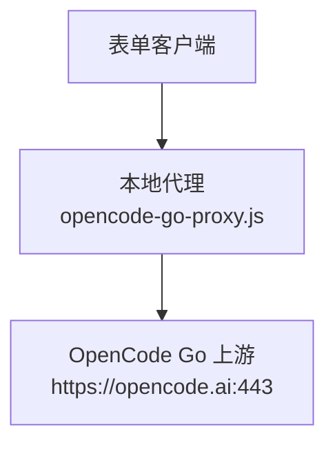
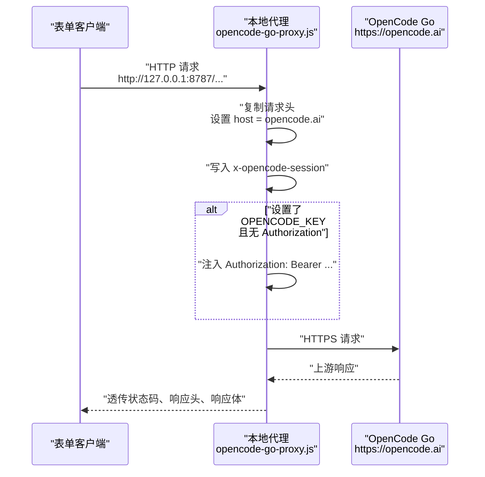
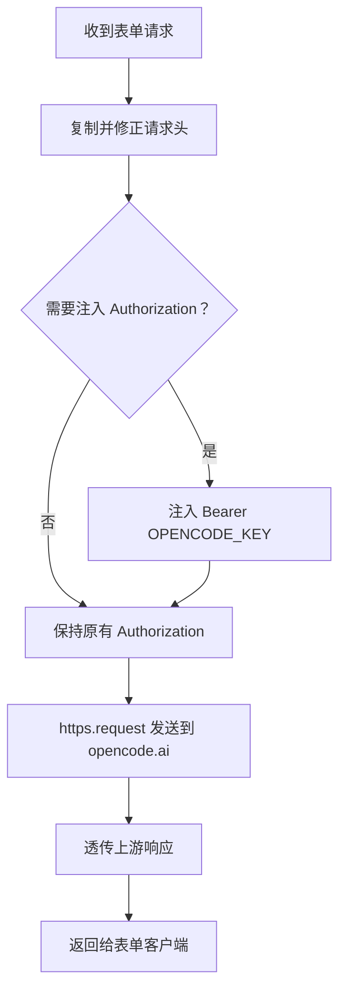
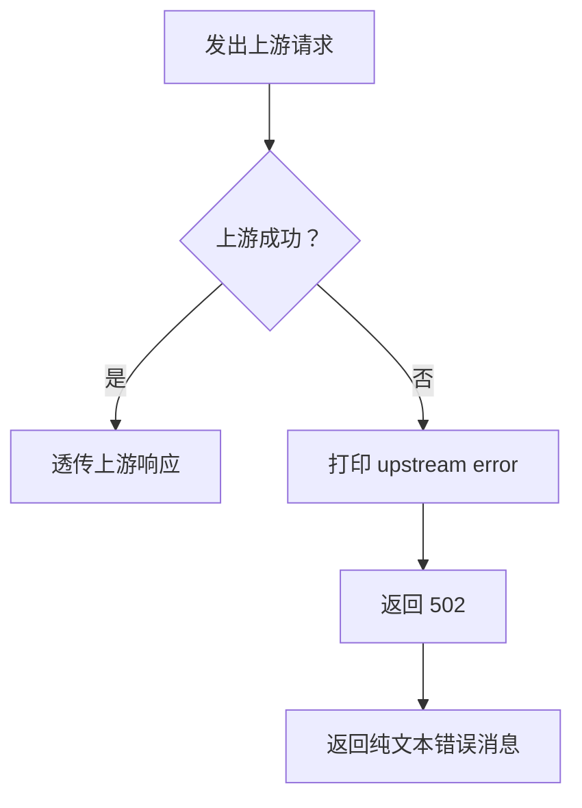
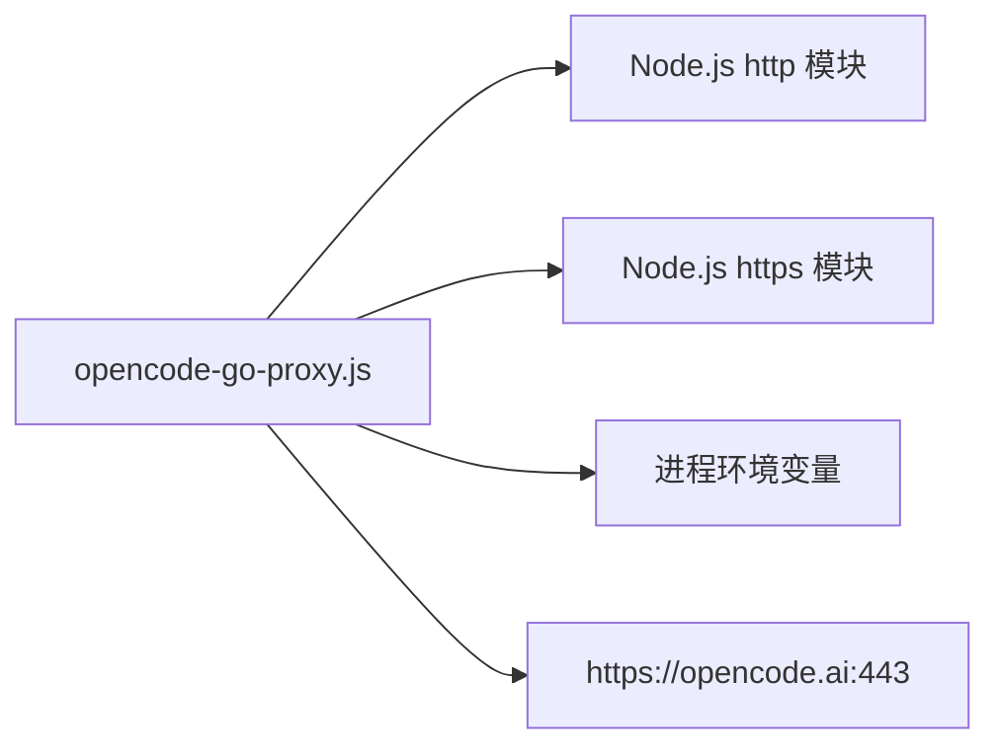

# OpenCode Go 本地代理

<cite>
**本文引用的文件**   
- [opencode-go-proxy.js](file://opencode-go-proxy.js)
</cite>

## 目录
1. [简介](#简介)
2. [项目结构](#项目结构)
3. [核心组件](#核心组件)
4. [架构总览](#架构总览)
5. [详细组件分析](#详细组件分析)
6. [依赖关系分析](#依赖关系分析)
7. [性能与缓存特性](#性能与缓存特性)
8. [故障排查指南](#故障排查指南)
9. [结论](#结论)

## 简介
OpenCode Go 的云端接口要求请求携带 `x-opencode-session` 头，但当前表单只支持 OpenAI 兼容协议，无法直接添加该头部，导致返回 400 MissingSessionID。本方案用 Node.js 原生 `http`/`https` 模块启动一个本地 HTTP 代理：

- 监听本机 `127.0.0.1:8787`；
- 收到表单请求后自动注入 `x-opencode-session` 与可选的 `Authorization`；
- 将请求原样转发到 `https://opencode.ai`；
- 上游响应直接透传回表单端。

最小运行方式：

```bash
OPENCODE_KEY=oc_sk_xxx node opencode-go-proxy.js
```

然后把表单中的「接口地址」改为：

```text
http://127.0.0.1:8787
```

## 项目结构
仓库根目录包含一个独立的代理脚本：

| 路径 | 职责 |
|---|---|
| `opencode-go-proxy.js` | 本地 HTTP 代理：监听端口、注入会话头、转发到 OpenCode Go 上游 |

它不依赖第三方库，仅使用 Node.js 标准库的 `http` 与 `https` 模块。



**图表来源**
- [opencode-go-proxy.js:1-56](file://opencode-go-proxy.js#L1-L56)

**章节来源**
- [opencode-go-proxy.js:1-56](file://opencode-go-proxy.js#L1-L56)

## 核心组件
代理的核心逻辑由以下部分组成：

| 组件 | 说明 |
|---|---|
| 目标地址 | `TARGET_HOST = 'opencode.ai'`，`TARGET_PORT = 443` |
| 监听地址 | `LISTEN_PORT = 8787`，绑定 `127.0.0.1` |
| 会话标识 | `SESSION_ID`，优先读环境变量 `OCODE_SESSION`，否则固定为 `local-proxy-session-001` |
| 请求头处理 | 复制原始请求头，覆盖 `host`，强制写入 `x-opencode-session` |
| Key 注入 | 若设置 `OPENCODE_KEY` 且请求未自带 `Authorization`，则注入 `Bearer OPENCODE_KEY` |
| 上游转发 | 使用 `https.request` 将请求转发到 `https://opencode.ai` |
| 响应透传 | 直接透传上游状态码与响应体 |
| 错误处理 | 上游连接或发送失败时返回 502 |

**章节来源**
- [opencode-go-proxy.js:1-56](file://opencode-go-proxy.js#L1-L56)

## 架构总览
代理的工作流如下：



**图表来源**
- [opencode-go-proxy.js:18-56](file://opencode-go-proxy.js#L18-L56)

**章节来源**
- [opencode-go-proxy.js:18-56](file://opencode-go-proxy.js#L18-L56)

## 详细组件分析

### 会话 ID 与环境变量
`SESSION_ID` 的取值规则是：

1. 如果存在环境变量 `OCODE_SESSION`，则使用其值；
2. 否则使用固定值 `local-proxy-session-001`。

这意味着：

- **同一会话保持稳定**：只要进程重启或 `OCODE_SESSION` 不变，`x-opencode-session` 就保持不变，有利于 OpenCode Go 侧做会话级缓存；
- **新会话应换值**：如果需要隔离不同对话或用户，应修改 `OCODE_SESSION`，不要每次请求随机生成，否则会丢失缓存收益；
- `OPENCODE_KEY` 和 `OCODE_SESSION` 是两个独立概念：前者用于鉴权，后者用于会话标识。

**章节来源**
- [opencode-go-proxy.js:13-17](file://opencode-go-proxy.js#L13-L17)

### 请求头转发规则
代理对请求头的处理顺序如下：

| 步骤 | 行为 |
|---|---|
| 1 | 复制客户端发来的所有请求头 |
| 2 | 将 `host` 改写为 `opencode.ai` |
| 3 | 强制写入 `x-opencode-session`，值为 `SESSION_ID` |
| 4 | 判断是否设置 `OPENCODE_KEY` 且请求中已存在 `authorization` |
| 5 | 只有当 `OPENCODE_KEY` 存在 **且** 请求未带 `Authorization` 时才注入 `Authorization: Bearer <OPENCODE_KEY>` |
| 6 | 将完整请求头发送到上游 |

因此：

- 表单可以自行填写 `Authorization`，代理会原样转发；
- 也可以不在表单填 Key，改用 `OPENCODE_KEY=oc_sk_xxx` 环境变量；
- 两者二选一即可，推荐在表单里填，便于区分不同账号。

**章节来源**
- [opencode-go-proxy.js:21-27](file://opencode-go-proxy.js#L21-L27)

### 上游转发与响应透传
代理使用 Node.js 原生 `https.request` 发起上游请求：

- 方法（`method`）来自原始请求；
- 路径（`path`）原样透传，例如 `/inference/go/openai/v1/chat/completions`；
- 响应状态码和响应头直接写回客户端；
- 响应体通过流式管道 `upRes.pipe(res)` 透传；
- 请求体也通过 `req.pipe(upstream)` 透传。



**图表来源**
- [opencode-go-proxy.js:29-48](file://opencode-go-proxy.js#L29-L48)

**章节来源**
- [opencode-go-proxy.js:29-48](file://opencode-go-proxy.js#L29-L48)

### 502 上游错误处理
当上游 HTTPS 请求发生异常时，代理不会让错误静默消失，而是：

1. 在控制台打印 `[proxy] upstream error:` 及错误信息；
2. 向客户端写入 HTTP 502；
3. 设置响应头 `Content-Type: text/plain; charset=utf-8`；
4. 返回文本消息 `Proxy upstream error: <错误信息>`。



**图表来源**
- [opencode-go-proxy.js:44-50](file://opencode-go-proxy.js#L44-L50)

**章节来源**
- [opencode-go-proxy.js:44-50](file://opencode-go-proxy.js#L44-L50)

### 优先级规则：表单 Authorization 与 OPENCODE_KEY
当表单已经携带 `Authorization`，同时环境又设置了 `OPENCODE_KEY` 时，代理的行为是：

- 因为请求中已存在 `authorization`，所以**不会**再注入 `OPENCODE_KEY`；
- 最终发给上游的是表单自带的 `Authorization`；
- 这是“表单优先”的设计：如果你明确在表单里写了 Key，代理尊重你的选择。

| 场景 | 实际使用的 Authorization |
|---|---|
| 未设置 `OPENCODE_KEY`，表单未填 Authorization | 不注入任何 Authorization |
| 设置 `OPENCODE_KEY`，表单未填 Authorization | 使用 `Bearer OPENCODE_KEY` |
| 表单已带 Authorization | 使用表单中的 Authorization，忽略 `OPENCODE_KEY` |
| 表单已带 Authorization，同时设置 `OPENCODE_KEY` | 仍使用表单中的 Authorization |

**章节来源**
- [opencode-go-proxy.js:21-27](file://opencode-go-proxy.js#L21-L27)

## 依赖关系分析
代理的依赖非常精简，全部来自 Node.js 标准库：



**图表来源**
- [opencode-go-proxy.js:19-56](file://opencode-go-proxy.js#L19-L56)

关键依赖点：

| 依赖 | 作用 | 风险 |
|---|---|---|
| `http` | 创建本地监听服务 | 端口占用、本机防火墙 |
| `https` | 访问 OpenCode Go 上游 | DNS、TLS、网络连通性 |
| 环境变量 | 提供 `OCODE_SESSION` 和 `OPENCODE_KEY` | 名称拼写错误、未生效 |
| `opencode.ai:443` | 真实推理接口 | 域名不可达、证书问题、限流 |

**章节来源**
- [opencode-go-proxy.js:19-56](file://opencode-go-proxy.js#L19-L56)

## 性能与缓存特性
这个代理本身不做缓存、不做重试、不做负载均衡，也不解析 JSON 或修改请求体。它的主要性能特征如下：

- **延迟增加很小**：只在内存中复制请求头并转发；
- **不引入额外序列化成本**：请求体和响应体以流形式透传；
- **会话缓存依赖上游**：`x-opencode-session` 保持稳定有助于 OpenCode Go 侧复用会话相关状态，但具体缓存策略由上游决定；
- **不建议频繁更换会话 ID**：每次改变 `OCODE_SESSION` 或重启代理时使用不同值，会破坏会话稳定性；
- **不适合高并发大流量**：它是一个轻量本地桥接器，不是生产级反向代理。

[本节为通用性能说明，不直接分析特定代码行]

## 故障排查指南

### 启动方式是否正确
确认你使用的是：

```bash
OPENCODE_KEY=oc_sk_xxx node opencode-go-proxy.js
```

并且没有遗漏 `node` 命令或环境变量赋值。

**章节来源**
- [opencode-go-proxy.js:1-12](file://opencode-go-proxy.js#L1-L12)

### 端口冲突
默认监听 `127.0.0.1:8787`。如果提示端口已被占用，说明已有进程监听该端口。解决方案：

1. 先停止旧代理进程；
2. 检查是否有其他服务占用了 8787；
3. 如需自定义端口，可修改脚本中的 `LISTEN_PORT`；
4. 确保表单中的接口地址与代理监听地址一致。

**章节来源**
- [opencode-go-proxy.js:14-16](file://opencode-go-proxy.js#L14-L16)
- [opencode-go-proxy.js:52-56](file://opencode-go-proxy.js#L52-L56)

### Key 未生效
症状：表单调用返回鉴权相关错误，但日志中没有出现上游错误。

排查步骤：

1. 确认是否设置了 `OPENCODE_KEY`；
2. 确认表单中没有同时填写 `Authorization`；
3. 如果表单中已有 `Authorization`，它会优先于 `OPENCODE_KEY`；
4. 如果想用环境变量 Key，请清空表单中的 Authorization；
5. 重新启动代理进程，确保读取到新环境变量。

**章节来源**
- [opencode-go-proxy.js:21-27](file://opencode-go-proxy.js#L21-L27)

### x-opencode-session 丢失
症状：返回 400 MissingSessionID。

可能原因：

1. 表单接口地址没有改为 `http://127.0.0.1:8787`，而是直接连到了上游；
2. 代理没有启动；
3. 代理进程崩溃或未正常监听；
4. 你手动覆盖了请求头，清除了 `x-opencode-session`。

验证方式：

- 启动代理后查看控制台输出是否包含 `listening on http://127.0.0.1:8787`；
- 检查表单请求是否经过本地 8787 端口；
- 确认 `OCODE_SESSION` 或默认 `local-proxy-session-001` 可用。

**章节来源**
- [opencode-go-proxy.js:1-17](file://opencode-go-proxy.js#L1-L17)
- [opencode-go-proxy.js:21-27](file://opencode-go-proxy.js#L21-L27)
- [opencode-go-proxy.js:52-56](file://opencode-go-proxy.js#L52-L56)

### 上游不可达
症状：控制台出现 `[proxy] upstream error:`，表单收到 502。

可能原因：

1. DNS 无法解析 `opencode.ai`；
2. 本机网络被阻断或公司代理未配置；
3. TLS 握手失败；
4. OpenCode Go 服务端暂时不可用；
5. 本机防火墙阻止了出站 443 端口。

处理方式：

- 检查本机是否能访问 `https://opencode.ai`；
- 检查系统代理和网络设置；
- 等待一段时间后重试；
- 查看 502 响应体中的错误消息，定位具体网络或 TLS 原因。

**章节来源**
- [opencode-go-proxy.js:44-50](file://opencode-go-proxy.js#L44-L50)

### 表单已带 Authorization 且同时设置 OPENCODE_KEY
这是预期行为：表单中的 `Authorization` 优先级更高。代理只有在请求头不存在 `authorization` 时才会注入 `OPENCODE_KEY`。

建议：

- 如果希望使用环境变量 Key，请在表单中删除 Authorization；
- 如果希望使用表单 Key，请保留表单 Authorization 并忽略 `OPENCODE_KEY`；
- 不要把两个 Key 混在一起使用。

**章节来源**
- [opencode-go-proxy.js:21-27](file://opencode-go-proxy.js#L21-L27)

### SESSION_ID 与 OCODE_SESSION
| 项 | 说明 |
|---|---|
| 固定值 `local-proxy-session-001` | 默认会话 ID，适合单机单人稳定使用 |
| 环境变量 `OCODE_SESSION` | 覆盖默认值，适合多用户或多会话隔离 |
| 稳定性要求 | 同一会话应保持相同值，以获得缓存收益 |
| 新会话 | 应更换 `OCODE_SESSION`，不要每次随机生成 |

**章节来源**
- [opencode-go-proxy.js:13-17](file://opencode-go-proxy.js#L13-L17)

## 结论
OpenCode Go 本地代理是一个极简、无依赖的桥接层，专门解决表单无法注入 `x-opencode-session` 的问题。它只做三件事：注入会话头、按需注入鉴权头、原样转发请求。对于大多数本地表单场景，它足以替代复杂的反向代理配置。

部署要点总结：

1. 使用 `OPENCODE_KEY=oc_sk_xxx node opencode-go-proxy.js` 启动；
2. 将表单接口地址改为 `http://127.0.0.1:8787`；
3. 如需稳定缓存，保持 `OCODE_SESSION` 不变；
4. 如需多会话隔离，为每个会话设置不同的 `OCODE_SESSION`；
5. 表单中的 `Authorization` 优先级高于 `OPENCODE_KEY`；
6. 遇到 502 时优先排查网络和上游可达性。

[本节为总结性内容，不直接分析特定代码行]