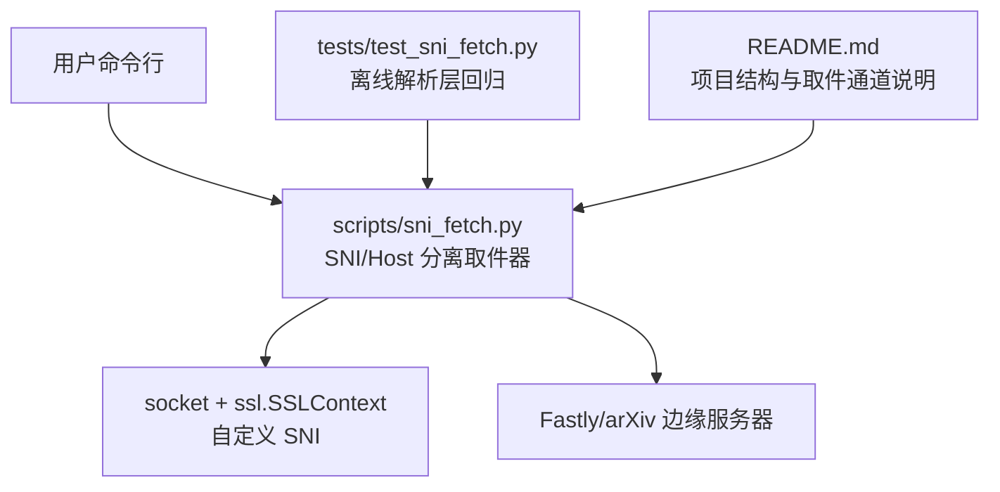
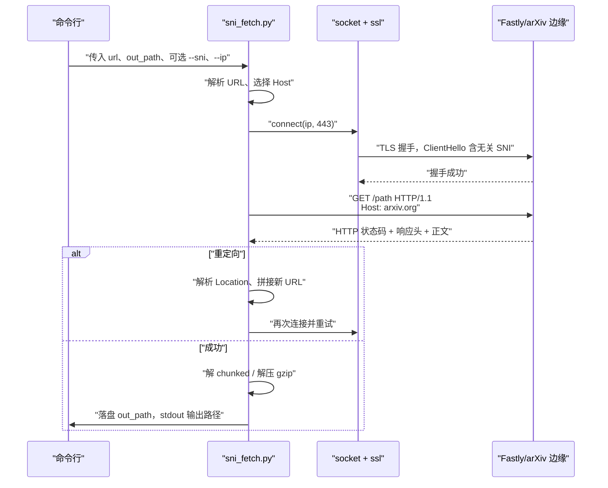
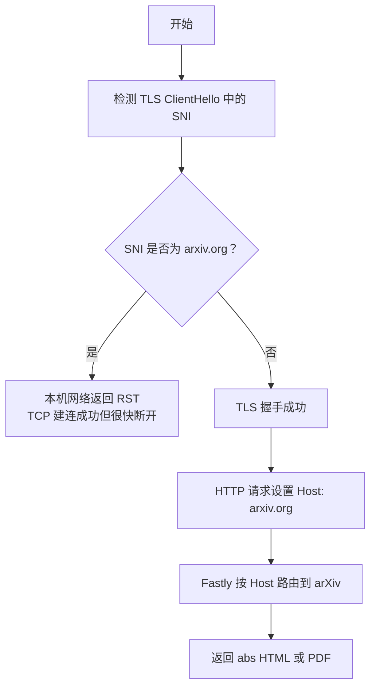
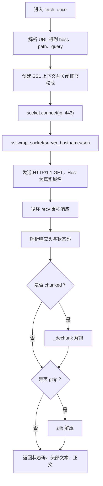
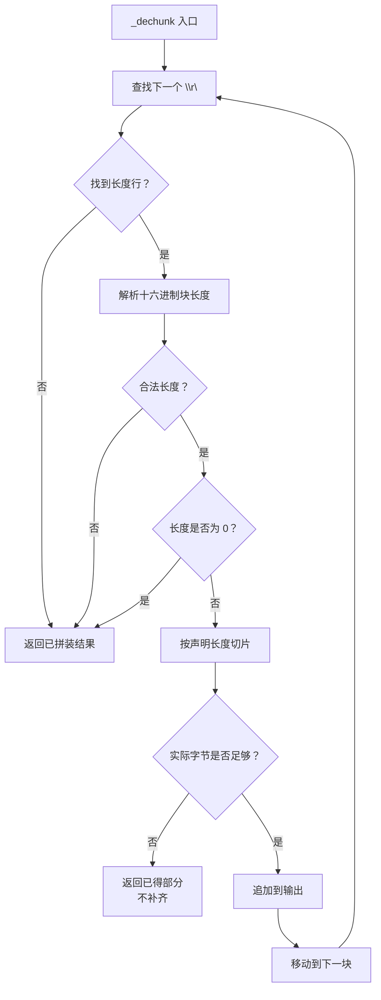
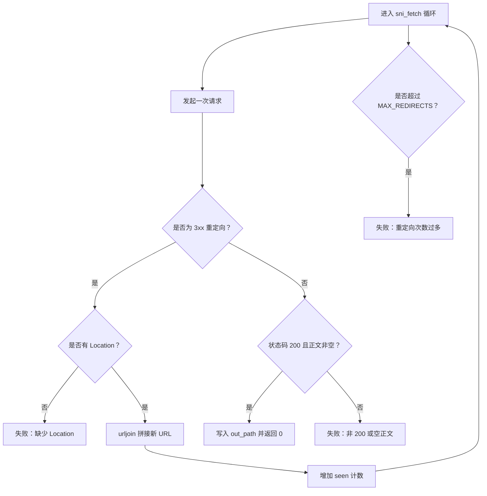
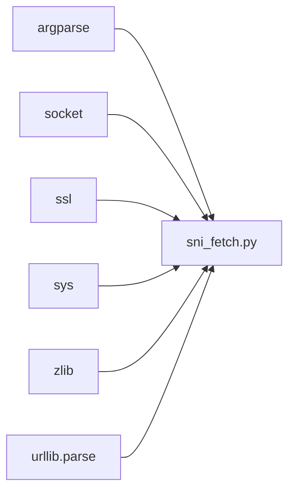

# SNI 阻断绕过

<cite>
**本文引用的文件**   
- [scripts/sni_fetch.py](file://scripts/sni_fetch.py)
- [tests/test_sni_fetch.py](file://tests/test_sni_fetch.py)
- [README.md](file://README.md)
</cite>

## 目录
1. [引言](#引言)
2. [项目结构](#项目结构)
3. [核心组件](#核心组件)
4. [架构总览](#架构总览)
5. [详细组件分析](#详细组件分析)
6. [依赖关系分析](#依赖关系分析)
7. [性能考虑](#性能考虑)
8. [故障排查指南](#故障排查指南)
9. [结论](#结论)
10. [附录：命令行与示例](#附录命令行与示例)

## 引言
本机网络对 TLS ClientHello 中 SNI 字段出现 `arxiv.org` 的请求会直接返回 RST，表现为 TCP 建连成功但约 0.08 秒后抛出 `ConnectionResetError`；而把 SNI 替换为 `www.bing.com` 或 `a.fastly.net` 时握手能正常完成。这说明本地过滤是按 SNI 关键字拦截，而不是整段 TLS 握手内容被阻断。

arXiv 使用 Fastly 作为边缘层，Fastly 主要按 HTTP `Host` 头决定后端路由。因此可以把 TLS 层的 SNI 设为不在阻断名单中的域名，同时在 HTTP 请求里保留真实 `Host: arxiv.org`，从而让 Fastly 正确路由到 arXiv 资源，取回 abs 页面与 PDF。该方案通常称为 **domain fronting（域名前置）**。

本脚本位于仓库的 `scripts/sni_fetch.py`，配套离线回归用例在 `tests/test_sni_fetch.py`。它不依赖第三方网络库，而是用 Python 标准库中的 `socket`、`ssl`、`zlib` 手动构造连接、TLS 包装、HTTP/1.1 请求、chunked 解包与 gzip 解压。

**章节来源**
- [scripts/sni_fetch.py:1-28](file://scripts/sni_fetch.py#L1-L28)

## 项目结构
与 SNI 阻断绕过直接相关的代码分布在两个位置：

- `scripts/sni_fetch.py`：实现 domain fronting 取件逻辑、SNI 与 Host 分离、重定向处理、chunked/gzip 解码、落盘与退出码约定。
- `tests/test_sni_fetch.py`：离线解析层回归测试，覆盖 chunked 多块、块扩展、声明长度大于实际剩余字节时的截断行为，以及响应头大小写与冒号值处理。
- `README.md`：从项目层面说明 `sni_fetch.py` 是“SNI 被阻断时的取件通道”，并给出脚本与用例的组织规范。



**图表来源**
- [scripts/sni_fetch.py:1-166](file://scripts/sni_fetch.py#L1-L166)
- [tests/test_sni_fetch.py:1-75](file://tests/test_sni_fetch.py#L1-L75)
- [README.md:1-200](file://README.md#L1-L200)

**章节来源**
- [scripts/sni_fetch.py:1-166](file://scripts/sni_fetch.py#L1-L166)
- [tests/test_sni_fetch.py:1-75](file://tests/test_sni_fetch.py#L1-L75)
- [README.md:1-200](file://README.md#L1-L200)

## 核心组件
`sni_fetch.py` 的核心由以下部分组成：

| 组件 | 作用 | 关键行为 |
|---|---|---|
| 常量 | 定义默认 SNI、User-Agent、最大重定向次数 | `DEFAULT_SNI = "www.bing.com"`、`UA`、`MAX_REDIRECTS = 6` |
| `_dechunk(body)` | 解包 HTTP chunked 传输编码 | 逐块读取十六进制长度，遇到终止块停止；声明长度大于实际剩余字节时返回已得部分，不补齐 |
| `fetch_once(url, ip, sni, timeout)` | 一次底层 HTTP 请求 | 用指定 IP 建连、用指定 SNI 做 TLS、Host 头用 URL 中的真实域名；支持 chunked 与 gzip |
| `_header(head_txt, name)` | 解析响应头 | 大小写不敏感，只按第一个冒号切分值 |
| `sni_fetch(url, out_path, sni, ip)` | 主流程控制 | 循环最多 `MAX_REDIRECTS` 次处理重定向，最终 200 且非空正文才落盘 |
| `main()` | 命令行入口 | 校验仅支持 `https://`，解析 `--sni`、`--ip` |

**章节来源**
- [scripts/sni_fetch.py:17-166](file://scripts/sni_fetch.py#L17-L166)

## 架构总览
SNI 阻断绕过的数据流如下：



**图表来源**
- [scripts/sni_fetch.py:43-135](file://scripts/sni_fetch.py#L43-L135)

**章节来源**
- [scripts/sni_fetch.py:43-135](file://scripts/sni_fetch.py#L43-L135)

## 详细组件分析

### SNI 阻断判定与 domain fronting 原理
脚本注释明确指出：本机网络对 SNI 中出现 `arxiv.org` 的 TLS ClientHello 直接回 RST，换 SNI 为 `www.bing.com` 或去 SNI 则握手成功，因此判断为按 SNI 关键字过滤。arXiv 走 Fastly，Fastly 按 HTTP Host 路由，所以脚本采用：

- TLS 层：`ssl.create_default_context()` + `ctx.wrap_socket(server_hostname=sni)`，其中 `sni` 默认为 `www.bing.com`。
- 证书校验：关闭主机名校验与证书验证，因为证书颁发给 SNI 域名而非 `arxiv.org`。
- HTTP 层：`Host` 头使用 URL 解析出的真实域名，例如 `arxiv.org`。

这样既绕过本地按 SNI 的 RST 阻断，又让 Fastly 根据 `Host` 找到 arXiv 后端。



**图表来源**
- [scripts/sni_fetch.py:1-28](file://scripts/sni_fetch.py#L1-L28)
- [scripts/sni_fetch.py:43-78](file://scripts/sni_fetch.py#L43-L78)

**章节来源**
- [scripts/sni_fetch.py:1-28](file://scripts/sni_fetch.py#L1-L28)
- [scripts/sni_fetch.py:43-78](file://scripts/sni_fetch.py#L43-L78)

### 命令行参数与常量
`sni_fetch.py` 使用 `argparse` 定义命令接口：

| 参数 | 类型 | 默认值 | 作用 |
|---|---|---|---|
| `url` | 位置参数 | 无 | 目标 HTTPS URL，必须为 `https://` |
| `out_path` | 位置参数 | 无 | 落盘文件路径 |
| `--sni` | 可选参数 | `DEFAULT_SNI` | 设置 TLS ClientHello 中的 SNI |
| `--ip` | 可选参数 | `None` | 指定目标边缘 IP；省略则通过 DNS 解析 URL 中的 host |

相关常量：

| 常量 | 值 | 含义 |
|---|---|---|
| `DEFAULT_SNI` | `"www.bing.com"` | 默认 SNI，不在阻断名单内且属于 Fastly 边缘 |
| `UA` | Chrome 风格 UA 字符串 | 模拟常见浏览器 User-Agent |
| `MAX_REDIRECTS` | `6` | 最大重定向次数，超过即失败 |

`main()` 会在未以 `https://` 开头时直接返回退出码 `2`，表示协议不被支持。

**章节来源**
- [scripts/sni_fetch.py:17-26](file://scripts/sni_fetch.py#L17-L26)
- [scripts/sni_fetch.py:137-166](file://scripts/sni_fetch.py#L137-L166)

### 一次请求流程 `fetch_once`
`fetch_once(url, ip, sni, timeout=60)` 负责单次底层请求，返回 `(status_code, head_text, body)`：

1. 使用 `urlsplit` 提取 `hostname`、`path`、`query`。
2. 创建默认 SSL 上下文，关闭主机名校验和证书验证。
3. 用 `socket.create_connection((ip, 443), timeout=timeout)` 建立 TCP 连接。
4. 用 `ctx.wrap_socket(raw, server_hostname=sni)` 包装 TLS，SNI 为无关域名。
5. 发送 HTTP/1.1 GET 请求，`Host` 为真实域名，`Connection: close`。
6. 循环 `recv(65536)` 累积响应体。
7. 用 `latin-1` 解码头部文本，解析首行状态码。
8. 若响应头包含 `transfer-encoding: chunked`，调用 `_dechunk` 解包。
9. 若响应头包含 `content-encoding: gzip`，使用 `zlib.decompress(..., 16 + zlib.MAX_WBITS)` 解压。
10. finally 中尝试关闭 socket 和 SSL 对象，避免 RST 场景下资源泄漏。



**图表来源**
- [scripts/sni_fetch.py:43-97](file://scripts/sni_fetch.py#L43-L97)

**章节来源**
- [scripts/sni_fetch.py:43-97](file://scripts/sni_fetch.py#L43-L97)

### chunked 解包 `_dechunk` 与截断处理
`_dechunk` 是本次文档最关键的健壮性点之一。它按以下规则处理 chunked 响应体：

- 每次查找 `\r\n`，把其之前的十六进制串解析为块长度。
- 忽略块扩展，例如 `4;ext=1` 只按 `4` 解析。
- 遇到长度为 `0` 的终止块时立即返回当前已拼装结果。
- 如果声明长度为 `n`，但实际切片长度小于 `n`，说明传输被截断，函数返回“已得部分”，不再继续拼装完整正文。
- 找不到长度行或十六进制解析失败时返回空字节。

测试用例明确覆盖：

- 正常多块拼出完整正文。
- 块扩展不参与长度解析。
- 声明长度大于实际剩余字节时，返回实际已得字节，而不是按声明长度补齐。
- 没有长度行或非十六进制长度时不抛异常，返回空或部分结果。



**图表来源**
- [scripts/sni_fetch.py:29-41](file://scripts/sni_fetch.py#L29-L41)
- [tests/test_sni_fetch.py:36-60](file://tests/test_sni_fetch.py#L36-L60)

**章节来源**
- [scripts/sni_fetch.py:29-41](file://scripts/sni_fetch.py#L29-L41)
- [tests/test_sni_fetch.py:19-60](file://tests/test_sni_fetch.py#L19-L60)

### 重定向处理与最大重定向限制
`sni_fetch` 主循环最多执行 `MAX_REDIRECTS` 次。当 HTTP 状态码为 `301`、`302`、`303`、`307`、`308` 时：

1. 解析 `Location` 响应头。
2. 若缺少 `Location`，打印失败信息并返回 `1`。
3. 递增已见跳转计数。
4. 使用 `urljoin(url, loc)` 拼接新 URL，正确处理相对路径、协议相对路径和绝对 URL。
5. 更新 `url` 后继续下一次请求。

超过最大重定向次数后返回 `1`，并提示“重定向次数过多”。



**图表来源**
- [scripts/sni_fetch.py:99-135](file://scripts/sni_fetch.py#L99-L135)

**章节来源**
- [scripts/sni_fetch.py:99-135](file://scripts/sni_fetch.py#L99-L135)

### 落盘策略与空文件保护
脚本只在以下条件下写入输出文件：

- HTTP 状态码为 `200`。
- 响应正文非空。

如果状态码不是 `200`，或者正文为空，脚本不会创建或清空 `out_path`，而是直接返回非零退出码。同时，成功落盘后会打印保存路径、字节数和前几个字节的 magic 信息，便于人读判断 PDF 或 HTML 是否合理。

**章节来源**
- [scripts/sni_fetch.py:116-135](file://scripts/sni_fetch.py#L116-L135)

## 依赖关系分析
`sni_fetch.py` 仅依赖 Python 标准库，没有第三方网络库：

- `argparse`：命令行参数解析。
- `socket`：TCP 连接与 DNS 解析。
- `ssl`：TLS 包装与 SNI。
- `sys`：标准错误输出与退出码。
- `zlib`：gzip 解压。
- `urllib.parse.urljoin`、`urllib.parse.urlsplit`：URL 解析与重定向拼接。



**图表来源**
- [scripts/sni_fetch.py:20-26](file://scripts/sni_fetch.py#L20-L26)

**章节来源**
- [scripts/sni_fetch.py:20-26](file://scripts/sni_fetch.py#L20-L26)

## 性能考虑
`sni_fetch.py` 的设计更偏向“在网络受限环境下稳定可用”，而不是追求高性能：

- 每次 `recv(65536)` 累积响应体，可能产生较大内存占用，尤其对于大体积 PDF。
- 重定向循环最多 6 次，避免无限跳转，但对深层跳转链路来说可能不够。
- DNS 解析发生在每次重定向后，若上游缓存失效，会增加额外延迟。
- 关闭 socket 放在 finally 中，但注释明确说明异常路径比正常路径更常走，因此避免在 finally 中重复关闭造成重试时累积文件描述符泄漏。

优化方向包括：

- 对超大 PDF 采用流式写入，而不是一次性累积到内存。
- 对 chunked 传输边收边写，减少中间缓冲区放大。
- 缓存 DNS 解析结果，避免频繁 `gethostbyname`。
- 增加可配置的重定向上限与超时时间。

[本节为通用性能讨论，不直接分析具体代码片段]

## 故障排查指南

| 问题 | 现象 | 原因 | 处理建议 |
|---|---|---|---|
| RST 阻断 | TCP 建连成功但很快 `ConnectionResetError` | 本机网络对 SNI 为 `arxiv.org` 的 TLS 请求进行关键字过滤 | 使用 `--sni www.bing.com` 或 `--sni a.fastly.net`；脚本默认即为 `www.bing.com` |
| 重定向超限 | 日志提示“重定向次数过多” | 响应链跳转超过 `MAX_REDIRECTS = 6` | 检查 URL 是否经过多次 3xx 跳转；必要时调整业务侧链接或使用更短路径 |
| chunked 截断 | 输出文件大小明显偏小，或二进制 PDF 损坏 | 网络在 chunked 传输过程中被截断，声明长度大于实际剩余字节 | 检查网络稳定性；确认 `_dechunk` 返回的是已得部分而非补齐假数据 |
| 空输出文件 | 运行后没有生成文件或文件为空 | 非 200 状态码、正文为空、或 chunked/gzip 解包后为空 | 查看 stderr 中的 HTTP 状态码与字节数；确认 `out_path` 未被提前创建为空文件 |
| 仅支持 https | 输入非 `https://` URL 直接失败 | `main()` 强制要求 `https://` | 改用 HTTPS 地址，不要传 HTTP |
| 证书校验失败 | TLS 握手失败 | 证书颁发给 SNI 域名，而非 `arxiv.org` | 保持 `check_hostname=False` 与 `verify_mode=CERT_NONE`，这是 domain fronting 的必要条件 |

**章节来源**
- [scripts/sni_fetch.py:17-26](file://scripts/sni_fetch.py#L17-L26)
- [scripts/sni_fetch.py:43-97](file://scripts/sni_fetch.py#L43-L97)
- [scripts/sni_fetch.py:116-166](file://scripts/sni_fetch.py#L116-L166)
- [tests/test_sni_fetch.py:19-60](file://tests/test_sni_fetch.py#L19-L60)

## 结论
`sni_fetch.py` 是一个轻量、低依赖、面向特定网络环境的 SNI 阻断绕过工具。它的核心思想很明确：在 TLS 层把 SNI 换成不受阻断影响的域名，在 HTTP 层保留真实 `Host`，利用 Fastly 的路由机制访问 arXiv。脚本对 chunked 传输采取保守处理——截断时返回已得部分而不是假装完整，并在非 200 或空正文时拒绝落盘，这使失败更容易被发现，而不是落到一个看似正常却残缺的文件中。

对于使用者而言，最关键的是理解：

- 默认 SNI 是 `www.bing.com`。
- 如果目标边缘不同，可通过 `--sni` 切换。
- 如果 DNS 不可信或需要固定边缘节点，可通过 `--ip` 指定 IP。
- 输出是否有效，不能只看退出码，还要看 stderr 中的状态码、字节数和文件 magic。

**章节来源**
- [scripts/sni_fetch.py:1-166](file://scripts/sni_fetch.py#L1-L166)
- [tests/test_sni_fetch.py:1-75](file://tests/test_sni_fetch.py#L1-L75)

## 附录：命令行与示例

### 命令行用法
```text
python scripts/sni_fetch.py <url> <out_path> [--sni www.bing.com] [--ip <IP>]
```

| 参数 | 必填 | 说明 |
|---|---|---|
| `url` | 是 | 必须以 `https://` 开头的 arXiv 地址 |
| `out_path` | 是 | 输出文件路径 |
| `--sni` | 否 | TLS SNI，默认 `www.bing.com` |
| `--ip` | 否 | 指定目标 IP，省略则由 DNS 解析 |

### arXiv PDF 最小示例
```bash
python scripts/sni_fetch.py https://arxiv.org/pdf/2609.09226 tmp_paper.pdf
```

预期行为：

- stderr 显示 `[fetch] ... ip=... sni=www.bing.com`。
- 显示 `[status] HTTP 200 bytes=... type=application/pdf`。
- 显示 `[ok] 已保存 tmp_paper.pdf（... 字节，magic=...）`。
- stdout 输出 `tmp_paper.pdf`。
- 退出码为 `0`。

### arXiv abs HTML 最小示例
```bash
python scripts/sni_fetch.py https://arxiv.org/abs/2609.09226 tmp_abs.html --sni a.fastly.net
```

预期行为：

- 使用 `a.fastly.net` 作为 SNI。
- 输出 HTML 文件。
- 状态码为 `200`，正文非空。
- 退出码为 `0`。

**章节来源**
- [scripts/sni_fetch.py:1-28](file://scripts/sni_fetch.py#L1-L28)
- [scripts/sni_fetch.py:137-166](file://scripts/sni_fetch.py#L137-L166)