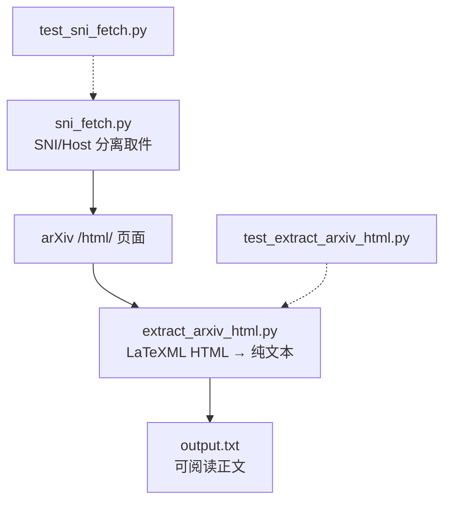
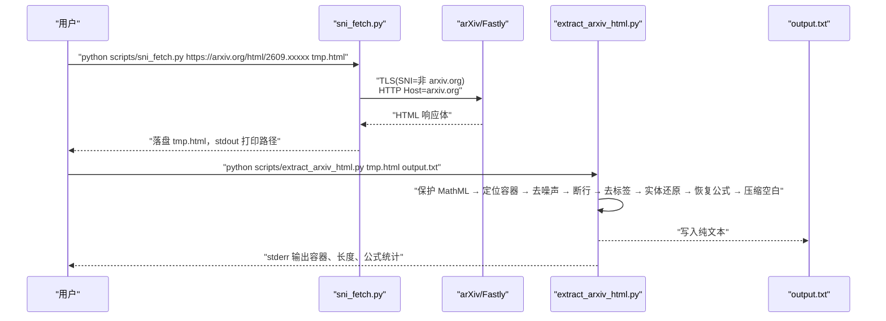
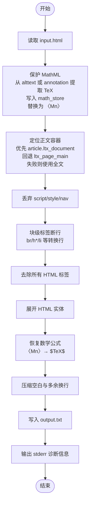
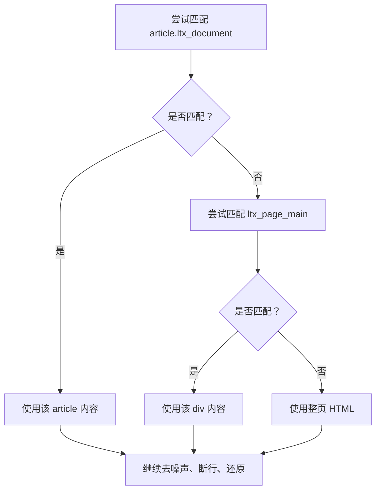
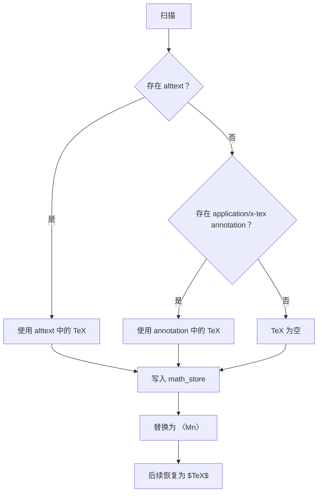
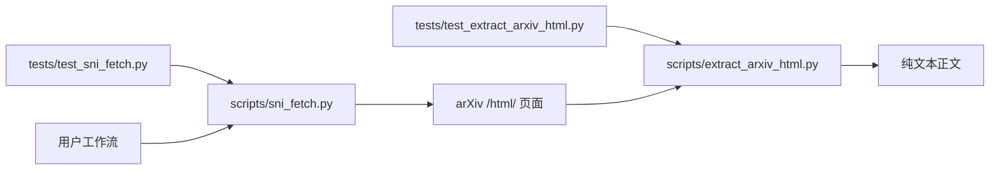

# arXiv HTML 正文抽取

<cite>
**本文引用的文件**
- [scripts/extract_arxiv_html.py](file://scripts/extract_arxiv_html.py)
- [scripts/sni_fetch.py](file://scripts/sni_fetch.py)
- [tests/test_extract_arxiv_html.py](file://tests/test_extract_arxiv_html.py)
- [tests/test_sni_fetch.py](file://tests/test_sni_fetch.py)
</cite>

## 目录
1. [引言](#引言)
2. [项目结构](#项目结构)
3. [核心组件](#核心组件)
4. [架构总览](#架构总览)
5. [详细组件分析](#详细组件分析)
6. [依赖关系分析](#依赖关系分析)
7. [性能考量](#性能考量)
8. [故障排查指南](#故障排查指南)
9. [结论](#结论)
10. [附录：用法与样例](#附录用法与样例)

## 引言
本说明聚焦 `scripts/extract_arxiv_html.py`，其目标是把 arXiv `/html/` 版（LaTeXML 产物）转为可读纯文本。典型使用场景是：先用 `sni_fetch.py` 绕过对 SNI 关键字的 TLS RST 阻断、抓取 arXiv 页面，再交给 `extract_arxiv_html.py` 提取正文，供卡片写作等下游消费。

该脚本的核心处理链为：
1. 保护 MathML 公式：从 `<math>` 的 `alttext` 或 `<annotation encoding="application/x-tex">` 中提取 TeX，用 `〈Mn〉` 占位符暂存后原位还原。
2. 定位正文容器：优先匹配 `article.ltx_document`，回退到 `ltx_page_main`，仍失败则整页作为正文。
3. 丢弃噪声：移除 `<script>`、`<style>`、`<nav>`。
4. 断行与实体还原：按块级标签和标题断行，替换 `<br>`，展开 HTML 实体。
5. 恢复公式并压缩空白：把 `〈Mn〉` 换回 `$TeX$`，最后做空白规范化。

## 项目结构
本次文档仅涉及两个脚本及其测试用例：



**图表来源**
- [scripts/sni_fetch.py:1-166](file://scripts/sni_fetch.py#L1-L166)
- [scripts/extract_arxiv_html.py:1-74](file://scripts/extract_arxiv_html.py#L1-L74)
- [tests/test_sni_fetch.py:1-75](file://tests/test_sni_fetch.py#L1-L75)
- [tests/test_extract_arxiv_html.py:1-100](file://tests/test_extract_arxiv_html.py#L1-L100)

**章节来源**
- [scripts/extract_arxiv_html.py:1-74](file://scripts/extract_arxiv_html.py#L1-L74)
- [scripts/sni_fetch.py:1-166](file://scripts/sni_fetch.py#L1-L166)
- [tests/test_extract_arxiv_html.py:1-100](file://tests/test_extract_arxiv_html.py#L1-L100)
- [tests/test_sni_fetch.py:1-75](file://tests/test_sni_fetch.py#L1-L75)

## 核心组件

### extract_arxiv_html.py
负责把 LaTeXML 生成的 HTML 转为纯文本。关键行为包括：
- 以正则扫描 `<math ...>...</math>`，优先读取 `alttext`，否则尝试解析内嵌 `<annotation>`。
- 使用 Unicode 书名号包裹的 `〈Mn〉` 作为临时占位符，避免在后续去标签阶段丢失公式。
- 正文容器优先级：`<article class="ltx_document...">` > `<div class="ltx_page_main">` > 全文。
- 丢弃 `<script>`、`<style>`、`<nav>`；将块级闭合标签、`<br>`、标题、列表项转为换行。
- 去掉所有剩余标签，展开 HTML 实体，恢复公式占位符，压缩空白。
- 诊断信息输出至标准错误：是否匹配容器、正文长度、占位符数量及空公式数量。

**章节来源**
- [scripts/extract_arxiv_html.py:1-74](file://scripts/extract_arxiv_html.py#L1-L74)

### sni_fetch.py
提供域名前置（domain fronting）式抓取能力，用于绕过某些网络环境对 SNI 中出现 `arxiv.org` 的直接 RST 阻断：
- 通过自定义 SSL socket，把握手时的 SNI 设为无关域名，同时在 HTTP 请求头中保留真实 Host。
- 支持 chunked 解码、gzip 解压、HTTP 重定向跳转。
- 成功时返回退出码 0，并把响应体写入指定路径；失败时不写空文件。

**章节来源**
- [scripts/sni_fetch.py:1-166](file://scripts/sni_fetch.py#L1-L166)

## 架构总览
完整链路如下：先由 `sni_fetch.py` 获取 arXiv 的 `/html/` 页面，再由 `extract_arxiv_html.py` 提取正文。



**图表来源**
- [scripts/sni_fetch.py:60-166](file://scripts/sni_fetch.py#L60-L166)
- [scripts/extract_arxiv_html.py:9-74](file://scripts/extract_arxiv_html.py#L9-L74)

## 详细组件分析

### 正文抽取流程
`extract_arxiv_html.py` 的处理顺序决定最终文本质量，尤其是公式保真与容器裁剪。



**图表来源**
- [scripts/extract_arxiv_html.py:9-74](file://scripts/extract_arxiv_html.py#L9-L74)

**章节来源**
- [scripts/extract_arxiv_html.py:9-74](file://scripts/extract_arxiv_html.py#L9-L74)

### 正文容器降级策略
脚本对容器匹配采用明确优先级：

| 优先级 | 匹配目标 | 行为 |
|---|---|---|
| 1 | `<article class="ltx_document...">` | 提取其内部内容作为正文 |
| 2 | `<div class="ltx_page_main">` | 作为兜底容器 |
| 3 | 无匹配 | 直接使用整个 HTML 字符串 |

当无法匹配 `article` 标签时，并不会报错终止，而是继续执行后续清洗流程。测试用例验证了兜底路径下公式仍可被正确还原。



**图表来源**
- [scripts/extract_arxiv_html.py:23-33](file://scripts/extract_arxiv_html.py#L23-L33)

**章节来源**
- [scripts/extract_arxiv_html.py:23-33](file://scripts/extract_arxiv_html.py#L23-L33)
- [tests/test_extract_arxiv_html.py:63-79](file://tests/test_extract_arxiv_html.py#L63-L79)

### 公式保护与还原
公式处理是该脚本最容易静默丢数据的位置，因此实现上做了双重保护：

1. 第一次正则扫描 `<math ...>...</math>`，提取 TeX 并写入 `math_store`。
2. 用 `〈Mn〉` 占位符替换原 `<math>` 节点，使后续去标签不会破坏公式。
3. 最后再用正则匹配 `〈Mn〉`，从 `math_store` 取出 TeX，包装成 `$TeX$`。
4. 若 TeX 为空，则替换为空格，避免留下 `$$` 或残留占位符。

测试覆盖了三种情况：
- 有 `alttext` 时优先使用。
- 无 `alttext` 时回落到 `<annotation>`。
- 两者皆空的公式不得留下占位符。



**图表来源**
- [scripts/extract_arxiv_html.py:12-22](file://scripts/extract_arxiv_html.py#L12-L22)
- [scripts/extract_arxiv_html.py:48-57](file://scripts/extract_arxiv_html.py#L48-L57)

**章节来源**
- [scripts/extract_arxiv_html.py:12-22](file://scripts/extract_arxiv_html.py#L12-L22)
- [scripts/extract_arxiv_html.py:48-57](file://scripts/extract_arxiv_html.py#L48-L57)
- [tests/test_extract_arxiv_html.py:31-59](file://tests/test_extract_arxiv_html.py#L31-L59)

### 噪声清理与排版还原
脚本在去标签前会进行结构化排版：
- 删除 `<script>`、`<style>`、`<nav>`。
- 把常见块级元素闭合标签、`<br>`、标题、列表项转换为换行。
- 标题前插入三段式标记，便于后续文本渲染。
- 最后统一去掉标签、展开实体、压缩空白。

注意：`<nav>` 是在“去标签”之前显式替换为空格处理的，但当前实现只显式替换了 `<script>` 和 `<style>`；`<nav>` 的实际消除更多依赖后续整体去标签步骤。

**章节来源**
- [scripts/extract_arxiv_html.py:35-47](file://scripts/extract_arxiv_html.py#L35-L47)

### SNI 抓取流程
`sni_fetch.py` 的关键点是：
- 使用 `ssl.create_default_context()` 并关闭主机名校验。
- 手动建立 TCP 连接，再用 `wrap_socket(server_hostname=sni)` 设置 SNI。
- HTTP 请求中 `Host` 头保持真实域名。
- 支持 chunked 解码、gzip 解压、最多 6 次重定向。
- 成功落盘后 stdout 输出路径，stderr 输出状态、字节数、类型等信息。

```mermaid
sequenceDiagram
    participant CLI as "命令行"
    participant Main as "main()"
    participant Loop as "snifetch 循环"
    participant Socket as "SSL Socket"
    participant Server as "arXiv/Fastly"

    CLI->>Main: "解析 url、out_path、--sni、--ip"
    Main->>Loop: "最多 MAX_REDIRECTS 次"
    Loop->>Socket: "connect(ip, 443)"
    Socket->>Server: "TLS handshake with server_hostname=sni"
    Socket->>Server: "GET path Host=真实域名"
    Server-->>Socket: "HTTP 响应"
    Socket-->>Loop: "status, headers, body"
    Loop->>Loop: "判断 3xx 重定向"
    Loop->>Loop: "chunked/gzip 处理"
    Loop->>CLI: "stdout 输出 out_path"
```

**图表来源**
- [scripts/sni_fetch.py:60-166](file://scripts/sni_fetch.py#L60-L166)

**章节来源**
- [scripts/sni_fetch.py:60-166](file://scripts/sni_fetch.py#L60-L166)
- [tests/test_sni_fetch.py:24-75](file://tests/test_sni_fetch.py#L24-L75)

## 依赖关系分析



- `extract_arxiv_html.py` 仅依赖 Python 标准库：`re`、`sys`、`html`、`os`。
- `sni_fetch.py` 依赖 `socket`、`ssl`、`zlib`、`urllib.parse` 等标准库。
- 两个脚本之间没有代码级 import 依赖，而是通过文件系统串联。

**图表来源**
- [scripts/extract_arxiv_html.py:9-10](file://scripts/extract_arxiv_html.py#L9-L10)
- [scripts/sni_fetch.py:18-27](file://scripts/sni_fetch.py#L18-L27)

**章节来源**
- [scripts/extract_arxiv_html.py:9-10](file://scripts/extract_arxiv_html.py#L9-L10)
- [scripts/sni_fetch.py:18-27](file://scripts/sni_fetch.py#L18-L27)

## 性能考量
- 全文一次性读入内存：适合 arXiv HTML 页面的常规体积，但对超大页面会有线性内存占用。
- 多轮正则替换：保护公式、定位容器、去脚本样式、断行、去标签、实体还原、恢复公式、压缩空白，每轮都是 O(n)。
- 公式数量通常远小于页面规模，因此 `math_store` 的空间开销一般可忽略。
- 优化方向：
  - 若需处理极大页面，可考虑分块或基于解析器逐步构建正文。
  - 减少不必要的中间字符串复制，例如合并相邻的正则替换。
  - 对 `<math>` 数量较多的页面，预编译正则表达式可降低重复编译开销。

[本节为通用性能讨论，不直接分析具体代码片段]

## 故障排查指南

### 常见问题
| 现象 | 可能原因 | 排查方法 |
|---|---|---|
| 输出正文中没有公式 | MathML 未正确保护或还原 | 检查 stderr 中 `math_placeholders` 和 `empty_math` |
| 正文出现大量 `〈Mn〉` | 公式还原失败 | 确认输入确实包含 `<math>` 且含 `alttext` 或 `annotation` |
| 导航、页脚噪声进入正文 | 未匹配到 `article.ltx_document` | 查看 stderr 中 `container matched = False` |
| 正文极短或为空 | 容器匹配到空内容，或页面格式变化 | 检查输入 HTML 是否仍为 LaTeXML `/html/` 结构 |
| 抓取失败 ConnectionResetError | 本地网络阻断 arXiv 的 SNI | 使用 `sni_fetch.py`，并通过 `--sni` 切换边缘 SNI |
| 抓到的文件不是预期类型 | 服务器返回 PDF 或其他类型 | 查看 stderr 中 `content-type` 与 `bytes` |

### 诊断信息
`extract_arxiv_html.py` 的标准错误输出包括：
- `[info] container matched = True/False len = N`：表示是否匹配到首选容器以及正文长度。
- `[out] output.txt N chars`：输出文件路径与字符数。
- `math_placeholders = N empty_math = M`：占位符总数与 TeX 为空的公式数量。

`sni_fetch.py` 的标准错误输出包括：
- `[fetch] URL ip=... sni=...`
- `[status] HTTP code bytes=N type=...`
- `[redirect N] -> URL`
- `[ok] 已保存 path（N 字节，magic=...）`
- `[fail] ...`

**章节来源**
- [scripts/extract_arxiv_html.py:33-33](file://scripts/extract_arxiv_html.py#L33-L33)
- [scripts/extract_arxiv_html.py:66-74](file://scripts/extract_arxiv_html.py#L66-L74)
- [scripts/sni_fetch.py:112-166](file://scripts/sni_fetch.py#L112-L166)

## 结论
`extract_arxiv_html.py` 是一个针对 arXiv LaTeXML HTML 的轻量正文抽取工具。它通过 MathML 保护、容器裁剪、结构化断行、实体还原和空白压缩，把 HTML 转化为可直接消费的纯文本。配合 `sni_fetch.py`，可以绕过部分网络环境对 arXiv 的 SNI 阻断，形成完整的抓取—抽取—写作链路。

关键要点：
- 公式保真是首要目标，实现上使用 `〈Mn〉` 占位符避免静默丢数据。
- 容器匹配失败不会崩溃，而是降级使用更宽泛的容器或整页。
- 所有诊断信息走 stderr，方便管道集成与日志分析。
- 测试用例覆盖 alttext、annotation、空公式、容器裁剪、断行、实体还原等关键路径。

[本节为总结性内容，不直接分析具体代码片段]

## 附录：用法与样例

### 完整链路
1. 使用 `sni_fetch.py` 抓取 arXiv `/html/` 页面：
   ```
   python scripts/sni_fetch.py https://arxiv.org/html/2609.xxxxx tmp.html
   ```
2. 使用 `extract_arxiv_html.py` 提取正文：
   ```
   python scripts/extract_arxiv_html.py tmp.html output.txt
   ```

### 运行入口
`extract_arxiv_html.py` 的主入口在 `__main__` 分支，直接调用 `extract(sys.argv[1], sys.argv[2])`。

**章节来源**
- [scripts/extract_arxiv_html.py:70-74](file://scripts/extract_arxiv_html.py#L70-L74)

### 典型输入特征
根据测试样例，典型输入应包含：
- `<article class="ltx_document ...">` 包裹正文。
- `<nav>`、`<footer>` 等外部噪声。
- `<math alttext="...">` 或带 `<annotation encoding="application/x-tex">` 的公式。
- HTML 实体如 `&amp;`、`&lt;`。

测试样例路径参考：
- [tests/test_extract_arxiv_html.py:31-59](file://tests/test_extract_arxiv_html.py#L31-L59)

### 典型输出特征
期望输出应满足：
- 不包含导航、页脚噪声。
- 标题位于独立行，或以段落开头。
- 公式以 `$TeX$` 形式出现。
- 空公式不留下 `〈Mn〉` 或 `$$`。
- HTML 实体已展开。

测试断言参考：
- [tests/test_extract_arxiv_html.py:51-79](file://tests/test_extract_arxiv_html.py#L51-L79)

### 无法匹配 article 标签时的行为
当找不到 `article.ltx_document` 时，脚本尝试匹配 `ltx_page_main`；若仍失败，则使用整页 HTML 作为正文继续清洗。测试用例验证了这种兜底路径仍能正确还原公式。

**章节来源**
- [scripts/extract_arxiv_html.py:23-33](file://scripts/extract_arxiv_html.py#L23-L33)
- [tests/test_extract_arxiv_html.py:63-79](file://tests/test_extract_arxiv_html.py#L63-L79)