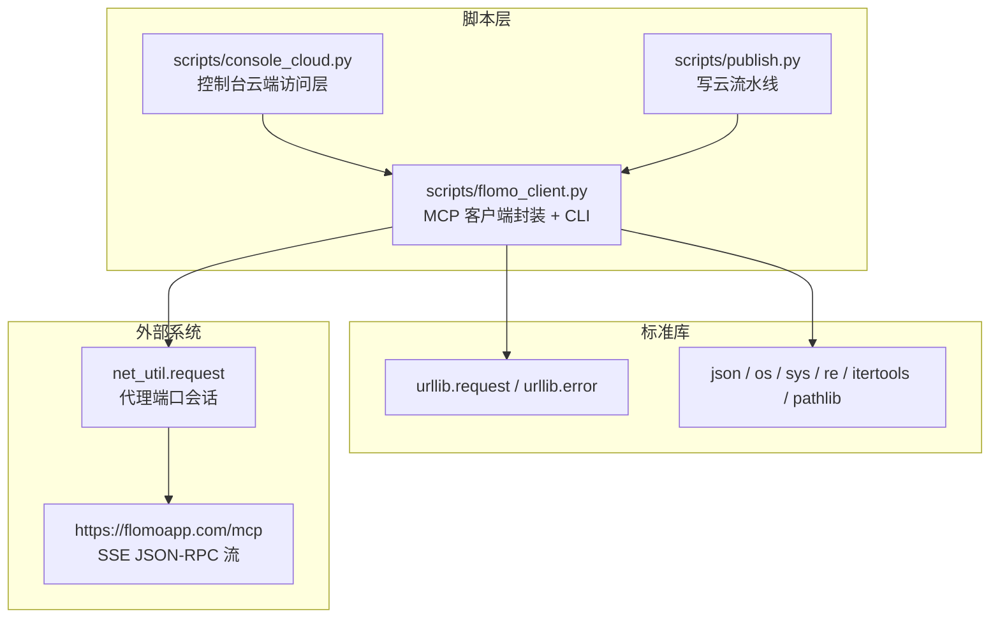
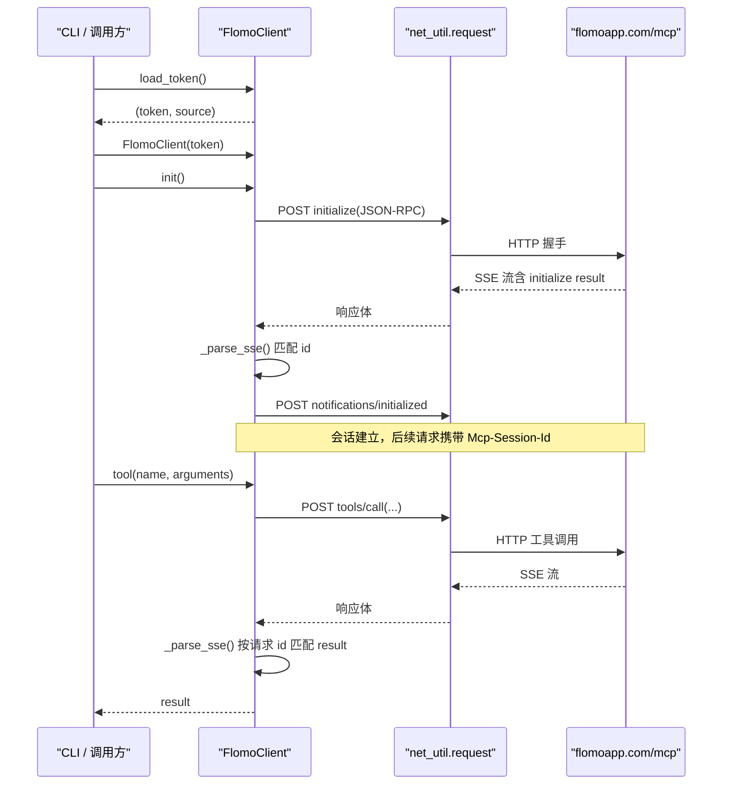
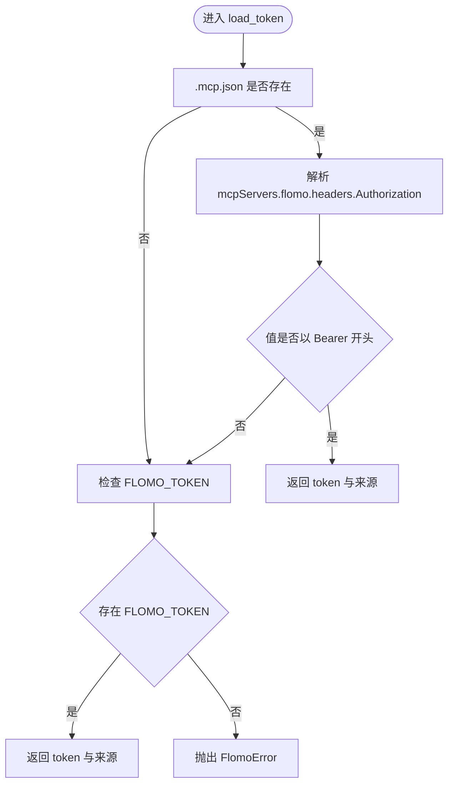
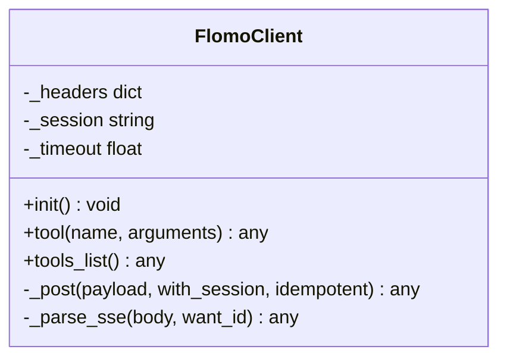
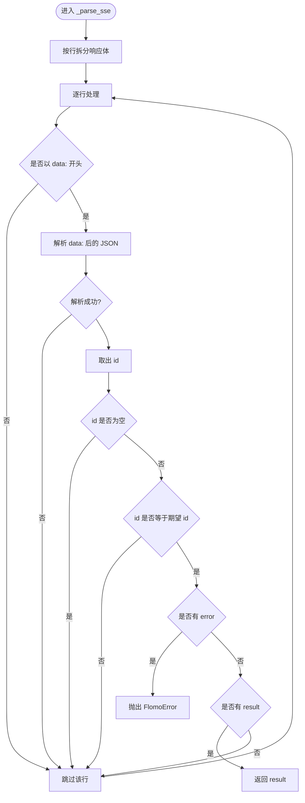
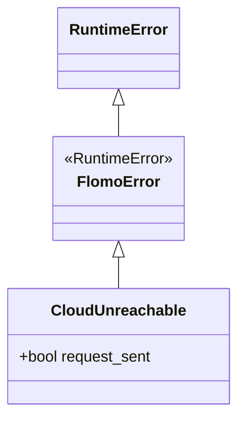
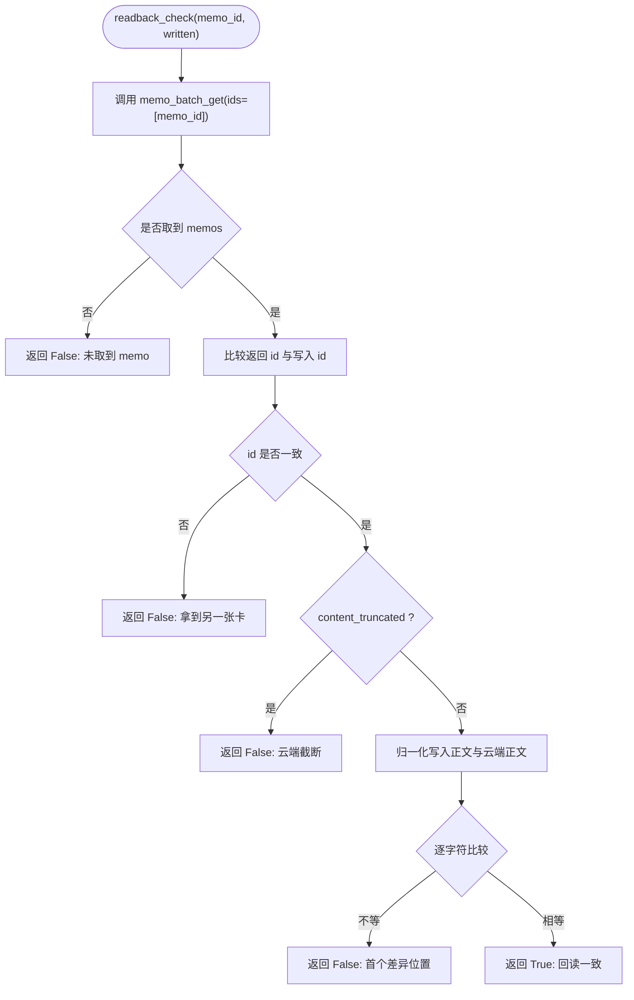
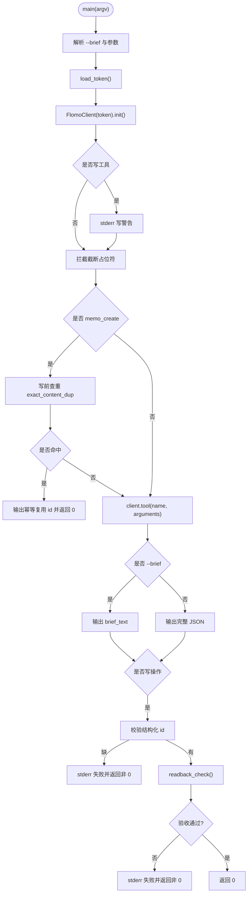
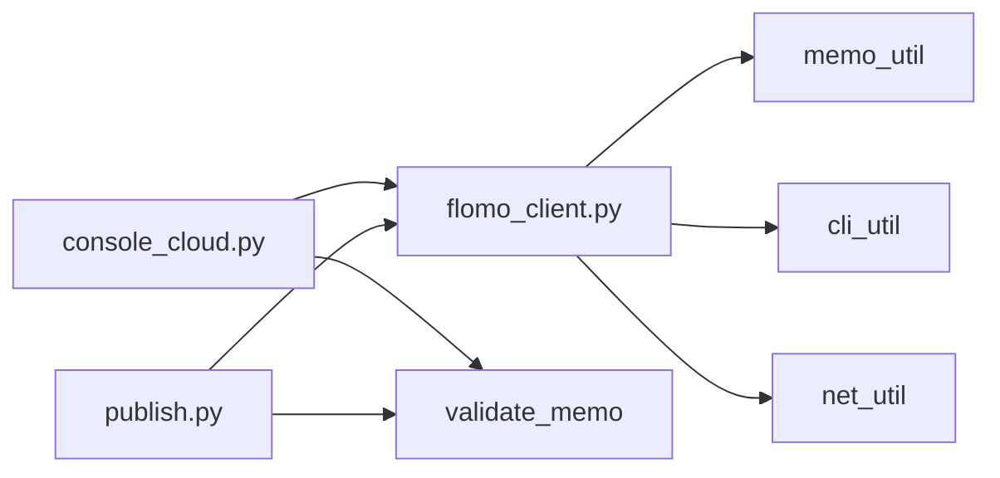
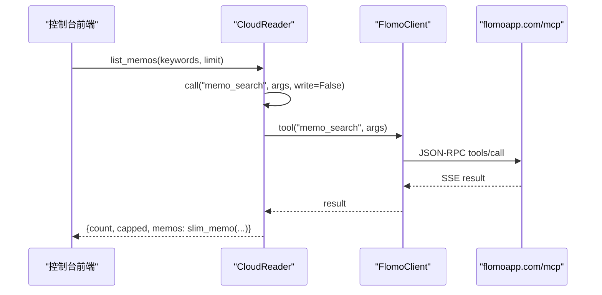

# flomo MCP 集成

<cite>
**本文引用的文件**
- [scripts/flomo_client.py](file://scripts/flomo_client.py)
- [scripts/console_cloud.py](file://scripts/console_cloud.py)
- [scripts/publish.py](file://scripts/publish.py)
</cite>

## 目录
1. [简介](#简介)
2. [项目结构](#项目结构)
3. [核心组件](#核心组件)
4. [架构总览](#架构总览)
5. [详细组件分析](#详细组件分析)
6. [依赖关系分析](#依赖关系分析)
7. [性能与行为特性](#性能与行为特性)
8. [最小可运行示例](#最小可运行示例)
9. [常见失败场景与排查](#常见失败场景与排查)
10. [对 console_cloud.py 与 publish.py 的调用契约](#对-console_cloudpy-与-publishpy-的调用契约)
11. [结论](#结论)

## 简介
本模块在 TRAE 无 MCP 面板、`.mcp.json` 不会被自动加载的环境下，用 Python 标准库直接对接 `https://flomoapp.com/mcp` 的 streamable-http/MCP 通道：完成握手、Bearer Token 鉴权、协议发现、工具枚举与 `memo_search` / `tag_tree` / `memo_create` / `memo_update` / `memo_batch_get` 等工具调用。它同时承担 CLI 脚本入口和可复用库的双重职责：命令行参数错误通过专用用法异常表达，云端/网络/协议错误统一收敛为 `FlomoError` 及其子类，便于被 `console_cloud.py` 与 `publish.py` 安全复用。

## 项目结构


**图示来源**
- [scripts/flomo_client.py:1-30](file://scripts/flomo_client.py#L1-L30)
- [scripts/console_cloud.py:1-60](file://scripts/console_cloud.py#L1-L60)
- [scripts/publish.py:1-40](file://scripts/publish.py#L1-L40)

**章节来源**
- [scripts/flomo_client.py:1-30](file://scripts/flomo_client.py#L1-L30)
- [scripts/console_cloud.py:1-60](file://scripts/console_cloud.py#L1-L60)
- [scripts/publish.py:1-40](file://scripts/publish.py#L1-L40)

## 核心组件
- **FlomoClient**：负责建立连接、发送 JSON-RPC 请求、解析 SSE 响应、维护会话 ID、调用工具。
- **FlomoError / CloudUnreachable**：异常模型；前者表示凭据缺失、HTTP 错误或 JSON-RPC 协议错误，后者区分“出网通道不可达”并携带 `request_sent` 标记。
- **load_token()**：Token 读取策略（`.mcp.json` 优先，`FLOMO_TOKEN` 后备）。
- **WRITE_TOOLS**：非幂等写工具集合，用于禁止重发。
- **brief_text()**：`--brief` 模式下的列表型回包压缩器。
- **readback_check()**：写后按 id 拉取全文逐字比对。
- **CloudReader**：`console_cloud.py` 中基于 `FlomoClient` 的只读/写入抽象，提供白名单、闸门、回读验收等上层契约。

**章节来源**
- [scripts/flomo_client.py:1-30](file://scripts/flomo_client.py#L1-L30)
- [scripts/flomo_client.py:55-120](file://scripts/flomo_client.py#L55-L120)
- [scripts/flomo_client.py:121-210](file://scripts/flomo_client.py#L121-L210)
- [scripts/flomo_client.py:300-380](file://scripts/flomo_client.py#L300-L380)
- [scripts/flomo_client.py:451-681](file://scripts/flomo_client.py#L451-L681)
- [scripts/console_cloud.py:1-120](file://scripts/console_cloud.py#L1-L120)

## 架构总览


**图示来源**
- [scripts/flomo_client.py:121-210](file://scripts/flomo_client.py#L121-L210)
- [scripts/flomo_client.py:201-240](file://scripts/flomo_client.py#L201-L240)

## 详细组件分析

### Token 获取与鉴权
- 优先级：
  1. 项目根 `.mcp.json` 的 `mcpServers.flomo.headers.Authorization`，需以 `Bearer ` 开头。
  2. 环境变量 `FLOMO_TOKEN`。
- 都找不到时抛出 `FlomoError`，不抛 `SystemExit`。
- 建立 `FlomoClient` 时把 `Authorization: Bearer <token>` 写入请求头。



**图示来源**
- [scripts/flomo_client.py:55-100](file://scripts/flomo_client.py#L55-L100)

**章节来源**
- [scripts/flomo_client.py:55-100](file://scripts/flomo_client.py#L55-L100)

### 握手、协议发现与工具调用
- 握手流程：
  - 先发送 `initialize`，携带 `protocolVersion`、空 `capabilities` 与 `clientInfo`。
  - 再发送单向通知 `notifications/initialized`。
  - 服务端可能返回 `Mcp-Session-Id`，客户端在后续请求中带上。
- 协议发现：
  - 使用 JSON-RPC 方法 `tools/list`，不是普通工具，因此不受工具白名单限制。
- 工具调用：
  - 统一走 `tools/call`，传入工具名与参数字典。
  - 非 `WRITE_TOOLS` 的工具允许在网络失败时换出口重试；写工具一律不重发。



**图示来源**
- [scripts/flomo_client.py:121-210](file://scripts/flomo_client.py#L121-L210)
- [scripts/flomo_client.py:201-240](file://scripts/flomo_client.py#L201-L240)

**章节来源**
- [scripts/flomo_client.py:121-210](file://scripts/flomo_client.py#L121-L210)
- [scripts/flomo_client.py:201-240](file://scripts/flomo_client.py#L201-L240)

### SSE 流式响应解析
- 响应体是 `data:` 行组成的流，每行包含一个 JSON-RPC 对象。
- `_parse_sse` 按请求显式传入的 `id` 匹配结果，避免误拿并发或通知中的其他 id。
- 遇到 `error` 字段直接抛 `FlomoError`。
- 没有 `result` 且不是本次请求 id 的消息视为正常空响应（如初始化通知）。



**图示来源**
- [scripts/flomo_client.py:140-180](file://scripts/flomo_client.py#L140-L180)

**章节来源**
- [scripts/flomo_client.py:140-180](file://scripts/flomo_client.py#L140-L180)

### 异常模型：FlomoError 与 CloudUnreachable
- `FlomoError`：所有“无法进行”的调用失败集中类型，包括凭据缺失、HTTP 错误、JSON-RPC 协议错误、工具级错误。
- `CloudUnreachable`：出网通道问题（连接拒绝、超时、DNS、中断），继承自 `FlomoError`，新增 `request_sent` 布尔：
  - `False`：确定未发出，可换通道重试。
  - `True`：可能已到达服务端，严禁重发写操作。
- 设计要点：不使用 `SystemExit` 作为业务失败，因为它是 `BaseException`，会绕过 `except Exception`，在服务端表现为连接中断且错误信息丢失。



**图示来源**
- [scripts/flomo_client.py:55-120](file://scripts/flomo_client.py#L55-L120)

**章节来源**
- [scripts/flomo_client.py:55-120](file://scripts/flomo_client.py#L55-L120)

### 幂等与非幂等工具：WRITE_TOOLS
- 非幂等写工具集合：`memo_create`、`memo_update`、`tag_rename`。
- 判定逻辑：`name not in WRITE_TOOLS` 即视为幂等，允许网络失败时换出口重试。
- 原因：
  - `memo_create` 签名幂等靠检索索引，但索引有滞后窗口，重发会创建重复卡。
  - `memo_update` 是覆盖更新，重发可能改写不同版本。
  - 未登记的新工具默认落入非幂等侧，宁可多报错也不冒重复写风险。

**章节来源**
- [scripts/flomo_client.py:25-40](file://scripts/flomo_client.py#L25-L40)
- [scripts/flomo_client.py:201-210](file://scripts/flomo_client.py#L201-L210)

### 写后回读验收：readback_check
- 写操作成功后，立即调用 `memo_batch_get` 拉取对应 id 的全文。
- 校验顺序：
  1. 必须取到 memos。
  2. 返回的 id 必须与写入 id 一致。
  3. 若 `content_truncated` 为真，直接判失败。
  4. 归一化正文后逐字符比对。
- 归一化忽略平台渲染差异：
  - Markdown 元字符反斜杠转义还原。
  - 裸邮箱自动链接化还原。
  - 空白与行内代码边界空格忽略。
- 不一致、取不到、被截断均返回 `(False, detail)`，CLI 退出码非 0，且不鼓励重发。



**图示来源**
- [scripts/flomo_client.py:400-470](file://scripts/flomo_client.py#L400-L470)

**章节来源**
- [scripts/flomo_client.py:360-470](file://scripts/flomo_client.py#L360-L470)

### --brief 模式的列表型压缩策略
- 目标：查重、复盘时只看“有哪些卡”，避免每次输出 27–55 KB 原始 JSON。
- 规则：
  - `memos` 列表：输出条目数、每条卡的 id、字数、标签、前两行概念名签名。
  - `memo_batch_get` 例外：不走摘要分支，始终输出完整正文，绝不截断。
  - 单卡回包：输出 id、字数、标签、链接/图片标志。
  - 标签树：输出 total/returned 与最多前 30 项。
  - 其他形态返回 `None`，调用方退回完整 JSON。

**章节来源**
- [scripts/flomo_client.py:300-360](file://scripts/flomo_client.py#L300-L360)

### CLI 参数解析与主流程
- 参数格式：`python scripts/flomo_client.py <tool名> ['{"参数":值}'] [--brief]`。
- `--file` 支持从文件读取参数 JSON。
- 参数写错抛 `UsageError`（`FlomoError` 子类），由入口转为用法退出码。
- 主流程：
  1. 解析参数。
  2. 读取 token。
  3. 建立 `FlomoClient` 并握手。
  4. 写工具打印注意提示。
  5. `memo_create` / `memo_update` 拦截正文中的截断占位符。
  6. `memo_create` 执行写前查重，命中则复用既有 id。
  7. 调用工具，按需输出 brief 或完整 JSON。
  8. 写操作校验结构化 id，并强制 `readback_check`。



**图示来源**
- [scripts/flomo_client.py:470-681](file://scripts/flomo_client.py#L470-L681)

**章节来源**
- [scripts/flomo_client.py:470-681](file://scripts/flomo_client.py#L470-L681)

## 依赖关系分析


**图示来源**
- [scripts/flomo_client.py:15-30](file://scripts/flomo_client.py#L15-L30)
- [scripts/console_cloud.py:1-60](file://scripts/console_cloud.py#L1-L60)
- [scripts/publish.py:1-40](file://scripts/publish.py#L1-L40)

**章节来源**
- [scripts/flomo_client.py:15-30](file://scripts/flomo_client.py#L15-L30)
- [scripts/console_cloud.py:1-60](file://scripts/console_cloud.py#L1-L60)
- [scripts/publish.py:1-40](file://scripts/publish.py#L1-L40)

## 性能与行为特性
- **纯标准库实现**：仅依赖 `urllib`、`json`、`os`、`sys`、`re`、`itertools`、`pathlib`，无需安装第三方 MCP SDK。
- **SSE 流式处理**：逐行扫描 `data:` 行，时间复杂度与响应行数线性相关；按 id 精确匹配，避免误匹配并发消息。
- **列表压缩**：`--brief` 避免每次传输完整正文，适合高频查重与审计。
- **会话保持**：服务端返回 `Mcp-Session-Id` 后复用，减少重复握手开销。
- **幂等保护**：`memo_create` 写前查重，利用概念名关键词搜索与签名比对，降低索引滞后带来的重复建卡风险。
- **写后验收**：写操作完成后强制回读全文比对，防止“拿到 id 不等于内容落库正确”。

[本节为通用行为说明，不直接分析具体代码片段]

## 最小可运行示例
以下命令假设已在项目根目录配置好 `.mcp.json` 或设置 `FLOMO_TOKEN`，并能访问 `https://flomoapp.com/mcp`。

- 列出标签树：
  ```
  python scripts/flomo_client.py tag_tree
  ```
- 搜索卡片（关键词查询）：
  ```
  python scripts/flomo_client.py memo_search '{"keywords":"...","limit":10}'
  ```
- 新建卡片：
  ```
  python scripts/flomo_client.py memo_create '{"content":"..."}'
  ```
- 使用 brief 模式压缩列表型回包：
  ```
  python scripts/flomo_client.py memo_search '{"keywords":"...","limit":10}' --brief
  ```
- 从文件读取参数：
  ```
  python scripts/flomo_client.py memo_create --file params.json
  ```

注意事项：
- 写操作会在 stderr 输出 `[注意] ... 是写操作，调用前应已征得用户明确授权`。
- `memo_create` 成功后还会输出 `[成功] 已写入 memo id=...` 与 `[验收] 回读一致（...字）` 或失败详情。
- 参数写错不会发起握手，而是尽早报用法错误。

**章节来源**
- [scripts/flomo_client.py:1-30](file://scripts/flomo_client.py#L1-L30)
- [scripts/flomo_client.py:470-681](file://scripts/flomo_client.py#L470-L681)

## 常见失败场景与排查
| 场景 | 表现 | 原因 | 排查方法 |
|---|---|---|---|
| Token 缺失 | 启动时报 `FlomoError`，提示未找到 flomo token | `.mcp.json` 不存在或结构不对，且未设置 `FLOMO_TOKEN` | 检查 `.mcp.json` 的 `mcpServers.flomo.headers.Authorization`，或以 `Export FLOMO_TOKEN=...` 补充 |
| `.mcp.json` 结构错误 | Token 读取失败，退回到环境变量 | JSON 解析失败或缺少键 | 确认 JSON 合法且路径正确 |
| 握手失败 | 调用工具前失败 | `initialize` 或 `notifications/initialized` 返回 JSON-RPC error | 检查网络可达、代理配置、服务端可用性 |
| HTTP 错误 | 抛出 `FlomoError("HTTP ...")` | 服务端返回非 2xx | 查看状态码与响应体；确认 endpoint 与鉴权 |
| JSON-RPC 协议错误 | 抛出 `FlomoError("MCP error: ...")` | 工具返回 `error` 字段 | 根据错误信息修正参数或工具名 |
| 云端截断正文 | `readback_check` 失败，提示被截断 | `content_truncated=True` | 不要据此重发写请求；人工核对云端全文 |
| 写后 id 不一致 | 回读拿到另一张卡 | id 抄错或云端映射异常 | 人工核对 id，禁止重发 |
| 写后正文不一致 | 回读比对失败，给出首个差异位置 | 平台渲染差异未完全宽容，或内容确实变化 | 检查 Markdown 转义、邮箱链接化、行内代码空格；必要时重新成稿 |
| 写前查重命中 | 输出幂等复用 id 并返回 0 | 已有相同签名的卡片 | 确认是否应复用；如需新建，调整正文使签名变化 |
| 正文含截断占位符 | 写操作提前返回退出码 4 | 待写内容来自检索类回包，已被挖空 | 改用 `memo_batch_get` 拉全文后重新成稿 |
| 参数写错 | 早期报 `UsageError`，提示 JSON 解析位置 | 传入了非法 JSON 或非对象 | 按用法传 `{}` 对象，长参数用 `--file` |
| 出网通道不可达 | 抛出 `CloudUnreachable` | DNS/连接拒绝/超时/中断 | 区分 `request_sent`：False 可换通道重试；True 禁止重发写请求 |

**章节来源**
- [scripts/flomo_client.py:55-120](file://scripts/flomo_client.py#L55-L120)
- [scripts/flomo_client.py:121-210](file://scripts/flomo_client.py#L121-L210)
- [scripts/flomo_client.py:300-360](file://scripts/flomo_client.py#L300-L360)
- [scripts/flomo_client.py:400-470](file://scripts/flomo_client.py#L400-L470)
- [scripts/flomo_client.py:470-681](file://scripts/flomo_client.py#L470-L681)

## 对 console_cloud.py 与 publish.py 的调用契约

### console_cloud.py 的契约
- 导入 `FlomoClient`、`FlomoError`、`_result_memos`、`load_token`、`tool_data_or_none`。
- 定义两套白名单：
  - `READONLY_TOOLS`：只放行读工具。
  - `WRITE_TOOLS`：只放行写工具，且必须显式 `write=True`。
- `CloudReader.call()`：
  - 越权调用抛 `CloudError`。
  - 所有异常统一转为 `CloudError`，包括 `SystemExit`，保证 HTTP 服务层能捕获并返回错误。
  - 失败后重置会话，下次请求重建连接。
- 读能力：
  - `list_memos` → `memo_search`
  - `memo_detail` / `memo_batch` → `memo_batch_get`
  - `recommended` → `memo_recommended`
  - `daily_review` → `get_daily_review`
  - `tag_tree` / `tag_names` → `tag_tree` / `tag_search`
  - `memory_doc` / `user_profile` / `format_guide` / `tag_guide` → 参考文本工具
- 写能力：
  - `create_memo`：格式闸门 → 流程闸门 → `memo_create` → 回执取 id → 回读验收。
  - `update_memo`：先回读原文（H22）→ 格式闸门 → 流程闸门 → `memo_update` → 回读验收。
  - `rename_tag`：批量标签重命名，把云端回执读成 `ok/status/hint` 结论。



**图示来源**
- [scripts/console_cloud.py:501-560](file://scripts/console_cloud.py#L501-L560)

**章节来源**
- [scripts/console_cloud.py:1-120](file://scripts/console_cloud.py#L1-L120)
- [scripts/console_cloud.py:501-824](file://scripts/console_cloud.py#L501-L824)

### publish.py 的契约
- 导入 `flomo_client` 模块，复用其写前查重、正文归一化、云端工具调用。
- 将写云固定为一条流水线：
  1. 闸门不过，不发送任何字节。
  2. 文本质检 ERR 不写云。
  3. `memo_create` 只发一次，失败即停。
  4. 更新前先回读目标卡，比对概念名；不符需 `--allow-rename`。
  5. 更新是整篇替换，写前快照 vs 草稿做行级 diff。
  6. 写入后机器项复核，失败不重发。
- 批次模式：预检全部通过后才逐张写入；失败行保留，避免整批重来造成重复写。

**章节来源**
- [scripts/publish.py:1-40](file://scripts/publish.py#L1-L40)
- [scripts/publish.py:40-120](file://scripts/publish.py#L40-L120)

## 结论
`scripts/flomo_client.py` 是 flomo MCP 集成的核心：它以纯标准库实现握手、鉴权、SSE 解析与工具调用，并通过 `FlomoError` / `CloudUnreachable` 建立清晰的异常语义；通过 `WRITE_TOOLS` 严格区分幂等与非幂等操作，避免重发制造脏数据；通过 `readback_check` 把“拿到 id”升级为“拿到并验证正文”；通过 `--brief` 控制列表型回包的体积，兼顾可读性与审计效率。`console_cloud.py` 在其之上构建控制台读写契约与白名单，`publish.py` 在其之上固化写云流水线与闸门纪律。三者共同构成从 CLI 到控制台再到自动化发布的 flomo 云端接入层。