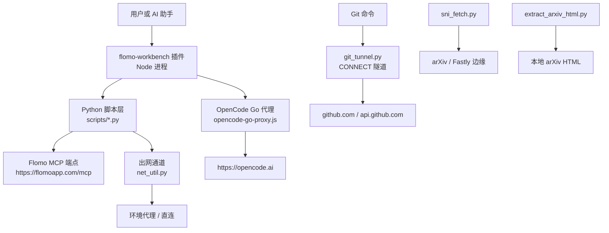
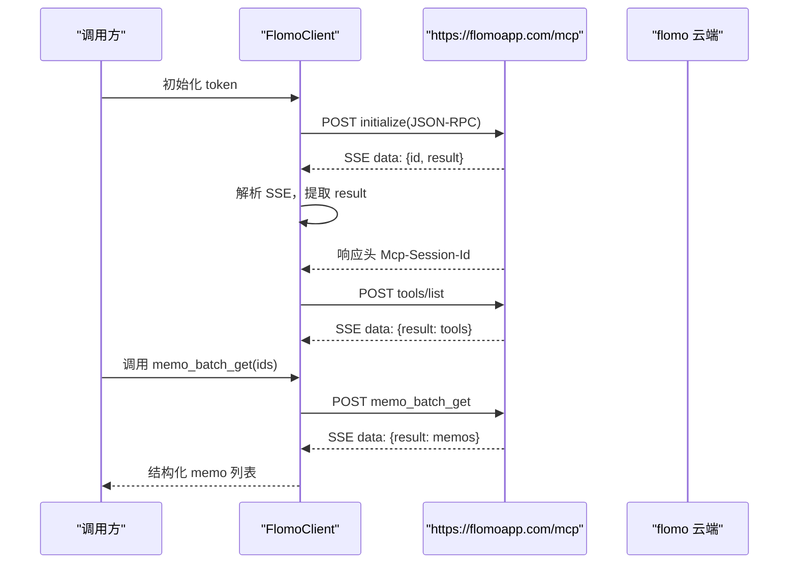
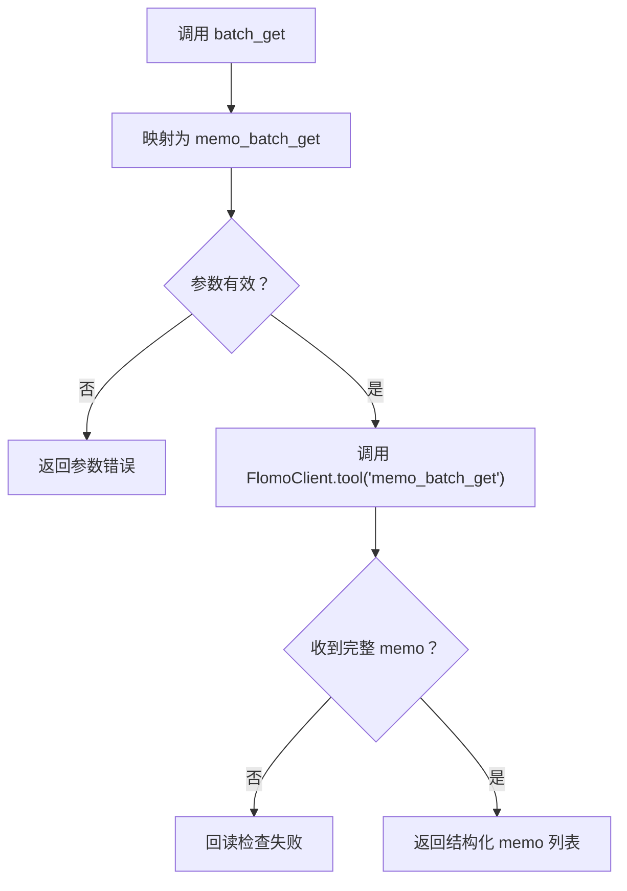
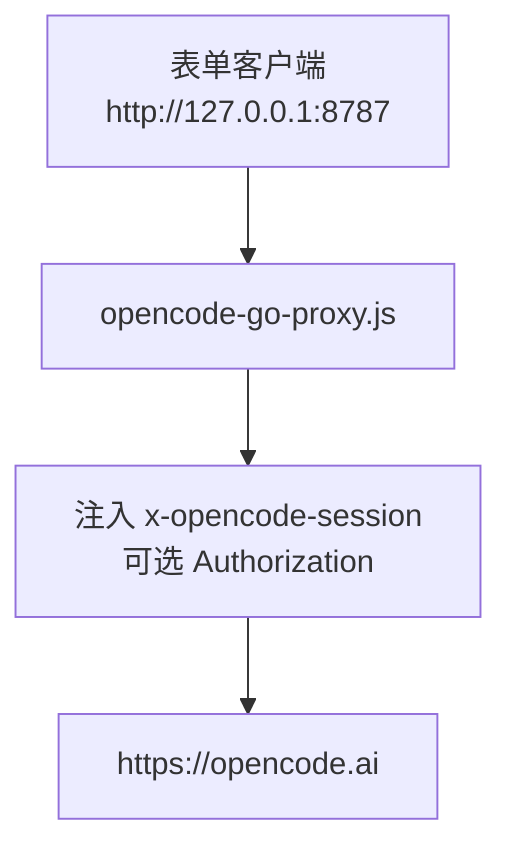
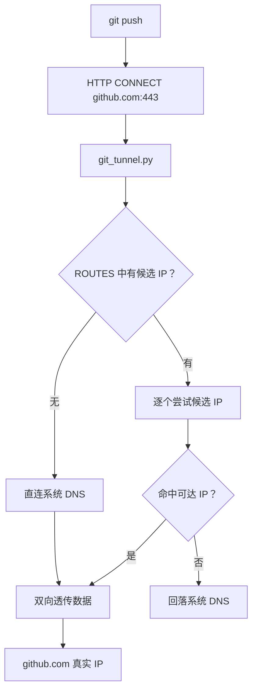
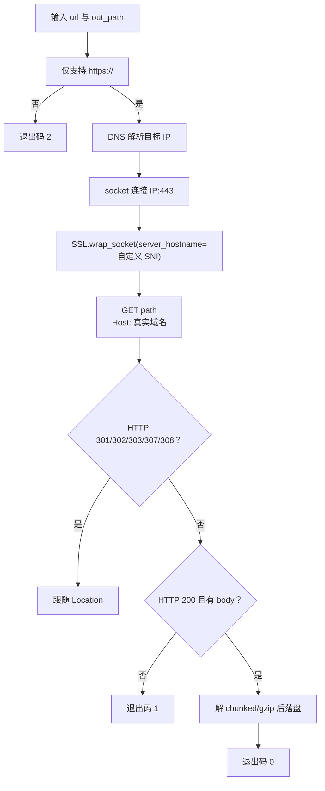
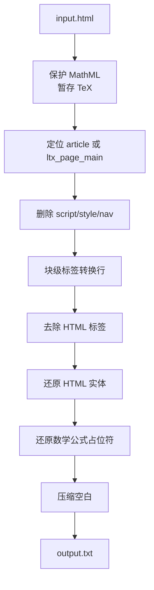
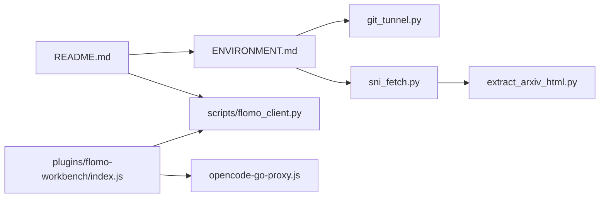

# 外部集成

<cite>
**本文引用的文件**   
- [README.md](file://README.md)
- [ENVIRONMENT.md](file://ENVIRONMENT.md)
- [opencode-go-proxy.js](file://opencode-go-proxy.js)
- [scripts/flomo_client.py](file://scripts/flomo_client.py)
- [plugins/flomo-workbench/index.js](file://plugins/flomo-workbench/index.js)
- [plugins/flomo-workbench/package.json](file://plugins/flomo-workbench/package.json)
- [scripts/git_tunnel.py](file://scripts/git_tunnel.py)
- [scripts/sni_fetch.py](file://scripts/sni_fetch.py)
- [scripts/extract_arxiv_html.py](file://scripts/extract_arxiv_html.py)
</cite>

## 目录
1. [引言](#引言)
2. [整体集成拓扑](#整体集成拓扑)
3. [Flomo MCP 集成](#flomo-mcp-集成)
4. [GitHub 推送通道与 OpenCode Go 代理](#github-推送通道与-opencode-go-代理)
5. [git_tunnel.py GitHub 隧道](#git_tunnelpy-github-隧道)
6. [sni_fetch.py SNI 阻断绕过](#sni_fetchpy-sni-阻断绕过)
7. [extract_arxiv_html.py arXiv HTML 抽取](#extract_arxiv_htmlpy-arxiv-html-抽取)
8. [依赖关系分析](#依赖关系分析)
9. [故障排查指南](#故障排查指南)
10. [结论](#结论)

## 引言
本仓库的 flomo-note 是一个“云端卡片笔记技能”，把网页、文章和想法整理成 flomo memo，并直接写入云端账号。其外部集成主要围绕四类能力展开：

| 集成 | 作用 | 关键入口 |
|---|---|---|
| Flomo MCP | 通过流式 HTTP 端点握手、发现工具、调用 `memo_batch_get` 等读写接口 | `https://flomoapp.com/mcp` |
| GitHub 推送通道 | 用 GitHub Contents API 或 `git push` 推送文档；失败时回退到本地隧道 | `scripts/git_tunnel.py`、`scripts/push_skill.sh` |
| OpenCode Go 代理 | 为表单客户端自动注入 `x-opencode-session` 头 | `opencode-go-proxy.js` |
| arXiv 取件与抽取 | 绕过 SNI 关键字阻断、下载正文后转纯文本 | `scripts/sni_fetch.py`、`scripts/extract_arxiv_html.py` |

所有凭据（token、OpenCode Key）均不入库；网络异常必须区分“连接未发出”和“可能已发出”，以避免重复写卡。

**章节来源**
- [README.md:1-120](file://README.md#L1-L120)
- [ENVIRONMENT.md:1-60](file://ENVIRONMENT.md#L1-L60)

## 整体集成拓扑



**图示来源**
- [scripts/flomo_client.py:1-120](file://scripts/flomo_client.py#L1-L120)
- [plugins/flomo-workbench/index.js:1-120](file://plugins/flomo-workbench/index.js#L1-L120)
- [opencode-go-proxy.js:1-56](file://opencode-go-proxy.js#L1-L56)
- [scripts/git_tunnel.py:1-60](file://scripts/git_tunnel.py#L1-L60)
- [scripts/sni_fetch.py:1-40](file://scripts/sni_fetch.py#L1-L40)
- [scripts/extract_arxiv_html.py:1-20](file://scripts/extract_arxiv_html.py#L1-L20)

## Flomo MCP 集成

### 协议与握手流程

Flomo MCP 采用 streamable-http + SSE 的 JSON-RPC 协议。客户端实现位于 `scripts/flomo_client.py`，核心行为包括：

1. 加载 Bearer Token。
2. 向 `https://flomoapp.com/mcp` 发送 `initialize` 请求。
3. 解析服务端返回的 SSE 流，匹配本次请求的 `id`。
4. 从响应头读取 `Mcp-Session-Id`，后续请求带上会话标识。
5. 通过 `tools/list` 发现可用工具。
6. 调用具体工具（如 `memo_search`、`memo_batch_get`、`memo_create`）。



**图示来源**
- [scripts/flomo_client.py:120-220](file://scripts/flomo_client.py#L120-L220)
- [scripts/flomo_client.py:220-320](file://scripts/flomo_client.py#L220-L320)

### Token 与鉴权

Token 解析优先级如下：

| 优先级 | 来源 | 说明 |
|---|---|---|
| 1 | `.mcp.json` 中的 `mcpServers.flomo.headers.Authorization` | 配置事实源 |
| 2 | 环境变量 `FLOMO_TOKEN` | 仅当 `.mcp.json` 不存在时使用 |
| 3 | 无 | 抛出 `FlomoError("未找到 flomo token")` |

`.mcp.json` 结构示例：

```json
{
  "mcpServers": {
    "flomo": {
      "headers": {
        "Authorization": "Bearer fmcp_xxxxx"
      }
    }
  }
}
```

鉴权请求头固定为 `Authorization: Bearer <token>`，由 `FlomoClient._headers` 统一注入。

**章节来源**
- [scripts/flomo_client.py:40-120](file://scripts/flomo_client.py#L40-L120)
- [README.md:20-40](file://README.md#L20-L40)
- [ENVIRONMENT.md:60-90](file://ENVIRONMENT.md#L60-L90)

### 协议发现与工具调用

`tools/list` 返回云端暴露的工具清单，包含名称、参数规格与接入状态。控制台前端会按此生成可执行表单，但写工具需走专属入口，不会在通用只读执行中直通。

常用工具：

| 工具 | 方向 | 用途 |
|---|---|---|
| `tag_tree` | 只读 | 获取标签树 |
| `memo_search` | 只读 | 按关键词、标签、日期搜索 |
| `memo_recommended` | 只读 | 推荐相关卡片 |
| `get_daily_review` | 只读 | 今日回顾 |
| `get_format_guide` | 只读 | 格式规范 |
| `get_tag_guide` | 只读 | 标签规范 |
| `memo_batch_get` | 只读 | 批量拉取全文（H1 要求判断正文必须取全文） |
| `memo_create` | 写 | 新建卡片 |
| `memo_update` | 写 | 覆盖既有卡片 |
| `tag_rename` | 写 | 重命名标签 |

幂等性策略：

| 类别 | 工具 | 是否允许重试 |
|---|---|---|
| 幂等 | `memo_search`、`memo_batch_get`、`tag_tree` 等 | 是 |
| 非幂等 | `memo_create`、`memo_update`、`tag_rename` | 否 |

非幂等工具失败时必须区分网络错误类型：若请求确定未发出，可换出口重试；若可能已到达服务端，则禁止重发，否则会产生第二张卡。

**章节来源**
- [scripts/flomo_client.py:1-60](file://scripts/flomo_client.py#L1-L60)
- [scripts/flomo_client.py:320-420](file://scripts/flomo_client.py#L320-L420)
- [plugins/flomo-workbench/index.js:40-90](file://plugins/flomo-workbench/index.js#L40-L90)

### `memo_batch_get` 调用规范

`memo_batch_get` 用于批量读取卡片全文。工作区插件将其映射为 `batch_get` action，且明确不启用 brief 模式，因为 H1 禁止用截断内容判断正文。

典型调用路径：



**图示来源**
- [plugins/flomo-workbench/index.js:40-90](file://plugins/flomo-workbench/index.js#L40-L90)
- [scripts/flomo_client.py:200-280](file://scripts/flomo_client.py#L200-L280)

### 最小可运行示例

```bash
# 1. 准备 .mcp.json（项目根）
cat > .mcp.json <<'EOF'
{
  "mcpServers": {
    "flomo": {
      "headers": {
        "Authorization": "Bearer fmcp_xxxxx"
      }
    }
  }
}
EOF

# 2. 测试标签树
python scripts/flomo_client.py tag_tree

# 3. 搜索卡片
python scripts/flomo_client.py memo_search '{"keywords":"政策","limit":5}'

# 4. 批量拉取全文
python scripts/flomo_client.py memo_batch_get '{"ids":["card-id-1","card-id-2"]}'

# 5. 新建卡片（无需确认）
python scripts/flomo_client.py memo_create '{"content":"#科技/机器人\\n某概念\\n\\n正文。"}'
```

如果未配置 token，输出应包含“未找到 flomo token”。

**章节来源**
- [README.md:20-40](file://README.md#L20-L40)
- [scripts/flomo_client.py:1-60](file://scripts/flomo_client.py#L1-L60)

## GitHub 推送通道与 OpenCode Go 代理

### GitHub 推送通道

推送文档时按稳定性逐级尝试：

1. **GitHub Contents API**：单文件改动首选。
2. **`git push` 直连**：去掉环境代理并覆盖 hosts 后重试。
3. **本地 CONNECT 隧道**：启动 `git_tunnel.py`，再通过 `git -c http.proxy=http://127.0.0.1:18123 push` 推送。

注意事项：

- 默认分支是 `master`，不是 `main`。
- 沙箱 DNS 会把 GitHub 域名劫持到保留段假 IP，需在 `/etc/hosts` 写真实 IP。
- 推送失败不等于 GitHub 不可用，必须换通道重试或报告本地已提交但未推送的状态。

**章节来源**
- [ENVIRONMENT.md:90-180](file://ENVIRONMENT.md#L90-L180)
- [scripts/git_tunnel.py:1-60](file://scripts/git_tunnel.py#L1-L60)

### OpenCode Go 代理 `opencode-go-proxy.js`

表单客户端只支持 OpenAI 兼容协议，无法添加 OpenCode Go 强制要求的 `x-opencode-session` 请求头，导致 `400 MissingSessionID`。该 Node 代理的作用是把本地表单请求转发到 `https://opencode.ai`，并自动注入：

- `Host: opencode.ai`
- `x-opencode-session`
- 可选的 `Authorization`



**图示来源**
- [opencode-go-proxy.js:1-56](file://opencode-go-proxy.js#L1-L56)

#### 配置方式

| 配置项 | 值 | 说明 |
|---|---|---|
| 监听地址 | `127.0.0.1:8787` | 仅本机可达 |
| 目标主机 | `opencode.ai:443` | HTTPS 上游 |
| 会话 ID | `OCODE_SESSION` 环境变量 | 同一对话内保持稳定 |
| API Key | `OPENCODE_KEY` 环境变量 | 可选；表单填 Key 时可不设置 |

#### 认证信息

- 优先使用表单自带的 `Authorization`。
- 若设置了 `OPENCODE_KEY` 且表单未带 `Authorization`，代理注入 `Bearer OPENCODE_KEY`。
- 二者选一即可，推荐在表单填写，更省事。

#### 最小可运行示例

```powershell
$env:OPENCODE_KEY = "oc_sk_xxx"
node opencode-go-proxy.js
# 然后在表单中把接口地址改为 http://127.0.0.1:8787
```

#### 失败回退

- 上游失败返回 502，并在日志中打印上游错误消息。
- 若代理自身启动失败，检查端口占用。
- 若仍报 `MissingSessionID`，确认 `OCODE_SESSION` 是否在对话内稳定，不要每次随机。

**章节来源**
- [opencode-go-proxy.js:1-56](file://opencode-go-proxy.js#L1-L56)

## git_tunnel.py GitHub 隧道

### 设计目标

本机对 `github.com` 的直连不稳定：DNS 解析出的 IP 与常用美国段 IP 都时通时断，且沙箱注入的代理对该域名返回 502。因此需要在本地起一个 HTTP CONNECT 代理，把 `github.com:443` 的 TCP 流量重定向到可达 IP，同时保持 TLS 端到端校验。

### 核心逻辑



**图示来源**
- [scripts/git_tunnel.py:1-120](file://scripts/git_tunnel.py#L1-L120)

### 配置与用法

| 参数 | 含义 | 默认值 |
|---|---|---|
| 位置参数 | 监听端口 | `18123` |
| `--quiet` | 关闭逐连接日志 | 关闭 |
| `--print-hosts` | 打印 `/etc/hosts` 建议行后退出 | 无 |

典型用法：

```bash
# 启动隧道
python scripts/git_tunnel.py

# 通过隧道推送
git -c http.proxy=http://127.0.0.1:18123 \
    -c https.proxy=http://127.0.0.1:18123 \
    push origin HEAD

# 生成 hosts 片段
python scripts/git_tunnel.py --print-hosts
```

### 网络要求

- 需要能访问 `ROUTES` 中列出的候选 IP。
- 候选全失败时回落系统 DNS。
- 非 CONNECT 请求返回 405，因为本项目不需要普通 HTTP 代理转发。
- 所有候选与系统 DNS 均不可达时返回 502。

### 失败回退

1. 先试 `ROUTES` 中的候选 IP。
2. 候选全部失败后回落系统 DNS。
3. 若仍不可达，返回 502。
4. 上层脚本应切换其他推送通道或报告本地已提交但未推送。

**章节来源**
- [scripts/git_tunnel.py:1-200](file://scripts/git_tunnel.py#L1-L200)
- [ENVIRONMENT.md:90-160](file://ENVIRONMENT.md#L90-L160)

## sni_fetch.py SNI 阻断绕过

### 背景

某些网络环境对 TLS ClientHello 中的 SNI 字段做关键字过滤：TCP 能建连，但 TLS 握手很快被重置。arXiv 走 Fastly，Fastly 按 HTTP `Host` 头路由，因此可以把 SNI 换成无关域名，同时保留 `Host: arxiv.org`，从而绕过阻断。

### 处理流程



**图示来源**
- [scripts/sni_fetch.py:40-166](file://scripts/sni_fetch.py#L40-L166)

### 配置与用法

| 参数 | 含义 | 默认值 |
|---|---|---|
| `url` | 目标 HTTPS URL | 必填 |
| `out_path` | 落盘路径 | 必填 |
| `--sni` | 自定义 SNI | `www.bing.com` |
| `--ip` | 指定边缘 IP | 省略则 DNS 解析 |

最小示例：

```bash
# 下载 PDF
python scripts/sni_fetch.py https://arxiv.org/pdf/2609.09226 tmp_paper.pdf

# 下载 abs HTML，使用 Fastly 边缘 SNI
python scripts/sni_fetch.py https://arxiv.org/abs/2609.09226 tmp_abs.html --sni a.fastly.net
```

### 失败回退

| 现象 | 含义 | 建议 |
|---|---|---|
| 退出码 2 | URL 不是 `https://` | 改用 HTTPS |
| 退出码 1 | 非 200、无 body、重定向缺少 Location、重定向过多 | 检查 URL、SNI、网络环境 |
| stdout 输出路径 | 成功落盘 | 用 `extract_arxiv_html.py` 继续处理 HTML |

**章节来源**
- [scripts/sni_fetch.py:1-166](file://scripts/sni_fetch.py#L1-L166)
- [ENVIRONMENT.md:160-220](file://ENVIRONMENT.md#L160-L220)

## extract_arxiv_html.py arXiv HTML 抽取

### 作用

arXiv `/html/` 版是 LaTeXML 产物，HTML 中包含 MathML 公式。该脚本负责：

1. 保护 MathML 公式，提取 alttext 或 annotation 中的 TeX。
2. 定位文章内容容器。
3. 删除 script/style/nav。
4. 按块级标签断行。
5. 去除 HTML 标签。
6. 还原 HTML 实体。
7. 原位还原数学公式占位符。
8. 压缩空白并输出纯文本。



**图示来源**
- [scripts/extract_arxiv_html.py:1-74](file://scripts/extract_arxiv_html.py#L1-L74)

### 配置与用法

```bash
python scripts/extract_arxiv_html.py input.html output.txt
```

诊断信息走 stderr，包括：

- 容器是否匹配。
- 输出字符数。
- MathML 占位符数量。
- 空公式数量。

### 失败与边界情况

- 找不到 MathML alttext 时尝试 `<annotation>`。
- 找不到 MathML 时占位符还原为空字符串。
- 找不到文章容器时退回整篇 HTML。
- 输出编码固定为 UTF-8，读取失败字符替换为 Unicode 替代符。

**章节来源**
- [scripts/extract_arxiv_html.py:1-74](file://scripts/extract_arxiv_html.py#L1-L74)

## 依赖关系分析



**图示来源**
- [README.md:1-120](file://README.md#L1-L120)
- [ENVIRONMENT.md:1-200](file://ENVIRONMENT.md#L1-L200)
- [scripts/flomo_client.py:1-60](file://scripts/flomo_client.py#L1-L60)
- [plugins/flomo-workbench/index.js:1-120](file://plugins/flomo-workbench/index.js#L1-L120)
- [opencode-go-proxy.js:1-56](file://opencode-go-proxy.js#L1-L56)
- [scripts/git_tunnel.py:1-60](file://scripts/git_tunnel.py#L1-L60)
- [scripts/sni_fetch.py:1-40](file://scripts/sni_fetch.py#L1-L40)
- [scripts/extract_arxiv_html.py:1-20](file://scripts/extract_arxiv_html.py#L1-L20)

## 故障排查指南

### Flomo MCP 无法连接

| 症状 | 可能原因 | 排查步骤 |
|---|---|---|
| 提示“未找到 flomo token” | 缺少 `.mcp.json` 或 `FLOMO_TOKEN` | 检查 `.mcp.json` 是否存在且含 `mcpServers.flomo.headers.Authorization` |
| HTTP 错误 | 云端返回业务错误 | 查看响应体中的 JSON-RPC error |
| 云端不可达 | 代理端口变化、DNS 失败、TLS 中断 | 用 `scripts/netdoctor.py` 检测通道 |
| 写操作重复建卡 | 误将非幂等请求重试 | 检查 `CloudUnreachable.request_sent` |

**章节来源**
- [scripts/flomo_client.py:1-120](file://scripts/flomo_client.py#L1-L120)
- [README.md:20-40](file://README.md#L20-L40)

### GitHub 推送失败

| 症状 | 可能原因 | 排查步骤 |
|---|---|---|
| DNS 解析到 `198.18.0.x` | 沙箱 DNS 劫持 | 用 `python scripts/git_tunnel.py --print-hosts` 生成 hosts |
| `gnutls_handshake() failed` | 通道质量问题 | 降级到 GitHub Contents API |
| 推送失败 | 不一定是 GitHub 不可用 | 换通道重试或报告本地 commit hash |
| `gh.exe` 弹窗 | Windows 安全策略拦截注册表 | 不使用 gh 凭据助手，改用明文缓存 |

**章节来源**
- [ENVIRONMENT.md:90-180](file://ENVIRONMENT.md#L90-L180)

### OpenCode Go 代理报错

| 症状 | 可能原因 | 排查步骤 |
|---|---|---|
| `400 MissingSessionID` | 未注入 `x-opencode-session` | 确认表单指向 `http://127.0.0.1:8787` |
| 上游 502 | 上游不可用 | 检查 `OPENCODE_KEY` 与网络 |
| 端口占用 | 旧代理仍在运行 | 杀掉旧进程后重启 |

**章节来源**
- [opencode-go-proxy.js:1-56](file://opencode-go-proxy.js#L1-L56)

### SNI 阻断与 arXiv 抓取

| 症状 | 可能原因 | 排查步骤 |
|---|---|---|
| TLS 握手立即 RST | SNI 关键字阻断 | 用 `sni_fetch.py` 更换 SNI |
| 下载为空 | HTTP 非 200 或无 body | 检查 URL、Location、重定向次数 |
| HTML 中公式乱码 | 未用 `extract_arxiv_html.py` 处理 | 先用 `sni_fetch.py` 下载 HTML，再抽纯文本 |

**章节来源**
- [scripts/sni_fetch.py:1-166](file://scripts/sni_fetch.py#L1-L166)
- [scripts/extract_arxiv_html.py:1-74](file://scripts/extract_arxiv_html.py#L1-L74)

## 结论

flomo-note 的外部集成以 flomo MCP 为核心，以 GitHub 推送、OpenCode Go 代理、SNI 绕过和 arXiv 抽取为辅助通道。关键纪律包括：

- Token 只能来自 `.mcp.json` 或 `FLOMO_TOKEN`，不落库。
- 写操作是非幂等的，连接未发出才允许换出口重试。
- GitHub 推送失败不能直接推断 GitHub 不可用，必须换通道。
- OpenCode Go 代理只负责补头，不负责业务规则。
- SNI 阻断与路由不通是不同问题，分别由 `sni_fetch.py` 与 `git_tunnel.py` 解决。
- arXiv HTML 必须先抽取再进入正文处理流程，避免公式丢失。