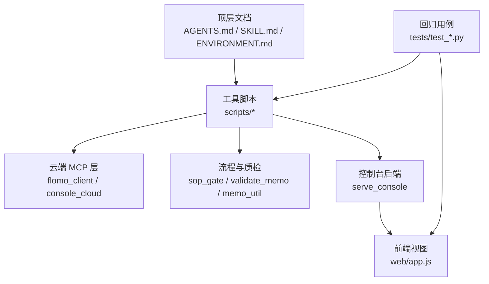
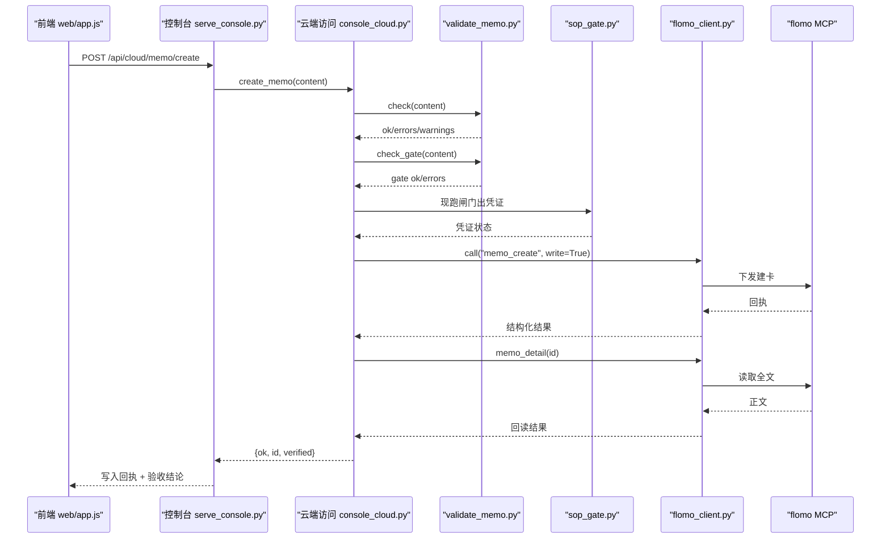
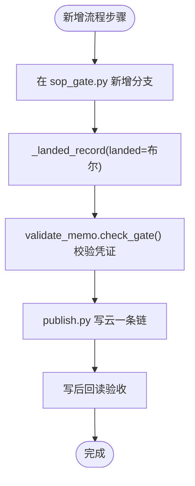
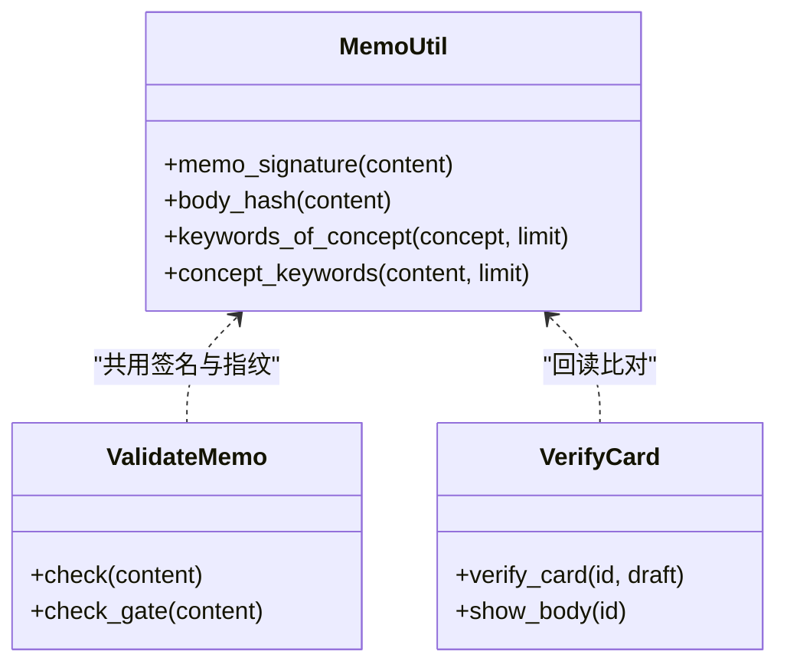
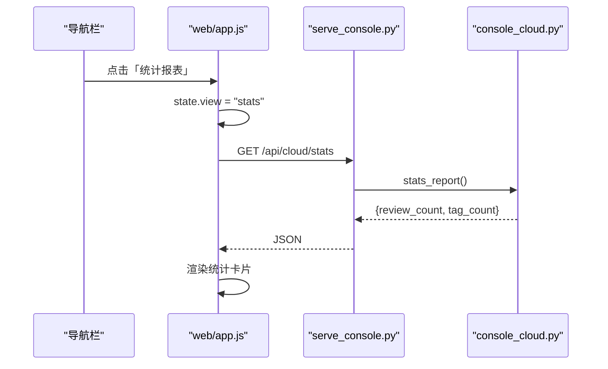
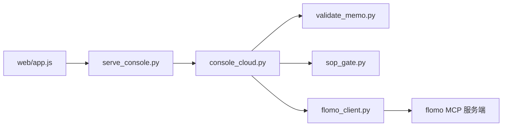

# 开发指南

<cite>
**本文引用的文件**
- [AGENTS.md](file://AGENTS.md)
- [README.md](file://README.md)
- [scripts/console_cloud.py](file://scripts/console_cloud.py)
- [scripts/memo_util.py](file://scripts/memo_util.py)
- [web/app.js](file://web/app.js)
- [tests/test_console_web.py](file://tests/test_console_web.py)
- [tests/test_console_serve.py](file://tests/test_console_serve.py)
- [tests/test_memo_util.py](file://tests/test_memo_util.py)
- [tests/test_validate_memo.py](file://tests/test_validate_memo.py)
- [tests/test_verify_card.py](file://tests/test_verify_card.py)
</cite>

## 目录
1. [引言](#引言)
2. [项目结构](#项目结构)
3. [分层架构总览](#分层架构总览)
4. [代码风格与提交前自检](#代码风格与提交前自检)
5. [扩展 MCP 工具（控制台读/写白名单与 tools/list）](#扩展-mcp-工具控制台读写白名单与-toolslister)
6. [新增流程步骤（sop_gate 凭证与 publish 链路）](#新增流程步骤sop_gate-凭证与-publish-链路)
7. [调整卡片格式（memo_util / validate_memo / verify_card）](#调整卡片格式memo_util--validate_memo--verify_card)
8. [扩展控制台视图（serve_console 路由与 web/app.js）](#扩展控制台视图serve_console-路由与-webappjs)
9. [回归测试与 COVERS 声明](#回归测试与-covers-声明)
10. [最小扩展示例](#最小扩展示例)
11. [依赖关系分析](#依赖关系分析)
12. [常见问题排查](#常见问题排查)
13. [结论](#结论)

## 引言
本指南面向贡献者与二次开发者，说明在现有 flomo-note 分层架构上如何安全扩展：新增 MCP 工具、新增流程步骤、调整卡片格式、扩展控制台视图，以及配套测试。文档以仓库中已实现的约定为准，不虚构不存在的能力；所有可执行规则都指向具体源码位置。

## 项目结构
仓库按“顶层文档 → 工具脚本 → 前端静态资源 → 回归用例”四层组织：
- 顶层文档：`AGENTS.md`（总则）、`SKILL.md`（细则源）、`ENVIRONMENT.md`（环境事实）、`README.md`（运行说明）。
- `scripts/`：云端访问、命令行入口、流程闸门、数据抽取、控制台后端等 Python 脚本。
- `web/`：控制台前端静态资源（HTML/CSS/JS），由 `scripts/serve_console.py` 提供本地服务。
- `tests/`：全部回归用例，按模块命名或显式 `COVERS` 声明认领被测脚本。



图表来源
- [README.md:94-200](file://README.md#L94-L200)
- [AGENTS.md:28-58](file://AGENTS.md#L28-L58)

章节来源
- [README.md:94-200](file://README.md#L94-L200)
- [AGENTS.md:28-58](file://AGENTS.md#L28-L58)

## 分层架构总览
flomo-note 的控制台能力集中在以下层次：
- 云端通道层：`flomo_client.py` 负责握手、协议发现、写后回读验收，是 H3 唯一入口。
- 控制台云端访问层：`console_cloud.py` 定义读/写白名单、统一只读执行、写路径的两道闸门与回读验收。
- 卡片语义层：`memo_util.py` 是唯一签名口径；`validate_memo.py` 做格式与流程闸门校验；`sop_gate.py` 产出带正文指纹的凭证。
- 控制台后端层：`serve_console.py` 暴露 `/api/cloud/*` 路由，把调用转给 `CloudReader`。
- 前端层：`web/app.js` 实现四个视图（云端笔记、标签、参考、能力），动态生成参数表单并消费后端返回形态。



图表来源
- [scripts/console_cloud.py:741-820](file://scripts/console_cloud.py#L741-L820)
- [scripts/console_cloud.py:821-854](file://scripts/console_cloud.py#L821-L854)
- [scripts/console_cloud.py:910-946](file://scripts/console_cloud.py#L910-L946)
- [web/app.js:560-660](file://web/app.js#L560-L660)

章节来源
- [scripts/console_cloud.py:1-120](file://scripts/console_cloud.py#L1-L120)
- [scripts/console_cloud.py:451-520](file://scripts/console_cloud.py#L451-L520)
- [scripts/console_cloud.py:741-854](file://scripts/console_cloud.py#L741-L854)
- [web/app.js:501-660](file://web/app.js#L501-L660)

## 代码风格与提交前自检
### 顶层约定
- 笔记只在云端，本地不落盘笔记内容；本地只留工具与配置。
- 凭据、中间态产物（如流程闸门凭证）一律不入库。
- 写云常规操作免确认，物理删除必须由用户手动完成。
- 卡片格式、标签规则、流程细节的唯一细则源是 `SKILL.md`。
- 每轮工作必须闭环交付，复盘建议不得直接改脚本或文档。

### 维护者自检清单
| 改动范围 | 必须运行的用例 | 关键约束 |
|---|---|---|
| `scripts/validate_memo.py` | `python tests/test_validate_memo.py` | 首行标签段、概念名、结论先行、字数上限等 |
| `scripts/sop_gate.py` | `python tests/test_sop_gate.py` | `_landed_record` 必须返回含 `landed` 布尔的对象 |
| `scripts/memo_util.py` | `python tests/test_memo_util.py` | 签名口径影响查重、闸门、凭证三处 |
| `scripts/console_cloud.py` | `python tests/test_console_cloud.py` | 读/写白名单必须与实际调用一一对应 |
| `scripts/serve_console.py` + `web/app.js` | `tests/test_console_web.py` + `tests/test_console_serve.py` | 前后端接口对齐、Host/Origin 校验 |
| `scripts/covers.py` | `python tests/test_covers.py` | 覆盖声明是唯一事实源 |

### 审查要点
- 新增脚本必须有人用 `COVERS` 认领，不能只靠文件名同名推断。
- 项目内 import 无环，`cli_util` 是叶子，导入符号必须真正使用。
- 控制台 `POST` 只允许两类接口：改动云端的写接口与 `/api/cloud/tool` 通用只读执行入口。
- 本地服务的 `do_GET` / `do_POST` 必须先过本机 Host 白名单与 Origin 同站检查。

章节来源
- [AGENTS.md:1-58](file://AGENTS.md#L1-L58)
- [README.md:132-200](file://README.md#L132-L200)

## 扩展 MCP 工具（控制台读/写白名单与 tools/list）
### 目标
让一个新的 MCP 工具能在控制台被识别、渲染和执行。

### 已有机制
- 读能力通过 `READONLY_TOOLS` 白名单保护，`CloudReader.call(write=False)` 只放行该集合中的工具。
- 写能力通过 `WRITE_TOOLS` 白名单保护，只有 `create_memo` / `update_memo` / `rename_tag` 三个专用方法走写路径。
- `tool_catalog()` 从云端 `tools/list` 取工具元信息，并根据是否在白名单标注 `wired`、`kind`、`reason`。
- 通用只读执行入口 `run_read_tool(name, arguments)` 把界面生成的参数直接喂给任意读工具。

### 扩展示例：新增一个只读 MCP 工具
假设新增云端工具名为 `memo_search_extended`，用于扩展搜索条件。

#### 步骤 1：在 `console_cloud.py` 添加读方法
```python
def search_extended(self, keywords=None, extra_filter=None):
    args = {}
    if keywords:
        args["keywords"] = keywords
    if extra_filter:
        args["extra_filter"] = extra_filter
    memos = self._memos(self.call("memo_search_extended", args))
    return {"count": len(memos), "memos": [slim_memo(m) for m in memos]}
```

#### 步骤 2：把工具名加入 `READONLY_TOOLS`
```python
READONLY_TOOLS = frozenset({
    "memo_search",
    "memo_batch_get",
    "memo_recommended",
    "get_daily_review",
    "tag_tree",
    "tag_search",
    "memory_context",
    "memory_user",
    "get_format_guide",
    "get_tag_guide",
    "memo_search_extended",  # 新增
})
```

#### 步骤 3：复用 `tools/list` 与通用执行入口
无需再为这个工具单独写前端表单：`tool_catalog()` 会把它标记为只读工具，`run_read_tool()` 会接受其参数并归一化返回形态。

#### 步骤 4：补充回归测试
在 `tests/test_console_cloud.py` 中增加断言：
- 新工具名出现在 `READONLY_TOOLS`。
- 新增方法实际调用 `call("memo_search_extended", ...)`。
- 白名单扫描仍通过，不多不少。

#### 危险边界
- 不要把写工具放进 `READONLY_TOOLS`。
- 不要绕过 `call(write=True)` 直接从读方法发写请求。
- 不要在白名单里留下无人使用的权限空位——回归用例按源码扫描锁定对等关系。

章节来源
- [scripts/console_cloud.py:87-107](file://scripts/console_cloud.py#L87-L107)
- [scripts/console_cloud.py:451-520](file://scripts/console_cloud.py#L451-L520)
- [scripts/console_cloud.py:856-946](file://scripts/console_cloud.py#L856-L946)

## 新增流程步骤（sop_gate 凭证与 publish 链路）
### 目标
在 SOP 流程中新增一步机械校验，并要求该步骤的结果能进入流程闸门凭证，最终被 `publish.py` 消费。

### 已有契约
- `sop_gate.py` 负责代跑标签核对、查重、复盘等步骤，校验验证留痕，最后产出带正文指纹的凭证。
- `console_cloud.run_gate()` 调用 `sop_gate.py --memo <草稿>`，支持 `--skip-web` 与 `--verify`。
- `validate_memo.check_gate()` 校验 `.sop_gate/<签名>.json` 是否存在、签名与正文指纹是否匹配、凭证是否过期。
- `publish.py` 是写云一条链：闸门 → 质检 → 建卡/覆盖 → 机器项复核 → 覆盖差异。

### 扩展示例：新增一步“引用链接核验”
#### 步骤 1：在 `sop_gate.py` 新增分支
- 接收输入（例如草稿路径、锚定 id、验证记录）。
- 执行核验逻辑。
- 通过 `_landed_record(..., landed=True/False)` 申报结果，不要裸 dict 返回。
- 在汇总阶段计入该分支条数。

#### 步骤 2：在 `validate_memo.check_gate()` 消费凭证
- 解析凭证 JSON。
- 要求新增步骤对应的键存在且 `landed` 为真。
- 若缺失，给出明确错误提示，阻断写云。

#### 步骤 3：在 `console_cloud.run_gate()` 透传参数
- 如果该步骤需要跳过网络验证或携带外部验证记录，追加对应 CLI 参数。
- 保留原行为：未通过时不出凭证，不触发写云。

#### 步骤 4：更新 `publish.py` 的前置检查
- 在写云前调用闸门，确保新增步骤已通过。
- 若凭证缺失，给出待修项，而不是静默跳过。



图表来源
- [scripts/console_cloud.py:701-740](file://scripts/console_cloud.py#L701-L740)
- [scripts/console_cloud.py:741-820](file://scripts/console_cloud.py#L741-L820)
- [scripts/memo_util.py:25-70](file://scripts/memo_util.py#L25-L70)

章节来源
- [scripts/console_cloud.py:701-820](file://scripts/console_cloud.py#L701-L820)
- [scripts/memo_util.py:25-70](file://scripts/memo_util.py#L25-L70)
- [README.md:156-200](file://README.md#L156-L200)

## 调整卡片格式（memo_util / validate_memo / verify_card）
### 目标
调整卡片的首行标签段、概念名行或正文结构的判定口径，并确保查重、闸门、凭证、写云验收保持一致。

### 已有单点实现
- `memo_util.memo_signature()` 是唯一签名实现：取前两个非空行，首行以 `#` 开头，第二行非空且不以 `#` 开头。
- `memo_util.body_hash()` 计算正文指纹，用于凭证防篡改。
- `validate_memo.check()` 基于签名与格式规则报 ERR/WARN。
- `verify_card.py` 写云后回读全文，做可机械判定的形态、占位符、净字符数检查。

### 扩展示例：放宽“标签段后可夹空行”
当前实现已经兼容标签段与概念名之间夹空行的情况；若要进一步调整，应按如下顺序修改：

#### 步骤 1：改 `memo_util.py`
- 只改 `memo_signature()` 及相关正则。
- 保持返回值结构 `{tagline, concept}` 不变。

#### 步骤 2：同步 `validate_memo.py`
- 若新增格式规则，把判断放在 `check()` 中，并归类到 ERR 或 WARN。
- 不要复制一份签名逻辑。

#### 步骤 3：同步 `verify_card.py`
- 若变更影响正文长度、截断判定或形态，更新回读比对逻辑。
- 保持“不一致即报告，未知即标记 matched=None”的语义。

#### 步骤 4：更新测试
- `tests/test_memo_util.py`：断言新旧输入下的签名、关键词、切片识别。
- `tests/test_validate_memo.py`：断言新增格式合法/非法情形。
- `tests/test_verify_card.py`：断言写后回读验收的三种结局。



图表来源
- [scripts/memo_util.py:1-120](file://scripts/memo_util.py#L1-L120)
- [scripts/memo_util.py:121-200](file://scripts/memo_util.py#L121-L200)

章节来源
- [scripts/memo_util.py:1-120](file://scripts/memo_util.py#L1-L120)
- [scripts/memo_util.py:121-200](file://scripts/memo_util.py#L121-L200)
- [tests/test_memo_util.py:1-50](file://tests/test_memo_util.py#L1-L50)
- [tests/test_validate_memo.py:1-40](file://tests/test_validate_memo.py#L1-L40)
- [tests/test_verify_card.py:1-40](file://tests/test_verify_card.py#L1-L40)

## 扩展控制台视图（serve_console 路由与 web/app.js）
### 目标
在控制台新增一个独立视图，例如“批量导出”或“统计报表”。

### 已有模式
- 后端在 `serve_console.py` 注册 `/api/cloud/*` 路由，调用 `CloudReader` 方法。
- 前端在 `web/app.js` 的 `VIEW_META`、`VIEWS`、导航项、事件处理中添加对应视图。
- 测试在 `tests/test_console_web.py` 中锁定导航项与视图、路由与前端调用的对齐关系。

### 扩展示例：新增“统计报表”视图
#### 步骤 1：后端新增只读接口
```python
@app.route("/api/cloud/stats")
def cloud_stats():
    reader = CloudReader()
    return jsonify(reader.stats_report())
```

#### 步骤 2：在 `console_cloud.py` 实现方法
```python
def stats_report(self):
    review = self.daily_review()
    tags = self.tag_names("")
    return {
        "review_count": review.get("count", 0),
        "tag_count": tags.get("count", 0),
    }
```

#### 步骤 3：前端添加视图
```javascript
const VIEW_META = {
    notes:     { title: "云端笔记", sub: "..." },
    tags:      { title: "标签", sub: "..." },
    reference: { title: "参考", sub: "..." },
    tools:     { title: "能力", sub: "..." },
    stats:     { title: "统计报表", sub: "今日回顾与标签规模摘要" }, // 新增
};

const VIEWS = {
    notes: viewNotes,
    tags: viewTags,
    reference: viewReference,
    tools: viewTools,
    stats: viewStats, // 新增
};
```

#### 步骤 4：添加导航项与事件
- 在 HTML 导航区添加 `<a data-view="stats">统计报表</a>`。
- 在 JS 事件中处理点击跳转。

#### 步骤 5：补充测试
- `tests/test_console_web.py`：断言新增导航项有对应视图、前端调用的 `/api/cloud/stats` 存在于后端路由表。
- `tests/test_console_serve.py`：真起服务并请求该接口。



图表来源
- [web/app.js:1-60](file://web/app.js#L1-L60)
- [web/app.js:801-880](file://web/app.js#L801-L880)
- [web/app.js:1080-1160](file://web/app.js#L1080-L1160)

章节来源
- [web/app.js:1-60](file://web/app.js#L1-L60)
- [web/app.js:801-880](file://web/app.js#L801-L880)
- [web/app.js:1080-1160](file://web/app.js#L1080-L1160)
- [tests/test_console_web.py:1-40](file://tests/test_console_web.py#L1-L40)
- [tests/test_console_serve.py:1-40](file://tests/test_console_serve.py#L1-L40)

## 回归测试与 COVERS 声明
### 原则
- 用例必须叫 `test_*.py`，否则 `run_tests.sh` 不会收集。
- 每个用例模块顶部用 `COVERS = ("脚本名", ...)` 声明它验的是哪些脚本。
- 覆盖关系是声明，不是文件名同名；`serve_console.py` 的用例叫 `test_console_serve.py`，`console_cloud.py` 的主要回归在 `test_console_web.py`，`memo_util` 的口径用例在 `test_memo_util.py`。
- `covers.py` 是“脚本有没有用例”的唯一解析实现；闸门与控制台 `has_test` 都依赖它。

### 新增能力时的测试清单
| 新增内容 | 必须补充的测试 |
|---|---|
| 新增 MCP 读工具 | `tests/test_console_cloud.py` 中白名单与方法调用扫描 |
| 新增 MCP 写工具 | `tests/test_console_cloud.py` 中写白名单、闸门拦截、回读验收 |
| 新增流程步骤 | `tests/test_sop_gate.py` 中凭证结构与落地记录 |
| 调整卡片格式 | `tests/test_memo_util.py`、`tests/test_validate_memo.py`、`tests/test_verify_card.py` |
| 新增控制台视图 | `tests/test_console_web.py`、`tests/test_console_serve.py` |
| 新增治理脚本 | `tests/test_covers.py` 相关断言仍需通过 |

章节来源
- [README.md:168-200](file://README.md#L168-L200)
- [tests/test_console_web.py:1-40](file://tests/test_console_web.py#L1-L40)
- [tests/test_console_serve.py:1-40](file://tests/test_console_serve.py#L1-L40)
- [tests/test_memo_util.py:1-40](file://tests/test_memo_util.py#L1-L40)
- [tests/test_validate_memo.py:1-40](file://tests/test_validate_memo.py#L1-L40)
- [tests/test_verify_card.py:1-40](file://tests/test_verify_card.py#L1-L40)

## 最小扩展示例
下面给出一个最小可行改动：**新增一个只读 MCP 工具并在控制台执行**。

### 改动范围
1. `scripts/console_cloud.py`
   - 新增方法 `list_by_source(source)`。
   - 把 `"memo_search"` 替换或新增为 `"memo_search_by_source"`，并把新工具名加入 `READONLY_TOOLS`。
2. `tests/test_console_cloud.py`
   - 断言新工具名在 `READONLY_TOOLS`。
   - 断言新方法调用 `call("memo_search_by_source", {"source": ...})`。
3. 前端无需改动：`tools/list` + `run_read_tool` 自动暴露该工具。

### 预期行为
- 控制台“能力”视图中出现该工具。
- 填入 `source` 参数后点击“执行”，返回形态被识别为 `memos`。
- 写工具不会出现在通用执行入口。
- 白名单扫描通过，没有多余权限空位。

### 失败场景
- 工具名不在 `READONLY_TOOLS`：`call()` 抛 `CloudError`，前端显示执行失败。
- 传入写工具名：`run_read_tool()` 主动拒绝。
- 新增方法没加白名单：回归扫描失败。

章节来源
- [scripts/console_cloud.py:87-107](file://scripts/console_cloud.py#L87-L107)
- [scripts/console_cloud.py:451-520](file://scripts/console_cloud.py#L451-L520)
- [scripts/console_cloud.py:910-946](file://scripts/console_cloud.py#L910-L946)

## 依赖关系分析
控制台写链路的关键依赖如下：



图表来源
- [web/app.js:501-660](file://web/app.js#L501-L660)
- [scripts/console_cloud.py:741-854](file://scripts/console_cloud.py#L741-L854)

章节来源
- [scripts/console_cloud.py:1-120](file://scripts/console_cloud.py#L1-L120)
- [scripts/console_cloud.py:741-946](file://scripts/console_cloud.py#L741-L946)
- [web/app.js:501-880](file://web/app.js#L501-L880)

## 常见问题排查
| 现象 | 可能原因 | 排查动作 |
|---|---|---|
| 控制台新增工具无法执行 | 工具名未加入 `READONLY_TOOLS` | 检查 `console_cloud.py` 白名单与方法调用 |
| 写工具能通过通用入口 | `run_read_tool()` 未拒绝写工具 | 检查是否误把写工具放入读白名单 |
| 写云后无法验收 | 回读全文失败或正文不一致 | 查看 `verified.matched` 与 `verified.error` |
| 凭证不出但闸门日志正常 | 新增步骤未 `_landed_record` 或 `landed` 字段缺失 | 检查 `sop_gate.py` 分支与 `validate_memo.check_gate()` |
| 前端导航点了没反应 | 缺少 `data-view`、`VIEWS` 或事件处理 | 对照 `viewTools` 模式补全 |
| 回归用例不生效 | 文件名不是 `test_*.py` 或 `COVERS` 未声明 | 检查 `run_tests.sh` 收集规则与 `covers.py` |
| 控制台页面显示“本地服务无响应” | `serve_console.py` 未重启或未绑定本机 Host | 重启进程并检查 Host/Origin 校验 |

章节来源
- [scripts/console_cloud.py:451-520](file://scripts/console_cloud.py#L451-L520)
- [scripts/console_cloud.py:741-854](file://scripts/console_cloud.py#L741-L854)
- [web/app.js:501-660](file://web/app.js#L501-L660)
- [AGENTS.md:40-58](file://AGENTS.md#L40-L58)

## 结论
flomo-note 的开发扩展遵循“单一事实源 + 白名单 + 闸门 + 回读验收 + 声明式覆盖”的设计：
- MCP 工具扩展必须同时改方法、白名单与测试。
- 流程步骤必须落在 `sop_gate.py` 并通过 `_landed_record` 申报，不能被 `publish.py` 静默忽略。
- 卡片格式调整必须以 `memo_util.py` 为唯一入口，并同步 `validate_memo.py` 与 `verify_card.py`。
- 控制台视图扩展必须同时补齐后端路由与前端 `VIEW_META` / `VIEWS` / 导航事件。
- 所有能力必须配套 `tests/test_*.py` 与 `COVERS` 声明，否则治理链条会认为“无人认领”。