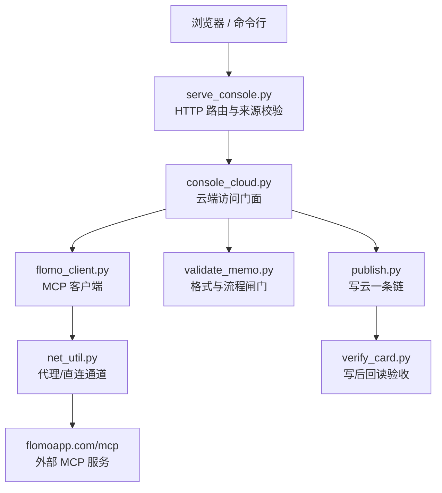
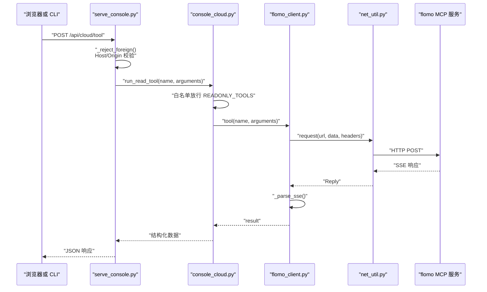
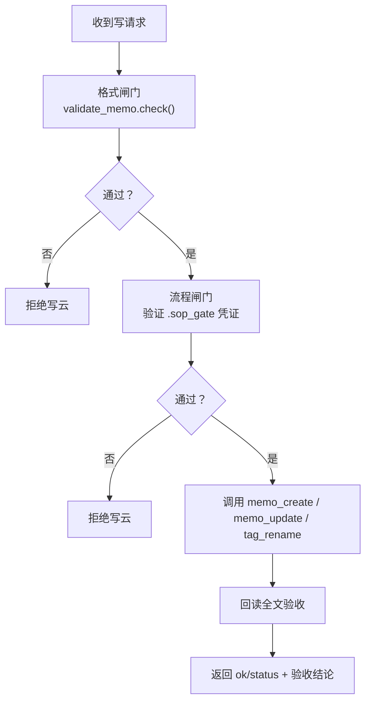
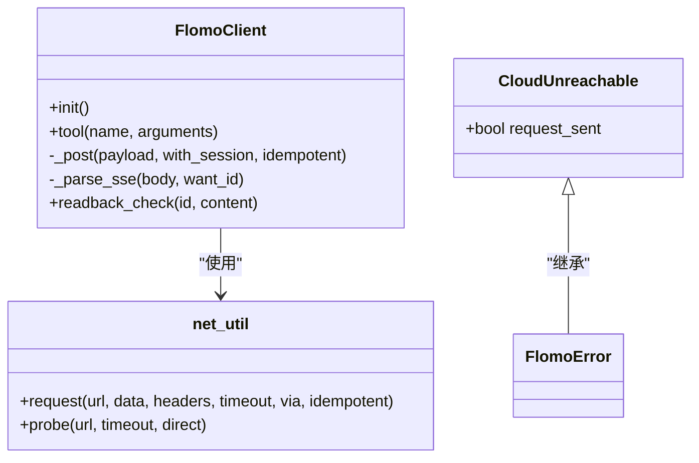
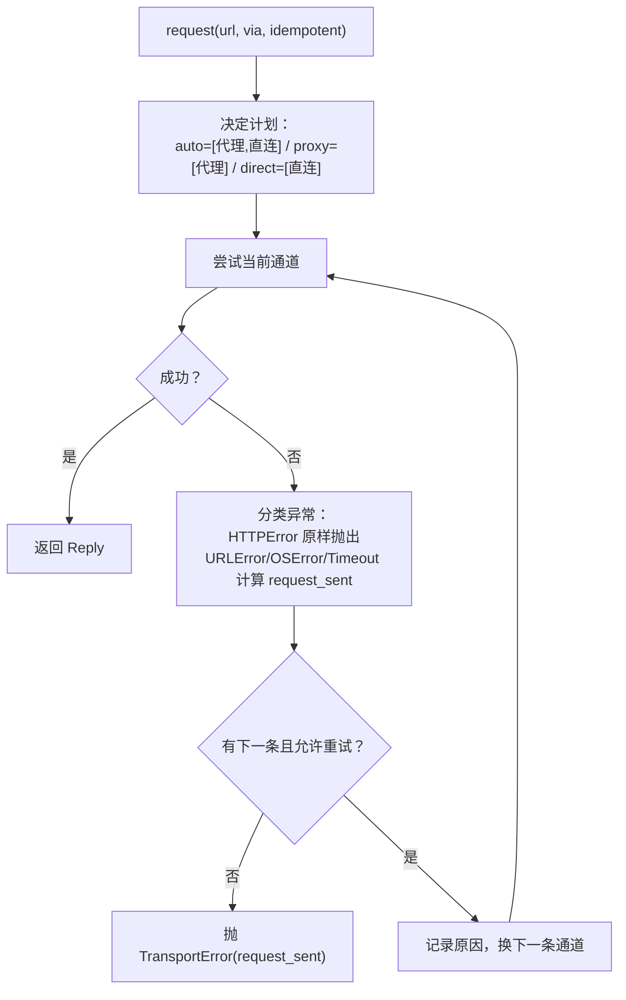
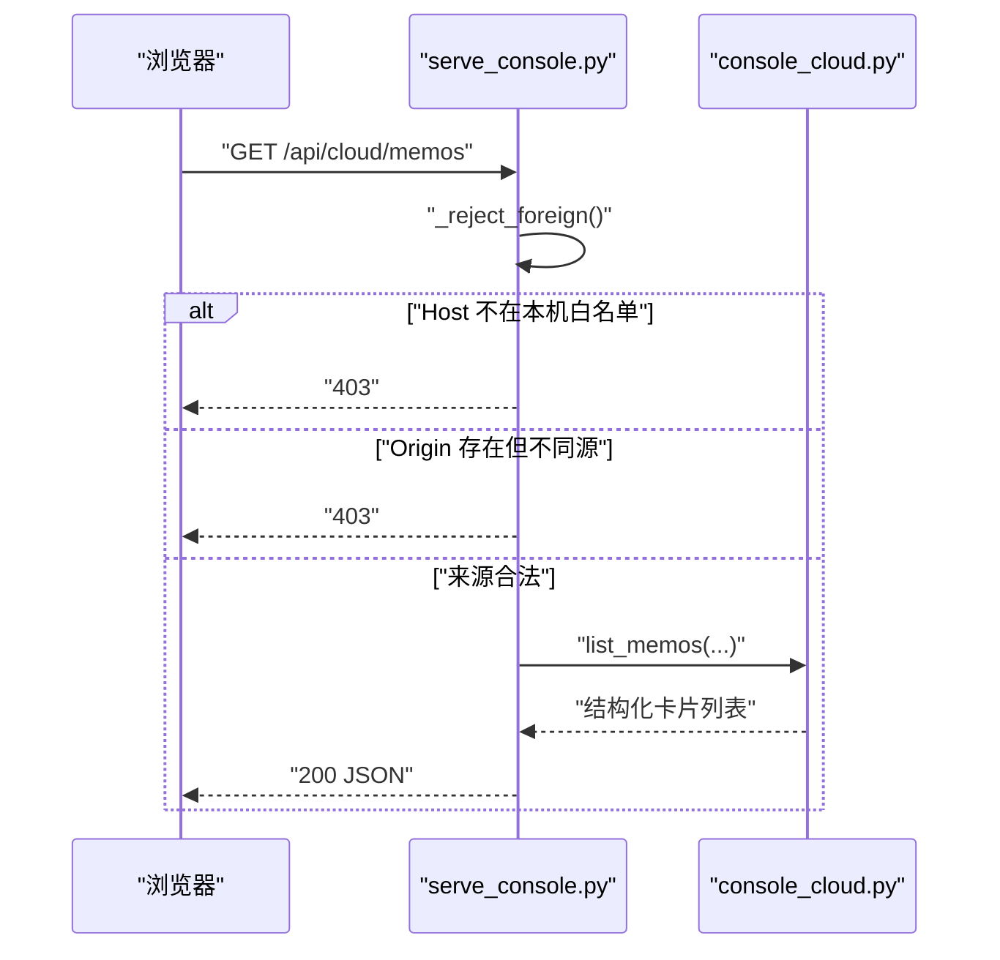
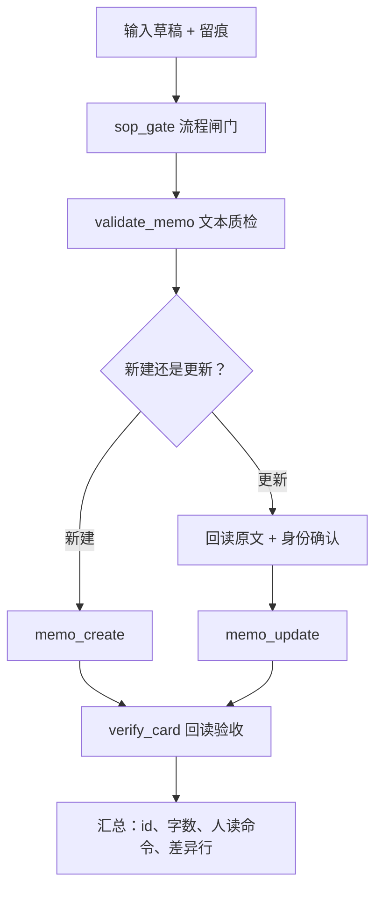
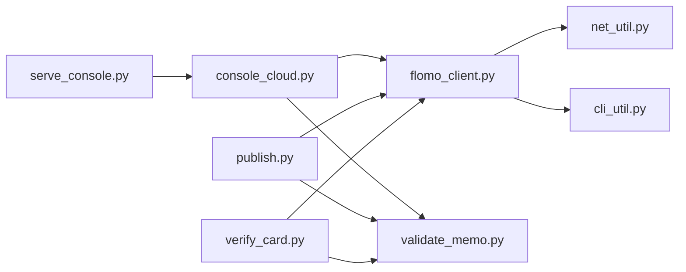
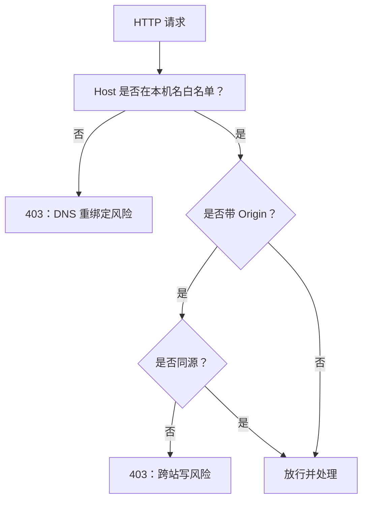
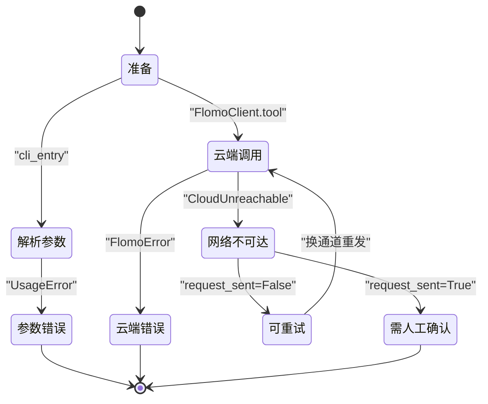

# 架构设计

<cite>
**本文引用的文件**   
- [README.md](file://README.md)
- [AGENTS.md](file://AGENTS.md)
- [scripts/serve_console.py](file://scripts/serve_console.py)
- [scripts/console_cloud.py](file://scripts/console_cloud.py)
- [scripts/flomo_client.py](file://scripts/flomo_client.py)
- [scripts/cli_util.py](file://scripts/cli_util.py)
- [scripts/net_util.py](file://scripts/net_util.py)
- [scripts/publish.py](file://scripts/publish.py)
- [scripts/validate_memo.py](file://scripts/validate_memo.py)
- [scripts/verify_card.py](file://scripts/verify_card.py)
</cite>

## 目录
1. [引言](#引言)
2. [项目结构](#项目结构)
3. [核心组件](#核心组件)
4. [架构总览](#架构总览)
5. [详细组件分析](#详细组件分析)
6. [依赖与分层分析](#依赖与分层分析)
7. [安全边界与白名单](#安全边界与白名单)
8. [错误处理策略](#错误处理策略)
9. [性能与可扩展性](#性能与可扩展性)
10. [与 AGENTS.md 全局约定的对应关系](#与-agentsmd-全局约定的对应关系)
11. [故障排查指南](#故障排查指南)
12. [结论](#结论)

## 引言
flomo-note 是一个把网页、文章或想法沉淀为 flomo 云端卡片的技能。整体流程是“草稿 → 闸门校验 → 文本质检 → 写云 → 回读验收”，对外暴露两条路径：命令行写卡链路与本地控制台 Web 入口。其关键设计包括门面模式（`console_cloud` 封装 MCP 能力）、白名单准入（工具名与 Host/Origin）、闸门与执行分离（`sop_gate`/`validate_memo` 不直接写云），以及依赖倒置的纯标准库 CLI 叶子层 `cli_util.py`。

## 项目结构
仓库按职责划分三层：
- 文档层：`SKILL.md`（细则源）、`AGENTS.md`（总则）、`ENVIRONMENT.md`（环境事实）。
- 脚本层：`scripts/` 内每个 `.py` 负责单一任务，用例在 `tests/`，前端静态资源在 `web/`。
- 外部系统：用户 flomo 账号上的 MCP 服务（`https://flomoapp.com/mcp`）与浏览器控制台页面。

**图表来源**
- [scripts/serve_console.py:1-80](file://scripts/serve_console.py#L1-L80)
- [scripts/console_cloud.py:1-90](file://scripts/console_cloud.py#L1-L90)
- [scripts/flomo_client.py:1-60](file://scripts/flomo_client.py#L1-L60)
- [scripts/net_util.py:1-60](file://scripts/net_util.py#L1-L60)
- [scripts/publish.py:1-60](file://scripts/publish.py#L1-L60)
- [scripts/validate_memo.py:1-40](file://scripts/validate_memo.py#L1-L40)
- [scripts/verify_card.py:1-40](file://scripts/verify_card.py#L1-L40)

**章节来源**
- [README.md:1-120](file://README.md#L1-L120)
- [README.md:120-220](file://README.md#L120-L220)

## 核心组件
| 组件 | 角色 | 关键行为 |
|---|---|---|
| `serve_console.py` | Web 入口 | 提供 `/api/cloud/*` 路由；先做 Host/Origin 校验；静态文件只返回白名单后缀；转发请求到 `console_cloud`。 |
| `console_cloud.py` | 云端访问门面 | 维护读写工具白名单；把 MCP 只读能力归一为字段精简的结构；写操作强制过两道闸门并回读验收；token 不出进程。 |
| `flomo_client.py` | MCP 客户端 | 读取 token、握手、SSE 解析、工具调用、写后回读比对；失败抛 `FlomoError`/`CloudUnreachable`。 |
| `net_util.py` | 出网通道 | 环境代理失败自动转直连；区分“可能已发出”和“确定未发出”；统一 HTTP 异常分类。 |
| `cli_util.py` | CLI 叶子层 | 选项声明、参数类型转换、统一退出出口；不 import 任何项目模块，作为依赖图叶子。 |
| `publish.py` | 写云一条链 | 闸门 → 质检 → `memo_create/update` → 机器项复核；批量时先全预检再逐张写。 |
| `validate_memo.py` | 文本质检 | 标签、概念名、正文格式、字数、模板前缀等；可被闸门或控制台自检调用。 |
| `verify_card.py` | 回读验收 | 复用 `validate_memo.check()` 做形态检查；对比草稿与云端全文；列出需人读的盲区。 |

**章节来源**
- [scripts/serve_console.py:1-120](file://scripts/serve_console.py#L1-L120)
- [scripts/console_cloud.py:1-120](file://scripts/console_cloud.py#L1-L120)
- [scripts/flomo_client.py:1-120](file://scripts/flomo_client.py#L1-L120)
- [scripts/net_util.py:1-100](file://scripts/net_util.py#L1-L100)
- [scripts/cli_util.py:1-166](file://scripts/cli_util.py#L1-L166)
- [scripts/publish.py:1-120](file://scripts/publish.py#L1-L120)
- [scripts/validate_memo.py:1-80](file://scripts/validate_memo.py#L1-L80)
- [scripts/verify_card.py:1-80](file://scripts/verify_card.py#L1-L80)

## 架构总览
系统分为四层：
1. **入口层**：命令行与 `serve_console.py` 提供的 Web API。
2. **门面层**：`console_cloud.py` 暴露统一的只读/写方法，屏蔽 MCP 协议差异。
3. **客户端层**：`flomo_client.py` 负责 MCP 握手、SSE 流解析、token 管理。
4. **网络层**：`net_util.py` 实现双通道选择与安全重试语义。

**图表来源**
- [scripts/serve_console.py:80-200](file://scripts/serve_console.py#L80-L200)
- [scripts/console_cloud.py:120-240](file://scripts/console_cloud.py#L120-L240)
- [scripts/flomo_client.py:120-220](file://scripts/flomo_client.py#L120-L220)
- [scripts/net_util.py:100-196](file://scripts/net_util.py#L100-L196)

## 详细组件分析

### 门面层：console_cloud.py
`console_cloud.py` 是控制台对外的唯一云端访问接口，承担以下职责：
- 定义 `READONLY_TOOLS` 与 `WRITE_TOOLS` 两个恰好等于实际调用的工具集合。
- 提供 `list_memos`、`memo_detail`、`tag_tree`、`memory_doc`、`tool_catalog` 等只读方法。
- 提供通用只读执行入口 `run_read_tool`，让界面根据 `tools/list` 动态生成表单并执行任意读工具。
- 写路径不是直通：`create_memo`、`update_memo`、`rename_tag` 必须先过格式闸门和流程闸门，写入后再回读全文。
- Token 仅在进程内建连时使用，不进入返回值或日志。

**图表来源**
- [scripts/console_cloud.py:1-120](file://scripts/console_cloud.py#L1-L120)
- [scripts/validate_memo.py:1-60](file://scripts/validate_memo.py#L1-L60)

**章节来源**
- [scripts/console_cloud.py:1-200](file://scripts/console_cloud.py#L1-L200)

### 客户端层：flomo_client.py
`flomo_client.py` 是 MCP 通道的唯一实现，重点契约如下：
- Token 优先从 `.mcp.json` 读取，其次退回到环境变量 `FLOMO_TOKEN`。
- 初始化会话、发送 JSON-RPC 请求、解析 SSE 流并按 `id` 匹配结果。
- 写操作属于不幂等工具，写入后自动调用 `memo_batch_get` 回读全文，与本地草稿逐字比对（宽容空白差异）。
- 所有调用失败抛 `FlomoError`，网络不可达抛 `CloudUnreachable`，其中包含 `request_sent` 标志，供上层决定是否允许换通道重发。

**图表来源**
- [scripts/flomo_client.py:60-200](file://scripts/flomo_client.py#L60-L200)
- [scripts/net_util.py:60-140](file://scripts/net_util.py#L60-L140)

**章节来源**
- [scripts/flomo_client.py:1-200](file://scripts/flomo_client.py#L1-L200)

### 网络层：net_util.py
`net_util.py` 解决两类问题：
1. **通道选择**：`auto` 先走环境代理，失败再走直连；`proxy` 仅代理；`direct` 完全绕过 `*_proxy`。
2. **重试安全**：只有连接被拒或域名解析失败才判为“确定未发出”；超时、TLS 失败、连接中断判为“可能已发出”，写操作不得盲重试。

**图表来源**
- [scripts/net_util.py:60-196](file://scripts/net_util.py#L60-L196)

**章节来源**
- [scripts/net_util.py:1-196](file://scripts/net_util.py#L1-L196)

### 入口层：serve_console.py
`serve_console.py` 的职责很窄：
- 启动 `ThreadingHTTPServer`，加载 `CloudReader` 单例。
- 静态资源只返回受信任后缀，避免任意文件泄露。
- 所有请求先经 `_reject_foreign()`：
  - Host 宿主名必须在由绑定地址算出的本机名白名单中。
  - 带 `Origin` 时必须同源；`null` 也拒绝。
  - 无 `Origin` 视为非浏览器客户端，放行命令行用法。
- 只暴露 `/api/cloud/*` 接口，禁止新增命令执行型入口。

**图表来源**
- [scripts/serve_console.py:1-200](file://scripts/serve_console.py#L1-L200)
- [scripts/console_cloud.py:200-360](file://scripts/console_cloud.py#L200-L360)

**章节来源**
- [scripts/serve_console.py:1-200](file://scripts/serve_console.py#L1-L200)

### 写云链路：publish.py → validate_memo.py → verify_card.py
CLI 写卡链路把过去多步手工流程收敛成一次调用：
1. 解析草稿与流程凭证。
2. 跑流程闸门。
3. 跑文本质检。
4. 新建或更新卡片。
5. 机器项复核；覆盖更新时还比较改前快照与草稿的行级差异。

**图表来源**
- [scripts/publish.py:1-120](file://scripts/publish.py#L1-L120)
- [scripts/validate_memo.py:1-80](file://scripts/validate_memo.py#L1-L80)
- [scripts/verify_card.py:1-120](file://scripts/verify_card.py#L1-L120)

**章节来源**
- [scripts/publish.py:1-200](file://scripts/publish.py#L1-L200)
- [scripts/validate_memo.py:1-120](file://scripts/validate_memo.py#L1-L120)
- [scripts/verify_card.py:1-160](file://scripts/verify_card.py#L1-L160)

## 依赖与分层分析
依赖方向是自上而下单向的：
- `serve_console.py` 依赖 `console_cloud.py` 与 `console_data.py`。
- `console_cloud.py` 依赖 `flomo_client.py`、`validate_memo.py`、`memo_util.py`。
- `flomo_client.py` 依赖 `net_util.py`、`memo_util.py`、`cli_util.py`。
- `net_util.py` 只依赖标准库。
- `cli_util.py` 不 import 任何项目模块，是依赖图叶子。

**图表来源**
- [scripts/serve_console.py:1-40](file://scripts/serve_console.py#L1-L40)
- [scripts/console_cloud.py:1-40](file://scripts/console_cloud.py#L1-L40)
- [scripts/flomo_client.py:1-40](file://scripts/flomo_client.py#L1-L40)
- [scripts/cli_util.py:1-40](file://scripts/cli_util.py#L1-L40)
- [scripts/net_util.py:1-40](file://scripts/net_util.py#L1-L40)
- [scripts/publish.py:1-40](file://scripts/publish.py#L1-L40)
- [scripts/verify_card.py:1-40](file://scripts/verify_card.py#L1-L40)

**章节来源**
- [AGENTS.md:30-120](file://AGENTS.md#L30-L120)

## 安全边界与白名单
系统有三道重要安全边界：

| 边界 | 位置 | 规则 | 目的 |
|---|---|---|---|
| 工具白名单 | `console_cloud.py` | `READONLY_TOOLS`、`WRITE_TOOLS` 必须恰好等于实际调用集合 | 防止 MCP 工具名越权执行 |
| Host 白名单 | `serve_console.py` | Host 宿主名必须在由绑定地址算出的本机名集合中 | 防 DNS 重绑定 |
| Origin 校验 | `serve_console.py` | 带 `Origin` 时必须同源；`null` 也拒绝；无 `Origin` 放行命令行 | 防浏览器跨站写 |

此外，正文不落盘，token 不出进程；静态资源只返回受信任后缀；服务端不会执行任意命令。

**图表来源**
- [scripts/serve_console.py:80-200](file://scripts/serve_console.py#L80-L200)
- [scripts/console_cloud.py:100-160](file://scripts/console_cloud.py#L100-L160)

**章节来源**
- [scripts/serve_console.py:1-200](file://scripts/serve_console.py#L1-L200)
- [scripts/console_cloud.py:1-160](file://scripts/console_cloud.py#L1-L160)

## 错误处理策略
系统对错误做了清晰分层：

| 错误类型 | 抛出位置 | 处理方式 |
|---|---|---|
| `UsageError` | `cli_util.py` | 入口以用法码退出，提示参数问题 |
| `FlomoError` | `flomo_client.py` | 凭据缺失、HTTP 错误、JSON-RPC 协议错误；HTTP 服务里应被捕获为普通异常 |
| `CloudUnreachable` | `flomo_client.py` | 网络层失败，携带 `request_sent` 标志 |
| `TransportError` | `net_util.py` | 所有通道失败，携带 `request_sent` 标志 |
| `CloudError` | `console_cloud.py` | 云端访问失败，如越权调用、工具报错 |
| 闸门失败 | `validate_memo.py` / `sop_gate.py` | 阻断写云，不向云端发送字节 |

**图表来源**
- [scripts/cli_util.py:120-166](file://scripts/cli_util.py#L120-L166)
- [scripts/flomo_client.py:60-140](file://scripts/flomo_client.py#L60-L140)
- [scripts/net_util.py:60-140](file://scripts/net_util.py#L60-L140)
- [scripts/console_cloud.py:160-240](file://scripts/console_cloud.py#L160-L240)

**章节来源**
- [scripts/cli_util.py:1-166](file://scripts/cli_util.py#L1-L166)
- [scripts/flomo_client.py:1-200](file://scripts/flomo_client.py#L1-L200)
- [scripts/net_util.py:1-196](file://scripts/net_util.py#L1-L196)

## 性能与可扩展性
- **会话复用**：`serve_console.py` 使用进程级 `CloudReader` 单例，避免每请求重复握手。
- **列表截断**：`memo_search` 默认限制条数，前端分页；`memo_batch_get` 单次上限 10 条。
- **标签树限制**：`TAG_MAX_LIMIT=1000`，默认 200，避免一次拉取过大标签树。
- **闸门时限**：流程闸门执行上限 300 秒，因为内部可能多次现查云端。
- **扩展读工具**：只要 MCP 暴露新读工具，`console_cloud.run_read_tool` 就能直接执行，无需改前端逻辑。
- **扩展写工具**：需要新增白名单、闸门、回读验收和前端入口，不能直接走通用执行入口。

这些设计使系统在增加 MCP 读能力时成本低，但在写能力上保持严格约束，符合“写少读多”的安全预期。

**章节来源**
- [scripts/console_cloud.py:1-120](file://scripts/console_cloud.py#L1-L120)
- [scripts/serve_console.py:1-80](file://scripts/serve_console.py#L1-L80)

## 与 AGENTS.md 全局约定的对应关系
| AGENTS.md 约定 | 代码体现 |
|---|---|
| 笔记只在云端 | 正文不落盘，仅内存与 HTTP 响应间传递；唯一落盘草稿由收尾清理回收。 |
| 本地只留工具 | `scripts/` 是工具，`web/` 是前端，`.mcp.json` 是配置，git 不追踪笔记内容。 |
| 写云免确认 | `memo_create`、`memo_update`、`tag_rename` 不要求用户二次批注；物理删除由用户在 App 完成。 |
| 来源实实在在 | 抓取、查重、标签核对、验证留痕都要求真实联网检索。 |
| 收口成闭环 | `publish.py` 把闸门、质检、写云、回读验收合为一次链式调用。 |
| 一份材料几个概念写几张卡 | 卡片格式与概念名提取由 `validate_memo.py` 与 `memo_util.py` 约束。 |
| 文档改动须附真实 hash | 推送与同步脚本在 README 与 AGENTS.md 中说明，不在本架构图中展开。 |

**章节来源**
- [AGENTS.md:1-63](file://AGENTS.md#L1-L63)
- [README.md:1-120](file://README.md#L1-L120)

## 故障排查指南
| 现象 | 可能原因 | 排查步骤 |
|---|---|---|
| 所有命令报“未找到 flomo token” | `.mcp.json` 不存在或结构不对，且没有 `FLOMO_TOKEN` | 检查项目根 `.mcp.json` 中 `mcpServers.flomo.headers.Authorization`，或设置环境变量。 |
| 控制台打开能加载页面，但写请求被 403 | Host 不是本机名，或浏览器 `Origin` 与站点不一致 | 用 `http://127.0.0.1:<端口>` 打开；不要从其他域名 iframe 或跨站页面调用。 |
| 写卡成功但内容不符 | 索引滞后窗口导致重复写，或回读被截断 | 查看 `verify_card.py` 输出；若被截断，改用 `memo_batch_get` 重新核验。 |
| 代理可用但写云失败 | 代理端口变化或 TLS 失败，`request_sent=True` | 不要盲重试；先用 `netdoctor.py` 探通道，再决定换代理或直连。 |
| 控制台显示某脚本没有回归覆盖 | `COVERS` 声明与文件名不同名，或声明缺失 | 检查 `tests/test_*.py` 中的模块级 `COVERS` 声明，而不是只看文件名。 |
| 浏览器跨站可以拿到 GET 结果 | 同源策略管响应读取，不管请求发送 | 仍需在服务端拦 Host/Origin；本项目已通过双重校验实现。 |

**章节来源**
- [scripts/flomo_client.py:120-200](file://scripts/flomo_client.py#L120-L200)
- [scripts/net_util.py:100-196](file://scripts/net_util.py#L100-L196)
- [scripts/verify_card.py:120-220](file://scripts/verify_card.py#L120-L220)
- [scripts/serve_console.py:120-200](file://scripts/serve_console.py#L120-L200)
- [README.md:200-347](file://README.md#L200-L347)

## 结论
flomo-note 的架构围绕“云端是唯一存储”“写路径强约束”“读能力可动态扩展”三个目标组织：
- 入口层只做路由和安全校验。
- 门面层 `console_cloud.py` 把 MCP 能力封装为稳定的 Python API，并通过工具白名单和闸门保护写路径。
- 客户端层 `flomo_client.py` 专注 MCP 协议、token 与会话。
- 网络层 `net_util.py` 提供安全的代理/直连切换与重试语义。
- CLI 叶子层 `cli_util.py` 通过纯标准库解耦，使本地脚本不必感知云端。

这套分层既降低了 MCP 协议变更对上层的影响，也把“写错一张卡”的风险压到了最低。未来扩展应以“只读能力低侵入、写能力高门槛”为原则继续演进。