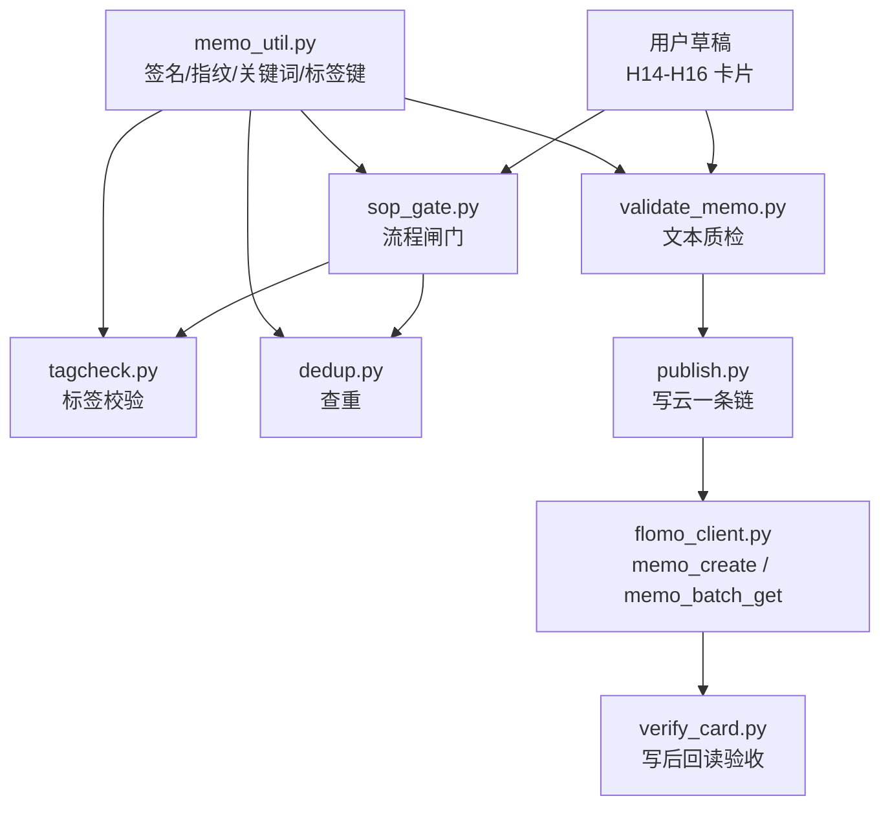
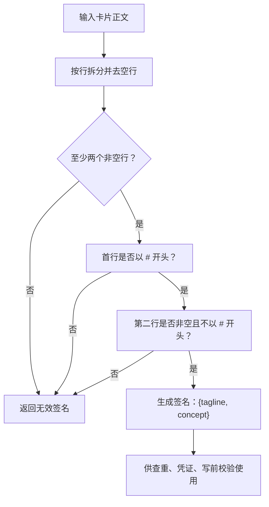
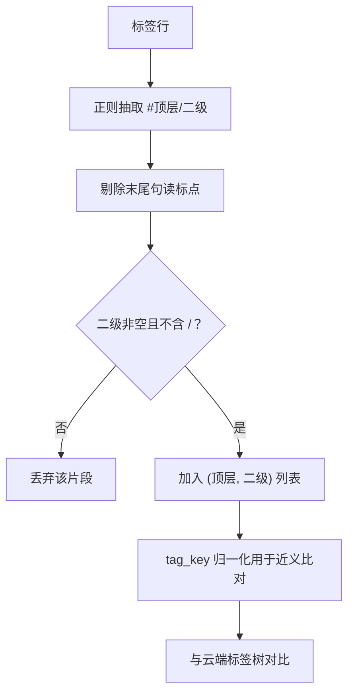
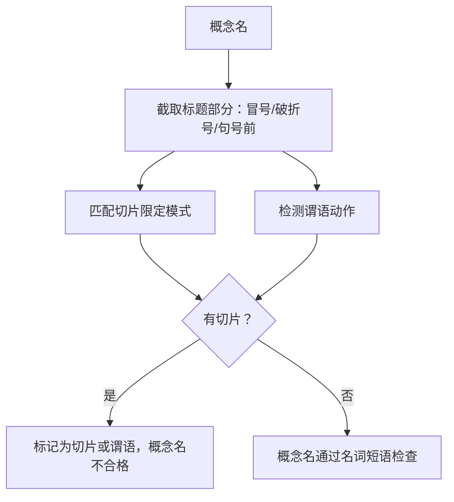
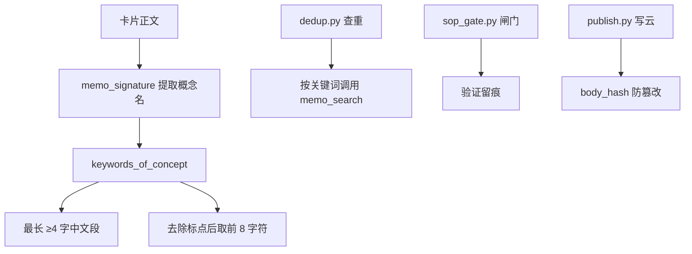
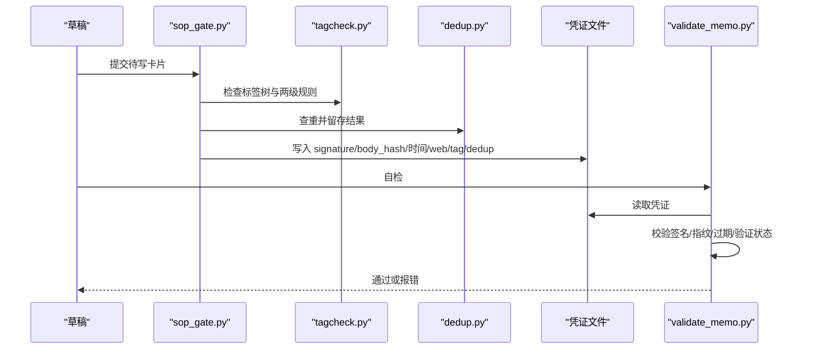
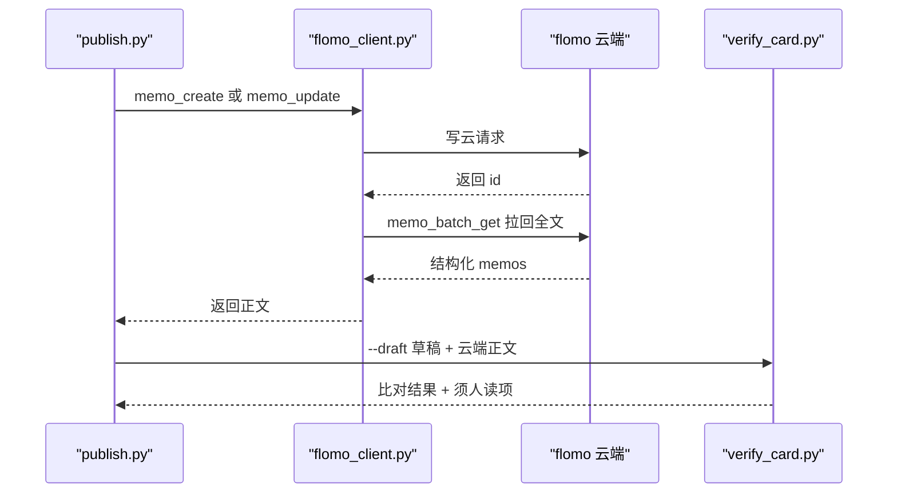
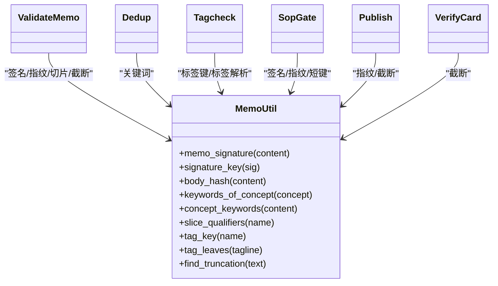
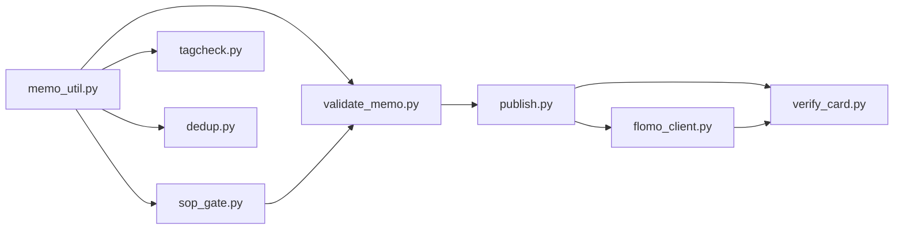

# 核心概念

<cite>
**本文引用的文件**   
- [README.md](file://README.md)
- [memo_util.py](file://scripts/memo_util.py)
- [test_validate_memo.py](file://tests/test_validate_memo.py)
- [test_dedup.py](file://tests/test_dedup.py)
- [test_tagcheck.py](file://tests/test_tagcheck.py)
- [test_sop_gate.py](file://tests/test_sop_gate.py)
- [test_publish.py](file://tests/test_publish.py)
</cite>

## 目录
1. [引言](#引言)
2. [项目结构](#项目结构)
3. [核心概念总览](#核心概念总览)
4. [H14–H16 卡片格式与签名](#h14h16-卡片格式与签名)
5. [两级标签体系](#两级标签体系)
6. [概念名判定规则](#概念名判定规则)
7. [正文指纹与检索关键词](#正文指纹与检索关键词)
8. [流程闸门与凭证](#流程闸门与凭证)
9. [写后回读验收](#写后回读验收)
10. [模块复用关系](#模块复用关系)
11. [依赖分析](#依赖分析)
12. [常见问题与排查建议](#常见问题与排查建议)
13. [结论](#结论)

## 引言
flomo-note 的核心目标是把网页、文章或想法沉淀为“一事一卡”的 flomo memo。所有判断口径都围绕三类事实：
- 卡片长什么样（H14–H16）；
- 概念名是不是独立成立的主题名词（H6b/H6d）；
- 流程是否按 SOP 顺序执行，并留下可校验凭证。

仓库的 README 明确区分三份权威文档：AGENTS.md 是总则，SKILL.md 是唯一细则源，ENVIRONMENT.md 是环境事实；README 只解释项目是什么、怎么跑、控制台怎么用。因此本文关于 H14–H16、标签、概念名等规则的叙述，都应理解为对 SKILL.md 中编号契约的代码层实现说明，而不是替代规则本身。

**章节来源**
- [README.md:1-200](file://README.md#L1-L200)

## 项目结构
从脚本侧看，核心代码集中在 `scripts/`，用例集中在 `tests/`。与 flomo-note 核心概念直接相关的文件包括：
- `memo_util.py`：卡片签名、正文指纹、检索关键词、标签键、概念名切片/谓语检测、截断占位符识别的唯一实现；
- `sop_gate.py`：SOP 流程闸门，代跑标签核对、查重、复盘，落凭证；
- `validate_memo.py`：文本质检 + 闸门凭证校验；
- `tagcheck.py`：现采标签树，核存在性与严格两级；
- `dedup.py`：查重，逐关键词搜索、分批取全文；
- `publish.py`：写云一条链，闸门 → 质检 → 建卡/更新 → 回读复核；
- `verify_card.py`：写后回读全文做机械校验，并支持按草稿逐字比对；
- `flomo_client.py`：MCP 调用入口，含写后回读验收逻辑。

**图表来源**
- [README.md:120-200](file://README.md#L120-L200)
- [memo_util.py:1-20](file://scripts/memo_util.py#L1-L20)

**章节来源**
- [README.md:120-200](file://README.md#L120-L200)

## 核心概念总览
| 概念 | 含义 | 关键约束 | 主要实现位置 |
|---|---|---|---|
| H14–H16 卡片格式 | 一行标签段 + 空行 + 概念名 + 空行 + 正文，一事一卡 | 首行以 `#` 开头；概念名不以 `#` 开头；两段空行不可省略 | `memo_util.memo_signature`、`validate_memo` |
| 一级/二级标签 | `#顶层/二级`，多标签空格分隔 | 严格两级；二级不得再含 `/` | `memo_util.tag_leaves`、`tagcheck.py` |
| 概念名 | 从正文前两个非空行提取的主题名词 | 必须是名词短语，不能是事件、阶段、版本、地域版本等“切片” | `memo_util.slice_qualifiers` |
| 卡片签名 | 标签行 + 概念名行构成的幂等键 | 用于查重、凭证文件名、写前校验 | `memo_util.memo_signature`、`signature_key` |
| 正文指纹 | 整个正文内容的哈希 | 防止“先过闸门、后改正文” | `memo_util.body_hash` |
| 检索关键词 | 从概念名派生的短词 | 避免全角标点导致检索命中为零 | `memo_util.keywords_of_concept` |
| 流程闸门凭证 | 记录签名、正文指纹、标签检查、查重结果的文件 | 每个 SOP 步骤产出一个凭证，全部齐全才允许 publish | `sop_gate.py`、`validate_memo.check_gate` |
| 写后回读验收 | publish 写云后立即拉回全文并比对 | 宽容空白差异，但必须同一张卡、同一段内容 | `publish.py`、`verify_card.py`、`flomo_client.py` |

**章节来源**
- [memo_util.py:1-200](file://scripts/memo_util.py#L1-L200)
- [test_validate_memo.py:1-188](file://tests/test_validate_memo.py#L1-L188)

## H14–H16 卡片格式与签名
### 格式要求
根据 README 的写卡流程描述，卡片形态是“一行标签段 + 概念名称行 + 正文”，并强调“一事一卡”。结合测试用例和 `memo_util` 的实现，实际校验更精确：
1. 首行应为标签段，以 `#` 开头；
2. 第二行应为概念名，非空且不以 `#` 开头；
3. 概念名之后应有空行，再进入正文；
4. 正文应包含实质内容，不能为空；
5. 整体遵循“一事一卡”，一个概念一张 memo。

测试用例覆盖了以下边界：
- 正常卡片通过；
- 标题后缺空行判错；
- 空正文判错；
- BOM 不干扰首行判断；
- CRLF 换行不干扰；
- URL 整行豁免正文中的非法字符扫描；
- 正文中数字斜杠如 `1/2` 不视为脏标签。

**图表来源**
- [memo_util.py:1-60](file://scripts/memo_util.py#L1-L60)

### 签名唯一性
`memo_signature` 是签名唯一实现，返回 `{tagline, concept}` 或 `None`。它不抛异常，而是对空值、非字符串、不足两行等情况统一返回 `None`。这很重要，因为调用方可能是缺失 content 的请求体或已清空的卡片。

签名还派生稳定短键 `signature_key`，由 tagline 与 concept 拼接后取 sha256 前 16 位，用作凭证文件名等稳定标识。

**章节来源**
- [memo_util.py:1-60](file://scripts/memo_util.py#L1-L60)
- [test_validate_memo.py:1-60](file://tests/test_validate_memo.py#L1-L60)
- [test_sop_gate.py:1-120](file://tests/test_sop_gate.py#L1-L120)

## 两级标签体系
### 规则
标签体系是严格两级：`#顶层/二级`。
- 顶层和二级之间用半角 `/`；
- 多标签用空格分隔；
- 二级部分不能再含 `/`；
- 标签必须以空白或行尾收束，避免把 `#科技/安全/邮件认证` 误拆成 `(科技, 安全)`；
- 二级末尾的句读标点要剔除，但成对括号保留；
- 大小写、空白、全角斜杠在“近义比对”时会被折叠，但在“存在性判断”时必须逐字匹配云端树。

### 实现要点
`tag_leaves` 负责从标签行解析出合法的两级对，`tag_key` 负责比较“是否是同一簇的不同写法”。两者分工明确：
- `tag_leaves` 决定“这个标签能不能作为有效键参与后续逻辑”；
- `tag_key` 决定“云端已有 `AI/Agent`，而用户写了 `AI / Agent` 或 `ai/agent`，属于重复簇而非新簇”。

测试用例覆盖：
- 三级标签判错；
- 裸顶层标签判错；
- 非法字符标签；
- 全角斜杠、大小写不同、两侧空格的重复写法；
- 只有叶子标签时的顶层存在性判断；
- 标签树截断时退出码非 0。

**图表来源**
- [memo_util.py:260-320](file://scripts/memo_util.py#L260-L320)

**章节来源**
- [memo_util.py:260-320](file://scripts/memo_util.py#L260-L320)
- [test_tagcheck.py:1-200](file://tests/test_tagcheck.py#L1-L200)
- [test_validate_memo.py:40-90](file://tests/test_validate_memo.py#L40-L90)

## 概念名判定规则
### 基本定义
概念名来自卡片签名的第二非空行。它必须是“独立成立的主题名词”，而不是某个事件、某次发布、某个时间切片、某个版本号、某个地域版本。

### 两类违规
`memo_util` 把概念名问题分为两类：
1. **切片限定**：概念名被时间、季度、年份区间、相对时间词、语义化版本号、阶段号、代次轮次、批次、地域/语种版本等限定；
2. **谓语动作**：概念名不是名词短语，而是“谁做了什么”的事件表述。

### 切片检测
切片模式表包括：
- 年份区间、季度、相对时间词、时间形态词；
- 语义化版本号、版本后缀、阶段号；
- 代次/轮次/批次；
- 地域/语种版本。

这些模式针对的是“对象可剥离的限定结构”：如果去掉这段限定，剩下的仍是对象名，那就属于切片。

### 谓语检测
谓语检测不使用开放动词枚举，而是按语法位置判断：
- 动词前为空或抽象修饰语 → 构词，放行；
- 动词后接型号、代词、介词短语、另一动词 → 强谓语标志；
- 其余有具体宾语或后置成分 → 谓语。

测试用例显示，像“发布会”“开源模型”这类构词不应被拦，而“GPT-6 发布”“新增命令”这类事件表达应被拦。

**图表来源**
- [memo_util.py:60-200](file://scripts/memo_util.py#L60-L200)
- [memo_util.py:201-300](file://scripts/memo_util.py#L201-L300)

**章节来源**
- [memo_util.py:60-200](file://scripts/memo_util.py#L60-L200)
- [memo_util.py:201-300](file://scripts/memo_util.py#L201-L300)

## 正文指纹与检索关键词
### 正文指纹
`body_hash` 对整个正文内容计算 sha256。关键点：
- 非字符串入参会加类型前缀，使 `None` 与空字符串不产生相同指纹；
- 凭证保存正文指纹，用于防止“先跑闸门、后改正文”；
- 写后回读时也依赖正文指纹判断是否同一份内容。

### 检索关键词
`keywords_of_concept` 从概念名派生短关键词，最多取两个：
1. 概念名内最长的连续中文段（≥4 字）；
2. 概念名去除标点后的前 8 个字符。

设计动机是：当概念名含全角标点时，flomo 全文检索可能返回 0，因此退到短核心词。`concept_keywords` 先从卡片中提取概念名，再委托 `keywords_of_concept`。

**图表来源**
- [memo_util.py:1-120](file://scripts/memo_util.py#L1-L120)
- [test_dedup.py:1-120](file://tests/test_dedup.py#L1-L120)
- [test_sop_gate.py:120-220](file://tests/test_sop_gate.py#L120-L220)

**章节来源**
- [memo_util.py:1-120](file://scripts/memo_util.py#L1-L120)
- [test_dedup.py:1-120](file://tests/test_dedup.py#L1-L120)

## 流程闸门与凭证
### 闸门职责
`sop_gate.py` 是流程闸门，负责代跑：
- 标签核对；
- 查重；
- 复盘；
并校验验证留痕。只有全部通过后，才写入凭证文件。

凭证内容包含：
- `signature`：卡片签名；
- `sig_key`：基于签名的稳定短键；
- `body_hash`：正文指纹；
- `generated_at`、`expires_at`：凭证时间；
- `web`：网络验证状态；
- `tag_check`：标签检查结果；
- `dedup`：查重结果；
- `review`：复盘结果；
- 可选：`no_gate_authorized`、`no_gate_reason`（降级授权）。

### 凭证校验
`validate_memo.check_gate` 检查四类情况：
1. 凭证缺失 → ERR；
2. 凭证齐备 → 通过；
3. 正文指纹不符 → ERR；
4. 凭证过期 → ERR；
5. 签名与当前卡片不符 → ERR；
6. 验证未执行且未显式跳过 → ERR。

测试用例还覆盖：
- 文件名对得上但凭证内 signature 是另一张卡；
- 显式 skip-web 不报验证错；
- `--allow-no-gate` 需要凭证带授权标记才生效。

**图表来源**
- [test_sop_gate.py:1-220](file://tests/test_sop_gate.py#L1-L220)
- [memo_util.py:1-120](file://scripts/memo_util.py#L1-L120)

**章节来源**
- [test_sop_gate.py:1-220](file://tests/test_sop_gate.py#L1-L220)
- [memo_util.py:1-120](file://scripts/memo_util.py#L1-L120)

## 写后回读验收
### 流程纪律
publish 的写云一条链是：
1. 闸门；
2. 质检；
3. 建卡或更新；
4. 机器项复核；
5. 覆盖差异。

其中关键纪律是：
- create 只发一次，失败不重发；
- 写后复核失败只报告，不改写也不重发；
- 写后立刻调 `memo_batch_get` 拉回全文；
- 按草稿逐字比对，但宽容空白差异。

### 回读比对
`verify_card.py` 负责写后回读，可做：
- H11 中可机械判的部分；
- 列出需人读的两项；
- `--draft <草稿>` 按写路径同口径逐字比对；
- `--show-body` 打印全文供人读。

测试用例覆盖成功链、闸门阻断、质检阻断、create 失败不重试、幂等复用 id、复核失败仍输出 id 但不改写。

**图表来源**
- [test_publish.py:1-200](file://tests/test_publish.py#L1-L200)

**章节来源**
- [test_publish.py:1-200](file://tests/test_publish.py#L1-L200)

## 模块复用关系
`memo_util.py` 的设计原则是：卡片签名、正文指纹、检索关键词、标签键等公共口径只实现一次，其他模块 import 共用。这样可以避免“一处改口径、另一处静默失配”的幽灵故障。

| 模块 | 复用的 memo_util 能力 | 作用 |
|---|---|---|
| validate_memo | `memo_signature`、`body_hash`、`slice_qualifiers`、`find_truncation` | 卡片格式校验、概念名合法性、截断占位符检测、闸门凭证校验 |
| dedup | `keywords_of_concept`、`concept_keywords` | 从概念名派生检索关键词，逐关键词搜索并分批取全文 |
| tagcheck | `tag_key`、`tag_leaves` | 标签存在性、两级规则、近义写法比对 |
| sop_gate | `memo_signature`、`signature_key`、`body_hash` | 生成凭证、校验凭证签名与正文指纹 |
| publish | `body_hash`、`find_truncation` | 写前防篡改、写后核验截断 |
| verify_card | `find_truncation` | 写后回读时检测截断占位符 |

**图表来源**
- [memo_util.py:1-347](file://scripts/memo_util.py#L1-L347)

**章节来源**
- [memo_util.py:1-347](file://scripts/memo_util.py#L1-L347)
- [test_validate_memo.py:1-188](file://tests/test_validate_memo.py#L1-L188)
- [test_dedup.py:1-120](file://tests/test_dedup.py#L1-L120)
- [test_tagcheck.py:1-200](file://tests/test_tagcheck.py#L1-L200)
- [test_sop_gate.py:1-220](file://tests/test_sop_gate.py#L1-L220)
- [test_publish.py:1-200](file://tests/test_publish.py#L1-L200)

## 依赖分析
核心依赖关系可以分成三层：
1. 工具层：`memo_util.py` 提供纯本地计算能力；
2. 流程层：`sop_gate.py`、`validate_memo.py`、`tagcheck.py`、`dedup.py` 组合 SOP；
3. 写云层：`publish.py`、`flomo_client.py`、`verify_card.py` 负责写云与回读验收。

**图表来源**
- [README.md:120-200](file://README.md#L120-L200)
- [memo_util.py:1-347](file://scripts/memo_util.py#L1-L347)

**章节来源**
- [README.md:120-200](file://README.md#L120-L200)

## 常见问题与排查建议
| 现象 | 可能原因 | 排查建议 |
|---|---|---|
| 闸门提示缺少凭证 | 没有先跑 `sop_gate.py`，或凭证目录不对 | 确认凭证文件存在，且 `signature` 与当前卡片一致 |
| 闸门提示正文指纹不符 | 闸门通过后修改了正文 | 重新跑闸门，不要绕过凭证直接写云 |
| 闸门提示凭证过期 | 凭证 `expires_at` 已过 | 重新执行闸门流程 |
| 闸门提示签名与卡片不符 | 凭证文件名对应的另一张卡 | 删除旧凭证后重新生成 |
| 标签提示严格两级 | 写了三级标签或裸顶层标签 | 改为 `#顶层/二级`，不要继续嵌套 |
| 标签提示写法重复 | 云端已有 `AI/Agent`，却写了 `AI / Agent` 或 `ai/agent` | 改用云端树中存在的写法，不要新建近义簇 |
| 概念名被判切片 | 概念名包含年份、季度、版本、阶段、地域版本等限定 | 去掉切片限定，只保留对象本身 |
| 概念名被判谓语 | 概念名是“发布”“上线”“新增”等事件 | 改为名词短语，例如把“某模型发布”改成“某模型” |
| 查重找不到命中文档 | 概念名含全角标点，检索命中为零 | 检查 `keywords_of_concept` 是否能提取短关键词 |
| 写云后复核失败 | 云端正文与草稿不一致 | 用 `verify_card.py --show-body` 查看云端正文，再用 `--draft` 做逐字比对 |
| 写云失败但怀疑已写入 | publish 禁止重试 create | 不要盲目重跑；先查 MCP 响应和凭证，必要时走 update 流程 |
| 正文出现截断占位符 | 检索回包中段被替换 | 用 `find_truncation` 检测，并用 `memo_batch_get` 拉真实正文 |

**章节来源**
- [test_validate_memo.py:1-188](file://tests/test_validate_memo.py#L1-L188)
- [test_tagcheck.py:1-200](file://tests/test_tagcheck.py#L1-L200)
- [test_sop_gate.py:1-220](file://tests/test_sop_gate.py#L1-L220)
- [test_publish.py:1-200](file://tests/test_publish.py#L1-L200)
- [memo_util.py:1-347](file://scripts/memo_util.py#L1-L347)

## 结论
flomo-note 的核心概念不是分散在多个脚本里的习惯做法，而是收敛在少数几个函数和测试用例中：
- `memo_util.py` 定义了卡片签名、正文指纹、检索关键词、标签键、概念名切片与谓语检测、截断占位符识别；
- `sop_gate.py` 把这些口径落到凭证上，形成流程闸门；
- `validate_memo.py` 复用同一套签名和指纹做写前校验；
- `tagcheck.py` 复用标签键保证写前与写后标签一致性；
- `dedup.py` 复用概念关键词进行查重；
- `publish.py` 和 `verify_card.py` 保证写云后能立即回读、逐字比对并发现截断。

这套设计的核心价值在于：**同一份规则只有一个实现**。只要改动 `memo_util`，就能同步影响闸门、质检、查重、标签、写云与回读，从而减少“一处漂移、另一处静默漏检”的风险。