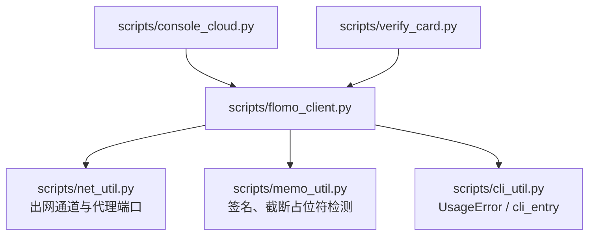
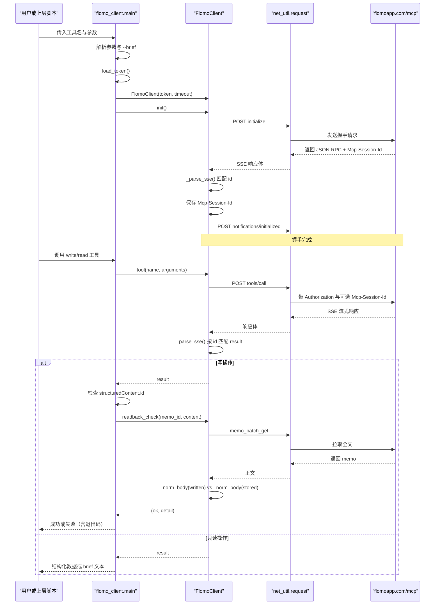
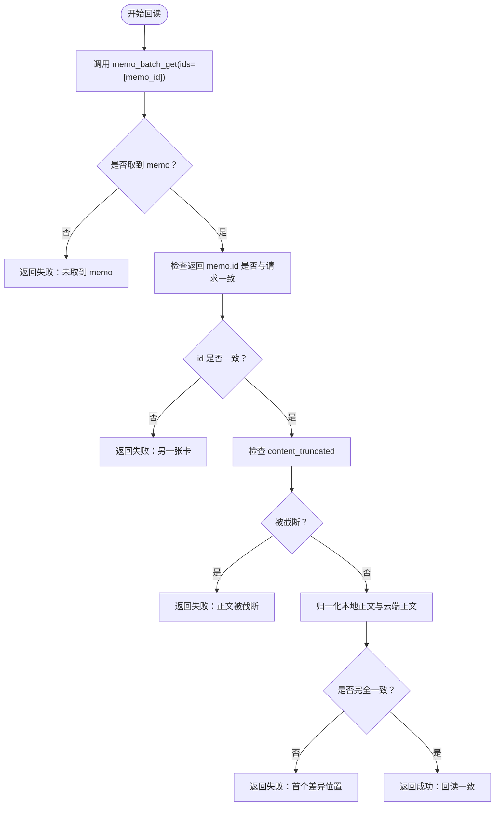
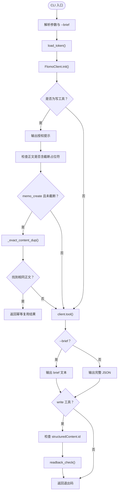
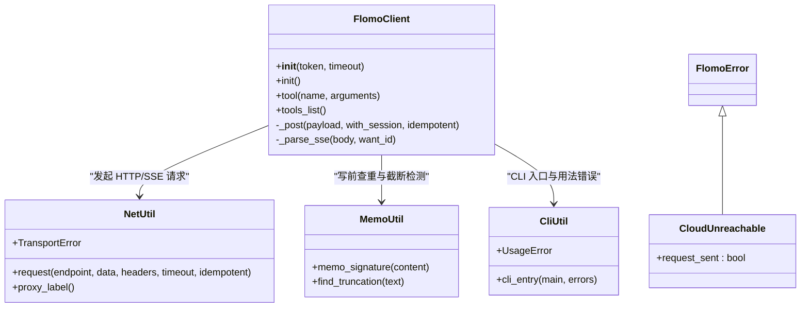
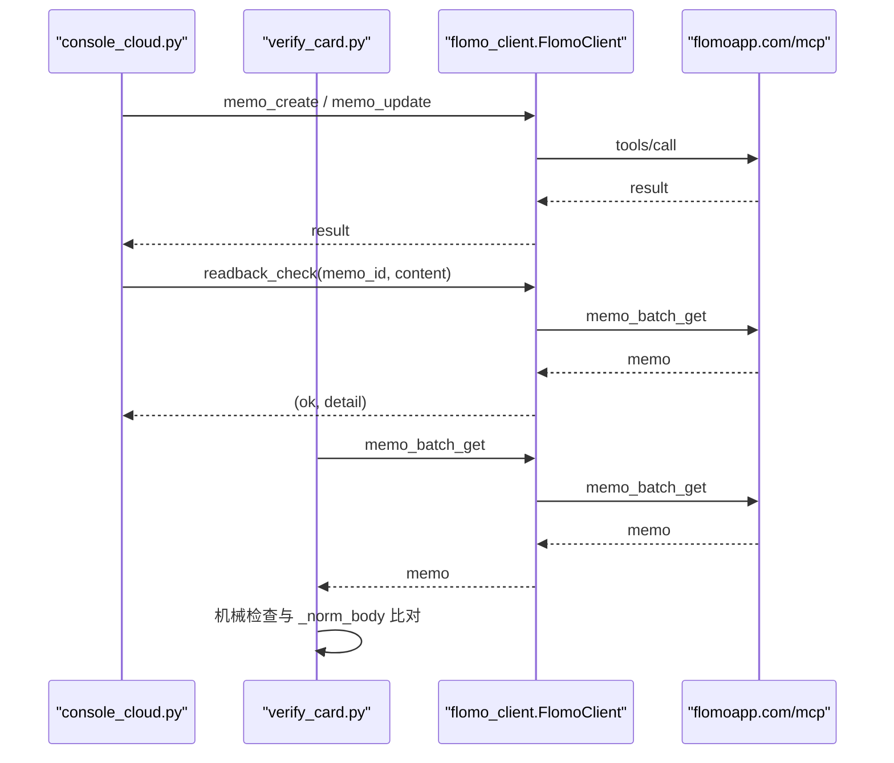

# MCP 客户端 flomo_client.py

<cite>
**本文引用的文件**   
- [scripts/flomo_client.py](file://scripts/flomo_client.py)
- [scripts/console_cloud.py](file://scripts/console_cloud.py)
- [scripts/verify_card.py](file://scripts/verify_card.py)
- [tests/test_flomo_client.py](file://tests/test_flomo_client.py)
</cite>

## 目录
1. [简介](#简介)
2. [项目结构](#项目结构)
3. [核心组件](#核心组件)
4. [架构总览](#架构总览)
5. [关键方法详解](#关键方法详解)
6. [依赖关系分析](#依赖关系分析)
7. [性能与可靠性特征](#性能与可靠性特征)
8. [故障排查指南](#故障排查指南)
9. [结论](#结论)

## 简介
`scripts/flomo_client.py` 是一个基于 Python 标准库的 MCP 客户端封装，负责与 `https://flomoapp.com/mcp` 建立连接、完成握手、发现工具、调用工具、解析 SSE 流式响应，并在写操作后按 id 回读全文做逐字比对。它同时提供命令行入口，把凭据读取、网络异常、JSON-RPC 协议错误统一收敛为 `FlomoError` 及其子类，避免让 `SystemExit` 穿透到 HTTP 服务层。

本模块的设计目标是：
- 集中实现 Bearer Token 读取、MCP 握手、SSE 解析；
- 暴露可复用的 `FlomoClient`，供控制台、发布流程、卡片校验等脚本复用；
- 对写操作实施“不重发 + 写后回读”双重防护；
- 将参数解析、用法错误与云端失败严格区分。

**章节来源**
- [scripts/flomo_client.py:1-200](file://scripts/flomo_client.py#L1-L200)

## 项目结构
该文件位于仓库的 `scripts` 目录中，作为独立可执行脚本和可复用库存在：
- 作为库：导出 `FlomoClient`、`load_token`、`tool_data`、`tool_data_or_none`、`readback_check`、`FLOMO_MCP_TOOLS` 等；
- 作为 CLI：通过 `if __name__ == "__main__"` 调用 `cli_entry(main, errors=(FlomoError,))`，把异常转成进程退出码。

**图表来源**
- [scripts/flomo_client.py:1-200](file://scripts/flomo_client.py#L1-L200)
- [scripts/console_cloud.py:1-120](file://scripts/console_cloud.py#L1-L120)
- [scripts/verify_card.py:1-60](file://scripts/verify_card.py#L1-L60)

**章节来源**
- [scripts/flomo_client.py:1-60](file://scripts/flomo_client.py#L1-L60)
- [scripts/flomo_client.py:660-681](file://scripts/flomo_client.py#L660-L681)

## 核心组件
| 名称 | 类型 | 职责 |
|---|---|---|
| `ENDPOINT` | 常量 | MCP streamable-http 端点 `https://flomoapp.com/mcp` |
| `WRITE_TOOLS` | 不可变集合 | 标记幂等性：重复执行可能产生第二张卡或改变读数 |
| `FlomoError` | 异常类 | 凭据缺失、HTTP 错误、JSON-RPC 协议错误的统一抛出类型 |
| `CloudUnreachable` | 异常子类 | 网络通道不可达，携带 `request_sent` 标志 |
| `FlomoClient` | 客户端类 | 连接初始化、工具调用、SSE 解析、会话 ID 管理 |
| `_extract_data` | 函数 | 从 MCP tools/call 回包中提取结构化数据 |
| `tool_data` | 函数 | 读路径专用：取不到抛 `FlomoError` |
| `tool_data_or_none` | 函数 | 写后回读专用：取不到返回 `None` |
| `brief_text` | 函数 | 列表型结果压缩为短表，用于 `--brief` |
| `_result_memos` | 函数 | 安全提取 memos 列表，空值退化为 `[]` |
| `_exact_content_dup` | 函数 | 写前查重，按签名匹配既有 memo id |
| `_norm_body` | 函数 | 平台差异归一化，用于回读比对 |
| `readback_check` | 函数 | 写后按 id 拉全文并逐字比对 |
| `FLOMO_MCP_TOOLS` | 常量 | 客户端侧镜像的工具契约，供治理审计 |

**章节来源**
- [scripts/flomo_client.py:20-120](file://scripts/flomo_client.py#L20-L120)
- [scripts/flomo_client.py:240-420](file://scripts/flomo_client.py#L240-L420)
- [scripts/flomo_client.py:420-511](file://scripts/flomo_client.py#L420-L511)
- [scripts/flomo_client.py:560-660](file://scripts/flomo_client.py#L560-L660)

## 架构总览
下面的时序图展示了从令牌加载到工具调用的完整链路，以及写操作后的回读验收。

**图表来源**
- [scripts/flomo_client.py:120-240](file://scripts/flomo_client.py#L120-L240)
- [scripts/flomo_client.py:512-660](file://scripts/flomo_client.py#L512-L660)

## 关键方法详解

### 凭据加载：`load_token()`
- **输入**：无。
- **输出**：`(token, source)` 元组。
- **行为**：
  - 优先读取项目根 `.mcp.json` 中的 `mcpServers.flomo.headers.Authorization`，要求以 `Bearer ` 开头；
  - 若不存在 `.mcp.json`，再回退到环境变量 `FLOMO_TOKEN`；
  - 均取不到时抛出 `FlomoError`。
- **设计要点**：`.mcp.json` 是配置事实源，环境变量仅作为后备，因为 env token 可能过期。

**章节来源**
- [scripts/flomo_client.py:60-120](file://scripts/flomo_client.py#L60-L120)

### 连接初始化：`FlomoClient.__init__` 与 `init()`
- **`__init__(self, token, timeout=30.0)`**：
  - 设置请求头：`Content-Type`、`Accept`、`Authorization`；
  - 保存默认超时秒数；
  - 初始会话 ID 为空。
- **`init()`**：
  - 先发送 `initialize`，协议版本固定为 `2025-03-26`；
  - 再从响应头取得 `Mcp-Session-Id` 并缓存；
  - 最后发送单向通知 `notifications/initialized`。
- **返回值**：无。
- **异常**：网络异常转为 `CloudUnreachable`；HTTP 错误转为 `FlomoError`；JSON-RPC error 转为 `FlomoError`。

**章节来源**
- [scripts/flomo_client.py:120-240](file://scripts/flomo_client.py#L120-L240)

### 工具调用封装：`tool()`
- **输入**：
  - `name`：工具名；
  - `arguments`：参数字典，默认为空字典。
- **输出**：MCP tools/call 的原始 `result` 对象。
- **行为**：
  - 构造 JSON-RPC 请求，method 固定为 `tools/call`；
  - 非幂等工具（`memo_create`、`memo_update`、`tag_rename`）禁止在通道失败时自动重试；
  - 读工具允许 `idempotent=True`，由底层网络层决定是否换出口重发。
- **异常**：透传 `FlomoError`、`CloudUnreachable`。

**章节来源**
- [scripts/flomo_client.py:200-240](file://scripts/flomo_client.py#L200-L240)

### 协议发现：`tools_list()`
- **输入**：无。
- **输出**：`tools/list` 的结构化结果。
- **行为**：
  - 调用 JSON-RPC 发现接口 `tools/list`；
  - 不属于工具白名单，因为它不是 `tools/call`。
- **用途**：供控制台列出云端暴露的 MCP 工具。

**章节来源**
- [scripts/flomo_client.py:240-260](file://scripts/flomo_client.py#L240-L260)

### 工具调用通用入口：`tool()` 的使用位置
控制台通过 `CloudReader.run_read_tool(name, arguments)` 把界面生成的参数直接传给任意只读工具；写工具则必须经过 `console_cloud.py` 的格式闸门与流程闸门，不会直通 MCP。

**章节来源**
- [scripts/console_cloud.py:1-120](file://scripts/console_cloud.py#L1-L120)

### 写前查重：`_exact_content_dup()`
- **输入**：`client`、`content`。
- **输出**：已有 memo id 或 `None`。
- **行为**：
  - 计算正文签名；
  - 用多个候选关键词调用 `memo_search`；
  - 对命中候选逐个比较签名；
  - 找到相同签名即返回既有 id，避免重复建卡。
- **异常处理**：单次搜索出错时跳过，继续尝试其他关键词。

**章节来源**
- [scripts/flomo_client.py:360-420](file://scripts/flomo_client.py#L360-L420)

### 写后回读全文比对：`readback_check()`
- **输入**：
  - `client`：可调用的 MCP 客户端；
  - `memo_id`：写入成功后返回的 id；
  - `written`：本次写入的正文。
- **输出**：`(ok, detail)` 元组。
- **行为**：
  1. 调用 `memo_batch_get`，按 id 拉取全文；
  2. 若无 memo，判失败；
  3. 若返回的 id 与请求 id 不同，判失败；
  4. 若 `content_truncated` 为真，判失败；
  5. 使用 `_norm_body` 归一化本地正文与云端正文；
  6. 归一化后仍不一致，返回首个差异字符位置；
  7. 一致则返回成功及字数信息。
- **重要约束**：失败信息明确提示“禁止据此重发写请求”。

**图表来源**
- [scripts/flomo_client.py:420-511](file://scripts/flomo_client.py#L420-L511)

**章节来源**
- [scripts/flomo_client.py:420-511](file://scripts/flomo_client.py#L420-L511)
- [tests/test_flomo_client.py:120-220](file://tests/test_flomo_client.py#L120-L220)

### 正文归一化：`_norm_body()`
- **输入**：字符串正文。
- **输出**：归一化后的字符串。
- **规则**：
  - 统一 CRLF 与 CR 为 LF；
  - 丢弃空行；
  - 还原 Markdown 元字符的反斜杠转义；
  - 还原裸邮箱自动链接化为 `[地址](mailto:地址)`；
  - 去除每行的水平空白；
  - 最终按行序列比较，行界与非空白字符不宽容。
- **目的**：屏蔽 flomo 渲染层与存储层的平台差异，使回读比对聚焦真实内容变化。

**章节来源**
- [scripts/flomo_client.py:420-511](file://scripts/flomo_client.py#L420-L511)
- [tests/test_flomo_client.py:60-120](file://tests/test_flomo_client.py#L60-L120)

### SSE 流式响应解析：`_post()` 与 `_parse_sse()`
- **`_post(payload, with_session=True, idempotent=True)`**：
  - 组装请求头；
  - 已建立会话时附加 `Mcp-Session-Id`；
  - 通过 `net_util.request` 发出请求；
  - 捕获 HTTP 错误为 `FlomoError`；
  - 捕获传输错误为 `CloudUnreachable`；
  - 从响应头更新会话 ID；
  - 交给 `_parse_sse` 解析。
- **`_parse_sse(body, want_id=None)`**：
  - 按行扫描 SSE 响应；
  - 只处理 `data:` 行；
  - 解析 JSON；
  - 若 `want_id` 未传，取第一个非空 id；
  - 若目标 id 出现 `error`，抛出 `FlomoError`；
  - 若目标 id 出现 `result`，返回 result；
  - 无 result/error 的 JSON-RPC 通知视为正常空响应。

**章节来源**
- [scripts/flomo_client.py:120-200](file://scripts/flomo_client.py#L120-L200)

### 结构化数据提取：`_extract_data`、`tool_data`、`tool_data_or_none`
- **`_extract_data(result)`**：
  - 若 result 不是对象，返回 `(None, 原因)`；
  - 若 `isError` 为真，收集 content 文本并返回错误原因；
  - 优先取 `structuredContent`；
  - 否则尝试解析 `content[].text` 中的内层 JSON；
  - 都取不到返回 `(None, 原因)`。
- **`tool_data(result)`**：取不到抛 `FlomoError`。
- **`tool_data_or_none(result)`**：取不到返回 `None`，用于写后回读场景。

**章节来源**
- [scripts/flomo_client.py:260-360](file://scripts/flomo_client.py#L260-L360)

### 命令模式与 CLI 入口
- **参数解析**：`_load_arguments` 支持直接传 JSON 字符串或 `--file` 传参文件；参数非法抛出 `UsageError`。
- **主流程 `main()`**：
  1. 打印帮助或退出；
  2. 解析参数；
  3. 加载 token；
  4. 初始化连接；
  5. 对写操作输出授权提示；
  6. 拦截含截断占位符的正文，退出码 4；
  7. 对 `memo_create` 执行写前幂等查重；
  8. 调用 `client.tool(name, arguments)`；
  9. 根据 `--brief` 输出摘要或完整 JSON；
  10. 写操作检查 `structuredContent.id`；
  11. 写操作调用 `readback_check`；
  12. 通过 `cli_entry` 把 `FlomoError` 转为退出码。

**图表来源**
- [scripts/flomo_client.py:512-660](file://scripts/flomo_client.py#L512-L660)

**章节来源**
- [scripts/flomo_client.py:480-511](file://scripts/flomo_client.py#L480-L511)
- [scripts/flomo_client.py:512-660](file://scripts/flomo_client.py#L512-L660)
- [scripts/flomo_client.py:660-681](file://scripts/flomo_client.py#L660-L681)

## 依赖关系分析

**图表来源**
- [scripts/flomo_client.py:120-240](file://scripts/flomo_client.py#L120-L240)
- [scripts/flomo_client.py:20-60](file://scripts/flomo_client.py#L20-L60)
- [scripts/flomo_client.py:660-681](file://scripts/flomo_client.py#L660-L681)

**章节来源**
- [scripts/flomo_client.py:20-60](file://scripts/flomo_client.py#L20-L60)
- [scripts/flomo_client.py:120-240](file://scripts/flomo_client.py#L120-L240)
- [scripts/flomo_client.py:660-681](file://scripts/flomo_client.py#L660-L681)

## 性能与可靠性特征

### 网络与超时
- 默认超时为 30 秒，可通过 `FlomoClient(token, timeout)` 调整。
- 所有出网请求走 `net_util.request`，由代理端口每次会话重新分配，避免裸调 `urlopen` 导致端口不一致。

### 幂等性与重试策略
- `WRITE_TOOLS = {"memo_create", "memo_update", "tag_rename"}` 被视为不幂等工具；
- 写工具调用时 `idempotent=False`，禁止在网络异常时自动换出口重发；
- 原因是 `memo_create` 存在索引滞后窗口，实测 13 秒内重发会创建第二张卡；
- 未登记的工具也按“不重发”处理，宁可多报一次错，也不制造脏数据。

### 写后回读验收
- 所有写操作成功后都会按 id 调用 `memo_batch_get`；
- 正文被截断、id 不匹配、内容不一致均判失败；
- 失败信息明确提示“禁止据此重发写请求”，防止自动化误判后重试造成重复写。

**章节来源**
- [scripts/flomo_client.py:20-60](file://scripts/flomo_client.py#L20-L60)
- [scripts/flomo_client.py:200-240](file://scripts/flomo_client.py#L200-L240)
- [scripts/flomo_client.py:512-660](file://scripts/flomo_client.py#L512-L660)

## 故障排查指南

### 凭据缺失
- 现象：启动后立即报错，未发生握手。
- 原因：`.mcp.json` 不存在或字段不完整，且未设置 `FLOMO_TOKEN`。
- 处置：补全 `.mcp.json` 中的 `mcpServers.flomo.headers.Authorization`，或导出 `FLOMO_TOKEN`。

### 鉴权失败
- 现象：HTTP 状态码非 2xx，或服务端返回 JSON-RPC error。
- 表现：抛出 `FlomoError`，消息中包含 HTTP 状态码或服务端错误正文。
- 处置：检查 token 是否过期、是否属于 flomo 账户、请求头是否正确。

### 网络异常
- 现象：连接被拒、DNS 解析失败、连接中断、超时。
- 表现：抛出 `CloudUnreachable`，包含 `request_sent` 标志。
- 关键分支：
  - `request_sent=False`：确定未发出请求，可换网络出口重试；
  - `request_sent=True`：可能已到达服务端，写操作严禁重发。

### 协议版本不一致
- 当前客户端固定发送 `protocolVersion: "2025-03-26"`；
- 若服务端不支持该版本，握手阶段会抛出 JSON-RPC error，最终被转换为 `FlomoError`；
- 处置：升级服务端 MCP 协议版本或同步客户端协议版本。

### 参数写错
- 现象：JSON 解析失败、参数不是对象、选项写错。
- 表现：抛出 `UsageError`，属于 `FlomoError` 子类；
- 区别：这是“用法错误”，不应与“云端调用失败”共用同一退出码。

### 写后回读失败
- 常见原因：
  - 云端未返回 memo；
  - 返回了另一张卡；
  - 正文被截断；
  - 正文内容不一致；
  - 云端存储层对 Markdown 元字符做了转义，但比对逻辑已通过 `_norm_body` 处理。
- 处置：不要重发写请求，按失败详情人工核对 id 与正文。

**章节来源**
- [scripts/flomo_client.py:60-120](file://scripts/flomo_client.py#L60-L120)
- [scripts/flomo_client.py:120-200](file://scripts/flomo_client.py#L120-L200)
- [scripts/flomo_client.py:480-511](file://scripts/flomo_client.py#L480-L511)
- [scripts/flomo_client.py:512-660](file://scripts/flomo_client.py#L512-L660)

## 与 console_cloud.py 和 verify_card.py 的关系

### 与 `console_cloud.py`
- `console_cloud.py` 是控制台的云端访问层，导入并使用 `FlomoClient`、`load_token`、`tool_data_or_none`；
- 它定义只读工具白名单 `READONLY_TOOLS` 与写工具白名单 `WRITE_TOOLS`；
- 读能力通过 `run_read_tool(name, arguments)` 把工具名与参数透传给 MCP；
- 写能力不走直通：必须先过格式闸门与流程闸门，再调用 `flomo_client`，最后回读全文验收；
- 它复用 `flomo_client` 的数据解析逻辑，避免各脚本各自解析 `structuredContent` 与 `content[].text`。

**章节来源**
- [scripts/console_cloud.py:1-120](file://scripts/console_cloud.py#L1-L120)

### 与 `verify_card.py`
- `verify_card.py` 是写云后的机械自查脚本，专门实现 H11 中可机械判定部分；
- 它直接导入 `flomo_client`，调用 `load_token()` 构造客户端；
- 通过 `memo_batch_get` 拉取卡片全文，并复用 `validate_memo.check()` 做形态检查；
- 它使用 `flomo_client._norm_body` 与 `_MD_ESCAPES` 进行同口径正文归一化；
- 它明确列出两项必须由人通读的盲区：首尾是否同一事件、是否串入他卡内容。

**章节来源**
- [scripts/verify_card.py:1-120](file://scripts/verify_card.py#L1-L120)

## 典型调用链示例

### 从控制台发起 `memo_create`
1. 控制台调用 `CloudReader.create_memo(...)`；
2. 先运行格式闸门与流程闸门；
3. 调用 `flomo_client.FlomoClient.tool("memo_create", arguments)`；
4. 检查返回的 `structuredContent.id`；
5. 调用 `readback_check(client, created_id, content)`；
6. 回读一致则报告成功，不一致则报告失败并提示人工核对。

### 从控制台发起 `memo_update`
1. 控制台调用 `CloudReader.update_memo(...)`；
2. 先运行格式闸门与流程闸门；
3. 调用 `flomo_client.FlomoClient.tool("memo_update", arguments)`；
4. 检查返回的 `structuredContent.id`；
5. 调用 `readback_check(client, updated_id, new_content)`；
6. 回读一致则报告成功，不一致则报告失败。

### 写后回读 `memo_batch_get`
1. `verify_card.py` 调用 `flomo_client.FlomoClient.tool("memo_batch_get", {"ids": [memo_id]})`；
2. 解析 `structuredContent.memos`；
3. 检查 `content_truncated`；
4. 检查首行标签段、第二行概念名；
5. 复用 `validate_memo.check()`；
6. 检查公式占位符与截断占位符；
7. 使用 `_norm_body` 与草稿做同口径比对。

**图表来源**
- [scripts/console_cloud.py:1-120](file://scripts/console_cloud.py#L1-L120)
- [scripts/verify_card.py:1-120](file://scripts/verify_card.py#L1-L120)
- [scripts/flomo_client.py:512-660](file://scripts/flomo_client.py#L512-L660)

## 结论
`scripts/flomo_client.py` 是 flomo MCP 客户端的核心实现，承担了凭据读取、握手、协议发现、工具调用、SSE 解析、写前查重与写后回读验收等职责。它通过 `FlomoError` 与 `CloudUnreachable` 明确区分“云端拒绝”与“网络不可达”，并通过 `WRITE_TOOLS` 与 `idempotent` 参数严格限制写操作的重试行为。控制台与卡片校验脚本在此基础上分别承担业务闸门与机械自检职责，共同保证写操作的终态一致性。