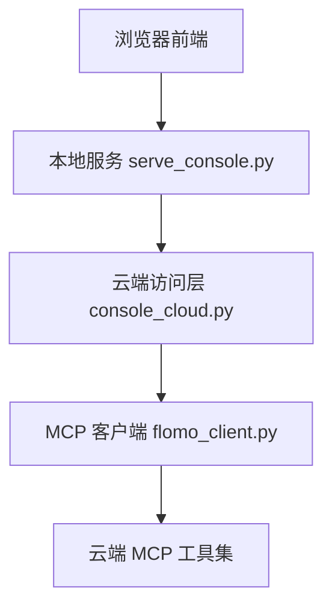
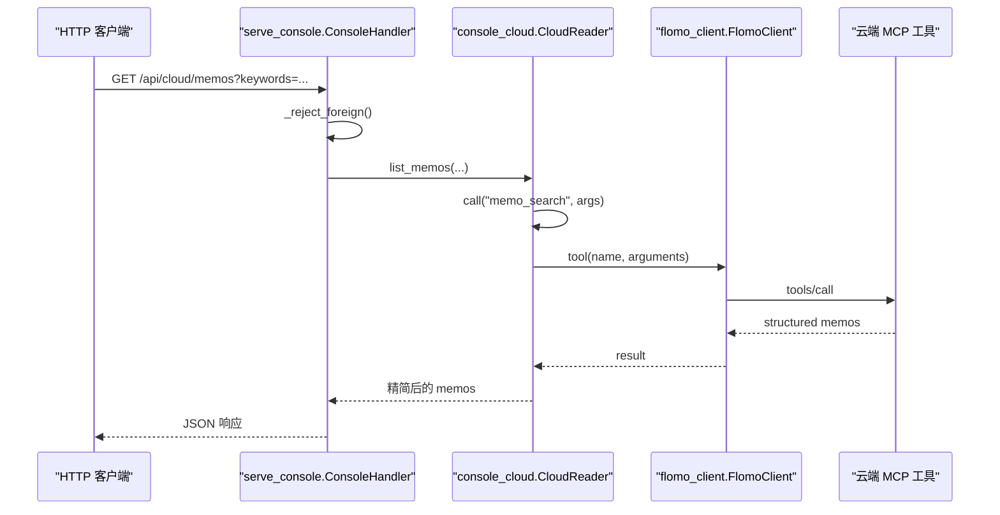
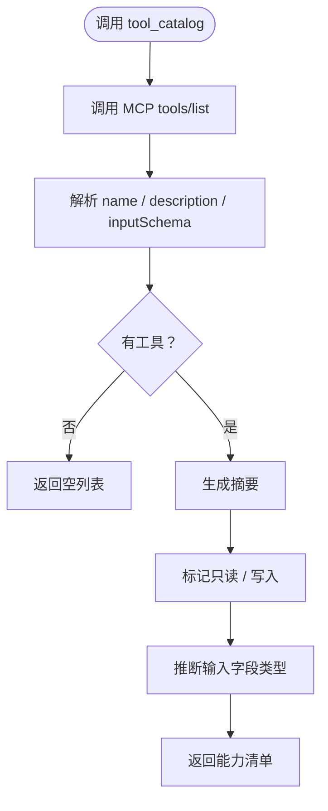
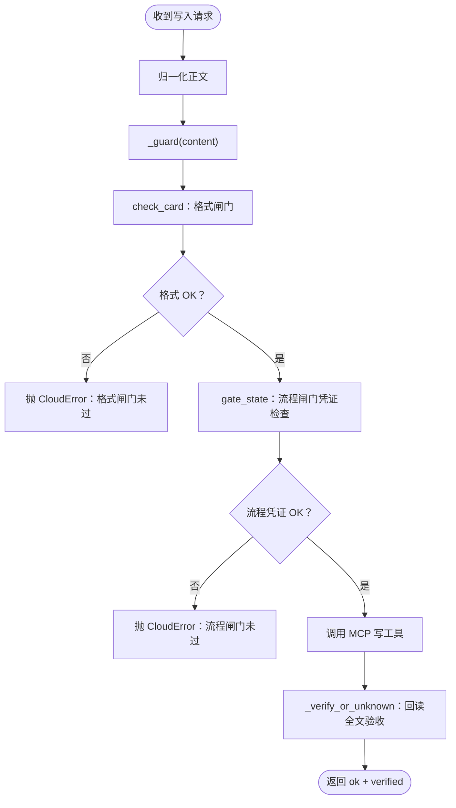
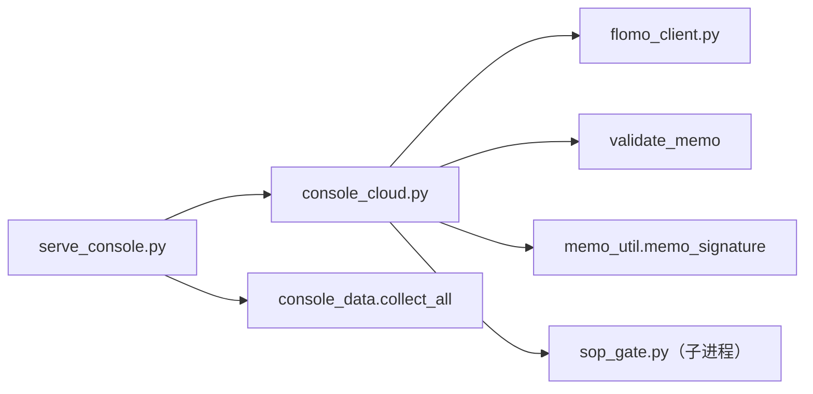

# 云端访问层 console_cloud.py

<cite>
**本文引用的文件**
- [scripts/console_cloud.py](file://scripts/console_cloud.py)
- [scripts/serve_console.py](file://scripts/serve_console.py)
- [scripts/flomo_client.py](file://scripts/flomo_client.py)
</cite>

## 目录
1. [引言](#引言)
2. [项目结构定位](#项目结构定位)
3. [核心组件与职责](#核心组件与职责)
4. [架构总览](#架构总览)
5. [接口规范](#接口规范)
6. [工具白名单与能力清单](#工具白名单与能力清单)
7. [写操作安全边界](#写操作安全边界)
8. [依赖关系分析](#依赖关系分析)
9. [性能与限制](#性能与限制)
10. [故障排查](#故障排查)
11. [新增 MCP 工具的注册步骤](#新增-mcp-工具的注册步骤)
12. [附录：curl 调用示例](#附录curl-调用示例)

## 引言
`console_cloud.py` 是 flomo-note 控制台项目的**云端访问层**，也是 Web 控制台与 MCP 客户端之间的安全边界。它负责：
- 维护**只读**和**写入**两套 MCP 工具白名单；
- 把 HTTP 请求映射到具体的 `CloudReader` 方法；
- 校验 Host/Origin，由上层 `serve_console.py` 拦截非本机来源；
- 对写操作强制执行格式闸门、流程闸门，并在写入后回读全文验收；
- 将云端返回的数据精简为前端可直接渲染的字段；
- 通过 `tools/list` 动态生成“能力”页表单，并开放通用只读执行入口。

本模块不直接作为可执行程序启动，而是被 `serve_console.py` 导入并复用进程级单例 `CLOUD = CloudReader()`。

**章节来源**
- [scripts/console_cloud.py:1-115](file://scripts/console_cloud.py#L1-L115)
- [scripts/serve_console.py:1-40](file://scripts/serve_console.py#L1-L40)

## 项目结构定位
控制台由三层组成：
1. **浏览器前端**（`web/index.html`、`web/app.js`）发起 GET/POST 请求；
2. **本地服务**（`scripts/serve_console.py`）做静态资源托管、JSON 路由、Host/Origin 校验；
3. **云端访问层**（`scripts/console_cloud.py`）做 MCP 工具白名单校验、参数归一化、闸门校验、云端调用与结果精简。



**图表来源**
- [scripts/serve_console.py:1-40](file://scripts/serve_console.py#L1-L40)
- [scripts/console_cloud.py:1-115](file://scripts/console_cloud.py#L1-L115)
- [scripts/flomo_client.py:116-214](file://scripts/flomo_client.py#L116-L214)

**章节来源**
- [scripts/serve_console.py:1-40](file://scripts/serve_console.py#L1-L40)

## 核心组件与职责
| 组件 | 职责 |
|---|---|
| `READONLY_TOOLS` | 只读 MCP 工具白名单，包含搜索、标签、参考文本等能力 |
| `WRITE_TOOLS` | 写入 MCP 工具白名单，仅含 `memo_create`、`memo_update`、`tag_rename` |
| `CloudError` | 统一异常类型，所有越权、网络、协议错误都收敛为它 |
| `CloudReader` | 懒连接、线程安全的 MCP 客户端封装，提供全部公开 API |
| `_structured` / `_result_memos` | 解析云端结构化数据或 memo 列表，失败转 `CloudError` |
| `check_card` / `gate_state` / `run_gate` | 委托 `validate_memo` 与 `sop_gate.py` 完成格式与流程闸门 |
| `create_memo` / `update_memo` / `rename_tag` | 写入口，串联闸门、云端写入、回读验收 |
| `tool_catalog` / `run_read_tool` | 动态暴露 MCP 能力清单与通用只读执行入口 |

**章节来源**
- [scripts/console_cloud.py:116-200](file://scripts/console_cloud.py#L116-L200)
- [scripts/console_cloud.py:201-500](file://scripts/console_cloud.py#L201-L500)
- [scripts/console_cloud.py:501-824](file://scripts/console_cloud.py#L501-L824)

## 架构总览


**图表来源**
- [scripts/serve_console.py:241-330](file://scripts/serve_console.py#L241-L330)
- [scripts/console_cloud.py:320-410](file://scripts/console_cloud.py#L320-L410)
- [scripts/flomo_client.py:207-214](file://scripts/flomo_client.py#L207-L214)

**章节来源**
- [scripts/serve_console.py:241-330](file://scripts/serve_console.py#L241-L330)
- [scripts/console_cloud.py:320-410](file://scripts/console_cloud.py#L320-L410)

## 接口规范

### 概览接口
| 接口 | 方法 | 路径 | 认证 | 说明 |
|---|---|---|---|---|
| 概览 | GET | `/api/overview` | 无 token，但需通过 Host/Origin 校验 | 合并本地数据与云端可用性状态 |

**请求参数**
- 无查询参数。

**响应结构**
```json
{
  "cloud": {
    "available": true,
    "reason": "凭证就位",
    "source": ".mcp.json 或环境变量",
    "max_limit": 50
  },
  "...": "collect_all(REPO_ROOT) 返回的本地数据字段"
}
```

**错误码**
| 状态码 | 含义 |
|---|---|
| 200 | 成功 |
| 403 | Host/Origin 不是本机地址 |
| 500 | 本地数据收集异常 |

**章节来源**
- [scripts/serve_console.py:241-274](file://scripts/serve_console.py#L241-L274)
- [scripts/console_cloud.py:370-390](file://scripts/console_cloud.py#L370-L390)

### 只读查询接口

#### 卡片列表与搜索：`memos`
| 属性 | 值 |
|---|---|
| HTTP 方法 | GET |
| 路径 | `/api/cloud/memos` |
| 查询参数 | `keywords`、`tag`、`start_date`、`end_date`、`source`、`has_tag`、`limit` |
| 默认 limit | 20 |
| 最大 limit | 50 |
| 白名单工具 | `memo_search` |

**参数语义**
- `tag` 必须是完整标签路径，例如 `AI/决策模型`；
- `source` 对应云端的 `from`，如 `ai`；
- `has_tag` 是三态开关：`true`、`false` 或不传；
- `limit` 会被钳制在 1 到 50。

**成功响应结构**
```json
{
  "count": 整数,
  "limit": 实际使用的 limit,
  "capped": boolean,
  "keywords": "字符串",
  "tag": "字符串",
  "start_date": "字符串",
  "end_date": "字符串",
  "source": "字符串",
  "has_tag": true | false | null,
  "memos": [
    {
      "id": "字符串",
      "tags": ["字符串"],
      "title": "字符串",
      "excerpt": "摘要",
      "word_count": 整数或空,
      "created_at": "字符串",
      "updated_at": "字符串",
      "url": "字符串",
      "from": "字符串",
      "truncated": boolean,
      "has_image": boolean,
      "has_link": boolean
    }
  ]
}
```

**错误码**
| 状态码 | kind | 含义 |
|---|---|---|
| 403 | 非 cloud | Host/Origin 校验失败 |
| 502 | cloud | 云端调用失败、token 缺失、工具报错、白名单外工具 |
| 500 | 其他 | 未预期异常 |

**章节来源**
- [scripts/serve_console.py:256-274](file://scripts/serve_console.py#L256-L274)
- [scripts/console_cloud.py:390-440](file://scripts/console_cloud.py#L390-L440)

#### 单卡全文：`memo`
| 属性 | 值 |
|---|---|
| HTTP 方法 | GET |
| 路径 | `/api/cloud/memo` |
| 查询参数 | `id` |
| 白名单工具 | `memo_batch_get` |

**成功响应结构**
```json
{
  "memo": {
    "id": "字符串",
    "tags": ["字符串"],
    "title": "字符串",
    "excerpt": "摘要",
    "word_count": 整数或空,
    "created_at": "字符串",
    "updated_at": "字符串",
    "url": "字符串",
    "from": "字符串",
    "truncated": boolean,
    "has_image": boolean,
    "has_link": boolean,
    "content": "完整正文",
    "content_truncated": boolean
  },
  "omitted_ids": ["字符串"]
}
```

**错误码**
| 状态码 | 含义 |
|---|---|
| 403 | Host/Origin 拒绝 |
| 502 | 缺少 id、未取到卡片、云端调用失败 |

**章节来源**
- [scripts/serve_console.py:264-268](file://scripts/serve_console.py#L264-L268)
- [scripts/console_cloud.py:440-452](file://scripts/console_cloud.py#L440-L452)

#### 批量全文：`memos/batch`
| 属性 | 值 |
|---|---|
| HTTP 方法 | GET |
| 路径 | `/api/cloud/memos/batch` |
| 查询参数 | `ids`，逗号分隔 |
| 单次上限 | 10 |
| 白名单工具 | `memo_batch_get` |

**成功响应结构**
```json
{
  "count": 实际返回条数,
  "requested": 清理后请求条数,
  "dropped": 超出 10 条被丢弃的数量,
  "memos": [full_memo],
  "omitted_ids": ["字符串"]
}
```

**错误码**
| 状态码 | 含义 |
|---|---|
| 403 | Host/Origin 拒绝 |
| 502 | 没有有效 id、云端调用失败 |

**章节来源**
- [scripts/serve_console.py:268-274](file://scripts/serve_console.py#L268-L274)
- [scripts/console_cloud.py:452-474](file://scripts/console_cloud.py#L452-L474)

#### 今日回顾：`review`
| 属性 | 值 |
|---|---|
| HTTP 方法 | GET |
| 路径 | `/api/cloud/review` |
| 白名单工具 | `get_daily_review` |

**成功响应结构**
```json
{
  "count": 整数,
  "memos": [slim_memo]
}
```

**错误码**
| 状态码 | 含义 |
|---|---|
| 403 | Host/Origin 拒绝 |
| 502 | 云端调用失败 |

**章节来源**
- [scripts/serve_console.py:270-274](file://scripts/serve_console.py#L270-L274)
- [scripts/console_cloud.py:474-482](file://scripts/console_cloud.py#L474-L482)

#### 相关笔记：`related`
| 属性 | 值 |
|---|---|
| HTTP 方法 | GET |
| 路径 | `/api/cloud/related` |
| 查询参数 | `id`、`limit`、`no_same_tag` |
| 默认 limit | 10 |
| 白名单工具 | `memo_recommended` |

**成功响应结构**
```json
{
  "id": "字符串",
  "count": 整数,
  "memos": [slim_memo]
}
```

**错误码**
| 状态码 | 含义 |
|---|---|
| 403 | Host/Origin 拒绝 |
| 502 | 缺少 id、云端调用失败 |

**章节来源**
- [scripts/serve_console.py:270-274](file://scripts/serve_console.py#L270-L274)
- [scripts/console_cloud.py:474-482](file://scripts/console_cloud.py#L474-L482)

#### 标签树：`tagtree`
| 属性 | 值 |
|---|---|
| HTTP 方法 | GET |
| 路径 | `/api/cloud/tagtree` |
| 查询参数 | `prefix`、`depth`、`limit` |
| 默认 limit | 200 |
| 最大 limit | 1000 |
| 白名单工具 | `tag_tree` |

**成功响应结构**
```json
{
  "tags": ["字符串"],
  "total": 整数或空,
  "returned": 整数或空,
  "limit": 实际 limit,
  "truncated": boolean,
  "hint": "字符串"
}
```

**错误码**
| 状态码 | 含义 |
|---|---|
| 403 | Host/Origin 拒绝 |
| 502 | 云端调用失败 |

**章节来源**
- [scripts/serve_console.py:274-274](file://scripts/serve_console.py#L274-L274)
- [scripts/console_cloud.py:482-505](file://scripts/console_cloud.py#L482-L505)

#### 标签名搜索：`tags`
| 属性 | 值 |
|---|---|
| HTTP 方法 | GET |
| 路径 | `/api/cloud/tags` |
| 查询参数 | `keywords`、`limit` |
| 默认 limit | 20 |
| 白名单工具 | `tag_search` |

**成功响应结构**
```json
{
  "keywords": "字符串",
  "count": 整数,
  "tags": ["字符串"]
}
```

**错误码**
| 状态码 | 含义 |
|---|---|
| 403 | Host/Origin 拒绝 |
| 502 | 云端调用失败 |

**章节来源**
- [scripts/serve_console.py:274-274](file://scripts/serve_console.py#L274-L274)
- [scripts/console_cloud.py:505-513](file://scripts/console_cloud.py#L505-L513)

#### 参考文本：`reference`
| 属性 | 值 |
|---|---|
| HTTP 方法 | GET |
| 路径 | `/api/cloud/reference` |
| 白名单工具 | `memory_context`、`memory_user`、`get_format_guide`、`get_tag_guide` |

**成功响应结构**
```json
{
  "memory": {
    "doc": "memory",
    "content": "字符串"
  },
  "user": {
    "doc": "user",
    "content": "字符串"
  },
  "format": {
    "doc": "format",
    "content": "字符串"
  },
  "tag": {
    "doc": "tag",
    "content": "字符串"
  }
}
```

**错误码**
| 状态码 | 含义 |
|---|---|
| 403 | Host/Origin 拒绝 |
| 502 | 任意参考文本读取失败 |

**章节来源**
- [scripts/serve_console.py:274-274](file://scripts/serve_console.py#L274-L274)
- [scripts/console_cloud.py:513-537](file://scripts/console_cloud.py#L513-L537)

### 写操作接口

#### 格式校验：`validate`
| 属性 | 值 |
|---|---|
| HTTP 方法 | POST |
| 路径 | `/api/cloud/validate` |
| 请求体 | `{ "content": "字符串", "format": "可选字符串" }` |
| 白名单工具 | 不调用 MCP 工具，仅走本地 `validate_memo` |

**成功响应结构**
```json
{
  "ok": boolean,
  "errors": ["字符串"],
  "warnings": ["字符串"],
  "tagline": "字符串",
  "concept": "字符串"
}
```

**错误码**
| 状态码 | 含义 |
|---|---|
| 400 | 请求体不是合法 JSON |
| 403 | Host/Origin 拒绝 |
| 422 | 格式闸门未过 |
| 500 | 未预期异常 |

**章节来源**
- [scripts/serve_console.py:314-320](file://scripts/serve_console.py#L314-L320)
- [scripts/console_cloud.py:539-555](file://scripts/console_cloud.py#L539-L555)

#### 流程闸门：`gate`
| 属性 | 值 |
|---|---|
| HTTP 方法 | POST |
| 路径 | `/api/cloud/gate` |
| 请求体 | `{ "content": "字符串", "skip_web": boolean, "anchor_id": "字符串", "verify": 对象或字符串 }` |
| 白名单工具 | 不调用 MCP 工具，调用 `sop_gate.py` 子进程 |

**成功响应结构**
```json
{
  "ok": boolean,
  "skip_web": boolean,
  "draft": "文件名",
  "lines": ["字符串"],
  "gate": {
    "ok": boolean,
    "errors": ["字符串"]
  }
}
```

**错误码**
| 状态码 | 含义 |
|---|---|
| 400 | 请求体不是合法 JSON |
| 403 | Host/Origin 拒绝 |
| 422 | 正文为空、闸门超时、流程闸门未过 |
| 500 | 未预期异常 |

**章节来源**
- [scripts/serve_console.py:320-327](file://scripts/serve_console.py#L320-L327)
- [scripts/console_cloud.py:555-603](file://scripts/console_cloud.py#L555-L603)

#### 新建卡片：`memo/create`
| 属性 | 值 |
|---|---|
| HTTP 方法 | POST |
| 路径 | `/api/cloud/memo/create` |
| 请求体 | `{ "content": "字符串", "format": "可选字符串" }` |
| 白名单工具 | `memo_create` |

**处理流程**
1. 归一化正文；
2. 格式闸门；
3. 流程闸门；
4. 调用 `memo_create`；
5. 提取新 id；
6. 按 id 回读全文验收。

**成功响应结构**
```json
{
  "ok": boolean,
  "id": "字符串",
  "id_inferred": boolean,
  "word_count": 整数或空,
  "verified": {
    "id": "字符串",
    "matched": boolean | null,
    "chars": 整数,
    "word_count": 整数或空,
    "content_truncated": boolean
  }
}
```

**错误码**
| 状态码 | 含义 |
|---|---|
| 400 | 请求体不是合法 JSON |
| 403 | Host/Origin 拒绝 |
| 422 | 格式闸门未过、流程闸门未过、正文为空 |
| 502 | 云端调用失败、回执缺 id 且兜底回搜失败 |

**章节来源**
- [scripts/serve_console.py:327-330](file://scripts/serve_console.py#L327-L330)
- [scripts/console_cloud.py:603-680](file://scripts/console_cloud.py#L603-L680)

#### 更新卡片：`memo/update`
| 属性 | 值 |
|---|---|
| HTTP 方法 | POST |
| 路径 | `/api/cloud/memo/update` |
| 请求体 | `{ "id": "字符串", "content": "字符串", "format": "可选字符串" }` |
| 白名单工具 | `memo_update` |

**处理流程**
1. 先取原文（H22）；
2. 归一化正文；
3. 格式闸门；
4. 流程闸门；
5. 调用 `memo_update`；
6. 回读验收。

**成功响应结构**
```json
{
  "ok": true,
  "id": "字符串",
  "before": {
    "chars": 整数,
    "concept": "字符串"
  },
  "word_count": 整数或空,
  "verified": {
    "id": "字符串",
    "matched": boolean | null,
    "chars": 整数,
    "word_count": 整数或空,
    "content_truncated": boolean
  }
}
```

**错误码**
| 状态码 | 含义 |
|---|---|
| 400 | 请求体不是合法 JSON |
| 403 | Host/Origin 拒绝 |
| 422 | 缺少 id、格式闸门未过、流程闸门未过 |
| 502 | 云端调用失败 |

**章节来源**
- [scripts/serve_console.py:330-333](file://scripts/serve_console.py#L330-L333)
- [scripts/console_cloud.py:680-716](file://scripts/console_cloud.py#L680-L716)

#### 重命名标签：`tag/rename`
| 属性 | 值 |
|---|---|
| HTTP 方法 | POST |
| 路径 | `/api/cloud/tag/rename` |
| 请求体 | `{ "old_tag": "字符串", "new_tag": "字符串", "max_memos": 整数或空 }` |
| 白名单工具 | `tag_rename` |
| 默认批量上限 | 200 |
| 绝对上限 | 2000 |

**成功响应结构**
```json
{
  "old_tag": "字符串",
  "new_tag": "字符串",
  "max_memos_requested": 整数或空,
  "matched_memos": 整数或空,
  "updated_memos": 整数或空,
  "updated_tags": 整数或空,
  "warnings": ["字符串"],
  "result": "原始回执",
  "ok": boolean,
  "status": "done | no_match | needs_scale | partial | unknown | inconsistent",
  "hint": "字符串"
}
```

**状态语义**
| status | 含义 |
|---|---|
| `done` | 匹配数等于实改数，全部写完 |
| `no_match` | 没有匹配到挂旧标签的笔记 |
| `needs_scale` | 匹配数超过默认 200，须带 `max_memos` 重试 |
| `partial` | 部分更新，标签已分裂 |
| `unknown` | 回执缺少关键字段，无法判定 |
| `inconsistent` | 回执自相矛盾，实改数大于匹配数 |

**错误码**
| 状态码 | 含义 |
|---|---|
| 400 | 请求体不是合法 JSON |
| 403 | Host/Origin 拒绝 |
| 422 | 本地前置校验失败、云端回执语义异常 |
| 502 | 云端调用失败 |

**章节来源**
- [scripts/serve_console.py:333-337](file://scripts/serve_console.py#L333-L337)
- [scripts/console_cloud.py:201-270](file://scripts/console_cloud.py#L201-L270)
- [scripts/console_cloud.py:716-824](file://scripts/console_cloud.py#L716-L824)

### 通用只读执行入口：`tool`
| 属性 | 值 |
|---|---|
| HTTP 方法 | POST |
| 路径 | `/api/cloud/tool` |
| 请求体 | `{ "name": "字符串", "arguments": 对象 }` |
| 白名单工具 | 仅限 `READONLY_TOOLS` |
| 用途 | 界面按 `tools/list` 生成的参数直接执行任一只读 MCP 工具 |

**成功响应结构**
响应形态归一为四类之一：
- `memos`：memo 列表；
- `tags`：标签列表；
- `text`：纯文本；
- `json`：结构化对象。

**错误码**
| 状态码 | 含义 |
|---|---|
| 400 | 请求体不是合法 JSON |
| 403 | Host/Origin 拒绝 |
| 422 | 工具名不在只读白名单、参数解析失败 |
| 502 | 云端调用失败 |

**章节来源**
- [scripts/serve_console.py:337-345](file://scripts/serve_console.py#L337-L345)
- [scripts/console_cloud.py:320-410](file://scripts/console_cloud.py#L320-L410)

## 工具白名单与能力清单

### 只读白名单
当前 `READONLY_TOOLS` 包含：
- `memo_search`
- `memo_batch_get`
- `memo_recommended`
- `get_daily_review`
- `tag_tree`
- `tag_search`
- `memory_context`
- `memory_user`
- `get_format_guide`
- `get_tag_guide`

任何不在该集合中的工具名，即使 `write=False`，也会被 `call()` 拒绝并抛出 `CloudError`。

### 写入白名单
当前 `WRITE_TOOLS` 仅包含：
- `memo_create`
- `memo_update`
- `tag_rename`

写工具不能通过通用只读入口 `/api/cloud/tool` 调用，因为该入口始终使用 `read=True` 的反向逻辑——即只放行 `READONLY_TOOLS`。

### 能力清单接口：`tools/list` → `/api/cloud/tools`
`tool_catalog()` 会调用 MCP 协议的 `tools/list` 发现能力，并按以下规则输出：
- 列出每个工具的 `name`、`description`、`inputSchema`；
- 计算一句人类可读摘要；
- 标注是否属于 `READONLY_TOOLS`、`WRITE_TOOLS`；
- 为写工具附加门槛说明；
- 根据 schema 推断 UI 控件类型：`boolean`、`integer`、`number`、`array`、其余按 `string`；
- 联合类型中忽略 `null`，取第一个非 null 类型；
- 当工具描述为空时，跳过该工具，避免生成无效表单。



**图表来源**
- [scripts/console_cloud.py:537-570](file://scripts/console_cloud.py#L537-L570)
- [scripts/console_cloud.py:600-650](file://scripts/console_cloud.py#L600-L650)

**章节来源**
- [scripts/console_cloud.py:116-170](file://scripts/console_cloud.py#L116-L170)
- [scripts/console_cloud.py:537-650](file://scripts/console_cloud.py#L537-L650)

## 写操作安全边界
写路径不是直通 MCP。`create_memo` 与 `update_memo` 都经过统一守卫：



**图表来源**
- [scripts/console_cloud.py:555-603](file://scripts/console_cloud.py#L555-L603)
- [scripts/console_cloud.py:603-716](file://scripts/console_cloud.py#L603-L716)

关键约束：
- 正文不落盘：仅在内存与 HTTP 响应之间传递；
- 唯一落盘的是流程闸门草稿 `memo_body*.txt`，由收尾清理回收；
- token 只在建立连接时使用，不进入返回值、响应体或日志；
- 所有越权、网络、协议异常统一转为 `CloudError`，由 `serve_console.py` 包装为 422 或 502。

**章节来源**
- [scripts/console_cloud.py:1-115](file://scripts/console_cloud.py#L1-L115)
- [scripts/console_cloud.py:555-716](file://scripts/console_cloud.py#L555-L716)
- [scripts/serve_console.py:241-345](file://scripts/serve_console.py#L241-L345)

## 依赖关系分析


**图表来源**
- [scripts/console_cloud.py:116-170](file://scripts/console_cloud.py#L116-L170)
- [scripts/serve_console.py:24-35](file://scripts/serve_console.py#L24-L35)

**章节来源**
- [scripts/console_cloud.py:116-170](file://scripts/console_cloud.py#L116-L170)
- [scripts/serve_console.py:24-35](file://scripts/serve_console.py#L24-L35)

## 性能与限制
| 限制项 | 值 | 说明 |
|---|---:|---|
| 卡片搜索默认数量 | 20 | 最大 50 |
| 批量全文上限 | 10 | 超出部分报 `dropped` |
| 标签树默认数量 | 200 | 最大 1000 |
| 标签重命名默认规模 | 200 | 绝对上限 2000 |
| 流程闸门超时 | 300 秒 | 子进程现查云端若干次 |
| 正文摘要长度 | 200 字符 | 列表视图使用 |
| 连接复用 | 是 | `CloudReader` 进程级单例懒连接 |

优化要点：
- `CloudReader` 使用线程锁保护连接初始化，避免并发首请求重复握手；
- 连接失败后重置，下次请求自动重连；
- 列表接口只返回精简字段，全文走单独接口；
- 写操作的回读验证失败不会重发请求，避免重复写入。

**章节来源**
- [scripts/console_cloud.py:170-200](file://scripts/console_cloud.py#L170-L200)
- [scripts/console_cloud.py:320-370](file://scripts/console_cloud.py#L320-L370)

## 故障排查

### 常见状态码
| 状态码 | 典型原因 | 排查建议 |
|---|---|---|
| 400 | 请求体不是合法 JSON | 检查 POST body 是否为 JSON 对象 |
| 403 | Host/Origin 不是本机地址 | 确认从 `http://127.0.0.1:<端口>/` 打开，而非外部域名 |
| 422 | 格式闸门、流程闸门、参数不合规 | 查看响应中的 `errors`、`kind` |
| 502 | 云端调用失败、token 缺失、白名单外工具 | 检查 `.mcp.json`、网络、MCP 工具是否可用 |
| 500 | 未预期异常 | 查看服务端日志中的异常类型 |

### token 不可用
`cloud_status().available == false` 时，`reason` 来自 `load_token()` 的异常信息。优先检查：
- 是否存在项目 `.mcp.json`；
- 若不存在，是否设置 `FLOMO_TOKEN` 环境变量；
- token 是否过期。

注意：token 本身不会出现在响应中。

### 写操作失败
- 422 + “格式闸门未过”：检查首行标签段、概念名、结论先行、标签层级、字数上限；
- 422 + “流程闸门未过”：检查 `.sop_gate/<签名>.json` 是否存在、签名是否匹配、是否过期；
- 502 + “回读验收失败”：可能正文被云端截断，应通过 `memo` 接口重新核对。

**章节来源**
- [scripts/serve_console.py:241-345](file://scripts/serve_console.py#L241-L345)
- [scripts/console_cloud.py:320-370](file://scripts/console_cloud.py#L320-L370)
- [scripts/console_cloud.py:555-716](file://scripts/console_cloud.py#L555-L716)

## 新增 MCP 工具的注册步骤
如果要在控制台接入新的 MCP 工具，应按以下顺序修改：

1. **新增 `CloudReader` 方法**  
   在 `console_cloud.py` 中实现一个方法，内部调用 `self.call("工具名", arguments)`。

2. **加入对应白名单**  
   - 只读工具：加入 `READONLY_TOOLS`；
   - 写入工具：加入 `WRITE_TOOLS`，并在方法中加入必要的闸门与验收逻辑。

3. **注册 HTTP 路由**  
   在 `serve_console.py` 的 `do_GET` 或 `do_POST` 路由表中添加路径映射。

4. **定义请求/响应契约**  
   明确查询参数、请求体字段、成功响应结构与错误码。

5. **更新能力清单行为**  
   如果是只读工具，`tools/list` 会自动发现；如果是写工具，确保 `WRITE_TOOLS_REASON` 能表达门槛。

6. **补充测试**  
   回归用例会扫描源码锁定白名单与实际调用的对等关系，新增方法必须通过相关测试。

**章节来源**
- [scripts/console_cloud.py:116-170](file://scripts/console_cloud.py#L116-L170)
- [scripts/serve_console.py:256-345](file://scripts/serve_console.py#L256-L345)

## 附录：curl 调用示例

> 以下示例假设本地服务运行在 `http://127.0.0.1:8787`。

### 查看云端状态
```bash
curl "http://127.0.0.1:8787/api/overview"
```

### 搜索卡片
```bash
curl "http://127.0.0.1:8787/api/cloud/memos?keywords=标签树&limit=20"
```

### 获取单卡全文
```bash
curl "http://127.0.0.1:8787/api/cloud/memo?id=卡片ID"
```

### 批量获取全文
```bash
curl "http://127.0.0.1:8787/api/cloud/memos/batch?ids=id1,id2,id3"
```

### 查看今日回顾
```bash
curl "http://127.0.0.1:8787/api/cloud/review"
```

### 查看相关笔记
```bash
curl "http://127.0.0.1:8787/api/cloud/related?id=卡片ID&limit=10"
```

### 查看标签树
```bash
curl "http://127.0.0.1:8787/api/cloud/tagtree?prefix=AI&limit=200"
```

### 搜索标签名
```bash
curl "http://127.0.0.1:8787/api/cloud/tags?keywords=决策"
```

### 拉取参考文本
```bash
curl "http://127.0.0.1:8787/api/cloud/reference"
```

### 校验格式
```bash
curl -X POST "http://127.0.0.1:8787/api/cloud/validate" \
  -H "Content-Type: application/json" \
  -d '{"content":"#标签\\n概念名\\n\\n正文"}'
```

### 跑流程闸门
```bash
curl -X POST "http://127.0.0.1:8787/api/cloud/gate" \
  -H "Content-Type: application/json" \
  -d '{"content":"#标签\\n概念名\\n\\n正文","skip_web":true}'
```

### 新建卡片
```bash
curl -X POST "http://127.0.0.1:8787/api/cloud/memo/create" \
  -H "Content-Type: application/json" \
  -d '{"content":"#标签\\n概念名\\n\\n正文"}'
```

### 更新卡片
```bash
curl -X POST "http://127.0.0.1:8787/api/cloud/memo/update" \
  -H "Content-Type: application/json" \
  -d '{"id":"卡片ID","content":"#标签\\n概念名\\n\\n更新后的正文"}'
```

### 重命名标签
```bash
curl -X POST "http://127.0.0.1:8787/api/cloud/tag/rename" \
  -H "Content-Type: application/json" \
  -d '{"old_tag":"旧标签","new_tag":"新标签","max_memos":200}'
```

### 动态执行只读工具
```bash
curl -X POST "http://127.0.0.1:8787/api/cloud/tool" \
  -H "Content-Type: application/json" \
  -d '{"name":"memo_search","arguments":{"keywords":"示例"}}'
```

**章节来源**
- [scripts/serve_console.py:241-345](file://scripts/serve_console.py#L241-L345)
- [scripts/console_cloud.py:320-824](file://scripts/console_cloud.py#L320-L824)