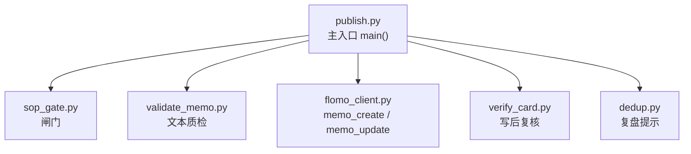
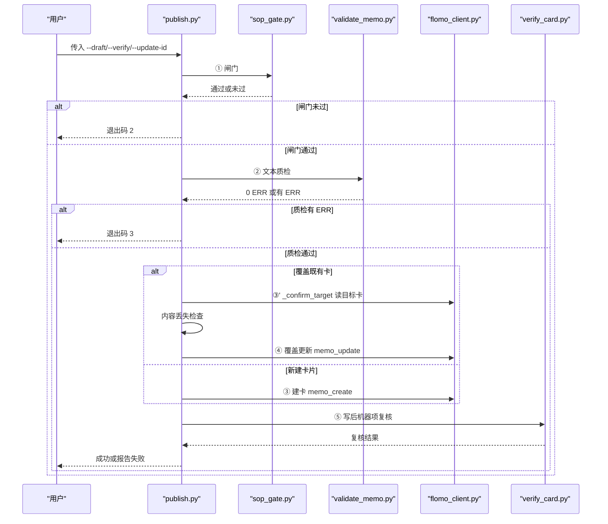
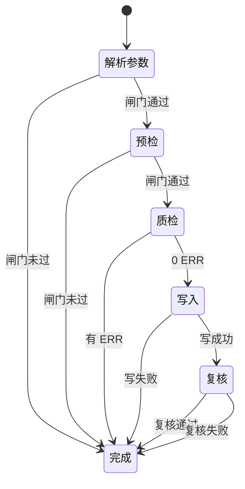
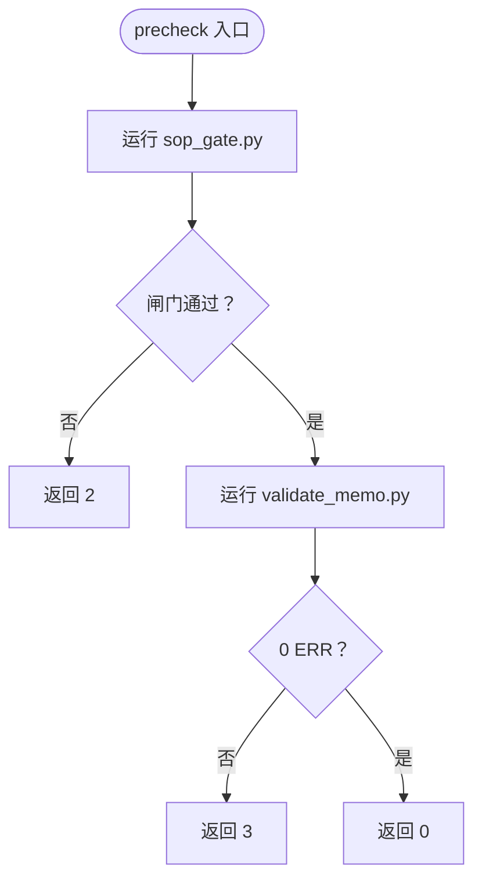
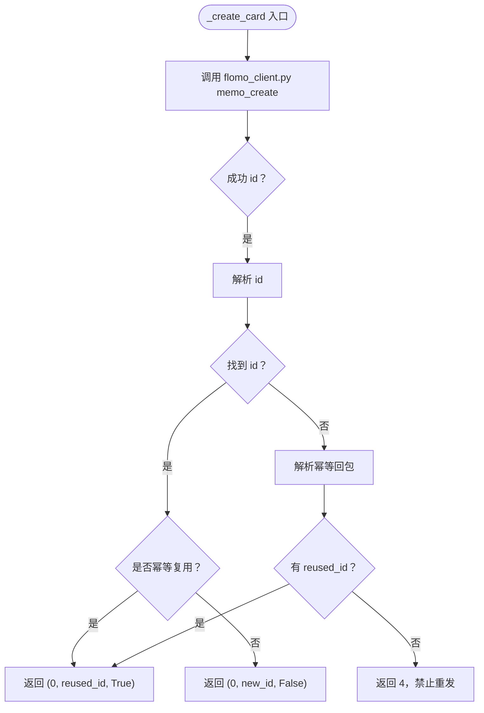
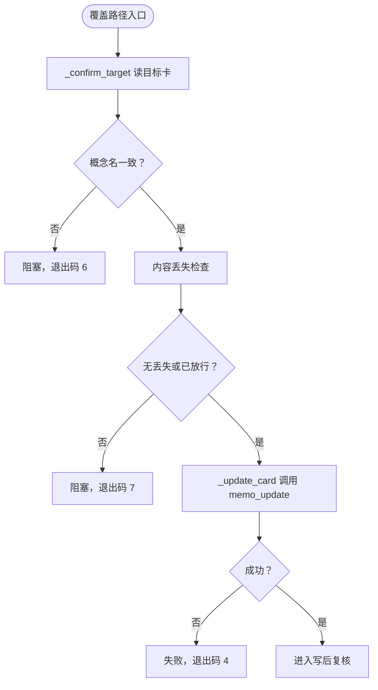
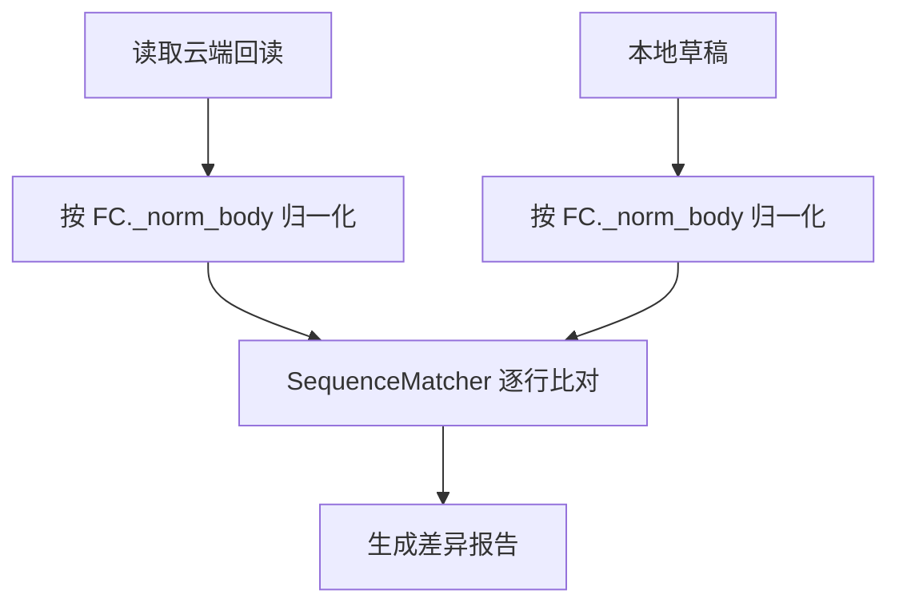
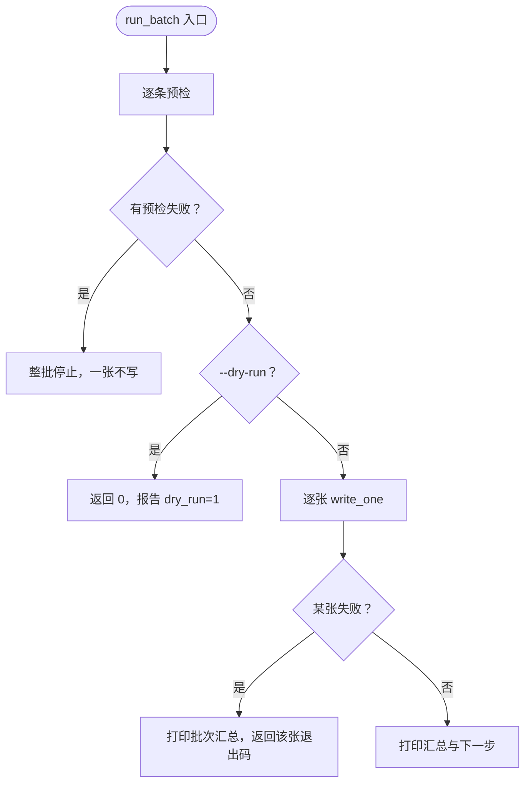
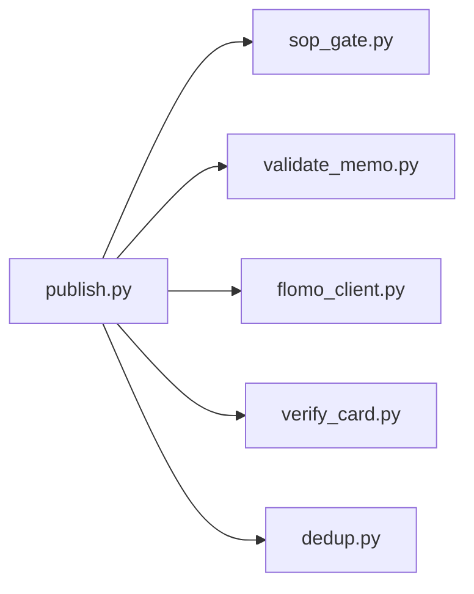

# 写云链路 publish.py

<cite>
**本文引用的文件**   
- [scripts/publish.py](file://scripts/publish.py)
- [tests/test_publish.py](file://tests/test_publish.py)
</cite>

## 目录
1. [引言](#引言)
2. [项目结构](#项目结构)
3. [核心组件](#核心组件)
4. [架构总览](#架构总览)
5. [详细组件分析](#详细组件分析)
6. [依赖关系分析](#依赖关系分析)
7. [性能考量](#性能考量)
8. [故障排查指南](#故障排查指南)
9. [结论](#结论)
10. [附录：CLI、批次清单与退出码](#附录cli批次清单与退出码)

## 引言
`scripts/publish.py` 实现“写云一条链”：把过去需要人工串联的闸门、质检、建卡/覆盖、回读复核、差异汇总固定成一次命令。它的三条纪律是：
- 闸门不过，一个字节不发云端；
- 文本质检存在 ERR，不发；
- `create` 只发一次，失败即停、绝不重发；成功后的 id 仅从回包程序解析。

它同时支持单卡写入、批量写入、更新既有卡（`--update-id`）、以及批量模式下的“预检全过才写”。

## 项目结构
仓库中与本脚本直接相关的是 `scripts/publish.py` 及其离线测试 `tests/test_publish.py`。其他外部工具通过子进程调用：
- `sop_gate.py`：流程闸门；
- `validate_memo.py`：文本质检；
- `flomo_client.py`：云端读写接口；
- `verify_card.py`：写后机器项复核；
- `dedup.py`：复盘定向复查（由下一步提示引导）。



**图示来源**
- [scripts/publish.py:970-1038](file://scripts/publish.py#L970-L1038)

**章节来源**
- [scripts/publish.py:1-200](file://scripts/publish.py#L1-L200)

## 核心组件
- CLI 参数解析：通过内部 `cli_util.CLI.parse_options` 与 `_OPTS` 定义。
- 子进程执行器：默认使用 `_exec`，测试可注入假执行器。
- 预检阶段：`precheck` 串行跑闸门与质检，不写云。
- 写入阶段：`write_one` 负责建卡或覆盖，并触发写后复核。
- 覆盖确认：`_confirm_target` 先读目标卡、比对概念名，再落改前快照。
- 内容丢失检查：`content_loss_report` 在覆盖前检测读数丢失和词中间断口。
- 差异报告：`diff_report` 比较云端原文与本轮草稿。
- 批量编排：`run_batch` 拆为“预检全量通过”与“逐张写入”。
- 结果输出：`[RESULT]`、`[下一步]`、`[批次汇总]`、`[批次] 已写 id`。

**章节来源**
- [scripts/publish.py:1-200](file://scripts/publish.py#L1-L200)
- [scripts/publish.py:601-894](file://scripts/publish.py#L601-L894)
- [scripts/publish.py:895-1038](file://scripts/publish.py#L895-L1038)

## 架构总览
一条标准写云链路按以下顺序执行：



**图示来源**
- [scripts/publish.py:601-894](file://scripts/publish.py#L601-L894)
- [scripts/publish.py:970-1038](file://scripts/publish.py#L970-L1038)

## 详细组件分析

### 命令行参数与模式选择
`main()` 先统一 stdout/stderr 编码，然后解析参数。关键行为如下：
- `--batch` 与 `--draft`/`--verify`/`--update-id`/`--allow-rename` 互斥；批量时这些字段必须写在清单里。
- 单卡模式下若给出 `--allow-rename` 但没有 `--update-id`，直接拒绝。
- 单卡模式会先校验草稿和留痕文件存在且可读。
- 非批量、非 dry-run 时最终走 `write_one()`。

| 参数 | 类型 | 含义 |
|---|---|---|
| `--draft` | 路径 | 草稿正文文件 |
| `--batch` | 路径 | 批次清单文件 |
| `--verify` | 路径 | 闸门验证留痕文件 |
| `--update-id` | 字符串 | 覆盖既有卡的目标 memo id |
| `--allow-rename` | 标志 | 允许覆盖时连概念名一起改 |
| `--allow-content-loss` | 标志 | 放行覆盖前的内容丢失检查 |
| `--dry-run` | 标志 | 只到质检，不写云 |
| `--skip-web` | 标志 | 透传给闸门的跳过 Web 查重 |
| `--no-verify-card` | 标志 | 跳过写后机器项复核 |

**章节来源**
- [scripts/publish.py:970-1038](file://scripts/publish.py#L970-L1038)

### 内部状态流转
整体流程可抽象为一个状态机：



- 预检：`precheck` 依次调用闸门与质检。
- 写入：`write_one` 区分建卡与覆盖；覆盖前先 `_confirm_target` 并做内容丢失检查。
- 复核：`verify_card` 失败不重试、不改写。

**图示来源**
- [scripts/publish.py:601-894](file://scripts/publish.py#L601-L894)

**章节来源**
- [scripts/publish.py:601-894](file://scripts/publish.py#L601-L894)

### 闸门与质检
`precheck` 严格按顺序执行：
1. 调用 `sop_gate.py --memo <draft>`，可选携带 `--verify` 与 `--skip-web`。
2. 调用 `validate_memo.py --file <draft>`。
3. 任一失败立即返回退出码 2 或 3，不继续后续步骤。



**图示来源**
- [scripts/publish.py:601-660](file://scripts/publish.py#L601-L660)

**章节来源**
- [scripts/publish.py:601-660](file://scripts/publish.py#L601-L660)

### 建卡与幂等复用
`_create_card` 调用 `flomo_client.py memo_create`，并严格遵循“只发一次”：
- 如果回包成功，从错误输出中匹配 `[成功] 已写入 memo id=...`，解析出 id。
- 如果云端返回幂等复用信息（包含 `idempotent` 与 `reused_id`），则视为成功但标记 `reused`。
- 其他情况一律按失败处理，禁止自动重发。



**图示来源**
- [scripts/publish.py:560-600](file://scripts/publish.py#L560-L600)

**章节来源**
- [scripts/publish.py:560-600](file://scripts/publish.py#L560-L600)

### 覆盖既有卡与改前快照
覆盖路径比建卡更危险：id 抄错不是多出一张卡，而是把另一张卡的正文盖掉。因此 `write_one` 在覆盖前先执行：
1. `_confirm_target`：读取目标卡，比对概念名。
2. 内容丢失检查：比较云端原文与本轮草稿，检测读数丢失与词中间断口。
3. 只有两者都通过，才调用 `_update_card` 执行 `memo_update`。



**图示来源**
- [scripts/publish.py:660-800](file://scripts/publish.py#L660-L800)

**章节来源**
- [scripts/publish.py:660-800](file://scripts/publish.py#L660-L800)

### 写后回读复核与宽容规则
`verify_card` 的调用位置在写成功后，作为机器项复核。它接收 `--id`、`--draft` 与 `--json`。

关键宽容规则来自对云端回读形态的处理：
- 云端标签段后会补一个空行，而本地草稿没有这个空行。
- 因此 `_head_lines` 取“前 n 个非空行”，避免把平台渲染层补的空行当成差异。
- `_norm_lines` 使用与 `flomo_client._norm_body` 同源的归一化口径，排除渲染层空白差异。
- 裸邮箱链接化属于平台渲染行为：回读正文中的裸邮箱可能被渲染成链接文本，但草稿中仍是裸邮箱。由于 diff 比较的是归一化后的行序列，这类渲染差异不参与判定。



**图示来源**
- [scripts/publish.py:120-180](file://scripts/publish.py#L120-L180)
- [scripts/publish.py:660-760](file://scripts/publish.py#L660-L760)

**章节来源**
- [scripts/publish.py:120-180](file://scripts/publish.py#L120-L180)
- [scripts/publish.py:660-760](file://scripts/publish.py#L660-L760)

### 批量处理
批量模式的核心不变量是：**先把 N 张全部预检通过，任何一张不过则一张都不写**。

批量的两个阶段：
1. 预检阶段：逐条跑 `precheck`；若指定 `--update-id`，还提前执行覆盖对象身份预检 `_precheck_target`。
2. 写入阶段：逐个调用 `write_one`，并在每张失败时打印 `[批次汇总]` 与 `[批次] 已写 id`。



**图示来源**
- [scripts/publish.py:895-969](file://scripts/publish.py#L895-L969)

**章节来源**
- [scripts/publish.py:895-969](file://scripts/publish.py#L895-L969)

### 批次清单格式
每行格式为：

```
草稿 | 留痕 | 覆盖 id | rename
```

- 后三段可省略或用 `-` 占位。
- `#` 开头为注释。
- 第 4 段只接受 `-`、空值或 `rename`。
- `rename` 只能出现在有覆盖 id 的行上。
- 同一份草稿路径不能出现两次。
- 同一份正文指纹不能出现两次，防止复制草稿造成重复卡。
- 同一张卡 id 不能覆盖两次。

示例清单：

```text
# 本轮三张
_tmp/draft_zt_1.txt | _tmp/verify_zt_1.json | -
_tmp/draft_zt_2.txt | _tmp/verify_zt_2.json | -
_tmp/draft_af_fix.txt | - | MjUzMzgyODYz | rename
```

**章节来源**
- [scripts/publish.py:760-894](file://scripts/publish.py#L760-L894)

### 示例

#### 单卡写入
```bash
python scripts/publish.py --draft _tmp/memo_body_68.txt --verify _tmp/verify_68.json
```

行为：
- 闸门 → 质检 → 建卡 → 写后复核 → 输出 `[RESULT] id=...`。
- 若云端返回幂等复用，还会输出 `[RESULT] reused=1`。

**章节来源**
- [scripts/publish.py:970-1038](file://scripts/publish.py#L970-L1038)

#### 批量写入
```bash
python scripts/publish.py --batch _tmp/batch.txt
```

行为：
- 先预检全部条目；任一预检失败则整批停止。
- 预检通过后逐张写入，失败时打印 `[批次汇总]` 与 `[批次] 已写 id`。
- 建议根据已写 id 续跑剩余条目，而不是整批重来。

**章节来源**
- [scripts/publish.py:895-969](file://scripts/publish.py#L895-L969)

#### 更新既有卡
```bash
python scripts/publish.py --draft _tmp/memo_body_68.txt --verify _tmp/verify_68.json --update-id MjYxODU0MzI5
```

行为：
- 预检通过后读目标卡，比对概念名。
- 若不匹配且未给 `--allow-rename`，阻塞并返回退出码 6。
- 做内容丢失检查；若检测到读数丢失或词中间断口且未给 `--allow-content-loss`，阻塞并返回退出码 7。
- 通过后才执行 `memo_update`。

**章节来源**
- [scripts/publish.py:660-800](file://scripts/publish.py#L660-L800)

#### 覆盖差异报告
覆盖路径会打印“写前云端 vs 写后云端”的差异：
- 删除行优先列出；超过 `DIFF_SHOW`（默认 80）行时截断并提示剩余行数。
- 若删除行占比超过 20% 且至少 3 行，额外警告可能是一次有意重写。
- 净删行数不为零时，要求人工逐条确认删除是否有意。

**章节来源**
- [scripts/publish.py:200-462](file://scripts/publish.py#L200-L462)
- [scripts/publish.py:462-600](file://scripts/publish.py#L462-L600)

## 依赖关系分析
`publish.py` 自身不直接访问网络，而是通过子进程调用其他脚本：



- 耦合点集中在子进程调用与 JSON 输出解析。
- 测试通过替换 `_exec` 注入假执行器，从而离线验证整条链。
- 外部依赖还包括 `cli_util`、`flomo_client` 模块导入，用于选项解析与正文归一化。

**图示来源**
- [scripts/publish.py:1-200](file://scripts/publish.py#L1-L200)
- [scripts/publish.py:970-1038](file://scripts/publish.py#L970-L1038)

**章节来源**
- [scripts/publish.py:1-200](file://scripts/publish.py#L1-L200)
- [scripts/publish.py:970-1038](file://scripts/publish.py#L970-L1038)

## 性能考量
- 批量模式替代了旧方案中每张卡各跑一次 `--dry-run` 的做法。旧方案下，闸门内含两路云端查重，六张卡可能触发十二次闸门；新方案把预检收敛为一次调用。
- 预检阶段不写云，避免不必要的云端请求。
- 子进程执行器默认超时 600 秒，写更新缩短至 180 秒，复核缩短至 120 秒。
- 差异报告使用 `difflib.SequenceMatcher`，时间复杂度与行数相关；对于超长卡，差异输出会被限制显示行数。

[本节为一般性指导，不直接分析具体代码片段]

## 故障排查指南

### 写失败时的回退策略
- 建卡失败：退出码 4。脚本明确禁止自动重发 create，必须先确认云端当前状态。
- 覆盖更新失败：同样返回 4，并提示客户端已做写后回读，应先看差异报告。
- 写后复核失败：退出码 5。此时卡已写入，脚本不改写、不重发，只报告失败项，要求人工处置。

**章节来源**
- [scripts/publish.py:560-600](file://scripts/publish.py#L560-L600)
- [scripts/publish.py:601-760](file://scripts/publish.py#L601-L760)
- [tests/test_publish.py:1-200](file://tests/test_publish.py#L1-L200)

### 幂等性保证
- 当 `flomo_client.memo_create` 返回 `idempotent=true` 与 `reused_id` 时，脚本认为云端已有同签名卡，直接复用该 id。
- 结果输出会包含 `[幂等] 云端已有同签名卡，复用 id=...` 与 `[RESULT] reused=1`。
- 这避免了因为索引滞后或并发导致重复建卡的风险。

**章节来源**
- [scripts/publish.py:560-600](file://scripts/publish.py#L560-L600)
- [tests/test_publish.py:1-200](file://tests/test_publish.py#L1-L200)

### verify_card 回读比对的具体宽容规则
- 平台渲染差异不参与比对：标签段后的空行、行内水平空白差异被忽略。
- 裸邮箱链接化：草稿中的裸邮箱与回读中被渲染成链接的文本被视为一致，因为比较基于归一化后的行序列。
- 概念名比较使用“前 n 个非空行”，避免因渲染补空行导致首尾不一致。

**章节来源**
- [scripts/publish.py:120-180](file://scripts/publish.py#L120-L180)
- [scripts/publish.py:660-760](file://scripts/publish.py#L660-L760)

## 结论
`scripts/publish.py` 将原本容易手滑的写云流程固化为一条有明确闸门、质检、写入、复核与差异报告的流水线。它通过“只发一次 create”“预检全过才写”“写前快照”“写后机器项复核”“谨慎的覆盖改名保护”等手段，显著降低重复卡、误删、id 抄错和内容静默丢失的风险。批量模式进一步减少了冗余云端查询，使大规模维护更可审计。

[本节为总结性内容，不直接分析具体代码片段]

## 附录：CLI、批次清单与退出码

### CLI 参数速查
- `--draft`：必填（单卡），草稿文件路径。
- `--batch`：批量模式，批次清单路径。
- `--verify`：闸门验证留痕，可选。
- `--update-id`：覆盖既有卡的目标 id。
- `--allow-rename`：允许覆盖时修改概念名。
- `--allow-content-loss`：放行覆盖前的内容丢失检查。
- `--dry-run`：只到质检，不写云。
- `--skip-web`：透传闸门跳过 Web 查重。
- `--no-verify-card`：跳过写后机器项复核。

**章节来源**
- [scripts/publish.py:970-1038](file://scripts/publish.py#L970-L1038)

### 退出码说明
| 退出码 | 含义 |
|---|---|
| 0 | 写入成功且机器项复核全过 |
| 1 | 前置检查不通过（草稿/留痕不存在等） |
| 2 | 闸门未过（未写云） |
| 3 | 文本质检有 ERR（未写云） |
| 4 | 写入失败（不重发，须人工核实） |
| 5 | 已写入但机器项复核失败（不改写、不重发） |
| 6 | 目标卡确认不通过（读不到、概念名不符、未显式允许改名） |
| 7 | 草稿比原卡少了读数或删出词中间断口（未写云，除非加 `--allow-content-loss`） |

批量模式下，2/3/6 若发生在预检阶段，表示一张都没写；4/5/6/7 若发生在第 k 张写入时，前 k−1 张已成功，应基于 `[批次汇总]` 与 `[批次] 已写 id` 续跑剩余条目。

**章节来源**
- [scripts/publish.py:1-200](file://scripts/publish.py#L1-L200)
- [scripts/publish.py:895-969](file://scripts/publish.py#L895-L969)