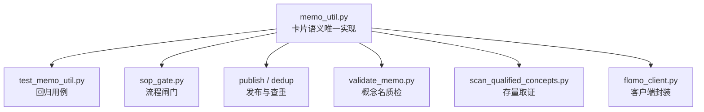
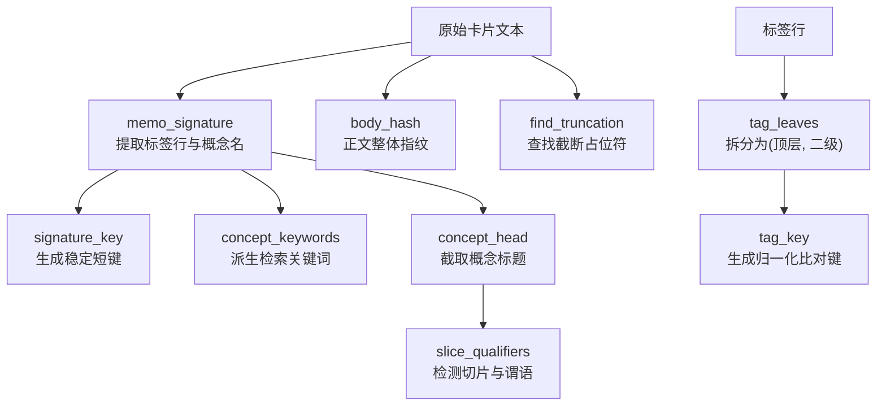
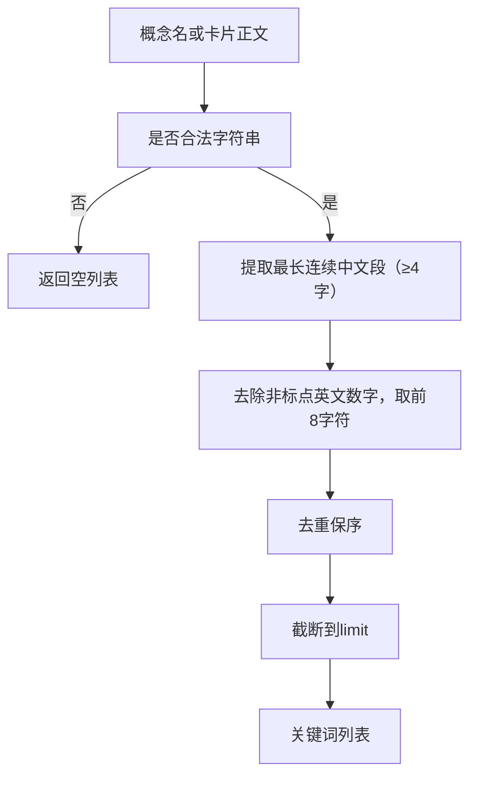
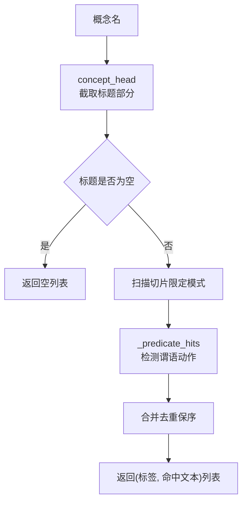
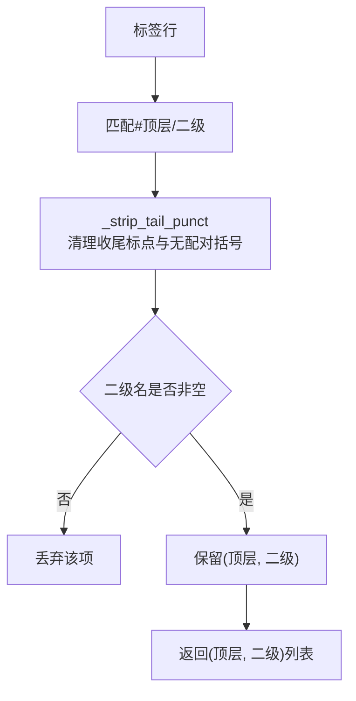
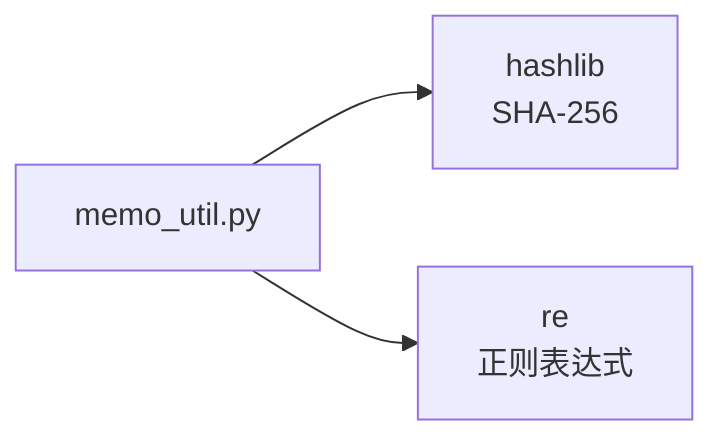
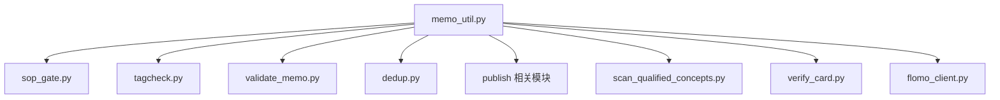

# 卡片语义 memo_util.py

<cite>
**本文引用的文件**
- [scripts/memo_util.py](file://scripts/memo_util.py)
- [tests/test_memo_util.py](file://tests/test_memo_util.py)
</cite>

## 目录
1. [引言](#引言)
2. [项目结构与定位](#项目结构与定位)
3. [核心组件总览](#核心组件总览)
4. [架构概览](#架构概览)
5. [详细函数文档](#详细函数文档)
6. [依赖关系分析](#依赖关系分析)
7. [性能与复杂度](#性能与复杂度)
8. [故障排查指南](#故障排查指南)
9. [结论](#结论)

## 引言
`scripts/memo_util.py` 是 flomo 卡片语义的**唯一事实源**。它集中实现三类能力：

1. **签名与指纹**：从卡片正文提取标签行和概念名，计算稳定短键与正文指纹，用于幂等查重、闸门凭证以及写后回读比对。
2. **检索关键词派生**：从概念名中抽取短中文核心词和清洗后的前缀，供检索系统使用。
3. **标签解析与概念名质检**：拆分两级标签、生成标签归一化键，并检测概念名中的“切片限定”和“谓语动作”，对应 H6b/H14/H18 等格式规范。

该模块被 `sop_gate`、`publish`、`dedup`、`tagcheck`、`validate_memo`、`scan_qualified_concepts`、`verify_card`、`flomo_client` 等多个脚本共享；若任何一处各自重写解析逻辑，极易出现“查重通过但凭证对不上”“写前放行但写后拦截”这类幽灵故障。

## 项目结构与定位
本模块位于仓库根下的 `scripts/` 目录，是一个纯 Python 工具模块，不依赖外部库（仅使用标准库 `hashlib` 和 `re`）。测试用例集中在 `tests/test_memo_util.py`，以独立导入方式加载模块并断言行为，避免把公共口径绑定到某个调用方。

**图表来源**
- [scripts/memo_util.py:1-20](file://scripts/memo_util.py#L1-L20)
- [tests/test_memo_util.py:1-20](file://tests/test_memo_util.py#L1-L20)

**章节来源**
- [scripts/memo_util.py:1-20](file://scripts/memo_util.py#L1-L20)
- [tests/test_memo_util.py:1-20](file://tests/test_memo_util.py#L1-L20)

## 核心组件总览
| 类别 | 函数或常量 | 输入 | 输出 | 主要用途 |
|---|---|---|---|---|
| 签名 | `memo_signature(content)` | 卡片全文字符串 | `{"tagline": str, "concept": str}` 或 `None` | 提取首行标签行与第二非空行概念名 |
| 签名键 | `signature_key(sig)` | 签名字典或 `None` | 16 字符十六进制串或 `None` | 凭证文件名、幂等键 |
| 正文指纹 | `body_hash(content)` | 任意对象 | 64 字符 SHA-256 十六进制串 | 凭证防篡改、空值区分 |
| 关键词 | `keywords_of_concept(concept, limit=2)` | 概念名字符串 | 去重保序的短关键词列表 | 直接基于概念名检索 |
| 关键词 | `concept_keywords(content, limit=2)` | 卡片全文 | 同上 | 先取签名再派生关键词 |
| 概念头 | `concept_head(name)` | 概念名 | 冒号或破折号前的标题部分 | 限定切片检测作用域 |
| 切片检测 | `slice_qualifiers(name)` | 概念名 | `[("标签", "命中文本"), ...]` | H6b 概念名质检 |
| 谓语检测 | `_predicate_hits(head)` | 概念标题 | 去重保序动词列表 | 内部辅助 |
| 标签键 | `tag_key(name)` | 标签段 | 归一化小写键 | 同簇不同写法识别 |
| 标签拆分 | `tag_leaves(tagline)` | 标签行 | `[(顶层, 二级), ...]` | 两级标签解析 |
| 截断检测 | `find_truncation(text)` | 正文文本 | 占位符字面列表 | 检索接口截断标记识别 |
| 常量 | `TRUNC_PLACEHOLDER` | 无 | 正则表达式 | 截断占位符匹配模式 |

**章节来源**
- [scripts/memo_util.py:21-110](file://scripts/memo_util.py#L21-L110)
- [scripts/memo_util.py:201-347](file://scripts/memo_util.py#L201-L347)

## 架构概览
以下图展示从原始卡片文本到结构化字段、指纹、关键词和质检结果的完整处理流：

**图表来源**
- [scripts/memo_util.py:21-110](file://scripts/memo_util.py#L21-L110)
- [scripts/memo_util.py:201-347](file://scripts/memo_util.py#L201-L347)

## 详细函数文档

### 卡片签名：`memo_signature`
- **职责**：从卡片正文中提取“标签行 + 概念名”。
- **规则**：
  - 忽略空行，取前两个非空行。
  - 第一非空行必须以 `#` 开头。
  - 第二非空行必须非空且不以 `#` 开头。
  - 不满足时返回 `None`，不抛异常。
- **与格式规范的关系**：
  - 兼容 H14 两种写法：标签段后直接跟概念名，或中间夹一个空行。
  - 只取前两个非空行，因此“标签段与概念名之间多行空白”也能正确跳过空行。
- **输入输出样例**：
  - 输入：`"#科技/机器人 #AI/物理AI\n德塔智能 Delta 0 双足人形机器人基础模型\n\n正文。"`  
    输出：`{"tagline": "#科技/机器人 #AI/物理AI", "concept": "德塔智能 Delta 0 双足人形机器人基础模型"}`
  - 输入：`"#科技/机器人\n\n概念名\n正文\n"`  
    输出：`{"tagline": "#科技/机器人", "concept": "概念名"}`
  - 输入：`""`、`None`、`123`、`"#标签\n"`、`"普通行\n概念名\n"`、`"#a/b\n#c/d\n正文\n"`  
    输出：`None`
- **边界条件**：
  - 空字符串、`None`、非字符串类型均返回 `None`。
  - 只有一个非空行返回 `None`。
  - 前两行都是标签行返回 `None`。

**章节来源**
- [scripts/memo_util.py:21-44](file://scripts/memo_util.py#L21-L44)
- [tests/test_memo_util.py:25-42](file://tests/test_memo_util.py#L25-L42)

### 签名键：`signature_key`
- **职责**：将签名转换为稳定的 16 字符短键，用于凭证文件名、索引键等。
- **算法**：对 `tagline + "\n" + concept` 做 UTF-8 编码后取 SHA-256 前 16 个十六进制字符。
- **输入输出样例**：
  - 同一签名两次调用返回相同 16 字符键。
  - 不同签名返回不同键。
  - 输入 `None` 返回 `None`。
- **与查重和凭证的关系**：
  - 作为“签名维度”的稳定标识，配合正文指纹共同构成凭证。
  - 短键适合用作文件名或缓存键，但完整签名仍参与指纹计算，保证不可逆还原。

**章节来源**
- [scripts/memo_util.py:46-53](file://scripts/memo_util.py#L46-L53)
- [tests/test_memo_util.py:44-54](file://tests/test_memo_util.py#L44-L54)

### 正文指纹：`body_hash`
- **职责**：生成正文整体指纹，用于防止“先跑闸门、后改正文”的凭证漂移。
- **算法**：
  - 字符串参数：直接对其 UTF-8 编码结果做 SHA-256。
  - 非字符串参数：先包装为 `<non-str:类型名>` 再哈希，使 `None` 与空字符串可区分。
- **输入输出样例**：
  - 同一正文两次调用返回相同 64 字符指纹。
  - 正文末尾加一个字符后指纹变化。
  - `body_hash(None)` 与 `body_hash("")` 不同。
  - `body_hash(1)` 与 `body_hash(2)` 相同（同为非字符串），但与 `body_hash("1")` 不同。
- **与写后回读比对的关系**：
  - 写前凭证记录签名键和正文指纹。
  - 写后回读时重新计算正文指纹，若不一致则说明正文被修改或读取不完整。
  - `None` 与空串区分开，避免把“未拿到正文”误判为“正文为空”。

**章节来源**
- [scripts/memo_util.py:55-68](file://scripts/memo_util.py#L55-L68)
- [tests/test_memo_util.py:56-70](file://tests/test_memo_util.py#L56-L70)

### 概念关键词派生：`keywords_of_concept` 与 `concept_keywords`
- **职责**：从概念名本身派生检索用短关键词，避免整行概念名含全角标点导致全文检索命中率为零。
- **规则**：
  - 先从概念名中按连续中文字符段匹配，保留最长一段（≥4 字）。
  - 再去除非中英文数字字符，取前 8 个字符。
  - 去重保序，最后截断到 `limit` 个。
  - 非字符串或空概念名返回空列表。
- **输入输出样例**：
  - 概念名：`"德塔智能 Delta 0 双足人形机器人基础模型"`  
    至少包含 `"双足人形机器人"` 等中文核心段。
  - 概念名：`"算子（含括号）的定义"`  
    括号不参与关键词。
  - `limit=1` 时返回列表长度为 1。
  - `None`、空字符串、纯空白返回 `[]`。
- **`concept_keywords` 与 `keywords_of_concept` 的区别**：
  - `concept_keywords` 先调用 `memo_signature` 从卡片正文取概念名，再委托 `keywords_of_concept`。
  - 非法卡片返回 `[]`。
  - 当调用方只握有概念名时，应直接用 `keywords_of_concept`。

**图表来源**
- [scripts/memo_util.py:70-98](file://scripts/memo_util.py#L70-L98)

**章节来源**
- [scripts/memo_util.py:70-98](file://scripts/memo_util.py#L70-L98)
- [tests/test_memo_util.py:72-94](file://tests/test_memo_util.py#L72-L94)

### 概念标题截取：`concept_head`
- **职责**：从概念名中截取标题部分，遇到冒号、全角冒号、破折号或句号即截断。
- **用途**：H6b 切片检测只应扫描概念名的标题本体，不应误伤“标题：摘要”形态中的摘要内容。
- **输入输出样例**：
  - `"某模型"` → `"某模型"`
  - `"某模型：摘要"` → `"某模型"`
  - `""`、`None` → `""`
- **与格式规范的关系**：
  - H14 允许概念名写成“标题：摘要”，但“概念名不得写成整句”由其他规则负责；本函数只负责划定切片检测的作用域。

**章节来源**
- [scripts/memo_util.py:225-240](file://scripts/memo_util.py#L225-L240)
- [tests/test_memo_util.py:171-177](file://tests/test_memo_util.py#L171-L177)

### 切片限定与谓语检测：`slice_qualifiers` 与 `_predicate_hits`
- **职责**：检测概念名是否属于“对象的某个切片”或“描述事件而非对象本身”。
- **两类错误**：
  1. **切片限定**：时间、季度、版本、阶段、代次、地域版本等限定结构。
  2. **谓语动作**：动词充当谓语，表示“谁做了什么”，而不是名词短语标识对象。
- **切片模式**：
  - 年份区间：优先整段吃掉两端四位年份及连接符。
  - 季度：包括紧贴年份的季度、带边界的裸 Q/Q1-Q4。
  - 相对时间词：最新、近期、当前、如今、今日、本周、本月、今年、目前、现阶段等。
  - 时间形态词：年度、半年度、财年、季度、月度、上半/下半年等。
  - 版本号：语义化版本、数字+版/版本。
  - 阶段号：RC、Beta、Alpha、Preview 等 + 数字。
  - 代次/轮次/批次：第 X 代/版/阶段/期/轮/届/批。
  - 地域/语种版本：中文版、英文版、国内版、海外版等。
- **谓语检测逻辑**：
  - 先匹配动词词表。
  - 若动词前为空或仅为抽象修饰语，视为构词成分，放行。
  - 若动词后为空、型号数字、代词介词短语、另一动词或具体事物，视为谓语。
- **返回值**：`[("标签", "命中文本"), ...]`，去重保序。
- **输入输出样例**：
  - `"某模型 2026 年度财报"` → 命中年份/时间形态切片。
  - `"某工具 v0.21.4"` → 命中语义化版本号。
  - `"某基准赛夺冠"` → 命中谓语动作。
  - `"阶跃星辰 Step 5 Preview 大模型"` → 不应命中（`Step 5 Preview` 是产品型号的一部分）。
  - `""`、`None` → `[]`
- **与格式规范的关系**：
  - H6b：概念名须是名词短语，标识对象本身，不含谓语，也不得是对象的切片。
  - 测试同时约束 `validate_memo.py` 与 `scan_qualified_concepts.py` 必须共用此实现，不能各自另写正则。

**图表来源**
- [scripts/memo_util.py:112-224](file://scripts/memo_util.py#L112-L224)
- [scripts/memo_util.py:225-240](file://scripts/memo_util.py#L225-L240)
- [scripts/memo_util.py:242-271](file://scripts/memo_util.py#L242-L271)

**章节来源**
- [scripts/memo_util.py:112-271](file://scripts/memo_util.py#L112-L271)
- [tests/test_memo_util.py:144-190](file://tests/test_memo_util.py#L144-L190)

### 标签拆分：`tag_leaves` 与 `tag_key`
- **`tag_leaves` 职责**：从标签行中提取合法的“两层标签” `(顶层, 二级)`。
- **规则**：
  - 使用正则匹配 `#顶层/二级`，二级部分不得再含 `/`。
  - 二级必须以空白或行尾收束，避免把 `#科技/安全/邮件` 误拆成 `(科技, 安全)`。
  - 剔除二级名末尾的句读标点和无配对右括号。
  - 成对括号原样保留。
- **`tag_key` 职责**：生成标签比对键，用于识别“同一簇被写成两种”。
- **规则**：
  - 折叠空白与全角空格。
  - 全角斜杠 `／` 归一为半角 `/`。
  - 统一小写。
  - 仅用于“同簇不同写法”识别，不用于存在性判断。
- **输入输出样例**：
  - `"#科技/机器人 #AI/物理AI"` → `[("科技", "机器人"), ("AI", "物理AI")]`
  - `"#科技/安全/邮件"` → `[]`
  - `"#科技/机器人。"` → `[("科技", "机器人")]`
  - `"#科技/机器人（人形）"` → `[("科技", "机器人（人形）")]`
  - `"#科技/机器人）"` → `[("科技", "机器人")]`
  - `tag_key("AI/Agent")` 与 `tag_key("ai / agent")` 相等。
  - `tag_key("AI/Agents")` 与 `tag_key("AI/Agent")` 不相等。
- **与格式规范的关系**：
  - H18：标签簇需归一，避免同一簇因大小写、空白、全角符号而分裂。
  - `tagcheck.py` 与 `sop_gate.py` 必须使用同一键实现，否则会出现“一边拦一边放”的矛盾。

**图表来源**
- [scripts/memo_util.py:273-319](file://scripts/memo_util.py#L273-L319)

**章节来源**
- [scripts/memo_util.py:273-319](file://scripts/memo_util.py#L273-L319)
- [tests/test_memo_util.py:96-142](file://tests/test_memo_util.py#L96-L142)

### 截断占位符检测：`find_truncation`
- **职责**：检测检索接口返回正文中是否存在截断占位符。
- **背景**：检索接口会把长正文中段替换为类似 `[此处省略419字]` 的标记，导致“结尾自然”和“写后逐字对账”都误判一致。
- **规则**：
  - 只匹配带括号的形态，如 `[此处省略...]`、`［此处省略...］`。
  - 括号内不限定必带数字，也允许“若干字”等变体。
  - 散文里不带括号的“此处省略若干字”不视为截断标记。
- **输入输出样例**：
  - 正文中包含 `[此处省略419字]` → 返回列表包含该字面。
  - 正文不包含 → 返回空列表。
  - 输入 `None` → 返回空列表。

**章节来源**
- [scripts/memo_util.py:321-347](file://scripts/memo_util.py#L321-L347)

## 依赖关系分析
`memo_util.py` 的内部依赖非常浅，主要依赖标准库：

**图表来源**
- [scripts/memo_util.py:19-20](file://scripts/memo_util.py#L19-L20)

外部调用方与复用关系如下：

**图表来源**
- [scripts/memo_util.py:1-20](file://scripts/memo_util.py#L1-L20)

**章节来源**
- [scripts/memo_util.py:1-20](file://scripts/memo_util.py#L1-L20)

## 性能与复杂度
- **签名与指纹**：
  - `memo_signature` 主要进行字符串分割、去空行和简单正则判断，时间复杂度近似 O(n)，空间复杂度 O(k)，k 为非空行数。
  - `signature_key` 与 `body_hash` 只做固定长度哈希，时间复杂度 O(n)，n 为签名或正文字节数。
- **关键词派生**：
  - `keywords_of_concept` 使用两次正则匹配，一次找中文段，一次清洗字符，时间复杂度近似 O(m)，m 为概念名长度。
  - `concept_keywords` 额外调用 `memo_signature`，总体仍线性于卡片长度。
- **标签解析**：
  - `tag_leaves` 使用单次正则匹配标签片段，并对每个二级名执行尾部清理，整体近似 O(t)，t 为标签行长度。
  - `tag_key` 只做字符串替换与小写转换，近似 O(l)。
- **切片检测**：
  - `slice_qualifiers` 预编译一组正则，逐个搜索概念标题，最坏情况为 O(p × h)，p 为模式数量，h 为标题长度。
  - `_predicate_hits` 遍历动词匹配位置并按语法位置判定，开销较小。
- **截断检测**：
  - `find_truncation` 使用预编译正则扫描正文，近似 O(r)，r 为正文长度。

这些实现均为轻量级离线计算，没有网络请求或数据库访问，适合在闸门、查重、质检等多处高频调用。

[本节为通用性能说明，不直接分析具体代码片段]

## 故障排查指南

| 现象 | 可能原因 | 排查步骤 | 对应函数 |
|---|---|---|---|
| 闸门通过但写后回读失败 | 正文被修改、读取不完整、或凭证记录的是旧正文 | 检查正文指纹是否与写前一致；确认未发生截断 | `body_hash`、`find_truncation` |
| 查重通过但凭证文件名冲突 | 签名键不稳定或比较口径不一致 | 确认所有调用方使用 `signature_key`，不使用自定义短键 | `signature_key` |
| 概念名被误判为切片 | 概念名含季度、版本、年份等限定结构 | 查看 `slice_qualifiers` 返回的标签与命中文本 | `slice_qualifiers` |
| 合规概念名被误拦 | 产品型号、型号数字、地名、阶段词被当作切片 | 检查是否命中“阶段号”“版本后缀”“年份”等模式 | `slice_qualifiers` |
| 谓语漏检 | 动词出现在概念名中间或不在预设词表 | 查看 `_predicate_hits` 的语法位置判据 | `_predicate_hits` |
| 标签簇重复创建 | 同一簇因大小写、全角斜杠、空白写法不同 | 检查 `tag_key` 是否一致；确认存在性检查未误用比对键 | `tag_key`、`tag_leaves` |
| 二级标签被截断 | 收尾标点或无配对括号被误删 | 检查 `_strip_tail_punct` 与括号配对逻辑 | `_strip_tail_punct`、`tag_leaves` |
| 关键词检索命中为零 | 概念名含全角标点，整行无法检索 | 使用 `keywords_of_concept` 获取短关键词 | `keywords_of_concept` |

**章节来源**
- [scripts/memo_util.py:46-68](file://scripts/memo_util.py#L46-L68)
- [scripts/memo_util.py:70-98](file://scripts/memo_util.py#L70-L98)
- [scripts/memo_util.py:112-271](file://scripts/memo_util.py#L112-L271)
- [scripts/memo_util.py:273-347](file://scripts/memo_util.py#L273-L347)
- [tests/test_memo_util.py:25-190](file://tests/test_memo_util.py#L25-L190)

## 结论
`scripts/memo_util.py` 通过单一实现收敛了 flomo 卡片的签名、指纹、关键词、标签和概念名语义。它的价值不仅在于函数本身，更在于把多个脚本的共同口径锁定在一份源码中：

- 签名与指纹支撑幂等查重、闸门凭证和写后回读比对。
- 关键词派生缓解全角标点导致的检索失效。
- 标签拆分与归一化键避免同一标签簇分裂。
- 切片与谓语检测落实 H6b 概念名质量要求。
- 截断占位符检测修复检索接口回读对账的盲区。

维护时应优先更新本模块，并确保 `tests/test_memo_util.py` 覆盖新增行为；任何在调用方重写解析逻辑的行为都会破坏“唯一事实源”的设计目标。

[本节为总结性内容，不直接分析具体文件]