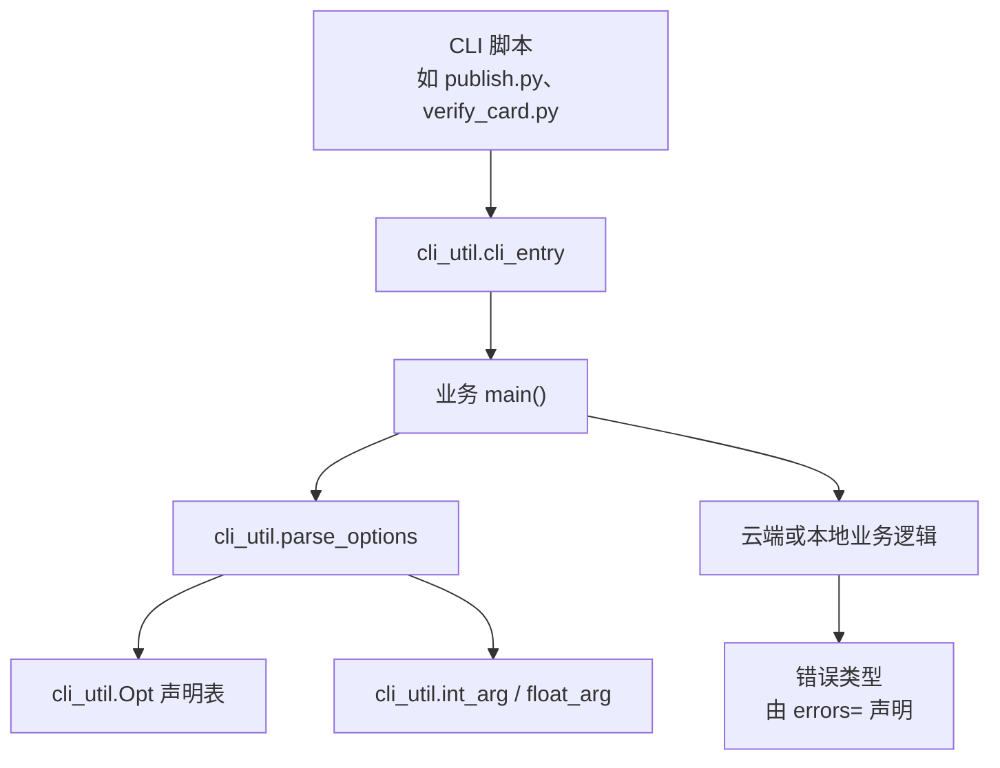
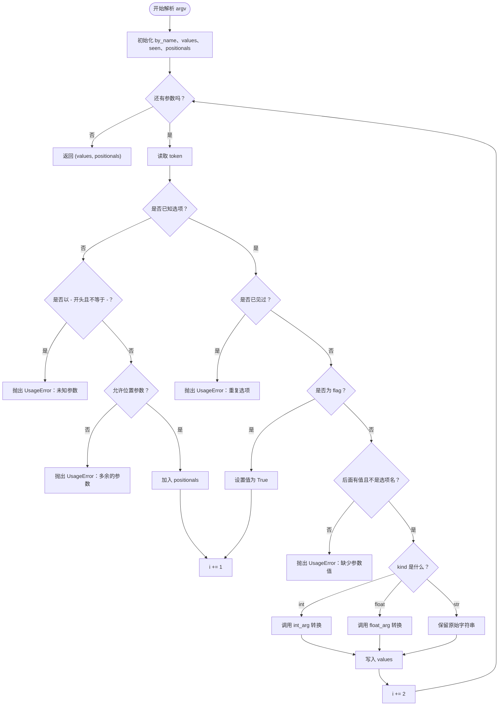
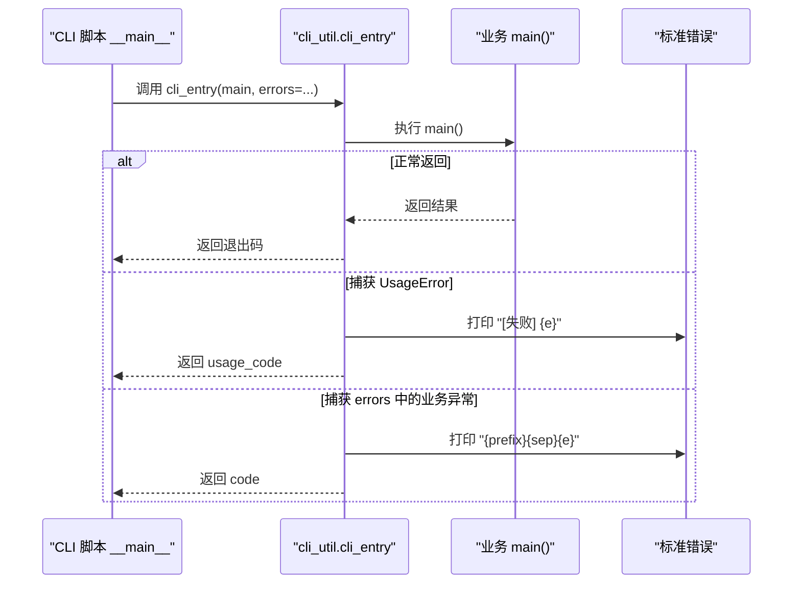
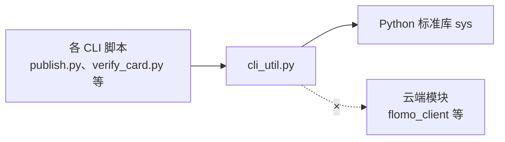

# 命令行契约 cli_util.py

<cite>
**本文引用的文件**
- [scripts/cli_util.py](file://scripts/cli_util.py)
- [scripts/publish.py](file://scripts/publish.py)
- [scripts/verify_card.py](file://scripts/verify_card.py)
</cite>

## 目录
1. [引言](#引言)
2. [设计目标与架构定位](#设计目标与架构定位)
3. [项目结构中的位置](#项目结构中的位置)
4. [模块入口总览](#模块入口总览)
5. [组件详解](#组件详解)
6. [依赖关系分析](#依赖关系分析)
7. [典型用法示例](#典型用法示例)
8. [异常与边界行为](#异常与边界行为)
9. [性能与可维护性](#性能与可维护性)
10. [故障排查指南](#故障排查指南)
11. [结论](#结论)

## 引言
`scripts/cli_util.py` 是脚本层的纯标准库叶子模块，承担「命令行契约」职责：统一声明选项、解析参数、转换类型、输出错误，并作为所有 CLI 脚本的统一入口出口。它把原本散落在多个脚本里的 while 循环、参数校验和退出码逻辑收敛到一处，避免每个脚本各自实现「缺值」「重复选项」「未知参数」等边界情况。

该模块不 import 任何项目内模块，也不进行网络访问；所有项目内脚本通过 `import cli_util as CLI` 使用它，从而保持依赖方向单向：上层依赖它，它不反向依赖上层。

## 设计目标与架构定位
- **单一来源**：`Opt`、`parse_options`、`int_arg`、`float_arg`、`cli_entry` 五个入口集中处理命令行契约。
- **纯标准库**：仅依赖 `sys`，不引入云端客户端、token、MCP 协议等语义，降低耦合面。
- **一致性**：不同脚本的失败表现统一为「一行说明 + 非零退出码」，traceback 只留给真正缺陷。
- **显式错误契约**：`cli_entry` 要求调用方传入 `errors` 元组，明确声明本脚本还会抛出哪些业务异常，避免默认值重新耦合回云端模块。
- **可测试性**：参数解析与业务逻辑分离，单元测试可以只针对解析层或业务层单独验证。



**图表来源**
- [scripts/cli_util.py:1-166](file://scripts/cli_util.py#L1-L166)
- [scripts/publish.py:90](file://scripts/publish.py#L90)
- [scripts/verify_card.py:44](file://scripts/verify_card.py#L44)

## 项目结构中的位置
仓库中脚本位于 `scripts/`，其中两个现有脚本已按约定导入该模块：
- `scripts/publish.py` 以 `import cli_util as CLI` 引用。
- `scripts/verify_card.py` 同样以别名方式引用。

这体现了模块作为「脚本公共工具层」的定位：所有命令行脚本共享同一套参数契约，而不是各自复制解析逻辑。

**章节来源**
- [scripts/publish.py:90](file://scripts/publish.py#L90)
- [scripts/verify_card.py:44](file://scripts/verify_card.py#L44)

## 模块入口总览
模块对外暴露以下五个关键入口：

| 入口 | 角色 | 输入 | 返回或副作用 | 主要用途 |
|---|---|---|---|---|
| `Opt` | 选项声明类 | `name`、`dest`、`kind`、范围、默认值、提示 | 构造出可选参数字段描述对象 | 用声明代替手写 if/while 解析 |
| `parse_options` | 选项解析器 | `argv`、`spec`、`positional_ok` | `(values, positionals)` 或抛 `UsageError` | 把命令行转成结构化字段字典 |
| `int_arg` | 整数转换器 | `raw`、`flag`、`low`、`high` | 整数值或抛 `UsageError` | 把字符串转换为带范围的整数 |
| `float_arg` | 浮点数转换器 | `raw`、`flag`、`low`、`high` | 浮点数值或抛 `UsageError` | 把字符串转换为带范围的浮点数 |
| `cli_entry` | 统一入口出口 | `main`、`errors`、`code`、`prefix`、`usage_code` | 返回 `main()` 结果或进程退出码 | 包装业务入口，统一错误与退出码 |

此外还定义内部辅助 `_num_arg` 和异常类 `UsageError`，供上述入口协作。

**章节来源**
- [scripts/cli_util.py:1-166](file://scripts/cli_util.py#L1-L166)

## 组件详解

### `UsageError`
`UsageError` 是命令行参数本身写错时抛出的异常，例如：
- 选项缺少值。
- 同一选项重复给出。
- 出现未知选项名。
- 整数或浮点数无法转换或越界。

它与云端错误类型相互独立，不会继承云端异常，因此 `except FlomoError` 不会误吞参数错误。这样用户看到的错误更准确：参数打错就报参数问题，而不是被归为「云端失败」。

**章节来源**
- [scripts/cli_util.py:12-34](file://scripts/cli_util.py#L12-L34)

### `_num_arg`
这是整数与浮点转换的内部实现，负责：
1. 去除空白。
2. 调用 `cast`（`int` 或 `float`）。
3. 捕获 `TypeError`、`ValueError` 并转为 `UsageError`。
4. 在提供 `low`、`high` 时检查取值范围。
5. 成功时返回转换后的数值。

该函数刻意不做宽松解析：非法文本直接报错，避免像 `int("2000条")` 这类意外行为。

**章节来源**
- [scripts/cli_util.py:36-56](file://scripts/cli_util.py#L36-L56)

### `int_arg`
将命令行原始字符串转换为整数，支持可选范围约束：
- 若转换失败，抛出 `UsageError`。
- 若小于 `low`，抛出 `UsageError`。
- 若大于 `high`，抛出 `UsageError`。
- 否则返回整数值。

典型场景包括 `--limit`、`--batch-size` 等限制型整数参数。

**章节来源**
- [scripts/cli_util.py:58-60](file://scripts/cli_util.py#L58-L60)

### `float_arg`
将命令行原始字符串转换为浮点数，同样支持范围约束。典型场景包括 `--timeout`、`--rate` 等需要小数精度的参数。

**章节来源**
- [scripts/cli_util.py:62-64](file://scripts/cli_util.py#L62-L64)

### `Opt`
`Opt` 是一条选项的声明对象，包含以下字段：

| 字段 | 含义 | 默认行为 |
|---|---|---|
| `name` | 命令行选项名，如 `--limit` | 必填 |
| `dest` | 解析后写入的字段名 | 必填 |
| `kind` | 选项类型 | 默认为 `"str"`，允许 `"int"`、`"float"`、`"flag"` |
| `low` | 最小值 | 可选 |
| `high` | 最大值 | 可选 |
| `default` | 默认值 | 开关类型为 `False`，其他为传入值或 `None` |
| `hint` | 重复时的附加提示 | 空字符串 |

构造时会做基础校验：
- `kind` 必须是四种合法类型之一。
- `flag` 类型不能同时指定 `low` 或 `high`。

这种声明式设计让「缺值」「重复」「未知参数」等边界判定集中在 `parse_options` 中，不再分散在各脚本的 while 循环里。

**章节来源**
- [scripts/cli_util.py:66-86](file://scripts/cli_util.py#L66-L86)

### `parse_options`
这是核心解析器，签名语义如下：

| 参数 | 含义 |
|---|---|
| `argv` | 命令行参数列表，通常是 `sys.argv[1:]` |
| `spec` | `Opt` 对象序列，即选项声明表 |
| `positional_ok` | 是否允许位置参数 |

返回值：
- `(values, positionals)`：`values` 是按 `dest` 命名的字段字典，`positionals` 是未识别的位置参数列表。

异常行为：
- 遇到未知选项名时抛 `UsageError`。
- 遇到多余位置参数且 `positional_ok=False` 时抛 `UsageError`。
- 选项重复时抛 `UsageError`，并附带选项名和 hint。
- 需要值的选项缺少值时抛 `UsageError`。
- 类型转换失败或越界时抛 `UsageError`。

关键设计要点：
1. **末尾选项不会误报未知参数**：如果最后一个词是某个选项名但没给值，会报「缺少参数值」，而不是「未知参数」。
2. **选项值不会被误判为下一个选项**：只有当紧随其后的词匹配某个 `Opt.name` 时才视为选项名；例如 `--limit -1` 会把 `-1` 传给 `int_arg` 做范围判断。
3. **重复选项统一拦截**：避免静默覆盖导致的业务风险，比如查重漏掉某张卡片。
4. **位置参数可控**：通过 `positional_ok` 控制是否接受裸参数，防止把值误写成选项名前。



**图表来源**
- [scripts/cli_util.py:88-149](file://scripts/cli_util.py#L88-L149)

**章节来源**
- [scripts/cli_util.py:88-149](file://scripts/cli_util.py#L88-L149)

### `cli_entry`
`cli_entry` 是所有 CLI 脚本 `__main__` 的统一出口，签名语义如下：

| 参数 | 含义 |
|---|---|
| `main` | 业务主函数，应返回期望的退出状态或正常结果 |
| `errors` | 业务异常类型的元组，必填 |
| `code` | 业务失败的退出码 |
| `prefix` | 业务失败的输出前缀 |
| `usage_code` | 用法错误的退出码 |

行为：
- 调用 `main()`。
- 捕获 `UsageError`，输出 `[失败] ...` 到标准错误，返回 `usage_code`。
- 捕获 `errors` 中声明的业务异常，输出 `prefix + 原因` 到标准错误，返回 `code`。
- 其他未被捕获的异常会向上传播，表现为 traceback，用于标识真正缺陷。

这个设计确保：
- 预期内的失败是干净的日志加非零退出码。
- 真正缺陷保留完整堆栈，方便调试。
- 模块自身不依赖云端错误类型，避免重新耦合。



**图表来源**
- [scripts/cli_util.py:151-166](file://scripts/cli_util.py#L151-L166)

**章节来源**
- [scripts/cli_util.py:151-166](file://scripts/cli_util.py#L151-L166)

## 依赖关系分析
依赖方向非常清晰：



- `cli_util.py` 仅依赖 `sys`。
- 各 CLI 脚本依赖 `cli_util.py`。
- `cli_util.py` 不依赖云端模块，避免把「命令行契约」和「云端通道」耦合在一起。

**图表来源**
- [scripts/cli_util.py:10-11](file://scripts/cli_util.py#L10-L11)
- [scripts/publish.py:90](file://scripts/publish.py#L90)
- [scripts/verify_card.py:44](file://scripts/verify_card.py#L44)

**章节来源**
- [scripts/cli_util.py:1-166](file://scripts/cli_util.py#L1-L166)
- [scripts/publish.py:90](file://scripts/publish.py#L90)
- [scripts/verify_card.py:44](file://scripts/verify_card.py#L44)

## 典型用法示例

### 定义选项声明表
每个脚本在 `main()` 中定义自己的 `Opt(...)` 列表，例如：
- `--limit` 是整数，可设上下界。
- `--timeout` 是浮点数。
- `--draft` 是开关，不需要值。
- `--tags` 是普通字符串。

这些声明会被传给 `parse_options(argv, spec)`，由解析器生成字段字典。

**章节来源**
- [scripts/cli_util.py:66-86](file://scripts/cli_util.py#L66-L86)
- [scripts/cli_util.py:88-149](file://scripts/cli_util.py#L88-L149)

### 解析参数
```python
values, positionals = parse_options(sys.argv[1:], spec, positional_ok=False)
```
- 如果选项缺失值，抛出 `UsageError`。
- 如果选项重复，抛出 `UsageError`。
- 如果出现未知选项，抛出 `UsageError`。
- 如果允许位置参数，则额外收集到 `positionals`。

**章节来源**
- [scripts/cli_util.py:88-149](file://scripts/cli_util.py#L88-L149)

### 类型转换
```python
limit = int_arg(raw_value, "--limit", low=1, high=10000)
timeout = float_arg(raw_value, "--timeout", low=0.0)
```
- 转换失败时抛 `UsageError`。
- 越界时抛 `UsageError`。
- 成功时返回对应数值类型。

**章节来源**
- [scripts/cli_util.py:36-64](file://scripts/cli_util.py#L36-L64)

### 统一入口
```python
if __name__ == "__main__":
    cli_entry(main, errors=(FlomoError,), prefix="[失败] 发布未能进行：", usage_code=2)
```
- `errors` 必须显式传入，避免默认值隐式耦合云端模块。
- 用法错误走 `usage_code`。
- 业务错误走 `code`。
- 未捕获异常保留 traceback。

**章节来源**
- [scripts/cli_util.py:151-166](file://scripts/cli_util.py#L151-L166)

## 异常与边界行为

| 场景 | 行为 | 建议 |
|---|---|---|
| 选项缺少值 | 抛 `UsageError` | 提示用户补全值 |
| 同一选项重复 | 抛 `UsageError` | 避免静默覆盖导致业务漏检 |
| 未知选项名 | 抛 `UsageError` | 检查拼写或扩展声明表 |
| 多余位置参数且不允许 | 抛 `UsageError` | 检查是否误把值写在选项名前 |
| 整数转换失败 | 抛 `UsageError` | 不要传中文混排或非数字文本 |
| 浮点转换失败 | 抛 `UsageError` | 确认小数点和负号格式 |
| 数值越界 | 抛 `UsageError` | 在 `Opt` 或 `*_arg` 中设置合理范围 |
| 业务异常 | 由 `cli_entry` 捕获并输出 | 在 `errors=` 中显式声明 |
| 未预期异常 | 抛出 traceback | 作为真正缺陷处理 |

特别注意：
- `--limit -1` 不会在这里报「缺少参数值」，而是交给 `int_arg` 判断是否小于 `low`。
- `flag` 类型不接受 `low`、`high`，构造时就会拒绝。
- `kind` 只能是 `"str"`、`"int"`、`"float"`、`"flag"`，其他值构造 `Opt` 时抛 `ValueError`。

**章节来源**
- [scripts/cli_util.py:36-86](file://scripts/cli_util.py#L36-L86)
- [scripts/cli_util.py:88-149](file://scripts/cli_util.py#L88-L149)
- [scripts/cli_util.py:151-166](file://scripts/cli_util.py#L151-L166)

## 性能与可维护性
- **时间复杂度**：`parse_options` 对 `argv` 线性扫描一次，查找选项名基于哈希表，整体近似 O(n)。
- **空间复杂度**：维护 `by_name`、`values`、`seen`、`positionals`，随选项数量和参数数量增长。
- **可维护性**：把 while 循环、重复检测、缺值检测、类型转换统一收口，减少四个以上脚本各自实现的差异和漏洞。
- **可扩展性**：新增选项只需添加 `Opt(...)`，无需修改解析逻辑。
- **可测试性**：单元测试可分别覆盖 `Opt` 构造校验、`parse_options` 各类分支、`int_arg`/`float_arg` 转换、`cli_entry` 异常分流。

**章节来源**
- [scripts/cli_util.py:1-166](file://scripts/cli_util.py#L1-L166)

## 故障排查指南
常见问题和修复思路：

1. **用户看到「未知参数：--draft」**
   - 可能原因：选项在末尾但没有值。
   - 修复：补全值，或在声明表中改为 `flag`。

2. **用户看到「重复时后者会静默覆盖前者」**
   - 可能原因：同一选项传了两次。
   - 修复：合并为一次，或通过业务层明确支持多值。

3. **用户看到「多余的参数」**
   - 可能原因：传了位置参数，但 `positional_ok=False`。
   - 修复：要么开启 `positional_ok=True`，要么调整参数顺序。

4. **用户看到「缺少参数值」**
   - 可能原因：选项后没有值，或紧接着的词是另一个选项名。
   - 修复：补全值，或确认值确实是一个普通字符串而非选项名。

5. **用户看到「需要整数」或「需要数字」**
   - 可能原因：传入的字符串无法被 `int` 或 `float` 转换。
   - 修复：清理输入，避免中文混排。

6. **业务失败却显示 traceback**
   - 可能原因：未在 `errors=` 中声明业务异常类型。
   - 修复：在 `cli_entry` 中传入正确的 `errors` 元组。

7. **同一个脚本在不同命令下失败表现不一致**
   - 可能原因：各脚本之前各自实现错误处理。
   - 修复：全部改用 `cli_entry`，统一 `prefix`、`code`、`usage_code`。

**章节来源**
- [scripts/cli_util.py:88-166](file://scripts/cli_util.py#L88-L166)

## 结论
`scripts/cli_util.py` 通过五个稳定入口，把命令行契约从各脚本中抽离出来，形成一条清晰的叶子依赖链。它让：
- 选项声明变成声明式数据。
- 参数解析、类型转换、范围校验集中在一个地方。
- 用法错误和业务错误分类明确。
- 所有 CLI 脚本的失败输出风格一致。
- 新脚本可以快速复用同一套模式，减少重复实现和回归风险。

对于维护者来说，改动命令行行为时，优先检查 `Opt` 声明表和 `parse_options`、`cli_entry`，而不是逐个脚本查找 while 循环和 try/except。