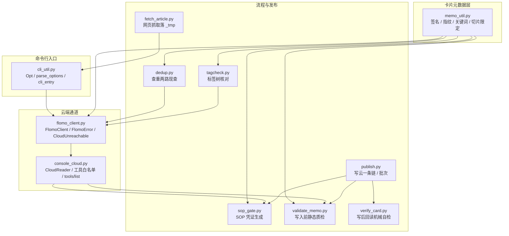
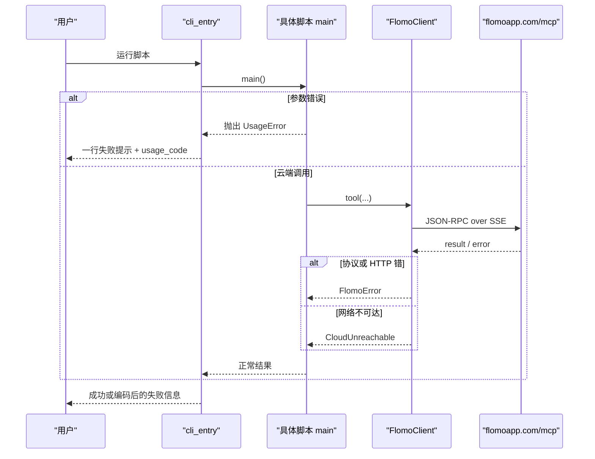
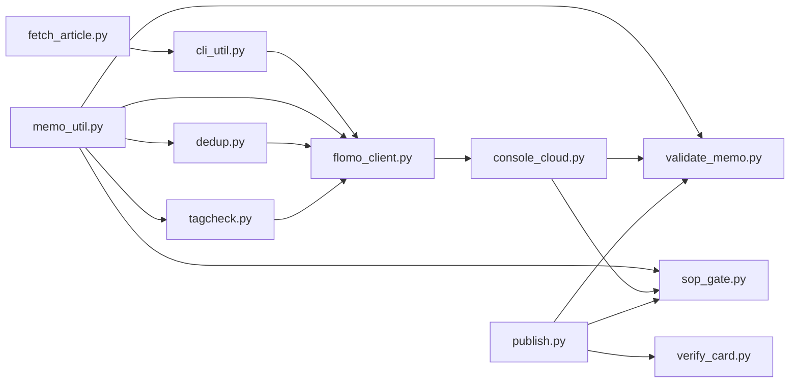

# 核心模块详解

<cite>
**本文引用的文件**   
- [cli_util.py](file://scripts/cli_util.py)
- [memo_util.py](file://scripts/memo_util.py)
- [flomo_client.py](file://scripts/flomo_client.py)
- [console_cloud.py](file://scripts/console_cloud.py)
- [sop_gate.py](file://scripts/sop_gate.py)
- [publish.py](file://scripts/publish.py)
- [validate_memo.py](file://scripts/validate_memo.py)
- [verify_card.py](file://scripts/verify_card.py)
- [dedup.py](file://scripts/dedup.py)
- [tagcheck.py](file://scripts/tagcheck.py)
- [fetch_article.py](file://scripts/fetch_article.py)
</cite>

## 目录
1. [引言](#引言)
2. [项目结构](#项目结构)
3. [核心组件总览](#核心组件总览)
4. [架构总图](#架构总图)
5. [详细组件分析](#详细组件分析)
6. [依赖关系分析](#依赖关系分析)
7. [性能与可靠性特征](#性能与可靠性特征)
8. [故障排查指南](#故障排查指南)
9. [结论](#结论)

## 引言
本仓库的 flomo-note 工作流围绕“卡片签名 → 标签树 → 查重两路 → 流程闸门 → 文本质检 → 写云一条链 → 写后回读”这条主线展开。核心 Python 脚本集中在 `scripts/` 下，每个脚本承担一个可独立复用的职责：命令行契约、签名与关键词派生、MCP 客户端封装、控制台云端接口、流程凭证、发布流水线、质检、回读比对、查重执行器、标签树校验与网页抓取。文档按“职责 → 公开接口 → 关键函数 → 参数与返回值 → 依赖 → 典型用法 → 错误处理 → 边界条件”的结构说明，重点覆盖题目指定的 11 个模块。

## 项目结构

**图表来源**
- [cli_util.py:1-166](file://scripts/cli_util.py#L1-L166)
- [memo_util.py:1-200](file://scripts/memo_util.py#L1-L200)
- [flomo_client.py:1-200](file://scripts/flomo_client.py#L1-L200)
- [console_cloud.py:1-200](file://scripts/console_cloud.py#L1-L200)
- [sop_gate.py:1-200](file://scripts/sop_gate.py#L1-L200)
- [publish.py:1-200](file://scripts/publish.py#L1-L200)
- [validate_memo.py:1-200](file://scripts/validate_memo.py#L1-L200)
- [verify_card.py:1-200](file://scripts/verify_card.py#L1-L200)
- [dedup.py:1-200](file://scripts/dedup.py#L1-L200)
- [tagcheck.py:1-200](file://scripts/tagcheck.py#L1-L200)
- [fetch_article.py:1-200](file://scripts/fetch_article.py#L1-L200)

**章节来源**
- [cli_util.py:1-166](file://scripts/cli_util.py#L1-L166)
- [memo_util.py:1-200](file://scripts/memo_util.py#L1-L200)
- [flomo_client.py:1-200](file://scripts/flomo_client.py#L1-L200)
- [console_cloud.py:1-200](file://scripts/console_cloud.py#L1-L200)

## 核心组件总览
| 模块 | 职责 | 主要公开对象 | 关键约束 |
|---|---|---|---|
| `cli_util.py` | 统一命令行选项声明、解析、类型转换与退出码出口 | `UsageError`、`Opt`、`parse_options`、`int_arg`、`float_arg`、`cli_entry` | 不 import 任何项目内模块；参数错走 `usage_code`；非用法错由调用方显式传 `errors` |
| `memo_util.py` | 卡片签名、短键、正文指纹、概念关键词、切片限定识别 | `memo_signature`、`signature_key`、`body_hash`、`keywords_of_concept`、`concept_keywords`、`slice_qualifiers`、`tag_key`、`tag_leaves` | 签名取前两个非空行；非法内容返回 `None` 或 `[]`，不抛异常 |
| `flomo_client.py` | MCP 握手、协议发现、工具调用封装、token 读取、写后回读 | `FlomoClient`、`FlomoError`、`CloudUnreachable`、`load_token`、`tool_data_or_none`、`tool_data` | 写工具登记为不幂等；HTTP/JSON-RPC 错转 `FlomoError`；网络错转 `CloudUnreachable(request_sent)` |
| `console_cloud.py` | 控制台读/写云端能力、工具白名单、`tools/list` 能力清单 | `CloudReader`、`run_read_tool`、`READONLY_TOOLS`、`WRITE_TOOLS` | 读写工具白名单与实现一一对应；正文不落盘；token 不出进程 |
| `sop_gate.py` | 流程闸门凭证生成与校验前置逻辑 | `main`（CLI） | 凭证带 TTL；结论须落正文；标签须现采树核对 |
| `publish.py` | 写云一条链与批次支持 | `main`（CLI）、`diff_report` | create 只发一次；更新前先回读目标卡；批量化预检全过再写 |
| `validate_memo.py` | 写入前静态质检 | `check()`、`check_gate()`、`concept_name_index` | ERR 阻塞写云；WARN 不阻塞；模板引导词进正文即 ERR |
| `verify_card.py` | 写后回读机械自检 | `fetch()`、`run()` | 复用 `validate_memo.check()`；草稿比对走同口径归一化 |
| `dedup.py` | 查重两路现查执行器 | `main()`、`search_one()`、`fetch_full()` | 每个关键词单独调；id 去重分批取全文；失败不视为无命中 |
| `tagcheck.py` | 定标签前标签树校验 | `main()`、`load_tree()`、`inspect_tag()` | 严格两级；写法重复判写错；total 不一致视为截断 |
| `fetch_article.py` | 网页抓取并落 `_tmp` | `main()`（CLI）、`trim_lead_noise()`、`trim_tail_noise()` | 首尾噪音裁剪可见；两条出网通道自动回退；结果必须读回 |

**章节来源**
- [cli_util.py:1-166](file://scripts/cli_util.py#L1-L166)
- [memo_util.py:1-200](file://scripts/memo_util.py#L1-L200)
- [flomo_client.py:1-200](file://scripts/flomo_client.py#L1-L200)
- [console_cloud.py:1-200](file://scripts/console_cloud.py#L1-L200)
- [sop_gate.py:1-200](file://scripts/sop_gate.py#L1-L200)
- [publish.py:1-200](file://scripts/publish.py#L1-L200)
- [validate_memo.py:1-200](file://scripts/validate_memo.py#L1-L200)
- [verify_card.py:1-200](file://scripts/verify_card.py#L1-L200)
- [dedup.py:1-200](file://scripts/dedup.py#L1-L200)
- [tagcheck.py:1-200](file://scripts/tagcheck.py#L1-L200)
- [fetch_article.py:1-200](file://scripts/fetch_article.py#L1-L200)

## 架构总图

**图表来源**
- [cli_util.py:117-166](file://scripts/cli_util.py#L117-L166)
- [flomo_client.py:1-200](file://scripts/flomo_client.py#L1-L200)

## 详细组件分析

### cli_util.py：命令行契约
- **职责**：定义统一的命令行选项声明、解析、数值类型校验与主入口退出码收敛。它位于依赖图叶子层，不 import 项目内其他模块，也不碰网络。
- **公开接口**
  - `class UsageError(Exception)`：表示命令行参数本身写错，例如缺值、重复、未知参数、整数越界。
  - `def int_arg(raw, flag, *, low=None, high=None)`：把字符串转为整数，并在非数字或越界时抛 `UsageError`。
  - `def float_arg(raw, flag, *, low=None,high=None)`：同上，但转换为浮点数。
  - `class Opt`：一条选项的声明，包含选项名、目标字段、类型、取值范围、默认值与提示语。类型仅限 `str`、`int`、`float`、`flag`。
  - `def parse_options(argv, spec, *, positional_ok=False)`：按声明表解析，返回 `(字段字典, 位置参数列表)`；遇到用法问题抛 `UsageError`。
  - `def cli_entry(main, *, errors, code=1, prefix="[失败]", usage_code=2)`：统一入口，捕获 `UsageError` 和调用方传入的 `errors` 元组中的异常，输出标准化失败信息并返回对应退出码。
- **关键设计**
  - 三个历史漏洞被集中修复：末尾选项报“未知参数”、同一选项重复时后者静默覆盖、位置参数未开启时报法混乱。
  - `cli_entry` 要求调用方显式传 `errors`，避免隐式耦合到云端错误类；漏传会在调用处立即产生 `TypeError`。
- **典型用法**
  - 纯本地脚本：`cli_entry(main, errors=())`。
  - 涉及云端的脚本：`cli_entry(main, errors=(FlomoError,))`。
- **错误处理与边界**
  - 非数字输入、小于下限、大于上限均抛 `UsageError`。
  - 未知参数、缺少值、重复选项、多余位置参数均抛 `UsageError`。
  - 非用法类异常按 `errors` 分类，不再混入“云端失败”。

**章节来源**
- [cli_util.py:1-166](file://scripts/cli_util.py#L1-L166)

### memo_util.py：签名、指纹、关键词与标签拆分唯一实现
- **职责**：提供卡片签名、稳定短键、正文指纹、从概念名派生检索关键词、以及“概念名切片限定”识别等共享语义。这是“幂等查重、流程凭证、写前质检”三处的共同判定依据。
- **公开接口**
  - `def memo_signature(content)`：返回 `{"tagline": ..., "concept": ...}` 或 `None`。仅取正文前两个非空行，首行必须以 `#` 开头，第二行不能为空且不能以 `#` 开头。
  - `def signature_key(sig)`：对 tagline 与 concept 拼接做 SHA-256，取前 16 位十六进制作为稳定短键；`sig` 为 `None` 时返回 `None`。
  - `def body_hash(content)`：正文整体指纹；非字符串输入会加类型前缀，使 `None` 与空字符串指纹不同。
  - `def keywords_of_concept(concept, limit=2)`：从概念名派生最多 `limit` 个短关键词，优先取最长连续中文段（≥4），其次取去除标点后的前 8 字符。
  - `def concept_keywords(content, limit=2)`：先取签名，再委托 `keywords_of_concept`；非法卡片返回 `[]`。
  - 切片限定相关：常量 `SLICE_PATTERNS`、正则 `_SLICE_RE`、动词检测 `_VERB_RE`、修饰语集合 `_MODIFIER`，以及内部 `_predicate_hits`。
- **数据结构与复杂度**
  - `memo_signature`：时间复杂度 O(n)（n 为行数），空间 O(n)。
  - `keywords_of_concept`：基于正则匹配，时间复杂度与概念长度线性相关，输出最多 `limit` 项。
  - 切片模式编译为正则列表，后续匹配使用预编译对象。
- **依赖关系**
  - 标准库 `hashlib`、`re`。
  - 被 `flomo_client`、`sop_gate`、`validate_memo`、`dedup`、`tagcheck` 等模块引用。
- **典型用法**
  - 生成凭证文件名短键：`signature_key(memo_signature(content))`。
  - 查重关键词：`keywords_of_concept(concept)`。
  - 防止正文被篡改：`body_hash(content)` 写入凭证，写前与写后对比。
- **错误处理与边界**
  - 非字符串、空内容、不足两行、首行非标签、第二行为空或以 `#` 开头，都安全返回 `None`。
  - 切片限定通过正则族判断是否含时间、季度、版本、阶段、地域语种、谓语动作等切片结构，违规概念名会被标记。

**章节来源**
- [memo_util.py:1-200](file://scripts/memo_util.py#L1-L200)

### flomo_client.py：MCP 握手、协议发现、工具调用封装、写后回读
- **职责**：封装 flomo MCP 端点的所有网络与协议细节，包括 token 加载、`initialize` 握手、SSE 响应解析、工具调用、会话 ID 缓存、写工具幂等标记、以及写后回读校验。
- **公开接口**
  - `class FlomoError(RuntimeError)`：凭据缺失、握手失败、HTTP 错误、JSON-RPC 协议错误的统一异常。
  - `class CloudUnreachable(FlomoError)`：连接被拒、超时、DNS、中断等网络层错误，携带 `request_sent` 布尔值。
  - `def load_token()`：优先从项目根 `.mcp.json` 中取 `Authorization`，否则回退环境变量 `FLOMO_TOKEN`；取不到抛 `FlomoError`。
  - `class FlomoClient`：构造函数接收 token 与超时；`init()` 发送 `initialize`；`_post(payload, with_session, idempotent)` 统一 POST；`_parse_sse(body, want_id)` 解析 SSE。
  - `def tool(name, arguments)`：对外暴露的工具调用方法（在完整文件中）。
  - `def tool_data(result)` / `tool_data_or_none(result)`：结构化回包提取。
  - `def readback_check(...)`：写后按 id 回读全文逐字比对（在完整文件中）。
- **关键设计**
  - 写工具集合 `WRITE_TOOLS` 标记为不幂等，禁止自动重试；新加工具若忘记登记，默认落在“不重发”侧，宁可多报错也不造重复卡。
  - SSE 解析严格按请求 `id` 匹配结果，不把通知或其他并发响应误当本次结果。
  - `CloudUnreachable.request_sent` 区分“确定没发出”和“可能已到达”，决定能否换通道重试。
- **依赖关系**
  - 标准库 `json`、`os`、`re`、`sys`、`urllib.error`、`urllib.request`、`pathlib`、`itertools`。
  - 依赖 `memo_util` 提供签名与关键词；依赖 `cli_util` 提供 `UsageError`、`cli_entry`；依赖 `net_util` 做实际出网。
- **典型用法**
  - 直接调用工具：`client.tool("memo_search", {"keywords": "...", "limit": 10})`。
  - 写后回读：`readback_check(id, expected_content)`。
- **错误处理与边界**
  - HTTP 状态码与响应体包装为 `FlomoError`。
  - 网络异常包装为 `CloudUnreachable`，保留 `request_sent`。
  - 不调用 `SystemExit`，以便库层调用方可用 `except Exception` 接住。

**章节来源**
- [flomo_client.py:1-200](file://scripts/flomo_client.py#L1-L200)

### console_cloud.py：云端读/写白名单、tools/list 能力清单
- **职责**：把 MCP 的只读能力全部暴露给控制台前端，同时把写能力接入格式闸门与流程闸门，并维护工具白名单与能力清单。
- **公开接口**
  - `class CloudReader`：封装云端读取操作。
  - `def run_read_tool(name, arguments)`：通用只读工具执行入口，按云端 MCP 暴露的能力动态可用。
  - `READONLY_TOOLS`：只读工具白名单，恰好等于当前各读方法实际调用的工具集合。
  - `WRITE_TOOLS`：写工具白名单，恰好等于 `memo_create`、`memo_update`、`tag_rename`。
  - `tool_catalog()`：基于 `tools/list` 能力发现返回工具清单。
- **关键设计**
  - 写不是直通：下发前强制调用 `validate_memo.check()` 与 `validate_memo.check_gate()`；写入后统一回读验收。
  - 正文不落盘，仅轮次草稿 `memo_body*.txt` 落入仓库根并被清理程序回收。
  - token 仅在连接时使用，不出现在返回值或日志中。
- **依赖关系**
  - 依赖 `flomo_client` 获取 token、创建客户端、解析结构化结果。
  - 依赖 `memo_util` 取签名。
  - 依赖 `validate_memo` 做格式与流程闸门。
- **典型用法**
  - 程序调用：`from console_cloud import CloudReader; r = CloudReader(); r.list_memos(keywords="...")`。
  - 控制台界面：按 `tools/list` 生成的参数直接喂给 `run_read_tool`。
- **错误处理与边界**
  - 白名单外工具名一律拒绝并抛错。
  - 解析结构化结果采用统一入口，避免一处严格、另一处宽松导致数据可读性不一致。

**章节来源**
- [console_cloud.py:1-200](file://scripts/console_cloud.py#L1-L200)

### sop_gate.py：流程闸门凭证
- **职责**：把原本靠自觉的验证步骤变成“必须留痕”的机械流程：跑标签树、查重候选、复盘推荐、结论落正文核对、标签树核对，最终产出 `.sop_gate/<signature>.json` 凭证。
- **公开接口**
  - CLI `main`：接受 `--memo`、`--verify`、`--skip-web`、`--anchor-id`、`--out`、`--allow-no-gate` 等参数。
  - 内部检查函数：标签归一、证据词抽取、术语词块抽取、落点审计记录构造、结论落正文校验等。
- **关键设计**
  - 凭证 TTL 固定为 6 小时，防止旧凭证复用。
  - 结论必须落正文：先核显式 `in_body` 锚点，再核关键参数，最后兜底术语词块；确无需落正文需显式豁免并留痕。
  - 标签核对现采 `tag_tree`，并与 `memo_util.tag_key` 同口径判断“只差空白/全半角斜杠/大小写”即为写错。
- **依赖关系**
  - 依赖 `flomo_client` 拉取标签树、推荐卡、搜索候选。
  - 依赖 `memo_util` 取签名、正文指纹、概念关键词、标签拆分。
  - 依赖 `cli_util.cli_entry` 统一出口。
- **典型用法**
  - 普通卡：`python sop_gate.py --memo <正文路径> --verify <验证记录JSON>`。
  - 跳过网络验证：`--skip-web`。
  - 批量历史卡：`--allow-no-gate "<理由>"`。
- **错误处理与边界**
  - 有阻塞项时不出凭证，退出码 1。
  - 人机判断盲区明确写入凭证，不参与放行。

**章节来源**
- [sop_gate.py:1-200](file://scripts/sop_gate.py#L1-L200)

### publish.py：写云一条链与批次支持
- **职责**：把“闸门 → 质检 → 建卡或覆盖更新 → 机器项复核”固化为一次调用，并支持单张与批量两种模式。
- **公开接口**
  - CLI `main`：支持 `--draft`、`--batch`、`--verify`、`--update-id`、`--allow-rename`、`--allow-content-loss`、`--dry-run`、`--skip-web`、`--no-verify-card`。
  - `diff_report(before, after)`：改前快照与改后正文的行级差异报告。
- **关键设计**
  - create 只发一次，失败即停，绝不重发。
  - 更新前先回读目标卡并比对概念名；不符则阻塞，除非显式允许改名。
  - 更新前落改前快照，写后逐行比对，净删行数不为零时点名提示。
  - 批次模式：先对所有草稿做预检，全部通过后再逐张写入；任一失败不会回滚已写入卡片，需根据 `[批次汇总]` 继续处理剩余行。
- **依赖关系**
  - 依赖 `cli_util` 做选项声明与入口。
  - 依赖 `flomo_client` 调用写工具、回读。
  - 依赖 `validate_memo` 做质检。
  - 依赖 `sop_gate` 做流程闸门。
  - 依赖 `verify_card` 做写后机器项复核。
- **典型用法**
  - 单卡：`python scripts/publish.py --draft _tmp/memo_body_68.txt --verify _tmp/verify_68.json`。
  - 覆盖更新：加上 `--update-id MjYxODU0MzI5`。
  - 批量：`python scripts/publish.py --batch _tmp/batch.txt`。
- **退出码**
  - 0：成功；1：前置检查失败；2：闸门未过；3：质检 ERR；4：写入失败；5：已写入但复核失败；6：目标卡确认失败；7：草稿比原卡少读数或出现断口。
- **错误处理与边界**
  - 子命令输出截断会明确告知前面省略了多少行。
  - 正文规范化与回读对账同源，避免平台渲染差异制造假 diff。

**章节来源**
- [publish.py:1-200](file://scripts/publish.py#L1-L200)

### validate_memo.py：文本质检
- **职责**：在写云前对卡片文本进行静态检查，涵盖标签格式、概念名定位、字数上限、Markdown/HTML 残留、表格形态、状态行、URL、邮箱、模板引导词等。
- **公开接口**
  - `def check()`：执行质检，填充模块级 `ERR` 与 `WARN` 列表。
  - `def check_gate()`：检查流程闸门凭证是否存在、签名是否匹配、是否过期、是否带有授权标记。
  - `def concept_name_index(lines)`：返回概念名所在行号，兼容云端回读在标签行后插入空行的情况。
- **关键设计**
  - 正文字数上限 20000，与 SKILL 承诺一致。
  - 半角 `|` 与全角 `｜` 同等对待。
  - 不支持的 HTML 标签检测考虑数学记号场景，避免 `<R`、`<T` 等误伤。
  - 模板引导词（如“结论先行”）写进正文即判 ERR。
- **依赖关系**
  - 依赖 `memo_util` 提供签名、指纹、切片限定等。
- **典型用法**
  - 命令行：`python validate_memo.py memo.txt`。
  - JSON 输入：`python validate_memo.py --file create.json` 或 `--create create.json`。
  - 程序调用：清空 `VM.ERR`/`VM.WARN` 后调用 `VM.check(norm)`。
- **错误处理与边界**
  - 读取文件使用 `utf-8-sig`，容忍 BOM。
  - CRLF/CR 归一化为 LF。
  - ERR 阻塞写云，WARN 不阻塞。

**章节来源**
- [validate_memo.py:1-200](file://scripts/validate_memo.py#L1-L200)

### verify_card.py：写后回读比对
- **职责**：写云后执行 H11 中可机械判定的部分，包括回读完整性、标签段、概念名、形态检查、占位符残留、截断标记、字数对账等，并可追加与本地草稿的逐字比对。
- **公开接口**
  - `def fetch(memo_id, client=None)`：按 id 取回卡片全文。
  - `def run(memo_id, client=None, draft_path=None)`：返回检查项列表与卡片元信息。
- **关键设计**
  - 复用 `validate_memo.check()`，确保写前与写后判据同源。
  - 还原渲染层在标签段后补的空行，但不还原“要点：”后补空行，避免把草稿自有空行误删。
  - 字数对账走 `FC._norm_body`，剥离平台层空行、转义、行内水平空白差异。
- **依赖关系**
  - 依赖 `cli_util`、`flomo_client`、`validate_memo`、`memo_util.find_truncation`。
- **典型用法**
  - 交互模式：`python scripts/verify_card.py --id MjYxMzk1MDg0`。
  - 自动化：`--json`。
  - 草稿比对：`--draft _tmp/memo_body_37.txt`。
  - 查看全文：`--show-body`。
- **错误处理与边界**
  - 回读失败或机械项不过，退出码 1。
  - 明确列出脚本判不了的两项：“首尾是否同一事件”“是否串入他卡内容”。

**章节来源**
- [verify_card.py:1-200](file://scripts/verify_card.py#L1-L200)

### dedup.py：查重两路
- **职责**：按 H3/H8 口径执行查重：对每个关键词单独调用 `memo_search`，对推荐卡按 `memo_recommended` 取近邻，再按 id 去重并以 ≤10 一批调用 `memo_batch_get` 取全文。
- **公开接口**
  - CLI `main(argv, client=None)`：支持 `--keywords`、`--tag`、`--id`、`--ids`、`--limit`、`--max-full`、`--no-full`。
  - `def split_keywords(raw)`：拆半角/全角逗号、顿号、分号、换行，去空去重保序。
  - `def search_one(client, label, args)`：执行一次检索并单独打印。
  - `def fetch_full(client, ids, max_full)`：分批取全文。
- **关键设计**
  - 每个关键词单独调一次，结果不合并掩盖。
  - 显式 `--ids` 不受 `--max-full` 限制。
  - 失败一律视为“查重未完成”，不当作无命中。
- **依赖关系**
  - 依赖 `flomo_client` 的 `FlomoClient`、`FlomoError`、`_result_memos`、`load_token`。
  - 依赖 `cli_util` 的 `Opt`、`UsageError`、`cli_entry`、`parse_options`。
- **典型用法**
  - 关键词查重：`python scripts/dedup.py --keywords "智能体,agent,工具契约"`。
  - 复盘路：`python scripts/dedup.py --id <本卡 memo id>`。
  - 点名读全文：`python scripts/dedup.py --ids ID1,ID2`。
- **错误处理与边界**
  - 任一云端调用失败，退出码 1。
  - 超出 `--max-full` 的 id 会告警并列出未读 id。

**章节来源**
- [dedup.py:1-200](file://scripts/dedup.py#L1-L200)

### tagcheck.py：标签树校验
- **职责**：定标签前现采 `tag_tree`，逐个校验拟用标签是否为严格两级、是否已存在、是否与现有标签只差写法、同顶层有哪些二级兄弟。
- **公开接口**
  - CLI `main(argv, client=None)`：支持 `--tags`、`--grep`、`--limit`。
  - `def load_tree(client, limit)`：现采标签树，返回 `(tags, total)`。
  - `def inspect_tag(tag, tags)`：单个标签检查结果。
- **关键设计**
  - 严格两级：恰有一个 `/`，且顶层与二级都不为空。
  - 写法重复：使用 `memo_util.tag_key` 判断，只差空白/全半角斜杠/大小写即判写错。
  - 若 `len(tags) != total`，视为标签树被截断，抛错。
- **依赖关系**
  - 依赖 `flomo_client` 取标签树。
  - 依赖 `cli_util` 做参数解析。
  - 依赖 `memo_util.tag_key` 做标签键比较。
- **典型用法**
  - 指定标签：`python scripts/tagcheck.py --tags "AI/Agent,科技/测试"`。
  - 模糊查找：`python scripts/tagcheck.py --grep "多语言|本地化"`。
- **错误处理与边界**
  - 0：全部合规；1：标签树截断或调用失败；2：标签缺失、层级不合规或写法重复。

**章节来源**
- [tagcheck.py:1-200](file://scripts/tagcheck.py#L1-L200)

### fetch_article.py：网页抓取落 `_tmp`
- **职责**：抓取网页、判断编码、去掉导航与脚本、抽取正文、裁剪首尾噪音、提取标题与发布日期，最终落到 `_tmp` 下的临时文件。
- **公开接口**
  - CLI `main`：支持 URL 位置参数，以及 `--out`、`--min-chars`、`--timeout`、`--via`、`--print`。
  - `def trim_lead_noise(text, title)`：裁掉开头连续元信息行。
  - `def trim_tail_noise(text, min_chars)`：裁掉结尾推荐位、相关文章、APP 下载、声明块。
  - `def find_published_in_text(text)`：从正文兜底提取发布日期。
- **关键设计**
  - 首尾噪音裁剪必须可见，打印裁掉多少、从哪句起。
  - 两条出网通道：默认 `--via auto` 先环境代理，失败直连重试，并打印实际走通的那条。
  - 站点专用抽取器针对 dev.to 等结构，兜底右界规则防止吞进评论区。
- **依赖关系**
  - 依赖 `cli_util` 做选项与入口。
  - 依赖 `net_util` 做统一出网通道。
- **典型用法**
  - 基本抓取：`python scripts/fetch_article.py <url>`。
  - 指定输出：`--out _tmp/article_1.txt`。
  - 强制直连：`--via direct`。
  - 强制代理：`--via proxy`。
- **错误处理与边界**
  - 0：抽取成功；1：网络或 HTTP 失败、响应非 HTML；2：抽取结果过短。
  - 抓回后仍须读回全文，本脚本不负责阅读正文。

**章节来源**
- [fetch_article.py:1-200](file://scripts/fetch_article.py#L1-L200)

## 依赖关系分析

**图表来源**
- [cli_util.py:1-166](file://scripts/cli_util.py#L1-L166)
- [memo_util.py:1-200](file://scripts/memo_util.py#L1-L200)
- [flomo_client.py:1-200](file://scripts/flomo_client.py#L1-L200)
- [console_cloud.py:1-200](file://scripts/console_cloud.py#L1-L200)
- [sop_gate.py:1-200](file://scripts/sop_gate.py#L1-L200)
- [publish.py:1-200](file://scripts/publish.py#L1-L200)
- [validate_memo.py:1-200](file://scripts/validate_memo.py#L1-L200)
- [verify_card.py:1-200](file://scripts/verify_card.py#L1-L200)
- [dedup.py:1-200](file://scripts/dedup.py#L1-L200)
- [tagcheck.py:1-200](file://scripts/tagcheck.py#L1-L200)
- [fetch_article.py:1-200](file://scripts/fetch_article.py#L1-L200)

**章节来源**
- [cli_util.py:1-166](file://scripts/cli_util.py#L1-L166)
- [flomo_client.py:1-200](file://scripts/flomo_client.py#L1-L200)
- [console_cloud.py:1-200](file://scripts/console_cloud.py#L1-L200)

## 性能与可靠性特征
- **一致性优于速度**：多个模块强调“单一实现”“同源口径”，例如签名、正文指纹、结构化结果解析、正文归一化、标签键比较，避免同一份数据在不同脚本里得到不同结论。
- **幂等与防重发**：`flomo_client.py` 登记写工具为不幂等；`publish.py` 的 create 只发一次；`dedup.py` 对 id 去重并按服务端单次上限分批取全文。
- **可观测性**：所有裁剪、失败、未命中、未读 id、差异行数等尽量显式输出，而不是静默吞掉。
- **分层错误模型**：`UsageError` 表示参数错误，`FlomoError` 表示调用失败，`CloudUnreachable` 表示网络不可达，`cli_entry` 负责把它们映射到不同退出码。
- **批处理不变量**：`publish.py` 批次模式先全量预检，通过后才逐张写入；失败时不自动回滚，而是留下已写 id 供增量续跑。

[本节为通用指导，不直接分析具体代码行]

## 故障排查指南
| 现象 | 可能原因 | 排查建议 |
|---|---|---|
| 命令行报“未知参数”或“缺少参数值” | 选项拼错、值放在选项名前面、或选项是最后一个词 | 检查 `cli_util.parse_options` 的处理；确认选项名以 `--` 开头且值紧跟其后 |
| “重复时后者会静默覆盖前者” | 同一选项传了多次 | 改为一次传多个值；或使用逗号分隔的约定 |
| 写云成功但正文不一致 | 索引滞后、云端截断、或回读未验收 | 看 `verify_card.py` 的机械项；确认 `content_truncated` 为 false |
| 网络失败但不知道是否重发 | 使用了不幂等写工具 | 不要自行重试；先看 `CloudUnreachable.request_sent` |
| 标签树显示截断 | `--limit` 太小 | 增大 `--limit` 或按 `tagcheck.py` 提示扩大 |
| 查重说无命中但怀疑漏查 | 云端调用失败被当成无命中 | 检查 `dedup.py` 的 FlomoError 分支；失败不是无命中 |
| 闸门通过但写云被拒 | 格式 ERR 或凭证过期 | 重新跑 `validate_memo` 与 `sop_gate` |
| 网页抓取结果很短 | JS 渲染页或反爬页 | 换通道 `--via direct` 或 `--via proxy`，或改用镜像源 |

**章节来源**
- [cli_util.py:117-166](file://scripts/cli_util.py#L117-L166)
- [flomo_client.py:1-200](file://scripts/flomo_client.py#L1-L200)
- [tagcheck.py:1-200](file://scripts/tagcheck.py#L1-L200)
- [dedup.py:1-200](file://scripts/dedup.py#L1-L200)
- [verify_card.py:1-200](file://scripts/verify_card.py#L1-L200)
- [fetch_article.py:1-200](file://scripts/fetch_article.py#L1-L200)

## 结论
这组核心模块围绕 flomo 卡片生命周期构建了一条可审计、可复现、尽量避免手工复制粘贴的流水线：先用 `memo_util` 统一签名与关键词，再用 `tagcheck` 和 `dedup` 做标签与查重两路，用 `sop_gate` 留下流程凭证，用 `validate_memo` 做写前质检，用 `publish` 把写云、更新、批次、快照与回读验收固定成一条链，最后用 `verify_card` 执行 H11 的机械自查。`cli_util` 提供统一的命令行契约，`flomo_client` 封装 MCP 握手与工具调用，`console_cloud` 把只读能力暴露给控制台并守卫写能力，`fetch_article` 完成第一步网页抓取。错误模型清晰分层，幂等与防重发策略贯穿写路径，便于在自动化与服务化场景中可靠复用。