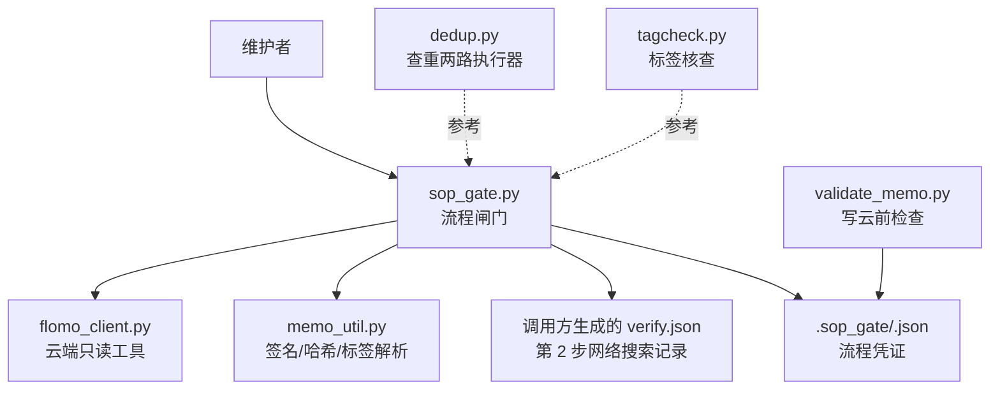
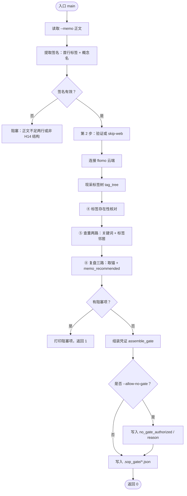
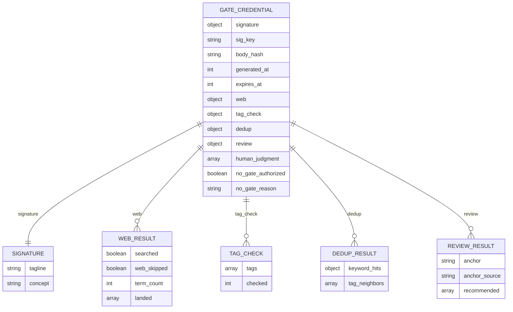
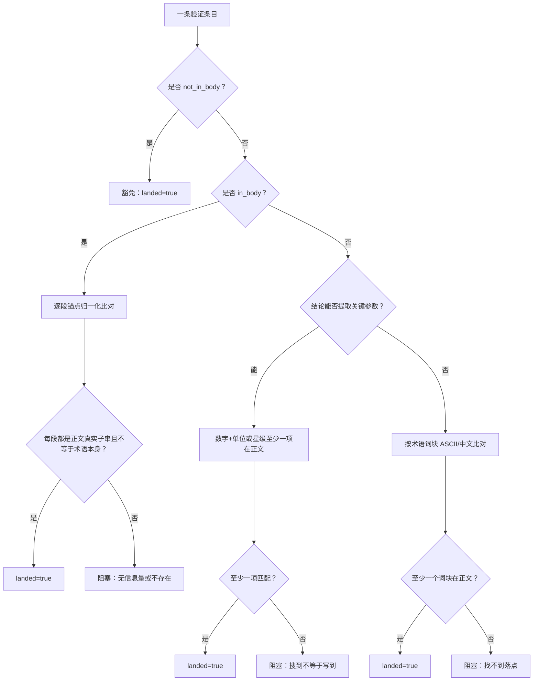
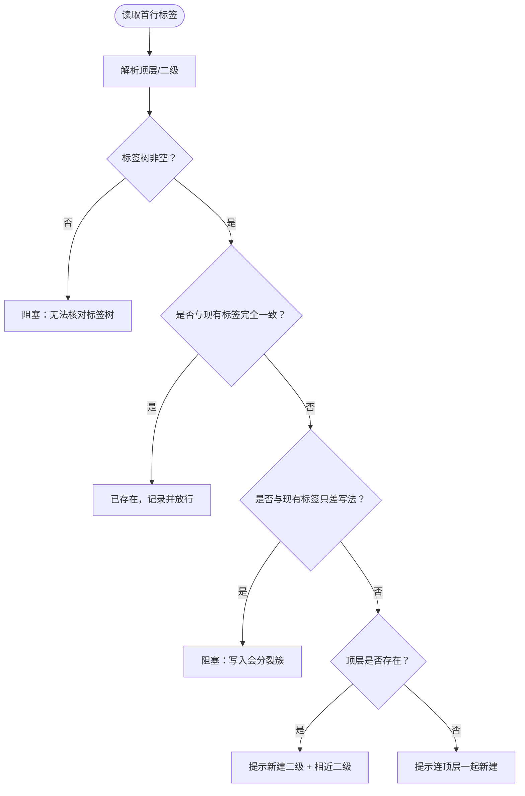
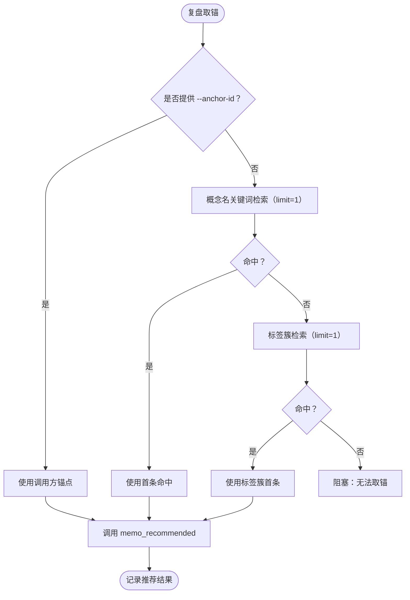
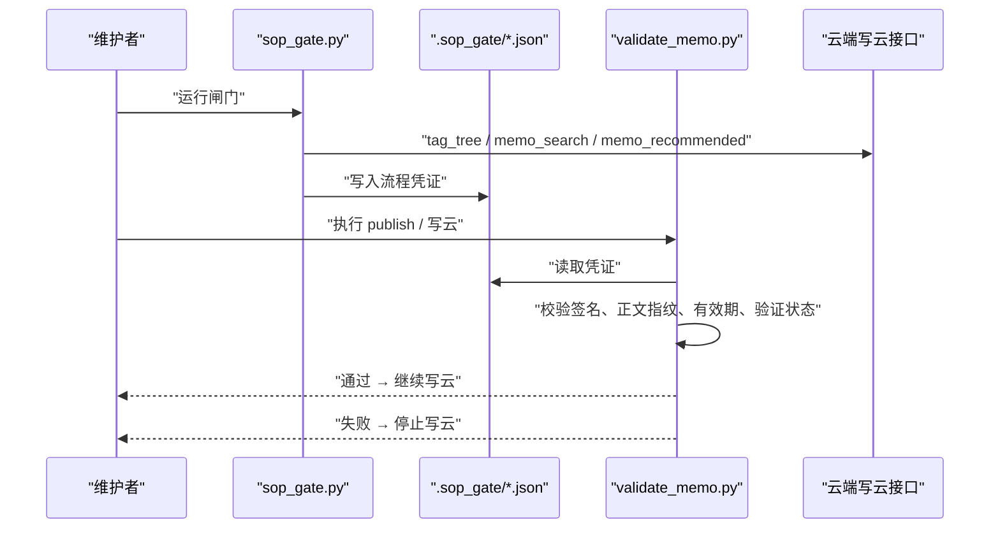
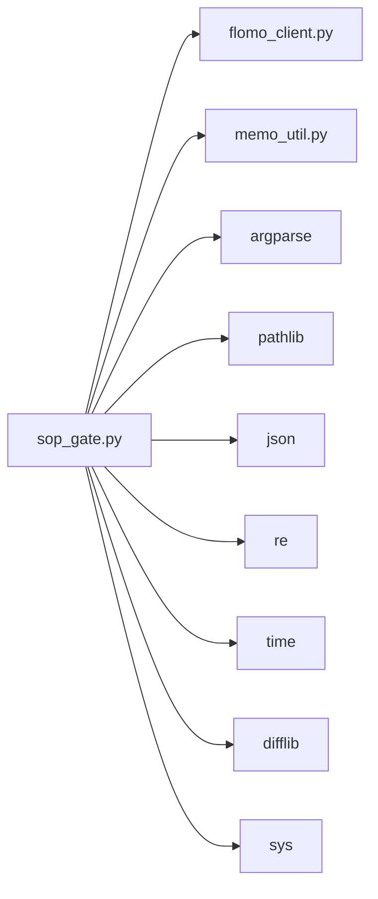

# 流程闸门 sop_gate.py

<cite>
**本文引用的文件**   
- [sop_gate.py](file://scripts/sop_gate.py)
- [validate_memo.py](file://scripts/validate_memo.py)
- [dedup.py](file://scripts/dedup.py)
- [tagcheck.py](file://scripts/tagcheck.py)
- [memo_util.py](file://scripts/memo_util.py)
- [flomo_client.py](file://scripts/flomo_client.py)
- [test_sop_gate.py](file://tests/test_sop_gate.py)
- [test_dedup.py](file://tests/test_dedup.py)
</cite>

## 目录
1. [引言](#引言)
2. [项目结构与定位](#项目结构与定位)
3. [核心职责与入口](#核心职责与入口)
4. [凭证数据结构](#凭证数据结构)
5. [校验规则详解](#校验规则详解)
6. [与上下游脚本的协作](#与上下游脚本的协作)
7. [典型使用场景](#典型使用场景)
8. [遗漏步骤的错误提示与修复指引](#遗漏步骤的错误提示与修复指引)
9. [闸门通过后的 publish 衔接](#闸门通过后的-publish-衔接)
10. [依赖关系分析](#依赖关系分析)
11. [性能与可靠性特性](#性能与可靠性特性)
12. [故障排查清单](#故障排查清单)
13. [结论](#结论)

## 引言
`sop_gate.py` 是 SOP 流程中的“流程闸门”：把过去靠自觉的检查型步骤变成必须留痕、可被写云侧机械核验的凭证。它覆盖三条关键路径：

| 步骤 | 含义 | 闸门负责什么 | 不做语义判断 |
|---|---|---|---|
| ② 验证（网络搜索） | 术语卡需现查并确认结论落进正文 | 读调用方提供的 `--verify` JSON，逐项核对落点 | 不替人决定该术语是否重要 |
| ⑤ 查重两路 | 关键词检索 + 标签簇近邻复查 | 真调云端工具，产出命中清单和标签邻居 | 不判定候选是否同一事件 |
| ⑧ 复盘三路 | 基于锚点的推荐卡自查 | 自动取锚或接受 `--anchor-id`，跑推荐路 | 不判定推荐卡是否相关 |

只有当这些凭证齐全、签名正确、正文指纹匹配且未过期时，`publish` 才能继续执行写云。设计意图很明确：**漏做物理上不可能**——没跑闸门就没有凭证，凭证缺失就是写云错误。

## 项目结构与定位
`sop_gate.py` 位于 `scripts/`，是维护工作流中独立的可执行脚本；它与以下组件形成上下游关系：



**图表来源**
- [sop_gate.py:1-594](file://scripts/sop_gate.py#L1-L594)
- [validate_memo.py:43-984](file://scripts/validate_memo.py#L43-L984)
- [dedup.py:1-220](file://scripts/dedup.py#L1-L220)
- [tagcheck.py:1-194](file://scripts/tagcheck.py#L1-L194)

**章节来源**
- [sop_gate.py:1-45](file://scripts/sop_gate.py#L1-L45)
- [validate_memo.py:43-45](file://scripts/validate_memo.py#L43-L45)

## 核心职责与入口
### 命令行入口
主入口是模块级 `main()`，由 `cli_entry(main, errors=(FlomoError,), code=2, prefix="[失败] 云端调用出错：")` 包装。正常通过返回退出码 `0`；有阻塞项返回 `1`；云端调用异常返回 `2`。

| 参数 | 必填 | 作用 |
|---|---:|---|
| `--memo` | 是 | 卡片正文文件路径 |
| `--verify` | 非术语卡为否 | 第 2 步网络搜索验证记录 JSON 路径 |
| `--skip-web` | 否 | 显式声明非术语卡，跳过第 2 步网络验证 |
| `--out` | 否 | 自定义凭证输出路径，默认 `.sop_gate/<sig_key>.json` |
| `--anchor-id` | 否 | 复盘锚点 id，更新已有卡时传本卡 id |
| `--allow-no-gate` REASON | 否 | 批量处理历史卡的降级授权理由，会写入凭证 |

### 控制流概览


**图表来源**
- [sop_gate.py:436-594](file://scripts/sop_gate.py#L436-L594)

**章节来源**
- [sop_gate.py:436-594](file://scripts/sop_gate.py#L436-L594)
- [sop_gate.py:586-594](file://scripts/sop_gate.py#L586-L594)

## 凭证数据结构
闸门通过后产出的是一张 `.sop_gate/<sig_key>.json` 凭证，字段由 `assemble_gate()` 定义，并由 `validate_memo.check_gate()` 消费。

| 字段 | 类型 | 含义 | 写云侧校验 |
|---|---|---|---|
| `signature` | 对象 | `{tagline, concept}` | 与当前卡片签名比对 |
| `sig_key` | 字符串 | 凭证书文件名对应的短签名 | 文件名须匹配 |
| `body_hash` | 字符串 | 正文 SHA-256 指纹 | 防闸门后改正文 |
| `generated_at` | 整数时间戳 | 凭证生成时刻 | 计算有效期 |
| `expires_at` | 整数时间戳 | 凭证过期时刻 | 默认 6 小时，过期判错 |
| `web` | 对象 | 第 2 步验证结果 | 要求 `searched=true` 或 `web_skipped=true` |
| `tag_check` | 对象 | ④ 标签核对明细 | 确认标签路已跑 |
| `dedup` | 对象 | ⑤ 查重两路结果 | 确认两路已跑 |
| `review` | 对象 | ⑧ 复盘三路结果 | 确认复盘已跑 |
| `human_judgment` | 数组 | 机器判不了的边界项 | 不参与放行判定，仅审计 |
| `no_gate_authorized` | 布尔 | 降级授权标记 | 仅允许 `--allow-no-gate` 情形 |
| `no_gate_reason` | 字符串 | 降级授权理由 | 供事后审计 |

凭证文件命名采用 `sig_key`，即对 `tagline\nconcept` 做 SHA-256 后取前 16 位十六进制；这保证文件名与凭证内签名同源。



**图表来源**
- [sop_gate.py:472-520](file://scripts/sop_gate.py#L472-L520)
- [sop_gate.py:522-585](file://scripts/sop_gate.py#L522-L585)
- [validate_memo.py:900-984](file://scripts/validate_memo.py#L900-L984)

**章节来源**
- [sop_gate.py:472-520](file://scripts/sop_gate.py#L472-L520)
- [sop_gate.py:522-585](file://scripts/sop_gate.py#L522-L585)
- [validate_memo.py:900-984](file://scripts/validate_memo.py#L900-L984)

## 校验规则详解
### 第 2 步：验证（网络搜索）
闸门并不自己执行网络搜索，而是读取调用方完成第 2 步后落盘的 `--verify` JSON，并做两件事：

1. **确认搜索确实做了**：`searched` 必须是严格布尔 `true`。
2. **确认搜到的东西写进了正文**：对每个术语按优先级判断落点。

术语落点判定顺序如下：



**图表来源**
- [sop_gate.py:201-270](file://scripts/sop_gate.py#L201-L270)

关键约束：

| 规则 | 说明 |
|---|---|
| `in_body` 不得空转 | 锚点不能等于术语本身，也不能包含于术语本身 |
| 关键参数必须落正文 | 如 `430 公里`、`160 kW`、`31,200 欧元`、`五星` |
| 纯命名类核实兜底词块 | 术语本身的 ASCII 与中文词块至少命中一个 |
| 豁免必须显式 | 用 `not_in_body` 写明理由，不会静默放行 |
| 两侧统一归一化 | 去空白、千分位逗号、统一小写，避免 `160 kW` 与 `160kW` 误判 |

**章节来源**
- [sop_gate.py:201-270](file://scripts/sop_gate.py#L201-L270)
- [sop_gate.py:401-465](file://scripts/sop_gate.py#L401-L465)

### 第 4 步：标签核对
闸门现采 `tag_tree`，对卡片首行每个二级标签做状态判定：

| 情况 | 行为 |
|---|---|
| 与现有标签只差空白、全半角斜杠、大小写 | **阻塞**：云端会把两种写法当成两个簇，写入即分裂 |
| 顶层存在但二级不在树中 | 提示“本卡将新建此二级”，并列出同顶层最相近的现有二级 |
| 顶层也不存在 | 提示连顶层一起新建 |
| 标签树为空 | 阻塞，因为无法进行第 ④ 步和第 ⑤ 步标签路 |

相近二级最多显示 3 个，用于辅助人工判断，但不改变放行条件。



**图表来源**
- [sop_gate.py:272-360](file://scripts/sop_gate.py#L272-L360)

**章节来源**
- [sop_gate.py:272-360](file://scripts/sop_gate.py#L272-L360)
- [sop_gate.py:362-380](file://scripts/sop_gate.py#L362-L380)

### 第 5 步：查重两路
闸门实现的是“两路都跑了”的最小强制条件：

| 路 | 操作 | 凭证字段 |
|---|---|---|
| 关键词路 | 从概念名派生最多 2 个关键词，分别调 `memo_search` | `dedup.keyword_hits` |
| 标签路 | 遍历标签树中与 `top/leaf` 精确相等或以其开头的簇 | `dedup.tag_neighbors` |

注意：这里不是 `dedup.py` 的全文复盘模式，而是闸门内部的轻量版查重。它不取全文、不做事件语义合并，只证明两路已执行。

**章节来源**
- [sop_gate.py:382-434](file://scripts/sop_gate.py#L382-L434)
- [dedup.py:1-220](file://scripts/dedup.py#L1-L220)

### 第 8 步：复盘三路
复盘需要一张已有的卡作为锚点，取锚顺序严格固定：

1. 如果传入 `--anchor-id`，直接用它。
2. 否则用概念名派生关键词检索，取首条命中。
3. 若关键词无命中，退到本卡标签簇检索，取首条。
4. 全部失败则阻塞，并在文案中指出出路。

成功时凭证保留 `anchor`、`anchor_source` 和推荐卡 id 列表。



**图表来源**
- [sop_gate.py:401-465](file://scripts/sop_gate.py#L401-L465)

**章节来源**
- [sop_gate.py:401-465](file://scripts/sop_gate.py#L401-L465)

### 机器盲区：human_judgment
凭证中的 `human_judgment` 不是放行门槛，而是“闸门承认机器做不到的事”。包括：

- 标签命名是否符合主体类别。
- 查重候选是否同一事件。
- 写云后本卡全文自查。
- 抓回原文并读回的工具动作。

这是故意设计的审计线索：一份看似处处有据却隐藏盲区的凭证，比如实标注边界的凭证更危险。

**章节来源**
- [sop_gate.py:47-85](file://scripts/sop_gate.py#L47-L85)
- [sop_gate.py:472-520](file://scripts/sop_gate.py#L472-L520)

## 与上下游脚本的协作
### 与 validate_memo.py：写云前的闸门守卫
`validate_memo.py` 在写云前调用 `check_gate(content)`，主要检查：

| 检查项 | 触发错误 |
|---|---|
| 找不到对应 `sig_key` 的凭证 | “缺少 SOP 流程闸门凭证” |
| 文件名与凭证内 `signature` 不一致 | “签名与当前卡片不符” |
| `body_hash` 与当前正文不一致 | “正文指纹与当前卡片不符” |
| `expires_at` 缺失或不是整数 | 拒绝旧格式凭证 |
| 当前时间超过 `expires_at` | “凭证已过期” |
| `web.searched` 为假且未 `web_skipped` | “验证未执行” |
| `--no-gate` 但没有 `no_gate_authorized=true` | 降级无效 |

**章节来源**
- [validate_memo.py:900-984](file://scripts/validate_memo.py#L900-L984)
- [test_sop_gate.py:80-170](file://tests/test_sop_gate.py#L80-L170)

### 与 dedup.py：查重执行器的兄弟脚本
`sop_gate.py` 的查重逻辑与 `dedup.py` 分工不同：

| 脚本 | 用途 | 是否取全文 | 是否做事件语义判断 |
|---|---|---|---|
| `sop_gate.py` | 闸门轻量查重，证明两路已跑 | 否 | 否 |
| `dedup.py` | 查重与近邻复查的执行器，适合人类阅读完整命中 | 可选，默认按 `--max-full` 分批 | 否 |

两者都强调“程序只跑查询、不替人做事件合并决策”。

**章节来源**
- [sop_gate.py:382-434](file://scripts/sop_gate.py#L382-L434)
- [dedup.py:1-220](file://scripts/dedup.py#L1-L220)
- [test_dedup.py:1-260](file://tests/test_dedup.py#L1-L260)

### 与 tagcheck.py：标签核查的参考实现
`sop_gate.py` 内部实现了自己的标签树读取与存在性核对，而 `tagcheck.py` 是面向用户的标签核查脚本，同样依赖 `tag_tree`。两者共用相同原则：

- 标签树必须带 `total`。
- 截断会使“标签不存在”结论不可信。
- 同一顶层下应关注相近二级，但是否同一簇属语义判断。

**章节来源**
- [tagcheck.py:1-194](file://scripts/tagcheck.py#L1-L194)
- [sop_gate.py:362-380](file://scripts/sop_gate.py#L362-L380)

### 与 memo_util.py：签名、哈希与标签工具
`sop_gate.py` 依赖 `memo_util.py` 提供：

- `memo_signature(content)`：从正文前两行提取 `{tagline, concept}`。
- `signature_key(sig)`：生成凭证书文件名用的短签名。
- `body_hash(content)`：正文指纹。
- `tag_leaves(tagline)`：解析 `#顶层/二级`。
- `keywords_of_concept(concept, limit)`：从概念名派生查重关键词。

**章节来源**
- [sop_gate.py:37-46](file://scripts/sop_gate.py#L37-L46)
- [sop_gate.py:900-920](file://scripts/sop_gate.py#L900-L920)

### 与 flomo_client.py：云端只读访问
闸门通过 `FlomoClient` 调用：

- `tag_tree`：现采标签树。
- `memo_search`：关键词与标签检索。
- `memo_recommended`：复盘推荐。

所有调用都是只读；写云由 `validate_memo.py` 后续流程负责。

**章节来源**
- [sop_gate.py:29-36](file://scripts/sop_gate.py#L29-L36)
- [sop_gate.py:436-594](file://scripts/sop_gate.py#L436-L594)

## 典型使用场景
### 单卡闸门
适用于维护者在修改某张卡片后，重新跑一次闸门并写云。

1. 先完成第 2 步网络搜索，生成 `--verify` JSON。
2. 运行闸门：
   ```bash
   python scripts/sop_gate.py --memo <正文路径> --verify <验证记录JSON>
   ```
3. 查看输出中的 `[通过] 闸门全过，凭证已写入 ...`。
4. 进入 publish 流程，让 `validate_memo.py` 检查凭证。

如果是非术语卡，使用：
```bash
python scripts/sop_gate.py --memo <正文路径> --skip-web
```

**章节来源**
- [sop_gate.py:16-25](file://scripts/sop_gate.py#L16-L25)
- [sop_gate.py:436-594](file://scripts/sop_gate.py#L436-L594)

### 批次闸门
适用于批量处理历史卡片。此时可能没有完整的第 2 步验证记录，可使用降级授权：

```bash
python scripts/sop_gate.py --memo <正文路径> --allow-no-gate "<理由>"
```

这会写入 `no_gate_authorized=true` 和 `no_gate_reason`，使 `validate_memo.py` 在 `--no-gate` 模式下接受缺失凭证。

注意：这不是绕过审核，而是把“批量处理历史卡”的例外写成凭证里的可审计事实。

**章节来源**
- [sop_gate.py:22-25](file://scripts/sop_gate.py#L22-L25)
- [sop_gate.py:540-585](file://scripts/sop_gate.py#L540-L585)
- [test_sop_gate.py:170-220](file://tests/test_sop_gate.py#L170-L220)

### 更新已有卡
更新场景需要复盘锚点指向已有卡 id：

```bash
python scripts/sop_gate.py --memo <正文路径> --verify <验证记录JSON> --anchor-id <本卡id>
```

**章节来源**
- [sop_gate.py:20-21](file://scripts/sop_gate.py#L20-L21)
- [sop_gate.py:401-465](file://scripts/sop_gate.py#L401-L465)

## 遗漏步骤的错误提示与修复指引
| 遗漏 | 闸门提示 | 修复方式 |
|---|---|---|
| 未提供 `--verify` 也未 `--skip-web` | “未提供第 2 步验证记录……术语卡必须现查，非术语卡须显式 --skip-web” | 术语卡补跑第 2 步并生成 verify JSON；非术语卡加 `--skip-web` |
| verify JSON 不存在 | “验证记录文件不存在” | 确认 `--verify` 路径正确 |
| verify JSON 非法 | “验证记录非法 JSON” | 修正 JSON 语法 |
| `searched` 不是布尔 `true` | “验证记录 searched 必须为布尔 true……第 2 步未真正执行网络搜索” | 重新执行第 2 步，不要写 `"false"` 或 `0` |
| terms 为空或缺 term/conclusion | “验证记录 terms 为空”“缺 term/conclusion” | 补充每条核实的术语与结论 |
| 术语结论的关键参数未落正文 | “搜到不等于写到，须融入正文对应要点” | 把参数写进正文，或用 `not_in_body` 显式豁免 |
| 纯命名术语未在正文出现 | “找不到落点” | 确保术语词块出现在正文 |
| 标签与现有标签只差写法 | “云端会把它们当两个簇，写入即分裂” | 改为现有标签写法 |
| 标签树为空 | “标签树未取到……重采通过后再跑” | 检查云端标签树可用性并重跑 |
| 无法从概念名派生关键词 | “无法从概念名派生查重关键词” | 检查概念名是否能派生关键词 |
| 复盘无法取锚 | “复盘第 ⑧ 步无法取锚……确属全新主题时用 --anchor-id” | 传 `--anchor-id`，或修正首行标签 |
| 正文签名不足两行 | “正文不足两行非空内容，无法生成签名——先按 H14 补齐结构” | 按 H14 补齐首行标签和概念名 |

**章节来源**
- [sop_gate.py:201-465](file://scripts/sop_gate.py#L201-L465)
- [sop_gate.py:522-585](file://scripts/sop_gate.py#L522-L585)

## 闸门通过后的 publish 衔接
闸门只是“前置检查”，最终写云仍由 `validate_memo.py` 控制。典型流程是：

1. 运行 `sop_gate.py`，得到 `.sop_gate/<sig_key>.json`。
2. 运行 write/publish 命令，其中会调用 `validate_memo.check_gate(content)`。
3. 如果凭证齐全且有效，写云继续；否则终止并报错。

常见衔接命令形式取决于项目发布脚本，但核心调用链是：



**图表来源**
- [sop_gate.py:522-594](file://scripts/sop_gate.py#L522-L594)
- [validate_memo.py:927-984](file://scripts/validate_memo.py#L927-L984)

**章节来源**
- [validate_memo.py:927-984](file://scripts/validate_memo.py#L927-L984)

## 依赖关系分析
`sop_gate.py` 的直接依赖如下：



**图表来源**
- [sop_gate.py:37-46](file://scripts/sop_gate.py#L37-L46)

外部协作组件：

| 组件 | 角色 | 耦合程度 |
|---|---|---|
| `validate_memo.py` | 写云前闸门校验方 | 高：共享凭证字段、GATE_DIR、签名口径 |
| `dedup.py` | 查重执行器 | 低：共同遵循“两路现查、不替人做语义判断”原则 |
| `tagcheck.py` | 标签核查脚本 | 低：共用标签树与“total 校验”理念 |
| `flomo_client.py` | 云端只读客户端 | 中：依赖工具名称和回包结构 |
| `memo_util.py` | 签名、哈希、标签解析 | 中：闸门与写云侧共用签名/哈希逻辑 |

**章节来源**
- [sop_gate.py:37-46](file://scripts/sop_gate.py#L37-L46)
- [validate_memo.py:33-45](file://scripts/validate_memo.py#L33-L45)

## 性能与可靠性特性
- **标签树只采一次**：④ 标签核对与 ⑤ 标签路查重共用同一份 `tree`，避免重复往返和两次之间标签改名导致矛盾。
- **凭证 TTL 默认 6 小时**：防止“昨天的凭证给今天的卡用”。
- **正文指纹强制校验**：`body_hash` 防闸门通过后改正文。
- **签名与文件名双校验**：文件名 `sig_key` 与凭证内 `signature` 必须一致。
- **云端异常转为退出码 2**：自动化不应重试写云，应视为调用失败。
- **标签树截断告警而非静默忽略**：`total` 缺失直接抛错；返回条数不足时记录截断信息。
- **验证记录严格布尔校验**：不用 Python 真值判定，避免 `"false"`、`0` 被误认为已通过。

**章节来源**
- [sop_gate.py:43-45](file://scripts/sop_gate.py#L43-L45)
- [sop_gate.py:362-380](file://scripts/sop_gate.py#L362-L380)
- [sop_gate.py:472-520](file://scripts/sop_gate.py#L472-L520)
- [sop_gate.py:586-594](file://scripts/sop_gate.py#L586-L594)

## 故障排查清单
| 现象 | 优先检查 |
|---|---|
| 闸门报“正文不足两行” | 确认 H14 结构：首行标签、第二行概念名 |
| 闸门报“验证未执行” | 确认 `--verify` 中 `searched` 是布尔 `true` |
| 闸门报术语未落正文 | 检查 `in_body` 是否为真实正文片段，或补充关键参数 |
| 闸门报标签写错 | 对比现有标签，修正空白、全半角斜杠、大小写 |
| 闸门报无法取锚 | 传 `--anchor-id`，或修正首行标签 |
| publish 报凭证缺失 | 确认 `.sop_gate/<sig_key>.json` 存在且未被删除 |
| publish 报正文指纹不符 | 重新运行 `sop_gate.py`，不要改完正文再复用旧凭证 |
| publish 报凭证已过期 | 重新运行 `sop_gate.py`，TTL 默认 6 小时 |
| publish 报签名不符 | 凭证属于另一张卡，重新为目标卡运行闸门 |
| 批处理想跳过闸门 | 使用 `--allow-no-gate` 并注明理由，同时配合 `--no-gate` |

**章节来源**
- [sop_gate.py:201-594](file://scripts/sop_gate.py#L201-L594)
- [validate_memo.py:927-984](file://scripts/validate_memo.py#L927-L984)

## 结论
`sop_gate.py` 的核心价值不是替代人对术语重要性、事件相关性、标签语义的判断，而是把这些判断需要的“证据链”固化成凭证。它强制：

- 术语卡要么现查并落点，要么显式声明无需网络验证。
- 标签写错会被阻塞，新建标签会有明确提示。
- 查重两路必须真的调用云端。
- 复盘必须有锚点，且锚点来源可审计。
- 凭证绑定签名、正文指纹和时间。
- 写云前必须存在匹配的凭证。

这正是“漏做物理上不可能”的实现方式：跳过第 2 步、第 5 步或第 8 步，都不会产生有效凭证；没有凭证，`validate_memo.py` 就不会允许写云。凭证里还诚实写出机器做不到的部分，让审计者知道哪里可以信任、哪里仍需人工判断。