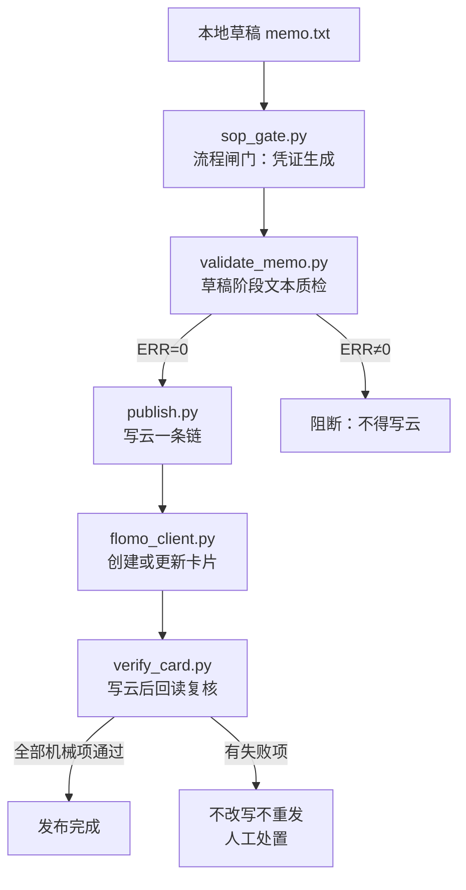
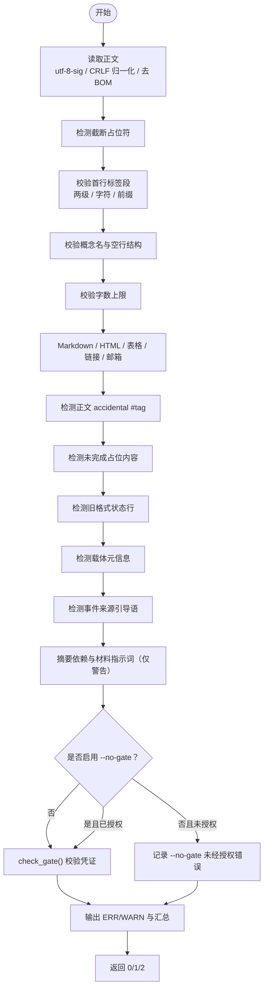
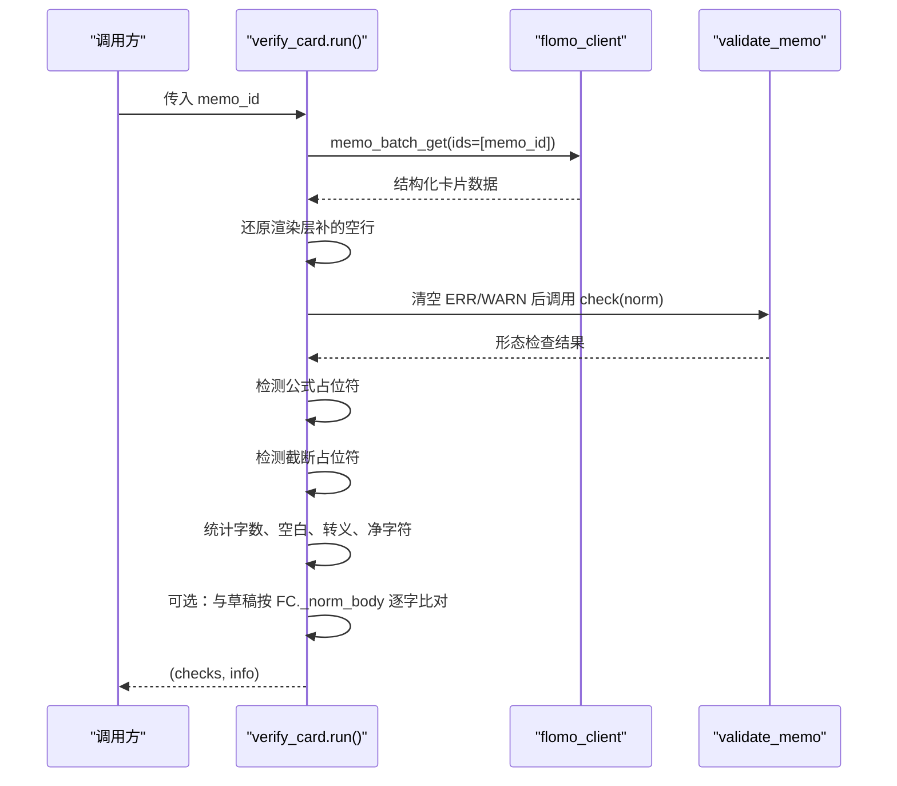
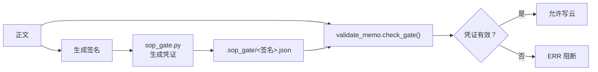
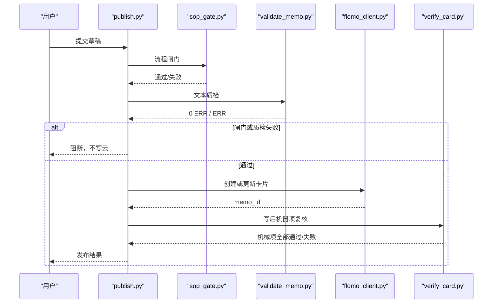
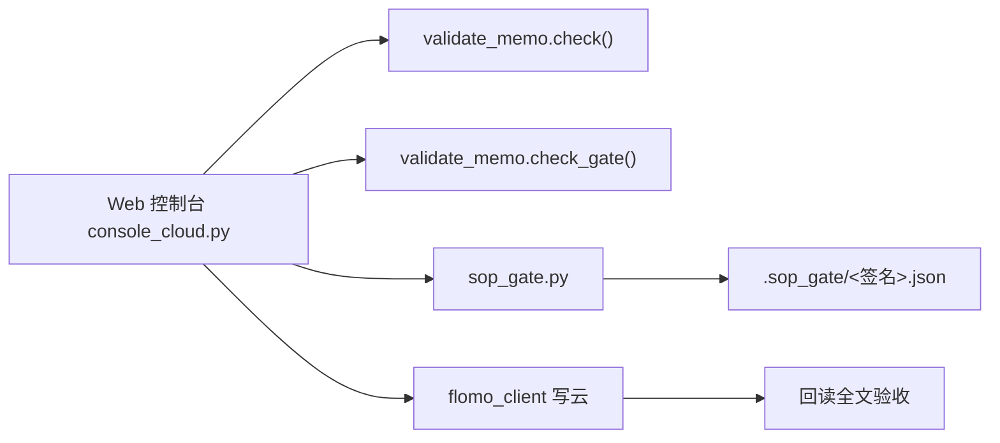
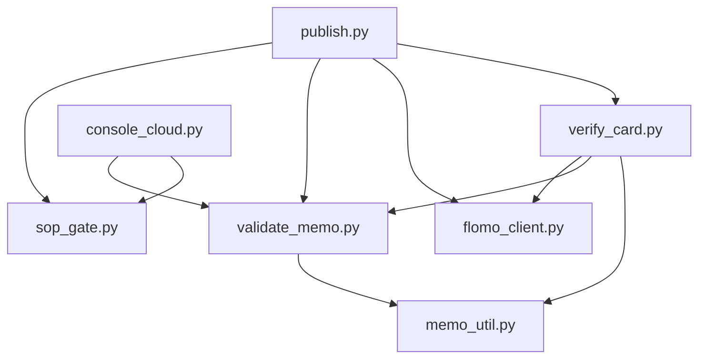

# 质检与复核 validate_memo.py / verify_card.py

<cite>
**本文引用的文件**   
- [scripts/validate_memo.py](file://scripts/validate_memo.py)
- [scripts/verify_card.py](file://scripts/verify_card.py)
- [tests/test_validate_memo.py](file://tests/test_validate_memo.py)
- [tests/test_verify_card.py](file://tests/test_verify_card.py)
- [scripts/publish.py](file://scripts/publish.py)
- [scripts/console_cloud.py](file://scripts/console_cloud.py)
- [scripts/sop_gate.py](file://scripts/sop_gate.py)
</cite>

## 目录
1. [引言](#引言)
2. [脚本定位与流水线位置](#脚本定位与流水线位置)
3. [validate_memo.py：草稿阶段文本质检](#validate_memopy草稿阶段文本质检)
4. [verify_card.py：写云后回读复核](#verify_cardpy写云后回读复核)
5. [两个脚本的对比总表](#两个脚本的对比总表)
6. [实际卡片示例：通过/失败对照](#实际卡片示例通过失败对照)
7. [如何被 sop_gate、publish 与 Web 控制台调用](#如何被-sop_gatepublish-与-web-控制台调用)
8. [依赖关系与风险点](#依赖关系与风险点)
9. [故障排查指南](#故障排查指南)
10. [结论](#结论)

## 引言

本仓库围绕“卡片”这一最小知识单元，建立了两条互锁的质量防线：

- **写前质检**由 `scripts/validate_memo.py` 承担，负责在正文进入云端之前检查格式、标签、来源、载体、字数与流程闸门。
- **写后复核**由 `scripts/verify_card.py` 承担，负责从云端拉回全文，做形态检查、占位符检测、净字符数统计，以及与本地草稿的可机械比对。

两者的设计目标是：**把可机械判定的规则固化下来，不靠每轮临时想到什么查什么；同时明确标注必须由人通读判断的两项，避免自动化输出伪装成“全部已查过”。**

## 脚本定位与流水线位置



**图示来源**
- [scripts/publish.py:662-679](file://scripts/publish.py#L662-L679)
- [scripts/publish.py:752-770](file://scripts/publish.py#L752-L770)
- [scripts/validate_memo.py:1031-1097](file://scripts/validate_memo.py#L1031-L1097)
- [scripts/verify_card.py:1-297](file://scripts/verify_card.py#L1-L297)

在常规流程中，`publish.py` 是编排者：它先跑 `sop_gate.py`，再跑 `validate_memo.py`；通过后调用写云逻辑，最后运行 `verify_card.py` 做机器项复核。Web 控制台则通过 `console_cloud.py` 直接复用 `validate_memo.check()` 和 `validate_memo.check_gate()`，并在写入后回读验收。

**章节来源**
- [scripts/publish.py:2-34](file://scripts/publish.py#L2-L34)
- [scripts/publish.py:662-679](file://scripts/publish.py#L662-L679)
- [scripts/publish.py:752-770](file://scripts/publish.py#L752-L770)
- [scripts/console_cloud.py:30-45](file://scripts/console_cloud.py#L30-L45)

## validate_memo.py：草稿阶段文本质检

### CLI 参数与入口行为

| 参数 | 含义 | 说明 |
|---|---|---|
| `memo.txt`（位置参数） | 校验纯文本卡片文件 | 若文件以 `{` 开头且为合法 JSON，会自动抽取 `content` 字段 |
| `--file <路径>` | 同位置参数别名 | 兼容 `flomo_client.py` 发送的 JSON 请求体 |
| `--content "<正文>"` | 直接从命令行传入正文 | 适合管道或测试 |
| `--create <JSON 文件>` | 从 create.json 抽取 `content` | 与 `--file` 共用同一份 JSON 解析逻辑 |
| `--no-gate` | 将 SOP 流程闸门降级为警告 | 必须配合 `.sop_gate/<签名>.json` 中的授权标记，否则仍按致命错误处理 |
| `-h` / `--help` | 打印帮助 | 退出码为 2 |

输入读取统一使用 `utf-8-sig`，自动处理 BOM；CRLF/CR 归一化为 LF。

**章节来源**
- [scripts/validate_memo.py:1-19](file://scripts/validate_memo.py#L1-L19)
- [scripts/validate_memo.py:901-990](file://scripts/validate_memo.py#L901-L990)
- [scripts/validate_memo.py:1031-1097](file://scripts/validate_memo.py#L1031-L1097)

### 主要校验规则与错误等级

| 类别 | 规则 | 错误等级 | 关键口径 |
|---|---|---|---|
| 截断 | 正文含检索回包截断占位符 | 致命（ERR） | 正文中段已缺失，不能写进云端 |
| 标签段 | 首行必须以 `#` 开头 | 致命 | 无标签无法检索 |
| 标签层级 | 严格两级 `#顶层/二级` | 致命 | 裸顶层、三级及以上均错 |
| 子标签前缀 | 存在主标签时，子标签须带 `/` | 致命 | 防止建出独立顶层标签 |
| 非法字符 | 标签只允许中文、英文、数字、下划线、`/` | 致命 | 其余字符会造脏标签 |
| 概念名 | 第二行非空且不以 `#` 开头 | 致命 | 影响卡片签名、幂等查重与闸门凭证 |
| 结构空行 | 标题行后必须空一行再接正文 | 致命 | 否则 flomo 合并段落 |
| 字数上限 | 含标签段不超过 20000 字 | 致命 | 超限通常应拆卡 |
| Markdown 强调 | 加粗 `**`、删除线 `~~`、斜体 `*`、粗斜体 `***` | 致命 | 本库卡一律纯文本 |
| 行内代码 | 反引号 | 致命 | flomo 不渲染 |
| HTML 标签 | 除 `<mark>` `<u>` 外的 inline HTML | 致命 | 本库禁止任何 HTML 强调标记 |
| 表格 | Markdown 表格分隔行、竖线包裹行、空格包围竖线组 | 警告（WARN） | 建议改用列表 |
| 图片语法 | `` | 致命 | flomo 不支持 |
| Markdown 链接 | `[text](https://...)` | 警告 | 建议改为纯文本 URL |
| 裸邮箱 | 未包裹的 `a@b.c` | 警告 | 云端会转成 mailto，破坏逐字对账 |
| 标题/引用语法 | 行首 `#` 或 `>` | 警告 | flomo 不渲染 |
| 正文 `#xxx` | 非首行的 `#词` | 致命 | flomo 会当标签处理 |
| 占位内容 | `example.com`、`待补`、`placeholder`、`TODO`、`lorem` | 致命 | 疑似未完成或生造内容 |
| 状态行 | 末尾行疑似旧格式状态行 | 警告 | 历史遗留，人工判断 |
| 载体信息 | 截图、讲义、页码、UP 主、直播间、公众号等载体元信息混入正文 | 致命 | 概念卡正文只写概念本身 |
| 概念名取材命名 | 概念名用截图/讲义等取材方式命名 | 警告 | 概念名应只写概念 |
| 事件来源 | “据某媒体报道”“史载”“据载”等来源引导语 | 致命 | H15/H16 要求不署来源 |
| 摘要依赖 | 正文出现“据摘要显示”等措辞 | 警告 | 预印本卡须基于正文 |
| 材料指示词 | “本文”“文中”“作者指出”等 | 警告 | 离开原文后“本篇/谁说的”不构成信息 |
| 流程闸门 | 缺少凭证、签名不匹配、正文指纹不一致、过期、未执行网络验证、缺标签核对 | 致命 | 凭 `.sop_gate/<签名>.json` 判定 |
| 闸门降级 | 使用了 `--no-gate` 但凭证未授权 | 致命 | 防止绕过整套 SOP |

其中，`check()` 负责文本格式与业务规则；`check_gate()` 负责流程闸门；`main()` 负责汇总输出并返回退出码。

**章节来源**
- [scripts/validate_memo.py:201-250](file://scripts/validate_memo.py#L201-L250)
- [scripts/validate_memo.py:250-430](file://scripts/validate_memo.py#L250-L430)
- [scripts/validate_memo.py:500-691](file://scripts/validate_memo.py#L500-L691)
- [scripts/validate_memo.py:691-850](file://scripts/validate_memo.py#L691-L850)
- [scripts/validate_memo.py:850-1097](file://scripts/validate_memo.py#L850-L1097)

### 输出格式

`main()` 输出三部分内容：

1. 所有 `ERR :` 行。
2. 所有 `WARN:` 行。
3. 汇总行：`结果：N 错 / M 警，合计 K 条提示`。

退出码约定：

| 退出码 | 含义 |
|---|---|
| 0 | 没有 ERR（WARN 不阻塞） |
| 1 | 存在至少一个 ERR |
| 2 | 参数错误、用法错误或输入读取失败 |

**章节来源**
- [scripts/validate_memo.py:1031-1097](file://scripts/validate_memo.py#L1031-L1097)

### 概念性流程图



**图示来源**
- [scripts/validate_memo.py:201-430](file://scripts/validate_memo.py#L201-L430)
- [scripts/validate_memo.py:500-691](file://scripts/validate_memo.py#L500-L691)
- [scripts/validate_memo.py:691-850](file://scripts/validate_memo.py#L691-L850)
- [scripts/validate_memo.py:901-1097](file://scripts/validate_memo.py#L901-L1097)

## verify_card.py：写云后回读复核

### CLI 参数与入口行为

| 参数 | 含义 | 说明 |
|---|---|---|
| `--id <卡片 id>` | 必填 | 从云端拉回该卡片 |
| `--draft <本地草稿路径>` | 可选 | 追加一项与草稿的逐字比对 |
| `--json` | 可选 | 输出 JSON，供自动化消费 |
| `--show-body` | 可选 | 打印云端全文，用于两条“须人读”项 |

默认终端输出包含卡片 ID、标签、云端报告字数、净字符数、行数、逐项检查结果、来自 `validate_memo` 的 WARN、以及两条“须人读”项。

`--json` 输出对象包含：

| 字段 | 含义 |
|---|---|
| `ok` | 所有机械检查项是否全部通过 |
| `info` | 卡片元信息与字数统计 |
| `checks` | 每项检查的名称、是否通过、详情 |
| `human_judgment` | 必须由人通读确认的两项 |

**章节来源**
- [scripts/verify_card.py:1-45](file://scripts/verify_card.py#L1-L45)
- [scripts/verify_card.py:200-297](file://scripts/verify_card.py#L200-L297)

### 回读与检查流程



**图示来源**
- [scripts/verify_card.py:46-147](file://scripts/verify_card.py#L46-L147)
- [scripts/verify_card.py:147-200](file://scripts/verify_card.py#L147-L200)
- [scripts/verify_card.py:200-297](file://scripts/verify_card.py#L200-L297)

### 机械检查项清单

| 检查项 | 通过条件 | 失败详情 |
|---|---|---|
| 回读完整（未被截断） | `content_truncated` 为假 | 提示换 `memo_batch_get` 重取 |
| 首行是完整标签段 | 首行以 `#` 开头且含 `/` | 打印首行片段 |
| 第二行是概念名 | 第二行非空且不以 `#`、`要点`、`结构`、`标签` 开头 | 打印次行片段 |
| 形态检查（复用 validate_memo） | `validate_memo.check()` 无 ERR | 最多列出前三条 ERR |
| 无内容占位符残留 | 未发现 `〈M…〉`、`〖M…〗`、`＜M…＞` 等占位符 | 命中数量与前三处 |
| 无截断占位符（正文未取自检索回包） | 未发现 `find_truncation` 标记 | 命中数量与前三处 |
| 与本地草稿逐字比对（同写路径口径） | 仅在传入 `--draft` 时执行 | 首个差异位置与两端长度 |

注意：第二行判断前先还原渲染层在标签段后插入的一个空行，因此云端回读常见的“标签段下一行为空、概念名落到第三行”不会误报缺概念名。

**章节来源**
- [scripts/verify_card.py:46-147](file://scripts/verify_card.py#L46-L147)
- [scripts/verify_card.py:147-200](file://scripts/verify_card.py#L147-L200)

### 字数与净字符统计

`verify_card.py` 明确区分四层平台差异，不再假装原始云端字符数等于本地草稿字符数：

| 指标 | 含义 |
|---|---|
| `word_count` | 云端回包提供的报告字数 |
| `chars_raw` | 原始云端正文字符数 |
| `chars` | 去除 `\r` 后的正文字符数 |
| `escapes` | Markdown 转义字符数量 |
| `blanks` | 丢掉的空行换行数 |
| `spaces` | 丢掉的行内水平空白数 |
| `net` | 经 `FC._norm_body` 归一化后的净字符数 |
| `lines` | 非空行数 |
| `render_padded` | 是否检测到渲染层补空行 |

对账口径采用 `FC._norm_body`：丢空行、还原转义、去行内水平空白。这是为了与写路径同源，避免平台差异被误诊为内容差异。

**章节来源**
- [scripts/verify_card.py:147-200](file://scripts/verify_card.py#L147-L200)
- [scripts/verify_card.py:200-297](file://scripts/verify_card.py#L200-L297)

### 退出码

| 退出码 | 含义 |
|---|---|
| 0 | 所有机械检查项通过 |
| 1 | 存在失败项，或回读失败 |

回读异常会被捕获并转为标准错误输出与退出码 1，不会静默当作成功。

**章节来源**
- [scripts/verify_card.py:200-297](file://scripts/verify_card.py#L200-L297)

## 两个脚本的对比总表

| 维度 | validate_memo.py | verify_card.py |
|---|---|---|
| 阶段 | 草稿阶段，写云前 | 写云后，回读时 |
| 主要目的 | 阻止不合格草稿进入云端 | 确认云端落库内容与预期一致 |
| 核心入口 | `check()` + `check_gate()` + `main()` | `run()` + `main()` |
| 输入来源 | 本地文件或命令行正文 | 云端 API 回包 |
| 形态检查 | 自建规则集 | 复用 `validate_memo.check()` |
| 流程闸门 | 直接校验 `.sop_gate/<签名>.json` | 不直接校验凭证 |
| 占位符检测 | 截断占位符（ERR） | 公式占位符 + 截断占位符 |
| 字数处理 | 硬限 20000 字 | 统计 raw/escapes/blanks/spaces/net |
| 草稿比对 | 不比对云端 | 可选 `--draft` 逐字比对 |
| 人机分工 | 几乎全部可机械判定 | 明确列出两项“须人读” |
| 输出 | 标准输出 ERR/WARN 汇总 | 终端报告或 JSON |
| 退出码 0 | 无 ERR | 机械项全过 |
| 退出码 1 | 有 ERR | 有失败项或回读失败 |
| 退出码 2 | 参数/用法错误 | 不适用 |
| 自动化友好度 | 中等（标准输出） | 高（`--json`） |

**章节来源**
- [scripts/validate_memo.py:1-1097](file://scripts/validate_memo.py#L1-L1097)
- [scripts/verify_card.py:1-297](file://scripts/verify_card.py#L1-L297)

## 实际卡片示例：通过/失败对照

以下示例使用真实用例覆盖的语义场景，不直接粘贴源码，而是给出“卡片文本形态 + 预期结果”。

### 示例一：正常数学卡

卡片文本形态：

```
#数学/泛函方程
某概念

要点：
- 圆盘内 p 的模不超过 r 分之一。
- 条件概率 P(A|B) 与 P(B|A) 不等。
```

- `validate_memo.py`：通过。无 ERR，无 WARN。
- `verify_card.py`：回读完整、标签段完整、第二行是概念名、形态检查通过、无占位符残留。

**章节来源**
- [tests/test_validate_memo.py:25-33](file://tests/test_validate_memo.py#L25-L33)

### 示例二：正文超 20000 字

卡片文本形态：

```
#测试/标签
概念名

[重复“字”超过 20010 个]
```

- `validate_memo.py`：失败。触发字数上限 ERR。
- `verify_card.py`：即使云端回读成功，也会保留超长背景下的其他检查结果；但写前已被 `validate_memo.py` 阻断。

**章节来源**
- [scripts/validate_memo.py:300-320](file://scripts/validate_memo.py#L300-L320)
- [tests/test_validate_memo.py:30-34](file://tests/test_validate_memo.py#L30-L34)

### 示例三：三级标签

卡片文本形态：

```
#科技/安全/邮件认证
某概念

要点：
- 内容。
```

- `validate_memo.py`：失败。触发“标签层级超过两级”ERR。
- `verify_card.py`：形态检查复用 `validate_memo`，同样失败。

**章节来源**
- [tests/test_validate_memo.py:44-46](file://tests/test_validate_memo.py#L44-L46)
- [scripts/validate_memo.py:250-290](file://scripts/validate_memo.py#L250-L290)

### 示例四：正文含加粗

卡片文本形态：

```
#科技/安全
持有型会话凭证

要点：
- 这里**加粗**了。
```

- `validate_memo.py`：失败。触发加粗语法 ERR。
- `verify_card.py`：形态检查项失败，证明两侧规则同源。

**章节来源**
- [scripts/validate_memo.py:320-390](file://scripts/validate_memo.py#L320-L390)
- [tests/test_verify_card.py:116-120](file://tests/test_verify_card.py#L116-L120)

### 示例五：事件来源引导语

卡片文本形态：

```
#时政/反腐
某甲被查

据沈阳市纪委监委消息：某甲涉嫌严重违纪违法。
```

- `validate_memo.py`：失败。触发事件来源 ERR。
- `verify_card.py`：如果已通过云端，形态检查可能仍通过，但写前闸门已在 publish 管线中拦截。

**章节来源**
- [tests/test_validate_memo.py:140-170](file://tests/test_validate_memo.py#L140-L170)
- [scripts/validate_memo.py:691-850](file://scripts/validate_memo.py#L691-L850)

### 示例六：云端补空行

云端回读形态：

```
#科技/安全

持有型会话凭证

要点：
- 公开标识只做定位，私有 token 才授权。
```

- `validate_memo.py`：标签段后第二行为空时会发出 WARN，但不阻断；写前逻辑容忍这种存储层行为。
- `verify_card.py`：通过。它会还原渲染层补的空行，使概念名正确落到第二行，而不是误报“缺概念名”。

**章节来源**
- [scripts/validate_memo.py:250-280](file://scripts/validate_memo.py#L250-L280)
- [scripts/verify_card.py:46-90](file://scripts/verify_card.py#L46-L90)
- [tests/test_verify_card.py:70-88](file://tests/test_verify_card.py#L70-L88)

### 示例七：公式占位符残留

卡片文本形态：

```
#科技/安全
持有型会话凭证

要点：
- 公开标识只做定位，私有 token 才授权。
- 界为 〈M12〉 与 〖M7〉。
```

- `validate_memo.py`：不一定命中该形态，因为它侧重正文完整性与来源。
- `verify_card.py`：失败。命中“内容占位符残留”，表明抽取器丢掉了正文。

**章节来源**
- [scripts/verify_card.py:46-60](file://scripts/verify_card.py#L46-L60)
- [tests/test_verify_card.py:106-113](file://tests/test_verify_card.py#L106-L113)

### 示例八：截断正文

卡片文本形态：

```
#科技/安全
持有型会话凭证

要点：
- 公开标识只做定位，私有 token 才授权。
- ...[此处省略419字]...
```

- `validate_memo.py`：失败。正文含截断占位符，ERR 阻断。
- `verify_card.py`：失败。命中“截断占位符”检查，并提示正文中段已缺失。

**章节来源**
- [scripts/validate_memo.py:201-230](file://scripts/validate_memo.py#L201-L230)
- [scripts/verify_card.py:147-180](file://scripts/verify_card.py#L147-L180)
- [tests/test_verify_card.py:90-105](file://tests/test_verify_card.py#L90-L105)

### 示例九：载体信息混入

卡片文本形态：

```
#数学/集合论
定理 5

要点：
- 定义见第 9 页。
```

- `validate_memo.py`：失败。命中载体信息 ERR。
- `verify_card.py`：形态检查可能通过，但写前已被阻断。

**章节来源**
- [tests/test_validate_memo.py:60-90](file://tests/test_validate_memo.py#L60-L90)
- [scripts/validate_memo.py:500-560](file://scripts/validate_memo.py#L500-L560)

## 如何被 sop_gate、publish 与 Web 控制台调用

### 与 sop_gate.py 的关系

`sop_gate.py` 是流程闸门执行者，负责：

1. 根据正文生成签名。
2. 执行网络搜索等验证步骤。
3. 写出 `.sop_gate/<signature>.json` 凭证。
4. 支持 `--allow-no-gate` 为批量历史卡留下降级授权标记。

`validate_memo.py` 的 `check_gate()` 反过来读取这份凭证，核验：

- 签名是否匹配当前卡片。
- 正文指纹是否一致。
- 是否过期。
- 第 ② 步网络验证是否执行。
- 第 ④ 步标签核对是否存在。

`--no-gate` 不是无条件开关：只有凭证中存在 `no_gate_authorized` 且正文指纹匹配时，才会把流程闸门错误降级为警告。



**图示来源**
- [scripts/sop_gate.py:6-22](file://scripts/sop_gate.py#L6-L22)
- [scripts/sop_gate.py:489-580](file://scripts/sop_gate.py#L489-L580)
- [scripts/validate_memo.py:901-990](file://scripts/validate_memo.py#L901-L990)

**章节来源**
- [scripts/sop_gate.py:6-22](file://scripts/sop_gate.py#L6-L22)
- [scripts/sop_gate.py:489-580](file://scripts/sop_gate.py#L489-L580)
- [scripts/validate_memo.py:901-990](file://scripts/validate_memo.py#L901-L990)

### 与 publish.py 的关系

`publish.py` 是写云一条链的主控脚本。其典型顺序如下：

1. 调用 `sop_gate.py` 生成流程凭证。
2. 调用 `validate_memo.py --file <草稿>` 做文本质检。
3. 调用 `flomo_client.py` 创建或更新卡片。
4. 调用 `verify_card.py --id <memo_id> --draft <草稿> --json` 做写后复核。
5. 把复核结果写入发布回执。

关键约束：

- 闸门失败：不写云。
- 质检 ERR：不写云。
- 写后复核失败：卡已写入，但不改写不重发，退出码 5。
- dry-run：只跑到质检，不调用 write_one。
- `--no-verify-card`：关闭写后复核。



**图示来源**
- [scripts/publish.py:662-679](file://scripts/publish.py#L662-L679)
- [scripts/publish.py:752-770](file://scripts/publish.py#L752-L770)
- [scripts/publish.py:975-1029](file://scripts/publish.py#L975-L1029)

**章节来源**
- [scripts/publish.py:2-34](file://scripts/publish.py#L2-L34)
- [scripts/publish.py:662-679](file://scripts/publish.py#L662-L679)
- [scripts/publish.py:752-770](file://scripts/publish.py#L752-L770)
- [scripts/publish.py:975-1029](file://scripts/publish.py#L975-L1029)

### 与 Web 控制台的关系

Web 控制台 `console_cloud.py` 不复制校验规则，而是直接委托 `validate_memo`：

- `check_card(content)` 调用 `validate_memo.check()`，ERR 阻断写云，WARN 只提示。
- `gate_state(content)` 调用 `validate_memo.check_gate()`，查看现有凭证状态。
- `run_gate(...)` 动态落盘草稿，调用 `sop_gate.py --memo <草稿>`，并把 `--skip-web` 或 `--verify` 透传过去。

控制台还声明：写能力不是直通，格式闸门与流程闸门必须通过；写入完成后必须回读全文验收。



**图示来源**
- [scripts/console_cloud.py:30-45](file://scripts/console_cloud.py#L30-L45)
- [scripts/console_cloud.py:630-700](file://scripts/console_cloud.py#L630-L700)

**章节来源**
- [scripts/console_cloud.py:30-45](file://scripts/console_cloud.py#L30-L45)
- [scripts/console_cloud.py:630-700](file://scripts/console_cloud.py#L630-L700)

## 依赖关系与风险点

### 模块依赖图



**图示来源**
- [scripts/validate_memo.py:21-30](file://scripts/validate_memo.py#L21-L30)
- [scripts/verify_card.py:46-50](file://scripts/verify_card.py#L46-L50)
- [scripts/publish.py:662-770](file://scripts/publish.py#L662-L770)
- [scripts/console_cloud.py:630-700](file://scripts/console_cloud.py#L630-L700)

### 耦合与内聚分析

- `validate_memo.py` 与 `memo_util.py` 耦合紧密：签名、正文指纹、关键词拆分都是共享口径。
- `verify_card.py` 对 `flomo_client.py` 的依赖体现在回读接口、token 构造、Markdown 转义正则与 `_norm_body` 归一化。
- `verify_card.py` 对 `validate_memo.py` 的依赖是“形态检查同源”，避免写前与写后两套规则漂移。
- `publish.py` 作为编排者，耦合三个外部脚本，但它只负责命令拼接、退出码转发与结果拼装，不重写校验逻辑。
- `console_cloud.py` 保持低耦合：它只调用既有实现，不重新发明规则。

### 潜在风险

1. **规则漂移风险**：如果 `verify_card.py` 另写一套形态检查，就会与 `validate_memo.py` 分叉。当前方案通过复用 `check()` 规避。
2. **凭证绕过风险**：`--no-gate` 若无授权标记仍可绕过闸门，会被视为重大安全问题。当前实现强制校验凭证中的 `no_gate_authorized` 与 `body_hash`。
3. **协议变化风险**：`verify_card.py` 的 `fetch()` 依赖 `FC.tool_data` 返回的结构。测试覆盖了 `structuredContent.memos`、`content[].text` 等形态，但仍需关注云端回包结构演进。
4. **平台差异风险**：云端字符数天然不等于草稿字符数。脚本通过显式列出转义、空行、行内空白差异来缓解，而不是隐藏差额。
5. **人读盲区风险**：`verify_card.py` 明确列出两项不可机械判定项，避免自动化报告误导使用者。

**章节来源**
- [scripts/validate_memo.py:901-990](file://scripts/validate_memo.py#L901-L990)
- [scripts/verify_card.py:46-147](file://scripts/verify_card.py#L46-L147)
- [scripts/verify_card.py:200-297](file://scripts/verify_card.py#L200-L297)
- [tests/test_verify_card.py:90-140](file://tests/test_verify_card.py#L90-L140)

## 故障排查指南

| 现象 | 可能原因 | 处理建议 |
|---|---|---|
| `validate_memo.py` 报“缺少 SOP 流程闸门凭证” | 未运行 `sop_gate.py`，或凭证文件名不匹配 | 重新执行 `sop_gate.py` |
| `validate_memo.py` 报“正文指纹与当前卡片不符” | 闸门通过后又修改了正文 | 重新执行 `sop_gate.py` |
| `validate_memo.py` 报“凭证已过期” | 凭证超过有效期 | 重新执行 `sop_gate.py` |
| `validate_memo.py` 报“使用了 --no-gate 但该项降级未经授权” | 手动加了 `--no-gate`，但没有对应授权凭证 | 批量历史卡才用 `sop_gate.py --allow-no-gate`，常规写卡不要加 |
| `validate_memo.py` 报“正文含截断占位符” | 正文取自 `memo_search` / `memo_recommended`，长正文中段被挖掉 | 用 `memo_batch_get` 取全文重写 |
| `validate_memo.py` 报“标签层级超过两级” | 写了 `#顶层/二级/三级` | 改为严格两级 |
| `validate_memo.py` 报“正文含 HTML 标签” | 粘贴了编辑器或网页中的 HTML | 改为纯文本 |
| `validate_memo.py` 报“事件来源引导语” | 正文里写了报道方/通报方 | 删除来源引导语，只陈述事实 |
| `verify_card.py` 报“回读失败：未返回卡片” | 云端未返回该 id 的卡片，或回包结构异常 | 检查 id、网络凭证、云端接口 |
| `verify_card.py` 报“回读失败：取不到结构化数据” | 云端返回的不是期望 JSON 结构 | 检查 `flomo_client.py` 的回包解析 |
| `verify_card.py` 报“与本地草稿逐字比对失败” | 云端正文与草稿在行界或非转义字符层面不一致 | 结合 `--show-body` 看全文，优先修草稿 |
| `publish.py` 报“闸门未过” | `sop_gate.py` 失败 | 按闸门失败项修复后再跑 |
| `publish.py` 报“质检存在 ERR” | `validate_memo.py` 有致命错误 | 修复正文后重跑整条链 |
| `publish.py` 报“机器项未全过” | `verify_card.py` 有失败项 | 不改写不重发，按失败项人工处置 |

**章节来源**
- [scripts/validate_memo.py:901-990](file://scripts/validate_memo.py#L901-L990)
- [scripts/validate_memo.py:1031-1097](file://scripts/validate_memo.py#L1031-L1097)
- [scripts/verify_card.py:200-297](file://scripts/verify_card.py#L200-L297)
- [scripts/publish.py:662-770](file://scripts/publish.py#L662-L770)

## 结论

`validate_memo.py` 与 `verify_card.py` 构成了同一张卡片的“写前防漏、写后防漂”双保险：

- `validate_memo.py` 负责把格式、标签、来源、载体、字数与流程闸门这些**写前能机械判定**的问题挡在云端之外。
- `verify_card.py` 负责在云端落库后，做形态检查、占位符检测、净字符统计和与草稿的同口径比对，并把必须由人通读判断的两项明确暴露出来。
- 两者都不各自复制规则：`verify_card.py` 复用 `validate_memo.check()`，`console_cloud.py` 也直接委托 `validate_memo`。
- `publish.py` 是流水线编排者，`sop_gate.py` 是凭证生成者，`console_cloud.py` 是 Web 控制台接入点。

维护这两个脚本时，应优先保证三条不变量：

1. 写前与写后的形态检查口径必须同源。
2. 平台差异必须显式列出，不能靠“数字相等”掩盖。
3. 自动化报告不能伪造“全部已查过”，必须保留“须人读”的边界。