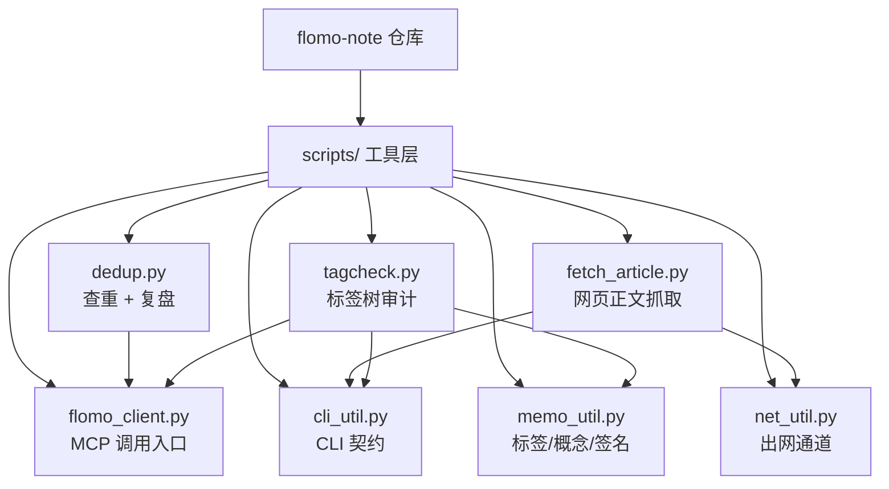
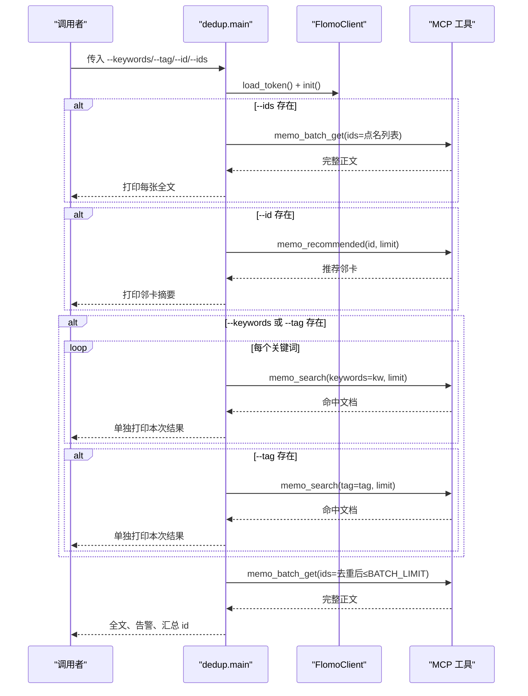
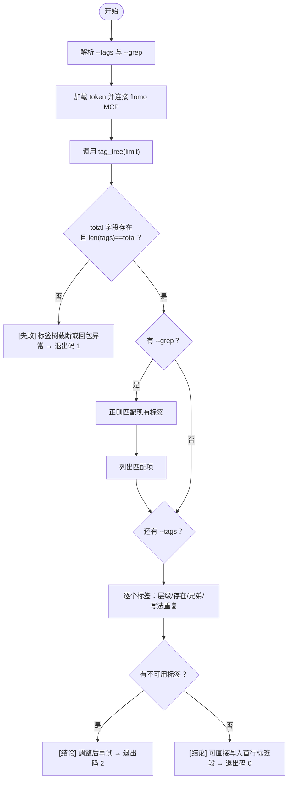
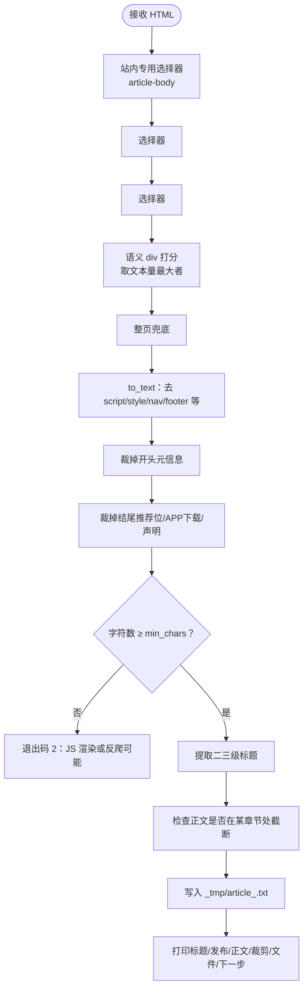
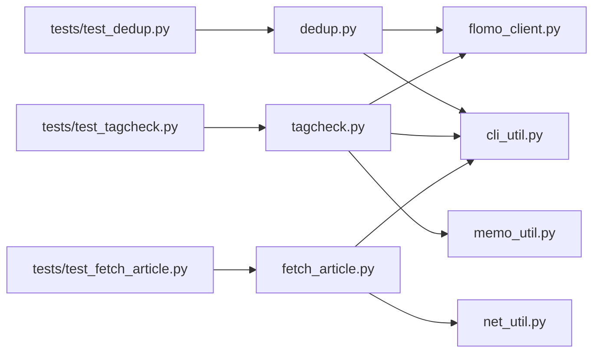

# 辅助工具 dedup.py / tagcheck.py / fetch_article.py

<cite>
**本文引用的文件**   
- [scripts/dedup.py](file://scripts/dedup.py)
- [scripts/tagcheck.py](file://scripts/tagcheck.py)
- [scripts/fetch_article.py](file://scripts/fetch_article.py)
- [tests/test_dedup.py](file://tests/test_dedup.py)
- [tests/test_tagcheck.py](file://tests/test_tagcheck.py)
- [tests/test_fetch_article.py](file://tests/test_fetch_article.py)
- [README.md](file://README.md)
</cite>

## 目录
1. [引言](#引言)
2. [项目结构中的位置](#项目结构中的位置)
3. [共同约定与依赖](#共同约定与依赖)
4. [dedup.py：查重与复盘工具](#deduppy查重与复盘工具)
5. [tagcheck.py：标签树审计工具](#tagcheckpy标签树审计工具)
6. [fetch_article.py：网页正文抓取工具](#fetch_articlepy网页正文抓取工具)
7. [与 SOP 流程的集成点](#与-sop-流程的集成点)
8. [常见用法示例](#常见用法示例)
9. [依赖关系分析](#依赖关系分析)
10. [性能与边界特性](#性能与边界特性)
11. [故障排查指南](#故障排查指南)
12. [结论](#结论)

## 引言
本文件为三个写卡流程辅助工具的联合文档：`scripts/dedup.py`、`scripts/tagcheck.py`、`scripts/fetch_article.py`。它们分别承担写卡流程中的「查重/复盘」「定标签前标签树核验」「网页正文抓取并落盘」职责，并通过 flomo MCP 能力接口或网络通道与云端及目标站点交互。

这三个脚本都遵循统一的 CLI 设计：参数解析走 `cli_util`，错误通过 `UsageError` 表达，退出码由调用方和流程闸门统一解释；云端失败时显式返回非 0，而不是把“没跑完”伪装成“无命中”。

## 项目结构中的位置
三个脚本位于仓库的 `scripts/` 目录，属于写卡流程的执行层，不在前端控制台页面中直接暴露，但会被 SOP 闸门、人工命令链和自动化流水线调用。



**图表来源**  
- [scripts/dedup.py:1-60](file://scripts/dedup.py#L1-L60)  
- [scripts/tagcheck.py:1-50](file://scripts/tagcheck.py#L1-L50)  
- [scripts/fetch_article.py:1-70](file://scripts/fetch_article.py#L1-L70)  
- [README.md:120-210](file://README.md#L120-L210)

**章节来源**  
- [README.md:120-210](file://README.md#L120-L210)

## 共同约定与依赖
| 维度 | 约定 |
|---|---|
| 命令行解析 | 使用 `cli_util.parse_options` 与 `Opt`，缺值、重复、未知选项、越界数值都会转成 `UsageError` |
| 帮助输出 | 不带参数或传入 `-h`/`--help`/`help` 时打印模块级 docstring |
| 标准输出编码 | 启动时对 stdout/stderr 尝试 `reconfigure(encoding="utf-8")` |
| flomo 凭据 | `flomo_client.load_token()` 从 `.mcp.json` 或环境变量读取 token；取不到则后续 MCP 调用失败 |
| 失败语义 | 云端调用失败一律非 0 退出，不表示“无命中”或“通过” |
| 本地路径 | `fetch_article.py` 默认落盘到仓库根下的 `_tmp/article_<url_slug>.txt` |
| 测试覆盖 | 每个脚本都有离线回归用例，声明在 `COVERS` 元数据中 |

**章节来源**  
- [scripts/dedup.py:1-40](file://scripts/dedup.py#L1-L40)  
- [scripts/tagcheck.py:1-40](file://scripts/tagcheck.py#L1-L40)  
- [scripts/fetch_article.py:1-60](file://scripts/fetch_article.py#L1-L60)  
- [tests/test_dedup.py:1-40](file://tests/test_dedup.py#L1-L40)  
- [tests/test_tagcheck.py:1-40](file://tests/test_tagcheck.py#L1-L40)  
- [tests/test_fetch_article.py:1-40](file://tests/test_fetch_article.py#L1-L40)

## dedup.py：查重与复盘工具

### 作用
`dedup.py` 实现写卡流程第 5 步和第 8 步的查重与复盘两路：

1. **关键词现查**：对每个关键词单独调用一次 `memo_search`，结果单独打印，不合并掩盖。
2. **id 去重分批取全文**：汇总所有命中文档 id，按服务端单次上限 10 条分批调用 `memo_batch_get`，逐张打印完整正文。
3. **主标签比对**：对每条命中文档按 H3/H8 规则进行内容比对，由调用方（人或闸门）判断是否为同一事件。
4. **复盘模式**：用 `memo_recommended` 根据本卡 id 拉推荐邻卡，用于写后复查。

它不替代判断：命中卡是否同一事件仍由调用方读全文判定。

### CLI 参数

| 参数 | 类型 | 默认值 | 说明 |
|---|---|---:|---|
| `--keywords` | 字符串 | 空 | 多个关键词可用半角逗号、全角逗号、顿号、分号或换行分隔 |
| `--tag` | 字符串 | 空 | 按标签检索；与 `--keywords` 并行执行 |
| `--id` | 字符串 | 空 | 复盘模式：按本卡 id 定向调 `memo_recommended` |
| `--ids` | 字符串 | 空 | 点名读取若干张卡的全文，不受 `--max-full` 限制 |
| `--limit` | 整数 | 10 | 每次检索或推荐的返回条数 |
| `--max-full` | 整数 | 8 | 自动取全文的最大卡片数；超出会列出未读的 id |
| `--no-full` | 标志 | false | 只输出命中清单，不取全文 |

### 输入输出

| 阶段 | 输入 | 输出 |
|---|---|---|
| 参数解析 | 命令行参数 | 规范化后的 keywords、tag、anchor、ids_raw、limit、max_full、no_full |
| 检索 | Flomo MCP `memo_search` | 每关键词一条独立结果块，含 id、字数、标签、概念名摘要 |
| 推荐 | Flomo MCP `memo_recommended` | 以本卡 id 为锚点的邻卡列表 |
| 全文 | Flomo MCP `memo_batch_get` | 按 ≤10 一批的完整正文，含 id、字数、标签 |
| 汇总 | 去重后的 id 集合 | 唯一卡数量、未读 id 列表、点名读取出口提示 |

### 与 flomo MCP 的交互方式



**图表来源**  
- [scripts/dedup.py:60-200](file://scripts/dedup.py#L60-L200)  
- [tests/test_dedup.py:40-140](file://tests/test_dedup.py#L40-L140)

### 关键行为
- 每个关键词单独调一次 `memo_search`，禁止跨关键词合并回包。
- 所有命中文档 id 去重后再分批取全文，单批不超过 10 张。
- `--ids` 点名读取不受 `--max-full` 与 `--no-full` 影响。
- `--id` 复盘路与 `--keywords`/`--tag` 可同给，两路都执行。
- 默认最多取 8 张全文；超出的 id 显式列出并提示用 `--ids` 点名。
- 云端调用失败返回退出码 1，明确区分“调用未完成”和“无命中”。

### 退出码

| 退出码 | 含义 |
|---:|---|
| 0 | 成功；无命中也算成功，会打印“无命中” |
| 1 | 任一云端调用失败；查重没跑完不得进入判定或写云 |

**章节来源**  
- [scripts/dedup.py:1-200](file://scripts/dedup.py#L1-L200)  
- [tests/test_dedup.py:40-260](file://tests/test_dedup.py#L40-L260)

## tagcheck.py：标签树审计工具

### 作用
`tagcheck.py` 实现写卡流程第 4 步的标签树核对：现采 flomo 标签树，校验拟用标签是否存在、是否严格两级、同顶层下有哪些二级兄弟，以及与现有标签只差空白/全半角斜杠/大小写的写法重复。

它只读不写：不创建标签，也不修改标签。

### CLI 参数

| 参数 | 类型 | 默认值 | 说明 |
|---|---|---:|---|
| `--tags` | 字符串 | 空 | 需要核验的标签列表，支持全角逗号、顿号、`#` 前缀 |
| `--grep` | 正则表达式 | 空 | 仅列出匹配的现有标签，不做判定；空值被拒绝 |
| `--limit` | 整数 | 2000 | 标签树查询上限 |

### 输入输出

| 阶段 | 输入 | 输出 |
|---|---|---|
| 标签树 | Flomo MCP `tag_tree` | 标签列表与 total，要求 `len(tags) == total` |
| 匹配 | `--grep` 正则 | 最多显示 60 个匹配标签 |
| 单个标签检查 | 一个待检标签 + 全部标签集合 | 存在性、层级、顶层存在性、兄弟二级、写法重复 |
| 结论 | 所有标签检查结果 | “全部存在且严格两级”或“不可直接用” |

### 与 flomo MCP 的交互方式



**图表来源**  
- [scripts/tagcheck.py:1-201](file://scripts/tagcheck.py#L1-L201)  
- [tests/test_tagcheck.py:40-248](file://tests/test_tagcheck.py#L40-L248)

### 关键行为
- 标签树必须完整：若 `tool_data` 解析出的 `tags` 长度不等于 `total`，视为截断，直接失败。
- 标签必须严格两级：`#顶层/二级`，不允许单层或三级及以上。
- 存在性判断与写前闸门一致：只差空白、全半角斜杠、大小写的标签视为“写法重复”，提示改回现有写法，不引导新建近义簇。
- 顶层存在性按键比较而非逐字比较：避免把已有顶层因大小写不同误判为缺失。
- `--grep` 只列匹配标签，找不到不代表失败；仍需提醒按 H18 判断，不要据此建近义簇。
- 支持 `structuredContent` 与 `content[].text` 两种回包形态，保持与 `sop_gate` 一致的 total 口径。

### 退出码

| 退出码 | 含义 |
|---:|---|
| 0 | 全部存在且严格两级、无写法重复 |
| 1 | 标签树被截断或调用失败，结论不可信 |
| 2 | 有标签缺失、层级不合规、写法重复，或命令行参数有误 |

**章节来源**  
- [scripts/tagcheck.py:1-201](file://scripts/tagcheck.py#L1-L201)  
- [tests/test_tagcheck.py:40-248](file://tests/test_tagcheck.py#L40-L248)

## fetch_article.py：网页正文抓取工具

### 作用
`fetch_article.py` 是写卡流程第 1 步的抓取通道：抓取网页、解码、抽取正文、裁剪首尾噪音、检测章节完整性、落盘到 `_tmp` 目录，并打印标题、发布日期、字符数、通道和下一步命令。

它不替调用方阅读正文；抓回即读回的纪律保持不变。

### CLI 参数

| 参数 | 类型 | 默认值 | 说明 |
|---|---|---:|---|
| URL | 位置参数 | 必填 | http(s) 链接 |
| `--out` | 路径 | 自动生成 | 指定输出文件；默认 `_tmp/article_<url_slug>.txt` |
| `--min-chars` | 整数 | 300 | 抽取正文最小字符阈值 |
| `--timeout` | 浮点数 | 30.0 | 网络请求超时秒数 |
| `--via` | 枚举 | auto | `auto`/`proxy`/`direct`，控制代理与直连策略 |
| `--print` | 标志 | false | 额外把正文打到 stdout |

### 输入输出

| 阶段 | 输入 | 输出 |
|---|---|---|
| 网络请求 | URL、timeout、via | HTML 响应体、Content-Type、实际出网通道 |
| 解码 | 字节体、Content-Type | UTF-8 或 GB18030 文本 |
| 抽取 | HTML | 正文片段 + 通道说明 |
| 元信息 | HTML | 标题、发布日期 |
| 裁剪 | 正文 | 去掉开头元信息与结尾推荐位的干净正文 |
| 落盘 | 正文 | `_tmp/article_<slug>.txt` |
| 结论 | 全部阶段 | `[抓取]` `[出网]` `[标题]` `[发布]` `[正文]` `[裁剪]` `[文件]` `[下一步]` |

### 网络通道与缓存/临时文件
- 网络通道依赖 `net_util.request`，支持 `auto`、`proxy`、`direct`。
- `auto` 先走环境代理，失败再直连重试；两条都不通才抛出 `FetchError`，并把两条原因一起报出。
- 没有本地缓存：每次抓取都重新请求。
- 正文落盘到 `_tmp` 目录，文件名基于 URL 路径生成 slug，最长 48 字符。
- 如果未传 `--out`，会自动创建 `_tmp` 目录并写入默认文件。

### 正文抽取逻辑



**图表来源**  
- [scripts/fetch_article.py:70-580](file://scripts/fetch_article.py#L70-L580)  
- [tests/test_fetch_article.py:40-348](file://tests/test_fetch_article.py#L40-L348)

### 关键字段处理
- **标题**：优先 `<title>`，其次 `<h1>`，去除站点后缀。
- **发布日期**：优先 `meta[property|name]`，其次 `<time datetime=...>`，最后从正文前几行日期行兜底，并标明来源。
- **正文通道**：站内专用选择器 → `<article>` → `<main>` → 语义 div 打分 → 整页兜底。
- **章节完整性**：对比页面二三级标题与正文中出现过的标题，若正文止于某章节而后续标题缺失，输出 `[告警]`。
- **首尾噪音**：开头面包屑、标题行、日期、来源、作者、责编、评论；结尾下载 APP、相关文章、推荐阅读、关键词、免责声明等。

### 退出码

| 退出码 | 含义 |
|---:|---|
| 0 | 抽取成功并已写文件 |
| 1 | 网络/HTTP 失败，或响应不是 HTML |
| 2 | 抽取结果过短，多半是 JS 渲染页或反爬页 |

**章节来源**  
- [scripts/fetch_article.py:1-580](file://scripts/fetch_article.py#L1-L580)  
- [tests/test_fetch_article.py:1-348](file://tests/test_fetch_article.py#L1-L348)

## 与 SOP 流程的集成点

| SOP 步骤 | 工具 | 集成行为 |
|---|---|---|
| 1. 抓取 | `fetch_article.py` | 抓取网页、抽正文、落 `_tmp`，打印下一步读哪个文件 |
| 2. 验证 | 其他工具 | 专业术语/机构/产品/模型简称需 `search` 现查，留痕 `verify.json` |
| 3. 提炼 | 人工/AI | 过滤营销话术，保留事实/数据/因果链 |
| 4. 定标签 | `tagcheck.py` | 现采标签树，核验存在性、严格两级、兄弟二级 |
| 5. 查重 | `dedup.py` | 关键词逐次现查 + id 去重分批取全文 |
| 6. 写作 | 人工/AI | 按卡片格式写作 |
| 7. 自检并写云 | `publish.py` | 闸门 → 质检 → 写云 → 写后复核 |
| 8. 复盘 | `dedup.py --id` | 定向复查近邻 |
| 9. 更新云端 | `publish.py --update-id` | 覆盖既有卡，同样走写前确认与写后差异 |

**章节来源**  
- [README.md:40-120](file://README.md#L40-L120)

## 常见用法示例

### 批量查重
```bash
python scripts/dedup.py --keywords "智能体,agent,工具契约" --tag "AI/Agent" --limit 10
```
- 对每个关键词单独调用一次 `memo_search`。
- 若有 `--tag`，标签检索作为最后一路单独调用。
- 默认最多取 8 张全文；超出的 id 会列出并提示用 `--ids`。

### 复盘邻卡
```bash
python scripts/dedup.py --id "<本卡 memo id>" --limit 10
```
- 调用 `memo_recommended`，按本卡 id 定向拉推荐。
- 适合写后复查、写前补充参考。

### 点名读全文
```bash
python scripts/dedup.py --ids ID1,ID2,ID3
```
- 不受 `--max-full` 与 `--no-full` 限制。
- 适合复盘已识别到的少量高价值卡片。

### 只看命中清单
```bash
python scripts/dedup.py --keywords "智能体" --no-full
```
- 不调 `memo_batch_get`，不取全文。
- 适合快速扫描是否有命中。

### 标签审计
```bash
python scripts/tagcheck.py --tags "AI/Agent,科技/测试"
```
- 现采标签树，逐个检查存在性与严格两级。
- 输出同顶层兄弟二级，便于决定复用还是新建。

### 模糊搜索现有标签
```bash
python scripts/tagcheck.py --grep "多语言|本地化"
```
- 只列出匹配标签，不判定是否存在。
- 找不到时提示按 H18 判断，不要据“搜不到”就建近义簇。

### 文章抓取
```bash
python scripts/fetch_article.py https://example.com/article --min-chars 300 --timeout 30
```
- 默认输出到 `_tmp/article_<slug>.txt`。
- 自动裁剪首尾噪音，打印裁剪详情。
- 若正文过短，提示改用 webfetch、镜像或预印本通道。

### 强制直连或强制代理
```bash
python scripts/fetch_article.py https://example.com --via direct
python scripts/fetch_article.py https://example.com --via proxy
```
- `direct` 绕开环境代理。
- `proxy` 强制走环境代理，不回退。

**章节来源**  
- [scripts/dedup.py:1-40](file://scripts/dedup.py#L1-L40)  
- [scripts/tagcheck.py:1-40](file://scripts/tagcheck.py#L1-L40)  
- [scripts/fetch_article.py:1-60](file://scripts/fetch_article.py#L1-L60)

## 依赖关系分析



**图表来源**  
- [scripts/dedup.py:20-40](file://scripts/dedup.py#L20-L40)  
- [scripts/tagcheck.py:20-40](file://scripts/tagcheck.py#L20-L40)  
- [scripts/fetch_article.py:20-40](file://scripts/fetch_article.py#L20-L40)  
- [tests/test_dedup.py:10-40](file://tests/test_dedup.py#L10-L40)  
- [tests/test_tagcheck.py:10-40](file://tests/test_tagcheck.py#L10-L40)  
- [tests/test_fetch_article.py:10-40](file://tests/test_fetch_article.py#L10-L40)

### 耦合与内聚
- `dedup.py` 与 `flomo_client` 耦合度高，因为核心行为是 MCP 工具调用；但与 `memo_util` 解耦，不共享标签键逻辑。
- `tagcheck.py` 与 `memo_util.tag_key` 强耦合，确保标签写法重复判定与写前闸门一致。
- `fetch_article.py` 与 `net_util` 强耦合，保证抓取、写云、体检共用同一套通道与错误分类。
- 三个脚本共享 `cli_util`，使 CLI 错误表现统一。

### 外部依赖
- flomo MCP：`memo_search`、`memo_batch_get`、`memo_recommended`、`tag_tree`。
- 网络协议：HTTP GET，UA、Accept、Accept-Language、Accept-Encoding 由 `net_util.user_agent()` 提供。
- 文件系统：`_tmp` 目录与 UTF-8 文本文件。

**章节来源**  
- [scripts/dedup.py:20-40](file://scripts/dedup.py#L20-L40)  
- [scripts/tagcheck.py:20-40](file://scripts/tagcheck.py#L20-L40)  
- [scripts/fetch_article.py:20-40](file://scripts/fetch_article.py#L20-L40)

## 性能与边界特性

| 组件 | 性能/边界 | 说明 |
|---|---|---|
| `dedup.py` | 每关键词一次 MCP 调用 | 避免合并检索掩盖单次结果 |
| `dedup.py` | 全文分批上限 10 | 服务端 `memo_batch_get` 单次上限 |
| `dedup.py` | 默认全文上限 8 | 防止一次复盘拉太多正文 |
| `tagcheck.py` | 默认标签树 limit 2000 | 超过 total 视为截断 |
| `tagcheck.py` | 兄弟二级最多展示 12 | 过长时用“另 N 个”省略 |
| `tagcheck.py` | grep 最多展示 60 | 过长时提示缩小范围 |
| `fetch_article.py` | 平衡扫描上限 2 MB | 防异常页面拖爆复杂度 |
| `fetch_article.py` | 默认正文阈值 300 字符 | 过短提示 JS 渲染或反爬 |
| `fetch_article.py` | 超时默认 30 秒 | 可通过 `--timeout` 调整 |

**章节来源**  
- [scripts/dedup.py:20-40](file://scripts/dedup.py#L20-L40)  
- [scripts/tagcheck.py:30-60](file://scripts/tagcheck.py#L30-L60)  
- [scripts/fetch_article.py:40-120](file://scripts/fetch_article.py#L40-L120)  
- [scripts/fetch_article.py:240-320](file://scripts/fetch_article.py#L240-L320)

## 故障排查指南

### 常见问题：网络代理与 SNI 阻断
| 现象 | 可能原因 | 排查建议 |
|---|---|---|
| `fetch_article.py` 报抓取失败 | 沙箱注入代理端口过期、环境变量代理未更新、SNI 阻断 | 先用 `--via auto`；日志会打印实际走通的通道；若仍失败，尝试 `--via direct` |
| 代理端口写死后失效 | 代理端口每次会话重新分配 | 不要手写固定端口，依赖 `net_util` 现读代理配置 |
| 某些站点能访问但 flomo MCP 失败 | 代理策略或域名白名单不同 | 使用 `netdoctor` 类体检工具或手动验证 flomo MCP 地址 |
| SNI 阻断导致取件失败 | 出站 TLS 握手被中间设备阻断 | 使用仓库提供的 `sni_fetch.py` 作为取件通道 |

**章节来源**  
- [scripts/fetch_article.py:1-60](file://scripts/fetch_article.py#L1-L60)  
- [scripts/fetch_article.py:430-520](file://scripts/fetch_article.py#L430-L520)

### 常见问题：页面结构变化
| 现象 | 可能原因 | 排查建议 |
|---|---|---|
| 正文只抽出一半 | 右界提前收束，如 WordPress 代码高亮块相邻 div | 查看 `[告警]` 输出，确认是否在某个章节后截断 |
| 正文很短但页面很长 | JS 渲染页面、SPA、反爬保护 | 改用 webfetch、镜像站或预印本通道 |
| 正文带导航或侧栏 | 通用选择器误伤 | 检查通道说明，必要时手动指定 `--out` 并观察原始正文 |
| 标题或发布日期为空 | meta 缺失或页面结构不同 | 查看 `[发布]` 是否来自“正文兜底”，否则人工补元信息 |

**章节来源**  
- [scripts/fetch_article.py:70-180](file://scripts/fetch_article.py#L70-L180)  
- [scripts/fetch_article.py:320-420](file://scripts/fetch_article.py#L320-L420)

### 常见问题：标签命名冲突
| 现象 | 可能原因 | 排查建议 |
|---|---|---|
| 提示“与现有标签只差空白/全半角/大小写” | 使用了 `AI / Agent`、`AI／Agent`、`ai/agent` 等不同写法 | 改回树里已有写法，不要新建近义簇 |
| 三级标签被拒 | 违反严格两级规则 | 改为 `#顶层/二级` |
| 顶层不存在提示不准确 | 标签树只返回叶子形态，顶层不会单独成条 | 脚本已按键比判断顶层存在性；若仍有疑问，先缩小 `--grep` 范围 |
| 标签树截断 | `len(tags) != total` | 调大 `--limit` 或检查 MCP 服务返回 |

**章节来源**  
- [scripts/tagcheck.py:60-160](file://scripts/tagcheck.py#L60-L160)  
- [tests/test_tagcheck.py:80-248](file://tests/test_tagcheck.py#L80-L248)

### 常见问题：查重误判
| 现象 | 可能原因 | 排查建议 |
|---|---|---|
| 云端失败却像“无命中” | 调用中途失败不应被当作空结果 | 检查 stderr 中的“查重调用未完成”提示，退出码为 1 |
| 多次关键词出现同一张卡 | id 去重正常，但正文仍需人读判断 | 看 `[汇总]` 唯一卡数量，再读全文 |
| 全文没取完 | 超过 `--max-full` | 用 `--ids` 点名读取关键卡片 |
| 复盘没拿到邻卡 | `--id` 传的 id 无效或 MCP 推荐为空 | 先确认 id，再检查 MCP 连通性 |

**章节来源**  
- [scripts/dedup.py:120-200](file://scripts/dedup.py#L120-L200)  
- [tests/test_dedup.py:100-260](file://tests/test_dedup.py#L100-L260)

## 结论
`dedup.py`、`tagcheck.py`、`fetch_article.py` 分别解决写卡流程中“查重与复盘”“标签树审计”“网页正文抓取”三类高频且易出错的任务。它们通过统一的 CLI 契约、明确的退出码、可追踪的 MCP 调用和网络通道，把原本容易手抄 id、肉眼扫标签、盲目 curl 的风险降到程序可验证的程度。

使用时应记住三条纪律：
1. 抓取后必须读回全文，不能只看脚本输出的统计。
2. 标签必须先经 `tagcheck.py` 核验，不得凭直觉新建近义簇。
3. 查重失败或非 0 退出时，不得跳过判定直接进入写云。