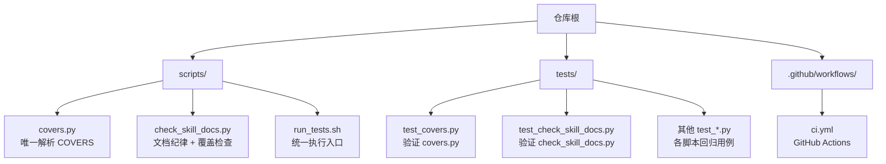
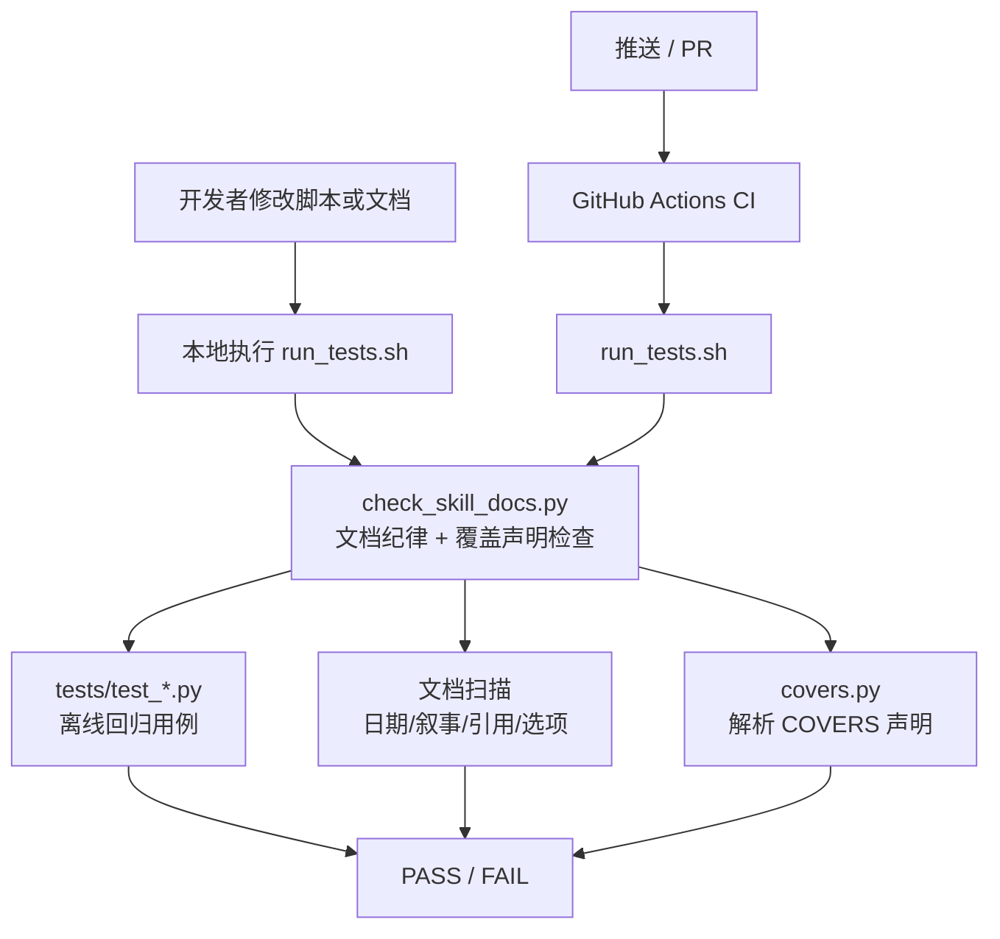
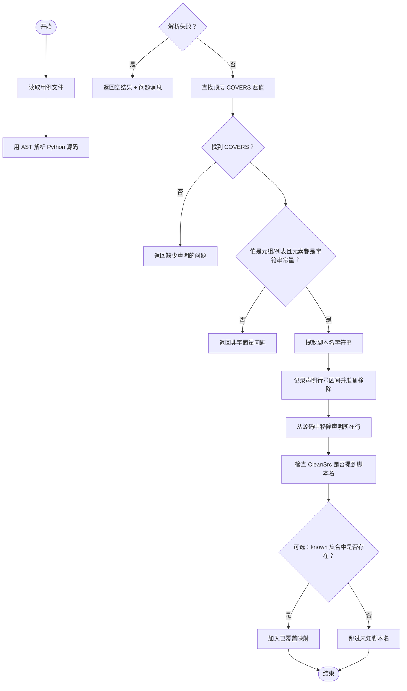
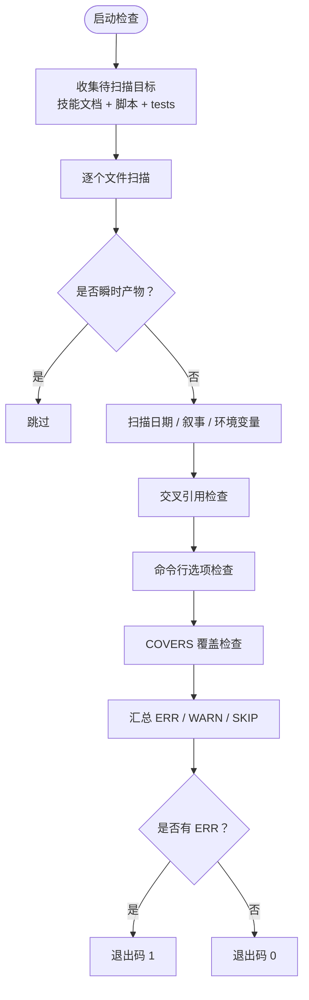
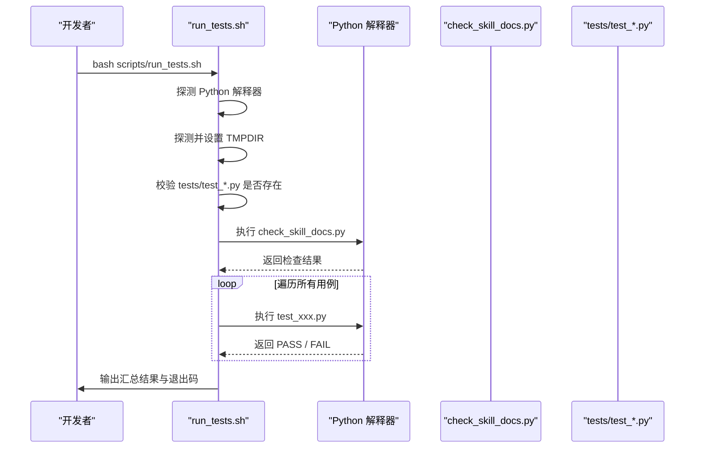
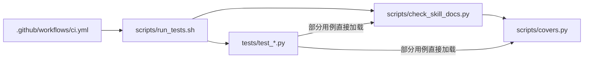

# 测试与质量保障

<cite>
**本文引用的文件**
- [README.md](file://README.md)
- [scripts/covers.py](file://scripts/covers.py)
- [scripts/check_skill_docs.py](file://scripts/check_skill_docs.py)
- [scripts/run_tests.sh](file://scripts/run_tests.sh)
- [.github/workflows/ci.yml](file://.github/workflows/ci.yml)
- [tests/test_covers.py](file://tests/test_covers.py)
- [tests/test_check_skill_docs.py](file://tests/test_check_skill_docs.py)
</cite>

## 目录
1. [引言](#引言)
2. [项目结构](#项目结构)
3. [核心组件](#核心组件)
4. [架构总览](#架构总览)
5. [关键组件详解](#关键组件详解)
6. [依赖关系分析](#依赖关系分析)
7. [新增用例与维护指南](#新增用例与维护指南)
8. [CI 触发方式](#ci-触发方式)
9. [性能与稳定性优化建议](#性能与稳定性优化建议)
10. [故障排查指南](#故障排查指南)
11. [结论](#结论)

## 引言
本仓库的测试与质量保障体系围绕“全离线回归 + 文档纪律自检 + 脚本-用例覆盖声明”构建：

- 所有 `tests/test_*.py` 是离线回归用例，不读取 token、不发起网络请求。
- 每个用例文件通过模块级 `COVERS = ("脚本名", ...)` 显式声明它验证的是哪些 `scripts/*.py`。
- `scripts/covers.py` 是唯一解析 `COVERS` 的模块；`check_skill_docs.py` 在内容纪律检查中复用该解析结果，用于判断“脚本是否被认领、声明是否真实存在、声明是否与源码提到该脚本”。
- `scripts/run_tests.sh` 统一执行入口，先跑 `check_skill_docs.py`，再串行运行所有 `tests/test_*.py`。
- `.github/workflows/ci.yml` 对 `master` 推送与所有 pull_request 执行同一条本地命令，避免 CI 与本地判据分叉。

这一体系的目标不是提供覆盖率工具意义上的精确覆盖率，而是保证：**新增脚本有回归、用例命名正确、文档不会静默漏检、脚本与用例的关系不会因为改名或拼写漂移而变成假通过**。

## 项目结构
与测试和质量保障直接相关的目录与文件如下：

**图示来源**
- [scripts/covers.py:1-118](file://scripts/covers.py#L1-L118)
- [scripts/check_skill_docs.py:1-200](file://scripts/check_skill_docs.py#L1-L200)
- [scripts/run_tests.sh:1-95](file://scripts/run_tests.sh#L1-L95)
- [.github/workflows/ci.yml:1-30](file://.github/workflows/ci.yml#L1-L30)
- [tests/test_covers.py:1-128](file://tests/test_covers.py#L1-L128)
- [tests/test_check_skill_docs.py:1-200](file://tests/test_check_skill_docs.py#L1-L200)

**章节来源**
- [README.md:1-200](file://README.md#L1-L200)

## 核心组件
### 1. 覆盖声明解析：`covers.py`
`covers.py` 的职责非常明确：从 `tests/test_*.py` 中解析顶层 `COVERS = (...)`，并回答两个问题：

| 函数 | 输入 | 输出 | 用途 |
|---|---|---|---|
| `declared_covers(path)` | 单个用例文件路径 | `(脚本名元组, 问题列表, 行号区间)` | 读一个用例的 COVER 声明 |
| `coverage_map(tests_dir, known)` | 用例目录 + 可选脚本全集 | `(脚本名 → 用例列表, 问题列表)` | 聚合全部用例并校验 |
| `_mentions(src, name)` | 去掉声明后的源码文本 + 脚本名 | `bool` | 判断源码是否在声明之外提到该脚本名 |

关键设计要点：

- **只认字面量字符串**：`COVERS` 必须是元组或列表，且元素为字符串常量；变量、拼接、动态表达式一律报问题。
- **“没声明”和“声明为空元组”严格区分**：前者是漏写，后者表示该用例有意不针对具体脚本（例如跨模块约束）。
- **声明之外才核对**：解析时会记录声明的行号区间，随后把这段源码挖掉，再判断源码里是否还提到该脚本名。这样能拦截“只声明、不测”的假覆盖。
- **宽松匹配脚本名**：只要脚本名作为独立标识符出现就算提到，因此 import、文件名拼接、helper 动态加载等写法都能通过，不因实现加载方式变化而产生大量误报。
- **容错优先**：语法错误、编码错误、无法读取的文件会返回空结果并追加问题消息，而不是抛出异常。调用方是闸门与控制台数据层，不能因为一个坏用例让整条链路崩溃。

**章节来源**
- [scripts/covers.py:1-118](file://scripts/covers.py#L1-L118)

### 2. 技能文档自检与覆盖检查：`check_skill_docs.py`
`check_skill_docs.py` 是一个离线、只读、无第三方依赖的文档质量门禁。它同时承担两类职责：

#### 2.1 内容纪律检查
- 禁止在文档中出现具体日期（H28），包括短横线、斜杠、中文年月等多种形态。
- 禁止历史事件叙事措辞，如“曾经”“当时”“上次推送”“事后发现”等。
- 技术常量行豁免：含 `version` 或 `protocol` 键名的行中的日期属于协议/版本常量，不算文档叙事日期。
- `ENVIRONMENT.md` 不豁免日期，也不豁免叙事词。
- `SKILL.md` 若出现可直接复制的环境地址（如 `127.0.0.1`、`localhost:端口`、`0.0.0.0`），视为违规；这些值应放在 `ENVIRONMENT.md`。
- 检测器自身与其回归测试免于“叙事扫描”，但日期扫描照常生效。

#### 2.2 跨文件结构检查
- README 必须列出 `scripts/` 下的脚本，否则按清单找不到入口。
- `tests/` 下必须以 `test_` 开头，否则 `run_tests.sh` 不会执行。
- 内部交叉引用失效：H 编号、附录小节、流程步骤、脚本名不存在时，报告 ERR。
- 命令行选项失效：文档里写的 `--flag` 必须是脚本实际认识的参数。
- **脚本-用例覆盖声明检查**：
  - 每个 `scripts/*.py` 都要出现在某个用例的 `COVERS` 中。
  - 每个用例都必须有 `COVERS` 声明，可用空元组表示不针对具体脚本。
  - 声明指向的脚本必须真实存在。
  - 声明之外整个文件必须提到该脚本名。

`check_skill_docs.py` 通过导入 `covers` 模块，复用同一份解析逻辑，避免“闸门说覆盖了、控制台页面却说没有覆盖”的双口径问题。

**章节来源**
- [scripts/check_skill_docs.py:1-200](file://scripts/check_skill_docs.py#L1-L200)

### 3. 统一执行入口：`run_tests.sh`
`run_tests.sh` 是本地与 CI 共同使用的唯一执行入口。其执行顺序是：

1. 定位仓库根目录。
2. 探测 Python 解释器，支持通过 `PYTHON_BIN` 指定。
3. 探测临时目录：如果外部 `TMPDIR` 不可写，自动改用仓库内 `_tmp/.tmp`；仍不可写则直接报错退出。
4. 校验是否存在至少一个 `tests/test_*.py`，否则说明用例丢失或命名不符合约定。
5. 先执行 `python scripts/check_skill_docs.py`。
6. 再逐个执行 `tests/test_*.py`。
7. 汇总 PASS/FAIL，任一失败则非 0 退出。

该脚本的关键价值是**统一行为**：本地开发、PR、master 推送都跑同一条命令，减少“本地过、CI 不过”的分歧。

**章节来源**
- [scripts/run_tests.sh:1-95](file://scripts/run_tests.sh#L1-L95)

### 4. CI 流水线：`.github/workflows/ci.yml`
CI 的定义很克制：

- 触发条件：`push` 到 `master`，以及所有 `pull_request`。
- 环境：Ubuntu + Python 3.12。
- 权限：仅 `contents: read`。
- 动作：直接执行 `bash scripts/run_tests.sh`。
- 不配置任何 secrets：因为回归用例全部离线，不应依赖凭据。

这意味着：**如果未来有人给用例加入真实网络或凭据依赖，CI 应该红；这是预期保护行为，不应通过添加 secret 掩盖。**

**章节来源**
- [.github/workflows/ci.yml:1-30](file://.github/workflows/ci.yml#L1-L30)

## 架构总览
下图展示测试与质量保障的整体控制流：

**图示来源**
- [scripts/run_tests.sh:1-95](file://scripts/run_tests.sh#L1-L95)
- [scripts/check_skill_docs.py:1-200](file://scripts/check_skill_docs.py#L1-L200)
- [scripts/covers.py:1-118](file://scripts/covers.py#L1-L118)
- [.github/workflows/ci.yml:1-30](file://.github/workflows/ci.yml#L1-L30)

## 关键组件详解

### 覆盖声明解析流程
`covers.py` 的核心流程可以抽象为：

**图示来源**
- [scripts/covers.py:20-118](file://scripts/covers.py#L20-L118)

**章节来源**
- [scripts/covers.py:1-118](file://scripts/covers.py#L1-L118)

### 文档自检与覆盖检查流程
`check_skill_docs.py` 的文档扫描流程可概括为：

**图示来源**
- [scripts/check_skill_docs.py:1-200](file://scripts/check_skill_docs.py#L1-L200)

**章节来源**
- [scripts/check_skill_docs.py:1-200](file://scripts/check_skill_docs.py#L1-L200)

### 统一测试执行流程
`run_tests.sh` 的执行顺序是线性且幂等的：

**图示来源**
- [scripts/run_tests.sh:1-95](file://scripts/run_tests.sh#L1-L95)

**章节来源**
- [scripts/run_tests.sh:1-95](file://scripts/run_tests.sh#L1-L95)

### 用例断言结构示例：`test_covers.py`
`tests/test_covers.py` 通过构造临时目录与临时 Python 源码，覆盖以下边界场景：

| 场景 | 断言目标 |
|---|---|
| 正常多行/单行 `COVERS` | 能解析出脚本名、无问题、行号区间正确 |
| 空元组 | 表示“不针对具体脚本”，与“没声明”严格区分 |
| 动态变量、非字符串、语法错误 | 返回问题消息，不抛异常 |
| 聚合多个用例 | 同名脚本可被多处认领 |
| 声明之外未提到脚本名 | 判定为假覆盖 |
| 以 `<脚本>.py` 字面量提到 | 算作有效提到 |
| 非 `test_*.py` 文件 | 不参与聚合 |
| 用例目录不存在 | 返回空结果 |

**章节来源**
- [tests/test_covers.py:1-128](file://tests/test_covers.py#L1-L128)

### 用例断言结构示例：`test_check_skill_docs.py`
`tests/test_check_skill_docs.py` 主要验证：

- 多种日期格式命中 ERR。
- ENVIRONMENT.md 同样受 H28 约束。
- 历史叙事词产生 WARN。
- 技术常量行豁免。
- 检测器自身与回归测试免于叙事扫描，但仍检测日期。
- 真实技能根目录必须被纳入扫描。
- 瞬时产物不得进入扫描目标。
- SKILL.md 与 ENVIRONMENT.md 对环境地址的处理差异。
- 外部 `--root` 目录下的 `.md` 也必须被扫描。

**章节来源**
- [tests/test_check_skill_docs.py:1-200](file://tests/test_check_skill_docs.py#L1-L200)

## 依赖关系分析
测试与质量保障的依赖关系如下：

**图示来源**
- [.github/workflows/ci.yml:1-30](file://.github/workflows/ci.yml#L1-L30)
- [scripts/run_tests.sh:1-95](file://scripts/run_tests.sh#L1-L95)
- [scripts/check_skill_docs.py:1-200](file://scripts/check_skill_docs.py#L1-L200)
- [scripts/covers.py:1-118](file://scripts/covers.py#L1-L118)
- [tests/test_covers.py:1-128](file://tests/test_covers.py#L1-L128)
- [tests/test_check_skill_docs.py:1-200](file://tests/test_check_skill_docs.py#L1-L200)

**章节来源**
- [scripts/covers.py:1-118](file://scripts/covers.py#L1-L118)
- [scripts/check_skill_docs.py:1-200](file://scripts/check_skill_docs.py#L1-L200)
- [scripts/run_tests.sh:1-95](file://scripts/run_tests.sh#L1-L95)
- [.github/workflows/ci.yml:1-30](file://.github/workflows/ci.yml#L1-L30)

## 新增用例与维护指南

### 如何新增测试用例
1. 在 `tests/` 目录下创建 `test_<功能名>.py`。
2. 用例名称必须以 `test_` 开头，否则 `run_tests.sh` 不会执行，也不会被 CI 捕获。
3. 在模块顶部添加 `COVERS = ("脚本名", ...)`：
   - 如果你测的是 `scripts/publish.py`，则写 `"publish"`。
   - 如果你测的是跨模块约束或不针对具体脚本，请写 `COVERS = ()`。
4. 用例内容应为**全离线**：使用临时目录、桩对象、标准库，不要读取 token 或发起网络请求。
5. 本地执行 `bash scripts/run_tests.sh`，确认新增用例 PASS。
6. 提交代码后观察 CI。

### 如何维护 COVERS 声明
`COVERS` 不是 import 列表，也不是文件名约定，而是**行为覆盖声明**。维护时应满足：

| 情况 | 应如何处理 |
|---|---|
| 新增脚本 | 至少新增一个 `test_*.py`，并在其中声明 `COVERS = ("新脚本名",)` |
| 删除脚本 | 删除对应用例，或将其 `COVERS` 改为空元组并说明用途 |
| 重命名脚本 | 更新 `COVERS` 中的字符串，并确保用例源码确实提到新脚本名 |
| 用例不针对具体脚本 | 保留 `COVERS = ()`，不要留空，也不要删掉声明 |
| 声明拼错 | `check_skill_docs.py` 会报“声明指向的脚本不存在” |
| 声明了但没测 | `covers.py` 会报“声明之外整个文件里没出现过这个名字” |

### 如何通过 GitHub 触发 CI
CI 会在以下分支与事件上运行：

- 向 `master` 分支推送代码。
- 创建或更新 pull_request。

触发后，GitHub Actions 会：

1. 检出代码。
2. 安装 Python 3.12。
3. 执行 `bash scripts/run_tests.sh`。
4. 将测试结果写入 Actions 日志。

不需要配置 secret，因为回归用例全部离线。

**章节来源**
- [scripts/run_tests.sh:1-95](file://scripts/run_tests.sh#L1-L95)
- [.github/workflows/ci.yml:1-30](file://.github/workflows/ci.yml#L1-L30)
- [scripts/covers.py:20-118](file://scripts/covers.py#L20-L118)
- [scripts/check_skill_docs.py:1-200](file://scripts/check_skill_docs.py#L1-L200)

## 性能与稳定性优化建议

### 性能建议
- **用例保持轻量**：用例应使用内存中的临时文件和最小数据集，避免重复抓取或长耗时 I/O。
- **避免重复解析**：`covers.py` 已经使用 AST 解析一次源码，新增用例不应引入额外的大文件解析。
- **CI 时间预算**：目前 CI 只做 Python 环境准备和执行测试，没有安装 Playwright 或其他重型浏览器工具，这有利于缩短构建时间。
- **批量用例执行**：`run_tests.sh` 串行执行用例，便于定位失败位置；若未来用例数量显著增长，可考虑按功能域分组并行执行，但需保证输出可归因。

### 稳定性建议
- **不引入网络依赖**：回归用例一旦需要联网，CI 可能因网络抖动、域名解析、代理策略或凭据缺失而失败，这会污染“代码是否正确”的判断。
- **不引入 Playwright Chromium**：当前仓库测试不包含浏览器 UI 自动化，也没有安装 Playwright 的步骤；若未来扩展 Web 测试，应在专用工作流中处理浏览器依赖，而不是混入主回归链。
- **临时目录隔离**：`run_tests.sh` 已自动处理 `TMPDIR` 不可写问题，新增用例应避免硬编码本机路径。
- **确定性输出**：断言应尽量比较结构化结果，而不是打印日志片段；这样可以降低不同平台换行、时间戳、随机 ID 带来的不稳定。
- **覆盖声明与源码同步**：每次改脚本名、拆分模块、变更加载方式时，都应检查 `COVERS` 是否仍能匹配到源码中的脚本名。

[本节为通用指导，不直接分析具体文件]

## 故障排查指南

### 1. 常见断言失败
**现象**：某个 `tests/test_*.py` 输出 FAIL。

**排查步骤**：
1. 单独运行该用例：`python tests/<失败用例>.py`。
2. 查看用例中 `check(...)` 或自定义断言输出的实际值。
3. 如果是 `test_covers.py` 失败，重点检查：
   - `COVERS` 是否为元组或列表。
   - 元素是否全是字符串常量。
   - 声明之外是否确实提到脚本名。
4. 如果是 `test_check_skill_docs.py` 失败，重点检查：
   - 文档中是否包含具体日期。
   - 是否使用了历史叙事词。
   - 是否遗漏了 README 中的脚本清单。
   - 是否误把环境地址写进 `SKILL.md`。

**章节来源**
- [tests/test_covers.py:1-128](file://tests/test_covers.py#L1-L128)
- [tests/test_check_skill_docs.py:1-200](file://tests/test_check_skill_docs.py#L1-L200)

### 2. 缺少覆盖声明
**现象**：`check_skill_docs.py` 报错，提示用例缺少 `COVERS`。

**原因**：
- 新增了 `test_*.py`，但没有写 `COVERS = (...)`。
- 写了注释或 docstring，但没有写模块级赋值语句。
- 想表达“本用例不针对具体脚本”，却直接删掉了 `COVERS`。

**修复方式**：
- 如果测具体脚本：补充 `COVERS = ("脚本名",)`。
- 如果不测具体脚本：写 `COVERS = ()`。
- 确保 `scripts/run_tests.sh` 能通过，且 `check_skill_docs.py` 不再报“缺少声明”。

**章节来源**
- [scripts/covers.py:40-118](file://scripts/covers.py#L40-L118)
- [scripts/check_skill_docs.py:1-200](file://scripts/check_skill_docs.py#L1-L200)

### 3. 声明指向不存在的脚本
**现象**：`check_skill_docs.py` 提示 `COVERS` 里的脚本名在 `scripts/` 下不存在。

**原因**：
- 脚本已重命名或删除，但用例中的 `COVERS` 未更新。
- `COVERS` 字符串拼写错误。
- 把模块名写成带 `.py` 的路径形式。

**修复方式**：
- 确认 `scripts/` 下是否存在该脚本。
- 将 `COVERS` 中的字符串改为不带 `.py` 的脚本名。
- 确认用例源码确实提到该脚本名。

**章节来源**
- [scripts/covers.py:70-118](file://scripts/covers.py#L70-L118)
- [scripts/check_skill_docs.py:1-200](file://scripts/check_skill_docs.py#L1-L200)

### 4. 声明与源码不一致
**现象**：`check_skill_docs.py` 提示“声称覆盖某脚本，但声明之外整个文件里没出现过这个名字”。

**原因**：
- 只写了 `COVERS`，没有真正 import、引用、拼接或使用该脚本。
- 用例只加载了另一个无关模块。
- 脚本改名后，旧字符串仍留在 `COVERS` 中。

**修复方式**：
- 在用例中加入对该脚本的引用。
- 或者删除该无效声明。
- 如果该用例确实不测该脚本，应将 `COVERS` 改为空元组。

**章节来源**
- [scripts/covers.py:80-118](file://scripts/covers.py#L80-L118)

### 5. Playwright Chromium 未安装
**现象**：如果未来引入 Playwright 相关测试，可能会遇到浏览器驱动未安装、Chromium 下载失败等问题。

**现状说明**：
- 当前仓库的回归用例全部离线，且不依赖 Playwright。
- CI 只安装 Python 3.12，不安装 Playwright。
- 如果有人在 `tests/` 中加入浏览器自动化，应在专用工作流中安装浏览器，而不是默认主回归流程。

**排查建议**：
- 确认失败是否来自 Playwright、浏览器或前端交互。
- 如果是主回归链失败，优先考虑将浏览器测试移出 `run_tests.sh`。
- 如果是本地环境问题，重新安装 Playwright 或清理缓存。

[本节为通用指导，结合当前仓库现状说明 Playwright 不在默认 CI 中]

### 6. 临时目录不可写
**现象**：用例大量出现 `PermissionError [Errno 13]`。

**原因**：
- 容器或沙箱中 `TMPDIR` 不可写。
- 用户设置了受限的临时目录。
- 系统 temp 路径权限异常。

**修复方式**：
- 让 `run_tests.sh` 自动降级到仓库内 `_tmp/.tmp`。
- 如果仍失败，手动设置 `TMPDIR` 为可写目录。
- 不要在用例中硬编码 `/tmp` 或本机私有路径。

**章节来源**
- [scripts/run_tests.sh:20-50](file://scripts/run_tests.sh#L20-L50)

### 7. 用例没有被执行
**现象**：`run_tests.sh` 显示没有用例，或新增用例没有结果。

**原因**：
- 文件名不是 `test_*.py`。
- 用例被移到 `scripts/` 下。
- 用例目录不存在。

**修复方式**：
- 将用例放回 `tests/`。
- 确保文件名以 `test_` 开头。
- 执行 `bash scripts/run_tests.sh` 查看是否识别到用例。

**章节来源**
- [scripts/run_tests.sh:55-70](file://scripts/run_tests.sh#L55-L70)

## 结论
flomo-note 的测试与质量保障体系强调三个原则：

1. **声明优于约定**：脚本与用例的关系由 `COVERS` 显式声明，而不是靠文件名猜测。
2. **统一入口**：本地与 CI 共用 `run_tests.sh`，避免两套判据分叉。
3. **离线优先**：回归用例不依赖 token、网络或浏览器，使失败更容易归因于代码本身。

维护者新增脚本时，最关键的检查点是：**是否新增 `test_*.py`，是否填写 `COVERS`，是否能在 `bash scripts/run_tests.sh` 中通过，是否能被 `.github/workflows/ci.yml` 捕获**。只要这四个环节一致，就能最大程度避免“脚本改了、用例丢了、文档漏检、CI 未发现”的质量滑坡。