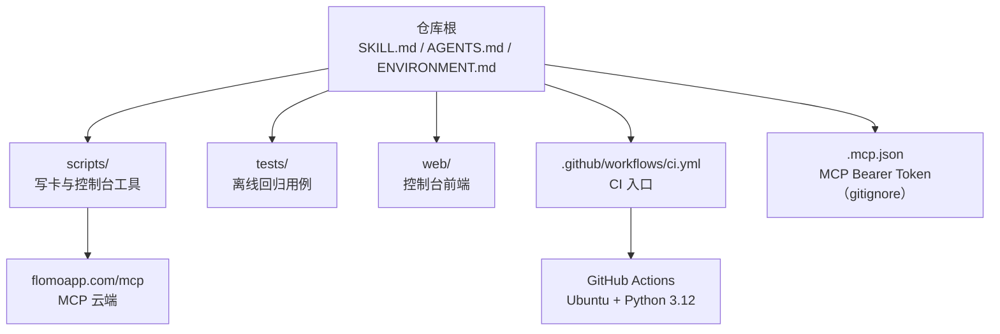
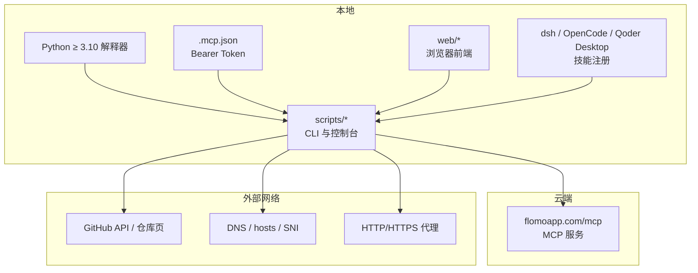
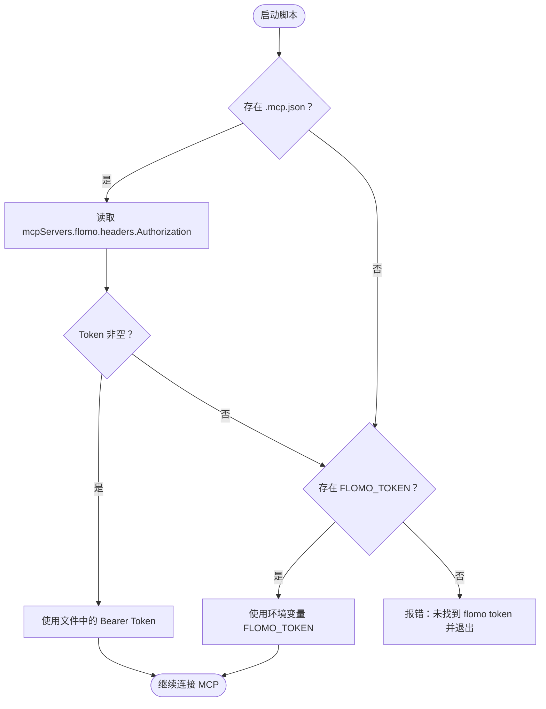
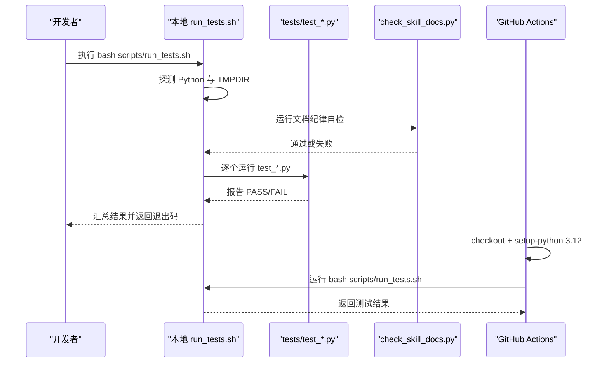
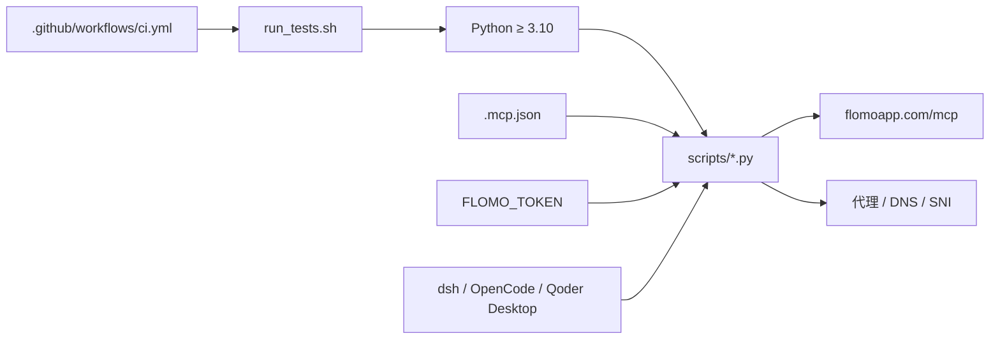

# 部署与环境

<cite>
**本文引用的文件**   
- [ENVIRONMENT.md](file://ENVIRONMENT.md)
- [README.md](file://README.md)
- [AGENTS.md](file://AGENTS.md)
- [.github/workflows/ci.yml](file://.github/workflows/ci.yml)
- [scripts/run_tests.sh](file://scripts/run_tests.sh)
</cite>

## 目录
1. [简介](#简介)
2. [项目结构](#项目结构)
3. [核心组件](#核心组件)
4. [架构总览](#架构总览)
5. [详细组件分析](#详细组件分析)
6. [依赖关系分析](#依赖关系分析)
7. [性能与稳定性注意事项](#性能与稳定性注意事项)
8. [故障排查指南](#故障排查指南)
9. [结论](#结论)
10. [附录：从零到第一次成功写卡](#附录从零到第一次成功写卡)

## 简介
本文件面向 flomo-note 的部署与环境配置，聚焦“在哪里装、用什么 Python、token 从哪来、怎么连 flomo MCP、技能如何注册、网络代理与推送通道怎么处理、测试与 CI 怎么跑，以及清理与存量治理脚本的要求”。它不重复 SKILL.md 中的卡片格式与流程判据；那些内容以 SKILL.md 为唯一事实源。

## 项目结构
flomo-note 把“规则、工具、前端、用例”分得很清楚：
- `SKILL.md` / `AGENTS.md` / `ENVIRONMENT.md`：执行细则、项目总则、环境事实，三者职责不重叠。
- `scripts/`：写卡流程、控制台后端、文档自检、治理与取件工具。
- `tests/`：全离线回归用例，按 `test_*.py` 命名，由 `run_tests.sh` 统一收集。
- `web/`：控制台静态资源（HTML/CSS/JS）。
- `.github/workflows/ci.yml`：CI 只跑本地同一套 `run_tests.sh`，避免本地与流水线判据分叉。
- `.mcp.json`：MCP Bearer Token 配置，已忽略进 Git，不可入库。



**图表来源**
- [README.md:1-120](file://README.md#L1-L120)
- [AGENTS.md:1-58](file://AGENTS.md#L1-L58)
- [.github/workflows/ci.yml:1-30](file://.github/workflows/ci.yml#L1-L30)

**章节来源**
- [README.md:1-120](file://README.md#L1-L120)
- [AGENTS.md:1-58](file://AGENTS.md#L1-L58)

## 核心组件
部署相关的关键点集中在以下位置：

| 类别 | 关键项 | 说明 |
|---|---|---|
| 运行平台 | Linux 沙箱 / Windows 本机 | 沙箱是 Ubuntu 22.04 root；本机当前会话在 Windows，Python 版本以实测为准 |
| Python 要求 | ≥ 3.10 | README 标注 3.10+；实际环境可能更高 |
| Token 来源 | `.mcp.json` 优先，`FLOMO_TOKEN` 后备 | 不存在时所有脚本退出并提示未找到 token |
| MCP 端点 | `https://flomoapp.com/mcp` | 使用 Bearer 鉴权 |
| 技能注册 | dsh / OpenCode / Qoder Desktop | 通过目录联接指向仓库根，不在仓库里复制副本 |
| 控制台端口 | `127.0.0.1:8787` | 默认绑定回环，需显式 `--allow-lan` 才绑外网 |
| 测试入口 | `bash scripts/run_tests.sh` | CI 与本地共用 |
| 清理与治理 | `cleanup.py`、`scan_*` | 中间态清理、存量概念与截断卡取证 |

**章节来源**
- [ENVIRONMENT.md:1-120](file://ENVIRONMENT.md#L1-L120)
- [README.md:1-120](file://README.md#L1-L120)

## 架构总览
flomo-note 的部署架构可以拆成三层：本地开发层、云端 MCP 层、外部网络层。



**图表来源**
- [ENVIRONMENT.md:1-200](file://ENVIRONMENT.md#L1-L200)
- [README.md:1-120](file://README.md#L1-L120)
- [AGENTS.md:1-58](file://AGENTS.md#L1-L58)

## 详细组件分析

### Python 虚拟环境与解释器准备
- 官方最低要求：Python ≥ 3.10。
- 当前仓库 README 用 `python --version` 风格描述环境；实际环境可能高于 3.10。
- 沙箱中用系统 Python；Windows 本机当前会话 Python 版本以实测命令输出为准。
- 如果机器上已有 venv、conda、uv 或托管版 Python，只要 `python` 可解析且版本满足要求即可；必要时通过环境变量指定解释器：
  - Unix/Linux/Git Bash：`PYTHON_BIN=/path/to/python bash scripts/run_tests.sh`
  - PowerShell：`$env:PYTHON_BIN = "/path/to/python"; bash scripts/run_tests.sh`

**章节来源**
- [README.md:1-120](file://README.md#L1-L120)
- [ENVIRONMENT.md:1-60](file://ENVIRONMENT.md#L1-L60)
- [scripts/run_tests.sh:1-40](file://scripts/run_tests.sh#L1-L40)

### .mcp.json 与 Bearer Token
- MCP 端点：`https://flomoapp.com/mcp`。
- 鉴权方式：请求头携带 Bearer Token。
- Token 优先级：
  1. 项目根 `.mcp.json` 中 `mcpServers.flomo.headers.Authorization`。
  2. 环境变量 `FLOMO_TOKEN`（仅后备，可能过期，不作为权威来源）。
- `.mcp.json` 必须放在仓库根，但已被 gitignore，绝不能提交到仓库。
- 当前环境没有 MCP 面板自动加载 `.mcp.json`，脚本统一直连 MCP 端点。



**图表来源**
- [ENVIRONMENT.md:60-100](file://ENVIRONMENT.md#L60-L100)
- [README.md:1-120](file://README.md#L1-L120)

**章节来源**
- [ENVIRONMENT.md:60-100](file://ENVIRONMENT.md#L60-L100)
- [README.md:1-120](file://README.md#L1-L120)

### 技能注册方式与联接命令
本项目提供三种技能注册路径，它们各自扫描自己的目录，互不影响。共同点是：都建议以目录联接形式指向仓库根，而不是复制副本。

| 平台 | 扫描根或数据目录 | 联接目标 | 验证要点 |
|---|---|---|---|
| DeepSeek Harness / dsh | `<projectRoot>/.dsh/skills/<name>/SKILL.md` | 新建 `.dsh/skills/flomo-note` 联接至仓库根 | 新会话技能目录出现 `flomo-note` |
| OpenCode | `~/.config/opencode/skills` 与 `.opencode/skills` | 全局目录或项目目录下建联接 | 当前会话技能清单出现 `flomo-note` |
| Qoder Desktop | `<用户数据目录>\skills\<name>\SKILL.md` | 当前在用数据目录下的 `skills/flomo-note` | `Test-Path` 返回 True，且 `git status` 不受影响 |

重要约束：
- 联接目标是仓库根，因此 `scripts/`、`AGENTS.md`、`ENVIRONMENT.md` 一并进入技能的 resource base。
- 不要复制 `SKILL.md`；复制形态会静默分叉，表现为旧规则生效但不报错。
- `.dsh/` 和 Qoder 数据目录中的联接都应被 gitignore，避免检出后变成普通文本文件。

**章节来源**
- [ENVIRONMENT.md:120-200](file://ENVIRONMENT.md#L120-L200)
- [ENVIRONMENT.md:201-256](file://ENVIRONMENT.md#L201-L256)

### 控制台与端口
- 默认监听 `127.0.0.1:8787`。
- 端口占用时会直接拒绝启动，避免新旧实例混用导致页面行为不一致。
- 绑定回环不等于只有本机能访问网页；任何网页都能向 `127.0.0.1` 发请求。因此服务端对 Host 与 Origin 做校验。
- 如需允许局域网访问，必须显式加 `--allow-lan`；该模式下服务无额外鉴权，等于同网段可读写，务必自行控制暴露面。
- 控制台脚本在服务启动时刻加载，修改脚本后必须重启进程。

**章节来源**
- [ENVIRONMENT.md:100-160](file://ENVIRONMENT.md#L100-L160)
- [README.md:120-220](file://README.md#L120-L220)

### 网络配置：代理、GitHub DNS 与 SNI 阻断
#### 代理
- 沙箱会注入 HTTP/HTTPS 代理，且常返回 502。
- 判断“网络不通”前必须先排除代理干扰。
- 代理端口每次会话重新分配，不能写死在命令或文档中。
- 推荐用 `netdoctor.py` 做通道体检，替代手写 `curl -x` 猜测端口。
- 抓取侧默认先走环境代理，失败再转直连；写云操作更谨慎：只有“连接被拒 / DNS 失败”才允许换出口，超时或中断视为“可能已写入”，不再重试，因为重复建卡就是第二张卡。
- 本机服务也要绕代理；`HTTP_PROXY`/`HTTPS_PROXY` 指向本机代理端口时，连本机也会走代理并被接管。

#### GitHub DNS
- 沙箱 DNS 会把 GitHub 相关域名解析到保留段假 IP，TLS 立即失败。
- 真实 IP 维护在 `scripts/git_tunnel.py` 的 `ROUTES`，不是本文件。
- 可通过 `python scripts/git_tunnel.py --print-hosts` 生成 hosts 片段。
- `/etc/hosts` 重启后还原；持久化需同步写入 `~/.user_hosts`。
- 候选段可达性随时波动，隧道会在候选全失败时回落系统 DNS。

#### SNI 关键字阻断
- TCP 能建连但 TLS 握手立即被重置时，可能是 SNI 关键字阻断。
- 确认方法：同一边缘 IP 换无关 SNI（如 `www.bing.com`），若能握手则为 SNI 问题。
- 处理：使用 `sni_fetch.py`，将 SNI 替换为无关域名，同时保留 HTTP `Host` 头，由 Fastly 按 Host 路由返回正文。

#### 推送通道选择
稳定性从高到低：
1. GitHub Contents API：适合单文件改动。
2. `git push` 直连：大文件易遇 TLS handshake 失败。
3. 本地 CONNECT 隧道：`git_tunnel.py` 把 `github.com:443` 透传到可达 IP。

注意分支名：默认分支是 `master`，API 通道必须显式写 `master`。

**章节来源**
- [ENVIRONMENT.md:60-200](file://ENVIRONMENT.md#L60-L200)

### run_tests.sh 与 CI 的运行方式
#### 本地运行
```text
bash scripts/run_tests.sh
```

可选指定解释器：
```text
PYTHON_BIN=/usr/bin/python3 bash scripts/run_tests.sh
```

它做的事：
- 探测 Python：优先 `PYTHON_BIN`，其次 `python3`，最后 `python`。
- 检查临时目录是否可写；不可写时自动改用仓库内 `_tmp/.tmp` 并给出明确提示。
- 检查 `tests/test_*.py` 是否存在，否则直接报“用例丢失”，而不是静默跑零条用例。
- 先跑 `scripts/check_skill_docs.py`，再逐个跑 `tests/test_*.py`。
- 任一失败即非 0 退出，并汇总通过/失败数量。

#### CI 运行
`.github/workflows/ci.yml`：
- 触发条件：push 到 `master` 与所有 pull_request。
- 运行环境：`ubuntu-latest`。
- Python 版本：3.12。
- 权限：`contents: read`。
- 工作步骤：checkout → setup-python → 运行 `bash scripts/run_tests.sh`。
- 不配置 secrets；用例全部离线，若有人给用例加上真实凭据依赖，CI 应直接变红。



**图表来源**
- [scripts/run_tests.sh:1-95](file://scripts/run_tests.sh#L1-L95)
- [.github/workflows/ci.yml:1-30](file://.github/workflows/ci.yml#L1-L30)

**章节来源**
- [scripts/run_tests.sh:1-95](file://scripts/run_tests.sh#L1-L95)
- [.github/workflows/ci.yml:1-30](file://.github/workflows/ci.yml#L1-L30)

### cleanup.py 与 scan_* 系列治理脚本
这些脚本用于收尾清理与存量取证，不属于正常写卡主流程，但部署后应理解其用途与环境要求。

| 脚本 | 用途 | 关键行为 |
|---|---|---|
| `cleanup.py` | 收尾强制清理残留文件与目录 | 跨进程共用基准时刻；删除超过 24 小时的闸门凭证；归档包只保留最近若干个 |
| `scan_qualified_concepts.py` | 存量概念名切片统计 | 只读，不写云 |
| `scan_concept_duplication.py` | 找“同一对象被切成多张卡”的实例 | 只读，不写云 |
| `scan_truncated.py` | 找正文可能被检索回包截断覆盖的卡 | 取不回正文时退出码为 2，不把“没读到”当成干净 |

环境要求：
- Python ≥ 3.10。
- 需要访问 flomo 云端接口以枚举卡片；具体调用由对应脚本实现。
- 输出多为统计或候选列表，不会自动改卡片正文。
- 建议在写卡流程结束后单独运行，作为质量复盘的一部分。

**章节来源**
- [README.md:220-347](file://README.md#L220-L347)
- [AGENTS.md:1-58](file://AGENTS.md#L1-L58)

## 依赖关系分析
部署相关依赖并不复杂，主要围绕 Python、MCP、网络与技能注册器：



**图表来源**
- [ENVIRONMENT.md:1-200](file://ENVIRONMENT.md#L1-L200)
- [scripts/run_tests.sh:1-95](file://scripts/run_tests.sh#L1-L95)
- [.github/workflows/ci.yml:1-30](file://.github/workflows/ci.yml#L1-L30)

**章节来源**
- [ENVIRONMENT.md:1-200](file://ENVIRONMENT.md#L1-L200)
- [scripts/run_tests.sh:1-95](file://scripts/run_tests.sh#L1-L95)
- [.github/workflows/ci.yml:1-30](file://.github/workflows/ci.yml#L1-L30)

## 性能与稳定性注意事项
- Python 解释器可用性和版本是第一步；解释器找不到或临时目录不可写，会直接导致测试批量失败。
- 代理端口动态变化，不应缓存或硬编码；网络诊断应走 `netdoctor.py`。
- 写云重入风险高于读操作：超时或中断不一定代表失败，盲目重试可能造成重复卡片。
- 控制台修改脚本后必须重启进程，否则页面看到的是旧代码。
- 端口占用时不要直接覆盖启动，应先查旧进程 PID 并结束旧实例。

[本节为通用指导，不直接分析具体源码行]

## 故障排查指南

### 常见环境问题与解决方案

| 现象 | 可能原因 | 排查与解决 |
|---|---|---|
| `python tests/test_*.py` 中文打印崩溃 | Windows PowerShell 默认 GBK 代码页 | 设置 `$env:PYTHONUTF8=1` 或 `PYTHONIOENCODING=utf-8` 后再跑 |
| 所有用例静默不跑 | `tests/` 下没有 `test_*.py` 或文件名不符合前缀 | 检查用例命名；`run_tests.sh` 会显式报错 |
| 临时目录 PermissionError | 受限环境或容器 `TMPDIR` 不可写 | 让 `run_tests.sh` 自动落到 `_tmp/.tmp`，或手动设 `TMPDIR` 到可写目录 |
| 网络不通 | 沙箱代理 502 或 DNS 劫持 | 先用 `env -u http_proxy -u https_proxy` 排除代理；再用 `git_tunnel.py --print-hosts` 更新 hosts |
| TLS 握手失败但 TCP 通 | SNI 关键字阻断 | 用 `sni_fetch.py` 绕过 SNI 关键字过滤 |
| `gh.exe` 凭据助手弹窗或被拒 | Windows 安全策略限制 | 脚本已改用明文 `~/.git-credentials` 与内联 insteadOf，不走 gh 凭据助手 |
| 控制台端口占用 | 上一轮旧实例仍在 | 查端口 PID 并结束旧进程后再启动 |
| 控制台改了脚本没生效 | 模块只在服务启动时加载 | 重启控制台进程 |
| 技能看不到 flomo-note | 未注册或注册到了错误目录 | 按 dsh / OpenCode / Qoder Desktop 分别建联接 |
| 复制形态技能不生效 | 安装位是复制而非联接 | 删除复制目录，改用联接或执行同步脚本 |

**章节来源**
- [ENVIRONMENT.md:1-200](file://ENVIRONMENT.md#L1-L200)
- [scripts/run_tests.sh:1-95](file://scripts/run_tests.sh#L1-L95)

## 结论
部署 flomo-note 的核心不是复杂配置，而是把几件事做对：
1. 准备 Python ≥ 3.10。
2. 在项目根放置 `.mcp.json`，填入 flomo MCP 的 Bearer Token。
3. 根据需要注册技能：dsh、OpenCode 或 Qoder Desktop。
4. 处理代理、DNS 与 SNI，确保本地能访问 flomo MCP 与 GitHub。
5. 用 `bash scripts/run_tests.sh` 验证环境与用例。
6. 通过控制台或 AI 助手完成首次写卡。
7. 用 `cleanup.py` 与 `scan_*` 做收尾与存量治理。

[本节为总结，不直接分析具体源码行]

## 附录：从零到第一次成功写卡

### 端到端步骤

1. **克隆仓库**
   ```text
   git clone https://github.com/shushuzn/flomo-note.git
   cd flomo-note
   ```

2. **确认 Python**
   ```text
   python --version
   ```
   版本应 ≥ 3.10。

3. **创建 .mcp.json**
   在仓库根创建 `.mcp.json`，包含 flomo MCP 端点与 Authorization 头中的 Bearer Token。不要提交该文件。

4. **验证 Token 优先级**
   - 有 `.mcp.json` 时优先使用其中 token。
   - 移除 `.mcp.json` 后，设置 `FLOMO_TOKEN` 作为后备。
   - 两者都不存在时，脚本应明确报错退出。

5. **注册技能（三选一）**
   - dsh：在 `.dsh/skills/flomo-note` 建立指向仓库根的联接。
   - OpenCode：在 `~/.config/opencode/skills/flomo-note` 建立联接。
   - Qoder Desktop：在当前在用数据目录的 `skills/flomo-note` 建立联接。

6. **检查网络**
   - 若代理返回 502，用 `env -u http_proxy -u https_proxy` 排除代理。
   - GitHub DNS 异常时用 `python scripts/git_tunnel.py --print-hosts` 生成 hosts。
   - SNI 阻断时用 `python scripts/sni_fetch.py <url> <out_path>`。

7. **运行测试**
   ```text
   bash scripts/run_tests.sh
   ```
   期望全部通过。

8. **启动控制台（可选）**
   ```text
   python scripts/serve_console.py
   ```
   访问 `http://127.0.0.1:8787`，确认页面能列出能力。

9. **发送链接给 AI 助手**
   按 SKILL.md 的 9 步 SOP 执行：抓取、验证、提炼、定标签、查重、写作、自检并写云、复盘、更新云端。

10. **收尾与治理**
    - 运行 `cleanup.py` 清理中间态与旧凭证。
    - 按需运行 `scan_qualified_concepts.py`、`scan_concept_duplication.py`、`scan_truncated.py` 做存量盘点。

**章节来源**
- [README.md:1-120](file://README.md#L1-L120)
- [ENVIRONMENT.md:1-200](file://ENVIRONMENT.md#L1-L200)
- [scripts/run_tests.sh:1-95](file://scripts/run_tests.sh#L1-L95)