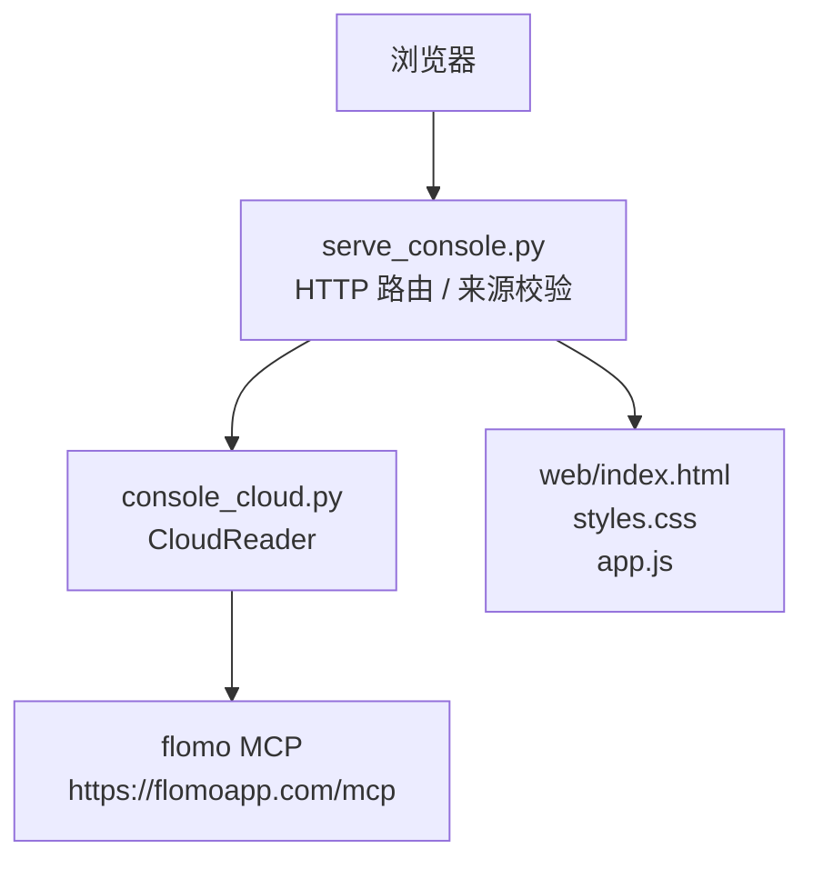
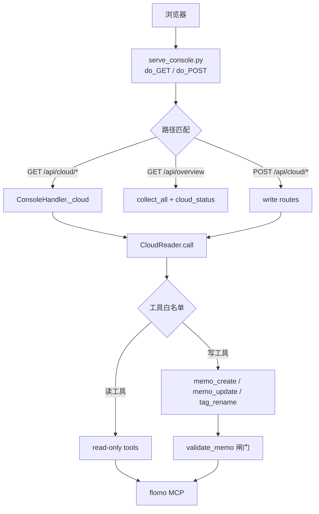

# API 参考

<cite>
**本文引用的文件**   
- [scripts/serve_console.py](file://scripts/serve_console.py)
- [scripts/console_cloud.py](file://scripts/console_cloud.py)
- [README.md](file://README.md)
- [ENVIRONMENT.md](file://ENVIRONMENT.md)
</cite>

## 目录
1. [简介](#简介)
2. [项目结构](#项目结构)
3. [安全边界与认证](#安全边界与认证)
4. [通用响应约定](#通用响应约定)
5. [只读查询接口](#只读查询接口)
6. [写操作接口](#写操作接口)
7. [概览接口](#概览接口)
8. [依赖关系图](#依赖关系图)
9. [性能与限制](#性能与限制)
10. [故障排查](#故障排查)
11. [结论](#结论)

## 简介
本仓库提供本地 Web 控制台，把云端 flomo MCP 的只读能力暴露为 REST 接口，并把写操作收敛到“格式闸门 + 流程闸门 + 回读验收”的固定链路。浏览器通过 `/api/*` 拉取数据；所有写入都走 `POST`，并受工具白名单与来源校验保护。

服务默认监听 `127.0.0.1:8787`，仅接受本机宿主名请求；带 `Origin` 时要求同源。Token 来自 `.mcp.json`，由后端注入连接，不进入任何 HTTP 响应体。

**章节来源**
- [README.md:130-200](file://README.md#L130-L200)
- [ENVIRONMENT.md:1-80](file://ENVIRONMENT.md#L1-L80)

## 项目结构
控制台由两个 Python 模块协作：

- `scripts/serve_console.py`：HTTP 服务器、静态页面路由、请求来源校验、JSON 接口转发。
- `scripts/console_cloud.py`：云端访问层，维护 CloudReader 实例，调用 flomo MCP 工具，执行写前闸门与写后验收。



**图示来源**
- [scripts/serve_console.py:250-360](file://scripts/serve_console.py#L250-L360)
- [scripts/console_cloud.py:420-520](file://scripts/console_cloud.py#L420-L520)

**章节来源**
- [README.md:130-200](file://README.md#L130-L200)
- [scripts/serve_console.py:1-60](file://scripts/serve_console.py#L1-L60)
- [scripts/console_cloud.py:1-60](file://scripts/console_cloud.py#L1-L60)

## 安全边界与认证

### 认证方式
- 服务端本身**没有登录系统**。
- 云端凭据通过 `.mcp.json` 中的 `mcpServers.flomo.headers.Authorization` 加载，值为 Bearer token。
- Token 仅在建立 MCP 连接时使用，不会出现在响应体、日志或错误消息中。
- 如果 `.mcp.json` 和环境变量都没有 token，云端可用性会报告不可用。

| 配置项 | 位置 | 说明 |
|---|---|---|
| Token | `.mcp.json` → `mcpServers.flomo.headers.Authorization` | 优先来源，已 gitignore |
| 后备 Token | 环境变量 `FLOMO_TOKEN` | 仅当 `.mcp.json` 不存在时生效 |
| 云端端点 | `https://flomoapp.com/mcp` | Bearer 鉴权 |

**章节来源**
- [README.md:30-60](file://README.md#L30-L60)
- [ENVIRONMENT.md:40-80](file://ENVIRONMENT.md#L40-L80)
- [scripts/console_cloud.py:340-380](file://scripts/console_cloud.py#L340-L380)

### Host 白名单
- 每个请求都会解析 `Host` 头中的主机名。
- 允许的主机名集合按启动参数动态计算：
  - 绑定回环地址（如 `127.0.0.1`）：允许 `127.0.0.1`、`localhost`、`::1` 及绑定地址本身。
  - 绑定具体非回环地址：允许该地址 + 回环名。
  - 绑定通配地址（`0.0.0.0` / `::`）：会把本机各接口地址也加入白名单，但仍拒绝攻击者域名。
- Host 不匹配返回 `403`，正文写明允许的宿主名。

### Origin 校验
- 如果请求携带 `Origin`，其主机名必须也在允许集合内。
- `Origin: null` 同样被拒绝。
- 缺失 `Origin` 视为 curl 等命令行客户端，放行。
- 该检查同时作用于 GET 和 POST，因为同源策略无法阻止跨站发起的请求。

### 仅允许 localhost 的策略
- 默认绑定 `127.0.0.1`。
- 绑定非回环地址必须显式加 `--allow-lan`。
- 即使绑了局域网地址，也没有身份认证；同网段任意机器可直接读写云端卡片。
- 因此生产建议保持回环绑定，并由反向代理或防火墙控制访问。

### 工具白名单
- 读工具白名单：`memo_search`、`memo_batch_get`、`memo_recommended`、`get_daily_review`、`tag_tree`、`tag_search`、`memory_context`、`memory_user`、`get_format_guide`、`get_tag_guide`。
- 写工具白名单：`memo_create`、`memo_update`、`tag_rename`。
- 通用只读执行入口 `/api/cloud/tool` 只放行读白名单；写工具会明确拒绝。
- 白名单是源码级硬集合，不是从云端动态开放任意工具。

**章节来源**
- [scripts/serve_console.py:80-160](file://scripts/serve_console.py#L80-L160)
- [scripts/serve_console.py:200-230](file://scripts/serve_console.py#L200-L230)
- [scripts/serve_console.py:360-424](file://scripts/serve_console.py#L360-L424)
- [scripts/console_cloud.py:120-180](file://scripts/console_cloud.py#L120-L180)
- [scripts/console_cloud.py:480-560](file://scripts/console_cloud.py#L480-L560)

## 通用响应约定

### 成功响应
大多数接口在正常处理完成后返回 `200`，主体为 JSON 对象。部分接口内部字段包含业务状态：

| 接口 | 成功语义 | 业务状态字段 |
|---|---|---|
| `/api/cloud/tag/rename` | HTTP 200 仅表示请求被处理 | `ok`、`status` |
| `/api/cloud/gate` | HTTP 200 仅表示请求被处理 | `ok` |
| `/api/cloud/memo/create` | HTTP 200 仅表示请求被处理 | `ok` |
| `/api/cloud/memo/update` | HTTP 200 仅表示请求被处理 | `ok` |
| `/api/cloud/validate` | HTTP 200 仅表示自检完成 | `ok` |

### 常见错误码
| HTTP 状态码 | 含义 | 常见原因 |
|---|---|---|
| `400` | 请求格式错误 | POST 请求体不是合法 JSON |
| `403` | 来源拒绝 | Host 不在本机白名单、Origin 不同源、静态资源路径逃逸 |
| `404` | 未知写入接口 | POST 路径不在写路由表中 |
| `422` | 写前验证失败 | 格式闸门或流程闸门未通过 |
| `500` | 服务端异常 | 代码层未预期异常 |
| `502` | 云端不可用 | MCP 连接失败、token 缺失、网络异常 |

### 统一错误体
云端通道错误通常形如：

```json
{
  "error": "错误描述",
  "kind": "cloud"
}
```

请求解析错误可能使用 `kind: request`。

**章节来源**
- [scripts/serve_console.py:230-260](file://scripts/serve_console.py#L230-L260)
- [scripts/serve_console.py:300-360](file://scripts/serve_console.py#L300-L360)
- [scripts/console_cloud.py:520-560](file://scripts/console_cloud.py#L520-L560)

## 只读查询接口

以下接口均为 `GET`，且经过 Host 与 Origin 校验。Token 由后端注入，调用方无需携带。

### 列出卡片：`GET /api/cloud/memos`

| 字段 | 类型 | 必填 | 说明 |
|---|---|---:|---|
| `keywords` | string | 否 | 关键词检索 |
| `tag` | string | 否 | 完整标签路径，例如 `AI/决策模型` |
| `start_date` | string | 否 | 起始日期 |
| `end_date` | string | 否 | 结束日期 |
| `source` | string | 否 | 来源渠道，对应云端的 `from` |
| `has_tag` | boolean | 否 | 三态开关：真、假、不传 |
| `limit` | integer | 否 | 默认 20，上限 50 |

**响应体字段**

| 字段 | 类型 | 说明 |
|---|---|---|
| `count` | integer | 实际返回数量 |
| `limit` | integer | 本次使用的 limit |
| `capped` | boolean | 是否达到云端单次上限 |
| `keywords` | string | 回填关键词 |
| `tag` | string | 回填标签 |
| `start_date` | string | 回填起始日期 |
| `end_date` | string | 回填结束日期 |
| `source` | string | 回填来源 |
| `has_tag` | boolean \| null | 三态值 |
| `memos` | array | 精简卡片列表 |

单条卡片精简字段：

| 字段 | 类型 | 说明 |
|---|---|---|
| `id` | string | 卡片 id |
| `tags` | array | 标签数组 |
| `title` | string | 概念名 |
| `excerpt` | string | 正文摘要 |
| `word_count` | number | 字数 |
| `created_at` | string | 创建时间 |
| `updated_at` string | string | 更新时间 |
| `url` | string | 来源链接 |
| `from` | string | 来源渠道 |
| `truncated` | boolean | 云端正文是否被截断 |
| `has_image` | boolean | 是否含图片 |
| `has_link` | boolean | 是否含链接 |

**curl 示例**

```bash
curl "http://127.0.0.1:8787/api/cloud/memos?keywords=笔记&tag=AI/决策模型&limit=20"
```

**章节来源**
- [scripts/serve_console.py:270-310](file://scripts/serve_console.py#L270-L310)
- [scripts/console_cloud.py:540-600](file://scripts/console_cloud.py#L540-L600)

### 读取单卡全文：`GET /api/cloud/memo`

| 字段 | 类型 | 必填 | 说明 |
|---|---|---:|---|
| `id` | string | 是 | 卡片 id |

**响应体字段**

| 字段 | 类型 | 说明 |
|---|---|---|
| `memo` | object | 完整卡片，含 `content` 正文 |
| `omitted_ids` | array | 云端未返回的其它 id |

**curl 示例**

```bash
curl "http://127.0.0.1:8787/api/cloud/memo?id=<卡片id>"
```

**章节来源**
- [scripts/serve_console.py:270-310](file://scripts/serve_console.py#L270-L310)
- [scripts/console_cloud.py:600-640](file://scripts/console_cloud.py#L600-L640)

### 批量读取全文：`GET /api/cloud/memos/batch`

| 字段 | 类型 | 必填 | 说明 |
|---|---|---:|---|
| `ids` | string | 是 | 逗号分隔的 id 列表 |

服务端会忽略空 id，并按云端单次上限保留最多 10 条。

**响应体字段**

| 字段 | 类型 | 说明 |
|---|---|---|
| `count` | integer | 实际取回数量 |
| `requested` | integer | 清理后的请求数量 |
| `dropped` | integer | 超过 10 条上限被丢弃的数量 |
| `memos` | array | 完整卡片数组 |
| `omitted_ids` | array | 云端未返回的其它 id |

**curl 示例**

```bash
curl "http://127.0.0.1:8787/api/cloud/memos/batch?ids=id1,id2,id3"
```

**章节来源**
- [scripts/serve_console.py:270-310](file://scripts/serve_console.py#L270-L310)
- [scripts/console_cloud.py:640-700](file://scripts/console_cloud.py#L640-L700)

### 今日回顾：`GET /api/cloud/review`

无请求参数。

**响应体字段**

| 字段 | 类型 | 说明 |
|---|---|---|
| `count` | integer | 回顾卡片数 |
| `memos` | array | 精简卡片列表 |

**curl 示例**

```bash
curl "http://127.0.0.1:8787/api/cloud/review"
```

**章节来源**
- [scripts/serve_console.py:270-310](file://scripts/serve_console.py#L270-L310)
- [scripts/console_cloud.py:700-720](file://scripts/console_cloud.py#L700-L720)

### 相关笔记：`GET /api/cloud/related`

| 字段 | 类型 | 必填 | 说明 |
|---|---|---:|---|
| `id` | string | 是 | 基准卡片 id |
| `limit` | integer | 否 | 默认 10，上限 50 |
| `no_same_tag` | boolean | 否 | 三态开关 |

**响应体字段**

| 字段 | 类型 | 说明 |
|---|---|---|
| `id` | string | 基准卡片 id |
| `count` | integer | 相关卡片数 |
| `memos` | array | 精简卡片列表 |

**curl 示例**

```bash
curl "http://127.0.0.1:8787/api/cloud/related?id=<卡片id>&no_same_tag=true"
```

**章节来源**
- [scripts/serve_console.py:270-310](file://scripts/serve_console.py#L270-L310)
- [scripts/console_cloud.py:700-730](file://scripts/console_cloud.py#L700-L730)

### 标签树：`GET /api/cloud/tagtree`

| 字段 | 类型 | 必填 | 说明 |
|---|---|---:|---|
| `prefix` | string | 否 | 前缀过滤 |
| `depth` | integer | 否 | 深度，范围 1–10 |
| `limit` | integer | 否 | 默认 200，上限 1000 |

**响应体字段**

| 字段 | 类型 | 说明 |
|---|---|---|
| `tags` | array | 标签字符串数组 |
| `total` | number | 云端 total |
| `returned` | number | 实际返回数 |
| `limit` | number | 本次 limit |
| `truncated` | boolean | 是否被云端截断 |
| `hint` | string | 云端提示 |

**curl 示例**

```bash
curl "http://127.0.0.1:8787/api/cloud/tagtree?prefix=AI&depth=2&limit=200"
```

**章节来源**
- [scripts/serve_console.py:270-310](file://scripts/serve_console.py#L270-L310)
- [scripts/console_cloud.py:720-760](file://scripts/console_cloud.py#L720-L760)

### 标签搜索：`GET /api/cloud/tags`

| 字段 | 类型 | 必填 | 说明 |
|---|---|---:|---|
| `keywords` | string | 否 | 标签名关键词 |
| `limit` | integer | 否 | 默认 20，上限 1000 |

**响应体字段**

| 字段 | 类型 | 说明 |
|---|---|---|
| `keywords` | string | 回填关键词 |
| `count` | integer | 返回标签数 |
| `tags` | array | 标签名字符串数组 |

**curl 示例**

```bash
curl "http://127.0.0.1:8787/api/cloud/tags?keywords=AI"
```

**章节来源**
- [scripts/serve_console.py:270-310](file://scripts/serve_console.py#L270-L310)
- [scripts/console_cloud.py:760-780](file://scripts/console_cloud.py#L760-L780)

### 参考文本：`GET /api/cloud/reference`

无请求参数。一次返回四份文本。

**响应体字段**

| 字段 | 类型 | 说明 |
|---|---|---|
| `memory` | object | 记忆文档，含 `doc` 与 `content` |
| `user` | object | 用户画像，含 `doc` 与 `content` |
| `format` | object | 笔记格式规范，含 `doc` 与 `content` |
| `tag` | object | 标签使用规范，含 `doc` 与 `content` |

**curl 示例**

```bash
curl "http://127.0.0.1:8787/api/cloud/reference"
```

**章节来源**
- [scripts/serve_console.py:270-310](file://scripts/serve_console.py#L270-L310)
- [scripts/console_cloud.py:780-830](file://scripts/console_cloud.py#L780-L830)

## 写操作接口

所有写接口均为 `POST`，请求体必须是 JSON 对象。Host 与 Origin 校验与只读接口相同。

### 通用只读执行：`POST /api/cloud/tool`

用于执行**读工具**。写工具会被明确拒绝。

| 字段 | 类型 | 必填 | 说明 |
|---|---|---:|---|
| `name` | string | 是 | 云端工具名 |
| `arguments` | object | 否 | 工具参数，键值对 |

**响应体字段**

| 字段 | 类型 | 说明 |
|---|---|---|
| `tool` | string | 工具名 |
| `arguments` | object | 实际传入参数 |
| `kind` | string | 渲染形态：`memos`、`tags`、`text`、`json` |
| `memos` | array | 卡片列表（当 kind 为 memos） |
| `tags` | array | 标签列表（当 kind 为 tags） |
| `total` | number | 云端 total |
| `truncated` | boolean | 是否被截断 |
| `text` | string | 纯文本结果（当 kind 为 text） |
| `raw` | object | 原始工具返回 |

**curl 示例**

```bash
curl -X POST http://127.0.0.1:8787/api/cloud/tool \
  -H "Content-Type: application/json" \
  -d '{"name":"memo_search","arguments":{"keywords":"测试"}}'
```

**章节来源**
- [scripts/serve_console.py:310-360](file://scripts/serve_console.py#L310-L360)
- [scripts/console_cloud.py:900-946](file://scripts/console_cloud.py#L900-L946)

### 格式自检：`POST /api/cloud/validate`

委托 `validate_memo.check()`，只报不改。

| 字段 | 类型 | 必填 | 说明 |
|---|---|---:|---|
| `content` | string | 否 | 卡片正文 |
| `format` | string | 否 | 可选格式标记 |

**响应体字段**

| 字段 | 类型 | 说明 |
|---|---|---|
| `ok` | boolean | 是否有 ERR 级错误 |
| `errors` | array | 格式错误列表 |
| `warnings` | array | 警告列表 |
| `tagline` | string | 解析出的标签行 |
| `concept` | string | 解析出的概念名 |

**curl 示例**

```bash
curl -X POST http://127.0.0.1:8787/api/cloud/validate \
  -H "Content-Type: application/json" \
  -d '{"content":"#顶层/二级\\n概念名\\n正文"}'
```

**章节来源**
- [scripts/serve_console.py:310-360](file://scripts/serve_console.py#L310-L360)
- [scripts/console_cloud.py:830-860](file://scripts/console_cloud.py#L830-L860)

### 流程闸门：`POST /api/cloud/gate`

现跑 `sop_gate.py`，生成流程凭证。

| 字段 | 类型 | 必填 | 说明 |
|---|---|---:|---|
| `content` | string | 是 | 卡片正文 |
| `skip_web` | boolean | 否 | 跳过网页验证 |
| `anchor_id` | string | 否 | 锚定 id |
| `verify` | object \| string | 否 | 第 2 步网络验证记录 |

**响应体字段**

| 字段 | 类型 | 说明 |
|---|---|---|
| `ok` | boolean | 子进程是否成功 |
| `skip_web` | boolean | 是否跳过网页验证 |
| `draft` | string | 当轮草稿文件名 |
| `lines` | array | 标准输出与错误输出行 |
| `gate` | object | 当前闸门状态，含 `ok` 与 `errors` |

**curl 示例**

```bash
curl -X POST http://127.0.0.1:8787/api/cloud/gate \
  -H "Content-Type: application/json" \
  -d '{
    "content":"#顶层/二级\\n概念名\\n正文",
    "skip_web":false,
    "verify":{}
  }'
```

**章节来源**
- [scripts/serve_console.py:310-360](file://scripts/serve_console.py#L310-L360)
- [scripts/console_cloud.py:860-920](file://scripts/console_cloud.py#L860-L920)

### 新建卡片：`POST /api/cloud/memo/create`

链路：格式闸门 → 流程闸门 → `memo_create` → 回读全文验收。

| 字段 | 类型 | 必填 | 说明 |
|---|---|---:|---|
| `content` | string | 是 | 卡片正文 |
| `format` | string | 否 | 可选格式标记 |

**响应体字段**

| 字段 | 类型 | 说明 |
|---|---|---|
| `ok` | boolean | 是否拿到新 id |
| `id` | string | 新卡片 id |
| `id_inferred` | boolean | id 是否通过签名回搜推断 |
| `word_count` | number | 云端字数 |
| `verified` | object | 回读验收结果，可能为 `matched: true/false/null` |

**curl 示例**

```bash
curl -X POST http://127.0.0.1:8787/api/cloud/memo/create \
  -H "Content-Type: application/json" \
  -d '{"content":"#顶层/二级\\n概念名\\n正文"}'
```

**章节来源**
- [scripts/serve_console.py:310-360](file://scripts/serve_console.py#L310-L360)
- [scripts/console_cloud.py:920-960](file://scripts/console_cloud.py#L920-L960)

### 更新卡片：`POST /api/cloud/memo/update`

链路：回读原文 → 格式闸门 → 流程闸门 → `memo_update` → 回读验收。

| 字段 | 类型 | 必填 | 说明 |
|---|---|---:|---|
| `id` | string | 是 | 要更新的卡片 id |
| `content` | string | 是 | 新正文 |
| `format` | string | 否 | 可选格式标记 |

**响应体字段**

| 字段 | 类型 | 说明 |
|---|---|---|
| `ok` | boolean | 请求是否到达写逻辑 |
| `id` | string | 被更新的卡片 id |
| `before` | object | 更新前的字符数与概念名 |
| `word_count` | number | 云端字数 |
| `verified` | object | 回读验收结果 |

**curl 示例**

```bash
curl -X POST http://127.0.0.1:8787/api/cloud/memo/update \
  -H "Content-Type: application/json" \
  -d '{"id":"<卡片id>","content":"#顶层/二级\\n概念名\\n更新后的正文"}'
```

**章节来源**
- [scripts/serve_console.py:310-360](file://scripts/serve_console.py#L310-L360)
- [scripts/console_cloud.py:960-1000](file://scripts/console_cloud.py#L960-L1000)

### 重命名标签：`POST /api/cloud/tag/rename`

批量重命名标签。HTTP 200 不代表标签一定全部改完，需看 `ok` 与 `status`。

| 字段 | 类型 | 必填 | 说明 |
|---|---|---:|---|
| `old_tag` | string | 是 | 原标签名 |
| `new_tag` | string | 是 | 新标签名 |
| `max_memos` | integer | 否 | 批量规模；默认 200，最大 2000 |

**响应体字段**

| 字段 | 类型 | 说明 |
|---|---|---|
| `old_tag` | string | 原标签 |
| `new_tag` | string | 新标签 |
| `max_memos_requested` | number | 请求的批量规模 |
| `matched_memos` | number | 匹配到的卡片数 |
| `updated_memos` | number | 实际修改数 |
| `updated_tags` | number | 实际修改标签数 |
| `warnings` | array | 警告信息 |
| `result` | object | 云端回执 |
| `ok` | boolean | 是否达成目标 |
| `status` | string | `done`、`partial`、`needs_scale`、`no_match`、`unknown`、`inconsistent` |
| `hint` | string | 面向用户的处置提示 |

| `status` | 含义 | 建议 |
|---|---|---|
| `done` | 匹配到的都已改写 | 完成 |
| `partial` | 部分改写，出现标签分裂 | 按 hint 重试或逐卡收尾 |
| `needs_scale` | 匹配数超默认 200，一条未写 | 带 `max_memos=匹配数` 重试 |
| `no_match` | 没匹配到挂旧标签的卡片 | 检查标签名或卡片是否存在 |
| `unknown` | 回执缺关键字段 | 不要当作已完成，应现查确认 |
| `inconsistent` | 实改数多于匹配数 | 回执自相矛盾，应人工复核 |

**curl 示例**

```bash
curl -X POST http://127.0.0.1:8787/api/cloud/tag/rename \
  -H "Content-Type: application/json" \
  -d '{"old_tag":"旧标签","new_tag":"新标签","max_memos":500}'
```

**章节来源**
- [scripts/serve_console.py:310-360](file://scripts/serve_console.py#L310-L360)
- [scripts/console_cloud.py:700-830](file://scripts/console_cloud.py#L700-L830)

## 概览接口

### 统计与云端可用性：`GET /api/overview`

合并本地仓库统计与云端可用性。

**响应体字段**

| 字段 | 类型 | 说明 |
|---|---|---|
| 本地统计字段 | object | 由 `collect_all(REPO_ROOT)` 产出，包含脚本、用例等统计 |
| `cloud` | object | 云端可用性 |

云端可用性字段：

| 字段 | 类型 | 说明 |
|---|---|---|
| `available` | boolean | 是否能取得 token 并建立连接 |
| `reason` | string | 不可用原因或“凭证就位” |
| `source` | string | token 来源 |
| `max_limit` | number | 单次最大限制 |

**curl 示例**

```bash
curl "http://127.0.0.1:8787/api/overview"
```

**章节来源**
- [scripts/serve_console.py:260-310](file://scripts/serve_console.py#L260-L310)
- [scripts/console_cloud.py:380-420](file://scripts/console_cloud.py#L380-L420)

## 依赖关系图



**图示来源**
- [scripts/serve_console.py:260-360](file://scripts/serve_console.py#L260-L360)
- [scripts/console_cloud.py:480-560](file://scripts/console_cloud.py#L480-L560)
- [scripts/console_cloud.py:830-1000](file://scripts/console_cloud.py#L830-L1000)

## 性能与限制

| 项目 | 限制 | 说明 |
|---|---|---|
| 卡片列表上限 | 50 | `MAX_LIMIT`，前端应提示还能继续筛 |
| 批量全文上限 | 10 | `BATCH_MAX`，超过 10 条会被丢弃并在响应中报告 |
| 标签树上限 | 1000 | `TAG_MAX_LIMIT` |
| 标签树默认返回 | 200 | `TAG_DEFAULT_LIMIT` |
| 标签搜索默认 | 20 | 可增大但受标签总量影响 |
| 相关笔记默认 | 10 | 经 `_clamp_limit` 约束 |
| 流程闸门超时 | 300 秒 | 超出抛 `CloudError` |
| 标签改名默认批量 | 200 | 超过时返回 `needs_scale` |
| 标签改名绝对上限 | 2000 | 超过直接报错 |
| 正文落盘 | 不允许 | 正文只在内存与响应之间传递 |
| 草稿例外 | 有 | 闸门用的 `memo_body*.txt`，由清理脚本回收 |

**章节来源**
- [scripts/console_cloud.py:160-220](file://scripts/console_cloud.py#L160-L220)
- [scripts/console_cloud.py:720-830](file://scripts/console_cloud.py#L720-L830)

## 故障排查

### 401：未找到 token
虽然 401 未在 HTTP 层显式抛出，但缺少 token 时云端可用性为 `False`，调用云端接口通常会返回 502 或 `cloud` 错误。

**排查步骤**
1. 检查项目根是否存在 `.mcp.json`。
2. 确认内容为 `{"mcpServers":{"flomo":{"url":"https://flomoapp.com/mcp","headers":{"Authorization":"Bearer fmcp_xxxxx"}}}}`。
3. 确认 token 以 `fmcp_` 开头。
4. 若 `.mcp.json` 不存在，检查环境变量 `FLOMO_TOKEN`。
5. 使用 `/api/overview` 查看 `cloud.available` 与 `cloud.reason`。

**curl 示例**

```bash
curl "http://127.0.0.1:8787/api/overview"
```

**章节来源**
- [README.md:30-60](file://README.md#L30-L60)
- [scripts/console_cloud.py:380-420](file://scripts/console_cloud.py#L380-L420)

### 403：Host 或 Origin 被拒
常见原因：
- 使用了远程域名访问本机服务。
- 浏览器跨站页面向 `127.0.0.1` 发请求。
- 手动构造的 `Host` 头不是本机名。
- 静态资源请求尝试路径逃逸。

**排查步骤**
1. 直接用 `http://127.0.0.1:8787/` 打开控制台。
2. 检查响应体是否包含“本服务只接受本机访问”。
3. 如果使用反向代理，确保转发给服务的 `Host` 仍是本机名。
4. 不要为控制台启用全局 CORS 放行；安全边界在服务端实现，不在响应里放开任意 Origin。

**curl 示例**

```bash
curl -v "http://127.0.0.1:8787/api/cloud/memos"
```

**章节来源**
- [scripts/serve_console.py:80-160](file://scripts/serve_console.py#L80-L160)
- [scripts/serve_console.py:200-230](file://scripts/serve_console.py#L200-L230)
- [ENVIRONMENT.md:160-220](file://ENVIRONMENT.md#L160-L220)

### 502：云端不可用
常见原因：
- token 无效或过期。
- 代理返回 502。
- MCP 端点不可达。
- 握手失败。

**排查步骤**
1. 先查 `/api/overview` 的 `cloud.available`。
2. 如果是代理问题，先用 `curl --noproxy '*'` 直连本机服务，避免代理接管 127.0.0.1。
3. 检查 `netdoctor.py` 的诊断结果。
4. 重启控制台服务，因为会话在进程内复用，连接失效后会重置并重连。

**curl 示例**

```bash
curl --noproxy '*' "http://127.0.0.1:8787/api/overview"
python scripts/netdoctor.py --url https://flomoapp.com/mcp
```

**章节来源**
- [ENVIRONMENT.md:80-160](file://ENVIRONMENT.md#L80-L160)
- [scripts/serve_console.py:230-260](file://scripts/serve_console.py#L230-L260)
- [scripts/console_cloud.py:420-520](file://scripts/console_cloud.py#L420-L520)

### CORS 相关问题
控制台不是公共 API，不应把它当成普通 CORS 服务来调。正确做法是：
- 浏览器直接访问 `http://127.0.0.1:8787/`。
- 如果需要跨域调用，应在同一站点下通过前端代理转发。
- 不要为了绕过 CORS 而关闭 Host/Origin 校验。

**章节来源**
- [scripts/serve_console.py:120-200](file://scripts/serve_console.py#L120-L200)
- [ENVIRONMENT.md:160-220](file://ENVIRONMENT.md#L160-L220)

### 422：闸门未过
写接口返回 422 时，说明请求已被识别为写操作，但格式闸门或流程闸门失败。

**排查步骤**
1. 先调 `/api/cloud/validate`，看 `errors` 和 `warnings`。
2. 再调 `/api/cloud/gate`，检查流程凭证是否有效。
3. 注意 422 不是 502；前者是输入不合规，后者是云端不可用。

**curl 示例**

```bash
curl -X POST http://127.0.0.1:8787/api/cloud/validate \
  -H "Content-Type: application/json" \
  -d '{"content":"#顶层/二级\\n概念名\\n正文"}'
```

**章节来源**
- [scripts/serve_console.py:230-260](file://scripts/serve_console.py#L230-L260)
- [scripts/console_cloud.py:830-920](file://scripts/console_cloud.py#L830-L920)

## 结论
Web 控制台的后端 API 以最小公开面暴露云端能力：只读查询集中在 `/api/cloud/*`，写操作集中在五个专用 POST 端点，概览由 `/api/overview` 聚合本地与云端状态。安全上依靠 Host 白名单、Origin 同源校验、工具白名单和本机回环绑定共同防护；认证则由 `.mcp.json` 中的 Bearer token 在进程内注入。调用方应避免自行绕过这些边界，也不要假设 HTTP 200 代表所有写操作都已完成——尤其是标签重命名，必须以响应体中的 `ok` 与 `status` 为准。