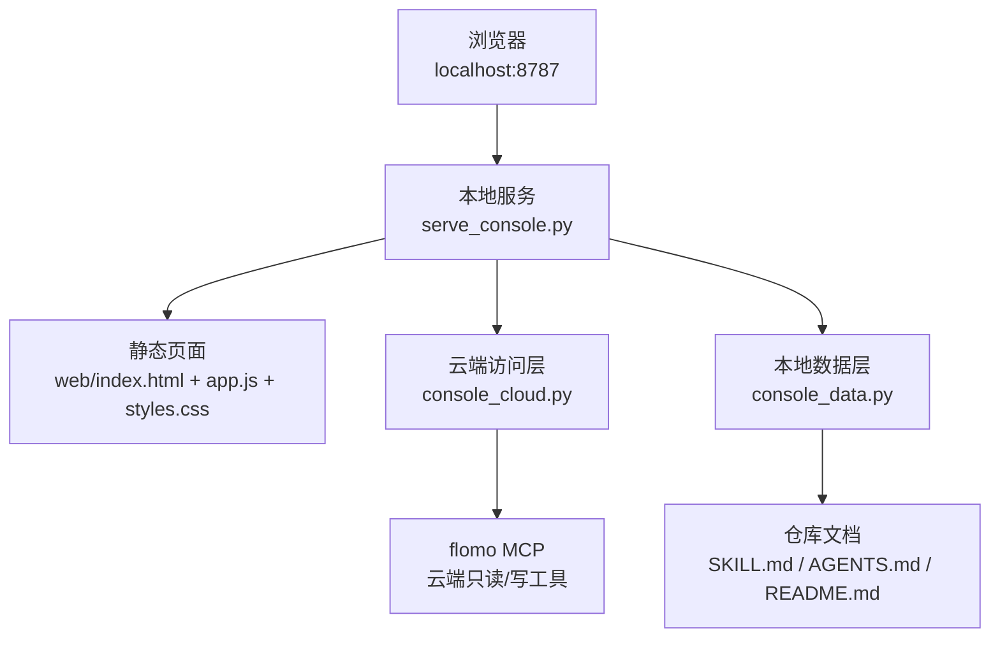
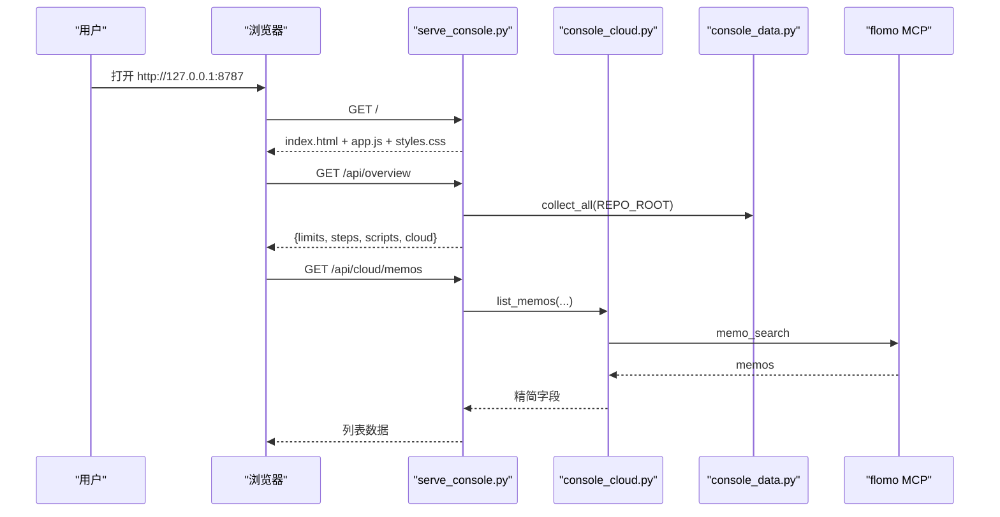
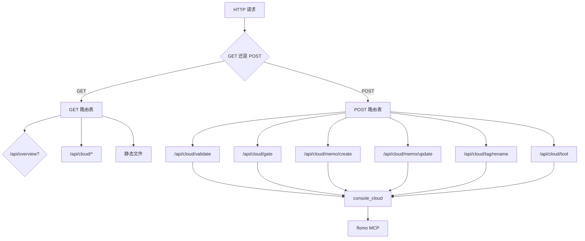
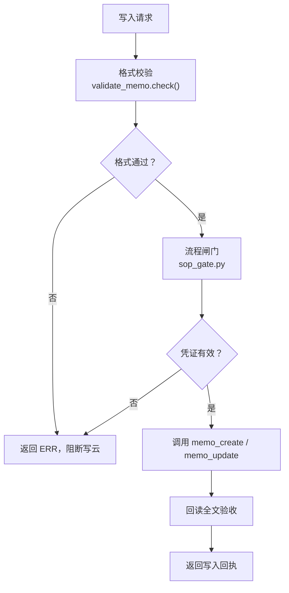
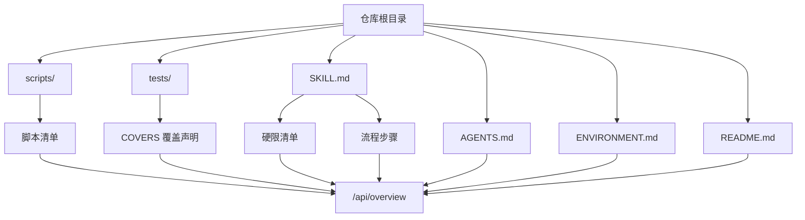
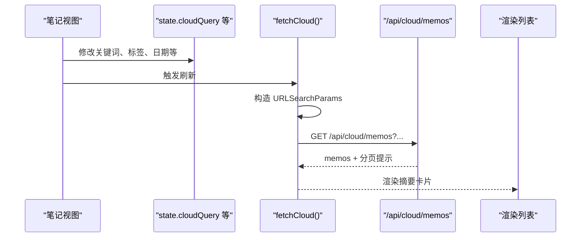
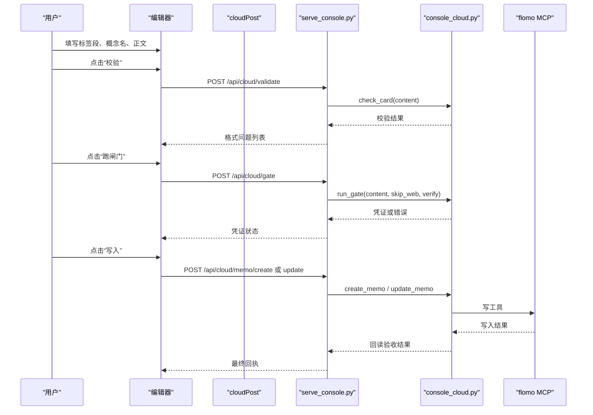
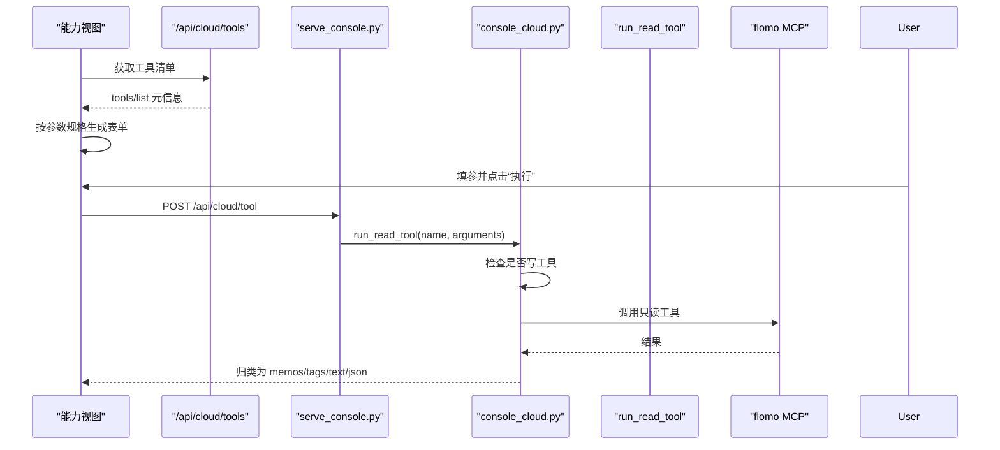

# Web 控制台

<cite>
**本文引用的文件**   
- [serve_console.py](file://scripts/serve_console.py)
- [console_cloud.py](file://scripts/console_cloud.py)
- [console_data.py](file://scripts/console_data.py)
- [app.js](file://web/app.js)
- [index.html](file://web/index.html)
- [README.md](file://README.md)
</cite>

## 目录

1. [简介](#简介)
2. [项目结构](#项目结构)
3. [核心组件](#核心组件)
4. [架构总览](#架构总览)
5. [四视图使用指南](#四视图使用指南)
6. [后端路由与分发](#后端路由与分发)
7. [云端访问层：读白名单、写白名单与闸门](#云端访问层读白名单写白名单与闸门)
8. [本地数据解析：技能文档与脚本清单](#本地数据解析技能文档与脚本清单)
9. [前端状态管理与交互逻辑](#前端状态管理与交互逻辑)
10. [API 参考](#api-参考)
11. [常用操作截图描述](#常用操作截图描述)
12. [常见问题排查](#常见问题排查)
13. [性能与安全特性](#性能与安全特性)
14. [结论](#结论)

## 简介

flomo-note 的 Web 控制台是一个零第三方依赖的本地 HTTP 服务，用来把云端 MCP 暴露的能力直接摆到浏览器里。它不是另一个笔记客户端，而是“控制台”——你仍然在 flomo 云端写卡片，但搜索、查看全文、相关笔记、标签管理、参考文档和工具执行都通过一个 Claude 风格的前端完成。

控制台提供四个视图：

| 视图 | 一句话职责 |
|---|---|
| 云端笔记 | 搜索 memos、查看单卡全文、相关笔记、新建与编辑卡片 |
| 标签 | 实时标签树、标签名搜索、批量重命名 |
| 参考 | 记忆文档、用户画像、笔记格式规范、标签使用规范 |
| 能力 | 动态工具台：按 `tools/list` 生成表单并执行只读工具 |

启动命令如下：

```bash
python scripts/serve_console.py
python scripts/serve_console.py --open
python scripts/serve_console.py --port 9000
```

默认监听 `http://127.0.0.1:8787`；`--open` 会在启动后自动打开浏览器。

**章节来源**
- [README.md:200-240](file://README.md#L200-L240)

## 项目结构

Web 控制台由三部分构成：

1. **本地 HTTP 服务**：`scripts/serve_console.py`，负责静态文件、JSON 接口、请求来源校验与端口检测。
2. **业务后端**：`scripts/console_cloud.py` 与 `scripts/console_data.py`，分别负责云端 MCP 调用和本地仓库文档解析。
3. **前端静态资源**：`web/index.html`、`web/styles.css`、`web/app.js`，负责四视图渲染、状态管理和 API 调用。



**图表来源**
- [serve_console.py:1-120](file://scripts/serve_console.py#L1-L120)
- [console_cloud.py:1-120](file://scripts/console_cloud.py#L1-L120)
- [console_data.py:1-60](file://scripts/console_data.py#L1-L60)
- [index.html:1-20](file://web/index.html#L1-L20)

**章节来源**
- [README.md:120-240](file://README.md#L120-L240)
- [serve_console.py:1-120](file://scripts/serve_console.py#L1-L120)

## 核心组件

### 本地服务：serve_console.py

它是控制台的入口，承担以下职责：

- 解析命令行参数：端口、绑定地址、局域网开关、自动打开浏览器。
- 检查端口占用，避免两个实例同时监听同一端口。
- 提供静态文件服务，限制允许的后缀（`.html`、`.css`、`.js`、`.svg`、`.ico`、`.png`、`.webp`、`.woff2`）。
- 提供 `/api/*` JSON 接口，转发到 `console_cloud.CloudReader` 或 `console_data.collect_all`。
- 校验请求来源：Host 必须在本机名白名单内；带 Origin 时必须同源。
- 对 POST 写请求统一返回 422（内容不合规）或 502（云端异常），让前端区分“本地表单问题”和“云端连接问题”。

关键行为包括：

| 功能 | 实现要点 |
|---|---|
| 端口检测 | 启动时用 socket 探测目标端口是否已有进程监听，避免两个实例竞争 |
| 静态路径防护 | 解析后的目标必须仍在 `web/` 目录下，否则返回 403 |
| 来源校验 | Host 与 Origin 都拒绝非本机宿主名；Origin 缺失视为命令行客户端放行 |
| 云端降级 | 捕获 `CloudError` 返回 502，其他异常返回 500 |
| 写入口收敛 | 所有写操作集中在 `do_POST` 中，无绕过开关 |

**章节来源**
- [serve_console.py:120-220](file://scripts/serve_console.py#L120-L220)
- [serve_console.py:369-424](file://scripts/serve_console.py#L369-L424)

### 云端访问层：console_cloud.py

它是控制台唯一与 flomo MCP 通信的地方，集中封装：

- 读工具：memo_search、memo_batch_get、memo_recommended、get_daily_review、tag_tree、tag_search、memory_context、memory_user、get_format_guide、get_tag_guide。
- 写工具：memo_create、memo_update、tag_rename。
- 通用只读执行：`run_read_tool(name, arguments)`。
- 工具清单发现：`tool_catalog()`，走 `tools/list`。
- 写前两道闸门：格式校验与流程凭证。
- 写后回读验收：确认落库正文。

它明确声明：**token 不出进程**，正文不落盘（当轮草稿除外），白名单外的工具一律拒绝。

**章节来源**
- [console_cloud.py:1-120](file://scripts/console_cloud.py#L1-L120)
- [console_cloud.py:450-520](file://scripts/console_cloud.py#L450-L520)

### 本地数据层：console_data.py

它离线读取仓库文档，不发起网络请求，产出控制台统计信息，包括：

- 硬限清单：从 SKILL.md 解析 H1–Hn 条目。
- 流程步骤：从 SKILL.md 解析九步 SOP。
- 脚本清单：列出 `scripts/` 下的工具及配套用例。
- 文档集合：SKILL.md、AGENTS.md、ENVIRONMENT.md、README.md。

它被 `/api/overview` 调用，供前端展示本地侧能力概览。

**章节来源**
- [console_data.py:1-60](file://scripts/console_data.py#L1-L60)
- [console_data.py:251-281](file://scripts/console_data.py#L251-L281)

### 前端：app.js 与 index.html

`index.html` 提供侧边栏导航、主区域、抽屉、编辑器、提示条等 DOM 骨架。  
`app.js` 维护全局状态、渲染四视图、处理搜索、批量取全文、编辑器校验与保存、标签重命名、工具表单生成与执行。

**章节来源**
- [index.html:1-162](file://web/index.html#L1-L162)
- [app.js:1-60](file://web/app.js#L1-L60)

## 架构总览

控制台采用“静态前端 + 轻量本地服务 + 两层后端”的分层结构：



**图表来源**
- [serve_console.py:220-368](file://scripts/serve_console.py#L220-L368)
- [console_cloud.py:80-120](file://scripts/console_cloud.py#L80-L120)
- [console_data.py:251-281](file://scripts/console_data.py#L251-L281)

## 四视图使用指南

### 一、云端笔记视图

这是默认主视图，用于浏览和编辑云端卡片。

#### 主要操作

1. **最近笔记**：不带查询参数时，显示最近一批卡片摘要。
2. **关键词搜索**：输入关键词后点击刷新。
3. **标签筛选**：选择标签后参与搜索。
4. **起止日期筛选**：支持 start_date 与 end_date。
5. **来源筛选**：按 source 过滤。
6. **是否含标签**：三态开关，表示“包含标签”“不包含标签”或“不限制”。
7. **查看全文**：点击卡片标题进入右侧抽屉，显示完整正文和相关笔记。
8. **相关笔记**：抽屉内提供 `no_same_tag` 选项，可排除同标签笔记。
9. **多选取全文**：选中多条后批量拉取完整正文，单次上限 10 条。
10. **新建卡片**：点击新建按钮打开编辑器，填写标签段、概念名、正文，预览字数。
11. **编辑卡片**：从列表进入编辑模式，会先回读原文再提交更新。

#### 重要规则

- 写操作不会直通云端，必须先过格式校验和流程闸门，再写云并回读验收。
- 编辑器支持“原始文本”模式，可直接编辑完整卡片文本。
- 非术语卡可选择跳过网络验证。

**章节来源**
- [app.js:1-60](file://web/app.js#L1-L60)
- [index.html:40-162](file://web/index.html#L40-L162)
- [README.md:200-240](file://README.md#L200-L240)

### 二、标签视图

标签视图面向标签体系管理。

#### 主要操作

1. **实时标签树**：每次刷新都会向云端请求最新标签树。
2. **收窄范围**：可按 prefix、depth、limit 缩小树规模。
3. **标签名搜索**：按关键词搜索标签名。
4. **批量重命名**：输入旧标签名和新标签名，确认后调用 `tag_rename`。
5. **二次确认**：首次点击重命名仅进入待确认态，防止误改。
6. **规模上限**：默认 200 条，显式确认后可到绝对上限 2000 条。

#### 结果语义

- HTTP 200 只表示请求被服务端处理，不代表全部成功。
- 真正成败看响应中的 `ok` 与 `status`：`done`、`partial`、`needs_scale`、`no_match`、`unknown`。

**章节来源**
- [console_cloud.py:104-120](file://scripts/console_cloud.py#L104-L120)
- [console_cloud.py:813-856](file://scripts/console_cloud.py#L813-L856)
- [app.js:60-120](file://web/app.js#L60-L120)

### 三、参考视图

参考视图聚合四份来自云端的文本：

| 文档 | 用途 |
|---|---|
| 记忆文档 | 系统级记忆上下文 |
| 用户画像 | 当前用户的画像信息 |
| 笔记格式规范 | 卡片格式要求 |
| 标签使用规范 | 标签命名与层级约定 |

该视图是纯只读展示，适合快速核对规则而不跳转到云端。

**章节来源**
- [console_cloud.py:23-40](file://scripts/console_cloud.py#L23-L40)
- [app.js:120-200](file://web/app.js#L120-L200)

### 四、能力视图

能力视图是“工具台”，把云端 MCP 暴露的全部工具呈现出来。

#### 工作原理

1. 前端调用 `/api/cloud/tools`，拿到 `tools/list` 返回的工具清单与参数规格。
2. 根据每个工具的参数定义动态生成表单控件。
3. 对只读工具，“执行”按钮直接调用 `/api/cloud/tool`，传入工具名与参数。
4. 对写工具，界面不提供直通执行按钮，只显示需要过闸门并跳转专属入口。
5. 执行结果按形态分类渲染：memos、tags、text、json。

#### 注意事项

- 通用只读执行入口会显式拒绝写工具。
- 工具返回的原始 JSON 超过 4000 字符时会截断并标注。
- 工具清单以云端声明为准，不是前端写死。

**章节来源**
- [console_cloud.py:856-922](file://scripts/console_cloud.py#L856-L922)
- [app.js:1-60](file://web/app.js#L1-L60)

## 后端路由与分发

### GET 路由

| 路径 | 方法 | 说明 |
|---|---|---|
| `/` 或空路径 | 返回静态 index.html | 控制台首页 |
| `/api/overview` | 收集本地仓库统计 | 调用 `console_data.collect_all` |
| `/api/cloud/memos` | 搜索 memos | keywords、tag、start_date、end_date、source、has_tag、limit |
| `/api/cloud/memo` | 单卡全文 | id |
| `/api/cloud/memos/batch` | 批量全文 | ids 逗号分隔，上限 10 条 |
| `/api/cloud/review` | 今日回顾 | daily_review |
| `/api/cloud/related` | 相关笔记 | id、limit、no_same_tag |
| `/api/cloud/tagtree` | 标签树 | prefix、depth、limit |
| `/api/cloud/tags` | 标签名搜索 | keywords、limit |
| `/api/cloud/reference` | 四份参考文本 | memory_doc、user_profile、format_guide、tag_guide |
| `/api/cloud/tools` | 工具清单 | tools/list 元信息与接入状态 |

### POST 路由

| 路径 | 作用 | 关键参数 |
|---|---|---|
| `/api/cloud/validate` | 格式自检 | content、format |
| `/api/cloud/gate` | 跑流程闸门 | content、skip_web、anchor_id、verify |
| `/api/cloud/memo/create` | 新建卡片 | content、format |
| `/api/cloud/memo/update` | 更新卡片 | id、content、format |
| `/api/cloud/tag/rename` | 批量重命名标签 | old_tag、new_tag、max_memos |
| `/api/cloud/tool` | 通用只读执行 | name、arguments |

所有 POST 写路由都委托给 `console_cloud`，并在其内部强制两道闸门与回读验收；服务层只提供 422 与 502 两类错误码区分。



**图表来源**
- [serve_console.py:220-368](file://scripts/serve_console.py#L220-L368)
- [serve_console.py:320-424](file://scripts/serve_console.py#L320-L424)

**章节来源**
- [serve_console.py:220-424](file://scripts/serve_console.py#L220-L424)

## 云端访问层：读白名单、写白名单与闸门

### 读白名单

读工具白名单 `READONLY_TOOLS` 严格等于本模块实际调用的只读工具集合：

- memo_search
- memo_batch_get
- memo_recommended
- get_daily_review
- tag_tree
- tag_search
- memory_context
- memory_user
- get_format_guide
- get_tag_guide

任何不在白名单内的工具名都会被拒绝。

### 写白名单

写工具白名单 `WRITE_TOOLS` 为：

- memo_create
- memo_update
- tag_rename

写工具不能通过通用只读执行入口 `/api/cloud/tool`，因为该入口会显式拦截 WRITE_TOOLS。

### 两道闸门

写卡片前必须经过：

1. **格式闸门**：委托 `validate_memo.check()`，检查首行标签段、第二行概念名、结论先行、标签两级、字数上限等。
2. **流程闸门**：委托 `validate_memo.check_gate()`，要求 `.sop_gate/<签名>.json` 凭证存在、签名与正文指纹匹配且未过期。

写完成后统一回读全文进行验收，对应 H1、H2、H11 等规则。

### 通用只读执行

`run_read_tool(name, arguments)` 允许前端把任意只读工具的结果直接展示出来。这是“云端 MCP 能力在页面上直接可用”的关键入口：云端新增只读工具后，只要加入白名单和方法实现，界面不需要改代码就能运行。



**图表来源**
- [console_cloud.py:30-52](file://scripts/console_cloud.py#L30-L52)
- [console_cloud.py:641-794](file://scripts/console_cloud.py#L641-L794)

**章节来源**
- [console_cloud.py:87-120](file://scripts/console_cloud.py#L87-L120)
- [console_cloud.py:450-520](file://scripts/console_cloud.py#L450-L520)
- [console_cloud.py:641-794](file://scripts/console_cloud.py#L641-L794)

## 本地数据解析：技能文档与脚本清单

`console_data.py` 的职责是把仓库中的文档和脚本目录解析成结构化数据，供 `/api/overview` 展示。

### 解析项

| 解析项 | 数据来源 | 输出内容 |
|---|---|---|
| 硬限清单 | SKILL.md | id、title、group、group_name、body、governance |
| 流程步骤 | SKILL.md 的“## 三、流程” | n、title、blocking、body |
| 脚本清单 | scripts/ 与 tests/ | 脚本名、一句话说明、配套用例覆盖情况 |
| 文档集合 | SKILL.md、AGENTS.md、ENVIRONMENT.md、README.md | 存在即收录 |

### 配套关系判据

脚本是否有回归用例，不以文件名同名判断，而是读取测试文件中的 `COVERS` 声明。这样能避免 `serve_console.py` 对应 `test_console_serve.py`、`console_cloud.py` 的主要回归在 `test_console_web.py` 这类非同名场景导致的误判。



**图表来源**
- [console_data.py:28-60](file://scripts/console_data.py#L28-L60)
- [console_data.py:64-120](file://scripts/console_data.py#L64-L120)
- [console_data.py:187-251](file://scripts/console_data.py#L187-L251)

**章节来源**
- [console_data.py:1-60](file://scripts/console_data.py#L1-L60)
- [console_data.py:64-120](file://scripts/console_data.py#L64-L120)
- [console_data.py:187-251](file://scripts/console_data.py#L187-L251)
- [console_data.py:251-281](file://scripts/console_data.py#L251-L281)

## 前端状态管理与交互逻辑

### 全局状态

`app.js` 使用一个全局 `state` 对象管理当前视图和缓存：

| 状态字段 | 含义 |
|---|---|
| view | 当前视图：notes、tags、reference、tools |
| cache | 已缓存的 `/api/*` 请求结果 |
| cloudMode | 云端笔记模式：recent、search、review |
| cloudQuery / cloudTag / cloudStart / cloudEnd / cloudSource / cloudHasTag | 搜索条件 |
| cloudLimit | 本次查询条数 |
| editor | 编辑器模式：create 或 edit |
| liveTags / liveNames | 标签树与标签名搜索结果 |
| renOld / renNew / renMax / renConfirm / renameResult | 标签重命名状态 |
| refData / catalog | 参考数据与工具清单 |

### 关键交互流程

#### 笔记搜索



**图表来源**
- [app.js:120-200](file://web/app.js#L120-L200)

#### 新建与编辑卡片



**图表来源**
- [app.js:60-120](file://web/app.js#L60-L120)
- [serve_console.py:320-424](file://scripts/serve_console.py#L320-L424)
- [console_cloud.py:641-794](file://scripts/console_cloud.py#L641-L794)

#### 能力视图工具执行



**图表来源**
- [console_cloud.py:856-922](file://scripts/console_cloud.py#L856-L922)
- [app.js:1-60](file://web/app.js#L1-L60)

**章节来源**
- [app.js:1-200](file://web/app.js#L1-L200)

## API 参考

### 概述接口

| 接口 | 方法 | 说明 |
|---|---|---|
| `/api/overview` | GET | 返回本地仓库统计与云端可用性 |

返回字段包括硬限清单、流程步骤、脚本清单、文档集合以及 `cloud` 可用性状态。

### 云端笔记接口

| 接口 | 方法 | 参数 | 说明 |
|---|---|---|---|
| `/api/cloud/memos` | GET | keywords、tag、start_date、end_date、source、has_tag、limit | 搜索或最近笔记 |
| `/api/cloud/memo` | GET | id | 单卡全文 |
| `/api/cloud/memos/batch` | GET | ids | 批量全文，逗号分隔，单次上限 10 条 |
| `/api/cloud/review` | GET | 无 | 今日回顾 |
| `/api/cloud/related` | GET | id、limit、no_same_tag | 相关笔记 |

### 标签接口

| 接口 | 方法 | 参数 | 说明 |
|---|---|---|---|
| `/api/cloud/tagtree` | GET | prefix、depth、limit | 实时标签树 |
| `/api/cloud/tags` | GET | keywords、limit | 标签名搜索 |
| `/api/cloud/tag/rename` | POST | old_tag、new_tag、max_memos | 批量重命名 |

### 参考接口

| 接口 | 方法 | 说明 |
|---|---|---|
| `/api/cloud/reference` | GET | 记忆文档、用户画像、格式规范、标签规范 |

### 能力接口

| 接口 | 方法 | 说明 |
|---|---|---|
| `/api/cloud/tools` | GET | 工具清单、接入状态、参数规格 |
| `/api/cloud/tool` | POST | 通用只读执行，name 与 arguments |

### 写接口

| 接口 | 方法 | 说明 |
|---|---|---|
| `/api/cloud/validate` | POST | 格式自检 |
| `/api/cloud/gate` | POST | 流程闸门 |
| `/api/cloud/memo/create` | POST | 新建卡片 |
| `/api/cloud/memo/update` | POST | 更新卡片 |
| `/api/cloud/tag/rename` | POST | 批量重命名标签 |

**章节来源**
- [README.md:200-240](file://README.md#L200-L240)
- [serve_console.py:220-424](file://scripts/serve_console.py#L220-L424)

## 常用操作截图描述

由于无法嵌入真实截图，以下用“截图画面描述”帮助读者对照界面。

### 云端笔记视图截图

典型画面从上到下依次为：

1. 顶部标题“云端笔记”和副标题，例如“筛选「RAG」· 标签 #AI/RAG · 2025-01-01 ~ 2025-06-30”。
2. 刷新按钮。
3. 统计区域，可能显示命中文档数量。
4. 搜索区：关键词、标签、开始日期、结束日期、来源、是否含标签、条数下拉。
5. 卡片列表：每条显示摘要、时间、来源、字数。
6. 点击卡片后右侧弹出抽屉，显示完整正文、标签行、列表项，以及“相关笔记”。
7. 勾选多个卡片后出现批量取全文按钮。
8. 新建/编辑卡片时打开编辑器面板，左侧是标签段、概念名、正文表单，右侧是预览、字数、校验、闸门、写入按钮。

### 标签视图截图

典型画面包括：

1. 标题“标签”。
2. 标签树区域，显示顶层标签与二级标签缩进。
3. prefix、depth、limit 收窄控件。
4. 标签名搜索框。
5. 重命名表单：旧标签名、新标签名、最大影响数量。
6. 二次确认提示。
7. 重命名结果：done、partial、needs_scale、no_match 或 unknown。

### 参考视图截图

典型画面分为四个区块：

1. 记忆文档：长文本段落。
2. 用户画像：用户相关信息。
3. 笔记格式规范：卡片格式规则。
4. 标签使用规范：标签命名规则。

### 能力视图截图

典型画面包括：

1. 工具清单表格或卡片，列出工具名、是否只读、是否写、是否已接线。
2. 某个工具展开后的动态表单，字段类型由云端参数规格决定。
3. “执行”按钮。
4. 执行结果区：卡片列表、标签串、文本块或原始 JSON。
5. 写工具旁有“去专属入口”的指路说明。

**章节来源**
- [index.html:20-162](file://web/index.html#L20-L162)
- [app.js:1-200](file://web/app.js#L1-L200)

## 常见问题排查

### 端口占用

**现象**：启动后立即退出，提示端口已被占用。

**原因**：`ThreadingHTTPServer` 默认带地址复用，第二个实例可能绑成功但不报错；因此服务在启动时主动探测端口，若已有服务监听则直接退出。

**解决**：

1. 关闭占用 8787 端口的旧进程。
2. 或使用 `--port` 指定其他端口。
3. 如果两个实例同时运行，页面可能时新时旧，因为请求随机落到不同进程。

**章节来源**
- [serve_console.py:160-200](file://scripts/serve_console.py#L160-L200)
- [serve_console.py:369-424](file://scripts/serve_console.py#L369-L424)

### MCP token 失效或未配置

**现象**：

- 所有云端接口返回错误。
- 控制台显示连接不可用。
- 日志中出现 token 相关失败。

**原因**：

- 缺少 `.mcp.json`。
- `.mcp.json` 中没有 `mcpServers.flomo.headers.Authorization`。
- `FLOMO_TOKEN` 环境变量也未设置。
- Bearer token 本身失效。

**解决**：

1. 确认 `.mcp.json` 存在且位于脚本加载路径下。
2. 检查 Authorization 头是否为有效的 `Bearer fmcp_xxxxx`。
3. 如使用环境变量，确保 `FLOMO_TOKEN` 已正确设置。
4. 更换 token 后重启控制台服务。

注意：token 只在建立连接时使用，不会出现在响应体或日志中；前端只看到“可用/不可用”或错误消息。

**章节来源**
- [console_cloud.py:1-120](file://scripts/console_cloud.py#L1-L120)
- [README.md:40-120](file://README.md#L40-L120)

### 403 请求被拒

**现象**：浏览器访问控制台时出现 403，提示 Host 或 Origin 不是本站地址。

**原因**：

- 请求的 Host 头不是本机名。
- 请求带有 Origin，但其域名与本机不同源。
- 浏览器跨站网页尝试访问控制台写接口。

**解决**：

1. 使用 `http://127.0.0.1:<端口>/` 直接访问。
2. 不要从其他域名下的网页发起请求。
3. 如果是局域网调试，需显式使用 `--allow-lan`，并注意这会让同网段机器具备读写能力。

**章节来源**
- [serve_console.py:120-220](file://scripts/serve_console.py#L120-L220)
- [serve_console.py:369-424](file://scripts/serve_console.py#L369-L424)

### 写卡片被 422

**现象**：提交新建或更新卡片时返回 422。

**原因**：格式校验或流程闸门未通过。

**解决**：

1. 先点击“校验”，查看格式问题。
2. 补充或修正首行标签段、第二行概念名、正文格式。
3. 点击“跑闸门”，生成 `.sop_gate/<签名>.json` 凭证。
4. 再次写入。

**章节来源**
- [console_cloud.py:30-52](file://scripts/console_cloud.py#L30-L52)
- [console_cloud.py:641-794](file://scripts/console_cloud.py#L641-L794)

### 标签重命名没有生效

**现象**：重命名请求返回 200，但标签未变化。

**原因**：HTTP 200 只代表请求被处理，不代表全部成功。

**解决**：

1. 查看响应中的 `ok` 与 `status`。
2. 若是 `partial`，说明部分匹配成功。
3. 若是 `needs_scale`，需要增大 `max_memos`。
4. 若是 `no_match`，检查旧标签名是否正确。
5. 若是 `unknown`，可能是云端返回了未识别的状态。

**章节来源**
- [console_cloud.py:217-262](file://scripts/console_cloud.py#L217-L262)
- [console_cloud.py:813-856](file://scripts/console_cloud.py#L813-L856)

## 性能与安全特性

### 性能特性

| 特性 | 说明 |
|---|---|
| 云端会话复用 | 进程级 `CloudReader` 单例复用与 MCP 的连接，避免每请求握手 |
| 前端缓存 | `/api/*` 结果缓存在 `state.cache`，避免重复请求 |
| 批量上限保护 | 列表摘要与全文分离，避免一次拉过多正文 |
| 标签树默认限制 | 默认 limit 200，最大 1000 |
| 批量全文上限 | 单次最多 10 条，超出由界面提示 |
| 工具 JSON 兜底上限 | 原始 JSON 超过 4000 字符时截断并标注 |

### 安全特性

| 特性 | 说明 |
|---|---|
| 来源校验 | Host 必须在本机名白名单内 |
| Origin 校验 | 带 Origin 时必须同源 |
| 静态后缀白名单 | 只允许有限静态资源后缀 |
| 静态路径逃逸防护 | 解析后的路径必须仍在 `web/` 下 |
| 写入口收敛 | 所有写操作集中在 POST 路由 |
| 工具白名单 | 读、写工具分别由固定集合限定 |
| 写工具不直通 | 通用只读执行入口拒绝写工具 |
| token 不出进程 | token 仅用于建连，不出响应体 |
| 正文不落盘 | 正文仅在内存与响应间传递 |
| 草稿回收 | 当轮草稿前缀 `memo_body` 被清理脚本扫描 |
| 局域网保护 | 非回环绑定默认拒绝，需显式 `--allow-lan` |

**章节来源**
- [serve_console.py:120-220](file://scripts/serve_console.py#L120-L220)
- [serve_console.py:369-424](file://scripts/serve_console.py#L369-L424)
- [console_cloud.py:41-52](file://scripts/console_cloud.py#L41-L52)
- [console_cloud.py:104-120](file://scripts/console_cloud.py#L104-L120)
- [app.js:1-60](file://web/app.js#L1-L60)

## 结论

flomo-note 的 Web 控制台是一个围绕“云端 MCP 能力直出”构建的本地工作台。它的价值不在于替代 flomo，而在于把搜索、全文阅读、相关笔记、标签管理、参考文档和工具执行整合到一个浏览器界面中。

设计上的关键约束很清晰：

- 读随时现采，写必须过闸门。
- 工具名受白名单保护。
- 云端能力通过 `tools/list` 动态发现，但写工具不开放通用执行。
- 前端状态简单、职责单一，主要做渲染与参数拼装。
- 本地服务只做转发、静态资源和安全边界，不重复业务逻辑。

对于使用者来说，最实用的路径是：先用“云端笔记”视图搜索和阅读，再用“标签”视图管理标签体系，用“参考”视图核对规则，最后用“能力”视图探索 MCP 工具；如果需要写卡片，则在编辑器中完成校验与闸门后再提交。