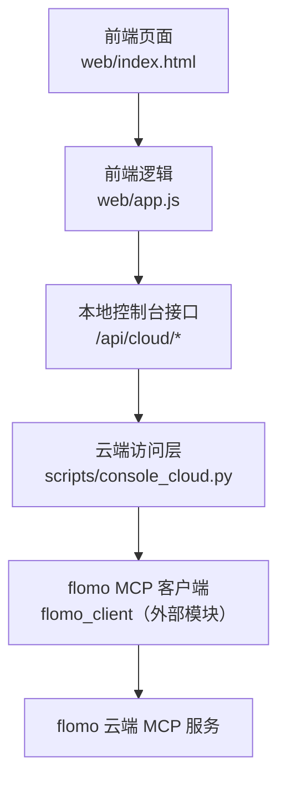
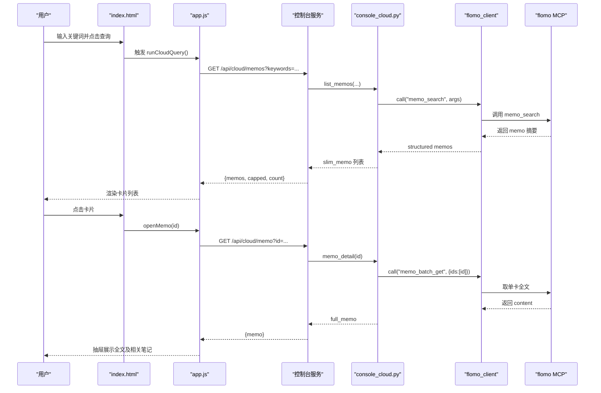
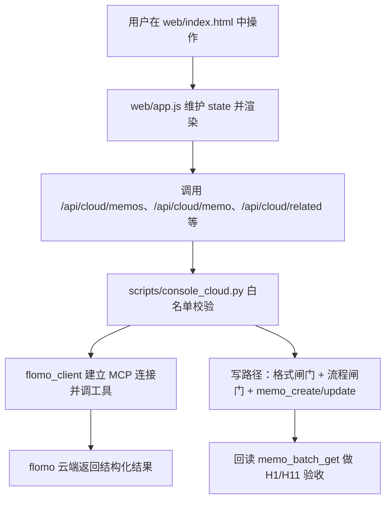
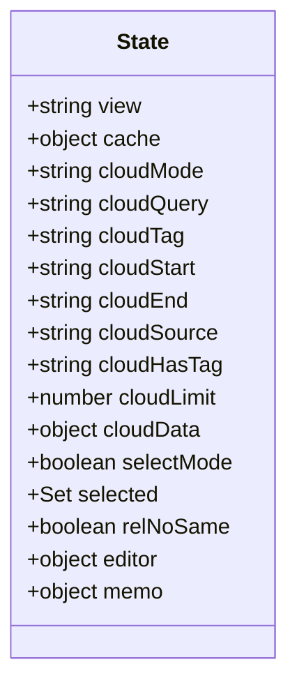
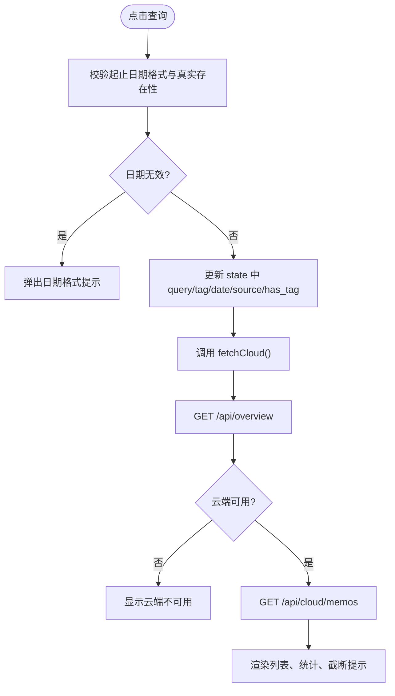
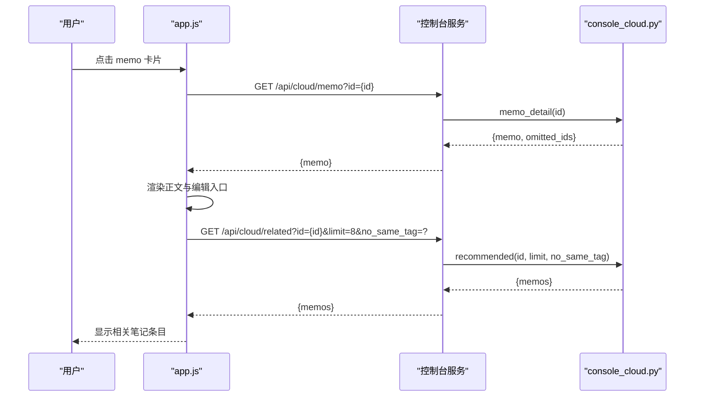
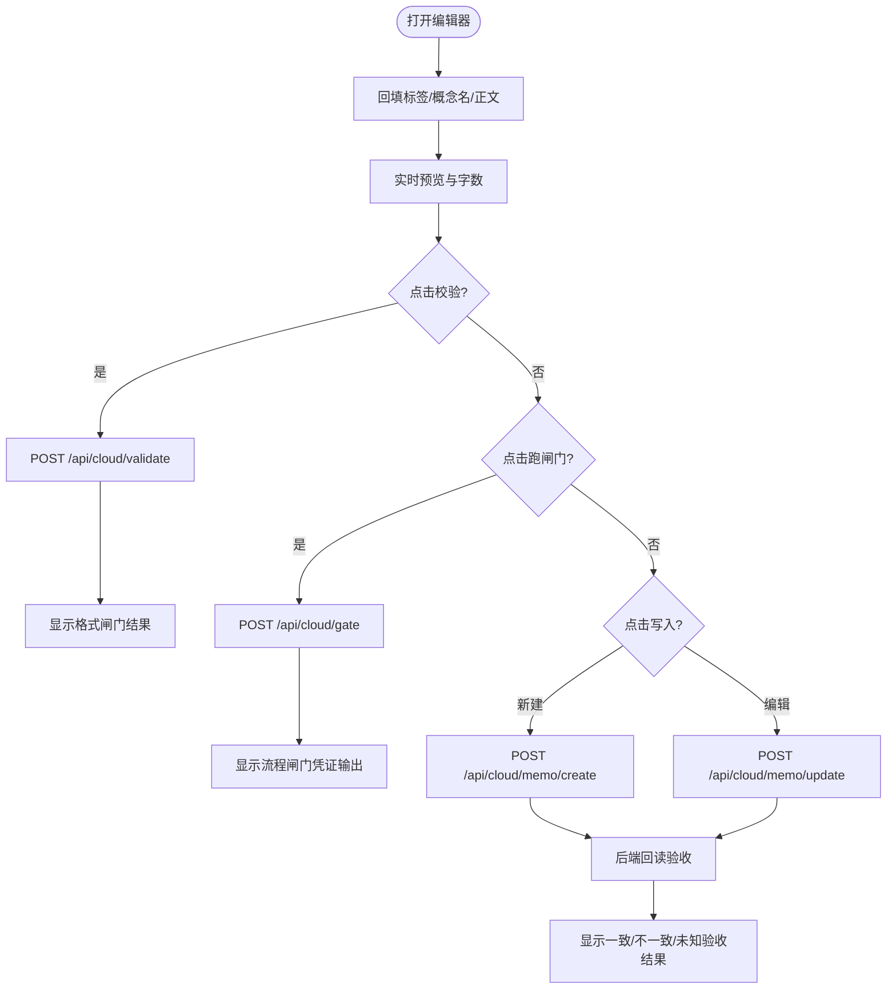
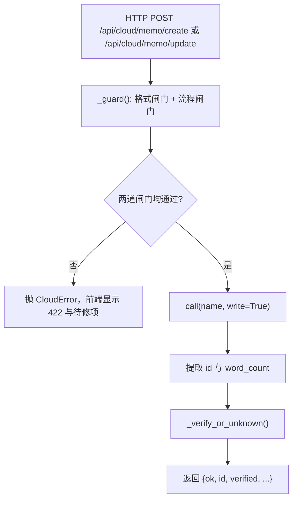
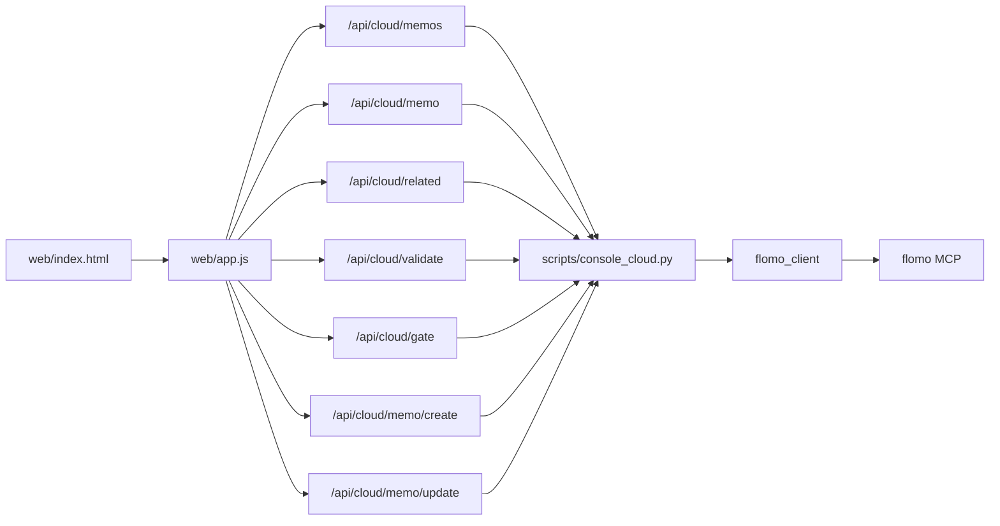

# 云端笔记视图

<cite>
**本文引用的文件**   
- [README.md](file://README.md)
- [web/index.html](file://web/index.html)
- [web/app.js](file://web/app.js)
- [scripts/console_cloud.py](file://scripts/console_cloud.py)
- [tests/test_flomo_client.py](file://tests/test_flomo_client.py)
</cite>

## 目录
1. [简介](#简介)
2. [项目结构定位](#项目结构定位)
3. [核心功能与交互流程](#核心功能与交互流程)
4. [架构总览](#架构总览)
5. [详细组件分析](#详细组件分析)
6. [依赖关系分析](#依赖关系分析)
7. [性能与规模特性](#性能与规模特性)
8. [常见交互示例](#常见交互示例)
9. [响应数据结构](#响应数据结构)
10. [错误处理与异常场景](#错误处理与异常场景)
11. [结论](#结论)

## 简介
「云端笔记」是 flomo-note 控制台的一个视图，负责把 flomo 云端的卡片能力以页面形式呈现。用户可以在该视图中搜索 memos、查看单卡全文、查看相关笔记、新建卡片和编辑已有卡片；写操作不会直接调用 MCP，而是先经过前端编辑器、后端 console_cloud 的格式闸门与流程闸门，再调用 flomo_client 执行写工具，最后回读正文做验收。

README 中明确说明：控制台不是只列能力，而是把能力接出来，并在页面上可直接使用；「云端笔记」视图支持搜索、全文抽屉、相关笔记、多选取全文、新建与编辑，且写操作过闸门后写云并回读验收。

**章节来源**
- [README.md:140-200](file://README.md#L140-L200)

## 项目结构定位
从仓库结构看，「云端笔记」涉及三层：

| 层次 | 文件 | 职责 |
|---|---|---|
| 前端界面 | `web/index.html` | 提供侧边导航、顶部栏、云端笔记列表区、详情抽屉、编辑器面板、提示条等 DOM |
| 前端逻辑 | `web/app.js` | 维护状态、渲染视图、发起 `/api/cloud/*` 请求、处理搜索结果、选中 memo、编辑器校验/闸门/写入 |
| 后端访问层 | `scripts/console_cloud.py` | 白名单调用 flomo MCP 工具、精简数据、执行格式与流程闸门、写后回读验收 |

**图表来源**
- [web/index.html:1-162](file://web/index.html#L1-L162)
- [web/app.js:1-60](file://web/app.js#L1-L60)
- [scripts/console_cloud.py:1-60](file://scripts/console_cloud.py#L1-L60)

**章节来源**
- [README.md:160-200](file://README.md#L160-L200)

## 核心功能与交互流程

### 功能清单
- 搜索 memos：关键词、标签、起止日期、来源、是否含标签、结果条数。
- 查看 memo 全文：点击条目打开右侧抽屉，加载完整正文和相关笔记。
- 查看 related 相关笔记：在详情抽屉中按当前 memo 推荐其他笔记，可选「不含同标签」。
- 新建卡片：打开编辑器填写标签段、概念名、正文，预览卡片形态。
- 编辑已有卡片：从详情抽屉进入编辑模式，自动解析现有内容回填表单。
- 多选取全文：多选模式下批量取回最多 10 条 memo 的全文。

### 用户操作流程
1. 打开「云端笔记」视图，页面从 `/api/overview` 读取云端可用性。
2. 输入关键词、标签或日期后点击查询，或直接点「最近」「今日回顾」。
3. 列表返回后点击某张卡片，打开详情抽屉并拉取单卡全文。
4. 在详情抽屉中查看相关笔记；勾选「不含同标签」可刷新推荐列表。
5. 点击「编辑这张卡」进入编辑模式，或点击「＋ 新建笔记」创建新卡。
6. 编辑器中可点击「校验」运行格式检查，点击「跑闸门」运行流程闸门，最后点击「写入」提交。
7. 写入成功后，后端回读全文并给出一致、不一致或未知三种验收结果。

**图表来源**
- [web/app.js:240-330](file://web/app.js#L240-L330)
- [scripts/console_cloud.py:520-570](file://scripts/console_cloud.py#L520-L570)

**章节来源**
- [web/app.js:240-330](file://web/app.js#L240-L330)
- [scripts/console_cloud.py:520-570](file://scripts/console_cloud.py#L520-L570)

## 架构总览
「云端笔记」并非前后端直连 MCP，而是通过一条清晰的调用链：

**图表来源**
- [web/app.js:1-120](file://web/app.js#L1-L120)
- [scripts/console_cloud.py:451-570](file://scripts/console_cloud.py#L451-L570)
- [scripts/console_cloud.py:751-840](file://scripts/console_cloud.py#L751-L840)

**章节来源**
- [README.md:140-200](file://README.md#L140-L200)
- [scripts/console_cloud.py:1-120](file://scripts/console_cloud.py#L1-L120)

## 详细组件分析

### 前端状态模型
`web/app.js` 中的全局 `state` 是「云端笔记」视图的状态中心，主要字段包括：

| 状态字段 | 含义 | 影响范围 |
|---|---|---|
| `view` | 当前视图名称，如 `notes` | 控制侧边栏高亮与渲染函数 |
| `cloudMode` | `recent`、`search`、`review` | 决定头部标题与查询路径 |
| `cloudQuery` | 关键词 | 拼接 `/api/cloud/memos?keywords=` |
| `cloudTag` | 标签路径 | 拼接 `/api/cloud/memos?tag=` |
| `cloudStart` / `cloudEnd` | 起止日期 | 日期预检通过后才发请求 |
| `cloudSource` | 来源 from | 筛选来源渠道 |
| `cloudHasTag` | 三态开关 | 仅含标签、仅无标签或不传 |
| `cloudLimit` | 单次条数 | 20 或 50 |
| `cloudData` | 缓存的云端列表数据 | 避免重复渲染 |
| `selectMode` | 多选模式 | 切换卡片点击行为为选中 |
| `selected` | Set 集合 | 记录被选中的 memo id |
| `relNoSame` | 相关笔记是否排除同标签 | 控制 `/api/cloud/related?no_same_tag=` |
| `editor` | 编辑器模式、id、原始文本开关 | 新建/编辑/原始文本模式 |
| `memo` | 当前详情抽屉中的 memo | 供编辑时回填 |

**图表来源**
- [web/app.js:33-70](file://web/app.js#L33-L70)

**章节来源**
- [web/app.js:33-70](file://web/app.js#L33-L70)

### 搜索与列表渲染
`fetchCloud()` 根据 `cloudMode` 决定请求路径：「今日回顾」走 `/api/cloud/review`，其余走 `/api/cloud/memos` 并拼出 keywords、tag、start_date、end_date、source、has_tag、limit。

`viewNotes()` 先取 `/api/overview` 判断云端是否可用；不可用时显示原因并停止正常流程。可用时渲染筛选栏、统计条、列表头部、memo 卡片网格和多选工具栏。若后端返回空列表，则显示「没有匹配的笔记」。

**图表来源**
- [web/app.js:200-300](file://web/app.js#L200-L300)
- [web/app.js:380-430](file://web/app.js#L380-L430)

**章节来源**
- [web/app.js:200-300](file://web/app.js#L200-L300)
- [web/app.js:380-430](file://web/app.js#L380-L430)

### 详情抽屉与相关笔记
`openMemo(id)` 打开抽屉、清空 body 并显示「正在读取全文…」，然后请求 `/api/cloud/memo?id=`。成功时设置 `state.memo`，渲染标题、标签、字数、id、截断标记、编辑按钮、正文和相关笔记区块。`loadRelated(id)` 随后请求 `/api/cloud/related`，并支持切换 `no_same_tag`。

**图表来源**
- [web/app.js:300-370](file://web/app.js#L300-L370)
- [scripts/console_cloud.py:570-620](file://scripts/console_cloud.py#L570-L620)

**章节来源**
- [web/app.js:300-370](file://web/app.js#L300-L370)
- [scripts/console_cloud.py:570-620](file://scripts/console_cloud.py#L570-L620)

### 编辑器：新建与编辑
编辑器由 `web/index.html` 提供表单字段：标签段、概念名、正文，以及可选的「完整卡片文本」原始文本模式。`web/app.js` 中：

- `splitCard(content)`：把已有 memo 内容拆成标签、概念名、正文，用于回填。
- `editorText()`：根据当前模式生成待提交的完整卡片文本。
- `updateEditorPreview()`：实时渲染预览和字数。
- `editorCheck()`：调用 `/api/cloud/validate`，显示格式闸门 errors/warnings。
- `editorGate()`：非术语卡必须提供验证 JSON；调用 `/api/cloud/gate` 跑流程闸门。
- `editorSave()`：新建走 `/api/cloud/memo/create`，编辑走 `/api/cloud/memo/update`，并解析 `verified` 给出一致、不一致或未知三种结果。

**图表来源**
- [web/index.html:70-162](file://web/index.html#L70-L162)
- [web/app.js:430-720](file://web/app.js#L430-L720)

**章节来源**
- [web/index.html:70-162](file://web/index.html#L70-L162)
- [web/app.js:430-720](file://web/app.js#L430-L720)

### 后端路由与 console_cloud 转发
console_cloud 是控制台与 MCP 之间的唯一边界。它维护两个白名单：

| 白名单 | 内容 | 用途 |
|---|---|---|
| `READONLY_TOOLS` | `memo_search`、`memo_batch_get`、`memo_recommended`、`get_daily_review`、`tag_tree`、`tag_search`、`memory_context`、`memory_user`、`get_format_guide`、`get_tag_guide` | 只读能力 |
| `WRITE_TOOLS` | `memo_create`、`memo_update`、`tag_rename` | 写能力，必须显式带 `write=True` |

所有工具调用都经 `call(name, arguments, write=False)`，越权调用会抛出 `CloudError`。写路径额外执行：

1. `_guard(content)`：先格式闸门，再流程闸门。
2. 调用 `memo_create` 或 `memo_update`。
3. `_verify_or_unknown(memo_id, expected)`：回读全文并逐字比对。

**图表来源**
- [scripts/console_cloud.py:451-520](file://scripts/console_cloud.py#L451-L520)
- [scripts/console_cloud.py:700-840](file://scripts/console_cloud.py#L700-L840)

**章节来源**
- [scripts/console_cloud.py:451-520](file://scripts/console_cloud.py#L451-L520)
- [scripts/console_cloud.py:700-840](file://scripts/console_cloud.py#L700-L840)

## 依赖关系分析

**图表来源**
- [web/app.js:1-120](file://web/app.js#L1-L120)
- [scripts/console_cloud.py:451-570](file://scripts/console_cloud.py#L451-L570)

关键依赖约束：
- 前端不直接调用 MCP，所有读写均通过 `/api/cloud/*`。
- console_cloud 的 `READONLY_TOOLS` 与 `WRITE_TOOLS` 是硬白名单，回归用例要求与实际方法调用一一对应。
- 写工具不能通过通用只读执行入口；只有 read 工具可通过 `/api/cloud/tool` 执行。
- 多选取全文上限 `BATCH_LIMIT = 10`，与后端 `BATCH_MAX = 10` 需保持一致。

**章节来源**
- [web/app.js:10-20](file://web/app.js#L10-L20)
- [scripts/console_cloud.py:80-120](file://scripts/console_cloud.py#L80-L120)
- [scripts/console_cloud.py:451-520](file://scripts/console_cloud.py#L451-L520)

## 性能与规模特性
- 列表默认一次 20 条，可选择 50 条；后端最大返回 `MAX_LIMIT = 50`，超过时 `capped=true`，前端提示继续用关键词、标签或日期收窄。
- 批量取全文单次最多 10 条；超出部分由前端显式提示，而不是静默丢弃。
- 相关笔记默认 limit 为 8，后端 clamp 到 10 以内。
- 标签树默认 200，最大 1000。
- 流程闸门执行有 300 秒超时限制，因为闸门内部可能现查云端多次。
- 前端对编辑器输入只做预览更新，不重渲染整页，避免每敲一个字导致光标跳回行首。

**章节来源**
- [web/app.js:10-20](file://web/app.js#L10-L20)
- [web/app.js:200-300](file://web/app.js#L200-L300)
- [web/app.js:350-370](file://web/app.js#L350-L370)
- [scripts/console_cloud.py:120-160](file://scripts/console_cloud.py#L120-L160)
- [scripts/console_cloud.py:620-700](file://scripts/console_cloud.py#L620-L700)

## 常见交互示例

### 示例一：搜索包含某个标签的笔记
1. 在「标签」输入框填入完整标签路径，例如 `AI/RAG`。
2. 可选：选择「仅含标签」或「仅无标签」。
3. 点击「查询」或按 Enter。
4. 列表返回后，点击卡片查看详情。

期望结果：
- 列表头显示筛选条件。
- 若达到后端单次上限，显示「已达单次上限，请用关键词 / 标签 / 日期继续筛」。
- 若为空，显示「没有匹配的笔记」。

**章节来源**
- [web/app.js:200-300](file://web/app.js#L200-L300)
- [scripts/console_cloud.py:540-570](file://scripts/console_cloud.py#L540-L570)

### 示例二：查看相关笔记并排除同标签
1. 打开某张 memo 的详情抽屉。
2. 在「相关笔记」区域勾选「不含同标签」。
3. 列表重新加载推荐结果。

期望结果：
- 每条相关笔记显示标题和少量标签。
- 如果云端未返回相关笔记，显示友好提示而非空白。

**章节来源**
- [web/app.js:300-370](file://web/app.js#L300-L370)
- [scripts/console_cloud.py:600-620](file://scripts/console_cloud.py#L600-L620)

### 示例三：新建卡片并通过闸门
1. 点击「＋ 新建笔记」。
2. 填写标签段，例如 `#科技/机器人`。
3. 填写概念名，例如 `马尔科夫链`。
4. 填写正文，首句写结论。
5. 点击「校验」确认格式闸门通过。
6. 如果是术语卡，勾选取消「非术语卡」并粘贴第 ② 步验证记录 JSON。
7. 点击「跑闸门」取得流程凭证。
8. 点击「写入」完成创建与回读验收。

期望结果：
- 校验失败时显示具体 errors。
- 闸门未过时显示阻塞项。
- 写入成功后显示 id、云端字数、回读书字数及验收结论。

**章节来源**
- [web/index.html:70-162](file://web/index.html#L70-L162)
- [web/app.js:430-720](file://web/app.js#L430-L720)
- [scripts/console_cloud.py:700-840](file://scripts/console_cloud.py#L700-L840)

### 示例四：编辑已有卡片
1. 在详情抽屉中点击「编辑这张卡」。
2. 表单自动解析现有 memo 的标签段、概念名和正文。
3. 修改内容后执行校验、闸门、写入。
4. 后端先回读原文，再执行写操作并回读验收。

期望结果：
- 编辑器显示「更新前先回读原文，更新后回读验收」。
- 写入回执中包含更新前字符数和概念名。
- 验收结果为一致、不一致或未知。

**章节来源**
- [web/app.js:500-720](file://web/app.js#L500-L720)
- [scripts/console_cloud.py:820-840](file://scripts/console_cloud.py#L820-L840)

## 响应数据结构

### 列表接口
`GET /api/cloud/memos` 返回精简 memo 列表，不包含完整正文：

| 字段 | 类型 | 含义 |
|---|---|---|
| `memos` | array | 精简 memo 数组 |
| `count` | number | 实际返回数量 |
| `limit` | number | 实际使用的 limit |
| `capped` | boolean | 是否达到后端单次上限 |
| `keywords` | string | 本次关键词 |
| `tag` | string | 本次标签 |
| `start_date` | string | 起始日期 |
| `end_date` | string | 截止日期 |
| `source` | string | 来源 |
| `has_tag` | boolean or null | 是否过滤含标签 |

每个 memo 精简字段包括 id、tags、title、excerpt、word_count、created_at、updated_at、url、from、truncated、has_image、has_link。

**章节来源**
- [scripts/console_cloud.py:540-570](file://scripts/console_cloud.py#L540-L570)
- [scripts/console_cloud.py:390-450](file://scripts/console_cloud.py#L390-L450)

### 单卡全文接口
`GET /api/cloud/memo?id=` 返回：

| 字段 | 类型 | 含义 |
|---|---|---|
| `memo` | object | 完整 memo，包含 content |
| `omitted_ids` | array | 云端未返回的其他 id |

content 可能仍被云端标记为截断，前端会显示「云端仍截断」。

**章节来源**
- [scripts/console_cloud.py:560-570](file://scripts/console_cloud.py#L560-L570)

### 相关笔记接口
`GET /api/cloud/related?id=&limit=&no_same_tag=` 返回：

| 字段 | 类型 | 含义 |
|---|---|---|
| `id` | string | 原 memo id |
| `count` | number | 相关笔记数量 |
| `memos` | array | 精简 memo 列表 |

**章节来源**
- [scripts/console_cloud.py:600-620](file://scripts/console_cloud.py#L600-L620)

### 批量全文接口
`GET /api/cloud/memos/batch?ids=` 返回：

| 字段 | 类型 | 含义 |
|---|---|---|
| `requested` | number | 请求条数 |
| `dropped` | number | 超出 10 条上限被丢弃的条数 |
| `count` | number | 实际取回条数 |
| `memos` | array | 完整 memo 列表 |
| `omitted_ids` | array | 云端未返回的其他 id |

**章节来源**
- [scripts/console_cloud.py:570-600](file://scripts/console_cloud.py#L570-L600)

### 写接口返回值
新建和编辑成功后返回：

| 字段 | 类型 | 含义 |
|---|---|---|
| `ok` | boolean | 是否拿到有效 id |
| `id` | string | 卡片 id，可能推断得到 |
| `id_inferred` | boolean | id 是否通过签名回搜推断 |
| `word_count` | number | 云端返回字数 |
| `before` | object | 仅编辑时有，含 chars 和 concept |
| `verified` | object | 回读验收结果 |

`verified.matched` 为：
- `true`：回读正文与提交内容一致。
- `false`：不一致，需核对后再决定是否重写。
- `null`：未知，已下发写请求但没读到全文，不应重发。

**章节来源**
- [scripts/console_cloud.py:751-840](file://scripts/console_cloud.py#L751-L840)
- [web/app.js:560-720](file://web/app.js#L560-L720)

## 错误处理与异常场景

### 无结果
- 列表为空时，前端显示「没有匹配的笔记」。
- 相关笔记为空时，显示「云端没有返回相关笔记」。
- 标签搜索为空时，显示「没有匹配的标签」。

建议：
- 放宽关键词或标签。
- 去掉过于严格的起止日期。
- 先用「最近」确认云端可用，再用筛选条件收窄。

**章节来源**
- [web/app.js:200-300](file://web/app.js#L200-L300)
- [web/app.js:300-370](file://web/app.js#L300-L370)

### token 失效
token 缺失会在 `cloud_status()` 中表现为 `available=false`，前端连接徽章显示「本地已连接 · 云端不可用」，并在云端笔记视图中显示「云端不可用」及原因。

建议：
- 检查 `.mcp.json` 是否存在且包含 flomo MCP 的 Authorization header。
- 确保 token 未被清理或过期。
- 不要在前端暴露 token，token 只在 console_cloud 建立连接时使用。

**章节来源**
- [README.md:30-60](file://README.md#L30-L60)
- [scripts/console_cloud.py:430-450](file://scripts/console_cloud.py#L430-L450)
- [web/app.js:1000-1160](file://web/app.js#L1000-L1160)

### 服务端限流
- 列表单次上限 50；达到上限时后端返回 `capped=true`，前端提示继续用关键词、标签或日期筛选。
- 批量取全文单次上限 10；前端显式提示超出部分未取，需分次取回。
- 标签树最大 1000；超限时云端返回 truncated 和 hint，前端如实转达。

建议：
- 优先缩小时间范围和标签范围。
- 分批选取全文，每次不超过 10 条。
- 使用标签前缀或深度收窄标签树。

**章节来源**
- [web/app.js:200-300](file://web/app.js#L200-L300)
- [web/app.js:350-370](file://web/app.js#L350-L370)
- [scripts/console_cloud.py:120-160](file://scripts/console_cloud.py#L120-L160)
- [scripts/console_cloud.py:620-700](file://scripts/console_cloud.py#L620-L700)

### 闸门未通过
- 格式闸门未过：前端显示 errors 和 warnings，并提示「闸门未过，未写入云端」。
- 流程闸门未过：前端显示阻塞项和凭证输出，提示「凭证不出，写入会被拒」。
- 非术语卡未提供验证 JSON：前端提示要么勾选「非术语卡」，要么粘贴验证记录。

建议：
- 先点「校验」修复格式问题。
- 术语卡补充第 ② 步网络验证记录。
- 再点「跑闸门」，确认凭证生成后再写入。

**章节来源**
- [web/app.js:520-620](file://web/app.js#L520-L620)
- [scripts/console_cloud.py:700-750](file://scripts/console_cloud.py#L700-L750)

### 回读验收不一致或未知
- 一致：说明落库内容与提交内容完全匹配。
- 不一致：说明回读正文与提交内容有差异，应先点开该卡核对，再决定是否重写。
- 未知：说明写请求已下发，但回读没取到全文；不应重发，应按 id 现查。

注意：测试用例覆盖回读逻辑中对空白、转义、截断、另一张卡、调用异常等边界情况，保证回读失败不会被误判为成功。

**章节来源**
- [web/app.js:600-720](file://web/app.js#L600-L720)
- [tests/test_flomo_client.py:1-120](file://tests/test_flomo_client.py#L1-L120)
- [tests/test_flomo_client.py:120-200](file://tests/test_flomo_client.py#L120-L200)

## 结论
「云端笔记」视图是一个面向用户的云端卡片工作区：它以搜索和列表为入口，以详情抽屉为阅读面，以编辑器为写入口，并以 console_cloud 作为安全边界。前端维护搜索结果、选中 memo 和编辑器状态；后端通过白名单、格式闸门、流程闸门和回读验收，确保写操作可控、可审计、可验证。对于无结果、token 失效、服务端限流、闸门未过、回读不一致等场景，系统分别提供了明确的前端提示与处置建议，避免静默失败或重复写入。