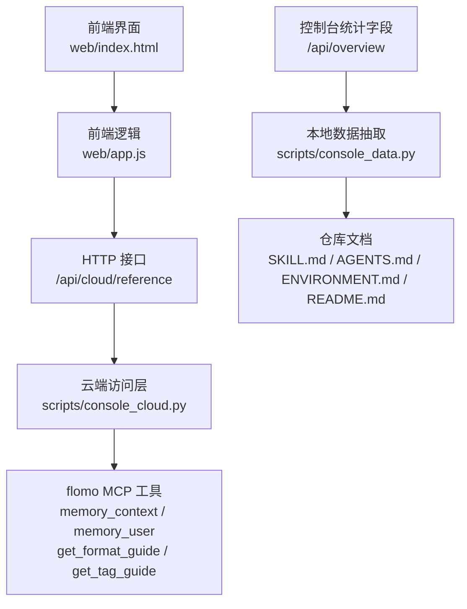
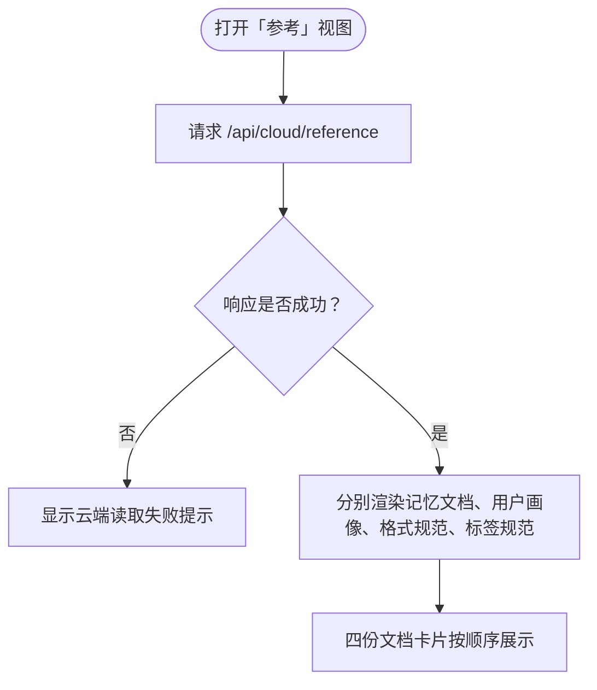
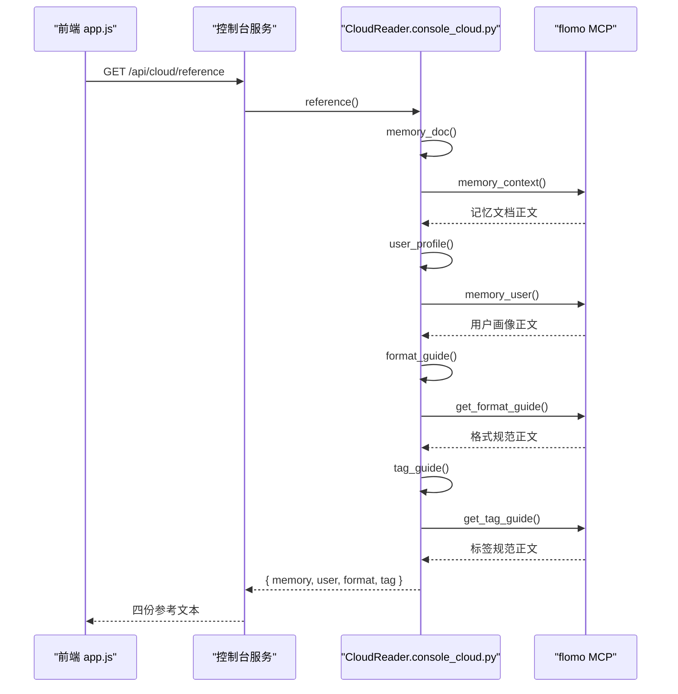
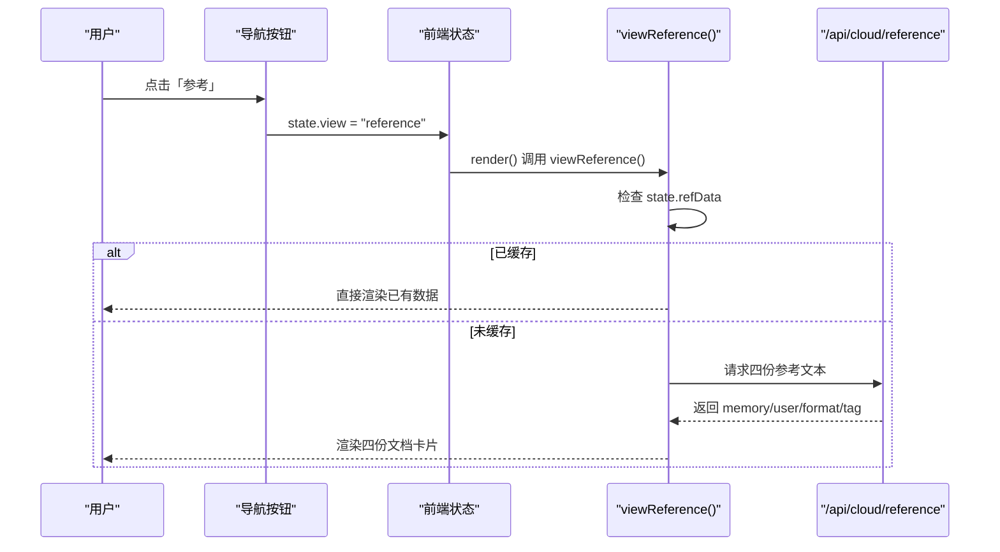
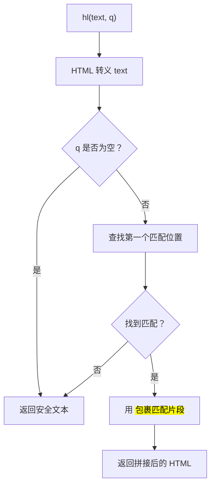
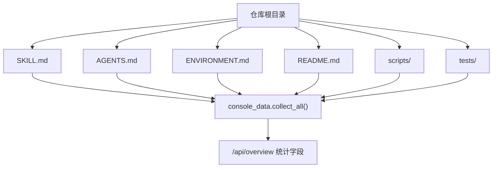

# 参考视图

<cite>
**本文引用的文件**   
- [README.md](file://README.md)
- [index.html](file://web/index.html)
- [app.js](file://web/app.js)
- [console_cloud.py](file://scripts/console_cloud.py)
- [console_data.py](file://scripts/console_data.py)
</cite>

## 目录
1. [简介](#简介)
2. [项目结构中的位置](#项目结构中的位置)
3. [参考视图展示内容](#参考视图展示内容)
4. [后端数据源与拉取流程](#后端数据源与拉取流程)
5. [前端交互：切换来源、高亮与跳转](#前端交互切换来源高亮与跳转)
6. [本地仓库 SKILL 文档与统计字段](#本地仓库-skill-文档与统计字段)
7. [扩展方法](#扩展方法)
8. [降级行为与排障](#降级行为与排障)
9. [结论](#结论)

## 简介
「参考」视图是控制台四个主要视图之一，用于集中阅读三类参考信息：
- 云端 reference 记忆文档；
- 由 `console_data` 解析出的技能文档与脚本清单（主要用于“能力”等统计面板，但同一套本地数据会出现在控制台概览中）；
- 格式规范与标签使用规范等约定文档。

该视图的核心原则是：**只读**。所有参考文本都从云端现取，不修改、不落盘、不缓存到磁盘。

## 项目结构中的位置
「参考」视图由前端静态页面和后端云端访问层共同实现：
- 导航按钮在 `web/index.html` 中声明，点击后触发前端状态切换；
- 渲染逻辑集中在 `web/app.js` 的 `viewReference`；
- 云端四份参考文本通过 `scripts/console_cloud.py` 调用 flomo MCP 工具获取；
- 本地仓库文档（`SKILL.md`、`AGENTS.md`、`ENVIRONMENT.md`、`README.md`）及脚本清单由 `scripts/console_data.py` 解析，供控制台统计字段使用。

**图表来源**
- [index.html:20-45](file://web/index.html#L20-L45)
- [app.js:710-745](file://web/app.js#L710-L745)
- [console_cloud.py:629-643](file://scripts/console_cloud.py#L629-L643)
- [console_data.py:1-40](file://scripts/console_data.py#L1-L40)

**章节来源**
- [index.html:20-45](file://web/index.html#L20-L45)
- [README.md:170-200](file://README.md#L170-L200)

## 参考视图展示内容
「参考」视图当前固定展示四类云端文本，每类包含标题、字符数和正文：

| 卡片 | 对应云端工具 | 含义 |
|---|---|---|
| 记忆文档 | `memory_context` | 动态工作信息，如当前任务、兴趣、项目、目标等 |
| 用户画像 | `memory_user` | 稳定身份信息，如身份、性格、价值观、偏好等 |
| 笔记格式规范 | `get_format_guide` | flomo 支持的标记与写法说明 |
| 标签使用规范 | `get_tag_guide` | 标签命名约定与层级组织建议 |

前端为每份文档输出一个卡片区块，显示：
- 标题；
- 文档长度（字符数）；
- 文档来源标识（例如 `memory_context`、`get_format_guide`）；
- 正文。

正文使用与云端笔记相同的轻量 HTML 渲染规则：标签段单独成行，以 `-` 开头的列表项进入无序列表，其余按段落处理，并支持代码反引号、加粗、链接、`<mark>` 高亮与下划线。

**图表来源**
- [app.js:710-745](file://web/app.js#L710-L745)

**章节来源**
- [app.js:21-21](file://web/app.js#L21-L21)
- [app.js:710-745](file://web/app.js#L710-L745)
- [console_cloud.py:629-643](file://scripts/console_cloud.py#L629-L643)

## 后端数据源与拉取流程
### 云端参考文本拉取
后端通过 `CloudReader.reference()` 一次性拉齐四份参考文本。该方法内部依次调用：
- `memory_doc()` → 调用 `memory_context`；
- `user_profile()` → 调用 `memory_user`；
- `format_guide()` → 调用 `get_format_guide`；
- `tag_guide()` → 调用 `get_tag_guide`。

每份文本最终被封装为 `{ doc, content }`，再由 `reference()` 合并为一个对象返回给前端。

**图表来源**
- [console_cloud.py:629-643](file://scripts/console_cloud.py#L629-L643)
- [console_cloud.py:633-643](file://scripts/console_cloud.py#L633-L643)

### 文本提取口径
云端工具返回结果可能包裹在不同结构中。后端统一通过 `_result_text()` 解析：
- 优先取结构化结果中的 `content`；
- 若为字符串则直接返回；
- 否则遍历 `content` 块，尝试解析内层 JSON；
- 如果内层是字符串或含 `content` 字符串，则返回对应值；
- 解析失败时退回原始文本。

这种设计让纯文本型工具（指南、记忆、画像）不必要求严格一致的协议结构。

**章节来源**
- [console_cloud.py:290-340](file://scripts/console_cloud.py#L290-L340)
- [console_cloud.py:629-643](file://scripts/console_cloud.py#L629-L643)

## 前端交互：切换来源、高亮与跳转
### 切换不同参考来源
「参考」视图本身没有“来源切换器”。它默认同时加载并展示全部四份云端参考文本。数据来源切换实际发生在以下两个层面：

1. **导航切换**：点击侧边栏「参考」按钮，前端将 `state.view` 设为 `reference`，并调用 `VIEWS.reference`，即 `viewReference()`。
2. **刷新行为**：当全局刷新操作发生时，`state.refData` 会被置空，再次进入「参考」视图时会重新请求 `/api/cloud/reference`。

因此，「参考」视图的“切换”更接近“加载整组参考文档”，而不是在单页里按来源切换。

**图表来源**
- [index.html:20-45](file://web/index.html#L20-L45)
- [app.js:710-745](file://web/app.js#L710-L745)
- [app.js:892-905](file://web/app.js#L892-L905)

### 关键字高亮
当前「参考」视图的实现**没有提供搜索框或关键字高亮功能**。代码中存在一个通用高亮函数 `hl(text, q)`，但它没有被 `viewReference` 调用。

现有高亮逻辑的行为是：
- 对输入文本进行 HTML 转义；
- 若没有查询关键词，直接返回转义后的文本；
- 若找到第一个匹配位置，用 `<mark>` 包裹匹配部分；
- 仅高亮第一次出现的位置。

由于 `viewReference` 没有把该函数接入搜索输入，所以目前「参考」页面的四份文档都是原样展示，不会根据关键词高亮。

**图表来源**
- [app.js:700-708](file://web/app.js#L700-L708)

**章节来源**
- [app.js:700-745](file://web/app.js#L700-L745)

### 跳转到对应文档片段
当前「参考」视图也没有“按关键字跳转到具体段落”的功能。每个文档卡片只渲染完整正文，不提供锚点、目录或片段定位。

如果需要实现跳转，可考虑：
- 为每份文档生成唯一 ID；
- 在高亮时记录匹配的 DOM 节点；
- 在搜索结果区列出可点击条目；
- 点击后滚动到对应段落并临时高亮。

这属于扩展方案，当前代码库并未实现。

**章节来源**
- [app.js:710-745](file://web/app.js#L710-L745)

## 本地仓库 SKILL 文档与统计字段
虽然「参考」视图展示的是云端参考文本，但控制台整体还依赖 `console_data.py` 解析本地仓库，产出统计字段。这些统计字段用于 `/api/overview`，进而影响“云端笔记”“能力”等视图的概览区域。

### 本地文档集合
`console_data.py` 明确定义要读取的文档文件：

| 文件 | 用途 |
|---|---|
| `SKILL.md` | 执行细则唯一源 |
| `AGENTS.md` | 项目总则 |
| `ENVIRONMENT.md` | 环境事实 |
| `README.md` | 项目说明与控制台入口说明 |

`load_docs()` 会逐个判断文件是否存在，存在则记录文件名、字节数和行数。

### 脚本清单与测试覆盖
`load_scripts()` 扫描 `scripts/` 下的 `.py` 和 `.sh` 文件，并借助 `covers.coverage_map()` 判断每个脚本是否有对应的回归用例。配套关系依据 `tests/` 中各文件的 `COVERS` 声明，而不是文件名同名。

### 统计字段
`collect_all()` 汇总：
- 步骤数量与阻塞步骤数量；
- 硬限条数与非治理类硬限；
- 工具数量与测试文件数量；
- 本地文档清单。

这些统计字段不是「参考」视图的直接内容，而是控制台“概览”数据的一部分，帮助读者理解项目规模、流程完整性与文档覆盖率。

**图表来源**
- [console_data.py:1-40](file://scripts/console_data.py#L1-L40)
- [console_data.py:200-281](file://scripts/console_data.py#L200-L281)

**章节来源**
- [console_data.py:1-40](file://scripts/console_data.py#L1-L40)
- [console_data.py:200-281](file://scripts/console_data.py#L200-L281)

## 扩展方法
### 新增一份云端参考文档
如果想让「参考」视图多出一份云端参考文档，需要改动两个地方：

1. **后端**：在 `scripts/console_cloud.py` 的 `CloudReader` 中新增一个只读方法，并写入 `READONLY_TOOLS` 白名单；然后将其纳入 `reference()` 的返回值。
2. **前端**：在 `web/app.js` 的 `viewReference()` 中增加对应卡片区块，并把新的返回字段加入渲染逻辑。

注意：
- 新增云端工具必须先确认其 MCP 工具名；
- 白名单必须与实际调用保持一致，不能留空位；
- 前端不应假设某份文档一定非空，应兼容空正文。

### 新增一份本地参考文档
如果希望控制台能发现新的本地参考文档，可以：
- 将新文档放入仓库根目录；
- 在 `console_data.py` 的 `DOC_FILES` 元组中加入文件名；
- 保持 UTF-8 编码，因为 `_read()` 使用 `utf-8-sig` 解码。

新增后，`/api/overview` 的 `docs` 列表会包含该文件，但不会自动出现在「参考」视图的正文展示区——后者仍由 `cloudApi("/api/cloud/reference")` 控制。

### 本地仓库缺少 SKILL 文档时的降级行为
`console_data._skill_lines()` 会先判断 `SKILL.md` 是否存在；不存在时返回空数组。这意味着：
- `load_limits()` 不会报错，只会得到空硬限列表；
- `load_pipeline()` 找不到 `## 三、` 节时返回空流程步骤；
- 统计字段仍可正常生成，只是步骤、硬限等数量为 0 或空；
- 其他文档如 `AGENTS.md`、`ENVIRONMENT.md`、`README.md` 仍可被 `load_docs()` 收集。

因此，缺少 `SKILL.md` 不会导致控制台崩溃，但会导致统计信息不完整，且无法解析执行细则与流程编号。

**章节来源**
- [console_cloud.py:120-140](file://scripts/console_cloud.py#L120-L140)
- [console_cloud.py:629-643](file://scripts/console_cloud.py#L629-L643)
- [console_data.py:25-40](file://scripts/console_data.py#L25-L40)
- [console_data.py:42-115](file://scripts/console_data.py#L42-L115)
- [console_data.py:117-198](file://scripts/console_data.py#L117-L198)
- [console_data.py:200-281](file://scripts/console_data.py#L200-L281)

## 降级行为与排障
### 云端不可用
当 `/api/cloud/reference` 返回错误时，`viewReference()` 会通过 `failCard()` 显示“云端参考文本读取失败”，并附带错误消息。常见原因包括：
- flomo token 缺失；
- 本地服务无响应；
- MCP 工具未暴露或未连接；
- 云端返回了非预期结构。

### 正文为空
如果某份参考文档的 `content` 为空，前端会渲染一段空段落，表示云端返回空文本。这不是前端 bug，而是云端确实没有返回内容。

### 无法搜索或高亮
当前「参考」视图没有搜索输入框，因此：
- 不会调用 `hl()`；
- 不会高亮关键词；
- 不会跳转段落。

如果需要搜索能力，应在 `viewReference()` 中加入搜索状态、输入监听、结果过滤和高亮渲染。

### 参考数据未刷新
`state.refData` 是内存缓存。除非显式清空该状态，否则多次进入「参考」视图会复用上一次请求结果。若需要强制刷新，可在刷新按钮或全局刷新逻辑中将 `state.refData` 置空。

**章节来源**
- [app.js:710-745](file://web/app.js#L710-L745)
- [app.js:1029-1030](file://web/app.js#L1029-L1030)

## 结论
「参考」视图是一个面向人类阅读的只读窗口，核心职责是把云端提供的记忆文档、用户画像、笔记格式规范和标签使用规范聚合展示。后端通过 `CloudReader.reference()` 统一拉取四份 MCP 工具结果，前端按固定顺序渲染为四个文档卡片。

对于“关键字高亮”和“跳转至文档片段”，当前实现尚未启用：高亮函数存在但未接入参考视图，也没有搜索输入和锚点机制。若业务需要，可扩展搜索框、匹配算法和段落定位。

本地仓库的 `SKILL.md` 等文档由 `console_data.py` 解析，主要用于控制台统计字段，而不是「参考」视图的正文来源。新增本地参考文档需注册到 `DOC_FILES`，新增云端参考文档需同时扩展后端白名单与前端渲染逻辑。当本地缺少 `SKILL.md` 时，控制台不会崩溃，但相关统计会降级为空。