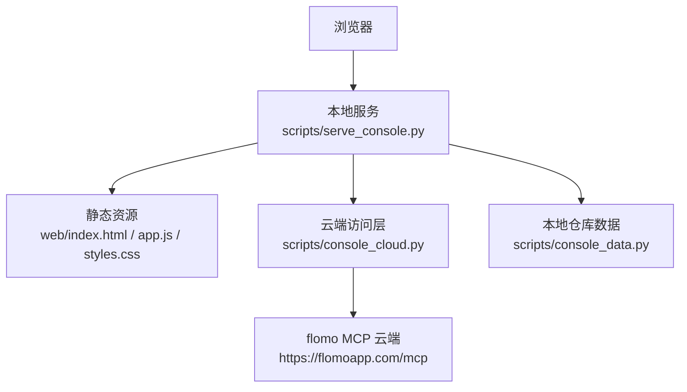
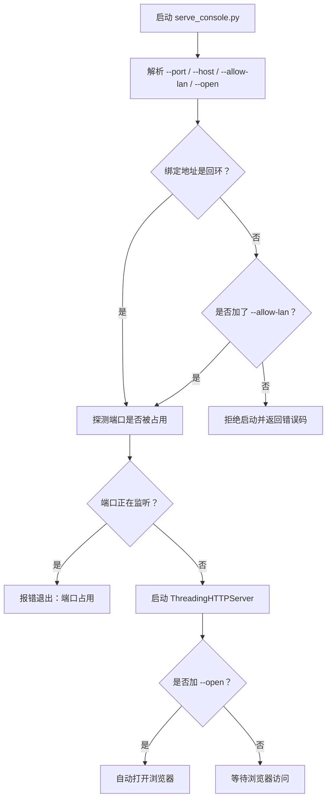
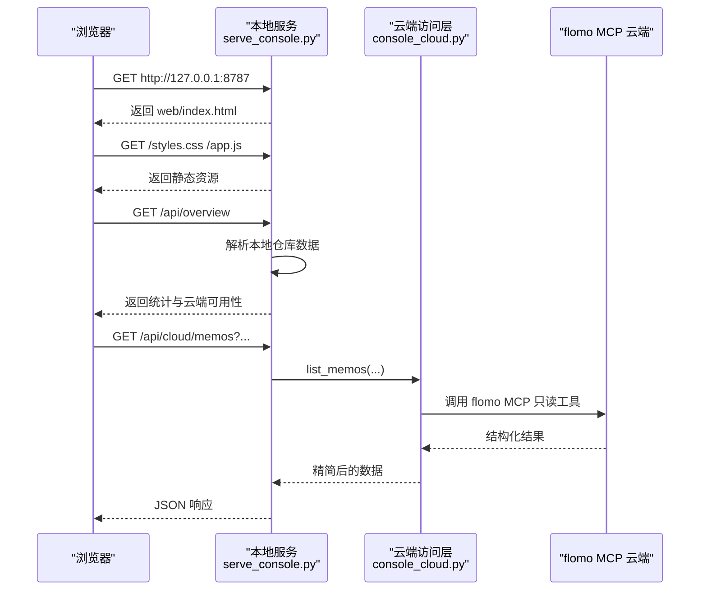

# 启动与配置

<cite>
**本文引用的文件**   
- [scripts/serve_console.py](file://scripts/serve_console.py)
- [scripts/console_cloud.py](file://scripts/console_cloud.py)
- [scripts/console_data.py](file://scripts/console_data.py)
- [web/index.html](file://web/index.html)
- [web/app.js](file://web/app.js)
- [web/styles.css](file://web/styles.css)
- [README.md](file://README.md)
- [ENVIRONMENT.md](file://ENVIRONMENT.md)
- [tests/test_console_serve.py](file://tests/test_console_serve.py)
- [tests/test_console_web.py](file://tests/test_console_web.py)
</cite>

## 目录
1. [引言](#引言)
2. [项目结构与角色分工](#项目结构与角色分工)
3. [快速启动](#快速启动)
4. [默认监听端口与浏览器地址](#默认监听端口与浏览器地址)
5. [.mcp.json 中 MCP token 的配置方式](#mcpjson-中-mcp-token-的配置方式)
6. [控制台依赖的云端能力与可选前端验证](#控制台依赖的云端能力与可选前端验证)
7. [接口与数据流总览](#接口与数据流总览)
8. [常见启动失败场景与排查步骤](#常见启动失败场景与排查步骤)
9. [Windows PowerShell 与 Git Bash 命令行示例](#windows-powershell-与-git-bash-命令行示例)
10. [排错清单与最佳实践](#排错清单与最佳实践)
11. [结论](#结论)

## 引言
本文说明如何在本机启动 flomo-note 项目的 Web 控制台，解释 `scripts/serve_console.py` 的职责、默认监听端口、浏览器访问地址，以及 `.mcp.json` 中 MCP token 的配置方式。同时说明控制台对 flomo MCP 云端能力的依赖关系，并指出 Playwright 仅用于前端渲染验证用例，而非服务本身运行必需。最后列出端口占用、token 无效、MCP 服务不可达、代理/DNS/SNI 等常见失败场景及排查步骤。

## 项目结构与角色分工
控制台由“本地 HTTP 服务 + 静态前端 + 云端访问层 + 本地仓库数据解析”四部分组成：

| 组件 | 文件 | 职责 |
|---|---|---|
| 本地服务 | [scripts/serve_console.py](file://scripts/serve_console.py) | 提供静态文件与 `/api/*` JSON 接口；校验 Host/Origin；复用云端会话；拒绝跨站请求；检查端口占用。 |
| 静态前端 | [web/index.html](file://web/index.html)、[web/app.js](file://web/app.js)、[web/styles.css](file://web/styles.css) | 零外部依赖的 HTML/CSS/JS；按 `/api/cloud/*` 拉取数据；读工具在界面生成表单执行，写操作走专用 POST 接口。 |
| 云端访问层 | [scripts/console_cloud.py](file://scripts/console_cloud.py) | 封装 flomo MCP 只读/写白名单、工具调用、字段精简、写路径的两道闸门与回读验收。 |
| 本地仓库数据 | [scripts/console_data.py](file://scripts/console_data.py) | 解析 SKILL.md、AGENTS.md、ENVIRONMENT.md、README.md 与 scripts/tests 目录，产出 `/api/overview` 统计。 |



**图示来源**
- [scripts/serve_console.py:1-60](file://scripts/serve_console.py#L1-L60)
- [scripts/console_cloud.py:1-80](file://scripts/console_cloud.py#L1-L80)
- [scripts/console_data.py:1-40](file://scripts/console_data.py#L1-L40)
- [web/index.html:1-20](file://web/index.html#L1-L20)

**章节来源**
- [scripts/serve_console.py:1-60](file://scripts/serve_console.py#L1-L60)
- [scripts/console_cloud.py:1-80](file://scripts/console_cloud.py#L1-L80)
- [scripts/console_data.py:1-40](file://scripts/console_data.py#L1-L40)
- [README.md:180-260](file://README.md#L180-L260)

## 快速启动
最小启动流程如下：

1. 进入项目根目录。
2. 确认已配置 `.mcp.json`（见下一节）。
3. 运行：
   - Linux/macOS：`python scripts/serve_console.py`
   - Windows：`python scripts/serve_console.py`
4. 在浏览器打开 `http://127.0.0.1:8787`。
5. 如需自动打开浏览器，加 `--open`；如需自定义端口，加 `--port`。

注意事项：
- 服务默认绑定回环地址 `127.0.0.1`。
- 修改脚本后需要重启进程才生效。
- 如果端口已被占用，服务会直接退出，不会静默覆盖旧实例。

**章节来源**
- [README.md:220-260](file://README.md#L220-L260)
- [scripts/serve_console.py:25-35](file://scripts/serve_console.py#L25-L35)
- [scripts/serve_console.py:373-380](file://scripts/serve_console.py#L373-L380)

## 默认监听端口与浏览器地址
- 默认监听地址：`127.0.0.1`。
- 默认监听端口：`8787`。
- 默认浏览器访问地址：`http://127.0.0.1:8787`。
- 可通过 `--port` 指定其他端口。
- 非回环绑定必须显式加 `--allow-lan`；否则服务会拒绝启动并提示风险。

该行为由常量与服务参数共同决定：默认端口常量为 `8787`，`--host` 默认为 `127.0.0.1`，`--allow-lan` 控制是否允许绑定到 `0.0.0.0` 等非回环地址。



**图示来源**
- [scripts/serve_console.py:373-405](file://scripts/serve_console.py#L373-L405)
- [scripts/serve_console.py:54-60](file://scripts/serve_console.py#L54-L60)

**章节来源**
- [scripts/serve_console.py:54-60](file://scripts/serve_console.py#L54-L60)
- [scripts/serve_console.py:373-405](file://scripts/serve_console.py#L373-L405)
- [ENVIRONMENT.md:140-160](file://ENVIRONMENT.md#L140-L160)

## .mcp.json 中 MCP token 的配置方式
控制台通过 `console_cloud.py` 间接使用 flomo MCP，而 MCP token 的实际读取逻辑位于 flomo 客户端模块。根据项目文档：

- token 优先从项目根 `.mcp.json` 的 `mcpServers.flomo.headers.Authorization` 读取。
- 若该文件不存在，再回退到环境变量 `FLOMO_TOKEN`。
- 两处都没有时，脚本以非 0 退出并提示未找到 flomo token。
- `.mcp.json` 含 token，已在忽略列表中，不应入库。

`.mcp.json` 的基本结构为：

```json
{
  "mcpServers": {
    "flomo": {
      "url": "https://flomoapp.com/mcp",
      "headers": {
        "Authorization": "Bearer fmcp_xxxxx"
      }
    }
  }
}
```

其中 `fmcp_xxxxx` 应替换为你实际的 flomo MCP Bearer token。

**章节来源**
- [README.md:40-70](file://README.md#L40-L70)
- [ENVIRONMENT.md:20-40](file://ENVIRONMENT.md#L20-L40)

## 控制台依赖的云端能力与可选前端验证
### 必需的云端能力：flomo MCP
控制台不是纯离线工具。它的核心视图——云端笔记、标签树、相关笔记、今日回顾、参考文本、工具清单——都来自 flomo MCP：

| 控制台视图 | 主要云端能力 |
|---|---|
| 云端笔记 | 卡片搜索、单卡全文、批量全文、相关笔记、今日回顾 |
| 标签 | 标签树、标签名搜索、标签重命名 |
| 参考 | 记忆文档、用户画像、格式规范、标签规范 |
| 能力 | 工具清单与通用只读工具执行 |

这些能力在 `console_cloud.py` 中以只读白名单和写白名单的形式收敛，并通过 `FlomoClient` 连接到 `https://flomoapp.com/mcp`。

**章节来源**
- [scripts/console_cloud.py:1-120](file://scripts/console_cloud.py#L1-L120)
- [README.md:180-260](file://README.md#L180-L260)

### 可选的前端验证依赖：Playwright
Playwright 属于测试与验证层，而不是 `serve_console.py` 正常运行所必需的运行时依赖：

- 前端静态三件套（HTML/CSS/JS）不引入任何外部资源，可在浏览器离线加载。
- 项目中的前端对齐回归测试用正则断言 HTML、CSS、JS 与服务路由表的一致性。
- 环境备忘中提到本机存在 Playwright 与 Chromium，可用于页面渲染验证；但这是验证用途，不是服务启动条件。
- 因此，“缺少 Playwright 导致控制台起不来”通常意味着把测试依赖误当作运行依赖。

**章节来源**
- [tests/test_console_web.py:1-40](file://tests/test_console_web.py#L1-L40)
- [ENVIRONMENT.md:140-160](file://ENVIRONMENT.md#L140-L160)

## 接口与数据流总览
控制台前端向本地服务发起请求，本地服务再决定是否访问云端：



**图示来源**
- [scripts/serve_console.py:240-330](file://scripts/serve_console.py#L240-L330)
- [scripts/console_cloud.py:120-220](file://scripts/console_cloud.py#L120-L220)

### 关键 API
| 方法 | 路径 | 说明 |
|---|---|---|
| GET | `/api/overview` | 本地仓库统计 + 云端可用性。 |
| GET | `/api/cloud/memos` | 卡片列表，支持关键词、标签、日期、来源、是否含标签、条数。 |
| GET | `/api/cloud/memo` | 按 id 取单卡全文。 |
| GET | `/api/cloud/memos/batch` | 批量取全文，逗号分隔 id，单次上限由后端常量限制。 |
| GET | `/api/cloud/review` | 今日回顾。 |
| GET | `/api/cloud/related` | 相关笔记。 |
| GET | `/api/cloud/tagtree` | 实时标签树。 |
| GET | `/api/cloud/tags` | 标签名搜索。 |
| GET | `/api/cloud/reference` | 记忆文档、用户画像、格式规范、标签规范。 |
| GET | `/api/cloud/tools` | 工具清单与参数规格。 |
| POST | `/api/cloud/tool` | 通用只读工具执行；写工具在此被明确拒绝。 |
| POST | `/api/cloud/validate` | 格式自检。 |
| POST | `/api/cloud/gate` | 现跑流程闸门。 |
| POST | `/api/cloud/memo/create` | 新建卡片。 |
| POST | `/api/cloud/memo/update` | 更新卡片。 |
| POST | `/api/cloud/tag/rename` | 批量重命名标签。 |

**章节来源**
- [README.md:220-340](file://README.md#L220-L340)
- [scripts/serve_console.py:240-360](file://scripts/serve_console.py#L240-L360)

## 常见启动失败场景与排查步骤

### 1. 端口占用
**现象：**
- 启动后立即退出。
- 提示端口已被占用。
- 两个实例同时监听同一端口时，页面内容可能时新时旧。

**原因：**
- 上一轮服务进程没有结束。
- 其他程序占用了 `8787`。
- `ThreadingHTTPServer` 的地址复用特性让第二个实例可能“绑成功”，所以服务主动探测端口并拒绝启动。

**排查步骤：**
1. 查看当前监听 `8787` 的进程。
2. 结束旧进程或改用 `--port` 指定空闲端口。
3. 重新启动服务。
4. 如果改过代码仍看到旧行为，确认是否真的重启了进程。

**章节来源**
- [scripts/serve_console.py:110-130](file://scripts/serve_console.py#L110-L130)
- [scripts/serve_console.py:400-415](file://scripts/serve_console.py#L400-L415)
- [ENVIRONMENT.md:140-160](file://ENVIRONMENT.md#L140-L160)
- [tests/test_console_serve.py:1-60](file://tests/test_console_serve.py#L1-L60)

### 2. token 无效或缺失
**现象：**
- 控制台能启动，但云端状态显示不可用。
- 写卡片或读取云端数据时报云端错误。
- 某些脚本命令直接以非 0 退出并提示未找到 flomo token。

**原因：**
- `.mcp.json` 不存在。
- `mcpServers.flomo.headers.Authorization` 为空或格式错误。
- Bearer token 过期或被撤销。
- 环境变量 `FLOMO_TOKEN` 也缺失或失效。

**排查步骤：**
1. 确认项目根存在 `.mcp.json`。
2. 检查 `mcpServers.flomo.headers.Authorization` 是否为 `Bearer fmcp_xxxxx` 形式。
3. 如果文件不存在，临时设置 `FLOMO_TOKEN` 作为后备。
4. 重新登录 flomo 账号并刷新 MCP token。
5. 重启控制台服务，因为 token 只在连接建立时使用。

**章节来源**
- [README.md:40-70](file://README.md#L40-L70)
- [ENVIRONMENT.md:20-40](file://ENVIRONMENT.md#L20-L40)
- [scripts/console_cloud.py:1-60](file://scripts/console_cloud.py#L1-L60)

### 3. MCP 服务不可达
**现象：**
- 控制台启动正常。
- `/api/overview` 显示云端不可用。
- 点击搜索、标签、新建卡片等操作报 502 或云端错误。

**原因：**
- 网络不通。
- 防火墙阻止出站 443。
- DNS 解析失败。
- flomo MCP 端点暂时不可用。
- 代理配置异常。

**排查步骤：**
1. 先确认 `.mcp.json` 与 token 有效。
2. 用网络诊断工具测试到 `https://flomoapp.com/mcp` 的连接。
3. 排除代理干扰：清除或绕过 `HTTP_PROXY`、`HTTPS_PROXY`。
4. 检查系统 DNS 是否能解析域名。
5. 如果确认是 TLS/SNI 问题，再进入下一类排查。

**章节来源**
- [scripts/serve_console.py:240-330](file://scripts/serve_console.py#L240-L330)
- [scripts/console_cloud.py:120-220](file://scripts/console_cloud.py#L120-L220)
- [ENVIRONMENT.md:40-120](file://ENVIRONMENT.md#L40-L120)

### 4. 代理问题
**现象：**
- 本机 curl 访问 `127.0.0.1:8787` 返回代理自己的错误。
- 看起来像服务没起来，实际请求走了代理。
- 沙箱或公司网络注入代理后，git/curl/抓取/写云都可能受影响。

**原因：**
- 环境变量 `HTTP_PROXY`/`HTTPS_PROXY` 指向本机代理。
- 代理端口每次会话可能变化。
- 某些 HTTP 客户端会受代理影响，但 Python `http.client` 直连不受。

**排查步骤：**
1. 查看当前 `HTTP_PROXY`、`HTTPS_PROXY`、`http_proxy`、`https_proxy`。
2. 使用 `curl --noproxy '*'` 直连本机服务验证。
3. 对于 Python 子进程，可清掉 `_proxy` 结尾的环境变量。
4. 不要照抄文档中的 `<端口>` 占位值；代理端口随会话变化。
5. 如确实需要代理，先用网络诊断工具确认通道可用。

**章节来源**
- [ENVIRONMENT.md:40-120](file://ENVIRONMENT.md#L40-L120)
- [tests/test_console_serve.py:60-120](file://tests/test_console_serve.py#L60-L120)

### 5. DNS 问题
**现象：**
- 域名无法解析。
- GitHub 或 flomo 域名被解析到假 IP。
- TLS 握手立即失败。

**原因：**
- 系统 DNS 被劫持或缓存异常。
- 沙箱或企业网络把特定域名解析到保留段。
- hosts 文件未配置正确映射。

**排查步骤：**
1. 分别尝试 `nslookup`、`dig`、系统自带解析工具。
2. 对比不同 DNS 服务器的解析结果。
3. 对已知有问题的域名，使用项目提供的隧道或 hosts 片段。
4. 注意 `/etc/hosts` 改动在部分环境中重启后还原。
5. 不要凭单一失败判定目标域名整体不可用。

**章节来源**
- [ENVIRONMENT.md:80-120](file://ENVIRONMENT.md#L80-L120)

### 6. SNI 关键字阻断
**现象：**
- TCP 能建连，但 TLS 握手立即重置。
- 错误表现为 `ConnectionResetError`、TLS handshake 失败等。
- 换无关 SNI 后握手成功。

**原因：**
- 中间设备对 TLS ClientHello 中的 SNI 字段做关键字过滤。
- 典型目标是 arXiv 等站点，也可能影响其他边缘节点。

**排查步骤：**
1. 确认 TCP 能连通目标 IP:443。
2. 判断是否为 SNI 阻断：换无关 SNI 重试。
3. 若确认为 SNI 阻断，使用项目提供的 SNI 取件通道。
4. 注意 SNI 只是传输层伪装，HTTP `Host` 头仍用于最终路由。

**章节来源**
- [ENVIRONMENT.md:100-140](file://ENVIRONMENT.md#L100-L140)

## Windows PowerShell 与 Git Bash 命令行示例

### PowerShell
```powershell
cd D:\OpenClaw\flomo-note

python scripts/serve_console.py

python scripts/serve_console.py --port 9000

python scripts/serve_console.py --open

python scripts/serve_console.py --host 127.0.0.1 --port 8787

$env:PYTHONUTF8=1
python tests/test_console_serve.py

$env:PYTHONUTF8=1
bash scripts/run_tests.sh
```

### Git Bash
```bash
cd /d/OpenClaw/flomo-note

python scripts/serve_console.py

python scripts/serve_console.py --port 9000

python scripts/serve_console.py --open

python scripts/serve_console.py --host 127.0.0.1 --port 8787

export PYTHONUTF8=1
python tests/test_console_serve.py

bash scripts/run_tests.sh
```

注意：
- PowerShell 默认代码页可能是 GBK，打印中文或特殊字符时可能出错；建议设置 `PYTHONUTF8=1`。
- Git Bash 下可直接使用 bash 命令。
- 如果控制台日志或输出乱码，优先检查终端编码与 `PYTHONUTF8`。

**章节来源**
- [ENVIRONMENT.md:10-20](file://ENVIRONMENT.md#L10-L20)
- [scripts/serve_console.py:373-380](file://scripts/serve_console.py#L373-L380)

## 排错清单与最佳实践

### 启动前检查清单
- 确认已进入项目根目录。
- 确认 `.mcp.json` 存在且包含有效的 `Authorization`。
- 确认 `8787` 未被旧进程占用。
- 确认 `web/` 目录存在，包含 `index.html`、`app.js`、`styles.css`。
- 确认 Python 版本满足要求。

### 启动后检查清单
- 浏览器能否打开 `http://127.0.0.1:8787`。
- 首页是否返回 HTML。
- `/api/overview` 是否返回 JSON。
- 云端可用性是否显示为可用。
- 搜索卡片、标签树、参考文本是否可加载。

### 安全与网络建议
- 不要随意把 `--host` 改成 `0.0.0.0`。
- 如需局域网访问，必须理解本服务无鉴权，同网段机器可直接读写云端。
- 不要在公共网络暴露该服务。
- 不要把 `.mcp.json` 提交到仓库。
- 修改脚本后务必重启服务。
- 遇到“改了代码没效果”，优先确认进程是否真正重启。

**章节来源**
- [scripts/serve_console.py:373-395](file://scripts/serve_console.py#L373-L395)
- [ENVIRONMENT.md:140-160](file://ENVIRONMENT.md#L140-L160)

## 结论
Web 控制台的启动入口是 `scripts/serve_console.py`，默认监听 `127.0.0.1:8787`，浏览器访问地址为 `http://127.0.0.1:8787`。它通过 `console_cloud.py` 调用 flomo MCP，读取云端笔记、标签、参考文本与工具清单；`console_data.py` 负责本地仓库统计。`.mcp.json` 中的 MCP token 是云端功能的前提，但 Playwright 仅是前端验证依赖，不影响服务本身运行。大多数启动失败可归因于端口占用、token 缺失或无效、代理/DNS/SNI 异常。按本文顺序排查，通常能快速定位问题。