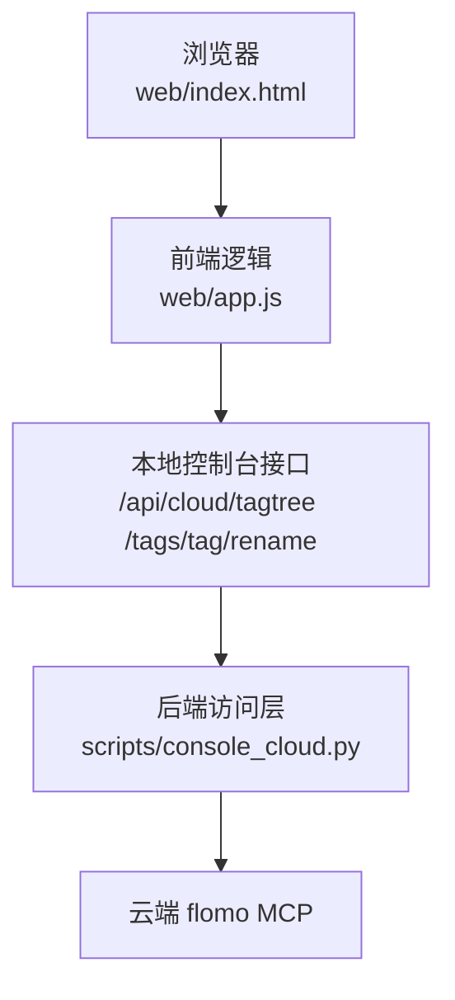
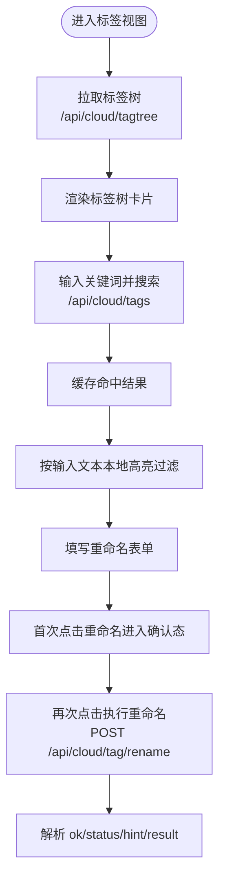
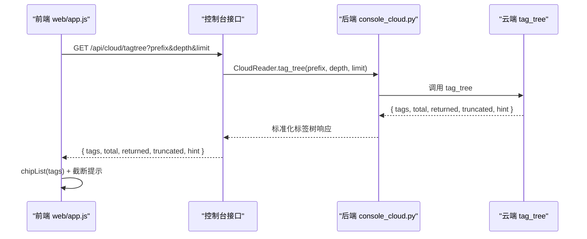
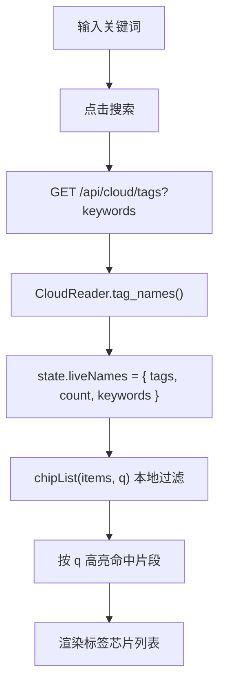
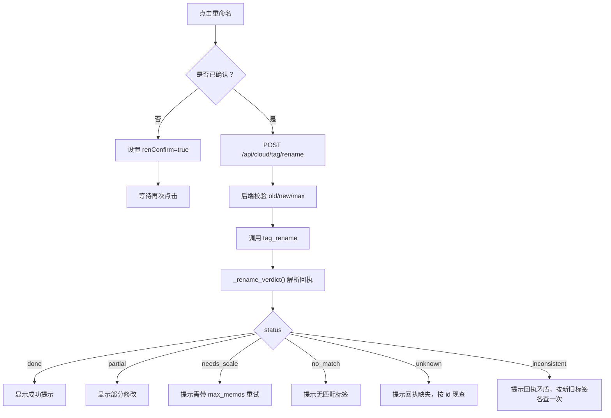
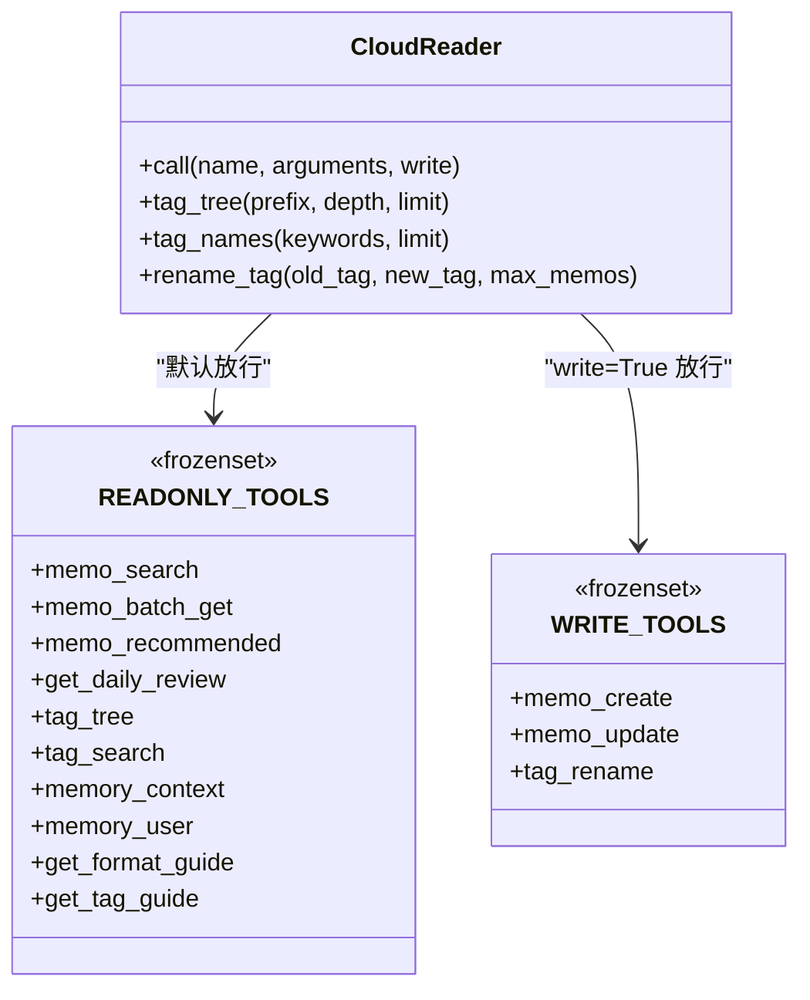
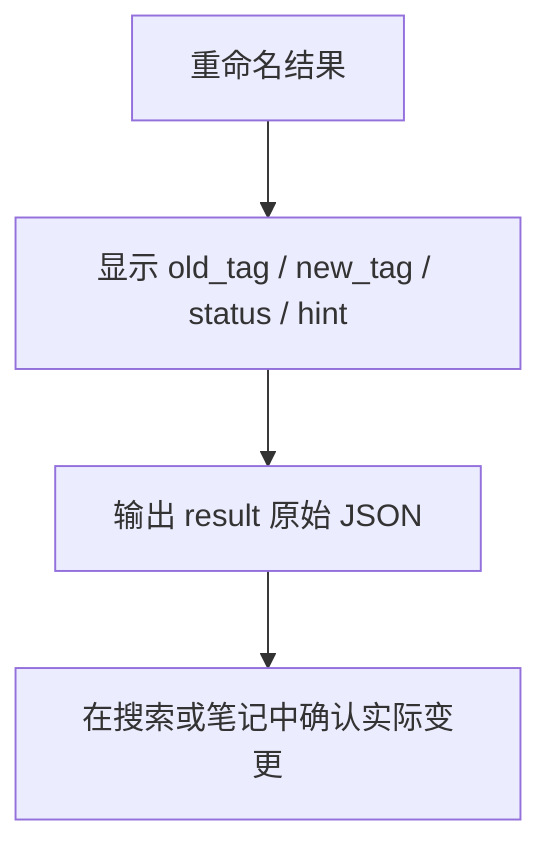
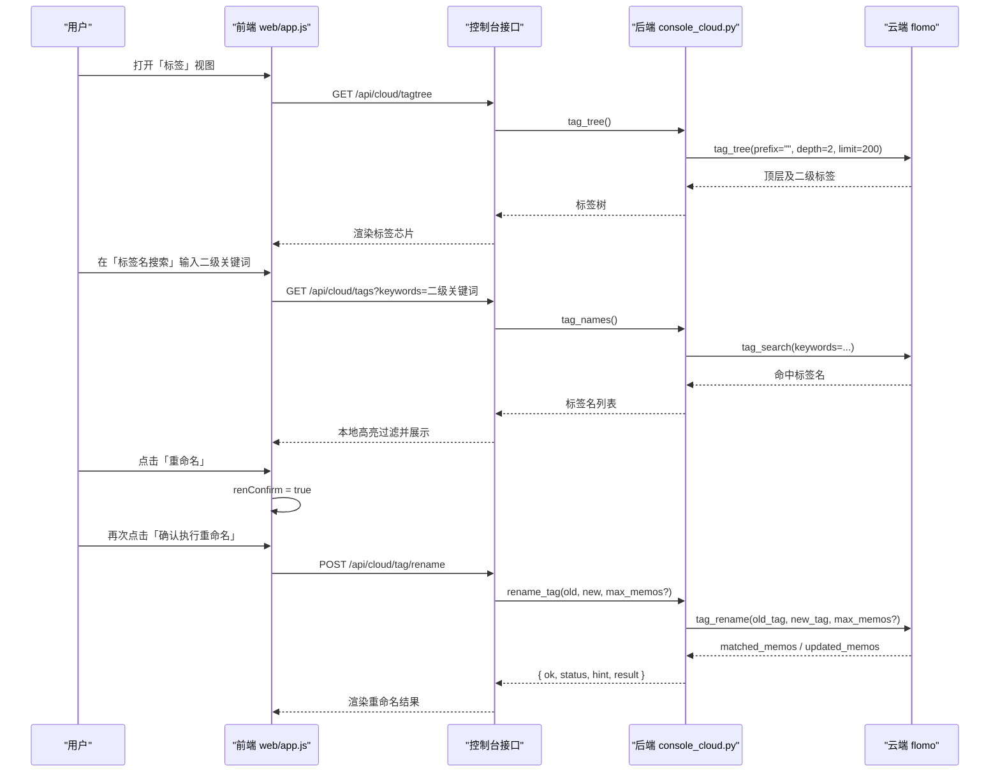

# 标签视图

<cite>
**本文引用的文件**   
- [README.md](file://README.md)
- [scripts/console_cloud.py](file://scripts/console_cloud.py)
- [web/app.js](file://web/app.js)
- [web/index.html](file://web/index.html)
</cite>

## 目录
1. [简介](#简介)
2. [项目结构与职责边界](#项目结构与职责边界)
3. [核心概念与数据流](#核心概念与数据流)
4. [标签树加载流程](#标签树加载流程)
5. [标签名搜索与本地过滤](#标签名搜索与本地过滤)
6. [批量重命名触发与确认机制](#批量重命名触发与确认机制)
7. [只读查询与写重命名的白名单差异](#只读查询与写重命名的白名单差异)
8. [前端渲染、展开状态与对比展示](#前端渲染展开状态与对比展示)
9. [典型操作序列](#典型操作序列)
10. [常见问题与回退方案](#常见问题与回退方案)
11. [性能与限制](#性能与限制)
12. [结论](#结论)

## 简介
「标签」视图是控制台四个主视图之一，负责把云端 flomo 的标签体系以实时方式呈现给操作者。它承担三件事：
- 从云端拉取标签树；
- 用云端标签搜索接口快速定位标签名；
- 通过后端写通道批量重命名标签。

需要特别注意：**标签树本身不保存在本地**。页面刷新后不会保留上次拉取的树结构；但「标签名搜索」会在当前页面会话中缓存结果，用于搜索框输入时的本地过滤。

## 项目结构与职责边界
| 层次 | 文件 | 职责 |
|---|---|---|
| 前端界面 | `web/index.html` | 提供侧边导航、顶部标题区、标签视图容器和 Toast 提示区域 |
| 前端逻辑 | `web/app.js` | 管理标签视图状态、发起 `/api/cloud/tagtree` 与 `/api/cloud/tags`、渲染树与搜索结果、处理重命名按钮点击与二次确认 |
| 后端访问层 | `scripts/console_cloud.py` | 定义只读与写工具白名单，调用云端 `tag_tree`、`tag_search`、`tag_rename`，并把原始回执转成前端可直接使用的字段 |
| 文档契约 | `README.md` | 声明控制台四个视图、标签视图能力、API 路径以及重命名接口的 HTTP 语义 |

**图表来源**
- [web/index.html:1-162](file://web/index.html#L1-L162)
- [web/app.js:1-200](file://web/app.js#L1-L200)
- [scripts/console_cloud.py:1-120](file://scripts/console_cloud.py#L1-L120)
- [README.md:140-200](file://README.md#L140-L200)

**章节来源**
- [README.md:140-200](file://README.md#L140-L200)
- [web/index.html:1-162](file://web/index.html#L1-L162)

## 核心概念与数据流
标签视图涉及两类数据源：
1. **标签树**：来自云端 `tag_tree`，返回扁平标签字符串列表，附带总数、本次返回数、是否截断等元信息。
2. **标签名搜索**：来自云端 `tag_search`，返回带 `name` 字段的标签对象列表。

前端在「标签」视图中维护如下关键状态：
- `liveTags`：最近一次标签树请求结果；
- `liveNames`：最近一次标签名搜索结果；
- `renOld` / `renNew` / `renMax`：重命名表单中的原标签、新标签、规模上限；
- `renConfirm`：是否已进入「确认执行重命名」态；
- `renameResult`：重命名请求返回的结构化结果。

**图表来源**
- [web/app.js:600-918](file://web/app.js#L600-L918)
- [scripts/console_cloud.py:700-824](file://scripts/console_cloud.py#L700-L824)

**章节来源**
- [web/app.js:600-918](file://web/app.js#L600-L918)
- [scripts/console_cloud.py:700-824](file://scripts/console_cloud.py#L700-L824)

## 标签树加载流程
### 触发时机
当用户切换到「标签」视图时，前端调用 `viewTags()`。该函数会读取 `state.liveTags`：
- 若已有值，直接渲染；
- 若没有值，显示占位提示“按「拉取」从云端现采标签树”。

### 拉取参数
用户可在「云端实时标签树」区域设置：
- `prefix`：前缀，例如 `AI/`；
- `depth`：深度，前端限制为 1 到 10；
- `limit`：条数，可选 200、500、1000；
- 默认值为 200，最大允许 1000。

### 后端处理
后端 `CloudReader.tag_tree()` 将参数封装后调用云端 `tag_tree`：
- `prefix` 原样传入；
- `depth` 被严格限制为 1 到 10；
- `limit` 被限制为 1 到 1000；
- 返回体中的 `tags` 仅保留字符串类型项，其他类型会被丢弃。

### 前端渲染
前端收到 `{ tags, total, returned, truncated, hint }` 后：
- 使用 `chipList` 渲染标签；
- 显示“云端共 X 个标签，本次返回 Y 个”；
- 若 `truncated` 为真，提示可用前缀或深度收窄；
- 若云端返回 `hint`，也一并展示。

**图表来源**
- [web/app.js:600-760](file://web/app.js#L600-L760)
- [scripts/console_cloud.py:740-770](file://scripts/console_cloud.py#L740-L770)

**章节来源**
- [web/app.js:600-760](file://web/app.js#L600-L760)
- [scripts/console_cloud.py:740-770](file://scripts/console_cloud.py#L740-L770)

## 标签名搜索与本地过滤
### 触发时机
用户在「标签名搜索」区域输入关键词并点击「搜索」。前端发送 `GET /api/cloud/tags?keywords=...`。

### 后端处理
`CloudReader.tag_names()`：
- 如果关键词为空，直接返回空列表；
- 否则调用云端 `tag_search`；
- 返回 `{ keywords, count, tags }`，其中 `tags` 是从云端对象的 `name` 字段提取的字符串数组。

### 前端本地过滤
前端同时维护 `state.liveNames` 作为最近一次搜索结果缓存。每次搜索会更新该缓存，随后由 `chipList(items, q)` 对结果进行本地过滤和高亮：
- 如果 `q` 为空，直接渲染全部结果；
- 如果 `q` 不为空，匹配第一个出现位置，并用 `<mark>` 高亮命中部分；
- 如果结果为空，显示“没有匹配的标签”。

**图表来源**
- [web/app.js:600-760](file://web/app.js#L600-L760)
- [scripts/console_cloud.py:770-780](file://scripts/console_cloud.py#L770-L780)

**章节来源**
- [web/app.js:600-760](file://web/app.js#L600-L760)
- [scripts/console_cloud.py:770-780](file://scripts/console_cloud.py#L770-L780)

## 批量重命名触发与确认机制
重命名不是单次点击即执行，而是分为两步：

| 步骤 | 用户动作 | 前端行为 | 后端行为 |
|---|---|---|---|
| 第一步 | 点击「重命名」 | 设置 `state.renConfirm = true`，按钮文案变为「确认执行重命名」，样式变危险色 | 不调用云端 |
| 第二步 | 点击「确认执行重命名」 | 读取 `renOld`、`renNew`、`renMax`，调用 `cloudPost("/api/cloud/tag/rename", ...)` | 校验白名单 → 校验参数 → 调用 `tag_rename` → 解析回执 → 返回结构化结果 |

### 参数约束
- `old_tag`：原标签；
- `new_tag`：新标签；
- `max_memos`：可选规模上限；
- 默认规模 200，绝对上限 2000；
- 前端不对 `max_memos` 做自动重试，也不替用户决定规模。

### 回执解读
后端 `_rename_verdict()` 把云端回执转为统一结构：
- `ok`：是否成功完成；
- `status`：`done` / `partial` / `needs_scale` / `no_match` / `unknown` / `inconsistent`；
- `hint`：面向用户的解释；
- `result`：原始云端回执；
- `matched_memos` / `updated_memos` / `updated_tags`：数量指标；
- `warnings`：警告列表。

**图表来源**
- [web/app.js:600-760](file://web/app.js#L600-L760)
- [scripts/console_cloud.py:210-260](file://scripts/console_cloud.py#L210-L260)
- [scripts/console_cloud.py:824-946](file://scripts/console_cloud.py#L824-L946)

**章节来源**
- [web/app.js:600-760](file://web/app.js#L600-L760)
- [scripts/console_cloud.py:210-260](file://scripts/console_cloud.py#L210-L260)
- [scripts/console_cloud.py:824-946](file://scripts/console_cloud.py#L824-L946)

## 只读查询与写重命名的白名单差异
后端使用两套互斥白名单控制对云端工具的调用：

| 白名单 | 常量 | 用途 | 包含标签相关工具 |
|---|---|---|---|
| 只读白名单 | `READONLY_TOOLS` | 普通查询、标签树、标签名搜索、参考文本、工具清单等 | `tag_tree`、`tag_search` |
| 写白名单 | `WRITE_TOOLS` | 新建笔记、更新笔记、批量重命名标签 | `memo_create`、`memo_update`、`tag_rename` |

调用入口 `CloudReader.call(name, arguments, *, write=False)`：
- 默认 `write=False`，只放行 `READONLY_TOOLS`；
- 只有显式 `write=True` 时才放行 `WRITE_TOOLS`；
- 不在任一白名单中的工具一律拒绝，抛出 `CloudError`。

因此：
- 标签树加载走 `tag_tree`，属于只读白名单；
- 标签名搜索走 `tag_search`，属于只读白名单；
- 标签重命名走 `tag_rename`，必须经过写白名单，并且后端还会额外做格式与业务校验。

**图表来源**
- [scripts/console_cloud.py:80-120](file://scripts/console_cloud.py#L80-L120)
- [scripts/console_cloud.py:360-430](file://scripts/console_cloud.py#L360-L430)

**章节来源**
- [scripts/console_cloud.py:80-120](file://scripts/console_cloud.py#L80-L120)
- [scripts/console_cloud.py:360-430](file://scripts/console_cloud.py#L360-L430)

## 前端渲染、展开状态与对比展示
### 层级结构渲染
当前「标签」视图并不渲染真正的嵌套树形 DOM。它把云端返回的扁平标签字符串列表渲染为「标签芯片」集合，并通过以下机制表达层级感：
- 标签字符串本身通常包含顶层和二级路径，例如 `AI/RAG`；
- 标签树支持 `prefix` 和 `depth`，用户可通过这两个参数主动缩小范围；
- 搜索功能支持按名称局部匹配，并在命中处加高亮。

### 展开状态
由于标签树是云端实时数据且未持久化到本地存储，当前实现**不维护节点展开状态**。切换视图、刷新页面或重新拉取标签树后，不会保留上次展开的分支。需要展开某一层级时，应通过「前缀」和「深度」参数重新拉取。

### 重命名前后对比
重命名成功后，前端渲染结果区域包含：
- 原标签与新标签的代码块对比：`旧标签 → 新标签`；
- 声明规模提示（如果传了 `max_memos`）；
- 人类可读的 `hint`；
- 原始云端回执的 JSON 文本；
- 根据 `ok` 决定是否显示成功提示或错误样式。

这个对比是**操作结果对比**，而不是标签树节点的视觉 diff。如果要确认实际标签是否已更新，应在「标签名搜索」中分别搜索旧标签和新标签，或在「云端笔记」中查看笔记的标签段。

**图表来源**
- [web/app.js:600-760](file://web/app.js#L600-L760)

**章节来源**
- [web/app.js:600-760](file://web/app.js#L600-L760)

## 典型操作序列
下面是一个典型操作序列：展开顶层标签 → 搜索二级标签 → 全选（在标签名搜索结果中选择目标）→ 批量重命名为新标签前缀。

**图表来源**
- [web/app.js:600-760](file://web/app.js#L600-L760)
- [scripts/console_cloud.py:740-780](file://scripts/console_cloud.py#L740-L780)
- [scripts/console_cloud.py:824-946](file://scripts/console_cloud.py#L824-L946)

**章节来源**
- [web/app.js:600-760](file://web/app.js#L600-L760)
- [scripts/console_cloud.py:740-780](file://scripts/console_cloud.py#L740-L780)
- [scripts/console_cloud.py:824-946](file://scripts/console_cloud.py#L824-L946)

## 常见问题与回退方案

### 标签树为空
可能原因：
- 尚未点击「拉取」；
- 前缀过深或深度太小；
- 云端确实没有标签；
- 云端返回被截断，但未正确收窄查询。

回退方案：
1. 先清空前缀，选择较小深度；
2. 提高 `limit` 至 500 或 1000；
3. 观察返回体中的 `truncated` 与 `hint`；
4. 如果仍为空，改用「标签名搜索」尝试更宽泛关键词；
5. 检查云端凭证和连接状态。

**章节来源**
- [web/app.js:600-700](file://web/app.js#L600-L700)
- [scripts/console_cloud.py:740-770](file://scripts/console_cloud.py#L740-L770)

### 重命名失败
常见状态与应对：

| status | 含义 | 建议 |
|---|---|---|
| `no_match` | 云端没有匹配到挂旧标签的笔记 | 检查标签名是否正确，或确认该标签下已无卡片 |
| `needs_scale` | 匹配条数超过默认 200，一条都没写 | 根据 `matched_memos` 填入 `max_memos` 后重试 |
| `partial` | 只改了部分卡片，标签已分裂 | 携带 `max_memos=matched_memos` 重试，或对剩余卡片逐卡更新 |
| `unknown` | 回执缺少必要字段 | 不要当作成功；按新标签现查，不要重发 |
| `inconsistent` | 回执自相矛盾 | 按新旧标签各查一次，不要当作已完成 |
| `done` | 所有匹配到的卡片都改完 | 正常结束 |

**章节来源**
- [scripts/console_cloud.py:210-260](file://scripts/console_cloud.py#L210-L260)
- [web/app.js:600-760](file://web/app.js#L600-L760)

### 部分标签未更新
这对应 `partial` 状态。此时：
- 不要认为操作完全成功；
- 优先携带 `max_memos` 重试；
- 如果仍然部分更新，说明存在并发或分片问题，应结合「标签名搜索」验证旧标签是否仍有残留；
- 最终兜底手段是对受影响笔记逐个执行更新，而不是继续盲目批量重命名。

**章节来源**
- [scripts/console_cloud.py:210-260](file://scripts/console_cloud.py#L210-L260)

## 性能与限制
| 项目 | 限制 | 影响 |
|---|---|---|
| 标签树默认条数 | 200 | 大账号可能需要提高 `limit` |
| 标签树最大条数 | 1000 | 超过时会返回 `truncated` |
| 标签搜索默认条数 | 20 | 搜索结果过多时可调整后端 `limit` |
| 重命名默认规模 | 200 | 超过则不会写入，必须显式传 `max_memos` |
| 重命名绝对上限 | 2000 | 超过会被视为越界规模 |
| 标签树本地缓存 | 无 | 刷新后需重新拉取 |
| 标签名搜索本地缓存 | 有 | 同页会话内可重复搜索，减少网络请求 |

**章节来源**
- [scripts/console_cloud.py:120-170](file://scripts/console_cloud.py#L120-L170)
- [scripts/console_cloud.py:740-780](file://scripts/console_cloud.py#L740-L780)

## 结论
「标签」视图的核心设计是：**云端是唯一事实源，前端只做实时展示、轻量搜索过滤和受控写入触发**。标签树通过 `tag_tree` 按需拉取，标签名通过 `tag_search` 精确检索，重命名通过 `tag_rename` 经白名单和回执判定后才算完成。

对于使用者而言，最重要的操作纪律是：
- 先看标签树或标签搜索，确认标签是否存在；
- 再填原标签、新标签；
- 第一次点击只进入确认态；
- 第二次点击才真正调用云端；
- 最后根据 `status` 和 `hint` 判断是否需要重试或人工收尾。