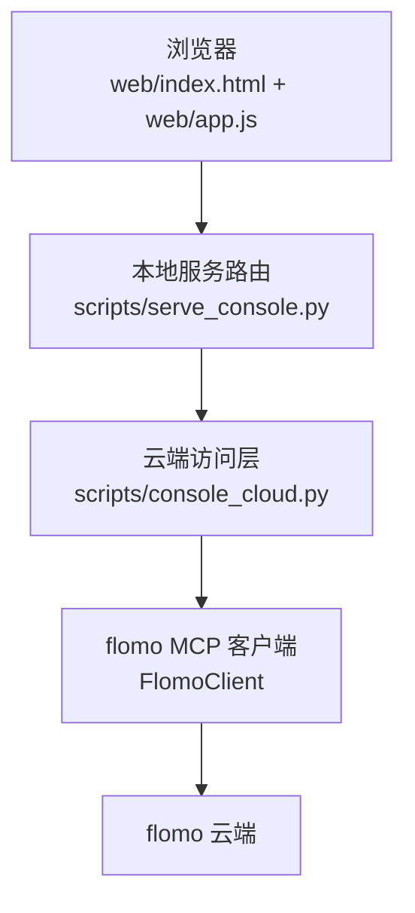
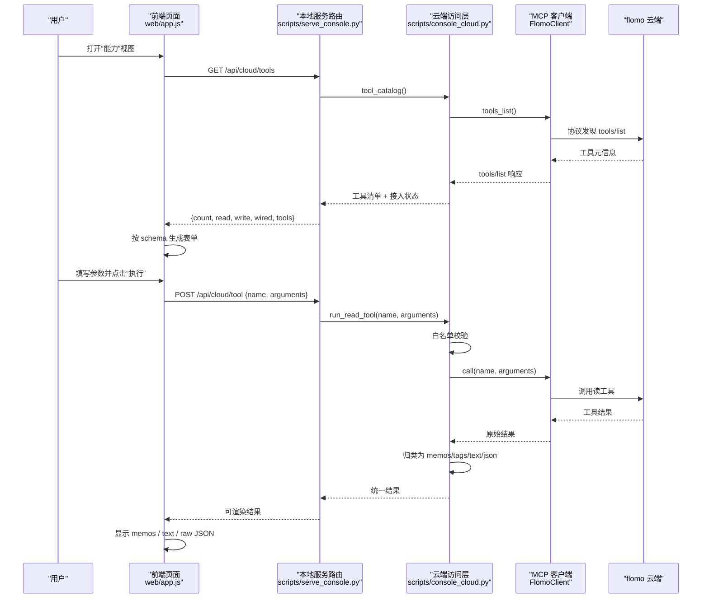
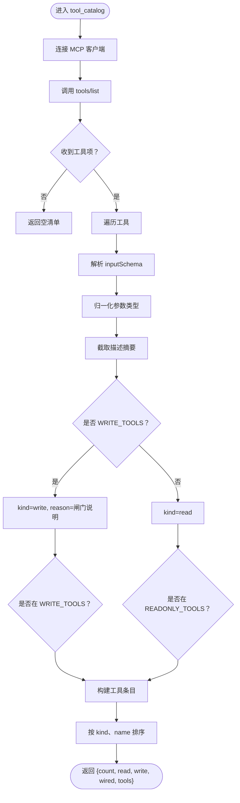
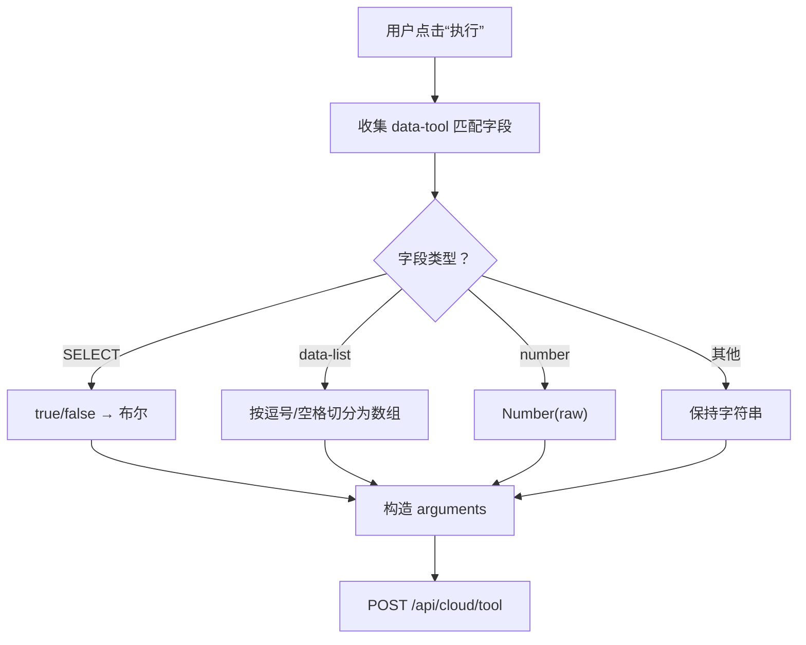
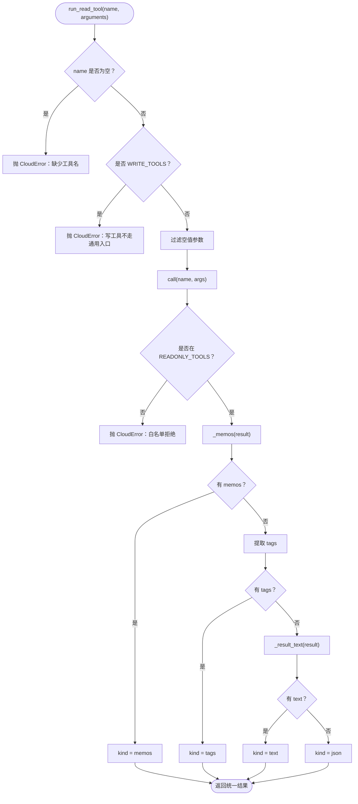
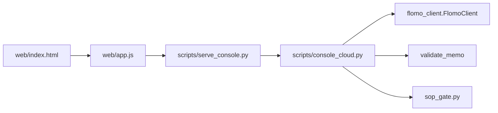

# 能力视图（工具台）

<cite>
**本文引用的文件**   
- [README.md](file://README.md)
- [web/index.html](file://web/index.html)
- [web/app.js](file://web/app.js)
- [scripts/console_cloud.py](file://scripts/console_cloud.py)
- [scripts/serve_console.py](file://scripts/serve_console.py)
</cite>

## 目录
1. [引言](#引言)
2. [项目结构中与能力视图相关的部分](#项目结构中与能力视图相关的部分)
3. [核心组件](#核心组件)
4. [架构总览](#架构总览)
5. [详细组件分析](#详细组件分析)
6. [依赖关系分析](#依赖关系分析)
7. [性能与行为特征](#性能与行为特征)
8. [调试与排错指南](#调试与排错指南)
9. [结论](#结论)

## 引言
「能力视图」是控制台四个视图之一，对应“工具台”。它的目标是把云端 MCP 暴露的工具全部接出来：不只是列出名称，而是让只读工具在页面上直接填参执行，并显示结构化结果。写工具不在这里直通执行，而是给出跳转到新建笔记、编辑笔记或标签重命名入口的指引，因为写操作必须经过格式闸门、流程闸门和回读验收。

该视图由前端 `web/app.js` 渲染，后端由 `scripts/console_cloud.py` 通过 MCP 客户端访问云端；HTTP 路由集中在 `scripts/serve_console.py`。关键接口包括：
- GET `/api/cloud/tools`：获取工具清单、接入状态与参数规格。
- POST `/api/cloud/tool`：通用只读执行入口，接收 `{name, arguments}`。

新增云端能力时，开发者需要同时完成两件事：在 `console_cloud.py` 中决定是否放行到白名单；如果希望用户能通过 HTTP 控制台直接执行，则把工具加入读白名单 `READONLY_TOOLS`。

**章节来源**
- [README.md:100-180](file://README.md#L100-L180)

## 项目结构中与能力视图相关的部分
能力视图涉及三层：
- 页面骨架：`web/index.html` 中的导航按钮和数据区。
- 前端逻辑：`web/app.js` 中的工具台渲染、表单生成、执行请求和结果展示。
- 后端逻辑：`scripts/console_cloud.py` 中的工具清单、白名单、通用只读执行；`scripts/serve_console.py` 中的路由绑定。



**图表来源**
- [web/index.html:1-162](file://web/index.html#L1-L162)
- [web/app.js:701-1077](file://web/app.js#L701-L1077)
- [scripts/serve_console.py:294-356](file://scripts/serve_console.py#L294-L356)
- [scripts/console_cloud.py:856-946](file://scripts/console_cloud.py#L856-L946)

**章节来源**
- [web/index.html:1-162](file://web/index.html#L1-L162)
- [web/app.js:1-1160](file://web/app.js#L1-L1160)
- [scripts/console_cloud.py:1-946](file://scripts/console_cloud.py#L1-L946)
- [scripts/serve_console.py:294-356](file://scripts/serve_console.py#L294-L356)

## 核心组件
- **工具清单接口**：GET `/api/cloud/tools` 调用 `CloudReader.tool_catalog()`，走云端 `tools/list` 协议发现，返回每个工具的 name、kind、wired、summary、arg_specs。
- **通用只读执行接口**：POST `/api/cloud/tool` 调用 `CloudReader.run_read_tool(name, arguments)`，对工具名做白名单校验，再按结果形态归类为 memos / tags / text / json。
- **前端工具台**：`viewTools()` 拉取 `/api/cloud/tools`，按 kind 分组渲染只读工具与写工具；只读工具附带“执行”按钮，写工具只显示参数提示和跳转按钮。
- **参数表单生成器**：`toolField(toolName, spec)` 根据归一化后的 schema type 生成 boolean、array、number/text 控件。
- **结果渲染器**：`toolResult(r)` 根据返回体中的 memos、text、raw 决定以卡片列表、纯文本还是原始 JSON 形式展示。

**章节来源**
- [scripts/console_cloud.py:856-946](file://scripts/console_cloud.py#L856-L946)
- [web/app.js:701-1077](file://web/app.js#L701-L1077)

## 架构总览
能力视图的整体数据流如下：



**图表来源**
- [web/app.js:701-1077](file://web/app.js#L701-L1077)
- [scripts/serve_console.py:294-356](file://scripts/serve_console.py#L294-L356)
- [scripts/console_cloud.py:856-946](file://scripts/console_cloud.py#L856-L946)

## 详细组件分析

### 工具清单：从 `tools/list` 到前端表单
`CloudReader.tool_catalog()` 的职责是把云端 MCP 暴露的全部工具转成控制台的内部表示。它不会读取任何卡片正文，只做协议发现；因此新增一个只读工具后，只要把它放进 `READONLY_TOOLS`，前端就能自动识别并渲染。

关键行为：
- 调用 `self._connect().tools_list()` 获取云端工具列表。
- 遍历工具项，提取 name、description、inputSchema。
- 用 `_schema_type(spec)` 把联合类型归一化为单一 token：boolean、integer、number、array、string。
- 用 `_tool_summary(description)` 截取首句作为摘要。
- 标记 write 工具是否属于 `WRITE_TOOLS`，其他工具视为 read。
- 标记 `wired`：只有实际被控制台方法调用的工具才显示“已接出”。
- 返回 count、read、write、wired、tools。



**图表来源**
- [scripts/console_cloud.py:856-910](file://scripts/console_cloud.py#L856-L910)

**章节来源**
- [scripts/console_cloud.py:856-910](file://scripts/console_cloud.py#L856-L910)

### 前端工具台：按 schema 生成表单
前端 `viewTools()` 会缓存 `/api/cloud/tools` 的结果，并按 kind 分成三类区域：
- 只读工具：显示工具名、摘要、参数表单、“执行”按钮。
- 写工具：显示工具名、摘要、参数提示、跳转按钮。
- 未接出的云端工具：仅列出名称，提示未接出。

`toolField()` 根据归一化类型生成控件：
- boolean：下拉选择“不传 / 真 / 假”。
- array：单行文本框，注释“多个值用逗号分隔”，执行时按逗号或空格切分。
- integer / number：HTML number 输入框。
- 其他：普通文本输入框。



**图表来源**
- [web/app.js:701-900](file://web/app.js#L701-L900)

**章节来源**
- [web/app.js:701-900](file://web/app.js#L701-L900)

### 通用只读执行：POST /api/cloud/tool
POST `/api/cloud/tool` 是能力视图的核心执行路径。它不是简单转发，而是做了三层处理：
1. 工具名白名单校验。
2. 调用 MCP 工具。
3. 将任意工具结果归类为四种形态：memos、tags、text、json。

`run_read_tool()` 的行为：
- 若 name 为空，抛出 `CloudError("缺少工具名")`。
- 若 name 属于 `WRITE_TOOLS`，明确拒绝：“写工具不走通用入口”。
- 清理 arguments 中的空值和空字符串。
- 调用 `self.call(name, args)`，真正白名单检查发生在 `call()`。
- 尝试从结果中提取 memos；失败则尝试提取 tags；失败则尝试提取纯文本；最终兜底为 raw JSON。
- 返回包含 tool、arguments、kind、memos、tags、total、truncated、text、raw 的统一结构。



**图表来源**
- [scripts/console_cloud.py:910-946](file://scripts/console_cloud.py#L910-L946)

**章节来源**
- [scripts/console_cloud.py:910-946](file://scripts/console_cloud.py#L910-L946)

### 控制台路由绑定
`serve_console.py` 把两个关键接口绑定到 `CloudReader` 实例：
- GET `/api/cloud/tools` → `r.tool_catalog()`
- POST `/api/cloud/tool` → `r.run_read_tool(name, arguments)`

这意味着：
- 所有工具清单来自云端协议发现，不靠前端硬编码。
- 所有只读执行都经过后端白名单和结果归类。
- 前端只需要信任 `/api/cloud/tools` 返回的 schema，不需要知道具体工具参数。

**章节来源**
- [scripts/serve_console.py:294-356](file://scripts/serve_console.py#L294-L356)

### 结果展示：memos、text、raw JSON
`toolResult()` 在前端按以下优先级渲染：
1. 如果返回体包含 memos，则以卡片列表形式展示，每条显示标签、标题、摘要。
2. 否则如果返回体包含 text，则以段落/标签行/列表形式渲染。
3. 否则把 raw 序列化为 JSON 字符串，超过 TOOL_JSON_LIMIT 字符时显式标注截断。

这保证了不同工具的结果差异很大时，界面仍能一致呈现。

**章节来源**
- [web/app.js:900-1000](file://web/app.js#L900-L1000)

## 依赖关系分析
能力视图的关键依赖链如下：



- `web/index.html` 提供导航、主视图容器、抽屉、编辑器等 DOM。
- `web/app.js` 负责视图切换、工具台渲染、表单生成、API 调用。
- `scripts/serve_console.py` 是 HTTP 层，把 `/api/cloud/tools` 和 `/api/cloud/tool` 映射到 `CloudReader`。
- `scripts/console_cloud.py` 是业务边界：白名单、参数校验、结果归类、写云闸门。
- `validate_memo` 和 `sop_gate.py` 主要服务于写工具，但能力视图通过写工具面板提示“须过闸门”。

**图表来源**
- [web/index.html:1-162](file://web/index.html#L1-L162)
- [web/app.js:701-1077](file://web/app.js#L701-L1077)
- [scripts/serve_console.py:294-356](file://scripts/serve_console.py#L294-L356)
- [scripts/console_cloud.py:1-946](file://scripts/console_cloud.py#L1-L946)

**章节来源**
- [scripts/console_cloud.py:1-946](file://scripts/console_cloud.py#L1-L946)

## 性能与行为特征
- 工具清单按需加载：`state.catalog` 缓存一次，刷新时才重新拉取。
- 通用只读执行没有额外分页逻辑：工具本身返回多少就展示多少；JSON 结果超长时前端显式截断。
- 写工具不在此视图执行：避免误把写操作当成只读调用。
- 白名单是集合查找：`frozenset` 的成员判断接近 O(1)，新增工具时复杂度不变。
- `tools/list` 是协议发现，不读取卡片正文，开销通常小于业务查询。

[本节为一般性说明，不直接分析具体代码片段]

## 调试与排错指南

### 推荐调试顺序
1. 先确认云端可用：查看“云端笔记”视图顶部的云端状态，或直接查看 `/api/cloud/tools` 是否能返回工具清单。
2. 打开“能力”视图，检查目标工具是否出现在“只读工具 · 直接执行”区域。
3. 如果工具出现但未显示“已接出”，说明工具存在但没有加入 `READONLY_TOOLS`。
4. 如果工具完全不存在，说明云端 MCP 尚未暴露该工具，或者 `tools/list` 返回中被过滤。
5. 填写参数后点击“执行”，观察：
   - 是否出现“执行失败”。
   - 错误消息中是否包含“白名单拒绝”“写工具不走通用入口”“缺少工具名”。
   - 结果是否正确归类为 memos、text 或 raw JSON。

### 常见错误及含义
- “工具白名单拒绝调用白名单外工具”：工具名既不在 `READONLY_TOOLS`，也不在 `WRITE_TOOLS`。解决方案：确认该工具是否应开放给 HTTP 控制台。
- “工具白名单拒绝调用写工具”：写工具不能通过 POST `/api/cloud/tool` 执行。解决方案：改用新建笔记、编辑笔记或标签重命名入口。
- “写工具不走通用入口”：`run_read_tool()` 主动拒绝 `WRITE_TOOLS` 中的工具。
- “缺少工具名”：POST body 中没有 name，或 name 为空。
- “参数校验失败”：前端会把布尔、数组、数字、文本分别序列化；例如布尔型 SELECT 值为 true/false，数组型按逗号或空格拆分。
- “云端调用失败”：可能是 MCP 连接失效、token 缺失、网络异常或云端工具报错。

### 请求体示例
通用只读执行接口 POST `/api/cloud/tool` 的请求体结构如下：

| 字段 | 类型 | 必填 | 说明 |
|------|------|------|------|
| name | string | 是 | 云端 MCP 暴露的工具名 |
| arguments | object | 否 | 工具参数对象，键名与值类型需符合 inputSchema |

参考请求体（仅结构示意）：
- 搜索笔记类工具：
  ```json
  {
    "name": "memo_search",
    "arguments": {
      "keywords": "示例关键词",
      "tag": "#AI/RAG",
      "limit": 20
    }
  }
  ```
- 批量取全文类工具：
  ```json
  {
    "name": "memo_batch_get",
    "arguments": {
      "ids": ["id1", "id2"]
    }
  }
  ```
- 标签搜索类工具：
  ```json
  {
    "name": "tag_search",
    "arguments": {
      "keywords": "AI",
      "limit": 20
    }
  }
  ```

注意：
- 布尔参数在前端表现为下拉选择，true/false 会被转为布尔值。
- 数组参数在前端表现为单行文本，提交时按逗号或空格切分。
- 数字参数使用 HTML number 输入框，非数字可能无法正确传入。

### 响应结构
成功执行时，`/api/cloud/tool` 返回统一结构：

| 字段 | 类型 | 说明 |
|------|------|------|
| tool | string | 被调用的工具名 |
| arguments | object | 实际传给云端的参数 |
| kind | string | 结果形态：memos / tags / text / json |
| memos | array | 当 kind 为 memos 时返回精简卡片列表 |
| tags | array | 当 kind 为 tags 时返回标签名列表 |
| total | number | 可选，工具返回的总数 |
| truncated | boolean | 可选，是否被云端截断 |
| text | string | 当 kind 为 text 时返回纯文本 |
| raw | any | 原始工具结果，用于兜底展示 |

失败时，前端会统一包装为：
```json
{
  "error": "错误消息"
}
```

### 权限拒绝的处理
权限拒绝发生在后端 `CloudReader.call()`：
- 如果 name 不在当前白名单集合中，抛出 `CloudError("工具白名单拒绝调用...")`。
- 读路径默认只放行 `READONLY_TOOLS`。
- 写路径必须显式设置 `write=True`，且 name 必须在 `WRITE_TOOLS`。
- 通用只读执行入口 `run_read_tool()` 还会主动拒绝所有 `WRITE_TOOLS`，防止写工具被绕过闸门。

因此，新增云端能力时的同步要求是：
- 如果希望 HTTP 控制台能直接执行该读工具：加入 `READONLY_TOOLS`。
- 如果只允许通过专用写接口执行：加入 `WRITE_TOOLS`，并在能力视图中以写工具面板显示。
- 如果暂时不希望 HTTP 控制台使用该工具：不要加入任一白名单；前端仍会从 `tools/list` 看到它，但会显示“未接出”。

**章节来源**
- [scripts/console_cloud.py:1-200](file://scripts/console_cloud.py#L1-L200)
- [scripts/console_cloud.py:201-500](file://scripts/console_cloud.py#L201-L500)
- [scripts/console_cloud.py:501-824](file://scripts/console_cloud.py#L501-L824)
- [scripts/console_cloud.py:825-946](file://scripts/console_cloud.py#L825-L946)
- [web/app.js:701-1077](file://web/app.js#L701-L1077)

## 结论
能力视图的设计原则很清晰：**清单来自云端，表单来自 schema，只读工具可直接执行，写工具必须走专属入口**。  
- `tools/list` 提供真实能力面貌，避免前端与云端漂移。  
- `READONLY_TOOLS` 和 `WRITE_TOOLS` 是能力视图的安全边界。  
- 新增云端能力时，必须同步更新对应白名单，否则要么看不到，要么只能看到但不能执行。  
- 调试时优先检查 `/api/cloud/tools` 是否暴露目标工具，再逐步验证参数和结果形态。