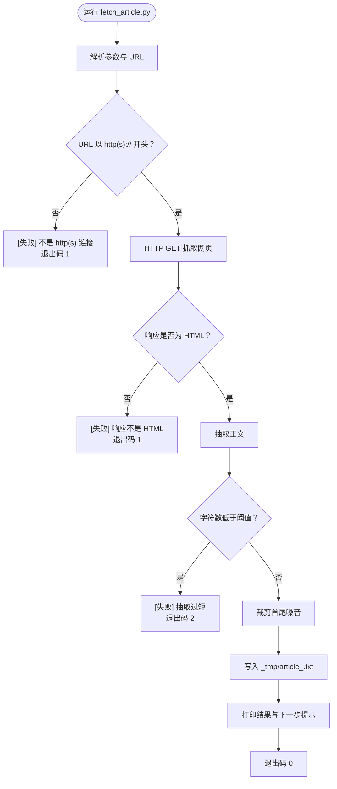
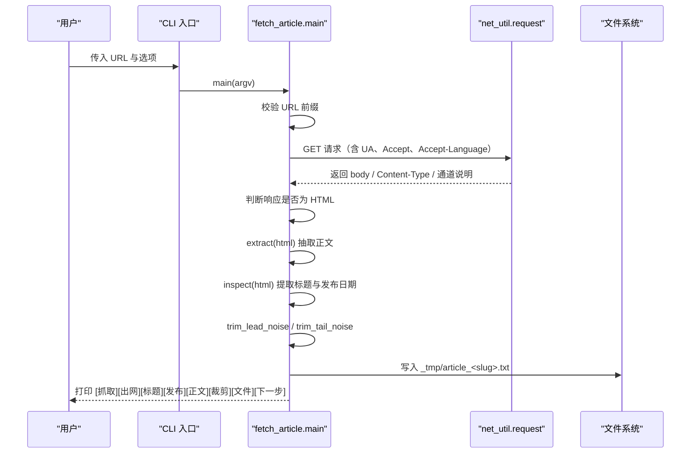
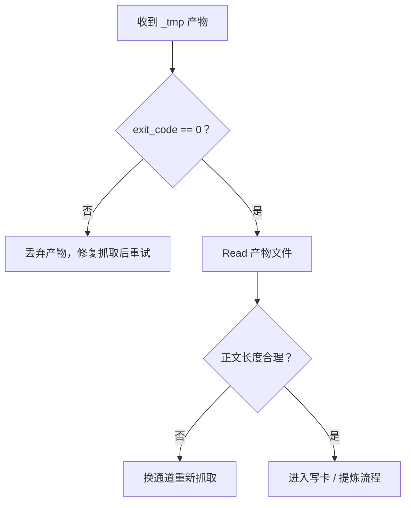
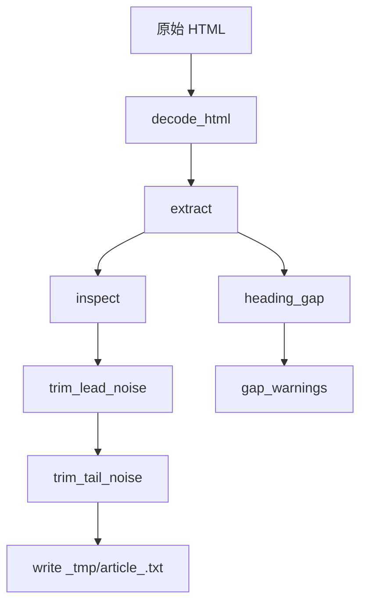

# 3.1 内容抓取（fetch_article）

<cite>
**本文引用的文件**
- [scripts/fetch_article.py](file://scripts/fetch_article.py)
- [tests/test_fetch_article.py](file://tests/test_fetch_article.py)
</cite>

## 目录
1. [简介](#简介)
2. [快速结论与产物约定](#快速结论与产物约定)
3. [命令行参数](#命令行参数)
4. [从 URL 到 `_tmp/<slug>.html` 的完整示例](#从-url-到-tmpslugetmll-html-的完整示例)
5. [执行流程总览](#执行流程总览)
6. [失败处理、重试与错误输出](#失败处理重试与错误输出)
7. [常见网络异常处理建议](#常见网络异常处理建议)
8. [后续消费步骤](#后续消费步骤)
9. [内部实现要点](#内部实现要点)
10. [常见问题排查](#常见问题排查)
11. [结语](#结语)

## 简介
`scripts/fetch_article.py` 是写卡工作流第 1 步的网页正文抓取通道。它负责：

- 通过 HTTP GET 抓取网页；
- 根据 `Content-Type`、页面 `<meta charset>`、UTF-8、GB18030 顺序解码；
- 去除脚本、样式、导航等噪音块，并抽取正文；
- 裁剪开头元信息行和结尾推荐位/相关文章等尾部噪音；
- 检测是否可能因 JS 渲染或反爬导致正文过短；
- 将清洗后的纯文本写入项目根目录下的 `_tmp/`；
- 打印标题、发布日期、字符数、出网通道、文件路径及下一步提示。

该脚本不替调用方阅读正文，也不参与卡片最终落盘，只负责“抓回 → 清洗 → 落盘”。

**章节来源**
- [scripts/fetch_article.py:1-58](file://scripts/fetch_article.py#L1-L58)

## 快速结论与产物约定
- **默认输出路径**：`_tmp/article_<slug>.txt`
- **URL slug 生成规则**：去掉查询串与锚点、取最后一段路径、非字母数字字符替换为连字符、截断至 48 个字符
- **编码**：输出始终使用 UTF-8
- **目录创建**：若 `_tmp/` 不存在则自动创建
- **返回值含义**：
  - `0`：成功抓取并写出文件；
  - `1`：网络 / HTTP 失败，或响应不是 HTML；
  - `2`：抽取正文过短，通常意味着 JS 渲染页或反爬页。



**图表来源**
- [scripts/fetch_article.py:380-580](file://scripts/fetch_article.py#L380-L580)

**章节来源**
- [scripts/fetch_article.py:337-378](file://scripts/fetch_article.py#L337-L378)
- [scripts/fetch_article.py:380-580](file://scripts/fetch_article.py#L380-L580)

## 命令行参数
脚本通过统一 CLI 入口解析参数，支持位置参数与命名参数混合使用。

| 参数 | 类型 | 默认值 | 说明 |
|---|---|---:|---|
| `<url>` | 位置参数 | 必填 | 要抓取的网页地址，必须以 `http://` 或 `https://` 开头 |
| `--out` | 字符串 | 空 | 自定义输出文件路径；未指定时按 `_tmp/article_<slug>.txt` 生成 |
| `--min-chars` | 整数 | `300` | 抽取后最小正文长度阈值；小于该值会返回退出码 2 |
| `--timeout` | 浮点数 | `30.0` | 单次网络请求超时秒数 |
| `--via` | 枚举 | `auto` | 出网通道：`auto`、`proxy`、`direct` |
| `--print` | 标志位 | 关闭 | 额外把正文输出到标准输出，适合短文预览 |

### `--via` 行为
- `auto`：先尝试环境代理，失败后清空代理直连重试；两条都不通才报错，且会把两条原因一起输出。
- `proxy`：强制走环境代理，失败即抛错，不回退直连。
- `direct`：强制直连，绕过环境代理设置。

注意：沙箱注入的代理端口每次会话重新分配，因此不应写死端口；`net_util` 会在运行时读取当前会话的代理配置。

**章节来源**
- [scripts/fetch_article.py:1-58](file://scripts/fetch_article.py#L1-L58)
- [scripts/fetch_article.py:380-580](file://scripts/fetch_article.py#L380-L580)

## 从 URL 到 `_tmp/<slug>.html` 的完整示例
严格来说，脚本默认输出的是 `.txt` 文件，而非 `.html`。如果业务需要 `.html` 产物，可以在脚本完成后对 `_tmp/article_<slug>.txt` 做一步转换；但脚本本身不会保留原始 HTML 正文。

下面给出一个可直接复现的命令序列：

```bash
python scripts/fetch_article.py \
  "https://example.com/docs/getting-started" \
  --min-chars 200 \
  --timeout 30 \
  --via auto
```

预期输出文件：

```text
_tmp/article_getting-started.txt
```

如果需要显式指定文件名：

```bash
python scripts/fetch_article.py \
  "https://example.com/docs/getting-started" \
  --out "_tmp/my-article.txt"
```

若希望正文也直接打印到终端（适合很短的文章）：

```bash
python scripts/fetch_article.py \
  "https://example.com/docs/getting-started" \
  --print
```

**章节来源**
- [scripts/fetch_article.py:337-378](file://scripts/fetch_article.py#L337-L378)
- [scripts/fetch_article.py:497-580](file://scripts/fetch_article.py#L497-L580)

## 执行流程总览


**图表来源**
- [scripts/fetch_article.py:380-580](file://scripts/fetch_article.py#L380-L580)

**章节来源**
- [scripts/fetch_article.py:380-580](file://scripts/fetch_article.py#L380-L580)

## 失败处理、重试与错误输出
脚本没有无限重试循环，而是通过“通道选择 + 明确错误分类”的方式降低误判概率。

### 退出码与典型场景
| 退出码 | 含义 | 常见原因 | 建议动作 |
|---:|---|---|---|
| `0` | 成功 | 已写出正文文件 | 进入第 2 步读回正文 |
| `1` | 网络 / HTTP / 非 HTML | DNS 不可达、SNI 握手失败、代理不可用、403/404、响应体不是 HTML | 检查网络、代理、URL、站点访问权限 |
| `2` | 正文过短 | JS 渲染页、SPA、反爬、验证码、仅加载骨架页 | 改用 webfetch、镜像站、预印本通道，或手动抓取完整 HTML |

### 通道级失败
当 `--via auto` 同时失败时，脚本会把环境代理失败原因与直连失败原因都打印出来，便于区分“环境问题”和“目标站问题”。

### 非 HTML 响应
即使 HTTP 200 成功，如果 `Content-Type` 不包含 `html`，且响应头 2000 字节内也不是 `<html`，脚本也会拒绝继续处理，避免把 JSON、图片、重定向页当成文章。

### 正文过短
当抽取正文字符数低于 `--min-chars` 时，脚本会：
- 输出 `[失败] 抽取仅 N 字符`；
- 如有正文片段，再输出 `[预览]`；
- 返回退出码 2。

这并不意味着一定失败，只是提醒调用方：可能需要换通道获取可渲染后的完整 HTML。

**章节来源**
- [scripts/fetch_article.py:1-58](file://scripts/fetch_article.py#L1-L58)
- [scripts/fetch_article.py:430-580](file://scripts/fetch_article.py#L430-L580)

## 常见网络异常处理建议
以下建议基于脚本实际使用的出网通道与错误分类方式。

### DNS 解析失败
- 现象：无法解析域名，属于传输层失败。
- 建议：
  - 先用 `ping` 或 `nslookup` 验证域名是否能解析；
  - 检查系统 DNS 配置、容器或沙箱的网络策略；
  - 如果使用代理，确认代理服务器可达；
  - 对 `--via auto`，DNS 失败通常会出现在第一条通道中，直连失败消息会帮助确认第二条通道状态。

### SNI / TLS 握手失败
- 现象：能解析域名，但 TLS 握手阶段失败。
- 建议：
  - 确认代理是否支持 HTTPS/SNI；
  - 某些代理要求额外头部或证书信任链；
  - 在 `--via direct` 下观察是否仍失败，以区分代理问题与站点问题；
  - 若只有代理失败而直连成功，日志中会体现通道切换信息。

### 代理不可用或端口过期
- 现象：连接被拒绝、超时、代理返回错误。
- 建议：
  - 不要硬编码代理端口；脚本依赖 `net_util` 在当前会话中读取代理；
  - 优先使用 `--via auto`，让脚本先试环境代理，失败再直连；
  - 如果是沙箱或容器环境，确认代理进程已启动且端口已重新分配；
  - 使用 `--via direct` 快速排除代理干扰。

### 403 / 404 / 其他 HTTP 错误
- 现象：服务器已响应，但状态码表示无权限、资源不存在等。
- 建议：
  - 这类错误不会触发直连回退，因为“通道本身是通的”，回退只会掩盖真实原因；
  - 检查 URL 是否正确、是否需要登录、是否需要 Cookie、是否被反爬拦截；
  - 对于 403，可考虑更换 UA、加鉴权、或使用可访问的镜像源。

### 响应不是 HTML
- 现象：`Content-Type` 不含 `html`，或响应头 2000 字节内不是 `<html`。
- 建议：
  - 确认 URL 指向的是文章页，而不是 API、JSON、图片或重定向终点；
  - 如果是 SPA 页面，通常需要浏览器渲染后的 HTML，应改用 webfetch 或预渲染服务。

**章节来源**
- [scripts/fetch_article.py:1-58](file://scripts/fetch_article.py#L1-L58)
- [scripts/fetch_article.py:430-580](file://scripts/fetch_article.py#L430-L580)

## 后续消费步骤
脚本末尾会明确提示下一步操作：

```text
[下一步] 读回全文：Read <输出文件>（流程第 1 步纪律，未读回不得提炼）
```

这意味着：

1. **必须先读回正文**：不能只看脚本输出的摘要就写卡片；
2. **读回的是 `_tmp/` 下的 `.txt` 产物**，不是原始 HTML；
3. **如果正文过短或带 `[告警]`**，应先核对原文，确认抽取是否完整；
4. **如果退出码是 2**，不要直接消费该产物，应换通道重新抓取；
5. **如果退出码是 1**，说明抓取未完成，不存在有效产物。

消费侧的典型判断逻辑：



**图表来源**
- [scripts/fetch_article.py:550-580](file://scripts/fetch_article.py#L550-L580)

**章节来源**
- [scripts/fetch_article.py:550-580](file://scripts/fetch_article.py#L550-L580)

## 内部实现要点
### 正文抽取通道
脚本按以下优先级抽取正文：

1. 站内专用选择器（例如 `div[id="article-body"]`）；
2. 站内专用右界兜底（防止评论区混入）；
3. `<article>`；
4. `<main>`；
5. 语义候选 `div` 中文本量最大者；
6. 整页兜底。

每个候选都会经过去噪音、换行、实体还原、空白归一化等处理，并按 `DEFAULT_MIN_CHARS` 过滤过短的侧栏或导语。

### 首尾噪音裁剪
- **开头**：连续的面包屑、标题行、日期、来源、作者、责编、评论等最多 15 行会被裁掉；
- **结尾**：APP 下载、相关文章、推荐阅读、关键词、免责声明等标记行，且必须位于全文前 40% 之后才会裁；
- 裁剪过程会输出 `[裁剪]` 行，标明原长度、新长度、裁掉的首尾位置。

### 章节完整性告警
脚本会提取页面的二级、三级标题，并与正文中出现的情况对比：

- 如果正文止于某个章节，其后章节标题缺失，输出 `[告警]`；
- 如果部分标题不在正文中，但不是结尾缺失，输出 `[提请注意]`；
- 告警不改抽取结果，只提醒人工核对。

### 发布日期兜底
发布日期优先从 `meta` 或 `<time>` 取；都取不到时，再从正文前若干行中识别日期行作为兜底，并标注来源是“页面 meta”还是“正文兜底”。



**图表来源**
- [scripts/fetch_article.py:201-496](file://scripts/fetch_article.py#L201-L496)

**章节来源**
- [scripts/fetch_article.py:201-496](file://scripts/fetch_article.py#L201-L496)

## 常见问题排查
| 问题 | 可能原因 | 排查动作 |
|---|---|---|
| 命令报“缺 URL” | 没有传位置参数，或把 `--out` 放在 URL 前面但未正确使用 | 确保第一个位置参数是 `http(s)://...` |
| 报“不是 http(s) 链接” | URL 缺少协议前缀 | 补上 `https://` |
| 一直返回退出码 2 | 页面需要 JS 渲染或被反爬 | 改用 webfetch、镜像站或预印本通道 |
| 代理总是失败 | 代理端口过期、代理不可用、TLS 不支持 | 使用 `--via auto` 或 `--via direct` 对比 |
| 403/404 | 权限不足或链接错误 | 检查 URL、登录态、站点策略 |
| 输出文件不在 `_tmp/` | 使用了 `--out` 指定了别的路径 | 检查 `--out` 参数 |
| 正文很短但页面很长 | 抽取到了侧栏、导航或仅骨架 | 查看 `[正文] 通道` 与 `[告警]` 提示 |
| 中文乱码 | 服务端编码或 meta charset 异常 | 脚本已内置多编码回退，若仍乱码需确认响应体是否被压缩或篡改 |

**章节来源**
- [scripts/fetch_article.py:380-580](file://scripts/fetch_article.py#L380-L580)

## 结语
`fetch_article.py` 的核心价值是把过去分散在 `curl`、临时正则和手写路径中的抓取逻辑收敛到一个可测试、可诊断的入口。它不负责替你理解正文，但会通过明确的错误码、通道说明、裁剪记录和章节告警，让你知道哪里出了问题、应该换哪条通道、以及下一步该读哪个文件。

实际使用中，建议：

- 先用 `--via auto` 获得最完整的失败信息；
- 遇到退出码 2 时优先怀疑 JS 渲染或反爬；
- 消费产物前必须 Read 文件，遵循“抓回即读回”的工作纪律；
- 对 `[告警]` 和 `[裁剪]` 保持警惕，不要盲目信任自动抽取结果。