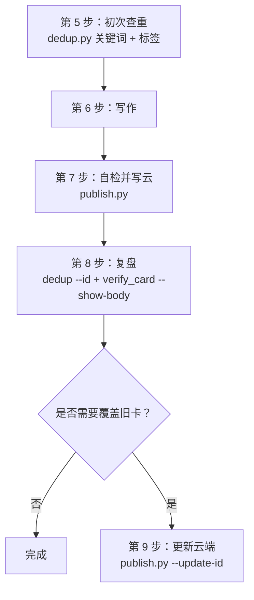
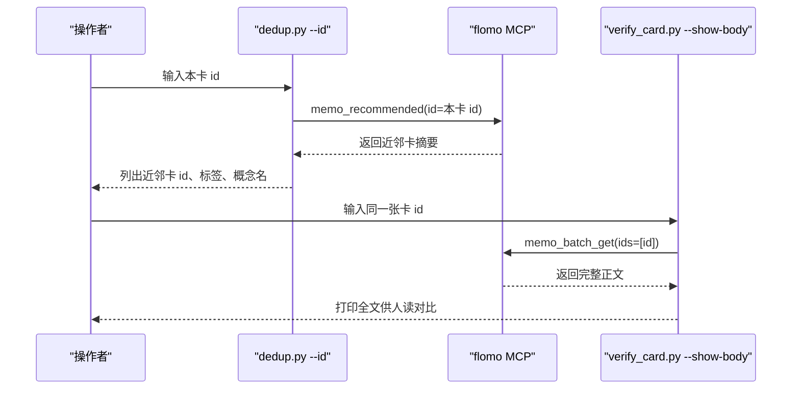
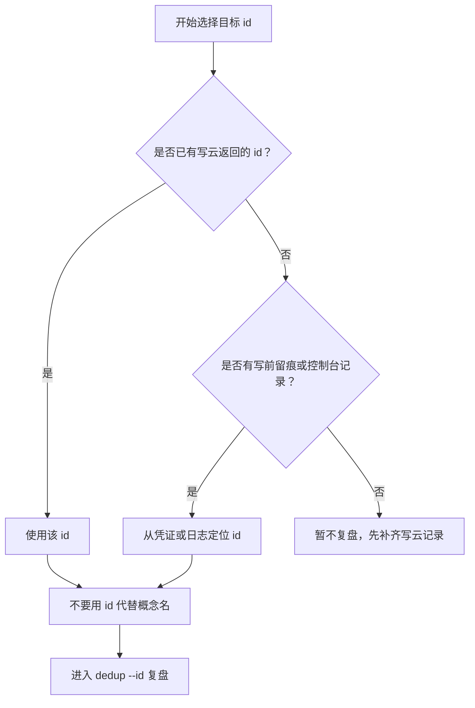
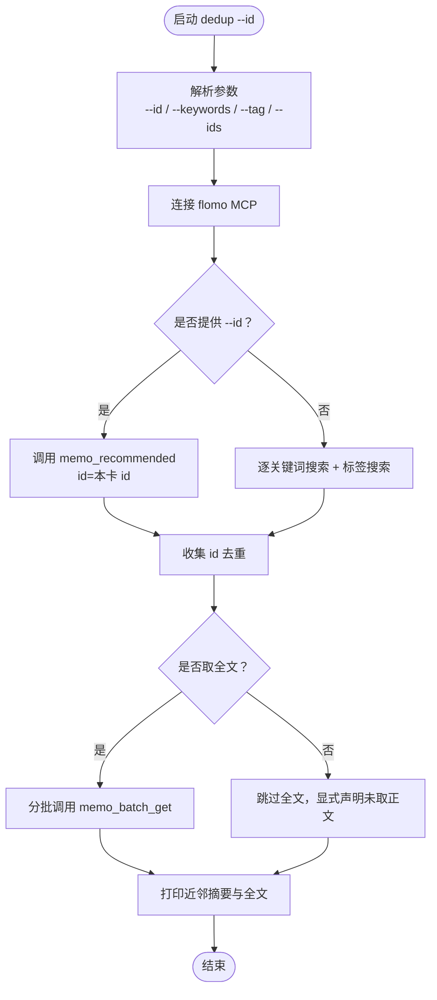
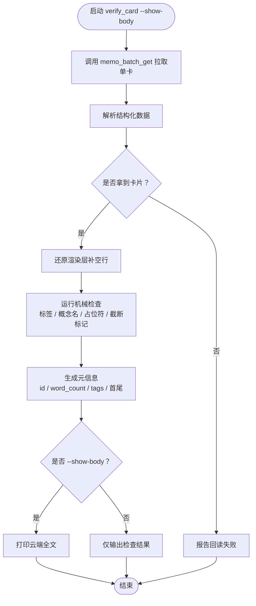
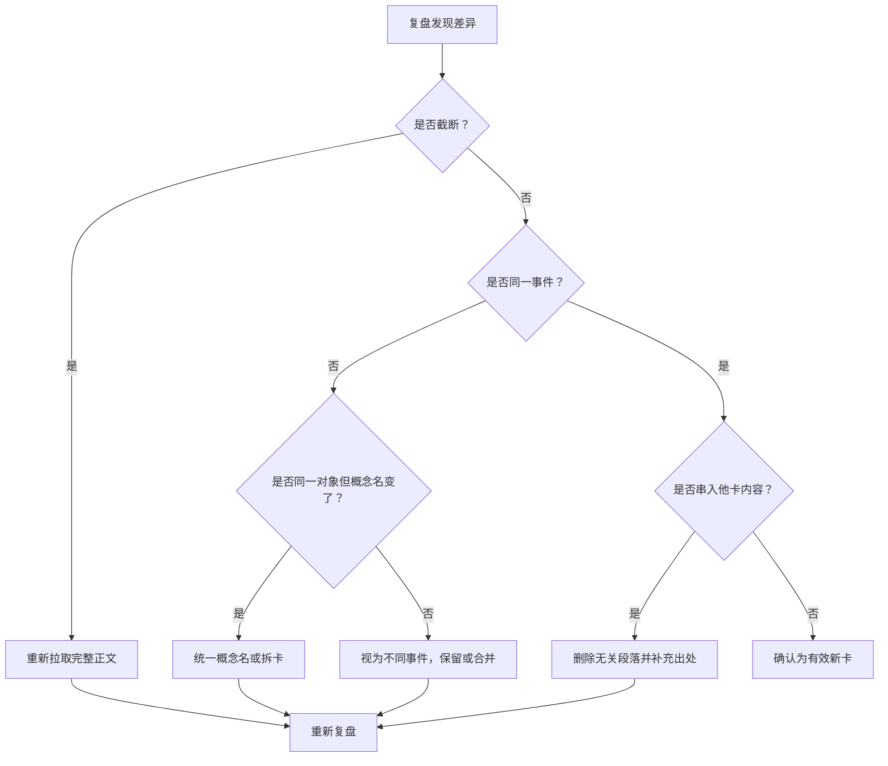

# 3.10 复盘（dedup --id + verify_card --show-body）

<cite>
**本文引用的文件**   
- [README.md](file://README.md)
- [dedup.py](file://scripts/dedup.py)
- [test_dedup.py](file://tests/test_dedup.py)
- [verify_card.py](file://scripts/verify_card.py)
- [test_verify_card.py](file://tests/test_verify_card.py)
</cite>

## 目录
1. [引言](#引言)
2. [复盘在 SOP 中的位置](#复盘在-sop-中的位置)
3. [复盘目的与总流程](#复盘目的与总流程)
4. [何时需要复盘](#何时需要复盘)
5. [如何选择目标 id](#如何选择目标-id)
6. [第一步：用 dedup --id 确认是否重复](#第一步用-dedup--id-确认是否重复)
7. [第二步：用 verify_card --show-body 拉取云端正文](#第二步用-verify_card--show-body-拉取云端正文)
8. [差异解读与处理建议](#差异解读与处理建议)
9. [复盘结果记录方法](#复盘结果记录方法)
10. [常见问题排查](#常见问题排查)
11. [结论](#结论)

## 引言
本 SOP 第 8 步复盘，是写云之后、最终更新云端之前的最后一道人读防线。它的核心任务只有两个：

- 用 `dedup.py --id` 确认新卡是否与已有内容重复；
- 用 `verify_card.py --show-body` 拉取云端真实全文，做“首尾是否同一事件、是否串入他卡内容”等无法机械判断的人读核对。

该步骤不是新增命令，而是把之前已经存在的查重与回读能力组合成一条固定顺序：**先查近邻，再拉正文，最后由人做结论**。

## 复盘在 SOP 中的位置
根据项目说明，写卡流程包含 9 个阶段，其中第 5 步是初次查重，第 8 步是定向复盘，第 9 步是更新既有卡片。

**图示来源**
- [README.md:39-60](file://README.md#L39-L60)

**章节来源**
- [README.md:39-60](file://README.md#L39-L60)

## 复盘目的与总流程
复盘要回答三个问题：

1. **这张卡是不是另一张卡的重复？**  
   通过 `dedup.py --id <本卡 id>` 调用推荐接口，拿到与本卡最相关的近邻卡清单。
2. **云端正文和草稿是否一致？**  
   通过 `verify_card.py --show-body` 直接打印云端全文，避免只看列表截断版。
3. **如果概念名变了，是该改名还是拆卡？**  
   通过对比近邻卡的概念名与正文边界，判断是“概念漂移”“主题合并”还是“真正新增”。

**图示来源**
- [dedup.py:144-173](file://scripts/dedup.py#L144-L173)
- [verify_card.py:114-146](file://scripts/verify_card.py#L114-L146)

**章节来源**
- [dedup.py:1-36](file://scripts/dedup.py#L1-36)
- [verify_card.py:1-38](file://scripts/verify_card.py#L1-38)

## 何时需要复盘
以下情况必须执行第 8 步复盘：

| 场景 | 为什么需要复盘 | 重点核对项 |
|---|---|---|
| 刚写完一张新卡 | 写前查重只做了关键词与标签检索；写后还需确认推荐近邻 | 首尾是否同一事件、是否混入其他卡 |
| 写的是既有卡片覆盖 | 必须先确认覆盖对象身份，再看覆盖后的正文差异 | 概念名是否仍指向同一对象 |
| 初查命中很多卡 | 数量多不代表都重复，需按 id 定向复查 | 哪些是同一事件、哪些只是同主题 |
| 怀疑云端正文被截断 | 列表页可能只显示摘要，不能据此判定内容完整 | 用 `--show-body` 拉完整正文 |
| 概念名出现变化 | 可能是概念演进、主题合并或误判 | 对比概念名漂移方向与正文边界 |

这些场景的共同点是：**机器可以给出候选，但“是否同一事件”必须由人读完正文后决定**。

**章节来源**
- [README.md:39-60](file://README.md#L39-L60)
- [verify_card.py:11-38](file://scripts/verify_card.py#L11-L38)

## 如何选择目标 id
目标 id 必须是**当前正在复盘的那张卡**的 id，而不是草稿文件名、不是上一张卡、也不是随机复制来的字符串。

选择规则如下：

1. **优先使用写云成功后返回的 id**  
   这是 publish 流程写入云端后确定的唯一标识，也是 dedup 推荐路需要的参数。
2. **若没有成功返回，则从复盘前的留痕中查找**  
   例如写前闸门凭证、草稿路径、控制台新建响应等能稳定关联到那张卡的位置。
3. **不要把 id 当成概念名或标题**  
   id 是系统标识，概念名才是人类可读的主题词；两者可能不同，尤其当发生概念名漂移时。
4. **不要凭记忆手抄一位 id**  
   dedup 文档明确警告：此前靠手抄 id 可能指向另一张卡，违反 H5 禁止手抄 id 的要求。
5. **如果不确定是哪张卡，先用 `verify_card.py --json --id <可疑 id>` 快速校验**  
   这比直接跑 `--show-body` 更轻量，适合先确认 id 是否存在、标签与概念名是否符合预期。

**图示来源**
- [dedup.py:1-36](file://scripts/dedup.py#L1-36)

**章节来源**
- [dedup.py:1-36](file://scripts/dedup.py#L1-36)

## 第一步：用 dedup --id 确认是否重复
### 命令含义
`dedup.py --id <本卡 id>` 走的是“复盘路”，调用的是推荐接口，而不是普通关键词搜索。它的作用是找出系统认为与本卡最相关的近邻卡。

推荐参数为 `id=<本卡 id>`，并可配合 `--limit` 控制返回数量。默认 `--limit` 为 10，可根据近邻数量调整。

### 输出结构
dedup 的输出分为三部分：

| 部分 | 含义 | 用途 |
|---|---|---|
| 推荐结果摘要 | 每张近邻卡的 id、字数、标签、概念名前 48 字 | 快速判断是否像同一事件 |
| 全文区块 | 按 id 分段打印完整正文 | 人读比对首尾、概念名、正文边界 |
| 未读告警 | 超出 `--max-full` 时列出的 id | 提醒仍需点名读取 |

### 关键行为
- 每个关键词单独调一次，不合并掩盖；复盘路则是按本卡 id 定向推荐。
- 去重后分批取全文，服务端单次上限 10 张。
- `--ids` 点名读取不受 `--max-full` 限制，适合只复查几张特定近邻卡。
- 云端调用失败时退出码为 1，且不会伪装成“无命中”。
- 同时给 `--id` 和 `--keywords` 时，两路都会执行，不再静默吞掉关键词路。

**图示来源**
- [dedup.py:38-143](file://scripts/dedup.py#L38-L143)
- [test_dedup.py:168-203](file://tests/test_dedup.py#L168-L203)

**章节来源**
- [dedup.py:1-36](file://scripts/dedup.py#L1-36)
- [dedup.py:38-143](file://scripts/dedup.py#L38-L143)
- [dedup.py:144-173](file://scripts/dedup.py#L144-L173)
- [test_dedup.py:168-203](file://tests/test_dedup.py#L168-L203)

## 第二步：用 verify_card --show-body 拉取云端正文
### 命令含义
`verify_card.py --show-body --id <本卡 id>` 的作用是：

1. 调用 `memo_batch_get` 拉取这张卡的完整正文；
2. 还原渲染层补的空行，使第二行对应概念名；
3. 打印云端原文，供人读核对“首尾是否同一事件”“是否串入他卡内容”；
4. 同时做可机械判断的形态检查，并把“须人读”的两项明确列出。

### 输出要点
verify_card 的输出不是单纯正文，而是“机械检查 + 元信息 + 全文”的组合：

| 输出项 | 作用 | 复盘关注点 |
|---|---|---|
| 机械检查项 | 标签段、概念名、占位符、截断标记等 | 是否全部通过 |
| 元信息 | id、word_count、tags、首行、第二行、末行等 | 概念名是否与预期一致 |
| 云端全文 | `--show-body` 才打印 | 人读首尾与近邻卡对比 |
| 人工判断项 | 脚本无法自动判断的两项 | 必须填写结论 |

### 重要细节
- 云端会在标签段后补一个空行，因此概念名实际落在第三行；脚本会还原这一层差异，但字符对账口径保持与写路径一致，不把平台差异算进内容。
- 如果正文来自检索回包的截断版本，会出现“截断占位符”，此时正文中段永久缺失，不能当作正常卡通过。
- 默认构造客户端时会解包 `(token, 来源)`，避免离线替换客户端时出错。
- 支持 `--json` 输出，便于自动化消费检查结果。

**图示来源**
- [verify_card.py:39-113](file://scripts/verify_card.py#L39-L113)
- [verify_card.py:114-146](file://scripts/verify_card.py#L114-L146)
- [test_verify_card.py:35-115](file://tests/test_verify_card.py#L35-L115)

**章节来源**
- [verify_card.py:1-38](file://scripts/verify_card.py#L1-38)
- [verify_card.py:39-113](file://scripts/verify_card.py#L39-L113)
- [verify_card.py:114-146](file://scripts/verify_card.py#L114-L146)
- [test_verify_card.py:35-115](file://tests/test_verify_card.py#L35-L115)

## 差异解读与处理建议
### 无变化
**现象**  
- dedup 推荐结果很少，或推荐的都是明显不同的事件；
- verify_card 机械检查全部通过；
- 云端正文与草稿概念名一致，首尾仍是同一事件；
- 没有串入其他卡的内容。

**处理建议**  
- 记录“已复盘，无重复，无需覆盖”；
- 如本次只是写云，可直接进入后续收尾；
- 如本次是覆盖旧卡，且概念名与正文均无实质变化，应拒绝无意义覆盖。

### 概念名漂移
**现象**  
- 本卡概念名与近邻卡概念名相似但不完全相同；
- 正文主题相近，但侧重点、时间范围、适用条件发生变化；
- 机械检查通过，但人读发现“同一对象换了称呼”或“概念边界扩大/缩小”。

**处理建议**  
- 如果本质仍是同一对象，优先统一概念名，并在变更处注明原因；
- 如果主题已经分裂为两个独立概念，应拆成两张卡，而不是继续拼在同一张卡里；
- 如果只是措辞优化，保持原概念名，避免因为同义词漂移制造重复卡；
- 在复盘记录中标注“概念名漂移方向”和“是否保留同一对象”。

### 正文被截断
**现象**  
- verify_card 报“回读完整（未被截断）”失败，或检测到“截断占位符”；
- 列表页能看到大致内容，但中间缺一段；
- 字数可能看似合理，但语义不完整。

**处理建议**  
- 立即使用 `memo_batch_get` 重新拉取完整正文；
- 不要基于截断版判断“内容已足够”；
- 如果正文是从检索回包中被截断的版本覆盖的，必须修复后再复盘；
- 记录“原始来源是否检索回包”“是否已换用完整正文”。

### 疑似串入他卡内容
**现象**  
- 近邻卡中有高度相似的段落；
- 本卡末尾突然跳到另一个事件；
- 概念名与正文主体不一致。

**处理建议**  
- 把近邻卡和本卡并列打开，逐段核对；
- 如果是拼接错误，删除无关段落并补充出处；
- 如果是多个事件，拆卡或改为系列笔记；
- 在复盘记录中标注“是否串入他卡”以及“已删除或拆分的内容”。

### 近邻很多但并非重复
**现象**  
- dedup 推荐出多条结果；
- 每条都是同主题下的不同角度；
- 概念名、事件边界、时间或载体不同。

**处理建议**  
- 不要因为数量多就删卡；
- 逐条判断“是否同一事件”；
- 对确实重复的卡，优先合并而非保留多张近似卡；
- 对非重复的近邻卡，记录其关系，有助于后续标签与概念名治理。

**图示来源**
- [verify_card.py:39-113](file://scripts/verify_card.py#L39-L113)
- [dedup.py:144-173](file://scripts/dedup.py#L144-L173)

**章节来源**
- [verify_card.py:39-113](file://scripts/verify_card.py#L39-L113)
- [dedup.py:144-173](file://scripts/dedup.py#L144-L173)

## 复盘结果记录方法
复盘不应只在屏幕上看完就结束。建议把结果记录到本地日志或评审清单中，至少包含以下内容：

| 字段 | 说明 |
|---|---|
| 目标 id | 本次复盘对应的云端卡片 id |
| 草稿路径 | 对应本地草稿文件，便于回溯 |
| 复盘时间 | 方便审计与排序 |
| 推荐近邻数 | dedup 返回的近邻卡数量 |
| 是否重复 | 是 / 否 / 部分重复 |
| 是否串入他卡 | 是 / 否 |
| 概念名状态 | 无变化 / 漂移 / 分裂 / 统一 |
| 正文是否完整 | 是 / 否，若否说明已重拉 |
| 人读结论 | 一句话总结“同一事件、不同事件、需合并、需拆分”等 |
| 后续动作 | 无 / 覆盖旧卡 / 拆卡 / 改概念名 / 清理正文 |

### 最小记录模板
建议采用表格或清单形式，每条复盘一行，便于以后扫描“谁在什么时候复盘了哪张卡”。

| 目标 id | 草稿 | 复盘时间 | 近邻数 | 重复 | 串入他卡 | 概念名状态 | 正文完整 | 人读结论 | 后续动作 |
|---|---|---|---:|---|---|---|---|---|---|
| `xxxxxx` | `_tmp/memo_body_*.txt` | `YYYY-MM-DD HH:MM` | 3 | 否 | 否 | 无变化 | 是 | 同一事件，内容有效 | 无 |
| `yyyyyy` | `_tmp/memo_body_*.txt` | `YYYY-MM-DD HH:MM` | 5 | 部分 | 是 | 漂移 | 是 | 前半段重复，后半段为新视角 | 拆分 |

### 与脚本输出的对应关系
- `dedup --id` 的输出用于填写“近邻数”“是否重复”“是否串入他卡”；
- `verify_card --show-body` 的输出用于填写“正文是否完整”“概念名状态”“人读结论”；
- 如果使用了 `verify_card --json`，可将机械检查项复制到评审清单作为“机器已通过”的证据；
- 如果使用了 `verify_card --draft`，可在记录中附加“云端与草稿逐字比对结果”，但不要把平台差异误写成内容差异。

**章节来源**
- [dedup.py:144-173](file://scripts/dedup.py#L144-L173)
- [verify_card.py:114-146](file://scripts/verify_card.py#L114-L146)

## 常见问题排查
### 提示未找到 flomo token
- 说明还没有配置 `.mcp.json` 或环境变量；
- 所有脚本在未找到 token 时会以非 0 退出；
- 先解决凭据，再跑复盘。

### dedup 退出码为 1
- 表示云端调用未完成，不是“无命中”；
- 不要据此进入判定或写云；
- 检查网络、代理、token 或重试。

### 推荐结果为空
- 可能是 limit 太小；
- 也可能是本卡太新或标签/关键词不足以触发推荐；
- 仍可继续用 `verify_card --show-body` 拉正文做最终人读。

### verify_card 报“未返回卡片”
- 表示回包中没有 memos；
- 可能 id 错误、卡片不存在、或协议回包形态异常；
- 先核对 id，再用 `--json` 查看原始诊断。

### 概念名在云端变成第三行
- 这是渲染层在标签段后补空行的正常现象；
- 不是缺概念名；
- verify_card 已还原该差异，不应据此误判。

### 正文看起来完整但仍有截断占位符
- 这说明正文曾被检索回包的截断版本覆盖；
- 即使结尾完好、字数够，也不能信任；
- 必须换用 `memo_batch_get` 拉完整正文并重写。

**章节来源**
- [README.md:27-37](file://README.md#L27-L37)
- [dedup.py:174-220](file://scripts/dedup.py#L174-L220)
- [verify_card.py:39-113](file://scripts/verify_card.py#L39-L113)
- [test_verify_card.py:115-320](file://tests/test_verify_card.py#L115-L320)

## 结论
SOP 第 8 步复盘不是额外负担，而是把“机器查重”和“人读核对”缝合在一起的关键一步：

- `dedup --id` 负责找近邻，回答“有没有重复候选”；
- `verify_card --show-body` 负责拉真文，回答“云端正文到底长什么样”；
- 人读负责回答“是不是同一事件”“是否串入他卡”“概念名是否漂移”；
- 最终结论应落到本地日志或评审清单，成为可审计、可追溯的复盘证据。

只要坚持这条顺序，就能避免“只看列表摘要”“手抄 id 指向错卡”“用截断正文冒充完整正文”等历史问题。