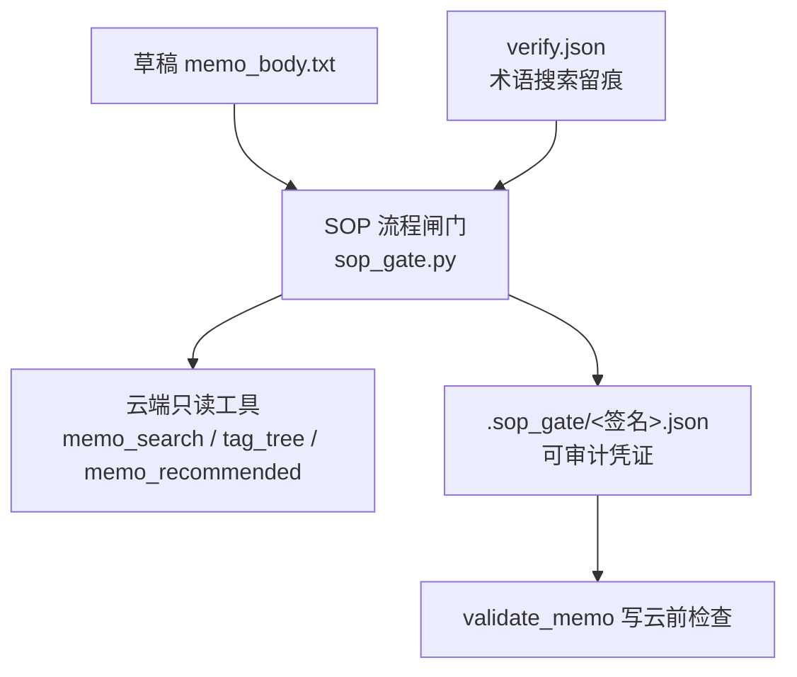
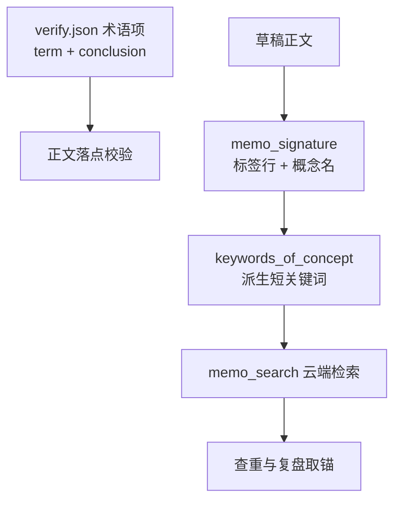
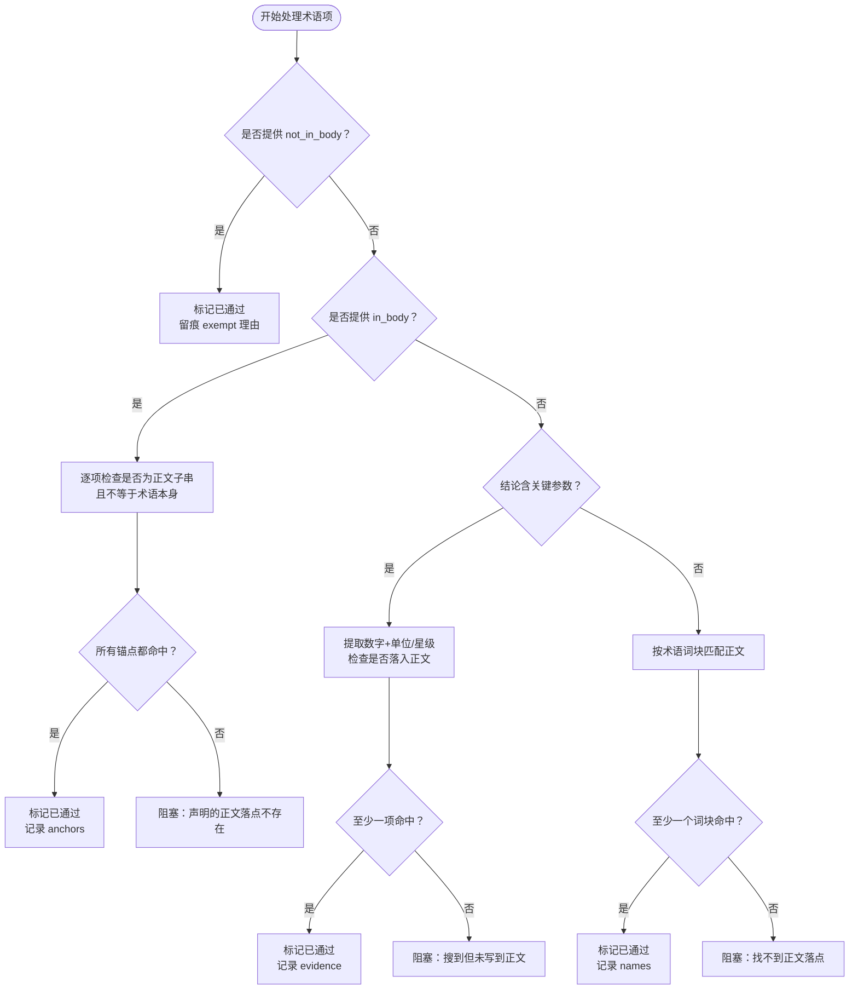
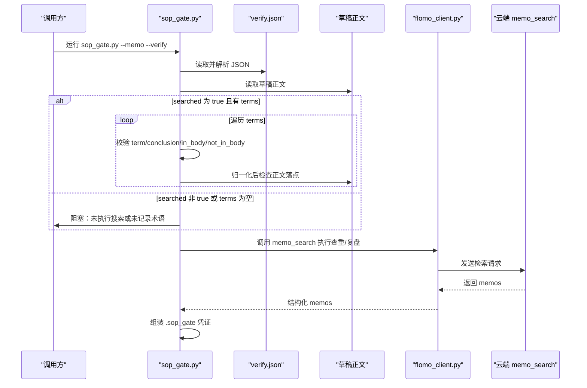

# 3.2 术语验证（search + verify.json）

<cite>
**本文引用的文件**   
- [README.md](file://README.md)
- [scripts/sop_gate.py](file://scripts/sop_gate.py)
- [scripts/memo_util.py](file://scripts/memo_util.py)
- [scripts/validate_memo.py](file://scripts/validate_memo.py)
- [scripts/flomo_client.py](file://scripts/flomo_client.py)
- [tests/test_sop_gate.py](file://tests/test_sop_gate.py)
</cite>

## 目录
1. [引言](#引言)
2. [在 SOP 中的定位](#在-sop-中的定位)
3. [调用入口与白名单](#调用入口与白名单)
4. [概念名来源与检索关键词](#概念名来源与检索关键词)
5. [verify.json 字段含义](#verifyjson-字段含义)
6. [判定规则与数据流](#判定规则与数据流)
7. [三种情形的命令示例与恢复方式](#三种情形的命令示例与恢复方式)
8. [故障排查](#故障排查)
9. [结论](#结论)

## 引言
本节说明 SOP 第 2 步“术语验证”的机械实现：对需要现查的概念名，通过云端 `memo_search` 工具确认其是否存在，并把搜索留痕写入 `verify.json`；随后由 SOP 流程闸门校验这份记录，最终生成 `.sop_gate/<签名>.json` 凭证。文档重点覆盖调用入口、输入来源、返回结果判定、`verify.json` 字段，以及“概念已存在 / 不存在 / 搜索失败”三类情形的处理。

## 在 SOP 中的定位
SOP 中“靠自觉”的检查型步骤被收敛为一次代跑与出凭证过程，其中第 2 步“验证”负责网络搜索留痕，第 5 步“查重”负责两路并查，第 8 步“复盘”负责推荐卡核验。`verify.json` 是第 2 步的审计证据，不是 SOP 凭证本身；真正让写云侧识别“第 2 步已做”的是 `.sop_gate` 下的凭证。



**图表来源**
- [scripts/sop_gate.py:1-60](file://scripts/sop_gate.py#L1-L60)
- [scripts/sop_gate.py:480-594](file://scripts/sop_gate.py#L480-L594)
- [scripts/validate_memo.py:1-20](file://scripts/validate_memo.py#L1-L20)

**章节来源**
- [scripts/sop_gate.py:1-60](file://scripts/sop_gate.py#L1-L60)
- [README.md:61-61](file://README.md#L61-L61)

## 调用入口与白名单
术语验证的实际执行入口是 `sop_gate.py` 的“② 验证”逻辑。它不直接接受任意用户输入，而是读取调用方提供的 `--verify <verify.json>`，并对该 JSON 进行严格结构校验。

### 命令行参数
| 参数 | 作用 | 约束 |
|---|---|---|
| `--memo <正文路径>` | 提供待提交卡片正文，用于核对术语是否落进正文 | 必须提供 |
| `--verify <verify.json>` | 提供第 2 步术语搜索留痕 | 术语卡必须提供；非术语卡可用 `--skip-web` 显式跳过 |
| `--skip-web` | 声明当前卡片主体不是专业术语等，无需第 2 步验证 | 会在凭证中留痕 `web_skipped=true` |
| `--anchor-id` | 指定第 8 步复盘锚点 id | 更新场景常用 |
| `--out` | 自定义凭证输出位置 | 默认写入仓库 `.sop_gate` |

### 云端工具白名单
`console_cloud.py` 把 MCP 只读能力暴露给控制台层，但术语验证走的是 `sop_gate.py` 直接调用的云端接口。本脚本使用的只读工具包括：

| 工具 | 用途 |
|---|---|
| `memo_search` | 按关键词检索卡片，用于术语验证、查重、复盘取锚 |
| `tag_tree` | 获取标签树，用于标签存在性核对与查重标签路 |
| `memo_recommended` | 按锚点 id 返回推荐笔记，用于第 8 步复盘 |

这些工具都经过白名单保护：不在允许集合中的工具名会被拒绝。

**章节来源**
- [scripts/sop_gate.py:20-58](file://scripts/sop_gate.py#L20-L58)
- [scripts/sop_gate.py:480-594](file://scripts/sop_gate.py#L480-L594)
- [scripts/console_cloud.py:1-60](file://scripts/console_cloud.py#L1-L60)

## 概念名来源与检索关键词
术语验证并不从 `verify.json` 里反向推断概念名；相反，它从两个地方分别拿到“要核什么”和“怎么搜”。

### 概念名来源
| 来源 | 用途 | 说明 |
|---|---|---|
| `verify.json` 的 `terms[].term` | 术语名称 | 每条术语记录必须有 `term` 和 `conclusion` |
| 草稿正文的第二行概念名 | 查重与签名 | 由 `memo_signature` 统一解析首行标签段与第二行概念名 |
| `keywords_of_concept(concept)` | 检索短关键词 | 整行概念名含全角标点时容易搜不到，因此退化为核心词 |

`memo_signature` 定义“签名 = 首行标签行 + 第二行概念名”，兼容本地草稿无空行与云端回读有插入空行的两种形态。`keywords_of_concept` 则从概念名派生最多两个短关键词：最长连续中文段（≥4 字），以及去除标点后前 8 个字符。

### 为什么区分“术语名”和“概念名”
- `verify.json` 里的 `term` 是“术语验证项的名称”，用于审计和正文落点比对。
- 草稿第二行的概念名是 SOP 签名的组成部分，也用于查重、凭证指纹、幂等保护。
- 两者可能相同，也可能不同；例如一个术语条目对应多个草稿卡，或术语名只是对外称呼。



**图表来源**
- [scripts/memo_util.py:1-30](file://scripts/memo_util.py#L1-L30)
- [scripts/memo_util.py:60-80](file://scripts/memo_util.py#L60-L80)
- [scripts/sop_gate.py:480-594](file://scripts/sop_gate.py#L480-L594)

**章节来源**
- [scripts/memo_util.py:1-30](file://scripts/memo_util.py#L1-L30)
- [scripts/memo_util.py:60-80](file://scripts/memo_util.py#L60-L80)
- [scripts/sop_gate.py:350-420](file://scripts/sop_gate.py#L350-L420)

## verify.json 字段含义
`verify.json` 是调用方在完成第 2 步网络搜索后手工落盘的审计记录。SOP 闸门要求它具备以下结构：

| 字段 | 类型 | 必填 | 含义 |
|---|---|---|---|
| `searched` | 布尔值 | 是 | 必须为 `true`，表示确实执行了云端搜索 |
| `terms` | 数组 | 是 | 至少包含一条术语核实记录 |
| `terms[].term` | 字符串 | 是 | 术语名称 |
| `terms[].conclusion` | 字符串 | 是 | 搜索结论 |
| `terms[].in_body` | 字符串数组 | 否 | 显式声明的正文落点片段 |
| `terms[].not_in_body` | 字符串 | 否 | 声明该术语不应写入正文的理由 |
| `terms[].query` | 字符串 | 可选 | 原始搜索查询，供审计追溯 |
| `terms[].in_body` 额外字段 | 字符串数组 | 可选 | 已在正文中命中的关键参数片段，便于审计 |

### 判定优先级
对每个术语项，SOP 闸门按以下顺序判断“是否已落到正文”：

1. **显式豁免**：若提供 `not_in_body`，该项视为已通过审核，但会随凭证留痕。
2. **显式落点**：若提供 `in_body`，每项必须是正文真实子串，且不能等于术语本身或包含于术语本身；全部命中才算通过。
3. **关键参数**：若 `conclusion` 能提取出数字+单位或评级类关键参数，则至少一项须出现在归一化后的正文中。
4. **术语词块**：纯命名类核实时，术语本身的 ASCII/中文词块至少有一个须出现在正文中。
5. **未落点**：以上都不满足，该项阻塞。



**图表来源**
- [scripts/sop_gate.py:200-260](file://scripts/sop_gate.py#L200-L260)

**章节来源**
- [scripts/sop_gate.py:20-58](file://scripts/sop_gate.py#L20-L58)
- [scripts/sop_gate.py:200-260](file://scripts/sop_gate.py#L200-L260)

## 判定规则与数据流
术语验证的完整数据流如下：



**图表来源**
- [scripts/sop_gate.py:480-594](file://scripts/sop_gate.py#L480-L594)
- [scripts/flomo_client.py:320-410](file://scripts/flomo_client.py#L320-L410)

### 成功条件
SOP 闸门放行需要同时满足：

| 条件 | 说明 |
|---|---|
| `verify.json` 存在且可解析 | 非法 JSON 直接阻塞 |
| `searched` 为布尔 `true` | 字符串 `"false"`、数字 `0` 不算通过 |
| `terms` 非空 | 未记录任何术语核实结果即阻塞 |
| 每条术语都有 `term` 和 `conclusion` | 缺任一字段即阻塞 |
| 术语正文落点校验通过 | 见上一节判定优先级 |
| 标签核对通过 | 写错标签会阻塞，新建二级仅提示 |
| 查重两路都跑了 | 关键词检索与标签近邻都必须有结果 |
| 复盘取锚成功 | 可通过 `--anchor-id`、关键词、标签簇或阻塞 |

**章节来源**
- [scripts/sop_gate.py:200-260](file://scripts/sop_gate.py#L200-L260)
- [scripts/sop_gate.py:480-594](file://scripts/sop_gate.py#L480-L594)

## 三种情形的命令示例与恢复方式

### 情形一：概念已存在
**现象**  
`memo_search` 返回包含目标概念的卡片，`verify.json` 中 `searched=true`，术语结论与正文落点均通过。

**命令示例**
```bash
python scripts/sop_gate.py --memo memo_body.txt --verify verify.json
```

**恢复方式**  
通常无需恢复。若仍阻塞，应优先检查：
- `verify.json` 是否合法 JSON；
- `searched` 是否为布尔 `true`；
- 术语是否真的落进正文；
- 标签是否写错；
- 查重或复盘是否因取锚失败而阻塞。

**章节来源**
- [README.md:287-288](file://README.md#L287-L288)
- [scripts/sop_gate.py:480-594](file://scripts/sop_gate.py#L480-L594)

### 情形二：概念不存在
**现象**  
`memo_search` 未找到该术语，或搜索结果不足以支撑结论；`verify.json` 中 `searched=true`，但术语结论无法证明“概念存在”，或者结论未落进正文。

**命令示例**
```bash
python scripts/sop_gate.py --memo memo_body.txt --verify verify.json
```

**恢复方式**
1. 先在云端用 `memo_search` 确认概念是否真的存在。
2. 若确实不存在，应重新构造术语：
   - 修正概念名，避免切片限定、谓语动作或来源标注；
   - 确保 `verify.json` 的 `term` 与 `conclusion` 反映真实搜索结果；
   - 将结论的关键参数或术语词块写进正文；
   - 如确实不该写入正文，使用 `not_in_body` 显式豁免并写明理由。
3. 重新运行闸门，直到 `.sop_gate/<签名>.json` 生成。

**章节来源**
- [scripts/sop_gate.py:200-260](file://scripts/sop_gate.py#L200-L260)
- [scripts/memo_util.py:60-80](file://scripts/memo_util.py#L60-L80)

### 情形三：搜索失败
**现象**  
云端工具调用失败、token 缺失、网络异常、协议回包变化导致结构化数据取不到，或 `verify.json` 本身损坏。此时不应把“搜索失败”伪装成“概念不存在”。

**命令示例**
```bash
python scripts/sop_gate.py --memo memo_body.txt --verify verify.json
```

**恢复方式**
1. 先修复底层问题：
   - 确认 token 可用；
   - 确认网络连接正常；
   - 确认 `verify.json` 是合法 UTF-8 文本；
   - 确认云端工具仍可调用。
2. 若 `verify.json` 损坏或缺失，重新执行第 2 步搜索并重新落盘。
3. 若云端协议变化导致结构化数据解析失败，应先修复客户端解析逻辑，而不是静默降级为“无结果”。
4. 对于非术语卡，可使用 `--skip-web` 显式跳过第 2 步验证，但会在凭证中留痕。

**章节来源**
- [scripts/sop_gate.py:480-594](file://scripts/sop_gate.py#L480-L594)
- [tests/test_sop_gate.py:220-231](file://tests/test_sop_gate.py#L220-L231)

## 故障排查
| 症状 | 可能原因 | 排查建议 |
|---|---|---|
| 提示“未提供第 2 步验证记录” | 未传 `--verify` | 术语卡必须提供 `verify.json`；非术语卡加 `--skip-web` |
| 提示“验证记录文件不存在” | `verify.json` 路径错误或未生成 | 检查相对路径与工作目录 |
| 提示“验证记录非法 JSON” | `verify.json` 语法错误、编码异常 | 用标准 JSON 编辑器检查 |
| 提示“searched 必须为布尔 true” | 值为字符串、数字或其他真值 | 改为 JSON 布尔 `true` |
| 提示“验证记录 terms 为空” | 未记录任何术语 | 至少添加一条 `term` + `conclusion` |
| 提示“术语在正文中找不到落点” | 结论没写进正文，或 `in_body` 无效 | 把关键参数或术语词块写入正文 |
| 提示“标签写错” | 标签与现有写法只差空白/全半角/大小写 | 改回现有标签写法 |
| 提示“标签不在树中” | 二级标签不存在 | 新建二级属常态，注意相近名语义判断 |
| 复盘取锚失败 | 关键词无命中、标签簇无卡、未传 `--anchor-id` | 明确传入最接近卡的 id |

**章节来源**
- [scripts/sop_gate.py:200-260](file://scripts/sop_gate.py#L200-L260)
- [scripts/sop_gate.py:480-594](file://scripts/sop_gate.py#L480-L594)

## 结论
术语验证在 SOP 中的核心职责不是替人判断“这个词对不对”，而是强制完成三件事：

1. 对需要现查的概念名，实际调用云端 `memo_search` 进行搜索；
2. 把搜索行为与结论写入 `verify.json`，作为可审计留痕；
3. 由 SOP 闸门校验留痕的真实性，并进一步校验术语是否写进了正文。

`verify.json` 是中间审计证据，`.sop_gate/<签名>.json` 才是写云侧识别“第 2 步已完成”的最终凭证。三者共同保证：漏做搜索、只做搜索不写正文、或搜索失败却静默放行，都无法绕过 SOP 闸门。